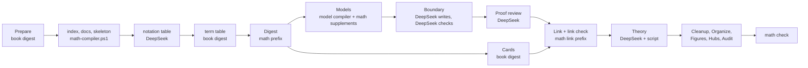

# Mathematical Cards: Design as Built

Status: built on branch `math-cards` (zt 0.19.0, 2026-10-16). Tested on scratch archives only. No digest ran with it yet, and the live archive did not change. The text follows ASD-STE100 (Simplified Technical English) as the other design documents do.

`math-cards-proposal.md` (revision 2) gives the reasons: the learning model, the attention tiers, the study order, and the link network. This document records what the branch builds, where it differs from the proposal, and what it does not build yet.

## Source Authority

- `CONTEXT.md` defines Math form, Unit, Result, Theory Card, Cited premise, Reach-in, Crux step, Load, Dependency order, Study order, and Book notation table. It also changes Emphasis, Relation kind, Building block, and Self-sufficient model.
- `math-cards-proposal.md` holds the reasons and the open questions.
- `zt-math-digest-workflow.md` describes the workflow and how to run it.
- `self-sufficient-models-proposal.md`, `model-elaboration-levels-design.md`, and `model-compiler-design.md` stay authoritative for every model rule that this design does not change.

## What changed in ZT

| Area | Change |
| --- | --- |
| Storage | New column `math_form` (theory, definition, axiom, theorem, proposition, lemma, corollary). `zt up` adds the column to an older archive. A new archive keeps a CHECK that only a Model Card without a facet has a form. `model::set` clears the form when a Card stops being a Model Card. |
| Module | `src/math.rs`: `MathForm`, the facet roles of a unit, labels, sections of a body, the unit report, and the theory report. |
| Build report | `build.cited` lists each rests-on Link to the Model Card of a unit, or to a Card titled `符号表…`. Such a Link is no closure fault. `build.reach_in` lists each rests-on Link to a part of another unit. A reach-in makes the model not self-sufficient. |
| `get_model` | Adds `form` and `math`. For a unit, `math` holds labels, tiers, core parts, the crux, the budget, faults, theories, load, `building_block`, `used_by`, and `study`. For a Theory Card, it holds the units in dependency order with weight and load, `main_results`, `objects`, `cycle`, `forward`, `tools`, `users`, `faults`, and `study`. |
| Relation kinds | New kind `specializes` (`特例`, `特殊情形`, `special case`, `specializ…`). Rests-on adds `按定义`, `cites`, and `by definition`/`by theorem`/`by lemma`/`by proposition`/`by corollary`/`by axiom`. Contrasts adds `逆命题`. |
| MCP | `create_successor` and `edit_card` take `form`. `get_card`, `get_tree`, and `search_cards` report it. `search_cards` filters by `form`, with an empty query. The server instructions and the `get_model` description name the math reports. |
| GUI | The card JSON carries `form`. A unit's stamp reads `theorem · L2 formal`. The command bar takes `mf <form|none>`. The create and edit endpoints take `form`. |
| Session | `mf <form|none>`. The Card view shows `[model · theorem · formal]`. |
| Dump | `archive.json` adds `forms`. |

### Fixed numbers

| Constant | Value | Meaning |
| --- | --- | --- |
| `CORE_BUDGET` | 3 | the most `core` chunks of a unit. The first example and the first non-example of a definition count as one. |
| `MAIN_RESULTS` | 7 | the most main results of a Theory Card |
| `HIGH_LOAD` | 3 | a unit cited by this many units or models takes one tier more attention on the theory board |
| companions | 3 | the most companions of a study station |

## What changed in the scripts

| File | Change |
| --- | --- |
| `math-compiler.ps1` (new) | The steps index, docs, skeleton, notation, notation-apply, boundary, boundary-apply, boundary-settle, proof, proof-apply, theory, theory-apply, and check. |
| `model-compiler.ps1` | Takes `-BriefDoc`, `-FillDoc`, and `-ReviewDoc`. A plan may start a formal unit's main line with `前提`. A premise that is the Model Card of a unit passes validation. Nothing else changed. |
| `list-models.ps1` | Each model names its `form`. |
| `model-architect-math.md` (new) | The architect's math supplement: levels, facets, the attention budget, the crux, cited premises, examples and exercises. |
| `dsh-math-*.zh.md` (new) | The DeepSeek supplements for the digest, the link pass, the brief, the fill, and the review. The instructions of the notation, boundary, boundary review, proof review, and theory jobs. |
| `make-math-workflow.mjs` (new) | Generates `.claude/workflows/zt-math-digest.js` from `zt-book-digest.js`. |

### One standard for both workflows

The user asked that the math workflow keep the book digest's standards for Card quality, Links, hubs, and the DeepSeek protocol. Two rules hold this:

1. **The math prompts append, they do not replace.** `math-compiler.ps1 -Step docs` writes each math prompt file as the shared instruction file followed by its math supplement. A rule of the shared file applies unchanged. The supplement says where it adds to it.
2. **A script makes the math workflow.** `make-math-workflow.mjs` takes `zt-book-digest.js` and makes 14 named edits. Every other line is the book digest's own text. That text holds the DeepSeek Subagent Managed Protocol pool, the managers, the card cycles, the link check, Organize, Figures, Hubs, and the Audit. `math-workflow-harness.mjs` fails when the committed `zt-math-digest.js` differs from the generator's output. It also checks that the shared stages build the same 26 commands in both workflows.

### Derivation explanations

The branch merges `model-compiler` at `fc7dfba` (doc/derivation-explanations-proposal.md). A Derivation part of a unit has the five sections 思路, 起点, 步骤, 结果, and 解读, as in every other model. R15 to R17 check them. The math fill supplement gives a proof step (`证明：…`) the same order: 思路, 起点, 论证 with 说明 lines, and 结果. The crux step adds 解读. Mode `explain` of the book digest is also a mode of the math workflow.

## Differences from the proposal

| Proposal | As built | Reason |
| --- | --- | --- |
| Rests-on adds `应用` and `由定理`-like words | Only `按定义` and English words. Proofs cite with the existing `依赖` and `基于`. | A read-only scan of the live archive found 66 Links after `应用` and 10 after `由命题`. Adding them changed the kind of Links in finished MWG models, and `由命题 6.B.3 [[49|a|a|2]]` became a new closure fault (the `来自` lesson of 0.18.1). `按定义` has no hit. |
| D9: a script template plans short proofs | The Sonnet architect plans every formal unit. | A template needs the proof's steps, which only the brief knows. The pilot measures the cost first. |
| The model compiler's reviewer checks proofs | A separate proof review (`math-compiler.ps1 proof`) checks the proof plan, every `证明：…` step, and the conclusion. The compiler's reviewer checks the Derivation parts, with the math review supplement. | The compiler reviews Derivation chains only. A proof step that is not a Derivation part would go unchecked. |
| M9: every symbol is in the notation table | The check reports a formal result with no symbol table in its premises. A Link to the notation table also counts. | A symbol-by-symbol check of TeX gives too many false faults. |
| M15 and M18 | The proof review checks M15 (titles state the proof in outline). M18 is in the architect's and the writer's instructions. No script checks it. | Both need judgment. |
| GUI: theory board, study desk, face-down cards, label chips, tool tabs | Only the stamp and the `mf` command. `get_model` already returns everything the views need (`math.study`, `math.order`, tiers, tools). | The views are a GUI project of their own (see "Not built yet"). |

## The workflow

See `zt-math-digest-workflow.md`. In short:

## Verification

| Test | What it shows |
| --- | --- |
| `cargo test` (all suites) | The Math form, cited premises, reach-in, the unit and theory reports, and the study stations. The new kinds, the schema, the dump manifest, and the Session help line. `tests/math_units.rs` builds one chapter and checks every report. The chapter holds an axiom of another theory, a definition, a lemma, the intermediate value theorem with its proof, a corollary, and two Theory Cards. |
| `scripts/book-digest/tests/math-compiler.tests.ps1 -Zt <debug zt.exe>` | 47 checks: every math-compiler step on a two-chapter fixture book in a scratch archive, with stand-in DeepSeek answers. It also checks that `model-compiler.ps1 validate` accepts a unit's plan that starts with 前提 and cites another unit. |
| `scripts/book-digest/tests/math-workflow-harness.mjs` | 22 checks. The generator check. The order of the math stages. The math prompts and instruction files. No Theory Card in the model compiler. The protocol: every manager deletes, none archives, at most 8 managers and 8 jobs each. The shared commands. Mode `math`. |
| `scripts/book-digest/tests/workflow-harness.mjs` | Unchanged and passing: the book digest still runs as before. |

I read the live archive once, read-only, to measure the effect of candidate relation words. I wrote nothing to it.

## Not built yet

- **The GUI views** of the proposal: the theory board, laid out by dependency and weight, and the study desk with stations. Also face-down cards in Review mode, label chips, and tool tabs in Look up mode.
- **A pilot digest** of a real textbook. It changes the slip-box, so it waits for the user's go-ahead and choice of book (proposal question Q4).
- **Linking the economics books to the new units** (proposal Q6).
- **A record of what a reader studied** (proposal Q7).
