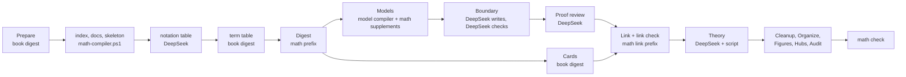

# Mathematical Cards: Design as Built

Status: built on branch `math-cards` (zt 0.19.0, 2026-10-16). Tested on scratch archives only. No digest ran with it yet, and the live archive did not change. The text follows ASD-STE100 (Simplified Technical English) as the other design documents do.

`math-cards-proposal.md` (revision 2) gives the reasons: the learning model, the attention tiers, the study order, and the link network. This document records what the branch builds, where it differs from the proposal, and what it does not build yet.

## Source Authority

- `CONTEXT.md` defines Math form, Unit, Result, Theory Card, Cited premise, Reach-in, Crux step, Load, Dependency order, Study order, and Book notation table. It also changes Emphasis, Relation kind, Building block, and Self-sufficient model.
- `math-cards-proposal.md` holds the reasons and the open questions.
- `zt-math-digest-workflow.md` describes the workflow and how to run it.
- `self-sufficient-models-proposal.md`, `model-elaboration-levels-design.md`, and `model-compiler-design.md` stay authoritative for every model rule that this design does not change.

## What changed in ZT

| Area | Change |
| --- | --- |
| Storage | New column `math_form` (theory, definition, axiom, theorem, proposition, lemma, corollary). `zt up` adds the column to an older archive. A new archive keeps a CHECK that only a Model Card without a facet has a form. `model::set` clears the form when a Card stops being a Model Card. |
| Module | `src/math.rs`: `MathForm`, the facet roles of a unit, labels, sections of a body, the unit report, and the theory report. |
| Build report | `build.cited` lists each rests-on Link to the Model Card of a unit, or to a Card titled `符号表…`. Such a Link is no closure fault. `build.reach_in` lists each rests-on Link to a part of another unit. A reach-in makes the model not self-sufficient. |
| `get_model` | Adds `form` and `math`. For a unit, `math` holds labels, tiers, core parts, the crux, the budget, faults, theories, load, `building_block`, `used_by`, and `study`. For a Theory Card, it holds the units in dependency order with weight, load, `cites` (all premises in the theory), and `statement_cites` (the premises of the Model Card and its `前提` parts), `main_results`, `objects`, `cycle`, `forward`, `tools`, `users`, `faults`, and `study`. |
| Relation kinds | New kind `specializes` (`特例`, `特殊情形`, `special case`, `specializ…`). Rests-on adds `按定义`, `cites`, and `by definition`/`by theorem`/`by lemma`/`by proposition`/`by corollary`/`by axiom`. Contrasts adds `逆命题`. |
| MCP | `create_successor` and `edit_card` take `form`. `get_card`, `get_tree`, and `search_cards` report it. `search_cards` filters by `form`, with an empty query. The server instructions and the `get_model` description name the math reports. |
| GUI | The card JSON carries `form`. A unit's stamp reads `theorem · L2 formal`. The command bar takes `mf <form|none>`. The create and edit endpoints take `form`. The theory board, the study desk, label chips, and tool tabs (see "The GUI views"). |
| Session | `mf <form|none>`. The Card view shows `[model · theorem · formal]`. |
| Dump | `archive.json` adds `forms`. |

### Fixed numbers

| Constant | Value | Meaning |
| --- | --- | --- |
| `CORE_BUDGET` | 3 | the most `core` chunks of a unit. The first example and the first non-example of a definition count as one. |
| `MAIN_RESULTS` | 7 | the most main results of a Theory Card |
| `HIGH_LOAD` | 3 | a unit cited by this many units or models takes one tier more attention on the theory board |
| companions | 3 | the most companions of a study station |

## What changed in the scripts

| File | Change |
| --- | --- |
| `math-compiler.ps1` (new) | The steps index, docs, skeleton, notation, notation-apply, boundary, boundary-apply, boundary-settle, proof, proof-apply, theory, theory-apply, and check. |
| `model-compiler.ps1` | Takes `-BriefDoc`, `-FillDoc`, and `-ReviewDoc`. A plan may start a formal unit's main line with `前提`. A premise that is the Model Card of a unit passes validation. Nothing else changed. |
| `list-models.ps1` | Each model names its `form`. |
| `model-architect-math.md` (new) | The architect's math supplement: levels, facets, the attention budget, the crux, cited premises, examples and exercises. |
| `dsh-math-*.zh.md` (new) | The DeepSeek supplements for the digest, the link pass, the brief, the fill, and the review. The instructions of the notation, boundary, boundary review, proof review, and theory jobs. |
| `make-math-workflow.mjs` (new) | Generates `.claude/workflows/zt-math-digest.js` from `zt-book-digest.js`. |

### One standard for both workflows

The user asked that the math workflow keep the book digest's standards for Card quality, Links, hubs, and the DeepSeek protocol. Two rules hold this:

1. **The math prompts append, they do not replace.** `math-compiler.ps1 -Step docs` writes each math prompt file as the shared instruction file followed by its math supplement. A rule of the shared file applies unchanged. The supplement says where it adds to it.
2. **A script makes the math workflow.** `make-math-workflow.mjs` takes `zt-book-digest.js` and makes 14 named edits. Every other line is the book digest's own text. That text holds the DeepSeek Subagent Managed Protocol pool, the managers, the card cycles, the link check, Organize, Figures, Hubs, and the Audit. `math-workflow-harness.mjs` fails when the committed `zt-math-digest.js` differs from the generator's output. It also checks that the shared stages build the same 26 commands in both workflows.

### Derivation explanations

The branch merges `model-compiler` at `fc7dfba` (doc/derivation-explanations-proposal.md). A Derivation part of a unit has the five sections 思路, 起点, 步骤, 结果, and 解读, as in every other model. R15 to R17 check them. The math fill supplement gives a proof step (`证明：…`) the same order: 思路, 起点, 论证 with 说明 lines, and 结果. The crux step adds 解读. Mode `explain` of the book digest is also a mode of the math workflow.

## Differences from the proposal

| Proposal | As built | Reason |
| --- | --- | --- |
| Rests-on adds `应用` and `由定理`-like words | Only `按定义` and English words. Proofs cite with the existing `依赖` and `基于`. | A read-only scan of the live archive found 66 Links after `应用` and 10 after `由命题`. Adding them changed the kind of Links in finished MWG models, and `由命题 6.B.3 [[49|a|a|2]]` became a new closure fault (the `来自` lesson of 0.18.1). `按定义` has no hit. |
| D9: a script template plans short proofs | The Sonnet architect plans every formal unit. | A template needs the proof's steps, which only the brief knows. The pilot measures the cost first. |
| The model compiler's reviewer checks proofs | A separate proof review (`math-compiler.ps1 proof`) checks the proof plan, every `证明：…` step, and the conclusion. The compiler's reviewer checks the Derivation parts, with the math review supplement. | The compiler reviews Derivation chains only. A proof step that is not a Derivation part would go unchecked. |
| M9: every symbol is in the notation table | The check reports a formal result with no symbol table in its premises. A Link to the notation table also counts. | A symbol-by-symbol check of TeX gives too many false faults. |
| M15 and M18 | The proof review checks M15 (titles state the proof in outline). M18 is in the architect's and the writer's instructions. No script checks it. | Both need judgment. |
| GUI: a lemma that a step cites is a companion with a "new" mark | The lemma is a tool tab with a "new" mark. Its statement comes out of the box when the reader opens the tab. | A companion takes one of the three places beside the focus. The tab costs no place until the reader asks for it. |
| GUI: Review mode shows `直觉` and examples as support | Review mode takes the Why and Boundary stations of Learn mode, face down, between the statement and the exercises. Their companions stay as in Learn mode. | One study order serves both modes. `math.study` has no separate Review stations. |

## The GUI views

The views read only `get_model`'s `math` report. They change no Card. `src/gui/layout.js` holds the pure parts: `theoryRows` (the rows of the theory board), `studyStations` (the stations of one reading mode), `theoryRun` (the stations of a whole theory), and `labelsIn` (the labels a text names). `src/gui/app.js` draws them. Each new CSS class starts with `tb-`, `sd-`, `lchip`, `ttab`, or `pullout`. No class of the Map, the Table, or the search tray changed.

| View | Where | What it shows |
| --- | --- | --- |
| Theory board | Below a Theory Card in the reader. Below a unit, folded under "In theory", with that unit open. | The units by dependency: each unit one row below the deepest unit it cites, under the mean place of those units. A unit with the weight `focus` is a full card. A `support` unit is a smaller card. A lemma with the weight `detail` is a slim slip between the results it connects. A corollary that follows from one result alone, and that no unit cites, hangs under that result. An axiom lies on a bottom row. The tools of other theories are tabs on the left edge. The theories that use this one (`后续`) are tabs on the right edge. Below the board, the study path lists each main result after the units it needs. A click on a stop starts the theory run on the study desk at that unit. |
| Degree of interest | Theory board | The open unit is lifted. The units it cites and the units that cite it keep full ink, and their threads are drawn in the model colour. The main results, the theory objects, and the units with the weight `focus` keep their ink. All other units recede to their form and one line of title. When the pointer is on a unit, that unit is the open unit until the pointer leaves the board. |
| Study desk | Key `s` or the button Study on any Card of a unit or on a Theory Card. A stop of a study path. | One station of `math.study` at a time, over the whole window. The focus Card lies in the centre, lifted. A contrast pair lies side by side. At most three companions lie beside the focus. The Derivation slips of a step (`details`) lie under the focus and unfold on a click. All other Cards of the unit lie in a "+N" stack at the edge. The stack fans out on a click, and a Card from it comes out of the box (as a tool tab does). A track of dots shows the passes and the stations. The crux station has an accent dot and an accent edge. Keys: ← and → move between stations, Space turns the focus over, 1, 2, and 3 set the reading mode, Esc puts the Cards back in the box. |
| Motion | Study desk | A Card that stays from one station to the next slides to its new place. A new Card comes off the stack. A Card that leaves goes back onto the stack. Each motion takes about 0.35 s. A face-down Card turns over about its vertical axis in 0.55 s. The reduced-motion setting of the system removes the motion. |
| Reading modes | A switch on the desk and on the theory board. The GUI keeps the last choice. | Learn: the stations of `math.study` without the recall pass. The proof-plan station shows the tool tabs of all steps. A proof step lies face down until the reader turns it. Review: the statement face down, then the Why and Boundary stations face down, then the exercises face down. On the theory board, each main result lies face down with its title. The first click turns it over and shows the statement. Look up: one station with the statement and its chips only, and every tool of the proof. |
| Statement and motive | Study desk, tool tabs | The GUI reads the bold labels of the Model Card's body. A Model Card in Look up mode, a Model Card as a companion, and the Model Card of another unit show only the `陈述`, `定义`, or `公理` section. Without such a section they show the body without `动机`, `思路`, `结构`, and `来源`. Before the station that has the statement as its focus, the Model Card as a companion shows only its `动机`. |
| Label chips | The statement of a unit in the reader, on the desk, and on a tool. | Each `(H1)` or `（C2）` becomes a chip. When the reader points at a chip, the Cards of the unit that name the label lift: the model board's slips in the reader, and the Cards, slips, and stacked Cards on the desk. A Card linked from a hypothesis role (`假设作用：H2`) also takes its label, so the counterexample lifts with it. The Card that holds the chip stays in place. On the desk, the statement's chips mark (accent colour) the labels that the focus uses and the clause that a non-example beside it fails. A Card that names labels shows them as small chips in its header. |
| Tool tabs | Bottom edge of the desk, left edge of the theory board. | A cited premise of the station (`tools`). A lemma (`just_in_time`) has a "new" mark. A click brings the unit half out of the box in Look up mode: the statement and its chips. A second click, the × button, or Esc drops it back. A tab held down for more than 0.35 s drops the unit back when the reader lets go. |
| Theory run | Key `s` or the button Study on a Theory Card. A stop of the study path starts the run at that unit. | The theory's study passes as one sequence of stations (layout.js `theoryRun`). Learn: Orient (the Theory Card, its first main results beside it), then for each main result its prerequisite path and the result itself (the path follows all premises of a result or definition, but only the statement premises of a lemma, because a lemma comes just in time and its proof premises come with it), each unit by its own Meet, Why, and Boundary stations, then Connect (the Theory Card, up to three theories that use it, its tools as tabs), then Recall (each main result face down). A unit's own Connect and Recall passes are left out of the run. Review: the Review stations of each main result. Look up: the Theory Card with its first main results. The track groups the dots by unit (its form and title) and names the theory's own passes. The bar shows where the reader stands: the theory, then the unit on the desk. At a theory station, the stack holds the theory's other units. |
| Lemma inside a step | The tool tab of a lemma, on the desk. | The pulled-out lemma has the button Study its proof. The lemma's own stations then take the desk (its Connect pass is left out), and its Cards come out of the pulled-out lemma. The track starts with a Lemma mark, and the bar adds the lemma after the unit of the step. Next on the lemma's last station, Back on its first station, the button Back to the step, and Esc each return to the same step. The lemma's Cards go back under its tab. A lemma that the lemma cites can open in the same way. A lemma that is already open, or the unit on the desk, does not offer the button. |

### Checks

- The views were tried in the browser pane on a scratch archive: a copy of the debug exe, `ZT_CONFIG_DIR` in the scratchpad, and `ZT_GUI_PORT=4799`. A node script built the chapter of `tests/math_units.rs` through `zt mcp`, with longer bodies (a motive, a statement, a second non-example, and an example of the theorem). The live archive did not change.
- Each station of the theorem and of the definition in Learn, Review, and Look up mode. The turn of a face-down step. The chips C2 and H1 in the reader and on the desk. The tool tab of the lemma. The theory board on the Theory Card and folded under a unit. Light and dark themes. A window 700 px wide (one column, no horizontal scroll).
- The Map with `x` on the scratch tree, unfolded and folded: no two `.node` boxes overlap.
- The theory run through all 15 stations of the scratch theory (Orient, the definition, the theorem, Connect, Recall), and Review and Look up of the run. From the crux step, Study its proof on the lemma's tab: the lemma's three stations, then back to the crux step, face down as before.

## The workflow

See `zt-math-digest-workflow.md`. In short:

## Verification

| Test | What it shows |
| --- | --- |
| `cargo test` (all suites) | The Math form, cited premises, reach-in, the unit and theory reports, and the study stations. The new kinds, the schema, the dump manifest, and the Session help line. `tests/math_units.rs` builds one chapter and checks every report. The chapter holds an axiom of another theory, a definition, a lemma, the intermediate value theorem with its proof, a corollary, and two Theory Cards. |
| `scripts/book-digest/tests/math-compiler.tests.ps1 -Zt <debug zt.exe>` | 47 checks: every math-compiler step on a two-chapter fixture book in a scratch archive, with stand-in DeepSeek answers. It also checks that `model-compiler.ps1 validate` accepts a unit's plan that starts with 前提 and cites another unit. |
| `scripts/book-digest/tests/math-workflow-harness.mjs` | 22 checks. The generator check. The order of the math stages. The math prompts and instruction files. No Theory Card in the model compiler. The protocol: every manager deletes, none archives, at most 8 managers and 8 jobs each. The shared commands. Mode `math`. |
| `scripts/book-digest/tests/workflow-harness.mjs` | Unchanged and passing: the book digest still runs as before. |

I read the live archive once, read-only, to measure the effect of candidate relation words. I wrote nothing to it.

## Not built yet

- **A pilot digest** of a real textbook. It changes the slip-box, so it waits for the user's go-ahead and choice of book (proposal question Q4).
- **Linking the economics books to the new units** (proposal Q6).
- **A record of what a reader studied** (proposal Q7).
