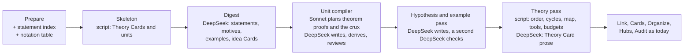

# Mathematical Cards: Proposal

Status: proposal, revision 2 (2026-10-15). Built in part on branch `math-cards` (zt 0.19.0): see
`math-cards-design.md` for what is built and where it differs. The text follows ASD-STE100 (Simplified Technical English) as the other design documents do.
Card text in the examples is in Chinese and follows the Card language rules.

Revision 2 adds three things to revision 1. It gives each unit an **attention design**: what a reader
must see, what supports it, and what recedes. It turns the study order into **stations** with an
attention budget. It adds a **link network** that ties theories, concepts, and building blocks together.

The `zt-book-digest` workflow digests economics books well. Their unit is the **model**: a question, a
setting, a derivation, and a result. A mathematics textbook has a different unit. It builds a
**theory** from definitions, axioms, and results, and each result has a proof. Later proofs use earlier
results as tools. Examples, counterexamples, and exercises give the definitions their meaning.

This proposal adds a mathematical layer to the Model Card. It adds these things:

1. A **learning model**: fourteen principles from research on how people learn mathematics and on
   limited attention. Each principle decides one part of the structure.
2. One property on the Model Card, the **Math form**: `theory`, `definition`, `axiom`, `theorem`,
   `proposition`, `lemma`, or `corollary`.
3. Three **unit models**: the Theory Card, the Definition model, and the Result model (a statement with
   its proof). Each has a fixed facet set and an **attention design** in three tiers.
4. A **crux step** in each proof: the one step that carries the idea.
5. Three **reading modes** (Learn, Review, Look up) and a **study order** made of passes and stations.
   Each station shows one focus Card and at most three companions.
6. A **link network**: cited premises, a concept hierarchy, building blocks across theories, and
   bridges to the economics models.
7. A **Book notation table**, beside the Book term table.
8. Eighteen rules (M1 to M18), checked by ZT, by a script, or by a DeepSeek reviewer.
9. A **math mode** of the book digest, and GUI changes for the theory board and the study desk.

## Decisions

I made these decisions in this proposal. Each one is open for the user to change.

| No. | Question | Decision | Reason |
| --- | --- | --- | --- |
| D1 | New Card types, or a property on the Model Card? | **One property, the Math form, on the Model Card.** A theorem with its proof is one whole model. | One model machinery (build order, board, build report, levels, compiler) serves both kinds of book. Six new Card types change every interface. |
| D2 | Is a proof a separate Model Card? | **No.** The proof is the main line of its Result model. An alternative proof is an off-line part. | A statement and its proof are learnt together. The build order already models a derivation. |
| D3 | What is the reusable unit? | **The statement.** A later proof rests on the Model Card of a result (a **cited premise**), never on a step inside its proof. | This is how mathematicians chunk knowledge. A proved result is a tool. Its proof is not part of every later proof. |
| D4 | What happens to a proof step that two proofs use? | **It becomes a lemma**: its own Result model. | The shared-part rule fits a model. In mathematics, the named lemma is the shared unit. |
| D5 | Is the facet set fixed? | **Fixed for math forms**, free for other models. | Scripts and the GUI must find the proof plan, the hypotheses, and the examples without a guess. |
| D6 | How many elaboration levels? | **The same two.** `concept`: a statement with a proof idea in words, or a result the book does not prove. `formal`: the full proof. | A third level adds a decision to every unit and no new structure. |
| D7 | Who orders a theory? | **A script**, from the cited premises and the book's numbering. | The book's numbering and cross-references give the order. No model must decide it. |
| D8 | May the digest supply an example or a counterexample that the book does not give? | **Yes, marked `（补：书中未给）`**, and a DeepSeek reviewer checks each one. | A definition without a non-example teaches less. A false counterexample teaches harm, so a check is necessary. |
| D9 | Who plans a proof? | **The Sonnet architect** for theorems and propositions with a formal proof. **A script template** for lemmas and corollaries with a proof of at most six steps. | This follows the model compiler roles. A short proof has no structure to plan. |
| D10 | Does this change the economics digest? | **No.** A Model Card without a Math form keeps every current rule. | Finished models stay as built. |
| D11 | Where does attention live? | **In the existing Emphasis.** `core` is the focus tier, no emphasis is the support tier, `aside` is the detail tier. Each facet has a default. | ZT stores emphasis today, and the board inks by it. A new field would duplicate it. |
| D12 | How much may a unit ask for? | **At most three `core` parts per unit**, beside the Model Card. A definition's first example and first non-example count as one. | Working memory holds about four chunks (Cowan 2001). The statement is the fourth. |
| D13 | Are all proof steps equal? | **No. One crux step is `core`.** The other steps are support. Derivation parts are detail. | A reader remembers a proof by its key idea. Routine steps must not compete with it. |
| D14 | Is the emphasis fixed? | **No. The reading mode changes it.** Stored emphasis serves Learn mode. Review and Look up lift other tiers. | What helps a novice hinders an expert (expertise reversal). A proved tool needs only its statement. |
| D15 | When does a learner meet a lemma? | **Just in time**: at the proof step that cites it, with its statement only. Its proof is detail. | A lemma before its use has no motive. Its use is the motive. |
| D16 | How does a unit become a building block? | **By use, computed.** A unit that units of two or more theories cite is a building block. Its **load** (how many units cite it) raises its ink on the theory board. ZT stores none of it. | A book's own name ("lemma") does not tell how much a result carries. Its citations tell it. |
| D17 | How do concepts link to each other? | **By three Links**: a definition rests on the concepts it uses, a narrower concept **specializes** a broader one, and an equivalence is a result. ZT adds the Relation kind `specializes`. | A reader needs the concept hierarchy. No current kind reads "is a special case of". |
| D18 | May an economics model cite a mathematical unit? | **Yes, as a cited premise.** A rests-on Link from any model to a unit's Model Card is not a closure fault. | The economics books cite mathematical tools by name. A Link makes the tool one step away. |

## Source Authority

- `CONTEXT.md` defines Model Card, Model part, Model facet, Emphasis, Relation kind, Build order,
  Derivation part, Derivation chain, Building block, Self-sufficient model, Elaboration level, Hub Card,
  and Book term table. This proposal adds the terms in "Proposed terms" and changes three entries (see
  "Changes to CONTEXT.md").
- `self-sufficient-models-proposal.md` stays authoritative for the build order, the build report,
  Derivation parts, and the Card language rules R1 to R14.
- `model-elaboration-levels-design.md` stays authoritative for the two levels.
- `model-compiler-design.md` stays authoritative for who does which work in the Models stage.
- `open-models-design.md` stays authoritative for membership by Link and for Relation kinds.
- `hub-cards-design.md` stays authoritative for hubs and the register.
- `digest-card-layers-proposal.md` gives the shape that every layer follows: survey, plan, write,
  check, fix, report.
- `derivation-explanations-proposal.md` (open, by another session) adds the sections 思路, 说明, and 解读
  to Derivation parts. If the user accepts it, proof steps and Derivation parts of a proof use the same
  sections. This proposal does not depend on it.
- The GUI principles: easy set-building, limited attention, and physical mapping with motion.

## The problem

The slip-box holds one mathematical book today: `mascolell1995microeconomic` (5,092 Cards, 343
models). Its Cards show where the model structure does not fit mathematics.

1. **A theorem is only a facet.** Propositions appear as parts with facets such as `命题三` and `命题五`
   (`mascolell1995microeconomic/124|a|a|12`, `…|15`). A reader cannot list the results of a chapter.
   No script can find which results a proof uses.
2. **Tools stay outside as plain text.** Derivation parts cite the intermediate value theorem, the
   envelope theorem, the implicit function theorem, and the fundamental theorem of calculus by name
   (`110|a|a|3`, `114|a|a|5`, `124|a|a|10|a`, `147|a|b`). No Card states these results. No Link
   reaches them. The model is self-sufficient only because the check cannot see these premises.
3. **The closure rule forbids the normal case.** Rule 1 of the self-sufficient models proposal says
   that a model rests on parts, never on a whole other Model Card. A mathematical proof does the
   opposite: it rests on a whole earlier result and ignores the proof of that result. In a textbook,
   each proof would then have to add dozens of shared parts as members.
4. **Examples and counterexamples have no fixed place.** A definition needs examples and
   non-examples to have meaning. A theorem needs a counterexample for each hypothesis. The current
   structure lets an author add them, but nothing asks for them or finds them.
5. **Notation grows across the book.** Chapter 9 uses a symbol from chapter 1. The term table of
   one model cannot hold it.
6. **Everything asks for the same attention.** A formal model of 30 parts shows 30 cards of nearly
   equal weight. A theorem, a routine algebra step, and a historical note lie side by side. The reader
   must find the idea of the proof alone.

## The learning model

The structure follows from how people learn mathematics and from the limits of attention. Each
principle below comes from research in mathematics education, cognitive psychology, or information
visualization. The last column says what the Cards must do.

### How mathematics is learnt

| No. | Principle | Source | What the Cards must do |
| --- | --- | --- | --- |
| P1 | **Concept image and concept definition.** A learner holds a formal definition and a separate image of examples, pictures, and properties. Errors come from an image that does not match the definition. | Tall and Vinner (1981) | A Definition model holds the formal statement and an intuition part. It also holds examples and non-examples that test the image against the definition. |
| P2 | **Example spaces and contrast.** A concept is learnt through the range of its examples. A non-example that differs from an example in one feature shows that feature. | Watson and Mason (2005), Marton (2015) | Each core definition has at least one example and one non-example. The first pair differs in one clause (rule M6). |
| P3 | **Process before object.** A learner first does a concept as a procedure. Later the learner treats it as one object to act on. | Dubinsky (APOS, 1991), Sfard (1991) | A worked example, a computation, comes beside the definition. The study order shows it before the abstract statement. |
| P4 | **Chunking.** An expert stores a proved result as one unit and uses it without its proof. | Chase and Simon (1973) | A proof rests on the statement of an earlier result (a cited premise), never on its proof steps (rule M3). |
| P5 | **Learning hierarchy.** A learner can learn a result only after its prerequisites. | Gagné (1962) | The cited premises form a graph without cycles. A script computes the dependency order (rule M4). |
| P6 | **Structured proofs.** A reader understands a proof faster from the top level down: the idea, then the main steps, then the details. | Leron (1983), Lamport (1995) | A Result model has three levels: the proof plan, the proof steps on the main line, and the Derivation parts for the details. |
| P7 | **Hypotheses earn their place.** A reader understands a theorem when the reader knows why each hypothesis is necessary. A counterexample shows it. | Pólya (1945), Lakatos (1976) | Each hypothesis has a number and a proof step that uses it. A counterexample shows what fails without it (rules M2, M5). |
| P8 | **Cognitive load and worked examples.** A novice learns more from a worked example than from a problem. Each step must be small enough to hold in working memory. | Sweller (1988), Renkl (2002) | The Card size rules R13 and R14 hold for proof steps. A worked example is a part. |
| P9 | **Multiple representations.** One concept in two registers (symbols and a picture) gives more understanding than one register. | Duval (2006) | A core unit has an intuition part or a picture part with an HTML chart (rule M7). |
| P10 | **Retrieval practice and self-explanation.** A learner remembers more when the learner recalls a result and explains each step than when the learner reads it again. | Chi et al. (1989), Roediger and Karpicke (2006) | Exercises are parts with a folded answer. The GUI study mode hides each proof step until the reader turns it over. |

### How attention works

| No. | Principle | Source | What the Cards must do |
| --- | --- | --- | --- |
| P11 | **Working memory is small.** A person holds about four chunks at one time. | Cowan (2001) | A unit has at most three `core` parts beside its statement (rule M13). A study station shows one focus Card and at most three companions. |
| P12 | **Signal the essential, and put related things together.** A learner learns more when cues mark what matters. A learner also learns more when a picture lies beside the text it explains. Repeated content costs attention. | Mayer (2009), Chandler and Sweller (1991) | The crux step and the intuition carry `core`. A picture lies beside its statement in the same station. The Model Card does not repeat the proof plan (rule M16). |
| P13 | **Expertise reversal.** Help that a novice needs hinders a reader who already knows the material. | Kalyuga et al. (2003) | Emphasis depends on the reading mode. Look up mode shows only the statement. Review mode hides what the reader must recall. |
| P14 | **Advance organizer and degree of interest.** A reader learns details faster after a short overview of the whole. A view of a large structure shows the focus in full and the rest by its importance and distance. | Ausubel (1960), Furnas (1986) | The Theory Card opens each theory with its question and at most seven main results. The theory board inks each unit by its form, its load, and its distance from the open unit. |

These principles give two rules for the whole design:

- **A unit is a concept image, a formal statement, and the reason it is true.** Its filing lets a reader
  build it from earlier units only.
- **At each moment, one Card is the focus.** At most three Cards support it. Everything else recedes
  but stays in reach.

## Proposed terms

**Math form**:
What mathematical unit a Model Card states: `theory`, `definition`, `axiom`, `theorem`, `proposition`,
`lemma`, or `corollary`. ZT stores it on the Model Card, never on a part. A Model Card without a Math
form is an ordinary model.
_Avoid_: Math type, statement kind, role

**Unit**:
A Model Card with the Math form `definition`, `axiom`, `theorem`, `proposition`, `lemma`, or
`corollary`, and its parts. A unit states one thing: one definition, one axiom, or one result.
_Avoid_: Math card, entry

**Result**:
A unit of the Math form `theorem`, `proposition`, `lemma`, or `corollary`. Its Model Card holds the
statement: numbered hypotheses and a conclusion. Its main line holds the proof.
_Avoid_: Theorem card, claim

**Theory Card**:
A Model Card with the Math form `theory`: the entry point of one theory, normally one chapter. It
states the theory's question, its objects, and its main results. A Link from it to a unit adds that
unit to the theory.
_Avoid_: Chapter Card, hub, structure Card

**Cited premise**:
A rests-on Link from a Card of any model to the Model Card of an earlier unit. The Card uses the
statement as a tool. It is not a closure fault.
_Avoid_: Imported result, external premise

**Reach-in**:
A rests-on Link from a part of one unit to a part inside another unit. It is a fault. The fix makes the
target step a lemma.
_Avoid_: Leak, borrowed step

**Crux step**:
The one proof step that carries the idea of a proof. It has the emphasis `core`, and the proof plan
names it. A long proof may have two.
_Avoid_: Key step, main step, trick

**Label**:
The short name of one hypothesis of a result (H1, H2, …) or one clause of a definition (C1, C2, …). A
proof step, a non-example, or a counterexample cites it.
_Avoid_: Tag, marker

**Load**:
How many units and models cite a unit as a cited premise, across the Workspace. ZT computes it.
_Avoid_: Weight, importance, popularity

**Building block** (changed for units):
A unit that units of two or more theories cite. Its home is the theory that proves it. The other
theories list it as a tool. ZT computes it from the cited premises.
_Avoid_: Library unit, common lemma

**Dependency order**:
The order of the units of a theory: each unit after every unit it cites. The book's numbering breaks
ties. ZT computes it.
_Avoid_: Logical order, prerequisite chain

**Reading mode**:
What the reader does with the Cards now: **Learn** (first study), **Review** (recall from memory), or
**Look up** (use a unit as a tool). The mode decides which tier each Card shows.
_Avoid_: View mode, filter

**Study order**:
The order in which a learner meets the Cards of a unit or a theory in Learn mode. It is a list of
passes. Each pass is a list of stations. ZT computes it from the facets, the emphasis, and the cited
premises. It changes no Location.
_Avoid_: Reading order, learning path

**Station**:
One stop of the study order: one focus Card and at most three companion Cards. Every other Card
recedes.
_Avoid_: Slide, page, step (a step is a part of a proof)

**Book notation table**:
The symbols of one book, each with its meaning and the unit that defines it: a Card titled `符号表…`,
a Side successor of the book's first anchor, beside the Book term table.
_Avoid_: Symbol list, glossary

## The unit models

### Overview

| Math form | Model Card states | Main line (build order) | Off-line parts | Normal level |
| --- | --- | --- | --- | --- |
| `theory` | the question, the objects, the main results, the tools | the units, in dependency order (by Link) | the dependency map, the history | none |
| `definition` | the motive and the definition with labelled clauses | none, or `记号` | `直觉`, `图示`, `例子`, `非例`, `等价刻画` | `concept` |
| `axiom` | the axiom and what it excludes | none | `直觉`, `例子`, `非例` | `concept` |
| `theorem`, `proposition` | the motive and the statement: hypotheses H1 … Hn, conclusion | `前提`, `证明思路`, `证明：…`, `推导：…`, `结论` | `直觉`, `图示`, `假设作用：Hi`, `反例：…`, `另证`, `习题`, `历史` | `formal` when the book proves it |
| `lemma`, `corollary` | the statement | as for a theorem, often one or two steps | `习题` | `formal` when the book proves it |

### Three attention tiers

Every Card of a unit lies in one of three tiers. The tier is the Card's Emphasis. Two more states
apply only in some reading modes.

| Tier | Emphasis | What the reader does with it | How the GUI shows it |
| --- | --- | --- | --- |
| **Focus** | `core` | must see it to have the unit | full ink, lifted, full text |
| **Support** | none | sees it when building the unit | full ink on the desk, title and first lines |
| **Detail** | `aside` | opens it only on demand | a slip: facet and title only, small and pale |
| *Face down* | (mode) | recalls it first, then turns it over | the back of the card, with the title only in Review mode |
| *Folded* | (mode) | does not need it in this mode | a "+N" fold at the edge of the desk |

In Learn mode the Model Card of a unit is always the focus. It does not count in the budget. A unit has at most three
`core` parts (rule M13). This keeps one unit within about four chunks (P11).

### The Theory Card

A Theory Card is the way into one theory. It is a Model Card with the Math form `theory`. It is a Side
successor of the chapter's anchor Card. It acts as an advance organizer (P14). Its body has these
sections:

- `问题`: the question the theory answers, in at most three sentences.
- `主要结果`: the main results, at most seven, each with a Link and one sentence.
- `对象`: the objects it studies, each with a Link to its Definition model.
- `结构`: every unit of the theory, in dependency order. A Link here adds the unit to the theory.
- `所用工具`: the building blocks of other theories that its units cite. A script writes this list.
- `后续`: the theories that cite its units. A script writes this list.
- `图`: the dependency map, an HTML chart that a script draws.
- `来源`.

**Attention in a theory.** The Theory Card holds whole units, not parts. Each unit has an a priori
weight from its form and its load:

| Unit | Weight on the theory board | Reason |
| --- | --- | --- |
| a main result (listed in `主要结果`) | focus | it is why the theory exists |
| a definition of a theory object (listed in `对象`) | focus | every result speaks of it |
| an axiom | support, on the bottom row | it holds the theory up but asks for no proof |
| a proposition | support | a result of the second rank |
| a corollary | support, hung under its theorem | it adds little to its theorem |
| a lemma | detail, a slim slip between the results it connects | its use is its meaning |
| a building block from another theory | detail, a tool tab on the edge | the reader knows it, or looks it up |
| any unit with a high load | one tier up | many units rest on it |

The board then applies the degree of interest (P14). The open unit is the focus. The units it cites and
the units that cite it lift to support. Main results and theory objects keep their own weight. All
other units recede to their form and title. A chapter with more than seven main results becomes two or
more theories, one per section group (rule M17).

A Theory Card is not a Hub Card. A hub states no claim and has no order. A theory has a question and a
dependency order. It is not the book's structure Card either. A structure Card orders the argument of
the whole book.

### The Definition model

A definition needs few Cards. Its Model Card holds the definition itself. Each clause has a label, so a
non-example can name the clause it fails:

```markdown
# 连续：$f$ 在 $x_0$ 连续当且仅当 $\varepsilon$-$\delta$ 条件成立

**动机**：函数图像在 $x_0$ 不断开。本卡用不等式写出这件事。

**定义**：设 $f:A\to\mathbb{R}$。若 (C1) 与 (C2) 都成立，则称 $f$ 在 $x_0$ 连续。
- (C1) $x_0\in A$，即 $f$ 在 $x_0$ 有定义。
- (C2) 对每个 $\varepsilon>0$ 都存在 $\delta>0$，使所有满足 $|x-x_0|<\delta$ 的 $x\in A$ 都有 $|f(x)-f(x_0)|<\varepsilon$。

**结构**：例子 [[book/4|b|b]]。非例 [[book/4|b|c]]。直觉 [[book/4|b|a]]。

基于 [[book/1|b]] 的绝对值。

来源：[[book]] 定义 4.3.1
```

The parts are Side successors of the Model Card. Their tiers:

| Part | Tier | Content |
| --- | --- | --- |
| `例子` (the first) | focus | one object that meets the definition, with the computation that shows it (P3) |
| `非例` (the first) | focus, with the first example | one object that fails exactly one clause, named by its label (P2) |
| `直觉` or `图示` | focus | the concept image in words, and a chart when a picture helps (P1, P9) |
| further `例子` and `非例` | support | more of the example space, each with one new feature |
| `等价刻画` | support | a Link to each result that states an equivalent form |
| `记号` | detail | the symbols the definition adds to the Book notation table |

The first example and the first non-example form a **contrast pair**: they differ in one clause. They
count as one chunk in the budget.

### The Result model

A result is a statement with its proof. The Model Card holds the statement. Each hypothesis has a
label. The Model Card states the proof idea in one sentence only. The `证明思路` part holds the rest
(rule M16).

```markdown
# 介值定理：闭区间上的连续函数取遍两端值之间的每个值

**动机**：连续函数的图像从直线 $y=c$ 一侧走到另一侧时，必须穿过这条直线。

**陈述**：
- (H1) $f$ 在 $[a,b]$ 上连续。
- (H2) $f(a)<c<f(b)$。
- 结论：存在 $x_0\in(a,b)$，使 $f(x_0)=c$。

**思路**：取 $f<c$ 的点集的上确界，再证明它的函数值只能等于 $c$。

**结构**：前提 [[book/4|d|a]]。证明思路 [[book/4|d|a|1]]。…

来源：[[book]] 定理 4.5.1
```

The main line is the proof, at three levels (P6):

1. `前提`: the objects, the hypotheses, and the symbols. This is the setting of the model.
2. `证明思路`: the method, the key idea, the crux step by name, and a numbered list of the top-level
   steps. The method is one of `直接`, `反证`, `逆否`, `归纳`, `构造`, `分情形`, or `对角线`.
3. `证明：…`: one part per top-level step, on the main line, in order. Its title states what the step
   proves. The titles of the main line, read in order, are the proof in outline (rule M15).
4. `推导：…`: Derivation parts and chains, as today, for each step the book skips or compresses.
5. `结论` (optional): the step that closes the proof, when the last step does not state it.

The parts and their tiers:

| Part | Tier | Reason |
| --- | --- | --- |
| `直觉` or `图示` | focus | why the result should be true (P1, P9) |
| `证明思路` | focus | the top level of the proof (P6) |
| the crux `证明：…` step | focus | the idea of the proof (D13) |
| `前提` | support | the statement already shows the hypotheses |
| other `证明：…` steps | support | the second level of the proof |
| `假设作用：Hi` with its `反例` | support | why each hypothesis is necessary (P7) |
| the first `例子` | support | the concrete case before the abstract one (P3) |
| `结论` | support | it closes the main line |
| `推导：…` | detail | the third level: algebra the reader checks on demand (P8) |
| further `例子`, `另证`, `历史`, `记号` | detail | not needed to have the result |
| `习题` | detail in Learn mode, focus in Review mode | retrieval practice (P10) |

The crux step is the step without which the proof plan fails. In the intermediate value theorem it is
the step that uses continuity at the supremum. A proof of three or more steps marks one crux step. A
proof of eight or more steps may mark two (rule M14).

A lemma or a corollary keeps the same parts, but fewer. A short proof (at most six steps) has no
separate proof plan part. Its Model Card's `思路` sentence is the plan.

### The facet set

A part of a unit uses one of these facets, after which a colon and a short name may follow
(`证明：x0 存在`). ZT stores the English spelling for books in English.

| Facet | English | Line | Default emphasis | Principle |
| --- | --- | --- | --- | --- |
| `前提` | `premises` | main, first | none | P5 |
| `记号` | `notation` | main | `aside` | P5 |
| `证明思路` | `proof plan` | main | `core` | P6 |
| `证明` | `proof step` | main | none, `core` for the crux | P6, P12 |
| `推导` | `derivation` | main, slim slip | `aside` | P6, P8 |
| `结论` | `conclusion` | main, last | none | P6 |
| `直觉` | `intuition` | off | `core` | P1, P9 |
| `图示` | `picture` | off | `core` when no `直觉`, else none | P9 |
| `例子` | `example` | side or off | `core` for the first in a definition, else none | P2, P3 |
| `非例` | `non-example` | off | `core` for the first, else none | P2 |
| `反例` | `counterexample` | off | none | P7 |
| `假设作用` | `hypothesis role` | off | none | P7 |
| `等价刻画` | `equivalent form` | off | none | P1 |
| `另证` | `alternative proof` | off | `aside` | P6 |
| `习题` | `exercise` | off | `aside` | P10 |
| `历史` | `history` | off | `aside` | none |

### The Book notation table

The Book notation table holds every symbol of the book, its meaning, and a Link to the unit that
defines it. Prepare writes it, as it writes the Book term table today. A unit uses a symbol only when
the table or the unit itself defines it (rule M9). A symbol with two meanings in the book gets two rows
and a note that names the chapters of each meaning. The table is detail in every mode. A reader opens
it from a symbol.

## Reading modes

The same Cards serve three reading tasks. The task decides the tiers (P13).

| Card | Learn | Review | Look up |
| --- | --- | --- | --- |
| Model Card: statement | focus | face down: the title only, recall the hypotheses and the conclusion | focus, with label chips only |
| Model Card: motive | focus | folded | folded |
| `直觉`, `图示` | focus | support | folded |
| `证明思路` | focus | face down | folded |
| crux step | focus | face down | folded |
| other proof steps | support, face down until turned | face down | folded |
| `推导：…` | detail | folded | folded |
| `假设作用`, `反例` | support | face down: "why H2?" | label chips: point at H2 to see its counterexample |
| `例子`, `非例` | focus (first pair), support | support | folded |
| `习题` | detail | focus | folded |
| cited premises | tool tabs: statement on demand | tool tabs | tool tabs |

**Learn** follows the study order below. **Review** turns the focus Cards face down and asks the reader
to recall them, then to turn them over. **Look up** is the mode of a unit opened from a cited premise in
another proof. The reader needs only the statement and its labels. Everything else folds away. This is
the chunk of P4: a proved result is its statement.

## The study order

The study order is the Learn mode path. ZT computes it. It is a list of **passes**. Each pass is a list
of **stations**. A station shows one focus Card and at most three companions (P11). Every other Card of
the unit recedes. The reader moves to the next station when ready.

### Stations of a Definition

| Pass | Station | Focus | Companions | Principle |
| --- | --- | --- | --- | --- |
| Meet | 1 | the contrast pair: first `例子` and first `非例` | the motive | P2, P3 |
| Meet | 2 | the definition, with clause chips | the contrast pair, the failed clause lit | P1 |
| Meet | 3 | `直觉` or `图示` | the definition | P1, P9, P12 |
| Boundary | 4 … | each further `非例` | the definition, the clause it fails lit | P2 |
| Connect | last | the definition | the broader concept, one narrower concept, the unit with the highest load that cites it | P4, P5 |

### Stations of a Result

| Pass | Station | Focus | Companions | Principle |
| --- | --- | --- | --- | --- |
| Meet | 1 | the first `例子` | the motive | P3 |
| Meet | 2 | the statement, with label chips | `直觉` or `图示` beside it, the example | P1, P9, P12 |
| Why | 3 | `证明思路` | the statement, tool tabs for its cited premises | P6 |
| Why | 4 … | each `证明：…` step, face down, then turned | the step before it, the label chip it uses, its Derivation slips | P6, P10 |
| Why | crux | the crux step, at its place among the steps (its station replaces the ordinary one) | `直觉` again, `证明思路` with the crux named | P12 |
| Boundary | next | each `假设作用：Hi` | its `反例`, the step that uses Hi | P7 |
| Connect | last | the statement | its corollaries, the generalization or special case, the unit with the highest load that cites it | P4 |

A lemma that a step cites appears **just in time** (D15). At that step, its statement lies as a
companion, as a tool tab with a "new" mark. The reader meets its proof only by opening it. Its proof
then runs as its own short study order, and the reader returns to the step.

### Passes of a Theory

| Pass | What the reader meets | Principle |
| --- | --- | --- |
| Orient | the Theory Card: `问题`, then the board with the main results lifted and every other unit receded | P14 |
| Path | for each main result in book order: its **prerequisite path**, then the result itself. The path holds the units the result needs that the reader did not meet yet, in dependency order. Each unit runs its Meet and Why passes. Lemmas come just in time. | P5, P11 |
| Connect | `所用工具` and `后续`: where the theory's tools come from, and which theories use it | P4 |
| Recall | the board with the main results face down: recall each statement from its title | P10 |

The prerequisite path of a main result is every unit it cites, directly or through other units,
inside the theory. Tools from other theories stay as tool tabs. A reader who already knows a unit skips
it. ZT does not record what a reader knows today. Open question Q7 asks whether it should.

## The link network

Theories, concepts, and building blocks link in one network. Each Link states its reason in its
sentence, as every Link does today. Scripts compute the derived lists. Nobody writes them by hand.

### Links a writer makes

| From | To | Words | Relation kind | Meaning |
| --- | --- | --- | --- | --- |
| a step or part of a unit | the Model Card of an earlier unit | `应用`, `依赖`, `按定义` | rests-on | a cited premise: the proof uses this statement |
| a definition | a definition it uses | `基于` | rests-on | the concept uses that concept |
| a narrower definition | a broader definition | `特例`, `加强`, `special case of` | **specializes** (new) | every object of this concept is also an object of that one |
| a broader definition or result | a narrower one | `推广`, `放宽` | relaxes | as today |
| a result | a definition or result it makes equal | `等价` | corresponds | the result proves two forms equal |
| a result | its converse or a weaker form | `逆命题`, `对照` | contrasts | the other claim differs, often false |
| a `反例` part | the unit it refutes | `反例`, `反驳` | objects | it shows a claim false without a hypothesis |
| an `例子` part | the unit it illustrates | `例示` | illustrates | as today |
| a Theory Card | a unit of its theory | its `结构` list | membership | the unit belongs to the theory |
| a Theory Card | another Theory Card | `推广`, `对应`, `对照` | relaxes, corresponds, contrasts | one theory generalizes, parallels, or differs from another |
| a definition in book B | the same definition in book A | `对应` | corresponds | the same concept in two books |
| a part of an economics model | the Model Card of a unit | `应用` | rests-on | a cited premise across books (D18) |

### Lists a script computes

| List | Where it appears | Computed from |
| --- | --- | --- |
| `所用工具` | Theory Card | cited premises from the theory's units to units of other theories |
| `后续` | Theory Card | cited premises from other theories' units to this theory's units |
| dependency map | Theory Card `图` | cited premises inside the theory |
| theory dependencies | the book's structure Card | the `所用工具` lists of all theories |
| load | `get_model` of a unit, the theory board | every cited premise to the unit |
| used by | `get_model` of a unit | the same Links, grouped by theory and by model |
| concept hierarchy | `get_model` of a definition | the specializes and relaxes Links between definitions |

### Building blocks

A unit becomes a building block when units of two or more theories cite it (D16). It stays filed in its
home theory, in the book that proves it. Each other theory lists it in `所用工具`. On another theory's
board, it is a tool tab on the edge, not a member. Its load decides its ink. A unit with a high load
stays legible even far from the focus, because many proofs rest on it.

A building block of one book may serve another book. A second analysis book cites the completeness
axiom of the first book with `应用`. An economics model cites the intermediate value theorem the same
way. The unit's "used by" list then shows every theory and every model that rests on it. A reader of
the theorem sees where it works. A reader of the economics model reaches the tool in one step.

### Concepts and hubs

The hub stage stays as it is, with two rules for math forms:

- A topic hub of a mathematical Topic lists the Theory Cards first, then the main definitions.
- A key term of the register links the term's Definition unit first, when one exists.

So the register reaches a concept in one step, and the concept reaches its theory through the
Theory Card that lists it.

## The rules

| Rule | Statement | Checked by | Fault |
| --- | --- | --- | --- |
| M1 | Each unit has a Math form and states one thing. Its title states the claim in at most 40 characters. | `card-style-check.ps1` | `M1` |
| M2 | A result labels its hypotheses (H1, H2, …) and states its conclusion. A definition labels its clauses (C1, C2, …). | `card-style-check.ps1` | `M2` |
| M3 | A part of a unit rests only on three kinds of Card. They are the parts of its own unit, the Model Card of an earlier unit (a cited premise), and the Book notation table. | ZT build report | `reach_in`, `closure` |
| M4 | The cited premises of a theory form no cycle. The report lists a unit that cites a later-numbered unit. ZT does not refuse it. | ZT build report on the Theory Card | `cycle`, `forward` |
| M5 | Each hypothesis appears in at least one proof step, or the part `假设作用` says why the book keeps it. | `card-style-check.ps1` | `unused_hypothesis` |
| M6 | Each core definition has at least one `例子` part and one `非例` part. The first `非例` names the one clause it fails. | ZT build report, reviewer | `no_example`, `no_nonexample` |
| M7 | Each theorem and each core definition has a `直觉` or `图示` part. Each formal theorem has a `证明思路` part. | ZT build report | `no_intuition`, `no_plan` |
| M8 | The proof plan names its method from the fixed list. A proof step holds at most 12 sentences (R13). A Derivation part holds at most 6 steps (R14). | `card-style-check.ps1` | `M8`, `R13`, `R14` |
| M9 | Each symbol in a unit is in the Book notation table or defined in the unit. | `card-style-check.ps1` | `undefined_symbol` |
| M10 | The digest marks content that the book does not give: `（补：书中略去）` for a step, `（补：书中未给）` for an example or counterexample. A DeepSeek reviewer checks each marked item. | reviewer | `unchecked_supply` |
| M11 | A step that two proofs need becomes a lemma, filed in the first unit's theory. | ZT build report (fix of `reach_in`) | none |
| M12 | An exercise answer stands under `## 答案`. The digest writes an answer only when the book gives one, or when the run allows it and marks it `（补：书中未给）`. | `card-style-check.ps1` | `M12` |
| M13 | A unit has at most three `core` parts. A definition's first example and first non-example count as one. | ZT build report | `over_budget` |
| M14 | A formal proof of three or more steps marks one crux step `core`. A proof of eight or more steps may mark two. The proof plan names each crux step. | ZT build report, reviewer | `no_crux`, `M14` |
| M15 | The titles of the main-line parts, read in order, state the proof in outline. Each title states what its step proves. | reviewer | `M15` |
| M16 | The Model Card states the proof idea in at most one sentence. The `证明思路` part holds the rest. No text repeats in two Cards of a unit. | `card-style-check.ps1` | `M16` |
| M17 | A Theory Card lists at most seven main results. A chapter with more becomes two or more theories. | ZT build report on the Theory Card | `over_budget` |
| M18 | A definition links each concept it rests on. It links its broader concept when the book names one. | reviewer | `M18` |

Rules M6, M7, M13, M14, and M17 report faults. They do not refuse a Card. Rules R1 to R14 of the Card
language apply to every unit without change.

## ZT changes

This section names the changes. It does not specify them in full.

| Area | Change |
| --- | --- |
| Storage | A new column `math_form` on a Model Card without a facet. `zt up` adds it to an older archive. Emphasis needs no change. |
| MCP | `create_successor` and `edit_card` take `form`. `get_card`, `get_tree`, `search_cards`, and `get_model` report it. `search_cards` filters by `form`. |
| Membership | A Link from a Theory Card to the Model Card of a unit adds the whole unit to the theory. |
| Build report | A rests-on Link from any model to the Model Card of a unit is a cited premise, listed in `build.cited`. A rests-on Link into another unit's parts is `reach_in`. On a unit, the report adds `no_example`, `no_nonexample`, `no_intuition`, `no_plan`, `no_crux`, and `over_budget`. |
| Theory report | On a Theory Card, `build.order` is the dependency order. The report adds `cycle`, `forward`, `over_budget`, `tools`, and `users`. |
| Use report | `get_model` of a unit reports `load` and `used_by`, grouped by theory and by model. |
| Relation kinds | A new kind `specializes` (`特例`, `加强`, `special case of`), the converse of relaxes. Rests-on adds `应用`, `按定义`, and `cites`. Objects adds `反例`. Corresponds adds `等价`. |
| Study order | `get_model` reports `study`: the passes and stations of a unit or a theory in Learn mode. |
| Session | The Card view shows `[model · theorem · formal]`. A new command `mf <form\|none>` sets the Math form. |
| Dump | `archive.json` adds `forms`. |

The checks of rules M1, M2, M5, M8, M9, M12, and M16 read Card text. They stay in
`card-style-check.ps1`, as rules R2 to R14 do today. ZT itself does not parse a statement.

## GUI

Every change follows the three GUI principles: easy set-building, limited attention, and physical
mapping with motion.

1. **Theory board.** The Model board of a Theory Card lays out its units by dependency. Each focus unit
   is a full card. Each support unit is a smaller card. Each lemma is a slim slip on the thread between
   its results. Building blocks of other theories are tool tabs on the edge. The degree of interest
   decides the ink: the open unit, its premises, its users, the main results, and the theory objects
   stay legible. The rest recede to their form and title.
2. **Study desk.** In Learn mode the desk shows one station at a time. The focus Card lies in the centre,
   squared up and lifted. Its companions lie beside it, in full ink. Every other Card of the unit lies
   in a "+N" fold at the edge. The next station slides the cards into place, as a hand moves cards on a
   real desk.
3. **Face down.** A proof step in Learn mode, and every focus Card in Review mode, lies face down. The
   reader tries to recall it, then turns it over. The turn follows the motion of a real card (P10).
4. **Label chips.** The statement shows H1 … Hn, and the definition shows C1 … Cn, as chips. When the
   reader points at a chip, the step that uses it and its counterexample or non-example lift.
5. **Tool tabs.** A cited premise in a proof shows as a tab. When the reader opens it, the unit comes
   out of the box halfway in Look up mode: the statement and its chips only. When the reader lets go,
   it drops back.
6. **Stamps.** The stamp of a unit reads `theorem · L2 formal`, `lemma · L2 formal`, or
   `definition · L1 concept`. A building block adds its load, for example `用于 14`.

## The math mode of the book digest

A new workflow argument `genre: "math"` runs the digest in math mode. The stages keep their names and
their order. Each stage keeps the shape survey, plan, write, check, fix, report. The roles follow the
model compiler: scripts build and check, DeepSeek writes and reviews, Sonnet plans proof structure only,
and Haiku relays jobs.



| Stage | Who | What it does |
| --- | --- | --- |
| **Statement index** (end of Prepare) | script `math-index.ps1` | Finds each numbered environment in the Markdown: 定义, 公理, 定理, 命题, 引理, 推论, 例, 习题, 证明, and the English forms. Records its number, its lines, and each cross-reference in it (`由定理 3.2`, `by Lemma 4.1`). Writes `index.json`. |
| **Notation table** (end of Prepare) | script, one DeepSeek job | The script lists symbol candidates from the definitions. DeepSeek chooses the rows. The script writes the Book notation table. |
| **Skeleton** | script | Creates one Theory Card per chapter and one unit Model Card per indexed definition, axiom, and result, with its Math form and its source lines. A script does this, so no unit is lost or made twice. |
| **Digest** | Haiku drives DeepSeek | Each run writes the statements, motives, and proof plans of its group's units. It also writes the `例子` parts the book gives, and Idea Cards for remarks. |
| **Unit compiler** | the model compiler, with math templates | Brief, plan, fill, derive, review, split, as for formal models. The architect's plan names the crux step and each part's emphasis. The reviewer checks that each step is valid, and checks rules M14 and M15. |
| **Hypothesis and example pass** | DeepSeek, then a second DeepSeek | For each theorem, writes `假设作用` parts and the counterexamples. For each core definition, writes the contrast pair when the book gives none. A second DeepSeek job checks each supplied item (rule M10) and deletes each item that fails the check. |
| **Theory pass** | script, one DeepSeek job per theory | The script computes the dependency order, the cycles, the map, `所用工具`, `后续`, and the budgets. It writes the `结构` list. DeepSeek writes `问题`, `主要结果`, and `对象`, and chooses the main results within the budget. |
| **Audit** | `digest-audit.ps1` | Adds the M rules and the build faults of units and theories to the audit. |

### New arguments

| Argument | Meaning | Default |
| --- | --- | --- |
| `genre` | `math` runs math mode. `econ` runs the current digest. | `econ` |
| `proofDepth` | `all`: every proved result is formal. `theorems`: only theorems and propositions are formal, and lemmas and corollaries keep the proof idea only. | `all` |
| `supply` | `none`, `examples`, or `examples+answers`: what the digest may add that the book does not give. Every supplied item carries its mark. | `examples` |
| `planTemplate` | the largest proof (in steps) that takes the script template, not the Sonnet architect | 6 |
| `coreBudget` | the most `core` parts per unit (rule M13) | 3 |
| `mainResults` | the most main results per Theory Card (rule M17) | 7 |

## Worked example: the intermediate value theorem

The example shows the Cards of two chapters of an analysis textbook with the Citation key `book`. The
addresses and numbers are illustrative.

| Address | Math form or facet | Tier | Title |
| --- | --- | --- | --- |
| `book/1\|a` | `theory` | — | 实数理论：完备性使实数轴没有空隙 |
| `book/1\|c` | `axiom` | focus in theory 1 | 完备性公理：有上界的非空实数集有上确界 |
| `book/4` | anchor | — | 第 4 章 函数极限与连续 |
| `book/4\|a` | `theory` | — | 连续函数理论：连续性使闭区间上的函数取遍中间值并取得最值 |
| `book/4\|b` | `definition` | focus (theory object) | 连续：$f$ 在 $x_0$ 连续当且仅当 $\varepsilon$-$\delta$ 条件成立 |
| `book/4\|b\|a` | `直觉` | focus | 直觉：图像在 $x_0$ 处不断开 |
| `book/4\|b\|b` | `例子` | focus (contrast pair) | 例子：$f(x)=x^2$ 在每一点连续，取 $\delta=\min(1,\varepsilon/(2\lvert x_0\rvert+1))$ |
| `book/4\|b\|c` | `非例` | focus (contrast pair) | 非例：符号函数在 0 处跳跃，取 $\varepsilon=1/2$ 时 (C2) 不成立 |
| `book/4\|c` | `definition` | support | 一致连续：同一个 $\delta$ 对定义域内每一点都适用 |
| `book/4\|d` | `theorem` | focus (main result) | 介值定理：闭区间上的连续函数取遍两端值之间的每个值 |
| `book/4\|d\|a` | `前提` | support | 前提：$f$ 在 $[a,b]$ 上连续，$f(a)<c<f(b)$ |
| `book/4\|d\|a\|1` | `证明思路` | focus | 证明思路：取集合 $S$ 的上确界，再用反证法排除两种情形 |
| `book/4\|d\|a\|2` | `证明：x0 存在` | support | 证明：$S$ 非空且有上界，所以 $x_0=\sup S$ 存在 |
| `book/4\|d\|a\|3` | `证明：排除小于` | focus (crux) | 证明：$f(x_0)<c$ 不成立，因为连续性给出 $x_0$ 右侧的 $S$ 中点 |
| `book/4\|d\|a\|4` | `推导：右侧点` | detail | 推导：取 $\varepsilon=c-f(x_0)$，得到 $x_0$ 右侧的点 |
| `book/4\|d\|a\|5` | `证明：排除大于` | support | 证明：$f(x_0)>c$ 不成立，因为 $x_0$ 左侧有更小的上界 |
| `book/4\|d\|b` | `直觉` | focus | 直觉：图像从直线 $y=c$ 下方走到上方，必须穿过它 |
| `book/4\|d\|c` | `假设作用：H1` | support | 假设作用：去掉连续性，函数可以跳过 $c$ |
| `book/4\|d\|d` | `反例：有理数域` | support | 反例：在 $\mathbb{Q}$ 上，$x^2-2$ 从负变正却没有零点 |
| `book/4\|d\|e` | `习题` | detail | 习题：奇次多项式至少有一个实根 |
| `book/4\|d\|f` | `例子` | support | 例子：$x^3-x-1$ 在 $[1,2]$ 两端变号，所以在其间有零点 |
| `book/4\|e` | `corollary` | support, under `\|d` | 推论：奇次实系数多项式至少有一个实根 |

The unit `book/4|d` has three `core` parts: `|d|b`, `|d|a|1`, and the crux `|d|a|3`. It meets rule
M13. The titles of its main line read as the proof: `S` has a supremum `x0`, `f(x0)<c` fails, `f(x0)>c`
fails. That meets rule M15.

### The Links

- `book/4|d|a|2` says `应用 [[book/1|c]]：有上界的非空实数集有上确界。` This is a cited premise to a unit
  of theory 1. The completeness axiom is a building block, so `book/4|a` lists it in `所用工具`.
- `book/4|d|a|3` says `依赖 (H1) 与 [[book/4|b]] 的 (C2)，取 $\varepsilon=c-f(x_0)$。` It cites the
  definition of continuity as a whole and names the clause it uses.
- `book/4|c` says `特例 [[book/4|b]]：一致连续的函数在每一点连续。` This is the new kind specializes. The
  concept hierarchy of chapter 4 now has two levels.
- `book/4|d|d` says `反例 [[book/4|d]]：本例满足 (H1) 与 (H2)，但定义域缺少完备性。` It shows that the
  proof needs the completeness axiom, through step `|2`.
- `book/4|e` says `应用 [[book/4|d]]` in its proof. The corollary cites the theorem's statement only.
- `book/4|a` lists `|b`, `|c`, `|d`, and `|e` in its `结构` list, and `|d` in `主要结果`. The script
  places them in dependency order and draws the map.
- If the user accepts it (Q6), a Link pass adds `应用 [[book/4|d]]` to the economics part
  `mascolell1995microeconomic/114|a|a|5`, where the text names the intermediate value theorem. The
  load of `book/4|d` then counts one economics model.

### A learner's path in Learn mode

| Station | Focus | Companions | Receded |
| --- | --- | --- | --- |
| Theory, Orient | `book/4\|a`: the question and the board | — | every unit except `\|b` and `\|d` |
| Definition, Meet 1 | the contrast pair `\|b\|b` and `\|b\|c` | the motive | the rest of `\|b` |
| Definition, Meet 2 | `\|b` with chips C1 and C2 | the pair, with C2 lit on the non-example | `\|c`, `\|d` |
| Definition, Meet 3 | `\|b\|a` | `\|b` | — |
| Result, Meet 1 | `\|d\|f` | the motive | the proof |
| Result, Meet 2 | `\|d` with chips H1 and H2 | `\|d\|b` beside it | the proof |
| Result, Why 3 | `\|d\|a\|1` | `\|d`, the tool tab `book/1\|c` | the steps |
| Result, Why 4 | `\|d\|a\|2`, face down, then turned | `\|d\|a\|1`, the tool tab `book/1\|c` | `\|3` to `\|5` |
| Result, crux | `\|d\|a\|3`, face down, then turned | `\|d\|b`, `\|d\|a\|1`, chip H1 lit | `\|d\|a\|4` as a slip |
| Result, Why 6 | `\|d\|a\|5`, face down, then turned | `\|d\|a\|3` | — |
| Result, Boundary | `\|d\|c` | `\|d\|d`, step `\|d\|a\|2` | — |
| Result, Connect | `\|d` | `\|e`, `book/1\|c` with its load | — |

At no station does the reader see more than four Cards in full ink. The Derivation part `|d|a|4` never asks for
attention. It waits as a slip under the crux step for the reader who wants to check the algebra.

## Changes to CONTEXT.md

- Add the terms of "Proposed terms".
- **Building block**: add the unit form of the term (D16). Its _Avoid_ list names `lemma card`. In a
  model without a Math form, this stays true. In a theory, the shared unit is a lemma (D4).
- **Self-sufficient model**: add that a cited premise to a unit is not a closure fault.
- **Relation kind**: add the kind `specializes`, and the new rests-on, objects, and corresponds words.
- **Emphasis**: add that for a unit, `core` is the focus tier, and that at most three parts carry it.

## Rollout

| Phase | Work | Changes Cards? |
| --- | --- | --- |
| 0 | The user decides the open questions below. | No |
| 1 | `math-index.ps1` and an audit of one math book: count the numbered units, the cross-references, the cycles, and the main results per chapter. Its numbers set the defaults of phase 3. | No |
| 2 | ZT: the Math form, membership of units, cited premises, `reach_in`, the kind `specializes`, load and used-by, the theory report, the study order. Tests on a scratch archive. | No (new column only) |
| 3 | The math mode of the digest on one chapter of a pilot book. | Yes, a new Literature tree only |
| 4 | GUI: theory board, study desk, face-down cards, label chips, tool tabs, stamps. | No |
| 5 | A full digest of the pilot book, then an audit. | Yes, a new Literature tree only |

Phase 1 needs no decision except the pilot book. Phases 2 and 4 are independent and may run in
parallel. The study desk of phase 4 needs the `study` report of phase 2.

## Cost

A mathematics textbook holds more units than an economics book holds models. A 300-page analysis text
may hold 300 to 600 numbered items. The cost drivers are:

1. the unit compiler for each formal result,
2. the reviewer, which must check every step for validity,
3. the second DeepSeek check of each supplied example and counterexample.

`proofDepth: "theorems"` and `planTemplate` limit the first two. `supply: "none"` stops the third. The
attention design adds no model run: the architect writes the emphasis in the plan it writes today, and
scripts compute the load, the lists, and the study order. Phase 1 gives the counts. The phase 3 pilot
measures the cost per unit. This proposal gives no cost figure before that measurement.

## Open questions for the user

| No. | Question | My recommendation |
| --- | --- | --- |
| Q1 | A property (Math form) or new Card types? | The property (D1). |
| Q2 | May the digest supply examples, non-examples, and counterexamples that the book does not give? | Yes, marked and checked (D8). |
| Q3 | May the digest write exercise answers that the book does not give? | No by default (`supply: "examples"`). |
| Q4 | Which book is the pilot? | One analysis or linear algebra textbook from the Scholar Archive with numbered environments. |
| Q5 | Do lemmas and corollaries get a full proof by default? | Yes (`proofDepth: "all"`). Lower it after the pilot if the cost is too high. |
| Q6 | May a Link pass add cited premises from `mascolell1995microeconomic` to the new units? | Yes, after the pilot, as a separate run. It adds Links only and changes no model's structure. It still edits finished Cards, so it waits for your go-ahead. |
| Q7 | Should ZT record what a reader studied, so that the study order skips known units and Review mode can space its questions? | Not in this proposal. Learn mode works without it. A later proposal can add per-reader study marks. |
| Q8 | Is three `core` parts per unit the right budget? | Yes for the pilot. The audit of phase 1 and your reading of the pilot decide the final number. |

## What this proposal does not do

- It does not change an economics model or a model without a Math form.
- It does not rebuild a model that a digest finished.
- It does not make ZT judge whether a proof is valid. The DeepSeek reviewer judges it. ZT checks only
  the structure.
- It does not add a third elaboration level or a per-part level.
- It does not add spaced repetition, a schedule for review, or a record of what a reader knows.
- It does not add a new Card type. The attention tiers use the existing Emphasis.
- It does not specify the ZT changes in full. A design document follows when the user accepts the
  proposal.

## References

- Ausubel, D. P. (1960). The use of advance organizers in the learning and retention of meaningful
  verbal material. *Journal of Educational Psychology*, 51(5), 267–272.
- Chandler, P., and Sweller, J. (1991). Cognitive load theory and the format of instruction.
  *Cognition and Instruction*, 8(4), 293–332.
- Chase, W. G., and Simon, H. A. (1973). Perception in chess. *Cognitive Psychology*, 4(1), 55–81.
- Chi, M. T. H., Bassok, M., Lewis, M. W., Reimann, P., and Glaser, R. (1989). Self-explanations: How
  students study and use examples in learning to solve problems. *Cognitive Science*, 13(2), 145–182.
- Cowan, N. (2001). The magical number 4 in short-term memory. *Behavioral and Brain Sciences*, 24(1),
  87–114.
- Dubinsky, E. (1991). Reflective abstraction in advanced mathematical thinking. In D. Tall (Ed.),
  *Advanced Mathematical Thinking* (pp. 95–126). Kluwer.
- Duval, R. (2006). A cognitive analysis of problems of comprehension in a learning of mathematics.
  *Educational Studies in Mathematics*, 61(1–2), 103–131.
- Furnas, G. W. (1986). Generalized fisheye views. *Proceedings of CHI '86*, 16–23.
- Gagné, R. M. (1962). The acquisition of knowledge. *Psychological Review*, 69(4), 355–365.
- Kalyuga, S., Ayres, P., Chandler, P., and Sweller, J. (2003). The expertise reversal effect.
  *Educational Psychologist*, 38(1), 23–31.
- Lakatos, I. (1976). *Proofs and Refutations*. Cambridge University Press.
- Lamport, L. (1995). How to write a proof. *American Mathematical Monthly*, 102(7), 600–608.
- Leron, U. (1983). Structuring mathematical proofs. *American Mathematical Monthly*, 90(3), 174–185.
- Marton, F. (2015). *Necessary Conditions of Learning*. Routledge.
- Mayer, R. E. (2009). *Multimedia Learning* (2nd ed.). Cambridge University Press.
- Pólya, G. (1945). *How to Solve It*. Princeton University Press.
- Renkl, A. (2002). Worked-out examples: Instructional explanations support learning by
  self-explanations. *Learning and Instruction*, 12(5), 529–556.
- Roediger, H. L., and Karpicke, J. D. (2006). Test-enhanced learning. *Psychological Science*, 17(3),
  249–255.
- Sfard, A. (1991). On the dual nature of mathematical conceptions. *Educational Studies in
  Mathematics*, 22(1), 1–36.
- Sweller, J. (1988). Cognitive load during problem solving. *Cognitive Science*, 12(2), 257–285.
- Tall, D., and Vinner, S. (1981). Concept image and concept definition in mathematics.
  *Educational Studies in Mathematics*, 12(2), 151–169.
- Watson, A., and Mason, J. (2005). *Mathematics as a Constructive Activity: Learners Generating
  Examples*. Lawrence Erlbaum.
