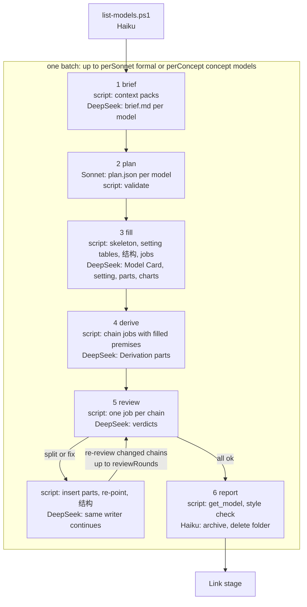

# The model compiler

Status: implemented in the `zt-book-digest` workflow (2026-10-14). It replaces the Sonnet manager of
the Models stage (`self-sufficient-models-proposal.md`, `model-elaboration-levels-design.md`).
What a model must be (levels, build order, Derivation parts, chains, Card size, Card language) is
unchanged; who does each piece of work changes.

## Why

The Sonnet manager did everything for its batch: it read the source in full, loaded three skills
and a 380-line proposal, wrote the ledger, the closure audit, the skeleton, and every job file,
made each tree operation, supervised eight or more DeepSeek runs (every `deepseek_wait` result
entered its context), redid each derivation by hand, and cleaned up. Each turn re-read a growing
context, so the stage was slow and spent most of the digest's tokens.

The user decided (2026-10-14):

- Sonnet only decides the structure: the level, the parts and their build order, and where the
  auxiliary Derivation parts go and how many.
- DeepSeek does the rest: the Card text, the HTML charts, and, in a further round, the Derivation
  parts. A second DeepSeek agent reviews each derivation and decides whether a part jumps or is too
  dense, and splits it into two, three, or more parts.
- Everything else saves tokens.

## Who does what

| Role | Model | Does | Never does |
| --- | --- | --- | --- |
| Architect | Sonnet, one call per batch | reads `brief.md` and `context.md`; writes `plan.json` per model; runs `validate` until it prints `faults: 0` | write Cards, make zt writes, start DeepSeek runs, load skills, read whole source files |
| Compiler | `model-compiler.ps1` (no model) | context packs; plan checks; skeletons and tree operations; setting tables and 结构 lists; job files with source lines and premise bodies copied in; applying splits; reports | write prose |
| Driver | Haiku, one call per round | runs one compiler step, starts the DeepSeek jobs it prints, waits, approves, retries once, returns the answers; the last driver archives and deletes | read the book or a Card, decide anything |
| Briefer | DeepSeek (`briefEffort`, medium) | reads the context pack and the source passages; writes `brief.md`: equations in book order with numbers and lines, which steps the book skips and how many lines each needs, examples, diagrams, outside premises, reusable building blocks | write Cards |
| Writer | DeepSeek (`dshEffort`, low; `deriveEffort`, high for derivations) | writes the Model Card prose, the setting, each part, each chart, then each Derivation part; runs `card-style-check.ps1` on its own Cards; answers `split` when a part will not fit | create, move, or delete Cards |
| Reviewer | DeepSeek (`reviewEffort`, high) | redoes every step of a chain; judges each Derivation part `ok`, `fix`, or `split` into N parts with the cut results; writes `review-NN.json` | change Cards |

## The flow of one batch

Batches run in parallel, each as soon as its digest block finishes. Inside a batch the rounds run in
order and every model of the batch moves through a round together, so one driver keeps up to
`dshPerBatch` DeepSeek runs going. A concept batch skips rounds 4 and 5. A writer's `split` answer
in any round sends the part to the compiler's `split` step before the next round.

## The rounds

| Round | Compiler step | DeepSeek job | Shared prompt prefix | Output |
| --- | --- | --- | --- | --- |
| 1 brief | `brief -Models …`: `model-context.ps1` per model, a read-only allow file, `brief-job.md`; skips a model that is already built | read the pack and source lines, search for building blocks (read-only helper) | `dsh-brief-instructions.zh.md` | `<model>\brief.md` (≤ 6000 characters) |
| 2 plan | `validate -Plan` (Sonnet runs it) | none | — | `<model>\plan.json` |
| 3 fill | `apply`: level, parts in build order (`create_successor`, `insert_card` before kept parts, `move_card` for moved Cards, `delete_card … into` for merges), skeleton bodies with kinded Links, the setting's 符号表 and 术语表, the Model Card's 结构 list, `setting.md`, one Model Card job and one job per three parts | write bodies and charts with the helper's `-Allow`, style-check them | `dsh-fill-instructions.zh.md`, then `setting.md` | filled Cards |
| 4 derive | `derive`: one job per three neighbouring parts of a chain, with each premise's filled body copied in | write 步骤 between the fixed 起点 and 结果 | same | Derivation parts |
| 5 review | `review` (`-Changed` after the first round): one job per chain of up to six parts, with the bodies of the chain and of the members before and after it | judge each part | `dsh-review-instructions.zh.md`, then `setting.md` | `<model>\review-NN.json` |
| 5′ split | `split [-Need a=N;…]`: inserts N−1 parts after the part (`insert_card` before the next member), writes their 起点 and 结果 from the cuts, ends the part at the first cut, re-points the next member to the last new part, adds them to the 结构 list and to the writer's allow file | the same writer conversation continues (`continue`); a fresh one gets `fallback` files | the writer's cached conversation | split and fixed Cards |
| 6 report | `report`: `get_model` and `card-style-check.ps1` per model | none | — | one report per model |

## Files and state

Everything of a batch lives in `<out>\models\m-<first model>` (the DeepSeek cwd):

| File | Written by | Read by |
| --- | --- | --- |
| `state.json` | compiler | compiler: models in batch order, plan id → address, job id → model, ids, allow file, review files applied, chains to re-review |
| `<model>\context.md`, `brief.md` | `model-context.ps1`, briefer | architect |
| `<model>\plan.json` | architect | compiler |
| `<model>\setting.md` | compiler | every writer and reviewer of the model (second prompt file) |
| `<model>\job-fNN.md`, `job-dNN.md`, `*.allow.txt`, `follow-NN.md` | compiler | writers; the helper's `-Allow` |
| `<model>\review-NN.md`, `review-NN.json` | compiler, reviewer | reviewer, compiler |

Every insert, move, and delete runs alone through the zt helper with `-Moves`; the compiler maps
every address in `state.json` through each `moved` map, so a plan id always names the right Card.
Writers address Cards by today's addresses, which only change between rounds.

## Where the tokens went, and where they go now

| Cost in the old stage | Now |
| --- | --- |
| Sonnet loads `zettelkasten`, `zt`, `asd-ste100-zh` and reads the 380-line proposal per manager | Sonnet reads one 100-line instruction file; DeepSeek gets `asd-ste100-zh` through `skills` |
| Sonnet reads the source in full | DeepSeek writes a ≤ 6000-character brief; Sonnet reads line ranges only for an open structural question |
| Sonnet writes the ledger, closure audit, skeleton, setting, and job files, and makes every tree operation | `plan.json` only; the script does the rest |
| Every `deepseek_wait` result enters Sonnet's growing context | Haiku drivers, one short-lived call per round |
| Sonnet redoes each derivation and reads every filled part | the DeepSeek reviewer, at high effort |
| Writers read source files and premise Cards | the job file carries the source lines and premise bodies |
| Fault and split follow-ups | sent to the writer's own conversation (cached prefix) |
| Concept models written by Sonnet | written by DeepSeek like any part |

## Arguments

| Argument | Default | Meaning |
| --- | --- | --- |
| `perSonnet` | 6 | formal or undecided models per batch (one architect call) |
| `perConcept` | 10 | concept models per batch |
| `dshPerBatch` | 8 | DeepSeek runs one batch keeps going (`dshPerSonnet` is the old name) |
| `briefEffort`, `dshEffort`, `deriveEffort`, `reviewEffort` | medium, low, high, high | DeepSeek effort per round |
| `reviewRounds` | 2 | review → split → review again; 0 skips the review |
| `architectEffort` | — | Sonnet's effort |
| `level`, `rebuild`, `only`, `maxSentences`, `maxPartChars`, `maxSteps` | as before | |

## Limits

- A kept main-line part keeps its place: a plan may put new parts between kept parts, but not
  reorder them. Only a part without successors can merge.
- A model whose filed parts are not all in its plan fails validation; the architect lists each one.
- A shared part (`take`) belongs to its home model: the review skips its chain, a verdict or a
  writer's `need` on it is an orphan, and the report's style faults and Derivation count leave it
  out (`card-style-check.ps1 -SkipShared`).
- A rebuild keeps what an earlier build wrote: the Model Card job carries the card's current body,
  and a refilled part's job carries the body the skeleton replaced.
- The compiler is tested on a scratch archive (`scripts/book-digest/tests/model-compiler.tests.ps1`:
  brief, validate, apply, derive, review, split by a verdict and by a writer's `need`, re-review,
  report, and a shared Derivation part of another model).

## Pilot (2026-10-14)

`mode: "models"`, `rebuild: true`, `only` hart1995firms/7|a (formal, 8 parts) and 4|a (concept,
4 parts). Both models built clean: no closure, forward, or unanchored faults, nothing 待写, 0 style
faults on their own Cards; the reviewer passed the new two-part chain. 10.4 minutes.

| | Pilot (2 models) | Old Sonnet manager |
| --- | --- | --- |
| Sonnet | 2 architect calls, 19 turns: 1.52 M cache read, 0.15 M cache write, 0.9 k output | per formal model (MWG, 412 models): 20 turns, 5.5 M cache read, 98 k cache write; per concept model: 10 turns, 1.2 M read |
| Haiku | 12 drivers, 48 turns: 2.73 M cache read, 0.43 M cache write | none |
| DeepSeek | 94 calls, 0.37 M miss, 5.65 M cached, 0.13 M output, $0.99 (day-ledger difference) | not measured per model |

The fixed cost of a Haiku driver (about 25 k cache write and 60 k per turn) dominates a small
batch; a full digest's batches of 6 or 10 models spread it.

Bugs the pilot found, all fixed and tested: the review split a shared part of a finished model;
`review -Changed` re-reviewed unchanged chains (the local `$changed` overwrote the `-Changed`
switch, PowerShell names being case-insensitive); a plan without `card` gave the Model Card job and
a concept model's setting no content; drivers wrapped the compiler's JSON line, and DeepSeek its
answer line, in prose, which the workflow could not parse; R4 read `被收购方` as a passive.
