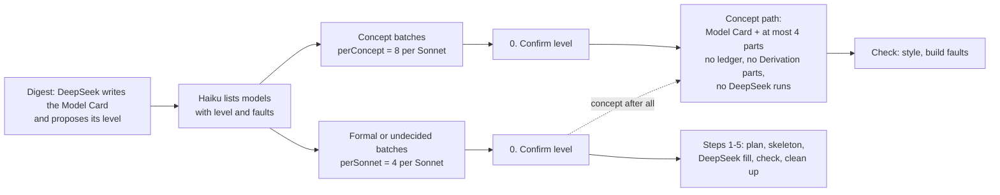

# Model Elaboration Levels Design

Status: implemented in zt 0.13.0 and the `zt-book-digest` workflow (2026-10-13). It adds one property to the Model Card and splits the book digest's Models stage in two. Everything `self-sufficient-models-proposal.md` (zt 0.12.0) decides still holds, but from now on it applies to **formal models** only.

Since 2026-10-14 the **model compiler** (`model-compiler-design.md`) does the work this document gives to the Sonnet manager: a Sonnet architect only writes `plan.json`, `model-compiler.ps1` builds the skeleton and applies splits, and DeepSeek writes, derives, and reviews. The rules for the models themselves still hold.

## Source Authority

- `CONTEXT.md` defines **Elaboration level**, **Concept model**, and **Formal model**, beside **Model Card**, **Model part**, **Derivation part**, and **Self-sufficient model**.
- `self-sufficient-models-proposal.md` stays authoritative for formal models: build order, the build report, Derivation parts, the tree operations, and Card language.
- `open-models-design.md` stays authoritative for membership by Link, shared parts, Relation kinds, and neighbours. Levels change none of it.
- `zt-book-digest-workflow.md` describes the workflow that applies the levels.

## The problem

The 0.12.0 Models stage builds every model the same way: a derivation ledger, a closure audit, a skeleton, Derivation parts, and eight or more DeepSeek runs. That fits a model that the book derives in mathematics. It does not fit a model that the book states in words, such as a mechanism, a typology, or a framework. For such a model:

1. There is no algebra to derive, so the ledger and the Derivation parts are empty work.
2. The auxiliary Cards add bulk that a reader must skip.
3. The DeepSeek runs and the Sonnet check cost as much as for a formal model.

The user decided (2026-10-13) that models have two elaboration levels, and that only level 2 takes the full model build with its auxiliary Cards.

## Decisions

| Question | Decision |
| --- | --- |
| How many levels | Two. Level 1 `concept`, level 2 `formal`. |
| What level 1 builds | The Model Card and at most four parts, in words. No derivation ledger, no Derivation parts, no DeepSeek fill runs. |
| What level 2 builds | The full 0.12.0 build: a self-sufficient model with Derivation parts for each step the source skips. |
| Where the level lives | On the Model Card, stored like the facet and emphasis. A part has no level. |
| Who decides | DeepSeek proposes the level when it writes the Model Card in the digest. The Sonnet manager confirms or corrects it. A workflow argument can force one level on a whole run. |
| A Model Card with no level | Not classified yet. The build report applies the formal rules. The Models stage gives it a level. |

## The two levels

| | Level 1: concept model | Level 2: formal model |
| --- | --- | --- |
| Source states the model in | words or a diagram: a mechanism, a typology, a framework, a verbal argument; or a formal model the source only cites | mathematics: symbols, equations, a derivation, a proposition with a proof, a numerical example that needs algebra |
| Model Card | 问题 · 概要 · 结构 · 关联 · 来源, about 600 characters | 问题 · 概要 · 结构 · 关联 · 来源 |
| Parts | at most four, often none: `设定`, `机制` (core), `结论`, `例子` (aside) | as many as the derivation needs; the setting holds a symbol table and a term table |
| Derivation parts | none; the build report lists any in `beyond_level` | one per step the source skips |
| Plan files | none | `ledger.json`, `closure.json`, `jobs.json` |
| Who writes the Cards | the Sonnet manager itself | DeepSeek runs, then the Sonnet manager checks |
| Build report must show | no `closure`, `forward`, `unanchored`, or `beyond_level` fault | no `closure`, `forward`, or `unanchored` fault |
| Card language | the same rules | the same rules |

A concept model is not a draft of a formal model. It is the right size for a model that has no derivation. A book may raise a concept model to formal later, and then the Models stage builds it in full (`level: "formal"`, `rebuild: true`).

## ZT changes (0.13.0)

### Storage

- A new column `model_level` (`concept`, `formal`, or NULL). `zt up` adds it to an older archive; no Model Card has a level then.
- New archives also keep a CHECK that only a Model Card without a facet has a level. In an older archive, `model::set` and `model::set_level` keep that rule: a Card that changes type or gets a facet loses its level.

### Interfaces

| Interface | Change |
| --- | --- |
| MCP | `create_successor` and `edit_card` take `level` (`concept`, `formal`, `1`, `2`, or empty to clear). `get_card`, `get_tree`, and `search_cards` report `level`. `get_model` reports `level`, and its `build` adds `level`, `level_number`, and `beyond_level`. |
| Session | The Card view shows `[model · concept]`. New command `lv <concept|formal|none>` sets the level of the current Model Card. |
| GUI | The stamp of a Model Card reads `model · L1 concept` or `model · L2 formal`. The writing desk shows a level picker when the Card is a whole model (no facet). The command bar takes `lv`. |
| Dump | `archive.json` adds `levels`: every Model Card with a level. |

### Build report

`build.beyond_level` lists each Derivation part (facet starting with `推导` or `derivation`) in the range of a concept model, with the fix: fold the step into the part that uses it, or raise the model to formal. For a formal model and a model with no level, the list is empty. `self_sufficient` keeps its meaning (`closure`, `forward`, and `unanchored` are empty); the level adds a check, it does not loosen one.

## Workflow changes

1. **Digest.** `dsh-instructions.zh.md` asks DeepSeek to set `level` on each Model Card: `formal` when the book derives the model in mathematics, `concept` when it states it in words. When unsure, it writes `formal`.
2. **List.** `list-models.ps1` reports each model's `level` and its count of build `faults`.
3. **Batch.** The workflow groups concept models in batches of `perConcept` (default 8) and formal or undecided models in batches of `perSonnet` (default 4).
4. **Step 0 (Sonnet).** `model-elaboration.md` adds step 0: the manager reads the source and confirms or corrects the level with `edit_card`. A forced `level` argument replaces this decision. A manager does not lower a model with Derivation parts to concept unless the run forces it.
5. **Concept path.** Read, rewrite the Model Card, write at most four parts, check. No ledger, no closure file, no jobs, no DeepSeek run.
6. **Formal path.** Steps 1 to 5 of the 0.12.0 build, unchanged.
7. **Organize.** Opus reads each model's `level`, checks `beyond_level` for concept models, lists the level in the book's structure Card, and reports a level that looks wrong instead of changing it.

### Arguments

| Argument | Meaning | Default |
| --- | --- | --- |
| `level` | `concept` or `formal`: build every model of the run to this level. A model whose level differs is never skipped. | each model's own level |
| `perConcept` | concept models per Sonnet manager | 8 |

### Report

Each model report adds `level`. The run log adds a line with the count of concept and formal models.

## Models built before levels

A model that a Models run built before zt 0.13.0 has no level, and may hold Derivation parts and skeleton parts (body `待写`) that the 0.12.0 build gave every model. Those parts do not decide its level. Step 0 decides it from the source. A concept model then folds the Derivation parts into the parts that use them and merges its other parts into at most four. Only a model whose level is already `formal` keeps its Derivation parts unless the run forces `concept`.

A merged part is deleted with `delete_card` and `into` (zt 0.13.1): its plan lists every Link from a Card that stays to a Card that goes, and `into` re-points each of them to the part that now holds the content. Without `into`, the plan names those Links under `links that will break`.

## What this design does not do

- It does not convert the models already in the archive. Models built by 0.12.0 have no level; the next Models run (`mode: "models"`) gives them one. Their build reports apply the formal rules until then.
- It does not add a third level or a per-part level.
- It does not make ZT judge whether a model is mathematical. The digest agents decide; ZT only stores the level and reports Derivation parts in a concept model.
