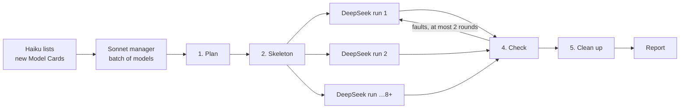

# Self-Sufficient Models: Proposal

Status: implemented in zt 0.12.0 and the `zt-book-digest` workflow (2026-10-12). Since zt 0.13.0 (`model-elaboration-levels-design.md`) this build applies to **formal models** (Elaboration level 2) only; a concept model (level 1) takes no ledger, no Derivation parts, and no DeepSeek fill. The tree operations, the build report, the divider tabs in build order, the derivation slips, the Card language check (`scripts/book-digest/card-style-check.ps1`), and the Sonnet-manager Models stage follow this document. Revision 2 (2026-10-12) records the user's decisions on shared parts, divider tabs, and insertion, and adds Sonnet managers, clean-up, and the Card language rules. Revision 3 (2026-10-13, zt 0.15.0) lets one step take a **Derivation chain** of any length, makes the Card size decide how many parts a step or a statement takes (rules 13 and 14 of "Card language"), and lets a whole derivation serve several models as a **building block** (rule 4).

This proposal changes how agents build a model from Cards. It adds five things:

1. One rule: a model must be self-sufficient.
2. Two tree operations: insert a Card between two Cards, and move a Card between two Cards.
3. One build report in `get_model`.
4. A new Models stage in the book digest. Sonnet managers plan each model, and each manager drives eight or more DeepSeek runs that fill the Cards. Each manager checks the Cards. Then it archives its temporary conversations and deletes its temporary files.
5. Card language rules: Card text follows ASD-STE100 (Simplified Technical English), adapted for Chinese.

## Decisions

The user decided three questions on 2026-10-12:

| Question | Decision |
| --- | --- |
| A building block that two models need | **One shared part.** The part stays in one model, and the second Model Card takes it in by a Link. The second model tolerates this structure. |
| Order of the divider tabs | **The build order.** |
| Where insert and move-between work | **Everywhere.** The operation is the same in every tree, inside or outside a model. |

## Source Authority

- `CONTEXT.md` defines **Model Card**, **Model part**, **Model facet**, **Model relation**, **Relation kind**, and **Model board**. This proposal adds the terms in "Proposed terms".
- `open-models-design.md` (zt 0.10.0) stays authoritative for membership by Link, shared parts, Relation kinds, and Model neighbours. This proposal adds rules to it. It cancels none of its rules.
- `zt-book-digest-workflow.md` describes the current workflow. "Workflow update" below replaces its Models stage.
- The `asd-ste100` skill holds the English rules of ASD-STE100. "Card language" below adapts them for Chinese Card text.

## The problem

The user reads a model to rebuild it from nothing. The current models do not let a reader do that. The models `hart1995firms/11|b` (Hart–Moore, the diversion model) and `12|a`–`12|c` show three faults.

1. **Premises lie outside the model.**
   - The setting of `12|b` (`12|b|a|2`) rests on 清算比例 (`11|b|a|3`) with `基于`. The Model Card of `12|b` does not take that part in, so the premise is not part of the model.
   - The same Card says `模型沿用 [[hart1995firms/11|b]] 的两期资金挪用结构`. It rests on a whole other model, and the reader cannot tell which parts it uses.
   - The setting of `12|c` (`12|c|a|2`) rests on the setting of `11|b` (`11|b|a`). The Model Card of `12|c` does not take it in either.
2. **The derivation jumps.** The part 融资条件 (`11|b|a|4`) says `结合 P=B 与 (5.5)，它化简为 (5.10)`. The algebra is not there. A `依赖` Link tells the reader that one part uses another. It does not show how. The board then looks complete, but the reader cannot follow the step.
3. **The tree cannot take a missing step.** The parts `11|b|a` … `11|b|a|9` form one chain of Direct successors. A step that belongs between 清算比例 (`|3`) and 融资条件 (`|4`) has no place. A Side successor `|3|a` shows as a branch, not as the next step. `move_card` refuses to move `|4` to `|5`, because `|5` is one of its own successors. The only path is three moves through a temporary place, each with its own confirmation.

## Goals

1. **A model is self-sufficient.** A reader can build the whole model from nothing. The reader reads only the model's own Cards, in build order. The reader never needs a Card outside the model for a premise, a definition, a symbol, or a step of a derivation. A shared part is one of the model's own Cards.
2. **The derivation has no jumps.** Each step from one part to the next is small enough to check by hand. When the book skips a step, an auxiliary Derivation part supplies it.
3. **The filing order is the build order.** Inside a model, the reader builds the model along the main line of Direct successors. Examples and variants are Side successors of their step.
4. **Card text is plain.** Each sentence states one thing, in short and literal words, and each term keeps one meaning.
5. **The slip-box stays open.** Links to Cards outside the model stay. They become neighbours (a contrast, a correspondence, a discussion), never premises.

## Proposed terms

**Model range**:
The Model Card and every Card filed under it (its subtree).
_Avoid_: Model scope, model folder

**Model member**:
A Card of the model: a Card in its Model range, or a shared part that the Model Card takes in by a Link.
_Avoid_: Model element

**Build order**:
The order in which a reader builds the model. The **main line** starts at the Model Card's first Side successor (`…|a`, the setting). It follows the Direct successors of that Card: the setting, then each step, then each result. A Side successor of a main-line part holds an example, a case, or a variant of that step. A later Side successor of the Model Card (`…|b`, `…|c`) stands outside the build: a correspondence with another model, a limit, a history. A shared part takes its place just before the first main-line part that rests on it.
_Avoid_: Reading order, sequence

**Derivation part**:
A Model part whose only job is to carry one step of a derivation. It starts from parts earlier in the build order and ends at an intermediate result that a later part uses. Its facet starts with `推导`, and its emphasis is normally `aside`.
_Avoid_: Proof card, helper card, bridge card

**Self-sufficient model**:
A model that meets two conditions. Every rests-on relation from a Card in its range targets a Model member. No main-line part rests on a later part. ZT reports the faults. It does not enforce them.
_Avoid_: Closed model, complete model

**Tolerated premise**:
A premise of a shared part that lies in the shared part's home model but is not a member of this model. The build report lists it. It is not a fault.
_Avoid_: Borrowed premise, leak

## The rules

### 1. Everything a model rests on is a member

- Every rests-on relation from a Card in the range targets a Model member. A rests-on Link to any other Card is a **closure fault**.
- A rests-on Link to another model's Model Card is also a closure fault. A model rests on parts, not on a whole model.
- Links of every other kind (`例示`, `对照`, `放宽`, `对应`, `反驳`, plain reference) may target any Card. They are neighbours.
- The 来源 Link to the Literature Card is not a premise. Tree roots stay out of the check, as they stay out of neighbours today.

### 2. The main line is the derivation

- The first part on the main line is the setting. It states the agents, the timing, and the information. It also holds two tables:
  - the **symbol table**: each symbol, what it is, and where it first appears.
  - the **term table**: each term the model uses, and the words the Cards must not use for it (rule 6 of "Card language").
- Each later part on the main line rests only on parts before it. A rests-on Link to a later part is a **forward fault**.
- A part may introduce a new symbol or term only with a sentence that defines it.
- Examples, numerical cases, and variants are Side successors of the step they illustrate. They are off the main line, so the main line reads as one derivation.

### 3. No step jumps

- A rests-on relation between two main-line parts must show its step. Either the later part holds the algebra, or Derivation parts between them hold it.
- One step is what a reader can check by hand in about one minute: three to six lines of algebra, each with its reason. A longer step gets a Derivation part.
- A Derivation part holds at most six numbered steps. A step that needs more lines becomes a **Derivation chain**: as many Derivation parts as its lines need, each starting from the result of the part before it. Nothing limits how many Derivation parts stand between two parts. The size of a Card decides the count; a derivation never drops lines to fit fewer Cards. `get_model` lists each chain in `build.chains`, with the members just before and after it.
- When the book skips the step, the Derivation part supplies it and marks each supplied line `（补：书中略去）`. It adds no claim that the book does not support.

### 4. Shared parts

The 0.10.0 rule stays. A part that two models share stays in its first model. The second Model Card takes it in by a Link in its 结构 list.

- **The second model tolerates the share.** Its build report lists the shared part at its place in the build order. The divider tabs and the board mark it with `⧉` and a dashed outline, as today.
- **The shared part's own premises stay in its home model.** Some of them are not members of the second model. The build report lists each of these as a tolerated premise. The reader may follow them into the home model.
- **A shared chain keeps its order** (zt 0.15.0). A shared part stands before the first step that needs it, directly or through another shared part, and after the shared parts that it rests on. So a model can take in a whole Derivation chain of another model as a **building block**: its Model Card links every part of the chain, and the chain reads in its own order. A tolerated premise that is a Derivation part carries a `fix`: take it in too.
- **A premise must be taken in, not only linked.** A part of model B may rest on a part of model A. Then B's Model Card must take that part in. Without that Link, the premise is a closure fault. `12|b` and `12|c` have this fault today.

### 5. Premises outside the model come in

A Card that the model rests on but that is not a member becomes one by one of these paths:

| Where the Card is | What to do |
| --- | --- |
| In the same Literature tree and the agent Workspace, and no other model holds it | Move it into the range at its build position (`move_card` with `before`). Give it a facet if it is an Idea Card. Links follow the move. |
| A Model part of another model | Take it in: the Model Card links it in its 结构 list. It becomes a shared part. |
| Another model's Model Card | Name the parts that the step uses, and take those parts in. Rewrite the sentence so that it rests on the parts. |
| An Idea Card in a Topic tree, or any human Card | Write a new part in the range that states the content in full. Keep the outside Card as a neighbour. The outside Card then links the new part. |
| A tree root | A tree root is never a premise. Rewrite the sentence as a plain reference. |

A Topic-tree Card cannot move into a Literature tree. This rule already exists, and the proposal keeps it. An agent never changes a human Card.

## Tree operations

Both operations work on any Regular Card in any tree, by the same rules as `move_card` today. Literature-tree Cards stay in their tree, and no Card moves between Workspaces.

### Insert a Card between two Cards

New MCP tool `insert_card`, new Session command `ins`, and an Insert action in the GUI:

- **Input.** `before`: the address of an existing Regular Card B. Then the same fields as `create_successor`: `text`, `type`, `facet`, `emphasis`.
- **Effect.** The new Card N takes B's Location. B and its whole subtree move down one place, and B becomes N's Direct successor.
  - B is `X/2`: N becomes `X/2`, B becomes `X/3`, the old `X/3` becomes `X/4`, and so on to the end of the chain. B's Side successors move with B (`X/2|a` becomes `X/3|a`).
  - B is `P|a`: N becomes `P|a`, B becomes `P|a|1`, the old `P|a|1` becomes `P|a|2`. B's Side successors move with B (`P|a|b` becomes `P|a|1|b`).
- **One rule for both cases.** The new Locations follow the existing move mapping (`path_edges` from B to N's Direct successor). `move_plan` must accept this one target inside B's own successors. That is safe, because every Card in the chain moves by the same step.
- **Safety.** The tool gives a plan first: every old and new address, and how many Link macros it rewrites. The agent sends `confirm: "insert"` to apply it. The tool applies the plan in one transaction. The Link rewrite, Reverse links, and Spreads follow, as in a move. The MCP server refuses an insert that rewrites a human Card's Link, as `move_card` refuses it today.

### Move a Card between two Cards

`move_card` gains two optional fields:

- `before`: move the Card (with its subtree) into B's place, and move B down as in `insert_card`. Use it instead of `to` when a Card already holds the target Location.
- `alone: true`: move only the Card, not its successors. The Card's Direct successor chain moves up one place to close the gap. The tool refuses a Card that has Side successors: `` `<address>` has Side successors: move them first, or move it with its subtree``.

`alone` together with `before` reorders one step of a chain in one call. For example, the tool can take the example 事后低效率 off the main line and file it beside the step it illustrates.

### Address changes

An insert or a move renumbers Cards. Luhmann chose fixed numbers, so his numbers never changed. ZET rewrites every Link, so no reference breaks. The plan shows every renamed address before the change, and the agent or the user confirms it.

## The build report

`get_model` gains `build`. ZT computes it. It does not store it.

- `order`: the Model members in build order. Each Card shows its facet, emphasis, and `line`: `main`, `side` (with the address it hangs from), `off` (outside the build), or `shared` (with its home model). A facet that starts with `推导` adds `derivation: true`.
- `closure`: each rests-on relation from the range to a Card that is not a member. Each entry gives the sentence and the Card's address, type, and model. The fix: ``rests on `<address>`, which is not in this model: take it in, move it into the range, or restate it in a part``.
- `forward`: each rests-on relation from a main-line part to a later part.
- `tolerated`: each premise of a shared part that is not a member of this model, with the shared part and its home model.
- `unanchored`: each main-line part with no rests-on path back to the setting.

`issues` keeps its meaning (a part in no model). The build faults are a separate list, so a model from 0.10.0 still shows no `issues`.

Three small changes come with the report:

- **Rests-on words.** `RELATION_KINDS` adds `代入`, `推导自`, `由此推出`, and `substitut…` to rests-on, so a Derivation part can write `代入 (5.5) [[…]]`.
- **Divider tabs.** The tabs follow `build.order`. The 结构 list stays the reader's entry list on the Model Card. It no longer sets the tab order.
- **Board.** The board draws a Derivation part as a slim slip on the thread between the parts it connects. The slip *is* that thread, made visible.

## Card language

Card text follows ASD-STE100. ASD-STE100 is a standard for English. This section adapts its structural rules for Chinese Cards. English Cards follow the English rules of the `asd-ste100` skill without change. These rules apply to titles and bodies. They do not apply to formulas, Links, chart code, or quotations from the book.

| # | Rule | Do | Do not |
| --- | --- | --- | --- |
| 1 | One statement per sentence | `E 违约。C 清算资产。` | `E 违约，于是 C 清算资产，同时……` |
| 2 | Sentence length: at most 40 characters in a description, and at most 30 in a derivation step. Formulas and Links do not count. | Split at each new statement. | A sentence that holds a condition, a cause, and a result. |
| 3 | No `；` (and no `;` in English) | Make two sentences. | `……付不出去；……能部分付出。` |
| 4 | Active voice: name the actor | `E 清算 $(1-f)$ 的资产。` | `资产被清算。` (Use `被` only when the book does not name the actor.) |
| 5 | A verb for an action | `分析`、`决定`、`比较` | `进行分析`、`作出决定`、`加以比较` |
| 6 | One term, one meaning | Use the word in the term table every time. | Rotation: `清算` / `卖资产` / `变卖资产` for one action. |
| 7 | At most two `的` in one noun phrase | `E 在时点 1 的现金` | `E 在时点 1 用来还债的现金的上限` |
| 8 | Keep the book's modality | `可能` stays `可能`. | Change `可能` to a fact, or add `或许` to a fact. |
| 9 | No hedge stacking and no praise words | State the claim. | `值得注意的是`、`在某种程度上`、`精妙`、`深刻` |
| 10 | Lists for three or more steps or conditions | A numbered list. | Three conditions in one sentence. |
| 11 | Each formula on its own line (`$$…$$`) has a sentence that names it | `C 收支相抵，须` + the formula. | A formula with no sentence. |
| 12 | A title states one claim in at most 40 characters | `融资条件：$L\ge K-w$ 且净现值为正` | A title with two claims. |
| 13 | A part of a formal model holds at most 12 sentences and 400 characters of prose. Formulas, Links, tables, charts, and quotations do not count. | Split it into two or more parts. | One part that holds two Cards of text. |
| 14 | A Derivation part holds at most 6 numbered steps | Split the step into a Derivation chain. | Merge lines or skip them to fit one Card. |

The numbers in rule 2 are first values. The pilot sets the final values. Rules 13 and 14 (revision 3) apply to formal models and to models with no level, not to concept models; the workflow arguments `maxSentences`, `maxPartChars`, and `maxSteps` change their numbers.

**Check.** A new script, `scripts/book-digest/card-style-check.ps1`, checks rules 2, 3, 4, 5, 7, and 9 mechanically. It also checks rule 6 against the model's term table. It prints one line per fault: the address, the rule, and the sentence. DeepSeek runs it on its own Cards before it answers. Sonnet runs it again in its check step. The script never changes text.

**Agent instructions.** The prompts that the workflow gives Sonnet and DeepSeek follow the Strict mode of the `asd-ste100` skill. The Chinese DeepSeek instructions follow the rules above.

## Workflow update

The digest keeps its stages. The Models stage changes. One **Sonnet manager** takes a batch of models. It plans each model, and it writes each model's skeleton. Then it drives eight or more DeepSeek runs that fill the Cards. It checks every Card. At the end, it archives its temporary conversations and deletes its temporary files.



### Arguments

| Argument | Meaning | Default |
| --- | --- | --- |
| `perSonnet` | Models per Sonnet manager | 4 |
| `dshPerSonnet` | DeepSeek runs that one manager keeps running at the same time | 8 (may be higher) |
| `rebuild` | Mode `models` only: rebuild models that already have parts | `false` |

### Step 1. Plan (Sonnet)

For each model in its batch, the manager reads the context pack and the source, as today. Then it writes two files to the model's work folder:

1. **The derivation ledger** (`ledger.json`). It holds one entry per step from the setting to each result. Each entry gives:
   - the inputs: equations and symbols, with the part that states each one.
   - the output.
   - the book's place: section, equation numbers, lines.
   - whether the book shows the step or skips it.
2. **The closure audit** (`closure.json`). It holds each premise that is not a member, from `get_model` `build.closure` and from the manager's own reading. Each entry carries the path from rule 5: move, take in, name the parts, restate, or make it a plain reference.

### Step 2. Skeleton (Sonnet)

1. The manager acts on the closure audit. It moves Cards into the range with `move_card` and `before`, and it takes shared parts in through the Model Card's 结构 list.
2. It orders the main line with `move_card` and `alone`/`before`. Each example goes beside the step it illustrates.
3. It writes the setting itself, with its symbol table and term table. Every other Card depends on these tables.
4. It writes every other part as a skeleton, at its place in the build order. A new part goes in with `insert_card`. A skeleton has:
   - a facet, an emphasis, and a title that states the claim.
   - the Links to its premises and neighbours, each with its kind word.
   - a body with one line, `待写`, and nothing else.
5. It writes the Model Card: 问题, 概要, 结构 list, 关联, 来源. The 结构 list takes in the shared parts.
6. It writes `jobs.json`. One job holds one part, or at most three adjacent parts of one model. Each job gives:
   - the addresses.
   - what each part must state: the claim, the equations, the chart it needs, the book's lines.
   - the symbols and terms in use.

The manager may keep a core part for itself and write it in this step. It marks the part `self` in `jobs.json`.

### Step 3. Fill (DeepSeek, eight or more runs)

1. The manager makes one DeepSeek Harness folder for itself: `<OUT>\models\<manager>`. All its runs use this folder as `cwd`.
2. It starts one run (`deepseek_run`) per job. Each run gets the same leading files, which keeps the prompt cache warm:
   - the new instructions `scripts/book-digest/dsh-fill-instructions.zh.md`.
   - the model's setting, symbol table, and term table.

   After these, the run gets its job and its source lines.
3. It keeps `dshPerSonnet` runs going at the same time. It starts a new run when one finishes, and it reads each result with `deepseek_wait`.
4. Each run writes the bodies of its parts with `edit_card`, and it follows "Card language". It runs `card-style-check.ps1` on its parts and fixes each fault. It changes only the parts in its job. It answers with one line of JSON per part: `done`, or `blocked` with its reason.

A Derivation part body has three sections:

- **起点**: each input, with `依赖` before its Link.
- **步骤**: numbered lines. Each line holds one equation and its reason (`代入 (5.5)`, `两边加 $K-w$`). Each line that the book omits carries `（补：书中略去）`.
- **结果**: the target equation, with its number from the book.

### Step 4. Check (Sonnet)

1. The manager reads each filled part. It does each derivation step again. Where the book gives numbers (例 1, 例 2), it checks the result at those numbers with a short script.
2. It runs `card-style-check.ps1` on every Card of the model.
3. It sends each fault back to the same DeepSeek conversation (`deepseek_prompt`), so the cached prefix keeps the cost low. After two rounds, the manager writes the part itself.
4. It runs `get_model` until `build` shows no `closure`, `forward`, or `unanchored` fault. A fault that it accepts goes into its report with a reason. Tolerated premises are not faults.

### Step 5. Clean up (Sonnet)

After the last model of its batch, the manager removes everything temporary that it made:

1. For each DeepSeek conversation that it started: `deepseek_close`, then `deepseek_archive`. DeepSeek Harness keeps the history of an archived conversation, but the conversation leaves the sidebar.
2. `deepseek_remove_workspace` for its folder `<OUT>\models\<manager>`. This removes only the sidebar entry. The folder belongs to this manager only, so the step does not touch other managers.
3. It deletes its work folders: context packs, `ledger.json`, `closure.json`, `jobs.json`, and the calls files.
4. It reports what it removed: conversations archived, conversations that it could not archive, and folders deleted.

The workflow's Cleanup stage then lists the conversations under `<OUT>\models` and archives any that a failed manager left open.

### Report

Each manager returns one report per model. The report adds these fields to the current ones:

- `derivations`: how many Derivation parts there are, how many DeepSeek wrote, and how many the manager fixed.
- `moved`: the Cards moved into the range.
- `shared`: the shared parts taken in, with their home models.
- `tolerated`: how many tolerated premises there are.
- `style`: style faults left, normally zero.
- `accepted`: faults left on purpose, each with a reason.
- `dsh`: runs started, runs archived, and DeepSeek tokens.

### Other stages

- **Digest.** DeepSeek's Model Card states the setting in full and names the symbols. It never writes `沿用某模型的设定` without the setting. Its Cards follow "Card language".
- **Link.** The link pass follows "Card language" for every sentence it adds.
- **Organize.** Opus reads each model's `build` report. It re-points the outside Cards that a closure audit names: each one links the new part in the range. It checks that each model with shared parts takes them in through its Model Card.
- **Mode `models`.** With `rebuild: true`, the managers run steps 1 to 5 on models that already have parts. They keep the facets, emphasis, and charts that still fit.

### Cost

DeepSeek flash writes the bodies and the long algebra. Sonnet writes plans, settings, skeletons, and checks. Every run of one manager starts with the same files. Every retry reuses its conversation. So most of the DeepSeek input comes from the cache. The added Sonnet time is mostly step 4. A model needs that check anyway if a reader is to trust it.

## Worked example: `hart1995firms/11|b`

The current range is one chain. In build order:

1. 设定 `|a`
2. 假设 `|1`
3. 可承诺的还款 `|2`
4. 清算比例 `|3`
5. 融资条件 `|4`
6. 事后低效率 `|5`
7. 事前低效率 `|6`
8. 模型对应 `|7`
9. 局限 `|8`
10. 多重债务 `|9`

After the rebuild (all addresses under `hart1995firms/11|b`):

```
11|b          Model Card                  问题 · 概要 · 结构 · 关联 · 来源
11|b|a        设定 + 符号表 + 术语表        main   E, C, w, K, B, P̂, P, y1, y2, f, L · 清算 (不用 卖资产)
11|b|a|1      假设                         main   rests on 设定
11|b|a|2      可承诺的还款 (core)          main   rests on 设定, 假设
11|b|a|3      清算比例                     main   rests on 可承诺的还款, 假设
11|b|a|3|a    事后低效率 (例 1)            side   illustrates 清算比例
11|b|a|4      推导：E 的参与约束化简为 (5.10)   main, new, aside
11|b|a|5      融资条件 (core)              main   rests on 推导, 可承诺的还款
11|b|a|5|a    事前低效率 (例 2)            side   illustrates 融资条件
11|b|a|6      多重债务 (aside)             main   rests on 可承诺的还款, 清算比例
11|b|b        模型对应                     off    corresponds to Aghion–Bolton
11|b|c        局限                         off
```

The operations, in order:

1. `insert_card` with `before: 11|b|a|4`. This adds the Derivation part and moves 融资条件 and the rest of the chain down one place.
2. `move_card` with `alone: true` for 事后低效率, to the next Side successor of 清算比例.
3. `move_card` with `alone: true` for 事前低效率, to the next Side successor of 融资条件.
4. `move_card` with `alone: true` for 模型对应 and for 局限, to Side successors of the Model Card.

The new Derivation part, as DeepSeek writes it:

> **推导：E 的参与约束化简为计入部分清算后的净现值条件**
> 起点：依赖清算比例 [[…|3]] 的 (5.5)。依赖可承诺的还款 [[…|2]] 的 $P=B$。
> 1. 时点 1 还款后，E 剩下的现金是 $B-(K-w)+y_1+(1-f)L-P$。
> 2. 时点 2，E 挪用 $fy_2$。
> 3. 代入 $P=B$，时点 1 的剩余化为 $y_1-(K-w)+(1-f)L$。（补：书中略去）
> 4. E 参与，须所得高于初始财富：$y_1-(K-w)+(1-f)L+fy_2>w$。
> 5. 两边加 $K-w$，得 $y_1+fy_2+(1-f)L>K$，即 (5.10)。（补：书中略去）

The manager then checks step 5 with 例 1. There $f=5/6$, and $50+83.3+10=143.3>90$.

The other models of the book change as follows:

- **`12|a`** keeps 可承诺的还款 (`11|b|a|2`) as a shared part. Its tab now stands just before 不违约条件, the first part that rests on it. Its premises 设定 and 假设 of `11|b` are tolerated premises.
- **`12|b`**: its Model Card takes in 清算比例 (`11|b|a|3`). Its setting rewrites `模型沿用 [[hart1995firms/11|b]] 的两期资金挪用结构` so that it rests on the parts it uses.
- **`12|c`**: its Model Card takes in the setting of `11|b` (`11|b|a`).

## Rollout

1. **zt 0.12.0.**
   - `insert_card`, and `move_card` with `before` and `alone`, in MCP, the Session, and the GUI.
   - `get_model` `build`, and the new rests-on words.
   - Divider tabs in build order, and the board's derivation slips.
   - The `CONTEXT.md` terms, and the `zt` and `zettelkasten` skills with "Card language".
2. **Workflow.** Rewrite `scripts/book-digest/model-elaboration.md` as the manager's instructions. Add `dsh-fill-instructions.zh.md` and `card-style-check.ps1`. Give the Sonnet managers the DeepSeek tools in `.claude/workflows/zt-book-digest.js`, and add `perSonnet`, `dshPerSonnet`, and `rebuild`. Rewrite the DeepSeek digest and link instructions to follow "Card language".
3. **Pilot.** Rebuild `hart1995firms/11|b`, `12|a`, `12|b`, and `12|c`. The user reads them and decides. The pilot also sets the sentence-length values of rule 2. Then rebuild the other models of the book.

## What this proposal does not do

- It does not make ZT check symbols or algebra. ZT can see Links, not mathematics. Sonnet checks the mathematics.
- It does not remove membership by Link or shared parts.
- It does not claim that Card text complies with the official ASD-STE100 dictionary. The dictionary is for English, and this project does not hold it. The Card rules adapt the structural rules only.
- It does not change the Table, Spreads, or dump format.
