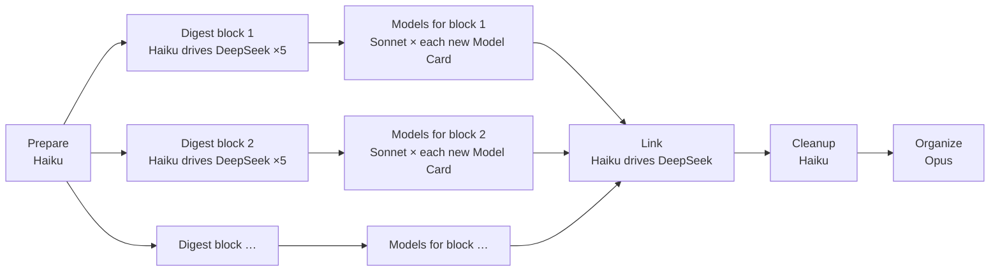

# The zt-book-digest workflow

`zt-book-digest` (`.claude/workflows/zt-book-digest.js`) turns a book from the Scholar Archive into
Cards in the agent Workspace: a Literature tree for the book, Topic trees for the ideas that stand
on their own, Event Cards for the real events it reports, and a **structured model** for every
model it sets out. Run it from Claude Code ("run the zt-book-digest workflow on …"); it uses
DeepSeek Harness for the bulk reading and writing, Sonnet for the models, and Opus for the final
organization.

## What happens



| Stage | Who | What it does | What you get |
| --- | --- | --- | --- |
| **Prepare** | Haiku runs a script | Extracts the Chinese text, cuts it into section groups (about 20,000 characters each), and creates the agent Literature Card with one anchor Card per group. | `<out>\groups`, `<out>\sections`, the Literature tree `[[Key]]` → `[[Key/1]]` … |
| **Digest** | one Haiku manager per block of up to 5 groups; one DeepSeek run per group | Each DeepSeek run gets only its own sections, searches the rest of the book on disk, and writes 6–12 Cards: Idea Cards placed in Topic trees or under its anchor, Event Cards, and **one whole Model Card per model**. Blocks run in parallel. | Cards, and `owned-gNN.txt` (which Cards each group wrote) |
| **Models** | Haiku lists, then one **Sonnet** agent per Model Card | Starts for a block as soon as that block's DeepSeek runs finish, while other blocks are still digesting. Each Sonnet agent reads the Model Card, studies the book's passages behind it, corrects it, and designs its structure (below). | Model parts with charts; a report per model |
| **Link** | Haiku drives DeepSeek again | Each group's run appends reasoned Links from its own Cards to the rest of the book, including to the Model part a Card concerns. | Cross-part Links |
| **Cleanup** | Haiku | Archives the DeepSeek conversations and removes scratch files; reports DeepSeek token use. | — |
| **Organize** | Opus | Merges duplicate Topics, writes hubs, the book's structure Card and index, checks every model with `get_model`, and fixes Links. | A finished, navigable digest |

## A structured model

DeepSeek writes each model as one Card, because it reads only its own sections and must work
fast. A model rarely fits one Card, and no two models need the same parts, so in the Models stage
a Sonnet agent **designs** each model's structure:

1. It runs `scripts/book-digest/model-context.ps1`, which writes a context pack: the Model Card
   as DeepSeek wrote it, any parts it already has, the Cards that discuss it and those it links,
   its group's source files with their headings and line numbers, the group's anchor Card (the
   part's place in the book), and the book's other models.
2. It reads the source passages in full (and any other book file, Card, or Scholar Archive record
   it needs) and corrects the Model Card where it is wrong.
3. It decides the parts the model needs and names each one with its own **facet** label; marks
   the one to three parts a reader must see `core` and skippable detail `aside`; relates parts by
   Links that say why one rests on another; and lets parts that stand apart (a case, a variant)
   stay **loose**.
4. It writes the parts with charts, rewrites the Model Card as the model's index, and checks
   `get_model` until it reports no issues.

For example:

```
Key/4|a        Model Card                  GHM 产权模型：……        问题 · 概要 · 结构 list · 来源
Key/4|a|a      设定                         设定：两位经理各用一项资产……
Key/4|a|a|1    假设                         假设：投资可观察但不可验证……     + table: assumption · what it buys · if relaxed
Key/4|a|a|2    议价 (core)                  议价：投资者只拿到边际回报的一半…  + plot with a slider; rests on 设定, 假设
Key/4|a|a|3    命题一 (core)                结论：所有权把激励从一方转给另一方    rests on 议价
Key/4|a|a|3|a  命题二                       结论：互补资产应同属一方            rests on 议价
Key/4|a|b      历史案例 (aside, loose)      通用汽车与费雪车身……
```

- Parts are filed under their Model Card; filing order is the order of the divider tabs.
- The Model Card links every part; every part links its Model Card and the parts it rests on, each
  in a sentence that gives the reason. `get_model` reports any missing Link, and lists the model's
  relations and loose parts.
- In the GUI, a Model Card or part shows divider tabs named by facet along its top edge and the
  **model board** below it: the parts laid out by what rests on what, threads for the relations,
  the open part lifted with its neighbours and their reasons, core parts legible, and the rest
  receding to their labels; loose parts lie apart. Charts are drawn in the card's colors, follow
  the light or dark theme, and open a part when clicked.
- Discussion Cards elsewhere link the part they concern, so the part's Reverse links list exactly
  the Cards that discuss it. Sonnet does not edit them; it reports the ones that should, and Opus
  acts on that in Organize.
## Running it

Arguments (`args`):

| Argument | Meaning |
| --- | --- |
| `mode` | `full` (default): everything. `link`: only the link pass (and Organize with `organize: true`) on an existing digest. `models`: only the Models stage on an existing digest's Model Cards. |
| `source`, `out`, `citationKey`, `bibtex`, `bookTitle` | the bilingual Markdown in the Scholar Archive, the staging folder, and the book's BibTeX |
| `groups` | modes `link` and `models`: the digest's group count |
| `models` | `false` skips the Models stage in a full run |
| `redoModels` | `true` restructures models that already have parts (a rerun skips them by default); use it to move models written before 0.7.0 to free facets and emphasis |
| `perManager`, `maxChars`, `maxUnits`, `dshModel`, `dshEffort` | sizing and the DeepSeek model |

The run's result lists every group's status, every model's parts, charts, and open issues, the
DeepSeek token use, and Opus's report. To structure the models of a book digested before 0.6.0 (or, with `redoModels: true`, restructure those of 0.6.0),
run it with `mode: "models"`, `citationKey`, `bookTitle`, and `out` (the Sonnet agents read the
book from the Scholar Archive when the staging folder is gone).
