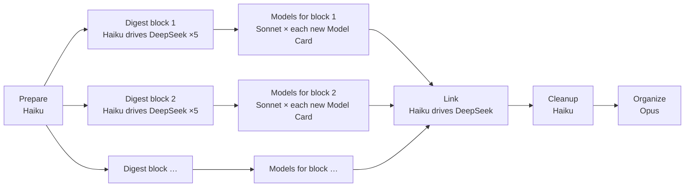

# The zt-book-digest workflow

`zt-book-digest` (`.claude/workflows/zt-book-digest.js`) turns a book from the Scholar Archive into
Cards in the agent Workspace: a Literature tree for the book, Topic trees for the ideas that stand
on their own, Event Cards for the real events it reports, and a **structured model** for every
model it sets out. Run it from Claude Code ("run the zt-book-digest workflow on …"); it uses
DeepSeek Harness for the bulk reading and writing, Sonnet for the models, and Opus for the final
organization.

## What happens



| Stage | Who | What it does | What you get |
| --- | --- | --- | --- |
| **Prepare** | Haiku runs a script | Extracts the Chinese text, cuts it into section groups (about 20,000 characters each), and creates the agent Literature Card with one anchor Card per group. | `<out>\groups`, `<out>\sections`, the Literature tree `[[Key]]` → `[[Key/1]]` … |
| **Digest** | one Haiku manager per block of up to 5 groups; one DeepSeek run per group | Each DeepSeek run gets only its own sections, searches the rest of the book on disk, and writes 6–12 Cards: Idea Cards placed in Topic trees or under its anchor, Event Cards, and **one whole Model Card per model**. Blocks run in parallel. | Cards, and `owned-gNN.txt` (which Cards each group wrote) |
| **Models** | Haiku lists, then one **Sonnet** agent per Model Card | Starts for a block as soon as that block's DeepSeek runs finish, while other blocks are still digesting. Each Sonnet agent reads the Model Card, studies the book's passages behind it, corrects it, and rebuilds it as a structured model (below). | Model parts with charts; a report per model |
| **Link** | Haiku drives DeepSeek again | Each group's run appends reasoned Links from its own Cards to the rest of the book, including to the Model part a Card concerns. | Cross-part Links |
| **Cleanup** | Haiku | Archives the DeepSeek conversations and removes scratch files; reports DeepSeek token use. | — |
| **Organize** | Opus | Merges duplicate Topics, writes hubs, the book's structure Card and index, checks every model with `get_model`, and fixes Links. | A finished, navigable digest |

## A structured model

DeepSeek writes each model as one Card, because it reads only its own sections and must work
fast. A model rarely fits one Card, so the Models stage splits it:

```
Key/4|a        Model Card   GHM 产权模型：……         问题 · 概要 · structure chart · 结构 list · 来源
Key/4|a|a      setting      设定：两位经理各用一项资产……     + diagram of who interacts with whom
Key/4|a|a|1    assumptions  假设：投资可观察但不可验证……     + table: assumption · what it buys · if relaxed
Key/4|a|a|2    timing       时序：先投资，后平分增益……       + timeline
Key/4|a|a|3    dynamics     动态：投资者只拿到边际回报的一半…  + plot with a slider
Key/4|a|a|4    results      结论：所有权把激励从一方转给另一方
```

- The parts read down one column of the Folgezettel map, under their Model Card.
- The Model Card links every part; every part links its Model Card and the parts it rests on
  (dynamics → timing and assumptions; results → dynamics). `get_model` reports any missing Link.
- In the GUI, a Model Card or part shows divider tabs for the whole model along its top edge and
  a map of the model's Cards below it; charts are drawn in the card's colors, follow the light or
  dark theme, and open a part when clicked.
- Discussion Cards elsewhere link the part they concern, so the part's Reverse links list exactly
  the Cards that discuss that facet.

## Running it

Arguments (`args`):

| Argument | Meaning |
| --- | --- |
| `mode` | `full` (default): everything. `link`: only the link pass (and Organize with `organize: true`) on an existing digest. `models`: only the Models stage on an existing digest's Model Cards. |
| `source`, `out`, `citationKey`, `bibtex`, `bookTitle` | the bilingual Markdown in the Scholar Archive, the staging folder, and the book's BibTeX |
| `groups` | modes `link` and `models`: the digest's group count |
| `models` | `false` skips the Models stage in a full run |
| `redoModels` | `true` rebuilds models that already have parts (a rerun skips them by default) |
| `perManager`, `maxChars`, `maxUnits`, `dshModel`, `dshEffort` | sizing and the DeepSeek model |

The run's result lists every group's status, every model's parts, charts, and open issues, the
DeepSeek token use, and Opus's report. To structure the models of a book digested before 0.6.0,
run it with `mode: "models"`, `citationKey`, `bookTitle`, and `out` (the Sonnet agents read the
book from the Scholar Archive when the staging folder is gone).
