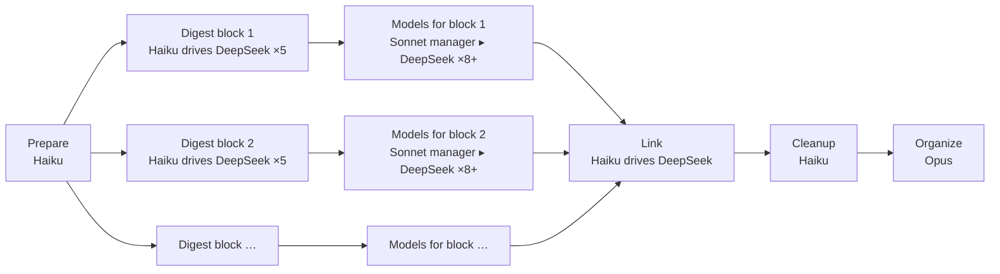

# The zt-book-digest workflow

`zt-book-digest` (`.claude/workflows/zt-book-digest.js`) turns a book from the Scholar Archive into
Cards in the agent Workspace: a Literature tree for the book, Topic trees for the ideas that stand
on their own, Event Cards for the real events it reports, and a **structured model** for every
model it sets out. Run it from Claude Code ("run the zt-book-digest workflow on …"); it uses
DeepSeek Harness for the bulk reading and writing, Sonnet managers (each driving eight or more
DeepSeek runs) for the models, and Opus for the final organization.

## What happens



| Stage | Who | What it does | What you get |
| --- | --- | --- | --- |
| **Prepare** | Haiku runs a script | Extracts the Chinese text, cuts it into section groups (about 20,000 characters each), and creates the agent Literature Card with one anchor Card per group. | `<out>\groups`, `<out>\sections`, the Literature tree `[[Key]]` → `[[Key/1]]` … |
| **Digest** | one Haiku manager per block of up to 5 groups; one DeepSeek run per group | Each DeepSeek run gets only its own sections, searches the rest of the book on disk, and writes 6–12 Cards: Idea Cards placed in Topic trees or under its anchor, Event Cards, and **one whole Model Card per model**. Blocks run in parallel. | Cards, and `owned-gNN.txt` (which Cards each group wrote) |
| **Models** | Haiku lists, then one **Sonnet manager** per batch: `perConcept` concept models, or `perSonnet` formal models with `dshPerSonnet` DeepSeek runs at a time | Starts for a block as soon as that block's DeepSeek runs finish, while other blocks are still digesting. Each manager confirms each model's **elaboration level**. A concept model (level 1) gets its Model Card checked and at most four parts in words. A formal model (level 2) gets the full build: the manager plans it, writes its skeleton in build order, has DeepSeek fill the Cards, checks every step and the Card language, then archives its conversations and deletes its files (below). | Concept models and self-sufficient formal models; a report per model |
| **Link** | Haiku drives DeepSeek again | Each group's run appends reasoned Links from its own Cards to the rest of the book, including to the Model part a Card concerns. | Cross-part Links |
| **Cleanup** | Haiku | Archives the DeepSeek conversations and removes scratch files; reports DeepSeek token use. | — |
| **Organize** | Opus | Merges duplicate Topics, writes hubs, the book's structure Card and index, checks every model with `get_model`, and fixes Links. | A finished, navigable digest |

## Elaboration levels (zt 0.13.0)

Not every model needs the full build (`doc/model-elaboration-levels-design.md`). Each Model Card
carries an **elaboration level**:

| Level | When | What the Models stage builds |
| --- | --- | --- |
| 1 `concept` | The book states the model in words or a diagram: a mechanism, a typology, a framework, a verbal argument, or a formal model it only cites. | The Model Card (问题 · 概要 · 结构 · 关联 · 来源) and at most four parts in words (`设定`, `机制`, `结论`, `例子`). No derivation ledger, no Derivation parts, no DeepSeek fill runs: the Sonnet manager writes the Cards itself. |
| 2 `formal` | The book states the model in mathematics: symbols, equations, a derivation, a proposition with a proof. | A self-sufficient model, by the five steps below. |

- **Digest.** DeepSeek sets `level` on each Model Card it writes (`formal` when unsure).
- **Listing.** `list-models.ps1` reports each model's `level`. Concept models go in batches of
  `perConcept` (default 8) per Sonnet manager; formal and undecided models in batches of `perSonnet`.
- **Step 0.** The manager reads the source and confirms or corrects the level (`edit_card`
  `level`). A concept model then follows the concept path of `model-elaboration.md`; a formal model
  follows steps 1 to 5.
- **Check.** A concept model must show no `closure`, `forward`, `unanchored`, or `beyond_level`
  fault in `get_model` `build`; `beyond_level` lists a Derivation part in a concept model.
- **Forcing a level.** `level: "concept"` or `level: "formal"` builds every model of the run to that
  level, and a model whose level differs is never skipped.
- **Organize.** Opus lists each model's level in the book's structure Card and reports a level that
  looks wrong; it does not change levels.

## A self-sufficient formal model (zt 0.12.0)

A reader must be able to build each formal model from nothing, reading only its own Cards in build order
(`doc/self-sufficient-models-proposal.md`). The Models stage reaches that in five steps, with
`scripts/book-digest/model-elaboration.md` as the manager's instructions:

1. **Plan (Sonnet).** The context pack (`model-context.ps1`), the source passages, and
   `get_model` `build` give a **derivation ledger** (`ledger.json`: one entry per step from the
   setting to each result, with its inputs, output, place in the book, and whether the book shows
   or skips it) and a **closure audit** (`closure.json`: each premise outside the model, with the
   path that brings it in: move, take in, name the parts, restate, or plain reference).
2. **Skeleton (Sonnet).** The manager acts on the audit, orders the main line with `move_card`
   (`before`, `alone`), inserts missing steps and Derivation parts with `insert_card`, writes the
   setting with its symbol table and `术语表` term table itself, writes every other part as a
   skeleton (facet, emphasis, claim title, kinded Links, body `待写`), rewrites the Model Card
   with its 结构 list in build order, and writes one job file per one to three parts.
3. **Fill (DeepSeek, `dshPerSonnet` runs at a time).** Every run starts with the same files
   (`dsh-fill-instructions.zh.md`, then the model's setting), then its job with the source lines
   copied in. It writes only its parts (the helper's `-Allow` list), runs
   `card-style-check.ps1` on them, and answers one JSON line per part.
4. **Check (Sonnet).** The manager redoes each derivation step, checks the book's numerical
   examples with a short script, runs the style check on the whole model, sends faults back to
   the same DeepSeek conversation (two rounds at most, then writes the part itself), and runs
   `get_model` until `build` has no `closure`, `forward`, or `unanchored` fault.
5. **Clean up (Sonnet).** It closes and archives each DeepSeek conversation it started, removes its
   DeepSeek workspace (`<out>\models\<manager>`), and deletes its work files. A Haiku sweep then
   archives anything a failed manager left open.

The report of each model adds `derivations`, `moved`, `shared`, `tolerated`, `style`,
`accepted`, and `dsh`.

## A structured model (zt 0.7.0 – 0.11.0)

DeepSeek writes each model as one Card, because it reads only its own sections and must work
fast. A model rarely fits one Card, and no two models need the same parts, so in the Models stage
a Sonnet agent **designs** each model's structure:

1. It runs `scripts/book-digest/model-context.ps1`, which writes a context pack: the Model Card
   as DeepSeek wrote it, any parts it already has, the Cards that discuss it and those it links,
   its group's source files with their headings and line numbers, the group's anchor Card (the
   part's place in the book), and the book's other models.
2. It reads the source passages in full (and any other book file, Card, or Scholar Archive record
   it needs) and corrects the Model Card where it is wrong.
3. It decides the parts the model needs and names each one with its own **facet** label; marks
   the one to three parts a reader must see `core` and skippable detail `aside`; relates parts by
   Links whose sentence gives the reason and whose word right before the Link names the
   **Relation kind** (`依赖` rests on, `例示` illustrates, `对照` contrasts, `放宽` relaxes,
   `对应` corresponds, `反驳` objects); links the Cards outside the model it relates to, the same
   way; and lets parts that stand apart (a case, a variant) stay **loose**.
4. It writes the parts with charts, rewrites the Model Card as the model's entry point (问题 ·
   概要 · 结构 list · 关联 · 来源), and checks `get_model` (issues, relation kinds, neighbours)
   until it reads as designed.

For example:

```
Key/4|a        Model Card                  GHM 产权模型：……        问题 · 概要 · 结构 list · 来源
Key/4|a|a      设定                         设定：两位经理各用一项资产……
Key/4|a|a|1    假设                         假设：投资可观察但不可验证……     + table: assumption · what it buys · if relaxed
Key/4|a|a|2    议价 (core)                  议价：投资者只拿到边际回报的一半…  + plot with a slider; rests on 设定, 假设
Key/4|a|a|3    命题一 (core)                结论：所有权把激励从一方转给另一方    rests on 议价
Key/4|a|a|3|a  命题二                       结论：互补资产应同属一方            rests on 议价
Key/4|a|a|4    数值例子 (aside)             例子：R=10、r=6 时……               illustrates 命题一
Key/4|a|b      历史案例 (aside, loose)      通用汽车与费雪车身……
Key/5|b|a|2    对应 GHM (shared)            对应：剩余控制权即资产所有权……       corresponds to 议价; also linked from Key/4|a
```

- A part belongs to the Model Card it is filed under and to every Model Card that links it
  (zt 0.10, `doc/open-models-design.md`): new parts are filed under their Model Card, and a part
  two models of the book share stays where it is and is linked from the second Model Card's 结构
  list. The order of that list is the order of the divider tabs.
- Parts need not open with `本卡是模型 [[…]] 的X` nor link their Model Card; each links the parts
  it relates to in a sentence that gives the reason, with its kind word right before the Link.
  `get_model` lists the model's kinded relations, loose parts, and neighbours outside it, and
  reports only a part that belongs to no model.
- In the GUI, a Model Card or part shows divider tabs named by facet along its top edge and the
  **model board** below it: the parts laid out by what rests on what, a thread for each rests-on
  relation and a named dashed arc for every other kind, the open part lifted with its neighbours
  and their kinds and reasons, core parts legible, and the rest receding to their labels; loose
  parts lie apart, and the open Card's neighbours beyond the model are listed below. Charts are
  drawn in the card's colors, follow the light or dark theme, and open a part when clicked.
- Discussion Cards elsewhere link the part they concern, so the part's Reverse links list exactly
  the Cards that discuss it. Sonnet does not edit them; it reports the ones that should, and Opus
  acts on that in Organize.
## Running it

Arguments (`args`):

| Argument | Meaning |
| --- | --- |
| `mode` | `full` (default): everything. `link`: only the link pass (and Organize with `organize: true`) on an existing digest. `models`: only the Models stage on an existing digest's Model Cards. |
| `source`, `out`, `citationKey`, `bibtex`, `bookTitle` | the bilingual Markdown in the Scholar Archive, the staging folder, and the book's BibTeX |
| `groups` | modes `link` and `models`: the digest's group count |
| `models` | `false` skips the Models stage in a full run |
| `rebuild` | `true` rebuilds models that already have parts (a rerun skips them by default), keeping the facets, emphasis, and charts that still fit; `redoModels` is its old name |
| `level` | `concept` or `formal`: build every model of the run to this elaboration level; default each model's own level |
| `perSonnet` | formal (or undecided) models per Sonnet manager (default 4); neighbouring models of the book share one manager |
| `perConcept` | concept models per Sonnet manager (default 8); they need no DeepSeek runs |
| `dshPerSonnet` | DeepSeek runs one manager keeps going at the same time (default 8; may be higher) |
| `only` | mode `models`: the Model Card addresses to work on (a pilot); default every Model Card of the book |
| `perManager`, `maxChars`, `maxUnits`, `dshModel`, `dshEffort` | sizing and the DeepSeek model |

The run's result lists every group's status, every model's parts, relations by kind, neighbours, charts, and open issues, the
DeepSeek token use, and Opus's report. To structure the models of a book digested before 0.6.0 (or, with `redoModels: true`, restructure those of 0.6.0),
run it with `mode: "models"`, `citationKey`, `bookTitle`, and `out` (add `rebuild: true` to make the models of an earlier digest self-sufficient) (the Sonnet agents read the
book from the Scholar Archive when the staging folder is gone).
