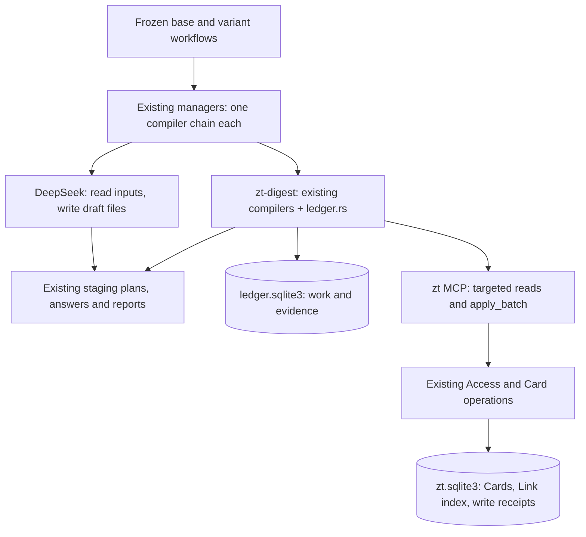
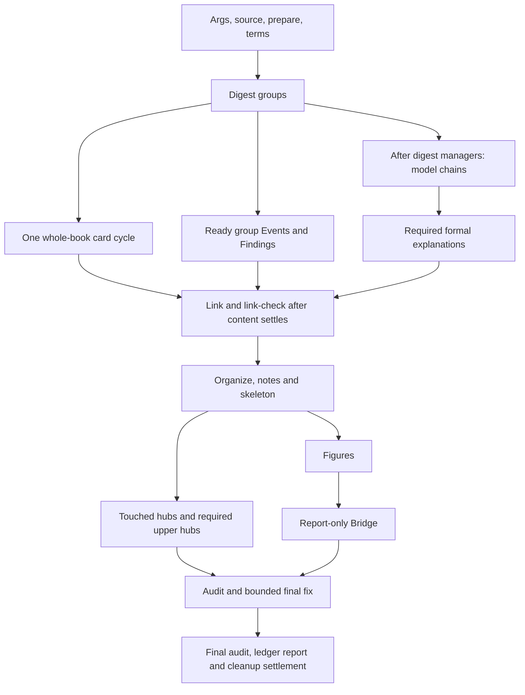

# Reliable and Fast Digest Runs: Implementation Design

Status: proposed implementation design, 2026-10-17. This document specifies work; it does not claim that the features, migration, cleanup, or performance targets have been delivered.

Based on [Digest Run Issues (stiglitz2014learning): Proposal](digest-run-stiglitz2014-issues-proposal.md), third version. The design covers G1–G3, L1–L9, A1–A7, W1–W17, I1–I38, and the daemon diagnostics in M4. It preserves the proposal's explicit decision: **no MCP read cache**.

## 1. Intended result and design boundaries

A digest should have one durable account of its intended work, one checked account of its completed work, and one command path for finishing the remainder. Its tools should read and write the relevant Cards rather than repeatedly reconstructing the whole slip-box.

The smallest structure that provides this is:

1. Keep the existing `zt` process, SQLite archive, operations, and MCP interface. Add a Link index, atomic write receipts, targeted reads, and one batch write operation.
2. Keep the existing `zt-digest` binary and layer compilers. Add one local SQLite ledger module and connect each compiler's existing validation and apply steps to it.
3. Keep the existing frozen workflow framework. Change the base's declared scheduling and manager instructions, then rebuild both variants through pre-flight.

There is no new service, message broker, shared read cache, general workflow engine, source-ownership database, or GUI. The existing lock file remains. A single writer in the service and FTS5 search remain optional later work; neither is required to complete this design.

### 1.1 What the three goals mean precisely

| Goal | Deliverable | Limit of the guarantee |
| --- | --- | --- |
| G1: nothing is silently lost | Every prepared group, declared candidate, compiler job, dependency, downstream action, and external conversation is accounted for as verified, deliberately inapplicable/refused, or unresolved with evidence. | The ledger cannot discover an idea or model that no source-analysis step recognized. Semantic coverage remains a source-review responsibility. It can prevent recognized work from disappearing. |
| G2: at most one rerun | One explicitly invoked `resume` drains the entire unresolved dependency closure, including newly released downstream work, within bounded automatic retries. Completed build units are not executed again. | One rerun cannot guarantee that an unavailable provider, missing source, or invalid mathematical claim becomes correct. Persistent failures remain named for manual work; the system does not request an endless series of reruns. |
| G3: slow tools become fast | Eliminate per-Card whole-archive reconstruction and ordinary whole-archive rewrites; replace repetitive MCP reads with bulk reads. Measure the proposal's command targets on the same archive fixture. | Millisecond reads and the 3.5–4 hour full-run estimate are targets, not results. Global exports and large connected models still scale with their actual input size. |

“Never touch done work” means never rerun a completed unit's build or overwrite its completed content merely to retry a neighbour. Later declared operations may add a reasoned Link, update a structure Card, attach a figure, or refresh a hub. Those are separate units with their own exact changes. A complete model's substantive text is not rebuilt by `resume`.

### 1.2 Decisions used to make this design concrete

Use the proposal's suggested answers to Q1–Q6 and Q8 as design defaults: one book card cycle; three automatic attempts for transient faults; continue with available outputs after a partial layer; ledger beside staging; improved lock file; transactional Link index; chapter endnotes as reference text. Q7 is already decided: no read cache.

These are specification choices, not a claim that the user has authorized a live migration or a new digest run. This document's preparation changes no Cards, installed workflow, Scholar Archive file, or external conversation.

The existing operating boundaries remain: agent Access cannot edit human Card content; explicit Bridge selections remain necessary; a new long run or `resume` follows the established run authorization/checkpoint policy; deployment does not interrupt an active digest.

## 2. Current implementation and the changes it needs

The following baseline was checked in the repository at `f1275d5`. The original proposal's live counts are historical observations, not a fresh measurement of the current archive.

| Existing mechanism | Current source | Consequence for this design |
| --- | --- | --- |
| MCP reads reconstruct `Snapshot`; `get_card` includes model, hubs, navigation, and Links | `src/mcp.rs`, `src/ops.rs` | Preserve response semantics while replacing the data-loading path. A small JSON response alone does not prove a small read. |
| `validate_card_text` constructs the full Link lifecycle | `src/main.rs` | Targeted Reverse link updates alone are insufficient. Ordinary write validation must also stop loading every Card. |
| Reverse links are regenerated by parsing and updating every Card | `src/main.rs`, `src/link.rs` | Keep the stored section and its exact formatting, but maintain only affected targets for ordinary writes. |
| Cards use `location` or `citation_key`; the in-memory `address` is their coalesced value | `src/main.rs` | SQL examples must respect the existing schema rather than assume a `cards.address` column. |
| Each compiler has local job files and `state.json` | `tools/zt-digest/src/card.rs`, `src/model/compiler.rs`, `src/event/layer.rs`, and the other compilers | Retain those formats for compiler progress; do not create a second independent definition of run completion. |
| `zt-digest` is a separate crate; it reuses `zt-check` and its MCP client | `tools/zt-digest/Cargo.toml`, `tools/zt-check/src/mcp.rs` | Add SQLite to this small crate, without extracting or embedding the entire `zt` application. |
| The workflow interprets managers' answers; modules can return failure while the kernel considers a stage finished | `scripts/book-digest/workflow/modules/zt-digest-blocks.js`, `zt-digest-lib.js`, `zt-digest-report.js` | Stage settlement and domain completion must be separate fields checked by the ledger. |
| Digest helpers currently permit direct Card writes and implement append as read plus full-body edit | `tools/zt-digest/src/calls.rs` | Reliable run mode routes generated changes through checked, identified compiler applies. |
| Base 2.3.0, economics 3.3.0, mathematics 2.4.0 are declared in the source blueprints | `scripts/book-digest/workflow/*.blueprint.json` | Change sources and version the builds. Do not edit `.claude/workflows/*.js` by hand. |
| I14's filed-parts validator fix is already in `bb7e905` | `tools/zt-digest/src/model/compiler.rs` | Keep and regression-test it. Do not implement another validator workaround. |

The source blueprints and code take precedence where an older narrative document names earlier versions.

### 2.1 Ownership of truth

| Question | Sole authority |
| --- | --- |
| What does a Card say? | Its authored text and existing metadata in `zt.sqlite3`. |
| Which Links occur in that text? | The body parser; `links` is its transactionally maintained index. |
| Did an identified write commit? | A receipt in the same archive transaction as that write. |
| What work remains in this prepared run? | `<out>/ledger.sqlite3`. |
| Which parts/jobs has a compiler prepared? | Its existing plan and progress files, referenced and checked by the ledger. |
| Is the output acceptable? | The compiler validator and `zt-check`, run by `zt-digest`; an agent's success statement is not sufficient. |
| May a Bridge sentence be applied? | The existing exact report and separately accepted selections. |

The ledger is an orchestrator's record. It is not another Card store, another mathematical validator, or a replacement for immutable Bridge reports.

## 3. Minimal architecture and code placement



### 3.1 New production files

Four focused Rust modules and one runner definition are enough. Tests and documentation are additional files, not additional runtime components.

| New file | Responsibility | Why it is separate |
| --- | --- | --- |
| `src/link_index.rs` | Index migration, body-to-index parsing, affected Reverse links, reindex and integrity comparison. | One owner for the derived Link index. |
| `src/read.rs` | Targeted SQL loading and MCP read projections; reuse the existing model/hub calculation functions. | Keep query construction out of MCP argument dispatch. |
| `src/batch.rs` | Batch validation/application, stable local references, archive write receipts, owned-paragraph replacement. | One transactional boundary for identified writes. |
| `tools/zt-digest/src/ledger.rs` | Schema, identity checks, claims/leases, dependency readiness, verification dispatch, registration, recovery, status and reports. | One ledger implementation; no per-layer scheduler classes. |
| `.claude/agents/zt-digest-runner.md` | Allowed tools and mechanical manager instructions. | A small agent definition checked by pre-flight, not a new runtime. |

Keep group-start/group-finish in `prepare.rs`, bulk snapshot rendering in `snapshot.rs`, model fixes in the existing model compiler, and quality rules in `tools/zt-check/src/check.rs`. Add small internal functions to those files rather than one plugin or trait hierarchy per layer.

Refactor the necessary low-level writers into functions that accept an existing transaction. Both current single writes and `apply_batch` call those functions. Do not call public operations that acquire their own lock or commit their own transaction from inside a batch.

### 3.2 Existing files that change

| Area | Main existing files | Change |
| --- | --- | --- |
| Archive storage and diagnostics | `src/main.rs`, `src/ops.rs`, `src/link.rs` | Migrations, targeted validation, shared transaction helpers, lock classification, revision counter, reindex/status commands, daemon logs. |
| MCP | `src/mcp.rs` | New read/batch schemas and dispatch, structured fault codes, preserve old response contracts. |
| MCP client/checker | `tools/zt-check/src/mcp.rs`, `src/check.rs` | Bounded MCP waits, bulk read support, shared orphan result and new corruption checks. |
| Digest transport and reads | `tools/zt-digest/src/main.rs`, `src/calls.rs`, `src/audit.rs`, `src/snapshot.rs`, `src/prepare.rs` | Ledger/group commands, identified writes, scoped and bulk reads, source resolution and notes. |
| Layer compilers | Existing `card`, `model`, `event`, `finding`, `organize`, `skeleton`, `hub`, `figures`, `bridge`, `math`, `terms` modules | Register their actual work, provide checked outputs, apply with receipts, emit downstream work. |
| Workflow | Source base/variant blueprints, simulation files, and existing stage/library modules | Fixed bounded claim loops, runner role, declared readiness, resume, final report and cleanup. |
| Agent integration | Existing `skills/zt/`, `skills/zt-digest-protocol/`, prompts and installer | Describe the new commands, draft-first writes and retry/result contracts. |

When implementation changes any block, update its wiki doc in the same commit. Relevant blocks are [Card operations](wiki/card-operations.md), [Service and CLI](wiki/service-and-cli.md), [MCP](wiki/mcp-server.md), [Cards and Links](wiki/cards-and-links.md), [zt-check](wiki/zt-check.md), [zt-digest](wiki/zt-digest.md), [Digest workflows](wiki/digest-workflows.md), [Digest scripts](wiki/digest-scripts.md), [Digest prompts](wiki/digest-prompts.md), and [Agent integrations](wiki/agent-skills.md).

## 4. The archive Link index and small writes

### 4.1 Schema and invariants

Use the proposal's occurrence table:

```sql
CREATE TABLE links (
    source TEXT NOT NULL,
    ord INTEGER NOT NULL CHECK (ord >= 0),
    target TEXT NOT NULL,
    kind TEXT,
    PRIMARY KEY (source, ord)
);
CREATE INDEX links_by_target ON links(target, source);
```

`source` and `target` are current ZET addresses. `ord` is the occurrence order, including repeated occurrences of the same target. Do not add a target foreign key: a Broken link must survive deletion of its target. Source rows are maintained explicitly in the same transaction as source creation, deletion, and address changes.

Use `LinkBody::parse` for occurrence boundaries and the same relation parser as `model::read_links` for kinds. Include existing mathematical relation kinds such as `specializes`. A plain reference has `kind = NULL`. Do not maintain a second vocabulary or scan generated Reverse links, BibTeX, titles, or code regions that the current parser excludes.

The body stays authoritative. Persisting a Link occurrence does not give a model a new member or turn a source-reference Link into a semantic Bridge. Those meanings remain in the current domain calculations.

Use metadata keys for `links_index_version` and a monotonically increasing `archive_revision`. Increase the revision once for each transaction that actually changes Cards or their relevant metadata. All writers, including Session, GUI, shell operations, batch operations and reindex repairs, use the same finalization helper. An exact write replay does not increase it.

The revision identifies a read view across processes. `PRAGMA data_version` is connection-relative and must not be exposed as a comparable cross-process revision.

### 4.2 Ordinary create or edit

Under the existing edit lock and one SQLite transaction:

1. Load the affected Card and validate agent Access, metadata changes and the caller's base.
2. Parse the new authored body once. For each distinct outbound target, query its existence by indexed `location`/`citation_key`. Permit an already broken target only under the current old-body preservation rule. A new invalid target is still refused.
3. Apply the Card change and replace this source's occurrence rows.
4. Collect an affected set: the changed Card itself; targets whose distinct inbound membership changed; and every old/new target if the source's title changed. Using the union of old/new targets is also correct and simpler for the first implementation.
5. For each existing target in that set, query distinct source addresses and their current titles. Render with the existing `card::reverse_section` function and existing address ordering. Update a stored Card only if its composed text differs.
6. Commit the body, metadata, occurrence rows, Reverse links, revision, and any write receipt together.

A body edit that preserves all targets usually changes only its own Card. A source title edit updates the Reverse link wording of its targets. Creating a target at an address already named by a Broken link supplies the new target's existing inbound sources immediately.

Updating a generated Reverse link section does not re-index that target's authored body: the generated section is outside the index's input. This prevents recursive update work.

This change must cover `validate_card_text` as well as `regenerate_reverse_links_tx`. Leaving the former's whole-archive Link lifecycle in every write would retain a large part of M3's cost.

### 4.3 Structural changes

Move, insert, citation-key rename, delete/repoint, compaction and legacy conversion keep their present plan/confirm and Access rules. Apply their address mapping and all authored Link rewrites in the current transaction; then remove old source keys, index changed/moved sources under their final addresses, and rebuild affected Reverse link sections.

Use the complete old/new target union, renamed targets and deleted targets' outgoing destinations. Incoming occurrences to a deleted Card remain Broken links unless the existing confirmed plan repoints them. Do not cascade-delete those rows.

Rare structural operations may initially perform a full parse once inside their existing transaction. That is an explicit correctness fallback; it must not be called for an ordinary create/edit. Even this fallback should update only stored text that actually changed.

Human authored bodies remain protected by existing Access checks. Generating a human target's Reverse links is allowed under the existing rule; rewriting its authored Link because a source moved remains refused to an agent.

All index writers must ship together before fast readers depend on the index. Do not enable A1 after converting only some writer paths.

### 4.4 Migration, reindex and rollback

1. Finish or stop authorized digest work before deployment. Inventory the configured archive root and installed version.
2. Make a consistent SQLite backup using `VACUUM INTO` or the SQLite backup API; verify `integrity_check`. Copying only a WAL-mode database file is insufficient.
3. Under the edit lock, check the migration marker, create the table, parse every existing body, populate rows, compare generated Reverse links, and set the marker in one transaction. A malformed body aborts with its address; do not publish a partial index.
4. Add the ensure step before any existing early return for an already-Markdown archive. A new table must not be skipped because `card_format` already equals `markdown`.
5. Expose `zt reindex` for rebuilding the index and generated sections, and `zt status --check-links` for a read-only comparison with a fresh full parse. The latter reports the first mismatches, totals, archive revision and a nonzero exit code.
6. Retain the full parser path as the test oracle and repair path. It is not an automatic fallback that conceals drift in ordinary fast reads.

An interrupted migration rolls back. A second attempt is idempotent. Before deployment, compare all authored bodies and metadata with the backup, including human Cards; only intended generated-section repairs may differ.

An old binary does not maintain this index or atomic receipts. Therefore rollback restores the pre-upgrade archive and compatible binaries, or runs a separately qualified conversion before any old writer is permitted. Do not run mixed old/new writers against the upgraded archive.

## 5. Targeted and bulk reads

### 5.1 Preserve behaviour while reducing loading

Keep existing `get_card`, `get_tree`, `list_trees`, `get_model`, Link, hub and Workspace response fields. Load a consistent SQLite read transaction per request. Extract calculation helpers from `Snapshot` where necessary; do not duplicate model mathematics in SQL.

| Tool | Data loaded |
| --- | --- |
| `get_card` | The Card; indexed inbound/outbound occurrences and referenced titles; immediate navigation; relevant hub/model context needed for the existing full response. |
| `get_tree` | The exact root and its `location` prefix range; metadata, outgoing/incoming counts and external titles required by the existing summaries. |
| `list_trees` | Root metadata plus grouped counts over indexed address/tree ranges; no full model calculation per Card. |
| `get_model` | Filed members, linked-in shared members, relevant ancestors/model heads, relations, boundary targets and reverse users/theories needed by the existing build and math reports. |
| `list_links`, `list_broken_links` | Indexed occurrences, existence checks, and source body lines when requested. Preserve repeated-occurrence reporting where currently exposed. |
| `get_hub`, `list_hubs` | Relevant hub/member structure and policy scope; explicitly global policy queries may still enumerate Workspace metadata. |
| `list_workspaces` | SQL counts and indexed Broken link counts. |

`get_model` must preserve `models`, `filed`, `also`, shared derivation chains, `neighbours`, `build`, cited premises, reach-in faults, mathematical load, `used_by`, theories and study results. Follow relevant indexed relationships until the required context is complete. A shared part can belong to several models and several models can share premises; loading only the filing subtree would be incorrect.

Validate every result against the existing full Snapshot oracle on a fixture with shared parts, cross-tree membership, mathematical units and human Links. If a connected component is large, report and measure that work; do not silently truncate the context to meet a latency target.

The Session and GUI retain their current Snapshot lifecycle. Their full rebuild can take inbound relationships from the Link index, but this design introduces no new cache invalidation scheme.

### 5.2 SQL and address details

Query `location = ?` or `citation_key = ?` using their existing unique indexes. For generic address queries, use an expression index on `COALESCE(location, citation_key)` only if query-plan measurements justify it. No extra stored address or title column is required initially.

Tree membership is exact root membership plus an indexed `location` prefix range for `<tree>/`. Escape pattern characters if using LIKE; citation keys must not accidentally act as SQL wildcards. Filter with the existing membership rules and sort results in ZET address order, not naive text order (`/10` must not precede `/2`). Preserve case-significant Citation keys and existing case-conflict checks.

Titles are currently inside Markdown text. `export_titles` will stream selected text rows once to parse titles. It is O(selected archive text), but one pass and one MCP call, rather than one complete archive parse per tree. Do not claim constant work or add another title cache to hide that fact.

### 5.3 New/extended read contracts

| Interface | Proposed input | Result |
| --- | --- | --- |
| `get_cards` | `addresses: string[]`, optional `view: "full" | "text"` (default `full`) | Ordered results plus `missing`, `complete`, `archive_revision`. `full` matches `get_card`; `text` includes address, authored text/body, BibTeX, type/facet/level/form and Workspace, without expensive model/hub projections. |
| `get_tree` | Existing arguments plus `bodies: true` | Existing summaries augmented with `body`, `text`, and BibTeX where present; one read view. Existing calls remain unchanged. |
| `export_titles` | Workspace and optional Zone filter | Address, tree, Workspace, type, facet and title per selected Card, plus count and revision; no body in the reply. |

Initial `get_cards` limits: 200 addresses and 8 MiB reply size. If a batch cannot fit, return a structured limit error; the client reduces the chunk size. Never return an apparently complete truncated batch. A tree/export response that exceeds its limit similarly fails explicitly; pagination is added only if actual archive measurements require it.

Some workflows need two reads, such as a book tree with bodies and external targets. If the revisions differ, retry the read set once or label the result a changing view. The final audit runs after this run's writes settle and records its revision; concurrent human edits are still possible and must not be represented as a frozen global state.

### 5.4 Digest read changes

- `snapshot-topics`: one fresh `export_titles` call per group, with the same title rendering and truncation rules. No snapshot is shared between groups.
- Group/offline checks: use the group's owned-Card manifest and required external targets. Run zt-check on drafts/loaded JSON; do not audit every tree first.
- Whole-book card cycle: one bulk book read plus the manifest's external Cards and required relationship metadata. Partition computation locally, not into hundreds of MCP processes.
- `prepare-link`: book bodies plus the title export/needed external targets, in a small bounded number of calls/chunks.
- `audit`: load the required scope and indexed inbound facts. A missing read is `incomplete`, not an empty Card list or zero faults.
- Keep one MCP process per command. Retain multi-worker reads only for genuinely large independent batches with measured benefit; default to one for the new bulk path.

These are command-local reads, not a persistent read cache.

## 6. Atomic writes and replay safety

### 6.1 Why the archive needs write receipts

The proposal places idempotency keys in ledger `ops`. That alone cannot guarantee safe replay: a Card transaction may commit and the process may die before the separate ledger transaction records it. Repeating the write then duplicates content.

Store the authoritative receipt **inside `zt.sqlite3`, in the same transaction as the Card change**. The ledger records references to receipts as outputs; it needs no second `ops` table or two-database transaction protocol.

```sql
CREATE TABLE applied_ops (
    op_key TEXT PRIMARY KEY,
    request_hash TEXT NOT NULL,
    result_json TEXT NOT NULL,
    committed_at TEXT NOT NULL
);
```

`request_hash` covers canonical operation kind, arguments, base content and local references. `result_json` retains allocated addresses, before/after authored fingerprints, and any owned-paragraph information needed by a later correction. Requests are canonicalized once with explicit defaults; JSON object-key order and line-ending transport differences do not create accidental new operations. Authored text is not normalized in a way that changes its meaning.

The key format is `<run_id>/<unit_id>/<plan_revision>/<step>/<stable_item_id>`. Attempts do not appear in the key. A changed accepted plan or fix is a new revision/key; using the same key with different content is a conflict, never permission to overwrite the earlier result.

Receipts remain while the run can be resumed. Do not expire them by time during an active or retained run. A later retention policy can remove receipts only when their associated runs are deliberately retired.

### 6.2 `apply_batch`

One MCP call accepts ordered creates and edits. It holds one edit lock and one SQLite transaction, then updates affected Reverse links once. The first version supports Topic/Literature/successor creation and content/type metadata edits used by the compilers. Destructive move/insert/delete confirmations stay on their existing path.

Each item has an `op_key`, a `client_ref`, a supported tool name and arguments. `@@<client_ref>` references an earlier result in the batch, so new parts can Link to earlier newly created parts. Compile forward references only when all addresses can be allocated and validated before writing; otherwise split the plan into dependency-ordered batches. Do not create unchecked placeholder text to make a forward reference exist.

Example shape, deliberately abbreviated:

```json
{
  "items": [
    {
      "op_key": "run-001/models:7a/p1/fill/setting",
      "client_ref": "setting",
      "tool": "create_successor",
      "arguments": {"at": "book/7|a", "kind": "side", "title": "设定", "body": "…", "type": "model", "facet": "设定"}
    },
    {
      "op_key": "run-001/models:7a/p1/fill/result",
      "client_ref": "result",
      "tool": "create_successor",
      "arguments": {"at": "@@setting", "kind": "direct", "title": "结果", "body": "依赖 [[@@setting]]，…", "type": "model", "facet": "结果"}
    }
  ]
}
```

The real schema uses the existing tool's field names and validation. This example is a proposed envelope, not an already executable call.

Processing order:

1. Check agent Access, limits and supported operations.
2. Look up each receipt. Matching hash returns its stored result and supplies its `client_ref`; a different hash aborts.
3. Resolve references, allocate new addresses under the lock, validate bases, Card format, Links, artifacts and model/type constraints against the transaction's evolving view.
4. Apply all unseen items, update the Link index and affected Reverse links, add receipts and bump the revision.
5. Commit and return each item's result and whether it was newly applied or replayed.

If any unseen item fails, roll back all unseen changes in that batch. Previously committed receipts remain committed. Repeating a completely committed request returns exactly the original allocated addresses and makes no new Card.

Initial limits are 64 items and 1 MiB authored input per batch. A large model uses deterministic dependency-ordered chunks. Each chunk is atomic; the complete multi-chunk model is not. The unit remains open until all chunks and final validation succeed. Optimize the limit from measured lock duration rather than promise an unbounded “one transaction per model.”

### 6.3 Optimistic concurrency and paragraph ownership

Identified batch edits carry a base fingerprint of authored title/body and editable metadata. Generated Reverse links are excluded so an unrelated inbound Link does not create a false conflict. Compare the base inside the transaction. Preserve current single-`edit_card` raw-base behaviour and the Bridge compiler's existing exact checks.

For the link pass, store the exact inserted paragraph and its Card in the write receipt. A correction is a new operation referring to that receipt:

- If the current body has exactly one matching owned paragraph, replace that span only.
- If the desired paragraph is already present from a verified legacy write, adopt it without appending another copy.
- If the old paragraph is absent, duplicated or changed by another writer, return a conflict with the observed body. Do not use fuzzy text replacement.
- Preserve every byte of authored content outside the matched span. Validate the corrected Card and its Links before commit.

This needs no visible marker in the Card and no new paragraph-ownership table. The receipt is the provenance. Repeated legacy paragraphs are reported and cleaned by a reviewed card-fix operation; ordinary append does not silently delete unrelated material.

### 6.4 Reconciliation after a lost answer

If the process dies after commit but before updating compiler state or the ledger, the next attempt repeats the same operation key. The archive returns the receipt. The compiler restores its address map from that result, rereads the outputs, and completes verification before changing the ledger.

If the process dies before commit, neither content nor receipt exists. Replay performs the write once. A failure in one chunk never makes the compiler assume that every later chunk committed.

Existing address-changing operations continue emitting `moved` maps. Update ledger locators, compiler progress and helper logs from those maps before another dependent apply. Unit identity is a logical work key, not a mutable Card address. If an external move cannot be reconciled from recorded mappings, report a stale input conflict; do not guess a replacement Card by its title.

## 7. One local run ledger

### 7.1 Identity and files

`<out>/ledger.sqlite3` belongs to one immutable preparation of one book. Store these identity values in `meta`: schema version, random `run_id`, canonical archive identity, Citation key, source file id/path and SHA-256, preparation/group manifest hash, effective options, workflow/variant versions, creation time, current invocation number and resume count.

An archive identity is a UUID recorded once in the archive's existing `metadata`, plus the resolved archive path for diagnosis. A path alone is insufficient: restoring another database at the same path must not silently reuse pending work. A backup restore preserves its identity; verify the expected output fingerprints as well.

A source, group-range, Citation-key or incompatible workflow-contract change requires a new preparation/output directory. Do not overwrite the old ledger or silently reinterpret its units. A compatible bug-fix binary may resume it when the stored contract versions and artifact schemas still validate.

Keep current `manifest.json`, `owned-gNN.txt`, source logs, plans, answers and reports in their existing places. The ledger stores their hashes and locators, not duplicate copies of their full contents. Files that carry evidence use atomic temp-file replacement; temporary writes are never accepted as finished artifacts.

### 7.2 Five tables, no separate job or scheduler database

Use SQLite WAL, foreign keys and a 10-second busy timeout. Keep transactions short; never hold one while awaiting an LLM, running zt-check or making an MCP call. Use the repository's established `rusqlite` version, with the same bundled-SQLite approach if required by the Windows build.

The following is the logical schema; JSON columns allow compiler-specific details without a table per layer.

| Table | Fields and purpose |
| --- | --- |
| `meta` | `key PRIMARY KEY`, `value`; immutable preparation identity and small invocation/barrier records. |
| `units` | `id PRIMARY KEY`, `layer`, `logical_key`, `revision`, `state`, `attempts`, `owner`, `claim_token`, `lease_until`, `retry_after`, `fault_class`, `fault_json`, `inputs_json`, `input_hash`, `progress_json`, `result_json`, `created_by`, `created_at`, `completed_at`. Unique `(layer, logical_key, revision)`. |
| `deps` | `(unit_id, needs_id) PRIMARY KEY`, `condition`; `success` or `settled`, as described below. Both endpoints reference units. |
| `outputs` | `(unit_id, output_key) PRIMARY KEY`, `kind`, `locator`, `fingerprint`, `data_json`; Cards, reports, manifests, write receipts, external run/conversation ids and usage facts. |
| `events` | Monotonic sequence, unit/invocation, UTC time, owner, claim token, event name and compact JSON facts. Append-only record of claims, transitions, faults, registrations and cleanup. |

Index `(layer, state, retry_after)` and `deps(needs_id)`. Do not add indexes speculatively. Compile SQL into this module; no generic repository abstraction is needed.

The proposal's ledger `ops` becomes references in `outputs` to archive `applied_ops` (§6). This is the one necessary placement change to obtain atomic replay safety.

External jobs are existing compiler jobs whose ids/results are recorded in `progress_json` and `outputs`. A separate cleanup unit represents their remote resource lifetime. Do not create another parallel system of job states.

### 7.3 Unit identity and publication revisions

Use readable logical keys, for example `digest/g092`, `models/<stable-model-key>`, `notes/<suggestion-id>`, `hubs/216`. Record the current Card address as an input/output locator. A stable model key can be the source group's local Model id assigned in its accepted manifest; an imported legacy model receives a fixed key during adoption.

Most content units have revision 1. Aggregate outputs such as `cards-book`, link-check, Organize, structure, figures, hubs, Bridge discovery and audit need a new revision when new upstream work arrives.

Example:

1. Initial digest builds model A but model B fails. `organize/book@1` publishes a structure listing A and explicitly naming B as unresolved. `hubs/216@1` describes that checked input set.
2. Resume builds B and emits its notes, structure contribution, Link requirements and touched-tree list.
3. The publication input set changes. Register `organize/book@2` and `hubs/216@2` with the new dependencies. Do not reopen `@1`, and do not rerun model A.
4. The report selects the latest required publication revision and states when an earlier report has been superseded.

For aggregate units, derive the next revision idempotently from a sorted input manifest: contributing unit ids and verified output fingerprints, relevant unresolved-unit dispositions, plus the publication contract version. Repeated registration of the same input hash returns the same revision. The manifest must include status changes even when a previously empty producer now deliberately has no output.

Do not create one structure unit per sentence. Model outputs contain their structure contribution; one Organize/structure revision consumes all available contributions. Likewise coalesce hub refreshes by touched tree, and collect independent note suggestions into the existing notes compiler while retaining a disposition per suggestion.

This is the smallest way to satisfy both permanent `done` and fresh downstream outputs after a repair.

### 7.4 Dependencies and closing the work list

A dependency has one of two meanings:

- `success`: this unit needs a verified output from that producer. If the producer fails, this unit is blocked.
- `settled`: this aggregate may run once the producer is terminal, consuming available outputs and listing the producer's failure. This permits a partial book report instead of blocking every later layer on one lost group.

For example, `events/g092` requires `digest/g092` to succeed. The initial book summary waits for the registered digest groups to settle. It may summarize 164 verified groups while visibly naming seven gaps. It must not invent those groups' content.

Register all group units and required fixed book-level work at preparation. A producer's successful completion atomically records its outputs, registers every derived unit/dependency, appends its completion event and sets it `done` in one ledger transaction. A crash cannot leave a done producer with unregistered children.

Dynamic layers require an enumeration barrier. A layer is sealed only when every producer capable of registering more items has settled and its enumeration/closure event is recorded. A zero-row `next` response while a producer is still running does not complete the layer. Use the existing fixed layer table and `meta` barrier records; do not build a generic streaming DAG service.

At every final gate, reconcile accepted manifests against registered units. Missing candidate ids, skipped jobs and missing children are faults. Dependency cycles or references to a nonexistent part are content faults with the exact cycle/reference named, rather than endless `registered` rows.

### 7.5 States, attempts and leases

| State | Meaning and permitted transition |
| --- | --- |
| `registered` | Known but not claimable; becomes `ready` when its success/settled dependencies are satisfied. |
| `ready` | Claimable; atomic claim changes it to `claimed`. |
| `claimed` | One owner and fencing token; may complete, retry, fail, or return to recovery after a lost owner. |
| `retry` | A retryable fault with `retry_after`; becomes ready after backoff and dependency checks. |
| `failed` | Content fault or exhausted attempt budget; included in the unresolved list. |
| `blocked` | A failed dependency prevents useful work; exact prerequisite recorded. Recomputed after that prerequisite changes. |
| `done` | Checked outputs and dispositions committed; terminal for this unit revision. |

Default maximum: three actual attempts per unit per invocation, including the initial attempt. Backoff before attempts two and three is 5 and 20 seconds, with bounded jitter. A claim that never reaches execution is still recorded, but dependency waiting is not a failed attempt. Keep total historical attempts in events when the resume invocation resets its own attempt counter.

Claim using `BEGIN IMMEDIATE`, select ready rows in stable order, assign owner/token/lease, append events and commit. Two managers must never receive the same current claim. Completion, failure and renewal require the exact current token; a late manager cannot overwrite a newer attempt.

Default lease: 120 seconds, renewed every 30 seconds. Long-running `zt-digest` commands renew themselves from a small internal heartbeat while doing bounded work. Between commands, a manager renews while polling its registered DeepSeek run, with waits short enough to renew. Heartbeat facts are timestamps and process/run ids, not agent assertions that the unit is complete.

### 7.6 Preventing a late writer after lease expiry

A fencing token in the ledger alone cannot atomically fence a transaction in a different database. Close that gap locally:

1. Reliable-run DeepSeek jobs write draft files, not Cards. Stale external jobs therefore cannot mutate the archive.
2. Before any compiler mutation, take an OS file lock for that unit under `<out>/locks/`, verify the current claim token, and hold the guard through the archive call and receipt reconciliation. Competing compiler processes for the same unit share this guard.
3. A reclaimer takes the same guard before changing the token. It cannot revoke a claim in the middle of an active compiler apply. A killed process releases the OS guard; stale lock-file presence alone does not prove ownership.
4. Bounded MCP transport waits stop a hung apply, terminate only its owned child process, and reconcile receipts before releasing/reclaiming the claim. Never start a second attempt while the old archive writer is still active.
5. When a registered external run is still running, request cancellation and observe its terminal state before launching a replacement. Late draft files carry the old token and cannot be accepted by the new attempt.

The guard is per unit and held only across mutations/recovery, not across minutes of LLM work. No global staging writer queue or persistent coordinator is introduced.

A surviving background command keeps renewing and may finish the unit after its manager has returned. If both manager and command die, recovery inspects the registered job and archive receipts, then retries only the unfinished work. A command that exited successfully is not reclassified as failed because its agent returned “no output.”

### 7.7 Fault classification

| Retryable | Final/content or operator action |
| --- | --- |
| Edit lock busy, Windows sharing violation on the lock, SQLite busy after bounded wait | Access refusal, invalid arguments, incompatible run/archive identity |
| MCP transport closure, bounded command timeout, service temporarily unavailable | Invalid plan after permitted fix rounds, unresolved mathematical dependency cycle |
| DeepSeek cap, transient provider failure, missing required result from an otherwise incomplete job | Source unavailable within the selected files, unsupported claim not repaired/labelled, stale content requiring a deliberate new plan |
| Missing structured step result, unexpectedly missing jobs, pending unapplied jobs | Hard zt-check faults left after allowed correction rounds |
| Lost manager/lease after safe reconciliation | Conflicting operation key, changed owned paragraph or unreconciled external move |

Do not retry every MCP error as transient: a permission or validation error remains final even if transported over MCP. Typed errors carry a stable code, retryability, operation/unit and observed cause; human-readable text remains available. Retain legacy message recognition only at the compatibility boundary.

No prompt decides the retry count. The unit driver applies this table, records the fault, and proceeds to the manager's other units. A failed prerequisite causes a dependency wait/block, not repeated failed attempts by all dependants.

## 8. Commands and checked layer contracts

### 8.1 Command surface

Every new command below is proposed, not available in the current binary. All ledger/group commands take `-Out <out>` explicitly; do not infer a staging folder from the process's current directory.

| Command | Contract |
| --- | --- |
| `zt-digest ledger init -Out <out>` | Validate manifest/identity and create or verify schema; register root units idempotently. Normally called by prepare. |
| `zt-digest ledger next -Out <out> -Layer <layer> -Take <n> -Owner <id>` | Reconcile readiness, claim bounded units atomically; return unit ids, tokens, input hashes and command/job inputs. |
| `zt-digest ledger renew -Out <out> -Unit <id> -Token <n>` | Extend only the current claim. Compiler heartbeats call the same internal function. |
| `zt-digest ledger done -Out <out> -Unit <id> -Token <n> -Outputs <file>` | Dispatch to the layer's deterministic verifier. Caller-supplied addresses alone cannot establish completion. Record checked outputs and children atomically. |
| `zt-digest ledger fail -Out <out> -Unit <id> -Token <n> -Class <class> -Fault <file>` | Record a structured fault; classification is checked against known codes. |
| `zt-digest ledger gate -Out <out> -Layer <layer>` | Return settlement, completion, sealing, counts and unresolved ids. Never infer completion from empty claims. |
| `zt-digest ledger status -Out <out> [-Layer <layer>]` | Read-only coverage, placeholders, dependencies, latest publication revisions and outstanding jobs/cleanup. |
| `zt-digest ledger rerun-list -Out <out>` | Read-only unresolved units plus prerequisite and downstream closure, excluding done builds. |
| `zt-digest group-start -Out <out> -Group <n> -Token <n>` | Verify claim/dependencies, make the fresh snapshot, freeze exact prompt/input hashes and issue the prepared job manifest. |
| `zt-digest group-finish -Out <out> -Group <n> -Token <n> -Draft <json> [-CheckOnly]` | With `-CheckOnly`, validate the draft without writes. Otherwise recheck, apply identified operations, verify the owned manifest and SELF-CHECK evidence, then complete/register children. |

Compilers receive the claim through explicit internal arguments/context and call these library functions themselves. Ordinary agents usually call only their step chain and read its final JSON. The `ledger done` CLI is useful for recovery/testing but is not a trust bypass.

Exit codes for ledger commands: 0 for a successful operation or a settled gate; 1 for operational failure; 2 for invalid invocation; 3 for a gate with executable/in-flight work. A settled partial gate returns 0 with `complete: false`; it is never printed as complete. The final run result reports partial and returns a nonzero CLI outcome if exposed through a top-level command. The frozen workflow maps that field explicitly instead of trusting the process exit code alone.

Example settled partial result:

```json
{"layer":"digest","sealed":true,"settled":true,"complete":false,"counts":{"done":164,"failed":7,"blocked":0,"open":0},"unresolved":["digest/g092","digest/g093","digest/g094","digest/g095","digest/g168","digest/g169","digest/g170"]}
```

### 8.2 The completion rule common to every layer

Verification runs after reading back actual outputs. Required files must parse and match their input/plan hash; required Cards must exist under the permitted Workspace and satisfy the layer's validator. `pending_jobs > 0`, an unexpected empty job list, a missing expected compiler step, a missing `faults:` result or a failed read prevents completion.

A valid no-op is explicit: an enumerated input had zero candidates, a model level makes derive inapplicable, or a note was refused with a checked reason. Record that disposition and the enumeration/check that supports it. An empty answer is not a valid no-op.

Some checks hand their faults onward, such as group offline checks handing work to the book cycle. Their unit can be done with disposition `deferred` only if every fault has a registered consumer. The final consumer must resolve it or keep it unresolved; recording a reason alone does not turn a hard quality failure into a pass.

Domain-tolerated premises and existing preserved faults are reported separately. They are not a new generic “ignore validation” mechanism. A source supplement must use the existing explicit label and pass the relevant validator.

### 8.3 Unit table

| Layer/unit | Completion evidence | Work emitted |
| --- | --- | --- |
| Prepare/book | Frozen source/range/group manifest, required files, Literature metadata, initialized ledger. Every chosen group is registered before workers start. | Terms, all digest groups, required book publications and enabled variant obligations. |
| Terms/book | Validated/applied term table or explicit disabled/no-terms disposition. | Source/quality context for dependent groups and checks. |
| Digest/group | Group-start token/input hash; accepted draft and SELF-CHECK; anchor plus substantive owned Cards verified. A genuinely empty group needs a source-backed `no_cards` disposition, not an empty anchor. | Offline cards, each Model candidate, Event/Finding candidate work, per-group Link work, touched trees. |
| Cards/group | Offline zt-check result on the exact owned set. Every deferred hard fault is registered for the book cycle. | Book card-cycle inputs. |
| Cards-book/book revision | Full deterministic rule pass, every Model draft source-reviewed, chosen Idea sample reviewed, bounded fixes checked. Required source-review outputs are recorded per Model; reuse the active model compiler's review rather than reviewing it twice. | Corrected non-model Cards, source decisions, quality obligations, changed-Card manifest. |
| Models/model | Required brief/source-review/plan/fill/derive/review/split/report steps have command evidence or justified level-specific no-op; all planned parts mapped; no unwritten placeholder; existing validate/build checks pass with permitted tolerances. Source-review is part of the brief, not another agent. | Formal explanation needs, every note suggestion, structure contribution, semantic Link requirements and touched hub trees. |
| Explain/model | Every in-scope Derivation part/chain has checked 思路 and 解读 and correct chain structure. | Updated content fingerprints and downstream publication inputs. |
| Events/group | Accepted candidate manifest, all jobs applied or explicitly ruled out, no pending jobs; Event rules pass. | Event list, source links, Organize/Link inputs and touched trees. |
| Findings/group | Same job completeness requirement; one checked result per accepted Finding with source and limitations. | Finding list, Organize/Link inputs and touched trees. |
| Link/group or changed-set revision | Every owned in-scope Card has the required kinded Link or a checked disposition; owned paragraph receipts and SELF-CHECK exist. | Link-check inputs and changed Cards. |
| Link-check/book revision | Shared orphan/rule checks; each planned correction applied and reread, or unresolved fault named. | Organize inputs and any remaining final-fix obligations. |
| Notes/suggestion | Exact suggestion is applied as a checked Link, already present, or refused with source/relationship reason; each suggestion has an outcome. | Changed-Card/touched-tree outputs; Organize consumes these dispositions. |
| Organize/book revision | Existing organizer decisions validated; permitted moves applied with mappings; notes cycle settled; structure/Topic-body contributions accounted for. | Skeleton, touched hubs, figures, Bridge discovery, audit inputs. |
| Skeleton/book revision | Completed groups accurately indexed; incomplete anchors visibly marked `待写`/gap. No invented group summary or fabricated coverage. | Structure/index artifacts with explicit gaps. |
| Hubs/tree revision | Required hub structure/member policy checked for the touched tree and relevant upper hubs/Register; all required repairs pass. | Verified hub report and changed-Card manifest. |
| Figures/book revision | Every recognized reference is shown, deliberately unmatched with reason, or unresolved; artifact integrity/source-document links checked. | Figure report and Bridge snapshot inputs. |
| Bridge/book revision | Existing immutable discovery report and exact proposal set complete. Accepted apply work, if separately requested, retains its existing bound selection and verification. | Review report; open unaccepted proposals are review decisions, not missing digest writes. |
| Audit/book revision | Complete read view; ledger coverage plus shared quality/build/figure/hub checks; exact unresolved list. Read failure makes it incomplete. | Run report and, before final publication, at most one final-fix input set. |
| Cleanup/conversation | Owned external conversation is terminal, its results/usage copied, deletion confirmed or already absent; workspace removed only when all its conversations are settled/deleted. | Resource outcome and retained evidence; no content work. |

Disabled optional layers appear as deliberate exclusions in the run's declared target, rather than successful work that was never attempted. If the user enabled a layer, a failure cannot be hidden by changing it to disabled during recovery.

### 8.4 Model dependencies and partial applies

At plan validation, turn a reference such as `X#A` into a dependency on the producer of part A. Register it before running any dependent fill/apply. Build independent models even when one model is waiting. Source order is a scheduling preference, not a substitute for dependencies.

If the referenced producer is incomplete, wait without spending an attempt on the dependant. If it finishes without the named part, produce a precise content fault. Detect cycles before scheduling; do not “fix” a cycle by inventing a premise.

On retry, reconcile write receipts and the compiler's part map. Reuse completed parts only when their current authored fingerprint matches the accepted plan output. Start at the first missing/unwritten step, not merely the first model with zero parts. Existing `待写` parts are incomplete even when the model has many parts.

A complete Model unit is not selected by resume. A deliberate new rebuild is a separate revision/request. Preserve I14's rule that linked-in parts alone do not create a filed-main-line requirement.

### 8.5 Mathematics variant obligations

Keep the mathematics variant's existing `math.rs` steps and domain checks. Give them the same ledger adapter rather than a second ledger, scheduler or compiler framework:

| Variant work | Checked contract and dependency |
| --- | --- |
| Index/docs/skeleton/notation | Account for every indexed source statement and Theory Card. Skeleton allocation does not mark a mathematical unit built; a `待写` statement remains open. Notation must be applied and available before proof/model work that requires it. |
| Boundary/unit | Track each hypothesis-role/counterexample/contrast candidate, its apply, independent review and `boundary-settle` disposition. A rejected supplied part is removed only through the existing confirmed operations and recorded mapping; no candidate disappears because a batch printed a count. |
| Proof/unit | Require every selected formal result's proof-plan/step/conclusion review and all accepted fixes; preserve cited premises and Links. A refused correction remains a named obligation unless the current proof independently passes its required check. |
| Theory/theory revision and math-check/book revision | Rebuild a Theory Card's checked membership/dependency summary after its units or cited-premise Links change. Keep theory publication after link-check and before final Organize/tail publication. Run existing M1–M18 math checks at the final audit revision. |

The unit's original model build can stay done while a separate boundary, proof or explanation obligation remains open. Resume drains those obligations and their Theory/hub/report refreshes without rebuilding the unit. Mathematics has no Event/Finding obligations unless its profile explicitly adds them. Its extra stages/edges remain declared by the variant's slots during pre-flight; the shared stage diagram below shows the common path only.

## 9. Fixed workflow scheduling and manager behaviour

### 9.1 Stage shape

The workflow framework has no general shell step without an agent. Retain it and reduce manager startups; do not add an execution service just to remove the final few relay agents.



This diagram describes readiness, not mutable runtime stage definitions. Pre-flight declares the group continuations, variants, branch joins and bounded correction/refresh path in advance. Event/Finding continuations run for completed groups while other groups digest. Models start after digest managers settle, without waiting for the full card cycle. Figures → Bridge runs alongside Hubs; the final audit joins both branches.

Use the existing global manager pool: at most eight active DeepSeek managers, each with at most eight jobs; keep the runtime's total agent cap. Do not create a second pool per layer. Refill vacant slots with ready units; a card backlog must not occupy every slot before model work can start.

### 9.2 Avoid competing writers

Give each Model draft's source review one owner. For a model selected for elaboration, its existing architect brief reviews the frozen draft against the source before accepting a plan, then records a checked source-review artifact. The whole-book card cycle consumes that artifact for its coverage report rather than launching another review or editing the same Model Card. A model excluded from elaboration receives its source review/correction through the card cycle itself.

The card cycle may correct unrelated Idea/Event/Finding Cards, with optimistic bases. Its final coverage gate waits for the delegated Model reviews to settle; model compilation does not wait for the whole card cycle. This avoids both a dependency cycle and two writers for a model. A source fault discovered in later review is routed to the unfinished model chain, or becomes an explicit targeted correction obligation if that build has already completed.

Run address-changing Organize after content writers and link checks settle. This keeps structural mappings out of in-flight group/model inputs. Subsequent Notes, Figures and Hubs use disjoint owned outputs where possible and exact bases everywhere else. A conflict triggers reread/replan of the unfinished operation, not a blind full-body retry.

### 9.3 One manager per compiler chain

One manager handles plan → job submission/result collection → apply → check → permitted correction → report for its claimed units. Reuse the same external conversation for an allowed fix, as today. Keep architect and organizer decisions in their existing roles; the manager does not take over their content work.

Each stage's fixed driver does:

1. Claim ready units in bounded blocks.
2. Run the corresponding existing compiler chain; it records results directly.
3. Continue other units when one fails.
4. Reconcile surviving commands/jobs, leases and receipts.
5. Drain retryable/ready work within the declared per-unit attempt budgets.
6. Seal enumeration and run the ledger gate. Return `complete` or `partial` only after settlement; return active/unsettled while work is still executable or claimed.

Retries are per unit, not whole-stage reruns. A late dependant released on the third producer attempt still receives its own full budget. A fixed global “three sweeps of the stage” must not strand it.

Stage modules declare `onFail: continue` for named partial content failures and preserve their outputs. Preparation identity failures remain hard halts. A broken ledger or unknown archive identity also halts unsafe work, while best-effort owned cleanup and a failure report still run.

### 9.4 Narrow runner and enforced group order

The runner has only the command tool used for bounded PowerShell invocations, file Read/Write under the run's permitted paths, and required DeepSeek tools. No terminal-tab opener, Monitor loop, session handoff, arbitrary sleeping, archive SQL writer or unrelated connector is available.

Give it the exact unit/step inputs, prepared files, allowed commands and expected result schema. Do not relay the user's whole request into derive/review steps. Skills are passed through the existing skills mechanism rather than pasted into every prompt.

`group-start` performs snapshot generation before writing a usable job manifest. That manifest binds the group id, source/group hash, snapshot hash, claim token and prompt files. If snapshot generation fails, there is no launchable manifest. The manager launches only from that result; `group-finish` accepts only a draft bound to it.

In reliable-run mode, group and link DeepSeek jobs return proposed operations/content in JSON files. Structural choices remain expressed through the current helper semantics and Topic gate, but `zt-digest` validates and applies them with receipts. This changes the write transport, not DeepSeek's responsibility for prose or the tools' responsibility for structural validation. Keep legacy direct helper calls for manual/non-ledger use; do not advertise their unkeyed writes as ledger-safe.

The group's new SELF-CHECK line is `group-finish ... -Draft <file> -CheckOnly`. It resolves proposed local references into a temporary draft view and runs the same in-process checker/plan validation without creating Cards. Normal `group-finish` revalidates, applies and checks the persisted outputs. Do not leave the old anchor-only `zt-check --cards` command as the check of drafts that do not yet exist in the archive. Link drafts use the existing helper/compiler path in `calls.rs` with the same draft-precheck and receipt-bound apply contract; no separate Link service or binary is needed.

### 9.5 Time bounds and structured results

- Every manager's zt-digest command uses `timeout_ms: 600000` explicitly.
- Add a bounded receive/deadline to the shared MCP client. `BufRead::read_line` and child shutdown must not wait forever. On timeout, stop and reap only that client's owned process tree, then reconcile possible committed writes.
- Default DeepSeek cap: 20 minutes per external run, measured from the registered provider start time. A restart does not reset it.
- At cap: request cancel, observe terminal state, save returned draft/usage, record a transient fault, then permit retry. Unconfirmed cancellation blocks replacement and is reported.
- Commands needing long edit patience set `ZT_EDIT_PATIENCE=180` for their child MCP. Ordinary helper reads/prechecks retain short bounds; no unbounded nested waiting.

Timekeeping and deadlines live in `zt-digest`, the manager's bounded command calls and provider run metadata. Workflow modules continue to obey the framework's no-clock/no-filesystem restriction; they do not add `Date.now()` polling or a new timer API.

Tools print one compact JSON object on their final nonblank stdout line. Logs go before it or to stderr. For legacy external answers, inspect the final nonblank line and tolerate an immediately preceding prose prefix only when the trailing object validates against the exact expected schema. Do not scan arbitrary earlier log lines and mistake an old JSON object for the result.

Validate expected job count, unit/token/input hash, exit status and required step evidence. `jobs: []` is success only when the compiler established `expected_jobs: 0` and a no-op reason. `pending_jobs > 0` remains open. Missing output triggers ledger reconciliation before deciding to rerun it.

Expose only the proposal's necessary new run settings: `book`, `maxAttempts` (default 3), and `dshRunCap` (default 1200 seconds). `resume` is a declared mode. Leases, batch-size limits and heartbeat intervals are versioned tool defaults initially, not a collection of new workflow knobs. Persist effective settings at preparation and validate their finite bounds during pre-flight; a resume reuses them.

## 10. Resume and mode-specific repair

### 10.1 User interface

The workflow adds mode `resume` accepting only `out` for normal use. It reads identity, source choices, Citation key, enabled layers, versions and existing authorization-bound selections from the ledger. It does not require reconstructing 61 model addresses by hand.

```javascript
Workflow({
  scriptPath: "E:\\zet\\.claude\\workflows\\zt-econ-digest.js",
  args: { mode: "resume", out: "D:\\zt-digest\\stiglitz2014learning" }
})
```

This is a proposed future invocation. It requires a prepared compatible ledger; it cannot resume the legacy run until the adoption step in §15 has created and verified one.

The run report prints this exact command only when relevant and supported by the installed variant. It never launches resume itself. Bridge apply still needs its independently explicit report/selection invocation; resume does not interpret an unaccepted proposal as permission.

### 10.2 Resume algorithm

1. Verify identity and all retained plans/results needed by unresolved work. Refuse to change source ranges, layer switches, workflow contract or archive silently.
2. Check that no other invocation owns the same run. Reconcile active commands and external jobs before reclaiming anything.
3. Recover archive receipts and valid compiler results. Finish any unit whose outputs already satisfy its verifier without rebuilding its Cards.
4. Start invocation 2, retaining history. Reset attempt counters only for selected unresolved units. Failed prerequisites become eligible; blocked dependants return to dependency evaluation, **not directly to ready**.
5. Drain those units and their downstream closure in the normal declared layer order/readiness rules. Register newly discovered work and new publication revisions as results arrive.
6. Run applicable notes, Links, structure, figures, explanation, hub, final-quality and cleanup work. Exclude every already-done build revision.
7. Publish the final unresolved list. If it is nonempty after this invocation, mark it for manual intervention rather than suggesting another automatic resume.

Record `resume_count` so the one-rerun policy is observable. A later user-directed new repair/rebuild is a separate operation with a new revision or preparation, not a hidden third attempt at the original resume contract.

### 10.3 Modes such as `models`, `events` and `findings`

For a ledger-backed run, a selected repair mode registers or selects its unfinished input units, then drains the necessary dependent outputs. `models` therefore includes its notes, required explanations, changed-Card Link work, structure, touched hubs, affected reports and final audit. It does not rebuild every unrelated group or model.

For a legacy staging folder without a ledger, do not infer completion from `parts > 0` or automatically create “done” rows. Perform the explicit read-only adoption/reconciliation first. `ledger status` is the supported build-state report; retain `list-models` for enumeration and document its actual `-Staging`, `-All`, `-CitationKey` signature so I24 does not recur.

## 11. Quality, source fidelity and source convenience

### 11.1 Repetition and title corruption

Add two deterministic rules to the one checker, reserving the next free rule ids at implementation time (proposed R18 and R19 if still unused):

1. Repeated prose paragraph: after line-ending normalization and outer whitespace trimming, a substantive paragraph appears twice. Ignore code/chart fences, formulas, generated Reverse links and explicitly delimited quotations. Report both locations. Start with exact equality; do not introduce fuzzy paraphrase detection.
2. Repeated title line: an authored body line outside those excluded regions repeats the Card's `# <title>` line. Report every occurrence with its line.

The core write guard refuses a newly supplied body's first nonblank line if it duplicates the Card title. Check after parsing the full Card envelope, so the one legitimate leading title is not rejected. An unrelated metadata-only edit to a legacy fault may preserve it; a new bad content write may not introduce it.

Do not classify every repeated Chinese character as corruption: many are legitimate. The named 向向/价价 cases require comparison with source text. The one-time cleanup reviews them and records corrections separately from automatic exact duplicate removal.

### 11.2 One orphan definition

Move the shared predicate into the checker library and use it from audit and the card/link cycle. The default orphan is an in-scope substantive Regular Card with zero valid inbound authored Links from another Card in the selected graph scope. A Card's own outbound source citation, navigation parent and generated Reverse links do not supply inbound authored Links to that Card; a self-Link does not rescue an orphan.

Scope is explicit: report eligible categories, excluded roots/anchors/structure/term/notation/hub Cards, and whether both Workspaces are sources of inbound Links. Default sources are both Workspaces; default repair targets are the book's agent substantive Cards. Report the stronger “inbound from an Idea Card with a relation kind” as a separate layer-rule statistic, not another orphan definition.

Both commands receive the same classification and graph revision and return the actual orphan address set. Compare sets, not only counts. A later count can legitimately differ after writes; include the revision and changed-Card set so that difference is explainable.

### 11.3 Whole-book card and final-fix cycles

Mode `full` runs one whole-book card cycle, after cheap per-group deterministic checks. Retain the link-check cycle. Remove 35 independent block compiler cycles and their queues.

Review every Model draft against its own source span and attached chapter notes. Deterministically sample Idea Cards using stable seed/group coverage, include every group with at least one eligible Card where feasible, and include Cards already flagged for source problems. Record sample size, eligible population, addresses and reviewed source spans. Do not present this sample as proof of every Idea Card's source fidelity.

For each unsupported claim: remove it, narrow it to the source, or explicitly mark an independently supplied step `（补：书中未写）`/`（补：书中略去）`. A fabricated source claim cannot pass merely because the text is fluent. If removing it changes a model's accepted plan, issue a new plan revision before any apply.

Run the existing bounded correction cycle on remaining audit faults. Finalization is a declared finite sequence: audit-plan → at most one compiler fix cycle → refresh affected downstream publications → final read-only audit. Do not repeat whole-book content generation. Refresh only dependencies affected by the changed-Card manifest, with new publication revisions. If hard faults remain, report partial; do not add an undeclared runtime loop.

This finite finalization branch is included in pre-flight and simulation. The final audit is always after corrections and refreshes, never the stale report that scheduled them.

### 11.4 Formal explanation coverage

A formal model that contains Derivation parts emits required explanation work even in mode `full` or a model repair. Count actual parts/chains from the checked model, not an older report's estimate. Verify both 思路 and 解读 sections and the compiler's existing chain/size constraints. A concept model records this layer as inapplicable.

Keep model build completion and explanation completion visible separately. A built model with unfinished explanations is a verified build but leaves the full digest's required quality work open.

### 11.5 Book argument and preparation

Add `args.book` / `prepare -Book`: a title string or integer Scholar Archive Work id. Use the existing read-only Scholar Archive bridge/search/export functions to resolve Work metadata, linked files and BibTeX.

- A Work id resolves exactly. A title resolves deterministically only when there is one unambiguous match; otherwise return candidate ids/titles/files for selection.
- Prefer the Work's linked bilingual/Chinese Markdown using existing file metadata. If several suitable files remain, require a file selection rather than silently picking the first.
- Generate BibTeX from the Work's saved metadata. A supplied Citation key overrides only the entry key after collision checks; preserve the selected key in the manifest.
- List top headings and propose start/end/skips. Persist the resolved choice, source hash and all excluded sections before creating group work. Expose the read-only preparation result when a choice remains unresolved.
- Keep explicit `source`, `fileId`, `bibtex`, `bookTitle` and range arguments for existing callers. Conflicting explicit and resolved values are an input error, not an undocumented precedence rule.

No network metadata guessing or Scholar Archive write is needed. If the bridge cannot supply a required operation, return a specific missing-metadata/file fault and accept the existing explicit source arguments as the fallback.

### 11.6 Endnotes and OCR faults

Preparation extracts the notes section separately from the main digest range, into `notes/<chapter-id>.md`. Record original source line spans, chapter/note ids and hashes in the existing manifest. Append/reference the matching chapter note file as read-only context for each group and model context pack. Notes do not create digest groups or Cards.

Map chapters by explicit headings/note labels. Ambiguous mappings are preparation faults. If notes are too large for the declared prompt budget, split them into labelled files and list the referenced note ids; do not silently truncate a mathematical definition. Missing referenced notes remain visible source limitations, not invented formulas.

Architects return source faults as structured entries: source hash/file id, original line span, chapter/equation/note label, observed text, proposed interpretation, confidence and affected Cards. Render these deterministically to `<out>/source-faults.md`, one fault entry per source location, deduplicated across attempts. Preserve the original observation and distinguish a proposed correction from a verified correction.

The source report includes the kinds of faults described for (A.66), the repeated (A.69a), and the sign in (A.53) only when the current source/evidence supports them. Nothing edits the Scholar Archive copy automatically.

## 12. Lock behaviour, service health and cleanup

### 12.1 Keep and repair the edit lock

Preserve the existing OS-backed lock and stale-holder test. Introduce a typed busy classification so `acquire_edit_lock_within` handles both an active edit and Windows `ERROR_SHARING_VIOLATION`/os error 32 while opening/removing a stale lock. Do not treat access-denied, disk-full or malformed-lock errors as interchangeable busy conditions.

`ZT_EDIT_PATIENCE` is an integer number of seconds: default 20, digest batch clients 180, validated within a documented finite range such as 1–300. Propagate it to the actual child `zt mcp`; setting it only in the parent workflow's prose has no effect.

After a wait exceeds five seconds, log one structured wait event with waiter pid, observable holder pid/marker, elapsed wait and operation. Log completion/timeout once. Do not emit a line every 20 ms or forcibly break a live Session's edit lock.

The normal fast path is small transactions and batching. Longer patience is insurance against contention, not a replacement for A3/A4. Record both queue wait and lock-held duration so a slow apply can be attributed correctly.

### 12.2 Daemon diagnostics and restart handling

Install a panic hook and log explicit normal shutdown/exit paths, daemon pid, binary version, archive identity and current revision. While a digest invocation is active, append a heartbeat about once per minute with an active-run marker. The marker is maintained by ledger-aware commands/managers and expires after missed renewals; it must not remain active indefinitely after a killed run.

On Windows, a forceful process kill or power loss cannot always execute a final log statement. On the next start, record that the previous service record/pid ended without a normal exit record, and preserve any available OS exit information. Do not promise that a heartbeat can identify the exact cause of every external termination. Unexpected disappearance with no evidence is reported as an unknown abnormal exit.

Before each stage and before retrying service failures, query `zt status`. Wait up to 120 seconds for the configured restart/autostart path, checking at bounded intervals; do not launch repeated daemons. If the service remains down, preserve the units and report an infrastructure fault. A valid restart reconnects the MCP client and reconciles receipts before continuing.

These diagnostics investigate M4. They do not assert that its historical cause is already known, and they do not require introducing a new watchdog service.

### 12.3 Cleanup belongs to the work that created the resource

When a manager creates a DeepSeek workspace/conversation/run, record the returned ids immediately, with run id, unit id and attempt token. Use those identifiers in the external workspace/run label as well. If creation succeeds but the response is lost, recovery searches only that run's labelled workspace to reconcile the orphaned resource; it does not delete conversations by guessed title matches across the user's account.

Create a cleanup unit at resource registration. It waits until the owning work has settled and no fix round needs the conversation. Before deletion:

1. Confirm that the external run is terminal, cancelling and observing it if necessary.
2. Save accepted answer files, required transcript/result evidence and per-run usage under the durable staging evidence path.
3. Delete exactly the recorded conversation id. “Already absent” is idempotent success; provider/network failure stays retryable.
4. Remove the owned workspace only after all its recorded conversations are absent and no run is active. A workspace containing an unknown conversation is reported for reconciliation rather than removed wholesale.
5. Remove only compiler scratch files whose retained plan/state/evidence have been copied or are no longer needed. Keep accepted plans, part maps, receipts, source spans and reports necessary for resume and audit.

The proposal's removal of completed model folders applies to disposable scratch, not the only copy of model progress or provenance. Store retained material outside the scratch subtree before removal. Resolve every target inside the exact staging root; never infer deletion targets from free-form agent output.

Cleanup runs on successful, partial and halted paths. A cleanup failure does not erase content success, but keeps the overall run partial with `content_complete: true, cleanup_complete: false` where appropriate. It does not trigger rebuilding finished content.

## 13. Reports, usage and performance qualification

### 13.1 Run report

Generate `<out>/run-report.md` and a machine-readable companion from ledger queries and verified current-output facts. Re-rendering a report is read-only with respect to Cards and idempotent. Include:

- Run identity, book/source/range hashes, archive identity/revision, workflow/binary versions, invocation and effective enabled layers.
- Per-layer counts: declared, done, deliberate no-op/refused, failed, blocked, registered, ready, claimed and retry. Separate initial invocation from resume and retain history.
- Overall `settled`, `content_complete`, `quality_complete`, `cleanup_complete` and `complete`. Completion requires required latest revisions, sealed producers and no unresolved required work.
- Every group gap, model build/placeholder/explanation gap, pending Event/Finding job, unapplied note, Link/source fault, missing figure, hub fault and resource cleanup failure with exact unit/address/file and reason.
- Current placeholder addresses/parts counted from verified reads. A read failure makes the count unknown/incomplete; it must not become zero.
- Stage elapsed time, queue wait, tool time, external-run time and the critical path. Parallel stage durations are not added to claim total wall time.
- Managers/agents and reported token usage by stage/role, with unknown values distinguished from zero.
- Per-DeepSeek-run usage/cost and coverage; separate initial work, retries, fixes and resume. Open Bridge proposals are labelled awaiting optional review, with the immutable report id.
- The supported resume invocation when unresolved work remains and the one resume has not been consumed. After resume, list the required manual decisions or corrections instead.

`ledger status` is the concise interactive view of the same facts. A kernel stage that ended running can still have `result.status: "partial"`; the user-visible report must preserve that distinction. A truncated 1.2 MB agent answer is not the report's authoritative source.

The source proposal's conflicting historical placeholder/explanation counts are not merged into a new claimed total. Use their named cases as test/reconciliation leads and count the current accepted scope during adoption.

### 13.2 DeepSeek accounting

Deduplicate usage by provider run id and, where needed, provider request id. A continuation with new requests contributes only its new request usage. Retrieving the same run result again does not add its cost again.

Use cost/usage attached to that run's result or exact run-filtered provider records. A rolling account-wide ledger total and the difference between two totals are never run cost. Do not subtract cached-token counts a second time from a provider's already-computed price.

If the API exposes only account-wide aggregates, store tokens/cost as unavailable for that run and report known subtotal plus missing-run count. Negative, nonfinite or currency-inconsistent values are data faults. An estimate based on a recorded pricing schedule is a separately labelled estimate, never a measured provider charge.

Cancelled/failed runs count when the provider records usage. Claude/runtime usage follows the same rule: collect exact agent/run facts where available, and state missing coverage rather than inventing a complete total.

### 13.3 Reproducible benchmarks

Use an isolated consistent copy of the archive and fixed staging fixtures. Record machine, release-build hashes, archive counts/text size, SQLite journal mode and background load. Keep the production archive unchanged during qualification.

Measure before and after with the same inputs. Separate process startup, MCP call count, selected rows/bytes, validation, lock wait, lock hold, SQL updates and total elapsed time. Use a warm-up plus at least ten measured tool runs, reporting median and p95; use repeated ordinary read/write trials for stable subsecond timings. Test both idle and a bounded concurrent workload similar to the recorded run.

| Operation | Target from proposal / acceptance target | Evidence required |
| --- | --- | --- |
| `snapshot-topics` | Around 1 second on the representative archive | One title export; no tree-by-tree scan; same snapshot content. |
| Card `plan/check/report` | Under 10 seconds for the comparable scoped input | Bulk input counts, no whole-book scan for group checks, same or better fault coverage. |
| `prepare-link` | Under 20 seconds | Bulk reads/chunks and content equivalence. |
| `model apply` | Under 30 seconds for the representative model, no lock failures under the declared concurrency | Stable part map, validated content, receipts, number/size of batches and lock timing. |
| Ordinary Card read/write | Milliseconds to low tens of milliseconds of archive work where local context is small | Bounded rows/bytes and latency distribution. Large fan-in/model context is reported separately. |
| Full book run | Evaluate the proposed 3.5–4 hours, fewer than 300 agents and roughly half the earlier Claude tokens | A comparable completed run with input, output-quality, usage and unresolved-work records. Estimates alone do not pass this gate. |

Add unrelated Cards to the fixture and repeat a fixed ordinary edit/get-card-text request. Its parsed-row and updated-row counts should remain bounded by the changed Card and its neighbours, rather than grow with the unrelated archive. Global title exports and full audits are exempt from constant-local-work expectations but must be one bounded pass.

Do not increase timeouts and then call G3 complete. Each optimization is accepted only with correctness parity plus recorded timings. If a target is missed, retain the instrumentation and identify the remaining measured bottleneck before adding a new structure.

## 14. Acceptance tests and failure scenarios

These are implementation acceptance requirements, not a claim that the tests have already run. Use temporary archives/staging and the existing fake MCP/provider seams where possible; no live destructive test is required.

### 14.1 Archive correctness

| Id | Test and required result |
| --- | --- |
| T01 | Migrate an existing Markdown archive with duplicate Link occurrences, Broken links, human Cards and BibTeX. Full-parser rows and reverse sections equal the index; authored text/metadata are preserved. Repeating migration changes nothing. |
| T02 | Crash/fail migration before commit. Old state remains usable by the compatible old path; no partial marker/index is accepted. Reindex restores deliberately corrupted derived data. |
| T03 | Create/edit/title-change/remove-Link/create-previously-missing-target. Index and Reverse links match the old full oracle, and only affected stored rows are updated. New invalid Links fail; preserved old Broken links remain allowed. |
| T04 | Move/insert/rename/delete/repoint/compact across agent and human inbound Links. Same address maps and Access refusals as before; Broken link lifecycle, Spreads and index remain correct. |
| T05 | Compare every migrated MCP projection against full Snapshot fixtures, including cross-tree shared parts, derivation chains, cited premises, theory users/load, hub memberships and case-sensitive Citation keys. |
| T06 | Bulk read order, missing-address reporting, limits and revision consistency. No missing read becomes an empty successful dataset. Tree keys containing allowed pattern characters do not broaden selection. |
| T07 | Batch with an invalid final item rolls back every unseen item. Same keys replay original addresses after lost response; changed payload for a key conflicts. References resolve correctly when earlier items are replays. |
| T08 | Owned paragraph fix replaces exactly its prior span. Duplicate legacy paragraphs are reported; independent content/formulas/figures survive. Changed base or changed owned paragraph refuses safely. |
| T09 | First-line duplicate title is refused on a new content write; legacy metadata-only preservation works. Both new checker rules exclude formulas/code/quotes and detect the named structural corruption. |
| T10 | Competing ordinary/batch writers, live Session lock and Windows os error 32. Finite waits, correct busy classification, one wait log, no forced stale-lock removal of a live holder. |

### 14.2 Ledger and compiler correctness

| Id | Test and required result |
| --- | --- |
| T11 | Two processes claim the same ready queue. Every unit has one current owner/token. Stale renew/done/fail operations are refused. |
| T12 | Kill a manager but leave its compiler running. It renews, writes and completes; no duplicate attempt starts. Kill the compiler before/after archive commit and recover via receipts. |
| T13 | Expire a lease while a compiler holds its unit guard. Reclaim waits; after release/reconciliation the correct current token wins. A late external draft with an old token cannot apply. |
| T14 | Every prepared group is registered; group-start snapshot fails; a skeleton anchor exists anyway. Group remains failed/open and the book report names it; no fabricated summary establishes coverage. |
| T15 | Producer completion and child registration fail at injected points. Both roll back together, or both commit. A done producer never loses Notes, explanation, structure or hub work. |
| T16 | Failed prerequisite, dependency cycle, missing named part and a late successful prerequisite. Blocked work is not run early or charged repeated attempts; newly ready work gets its own full budget. |
| T17 | Model with existing `待写` parts and several completed chunks. Resume fills only missing work; a completed neighbouring model's build fingerprints and receipts do not change. I14's linked-only-part fixture remains valid. |
| T18 | Missing JSON, wrong unit/token/hash, empty jobs with nonzero expectation, missing derive/review evidence, two pending Finding jobs. None reports done. A legitimate no-op has explicit checked evidence. |
| T19 | Initial partial Organize/hub publication followed by one repaired model. New downstream revisions incorporate its notes/structure/Links/hubs; old done units remain terminal and unrelated builds never run. |
| T20 | One resume starts with failures in multiple layers and releases new work. It drains all reachable work, retains history, preserves done builds and reports persistent failures without suggesting another automatic resume. |
| T21 | Source/group hash, archive identity or incompatible workflow contract differs. Resume refuses before writing. A known structural mapping updates locators; an unknown move produces a precise conflict. |
| T22 | Audit and link check on the same graph revision return identical orphan sets. A later revision explains any changed set; read failures make coverage incomplete. |
| T23 | Every Model draft and deterministic Idea sample has source spans/review outcomes; absent footnote definitions are visible. Endnote mapping and source-fault deduplication preserve original lines/hashes. |
| T24 | A formal model's explanation obligations are present in full/models/resume; concept models have an explicit no-op. Missing 思路/解读 cannot disappear from coverage. |

### 14.3 Runtime, accounting and publication

| Id | Test and required result |
| --- | --- |
| T25 | Frozen simulations for economics and mathematics: ready Event/Finding continuations, models not queued behind block checks, Figures→Bridge parallel with Hubs, partial outputs, every join and finite final-fix path. |
| T26 | Runner tool restrictions and step prompts: no terminal tabs/Monitor/handoff; every command has the long timeout; prepared snapshot precedes launch; users' broad request is absent from step-only instructions. |
| T27 | Provider hangs past cap, cancellation returns late, service disappears and restarts, MCP never returns, child refuses clean shutdown. Bounded recovery and owned-process cleanup; no concurrent replacement writer. |
| T28 | Usage totals shrink globally, same run is retrieved twice, continuation adds requests, cancelled run has cost, some usage is missing. Totals remain nonnegative, deduplicated and explicitly incomplete where appropriate. |
| T29 | Cleanup after success/failure, lost creation response, already-deleted conversation, active conversation, unknown workspace member and network failure. Only run-owned resources are removed and all required evidence remains. |
| T30 | Final correction modifies a Link/Card after initial audit. Refresh affected reports/hubs, publish the final audit at the new revision, and preserve unresolved hard faults as partial. |
| T31 | Book-title ambiguity, multiple linked Markdown files, Work id, explicit-source compatibility and conflicting args. Resolution never silently selects the wrong source. |
| T32 | Repeat the isolated timing suite. Correctness parity passes, latency/call/row-count evidence is retained, and unmeasured whole-run estimates are not labelled achieved. |

### 14.4 Existing suites to retain

Run focused new tests while implementing; at release run the applicable existing suites from PowerShell, using the D: target directories established by the repository's digest protocol:

```powershell
$env:CARGO_TARGET_DIR = 'D:/zt-target'
cargo test --all-targets --locked
$env:CARGO_TARGET_DIR = 'D:/zt-check-target'
cargo test --manifest-path tools/zt-check/Cargo.toml --release --locked
$env:CARGO_TARGET_DIR = 'D:/zt-digest-target'
cargo test --manifest-path tools/zt-digest/Cargo.toml --release --locked
pwsh -NoProfile -File scripts/book-digest/tests/run-all.ps1 -Throttle 4
node scripts/book-digest/tests/framework-harness.mjs
node "$HOME/.claude/skills/project-wiki/scripts/wiki.mjs" check
```

Use the real existing `tests/workspaces_mcp.rs`, model/math/hub/CLI integration suites and script fixtures as regression coverage. Add named ledger/batch/index tests to their owning modules or existing harnesses; do not duplicate every implementation branch with trivial tests. Failure injection should exercise actual commit, lease and publication boundaries.

## 15. Adoption, rollout and the Stiglitz backlog

### 15.1 Delivery sequence

Each step has a usable, reviewable boundary. A later step cannot borrow an earlier step's unmeasured success claim.

| Step | Deliverable | Exit criterion |
| --- | --- | --- |
| D0: baseline and reconciliation | Read current versions, run activity and retained evidence; consistent archive/staging backups; exact backlog manifest. | Historical counts distinguished from current observations; active writers identified. No concurrent cleanup or deployment against a live repair. |
| D1: fast archive core | Complete Link-index migration/all writers, reindex/check, targeted ordinary validation and lock fixes. | T01–T04/T10 pass; all write paths maintain the index; recorded ordinary-write timing improves. |
| D2: fast reads | Targeted projections and bulk tools; digest snapshot/audit/link reads use them. | T05/T06/T22 and focused timing targets pass; no read cache. |
| D3: atomic applies | Shared transaction writers, batch interface, write receipts and owned paragraph replacement. | T07/T08 plus crash/replay tests pass; representative model chunks measured. |
| D4: ledger core and adapters | Identity, claims, fencing/recovery, verified contracts and atomic downstream registration for every enabled layer. | Small fixture covers failed group/model/finding/note/cleanup; T11–T24 pass. No adapter infers done from manager text. |
| D5: frozen workflow integration | Base scheduling, narrow runner, bounded chains, full explanations, resume, both variants. | Pre-flight, simulations and installed verification pass; pilot with one deliberately injected recoverable failure completes in the initial run or one resume. |
| D6: remaining fidelity/reporting/resource features | Book resolution/endnotes/source checks, source-fault output, audit fix/refresh, usage, diagnostics and cleanup. | T23–T31 pass; every I1–I38 row below has evidence. |
| D7: Stiglitz recovery and qualification | Adopt current legacy staging; work only the verified unresolved closure; final quality/build/report audit. | Exact backlog dispositions, one authorized resume, no completed model rebuild, retained performance/coverage evidence. |

Implement source-side quality rules and source resolution earlier when convenient; the sequence is about dependency and qualification boundaries, not a requirement to postpone simple fixes.

The optional single service writer is deliberately outside D0–D7. A3–A5 must first demonstrate that lock contention has ceased to be the limiting factor. If it has, no queue/service rewrite is needed.

### 15.2 Workflow pre-flight and installation

Follow the installed `workflow-framework-protocol` pre-flight decisions P1–P9. Freeze stages, group continuations, dependency policies, retry budgets, role/tool restrictions, parallel branches, finalization, checkpoints and resume mode before execution. No agent changes these during a run.

Raise versions of changed modules and base/variants. Suggested release boundaries are base 3.0.0, economics 4.0.0 and mathematics 3.0.0 because run-completion/default workflow semantics change; final numbers are set in pre-flight. Update the simulation fixtures and stored protocol skills together.

Build/install both variants through the assembler and verify each against the installed registry. For example, after tests and completed pre-flight:

```powershell
$assembler = "$HOME/.claude/skills/workflow-framework-protocol/tools/assemble.mjs"
node $assembler install scripts/book-digest/workflow/zt-econ-digest.blueprint.json --sim scripts/book-digest/workflow/zt-econ-digest.sim.json --scope project --project E:/zet
node $assembler verify zt-econ-digest --scope project --project E:/zet
node $assembler install scripts/book-digest/workflow/zt-math-digest.blueprint.json --sim scripts/book-digest/workflow/zt-math-digest.sim.json --scope project --project E:/zet
node $assembler verify zt-math-digest --scope project --project E:/zet
```

Re-run `scripts/install-agent-integrations.ps1` when the relevant skill/helper contracts change. Deploy the matching `zt`, `zt-check` and `zt-digest` versions only when no digest is active; verify installed binary identity and basic read/batch smoke tests on a scratch archive before connecting a real run. Reinstalling frozen workflows is not proof that a real provider run has passed.

Pilot first on a short source with a formal model, shared premise, Event/Finding candidate and a deliberately failed group. Then use a bounded Stiglitz subset after adoption. A full comparable run is the final runtime/performance qualification, not the first test.

### 15.3 Legacy adoption

The observed Stiglitz staging folder predates the ledger. A generic `ledger init` must not fabricate its history. Add an explicit `ledger adopt -Out <out>` operation to the same module:

1. Read the legacy preparation manifest, source/group files, owned/source logs, compiler plans/state, actual Cards and retained command/provider outputs. Do not treat skeleton anchors as evidence of digest success.
2. Produce a read-only adoption report with known, verified, incomplete and unknown facts. Resolve the archive/run identity and frozen source inputs.
3. Import verified units with `adopted` events naming their evidence. Do not invent missing command evidence or pretend that a historic SELF-CHECK ran. Where output can be verified now, record a new read-only verification with its date/version; retain that distinction.
4. For existing models, check actual parts, placeholders, build faults and source reports. Preserve verified built models. Register missing derive/review/explanation work as targeted units; do not rebuild the whole model to repair a missing report.
5. Register all missing/unknown group jobs and downstream obligations. Recover note suggestions from every retained model plan. If a plan is missing, report that provenance gap and perform only the specific read-only reconstruction necessary to identify the obligation.
6. Write the ledger only after the proposed adoption manifest is concrete and the actual repair run is authorized. A read-only adoption plan and an applied ledger are separately identifiable artifacts.

An old folder lacking enough source/group evidence cannot safely be resumed under a guessed contract. Keep its artifacts, name what is missing and require explicit preparation of that missing scope. Do not silently restart the full book or mark all old work done.

### 15.4 Exact cleanup worklist

Recount every category on the settled current archive. The proposal's “fourth run in progress” and numbers such as 137 placeholders are dated observations. Do not overwrite an active fourth-run result or assume it is still active.

| Backlog from proposal | Recovery operation and completion evidence |
| --- | --- |
| 15 Cards/18 repeated Link paragraphs | Exact repeated-paragraph findings; reviewed fixes with preserved nonduplicate text and Link integrity; zero remaining accepted duplicate faults. |
| 31 repeated title bodies; five older 向向/价价 cases | Title-line rule and source comparison; targeted card fixes. The five uncertain cases receive reviewed dispositions, not automatic character replacement. |
| Groups 92–95 and 168–170 | Verify owned substantive Cards and source logs. Redigest only the missing groups, replace fabricated skeleton coverage with real outputs, then refresh the book publications. |
| Models reported unbuilt/placeholder-filled | Check current accepted plans, receipts and actual parts. Complete only unfinished work, then required explanations and downstream obligations. |
| `67|a` derive and `59|a` review | Verify whether later work already supplied them. Run only the missing step and required validation/reporting. |
| Two Finding jobs | Recover exact pending ids/results. Apply or rerun only those jobs, verify no pending count, update resulting source/Link/structure/hub obligations. |
| 65 model Link suggestions | Recover the actual retained suggestion set, deduplicate stable ids, and run the existing notes cycle with a disposition for every suggestion. Recount if later runs added more. |
| Failed/background card blocks | Adopt valid completed results after verification; collapse remaining faults into the new whole-book cycle. Do not run 23 obsolete block chains just to reproduce their old schedule. |
| Remaining orphans/language/untyped-Link/build faults | Shared audit definitions and a bounded scoped fix cycle; record any residual content faults instead of hiding them behind a coverage count. |
| Unexplained Derivation parts and 13 named figures | Recount from current Cards/artifacts; explain each required part and attach/match each recognized figure or report why it remains unresolved. |
| DeepSeek leftovers | Reconcile exact recorded ids/owners/active status, preserve evidence, delete only this run's owned terminal resources, confirm workspace settlement. |
| Unchecked Model drafts and source misprints | Source-review coverage plus source-fault report with exact original locations. |
| 57 open Bridge proposals | Preserve the immutable review report. Apply none through ordinary cleanup/resume without the existing exact acceptance selections. |

Retain a before/after manifest of affected Card addresses and authored fingerprints, original source hashes, model build fingerprints, reports and resource ids. This makes “completed models were preserved” and “all seven gaps were addressed” inspectable claims.

## 16. Complete proposal coverage

### 16.1 Every implementation proposal

| Proposal | Design location |
| --- | --- |
| L1 ledger store | §7.1–7.2; archive receipts replace ledger-local `ops` in §6. |
| L2 states/retries/leases | §7.5–7.7, with actual late-writer fencing in §7.6. |
| L3 commands | §8.1 and explicit legacy adoption in §15.3. |
| L4 layer contracts/downstream handoff | §7.3–7.4 and §8.2–8.4. |
| L5 workflow loop | §9.1–9.3; partial settlement is explicit. |
| L6 identified writes | §6; keys and receipts commit with actual content. |
| L7 resume | §10, including blocked dependencies, one resume and downstream revisions. |
| L8 coverage argument | §1.1, §7.4, §8.2 and acceptance tests T11–T20. |
| L9 reports | §13.1–13.2. |
| A1 targeted reads | §5.1–5.2; no persistent read cache. |
| A2 bulk reads | §5.3. |
| A3 Link table/affected Reverse links | §4, including ordinary validation and all writer paths. |
| A4 batch writes | §6.2–6.4, with bounded chunks. |
| A5 robust lock | §12.1. |
| A6 daemon diagnostics | §12.2, with limits on observing forceful termination. |
| A7 fewer digest reads/processes | §5.4. |
| W1 one book card cycle | §9.1, §11.3. |
| W2 one manager per chain | §9.3, §9.5. |
| W3 narrow runner/group order | §9.4. |
| W4 external run cap | §9.5. |
| W5 ready work/parallel tail | §9.1–9.2. |
| W6 model resume/dependencies | §8.4. |
| W7 repeat check | §11.1 and §15.4. |
| W8 book argument | §11.5. |
| W9 shared orphan definition | §11.2. |
| W10 explanation/final fixes | §11.3–11.4. |
| W11 endnotes | §11.6. |
| W12 source checking | §9.2, §11.3. |
| W13 replace owned paragraph | §6.3. |
| W14 title/text guard | §11.1. |
| W15 actual step execution | §8.2–8.3, §9.5. |
| W16 owned cleanup | §12.3. |
| W17 source-fault report | §11.6. |

### 16.2 Every issue and its acceptance evidence

| Issue | Concrete resolution | Acceptance |
| --- | --- | --- |
| I1 group snapshot scans | One fresh title export; targeted reads | T05, T06, T32 |
| I2 repeated book audits | Scoped group checks and bulk book reads | T06, T22, T32 |
| I3 expensive block cycles | One whole-book cycle with recorded sample/source coverage | T23, T25, T32 |
| I4 card backlog | Models start after digest managers, with shared bounded pool | T25 |
| I5 one slow external run | Persisted run cap, cancellation and safe retry | T27 |
| I6 serial tail | Figures→Bridge branch alongside Hubs | T25 |
| I7 excessive agents/tokens | One manager per chain; remove block cycles; measure exact usage | T25, T28, T32 |
| I8 concurrent write failures | Affected-row writes, bounded batch, robust lock and unit retries | T03, T07, T10, T32 |
| I9 os error 32 | Typed sharing-violation busy handling | T10 |
| I10 repeated paragraphs | Archive-atomic keys, owned paragraphs, repeat rule and legacy cleanup | T07, T08, T09 |
| I11 placeholder parts | Checked completion and partial-apply reconciliation | T17 |
| I12 lost groups | Initial group inventory, checked completion and sealed gates | T14, T15, T20 |
| I13 background command results | Self-renewal and recovery from results/receipts | T12, T13 |
| I14 linked-part validator | Preserve `bb7e905` regression behaviour | T05, T17 |
| I15 placeholder skip | Select by verified unit/step state, never `parts > 0` | T17, T20 |
| I16 reference cascade | Explicit producer dependency and cycle/part checks | T16 |
| I17 forbidden transient retries | Frozen typed retry policy owned by driver | T16, T18, T27 |
| I18 agent text as truth | Tool verification and persistent ledger | T14, T15, T18 |
| I19 inappropriate tools | Narrow runner capability list | T26 |
| I20 command timeouts | Explicit 600000 ms plus bounded MCP waits | T26, T27 |
| I21 wrong group order | Prepared launch manifest issued after fresh snapshot | T14, T26 |
| I22 incorrect cost | Deduplicated per-run/request usage with unknown coverage | T28 |
| I23 placeholder undercount | Actual verified current part list; unknown on read failure | T06, T17, T18 |
| I24 no build-state command | `ledger status`; document existing `list-models` signature | T17, T20 |
| I25 done despite failures | Separate settlement, complete/partial and unresolved records | T18, T20, T25 |
| I26 orphan disagreement | One predicate, identical scope and graph revision | T22 |
| I27 manual book lookup | Work id/title source resolution and explicit ambiguity | T31 |
| I28 missing repair downstream | Atomic child registration and publication revisions | T15, T19, T20 |
| I29 skeleton hides gaps | Ledger-backed substantive group verification | T14 |
| I30 missing endnotes | Chapter reference files and mapping evidence | T23 |
| I31 unsupported drafts | All Model drafts and recorded Idea sample source-reviewed | T23 |
| I32 cannot fix link paragraph | Receipt-bound exact paragraph replacement | T08 |
| I33 corrupted bodies | Core title guard, checker rules, reviewed legacy fixes | T08, T09 |
| I34 skipped steps | Expected-step receipts/no-op checks and structured result schema | T18, T26 |
| I35 pending Findings | Candidate/job manifest completeness, pending count blocks done | T18 |
| I36 leftover conversations | Owned cleanup units, terminal-state checks, preserved evidence | T29 |
| I37 source OCR faults | Structured original-location report, no source mutation | T23 |
| I38 prose before JSON | Validate final result line/schema with compatible trailing-object handling | T18, T26 |
| M4 daemon disappearance | Heartbeat, abnormal-exit diagnostics and bounded restart recovery | T27 |

## 17. Definition of delivery

The implementation is complete when the archive/index/batch changes pass correctness and migration tests; every enabled layer has a checked ledger adapter; both variants pass pre-flight, simulation and a real bounded pilot; one resume demonstrably drains an injected unresolved closure while preserving completed builds; source/quality/cleanup obligations are reflected in the final report; and the representative timing targets have recorded results.

The Stiglitz book is complete only when the current reconciled backlog has verified outcomes, its required latest downstream publications and final audit are current, and any remaining content/source decisions are explicitly named. Source implementation, installed builds, pilot qualification and completion of this particular book are four separate milestones. A design document alone completes none of those implementation milestones.
