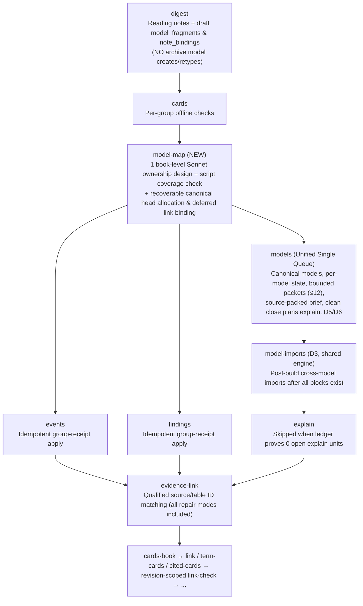

# Economics Digest & Post-Digest Efficiency Proposal

| Field | Value |
|---|---|
| **Status** | Proposal — candidate design (read-only analysis; no code, job-map row, or live archive modified) |
| **Date** | 2026-11-24 |
| **Repo baseline** | `main` at `b92d78f0` (`zt` 0.68.0, `zt-digest` 0.64.7, `zt-digest-base` 5.12.12, `zt-econ-digest` 6.12.13) |
| **Empirical baseline** | Post-digest records in `docs/model-passes/` (7 audited papers: Arrocannarsa, Bedford, Bergin, Furceri, Riboni, Rotunno, Goldsmith-Pinkham) and retained staging `D:\zt-digest\bedford2026learning` |
| **Design review** | Two-round code audit and architecture review with **Astra** (`gpt-6.2-astra`, effort `high`, standard tier; session `01a20e81-ba0a-7b13-91a4-024279c8cb4c`) |
| **Chinese edition** | [`docs/econ-digest-efficiency-proposal.zh.md`](econ-digest-efficiency-proposal.zh.md) (shared decision IDs `O1`–`O6`, job-map line references, and qualification tables) |
| **Related docs** | [`docs/agents/digest-job-map.md`](agents/digest-job-map.md), [`docs/agents/workflow-principles.md`](agents/workflow-principles.md), [`docs/digest-cost-experience.md`](digest-cost-experience.md), [`docs/model-compiler-v2-proposal.md`](model-compiler-v2-proposal.md), [`docs/empirical-models-proposal.md`](empirical-models-proposal.md), [`docs/math-digest-redesign-proposal.md`](math-digest-redesign-proposal.md) |

---

## Executive Summary

**Core thesis:** Most avoidable spend and manual rework in the economics pipeline comes from **compiling fragmented section-level models first and reconciling them by hand afterwards**, compounded by **schema mismatches** between `zt-econ-digest` and `zt-post-digest`, **unqualified candidate fan-out** in tables and evidence dialogue, and **silent repair/retry defects**.

A read-only audit of `main` (`b92d78f0`), the unmerged `model-speed-options` branch, the seven `zt-post-digest` skills, and live pass records establishes five concrete facts:

1. **Fragmented compile-then-fold is the largest structural waste.** Across seven audited economics papers, `zt-econ-digest` compiled **96 model units** that `zt-model-fold` consolidated into **25 surviving heads**. In empirical-heavy papers, subsequent stages deleted huge duplicate builds (`bergin2026exchange`: **127 Cards** deleted in Stage 2; `furceri2026divide`: **95 + 59 = 154 Cards** deleted across Stages 2–3; `riboni2026presidential`: **54 + 18 = 72 Cards** deleted). This does **not** imply a 74% token saving — many folded heads contributed unique chapters, proofs, specifications, or appendix estimates that the surviving model still needs. The true savings are eliminated duplicate plans, duplicate setting/data/variable/ladder builds, duplicate prose, and manual tree surgery. The right cost denominator is **cost per accepted, reader-ready canonical model** with all source evidence intact.
2. **Three live correctness/reliability defects cause immediate rework or silent data loss:**
   - **Repair modes silently omit `evidence-link`:** `zt-econ-digest.blueprint.json:201` allows `evidence-link` in `models`, `findings`, and `resume`, but all three explicit `modes` lists (`:260–339`) omit the stage, and the frozen runner filters by mode list first (`.claude/workflows/zt-econ-digest.js:244`). Similarly, `models` lists standalone `explain` even though its `when` predicate (`:157`) excludes `models`.
   - **Partial Findings retries duplicate Cards:** On `bedford2026learning`, a retry re-applied already-applied groups and created **30 duplicate Finding Cards** (`workflow-principles.md:190`), because `layer-steps.ps1` calls book-level plan/apply while `event/layer.rs:626` skips only by job ID rather than per-group committed output receipts.
   - **Panel-blind table lookup writes valid numbers from the wrong panel:** `tables.rs:222` matches rows and `N` by label without panel identity; on `bedford2026learning/9|a`, every estimate card silently received Table 4 Panel A values (`N = 42,678`) under Panel B titles and prose (`N = 41,353`).
3. **Two hidden fan-out costs burn tokens with zero yield:**
   - **Book-wide table duplication in every empirical brief:** `compiler.rs:2030` scans every staged section and back matter per empirical model. `bedford2026learning` staging holds **11 `tables.json` files of 21 tables each (1,029,034 bytes)**. Porting `model-speed-options`'s message-only brief without parse-once per-model projection would turn tool browsing into massive repeated prompts.
   - **Within-book noise in `zt-evidence-dialogue`:** On `bedford2026learning`, `dialogue.mjs` sent **2,147 within-book pairs** to seven DeepSeek conversations and accepted **zero**; the six metered conversations alone consumed **25.03M cached input tokens, 1.44M uncached input tokens, and 159K output tokens**. Meanwhile, `unjudged()` accepts bare address-pair hits even when the statements at those addresses have changed.
4. **Deterministic schema gaps force repetitive post-digest edits on every book.** `zt-econ-digest` omits `**起点**` on empirical data-tree children, omits `**直觉**` leads on empirical main-line blocks, does not share `zt-model-illustrate`'s `intuition.mjs` lint with formal fill, embeds formal symbol/term tables in the setting card (where `zt-check` and `src/gate.rs` currently read R6), and requires main-line `derive` parts (`compiler.rs:1117`). Meanwhile, `zt-post-digest` lacks checked-in canonical executors (`fold.mjs` is copied between scratchpads; ad-hoc Bash heredoc scripts corrupted backslashes in **17 live Cards**, `backslash-repair-2026-11-21.md`), and running `illustrate` before `literature-organize` forces external chart module updates after addresses shift.
5. **Job-map discipline must be preserved.** Under `docs/agents/digest-job-map.md:32`, `PROPOSED` means the owner has ordered a change, and `current` means `main` implements it after copied-box qualification. Every change in Section 5 is therefore marked as a **candidate** pending owner decisions (`O1`–`O6`) and paired copied-box trials.

**Recommended first two paid pilots (after P0 correctness fixes):**
1. **Bergin (`bergin2026exchange`)** for canonical model ownership + packetized build (tests eliminating 127 duplicate empirical cards while keeping formal DSGE and empirical test strictly separate).
2. **Bedford (`bedford2026learning`)** for `dialogue.mjs` candidate filtering (tests against 2,147 already-adjudicated within-book negatives plus retained positive controls from AJR, Deming, Brandimarti, and Ebrill).

---

## 1. Decisions for the Owner (`O1`–`O6`)

These six decisions govern phasing, authority, and job-map status. Until approved, every job-map entry in Section 5 remains a **candidate** (not `PROPOSED`).

| ID | Decision | Options | Joint Recommendation (Antigravity + Astra) |
|---|---|---|---|
| **O1** | **Pre-compile canonical model ownership (P2a)** | **(A)** Group writers record `model_fragments` + deferred `note_bindings` in draft JSON (no throwaway seed Model Cards); a book-level Sonnet `model-map` step assigns canonical ownership and allocates canonical heads before `models` claims work. **(B)** Keep per-group seed Model Cards and fold them before `models` runs. | **Authorize Option A** on a copied Bergin snapshot first, with Goldsmith-Pinkham §VI (omission detection across groups 13–14) and Arrocannarsa (256-part upper-tail size) required before release. Option B retains throwaway archive identities, delete/retype churn, external-mount hazards, and cannot detect omitted zero-seed sections on its own. |
| **O2** | **Authority for formal cross-model imports (D3)** | **(A)** One shared import engine runs inside `zt-econ-digest` after self-contained builds (D2+D3), and post-digest Stage 4 reuses accepted decisions, reopening only blocks changed by fold/settings/restructure. **(B)** Leave all cross-model imports exclusively to post-digest Stage 4. | **Option A — preserve the finished-digest contract.** A standalone digest should not finish with unresolved pending imports. One shared engine prevents judging the same pair twice across digest and Stage 4, while preserving Stage 4's explicit whole-model `整块` semantics. |
| **O3** | **Post-digest stage ordering (`zt-post-digest`)** | **(A)** Keep current order (`… → illustrate → dialogue → literature-organize`). **(B)** Move `literature-organize` **before** `illustrate`: `fold → settings (all) → restructure (all) → import + explain (lender order) → literature-organize → illustrate (formal)`. | **Approve Option B.** `zt-literature-organize` derives summaries from the source and subordinate Cards and has zero figure prerequisite. Running `illustrate` after `literature-organize` writes external `.mjs` modules against final home addresses once, eliminating post-organize module patching and double light/dark re-verification. |
| **O4** | **Evidence-dialogue & `zt-term-sync` cadence** | **(A)** Run `zt-term-sync` automatically inside every post-digest. **(B)** Split dialogue into **(i) within-book dialogue** after import + relink (with book-wide-Term noise suppression) and **(ii) cross-book shelf dialogue** after final organization and an **owner-requested** `zt-term-sync`, reporting equivalent-Term coverage explicitly. | **Approve Option B.** Respects the owner's rule that `zt-term-sync` runs only when asked (`zt-post-digest/SKILL.md:50`), stops burning 25M+ cached tokens on zero-yield within-book noise, and clearly separates *"shelf comparison pending (0 synced terms)"* from *"compared, 0 matches."* |
| **O5** | **Architect & formal-review budget challengers** | **(A)** Keep `perSonnet: 8` and continued-conversation formal review unchanged. **(B)** Keep both as baselines, and authorize **isolated paired copied-box trials** of `perSonnet: 4` and fresh parallel whole-chain formal review (from `model-speed-options`, preserving math's `-IndependentReview`), with reasoning effort held fixed at `high`. | **Approve Option B.** Never merge `model-speed-options` wholesale: its parallel formal review loses the writer's cached prefix and strips `-IndependentReview`. Measure each lever separately on identical snapshots before changing any baseline. |
| **O6** | **Post-digest backup & Term-relink granularity** | **(A)** Keep per-writing-stage `VACUUM INTO` backups during P1; expose scoped `term-relink.ps1 -Cards <list>` between passes (when the full affected set is known) while keeping a mandatory final full-book zero-change plan. **(B)** Collapse backups immediately to one per book. | **Approve Option A.** Do not reduce recovery checkpoints until a restore-and-replay drill on a copied box proves identical `card_id`s, formulas, Links, and mounts after mid-pass failure. |

---

## 2. Empirical Audit of `zt-econ-digest` and `zt-post-digest`

### 2.1 Quantitative Rework Evidence Across Seven Economics Papers

Measured directly from `docs/model-passes/*.md` and `D:\zt-digest\bedford2026learning\run-report.json`:

| Paper | Completed Model Units → Initial Surviving Heads | Post-Digest Card Churn & Key Observations | Source |
|---|---:|---|---|
| **`arrocannarsa2026flight`** | **22 → 3** | Surviving formal head held **256 parts immediately after fold**; 2 empirical measurements stayed separate (one supplies calibration input). Upper-tail stress test for packetized compilation and avoiding false merges. | [`arrocannarsa2026flight.md:70`](model-passes/arrocannarsa2026flight.md) |
| **`bedford2026learning`** | **25 → 12** | Settings deleted 11 Cards (+3 notation Cards); Restructure deleted 9 (+3 chapters). Separate Findings retry bug created **30 duplicate Finding Cards**. Stage 6 dialogue sent **2,147 within-book pairs** across 7 conversations → **0 accepted** (25.03M cached + 1.44M uncached tokens on the 6 metered conversations). | [`bedford2026learning.md:53,147,457,588`](model-passes/bedford2026learning.md) |
| **`bergin2026exchange`** | **14 → 2** | Formal DSGE (`7|a`) and empirical panel (`6|a`) stayed separate. Empirical head held **217 parts** after fold; Settings **deleted 127 duplicate Cards** into survivors. Strongest proof of empirical duplicate-build waste. | [`bergin2026exchange.md:28,57,104`](model-passes/bergin2026exchange.md) |
| **`furceri2026divide`** | **9 → 2** | Empirical head held **313 parts** after fold; Settings **deleted 95 Cards** (+2 created); Restructure **deleted 59 Cards** (+1 created) — **154 duplicate Cards deleted**. Some deleted copies held unique numbers transferred to survivors (duplicates cannot be dropped blindly). | [`furceri2026divide.md:43,50,119`](model-passes/furceri2026divide.md) |
| **`riboni2026presidential`** | **11 → 2** | Both survivors empirical. Settings + Restructure removed **54 + 18 = 72 Cards**. `model-survey.mjs` found 11 singletons (0 rests-on links joining them); 2 boundary calls went to the owner. | [`riboni2026presidential.md:9,47,117`](model-passes/riboni2026presidential.md) |
| **`rotunno2026industrial`** | **5 → 2** | Net **17 Cards** removed in Settings (empirical lost 17; formal lost 1 restated assumption, gained 1 notation Card). Stage 5 Open #1 explicitly flags post-organize address patching for the `.mjs` chart module. | [`rotunno2026industrial.md:30,40,237`](model-passes/rotunno2026industrial.md) |
| **`goldsmithpinkham2020bartik`** | **10 → 2** *(+1 later)* | Under the old complete-model prompt, §VI crossed groups 13–14 and both writers reported 0 models; §VI was later backfilled as a **3rd model (59 parts)**. Proves that coverage across zero-seed sections is mandatory before folding. | [`workflow-principles.md:173`](agents/workflow-principles.md); [`goldsmithpinkham2020bartik.md:154`](model-passes/goldsmithpinkham2020bartik.md) |
| **Total (7 papers)** | **96 → 25** *(+1 backfill)* | **71 redundant heads folded; >390 duplicate model parts deleted** after full Sonnet planning and DeepSeek fill/review/close/explain. | — |

**Accounting boundary (honest reporting):** Bedford's `run-report.json` (`wall_seconds`: ~5 h 42 min, `models` elapsed: 54.6 min) records provider usage for only **10 of 277 runs**, and stage `elapsed_seconds` / `tool_seconds` overlap across parallel stages — so summing them would fabricate a critical path. Similarly, *"no DeepSeek job"* in pass logs shows DeepSeek cost was zero, not that the parent Opus session was free (`docs/digest-token-pilot-report.md:26`). Historical drive estimates also carry distinct provenance: **84K** Claude tokens/drive (`digest-cost-experience.md:250`) vs. **129K** weighted Haiku tokens/drive across 189 Thompson drive managers (`math-digest-redesign-proposal.md:398`). Every pilot in Section 6 must therefore measure DeepSeek, Haiku, Sonnet, and Opus separately on paired copied-box snapshots.

### 2.2 Verified Bugs & Operational Waste in `zt-econ-digest`

| # | Defect / Bottleneck | Verified Code Location | Concrete Impact |
|---|---|---|---|
| **B1** | **Repair modes silently omit `evidence-link`; `models` lists unreachable `explain`** | `zt-econ-digest.blueprint.json:157,201,260-339`; `.claude/workflows/zt-econ-digest.js:244` | `evidence-link`'s `when` accepts `models`, `findings`, `resume`, but all three `modes` arrays omit it — and the frozen runner filters by mode list first. Repaired empirical models or Findings never get linked. |
| **B2** | **Partial Findings/Events retries duplicate already-applied Cards** | `layer-steps.ps1:174`; `tools/zt-digest/src/event/layer.rs:626`; `workflow-principles.md:190` | `event/layer.rs` skips only by applied job ID; when a group fails mid-layer and retries, book-level plan/apply rewrites already-applied groups (Bedford: 30 duplicate Findings). |
| **B3** | **Panel-blind table cell lookup silently injects wrong-panel values** | `tools/zt-digest/src/model/tables.rs:201,222`; `bedford2026learning.md:221` | `tables::find` matches table label and first matching row / `N` without panel scope. Bedford `9|a` passed all formal checks with Panel A numbers (`N=42,678`) under Panel B titles (`N=41,353`). |
| **B4** | **Every empirical brief re-parses and stores the entire book's tables** | `tools/zt-digest/src/model/compiler.rs:2030`; `D:\zt-digest\bedford2026learning\models` | Each model scans its group, all remaining staged sections, and back matter (Bedford: **11 × 21 tables = 1.03 MB**). Blocks safe message-only brief adoption until projected per model. |
| **B5** | **Drive fragility: foreign claims, unrecorded declined attempts, 400-char line corruption** | `zt-workflow-lib.js:174-231`; `workflow-principles.md:172,185-189` | Haiku managers occasionally ran step commands via Bash before their drive job (foreign claims on Goldsmith-Pinkham, Kennedy, Rowlandson, Bedford); declined drive jobs lacked evidence, breaking `cleanup`; retyped JSON lines halted runs. |
| **B6** | **Eight-lane repeated discovery & batch failure blast radius** | `zt-model-layer.js:102`; `model-steps.ps1:183`; `model-compiler-v2-proposal.md:26,105` | Every lane block re-lists all models and walks saved `state.json` files; one model's refused archive edit fails its entire batch (D5); lanes remain the last exception to the governing single-queue rule (`workflow-principles.md:35`). |
| **B7** | **Full-book paid reread in `link-check` & sequential session delete in `cardCycle`** | `zt-link-check.js:24`; `zt-digest-lib.js:590`; `zt-dsh-cleanup.js:37` | Run-level cleanup already uses batched `deepseek_settle`, but `cardCycle` still deletes conversations sequentially in one manager, and `link-check` re-reviews the whole book on non-resume runs (including repair modes). |
| **B8** | **Residual `finalize-plan` out-of-band edit gap & `evidence-link` address-group coupling** | `finalize.rs:429`; `ledger.rs:5519`; `evidence_link.rs:33,120` | `zt-digest 0.64.3` (`3ab52458`) fixed stale ledger-prerequisite audits, but out-of-band Card edits changing graph revision without changing prerequisite manifests need an explicit regression guard. `evidence-link` derives group from Card address prefix, which breaks once canonical heads span multiple groups or trees reorganize. |

### 2.3 Schema Impedance Mismatch Between `zt-econ-digest` and `zt-post-digest`

| Area | What `zt-econ-digest` Currently Emits | What `zt-post-digest` Requires | Real Code Constraint |
|---|---|---|---|
| **Empirical data children & main-line leads** | `empirical.rs:359` renders design/spec links at top, but `dsh-fill-instructions.zh.md:91` omits `**起点**` on `样本`/`测量`/`描述` children and omits `**直觉**` leads on `数据`/`假说`/`设计`/`规格：基准`. | Stage 2 adds `**起点**` to every data-tree child (Bedford: 13 cards); Stage 3 writes `**直觉**` leads on all main-line blocks (Bedford: 37 cards; Deming+Brandimarti: 41 cards). | Low-risk template + prompt alignment inside existing fill message (**P1**). |
| **Formal setting `**直觉**`** | `compiler.rs:356` + `dsh-fill-instructions.zh.md:123` require three lines without Links, but do not run `intuition.mjs` lint (bare assumption names, light verbs, length, display math). | Stage 5 (`zt-model-illustrate`) runs `intuition.mjs:35` and rewrites failing sections (Bedford rewrote 15/15; Furceri kept 2 of 3 lines on both setting cards). | Share `intuition.mjs` check rules directly with writer SELF-CHECK (**P1**); keep semantic review of chapter names. |
| **Formal notation Card (`符号表与读法`)** | `model-architect.md:28` & `model/text.rs:76` embed symbol & term tables inside the setting card. | Stage 2 creates `<head>|a|a` (`符号表与读法`) for every formal model and removes tables from setting cards. | **`tools/zt-check/src/check.rs:1059` and `src/gate.rs:1094` read the setting card for R6 Term tables.** Moving tables via prompt alone would silently break R6. Must ship as a coordinated compiler + checker + gate release (**P2b**). |
| **Formal intuition spine** | Flat main line (`设定 → 推导 → 命题`); derivations must sit on `main`. | Stage 3 rebuilds into `设定 → 第 k 章 → 结果 → 推导链` (Side branches), invalidating digest `explain` chain-position lines and triggering Stage 4 step 8 reruns. | **`compiler.rs:1117` refuses `derive` off `main`, and `:4189` walks `main` for chains.** Requires coordinated validator, skeleton, chain-discovery (reusing `proof_chains`/`stale_positions`), split, review, and explain upgrade (**P2b**). |
| **Writer style gate vs. final audit** | Fill runs `zt-check`, `compiler.rs:3464` logs `style: N`, but `ledger.rs:14101` lets `model-finish` tolerate blocking style faults (deferring to `cards-book`/`finalize`). | Violates the owner's check-consistency rule (`workflow-principles.md:13`). | Give the writer the exact acceptance rule/severity/baseline comparison and return **new blocking faults on its own Cards** while the conversation is open (**P0**). |

### 2.4 Post-Digest Execution & Safety Bottlenecks

1. **Missing canonical executors & Bash backslash corruption:** Every book's Stage 1 copies an uncommitted scratchpad `fold.mjs` (`bedford2026learning.md:41`). Stages 2–3 hand-author ad-hoc Node scripts per paper. In `backslash-repair-2026-11-21.md:46`, ad-hoc scripts written via Bash heredocs halved `\\` inside JavaScript string literals, corrupting TeX commands (`\delta`, `\sum`, `\quad`, `\mathrm`, `@BS@`) across **17 live Cards**.
2. **Multi-tree coordinate hazards (`zt 0.65–0.68`):** Under `CONTEXT.md:109, 135`, station coordinates cannot appear in authored `[[…]]` Links, and deleting a mounted home Card during fold/settings/restructure can leave a **Missing mount** even when ordinary Links repoint cleanly. Ad-hoc delete scripts do not check external mounts or reference cards by immutable `card_id`.
3. **Suboptimal stage ordering (`illustrate` before `literature-organize`):** Even though `zt 0.63+` rewrites `data-zt` inside stored charts on a move, external `.mjs` modules retain old `head` and cross-model target addresses, forcing post-organize patching and double light/dark visual verification (`rotunno2026industrial.md:237`; `bedford2026learning.md:559`).
4. **Dialogue candidate explosion & stale-address masking:** `dialogue.mjs:69,223` rescans the whole shelf per empirical head, falls back to book-wide head Terms when an estimate has no specific Term (generating 2,147 zero-yield pairs on Bedford and 152 on Dell `5|a`), and `unjudged()` (`:130`) suppresses a pair on bare `from>to` address match even if the Card statements changed!
5. **Unscoped `term-relink.ps1` wrapper:** `scripts/book-digest/term-relink.ps1:16` always relinks the whole book even though `tools/zt-digest/src/term_link.rs:125` already accepts `-Cards` (used by `explain.mjs:62`).

---

## 3. Core Architectural Proposal: Pre-Compile Canonical Model Ownership & Packetized Compilation

### 3.1 Target `zt-econ-digest` Stage Graph

Current assembled graph on `main` (`zt-econ-digest.js:5353`):
`digest → cards → {events, findings, models} → explain → evidence-link → cards-book → {link, term-cards, cited-cards} → link-check → organize → figures → bridge → term-link → audit → finalize → cleanup → report`

Proposed target graph (P2a):

*(Note: `events` and `findings` have no semantic dependency on `model-map`; in the first pilot their archive writes are ordered after `model-map` allocation wherever they share a home anchor to avoid concurrent-move contention, while standalone modes `events` and `findings` still run independently without rerunning `model-map`.)*

### 3.2 Option A Contract: Draft Fragment Manifest → Canonical Allocation

Keep local discovery inside `digest` (so no cross-group model is ever dropped), but move **model identity and compilation ownership** to a single book-level acceptance boundary:

| Boundary | Exact Contract & Invariants |
|---|---|
| **1. `digest` / `group-finish`** | Version the group draft schema (`ledger.rs:10196, 10329`). Accept `model_fragments` (fragment ID, proposed level, section spans, primitives/estimand/table-panel summary) and `note_bindings` (local note op, fragment ID, intended relation, insertion slot/text hash) — including explicit empty arrays. Bind both into the accepted plan hash and registered group outputs. **Hard-reject archive `type: model` creates or retypes by econ group writers.** A fragment manifest alone never discharges a substantive reading-note obligation. |
| **2. Book-level `model-map`** | Registered at `prepare` as one book-level unit whose inputs list every expected group receipt plus a source outline of sections, appendices, and table panels. **One Sonnet design call** (for a paper; for a textbook, size decision material first and send only unresolved cross-section cases) assigns each fragment one primary canonical owner, records secondary uses as references, and **emits an explicit evidenced disposition for every model-bearing section with zero fragments** (including `"no model here"`). A script checks 100% fragment coverage, duplicate ownership, and references; genuinely ambiguous model boundaries retain the owner-decision stop (`zt-model-fold/SKILL.md:45`). Acceptance case for zero-seed recall: **Goldsmith-Pinkham §VI**. |
| **3. Deferred reading-note link binding** | During `digest`, writers publish clean, readable note prose without broken addresses. Each group receipt records `(note card_id, fragment_id, relation_kind, insertion_slot, expected_text_hash)`. At canonical allocation, a deterministic script resolves each canonical head's current home address and applies each binding **exactly once**. (Never leave unresolved Links during `digest`, and never demote known model-note links to the generic `link` gap stage.) |
| **4. Crash-safe recoverable allocation** | Persist the accepted `model-map.json` and explicit operation intents keyed by `(map_revision, canonical_id, op_id)` *before* the first archive mutation (following the math allocation precedent, `math.rs:2496`). Record each resulting `card_id`, receipt, and before/after fingerprint. On crash/resume, reconcile already-committed operations and execute only the remainder; unexpected edits or conflicting ownership stop that unit. After readback, publish the map, canonical `models/<canon-id>@1` units (with the union of their ordered source spans), and dependency edges in **one ledger transaction**. |

### 3.3 Three Mandatory Couplings Handled Explicitly

1. **Receipt replay (`ledger.rs:9963, 10028`):** `verify_done_group` checks exact child enumeration, output keys, owned-card sets, and live authored fingerprints. Because canonical allocation applies authorized note-link bindings to completed group notes, teach replay to verify the exact authorized binding transition while still failing on any unrelated one-character drift. Never add canonical heads to `owned-gNNN.txt`.
2. **Span-driven context & evidence matching (`context.rs:157, 303`; `evidence_link.rs:120`):** Current code resolves *one* address-derived group per model — which would blind a canonical head at `/3|a` to its Appendix C proofs or Table 7 panel. Make the accepted map's **ordered source spans** the authoritative input to brief, architect, table projection, and `evidence-link`, completely decoupled from home anchor placement.
3. **`models:false`, repair, and resume (`zt-cards-book.js:24`; `ledger.rs:4404`):** When `models:false`, allocation still creates canonical draft heads and assigns their source review to `cards-book`; when `models:true`, the model chain is the sole source reviewer. Pre-map staging folders keep an explicit version/adoption boundary so resumed runs reuse committed heads and bindings cleanly.

### 3.4 Packetized Compilation & Unified Single Queue

A consolidated model (e.g., Arrocannarsa at 256 parts, Bergin DSGE at 81 parts, Furceri empirical at 159 parts) **cannot** be compiled safely by dumping every part into one `fill` or `derive` turn (`compiler.rs:2550, 3820`), nor by naively emitting `then` lists into `runJobs`.

**Critical bug caught in Round 2:** `zt-model-lib.js:148` already uses `runJobs`, which supports `then` (`zt-digest-lib.js:555`), **but `runJobs` returns only the last message's answer**, whereas `zt-model-lib.js:214` extracts `split` requests from returned answer lines! A split requested in packet 1 would silently disappear behind packet 2's final answer.

**Unified single-planner packet design:**
- **One packet planner for all model sizes:** Small models naturally produce 1 packet (1 message); large models produce $k$ ordered packets in the same writer conversation.
- **Fill packets:** Emit parts in dependency order (setting/data foundation + script-generated notation/变量表 before consumers) at a pilot soft ceiling of **≤12 authored parts per user message**, bounded also by source bytes and expected output. *(Note: 12 is backed by a review experiment in `digest-cost-experience.md:184`; its writing envelope must be measured directly in the pilot.)*
- **Derive packets:** Pack whole proof chains up to the same pilot target (~12 Derivation parts). A 13-part chain may stay whole if within envelope; an algebraically dense or very long chain gets an **explicit intermediate boundary** carrying prior conclusion, next premise, chain ID, and global endpoints, followed by continuity review — never an unbounded exemption. Also monitor Sonnet `plan.json` size and cumulative conversation prefix on upper-tail models (Arrocannarsa).
- **Per-packet durable receipts & recovery:** Persist `(model_id, plan_hash, phase, packet_id, inputs, outcome, split_requests)` to per-model state (`models/<slug>/state.json`, eliminating the batch-shared `state.json` race at `compiler.rs:621`). Use `then` only when successor inputs are already fixed; when a split or allocation alters downstream inputs, apply it first and resume via `continue` with fresh inputs. On session loss, reconstruct from accepted packet receipts; preserve `zt-model-lib` v19 missing-parts-only repair.
- **Retire the 8-lane block loop (`zt-model-layer.js:102`):** Once per-model state, fenced writes, D5 containment, and D2 (no formal build-time `take`) are qualified, replace the 8-lane loop and its final sweep with the governing **one start → one bounded queue → one finish** structure (`workflow-principles.md:35`), keeping the shared 8×8 DSMP limit.

---

## 4. Schema Alignment, Reliability Fixes & Post-Digest Streamlining

### 4.1 Digest Schema Alignment & Check Consistency

1. **Empirical fill alignment (P1):** Render accepted prerequisites directly into `**起点**` for all data-tree children (`样本`, `测量`, `描述`), retain baseline and variant equations byte-for-byte, and write concise substantive `**直觉**` leads on `数据`, `假说`, `设计`, and `规格：基准` inside the existing fill message.
2. **Shared formal `**直觉**` lint (P1):** Run `zt-model-illustrate/scripts/intuition.mjs`'s exact rules as part of the formal fill SELF-CHECK so Stage 5 reuses clean digest intuitions instead of rewriting them (keeping human/Opus review for economic substance and chapter-name accuracy).
3. **Writer check-consistency (P0):** Align the model writer's `zt-check` call with final acceptance (exact rule set, blocking severity, and baseline comparison). Return **new blocking style faults on the writer's own Cards** while the conversation is still open, keeping advisory, inherited, and borrowed-part findings separate (`workflow-principles.md:13`).
4. **Coordinated formal notation Card (P2b-1):** Emit `<head>|a|a` (`符号表与读法`) directly from the formal compiler **together with** updated R6 Term-table resolution in `tools/zt-check/src/check.rs:1059` and `src/gate.rs:1094` (supporting both local `<head>|a|a` and imported notation cards, with migration tests for legacy models and shared blocks).
5. **Formal intuition spine emission (P2b-2):** Update plan validation (`compiler.rs:1117`), skeleton placement, chain discovery (`:4189`, reusing `proof_chains` / `stale_positions`), split, review, and explain together so formal models build `设定 → 第 k 章 → 结果 → 推导链` directly.

### 4.2 Post-Digest Canonical Toolkit & Safety Guards (P1)

Consolidate the repeated scratchpad scripts from `docs/model-passes/` around the existing skill helpers (`mask-links.mjs`, `tidy`, `tree-mover.mjs`, `check-drafts.mjs`, `imports.mjs`, `outline.mjs`, `batch.mjs`, `leads.mjs`, `check.mjs`):

| Tool | Purpose & Mandatory Safeguards |
|---|---|
| **`fold-apply.mjs`** *(checked into `skills/zt-model-fold/scripts/`)* | Executes a declarative fold plan (`card_id`, surviving head, facet, placement, expected base): strips `**结构**`/`**引入**`, masks Model-part Links, moves Idea chains to anchors, parks parts, retypes one head atomically, restores body with rename map, drops self-imports, and verifies `model-survey` + `list_broken_links`. Replaces scratchpad `fold.mjs` copy-pasting. |
| **`batch-edit.mjs` + `formula-guard.mjs`** *(shared library)* | Reads edits strictly from JSON data files (eliminating Bash heredoc backslash loss that damaged 17 Cards). Before write **and** after readback: compares inline + display math, `\tag`/`(N)` numbers, numeric values, and Links; for merges, verifies every transferred formula against its **specified destination** (not merely a global set). **Checks external mounts by `card_id` before any deletion** (`CONTEXT.md:135`) so no Missing mount is created. Rejects station coordinates in authored `[[…]]` Links (`CONTEXT.md:109`). |
| **`rebuild-structure.mjs`** | Rebuilds a Model Card's `**结构**` (two-level or build-order) deterministically from the live tree — currently re-implemented in Stages 2, 3, and 4. |
| **`auto-cite.mjs`** | Applies unambiguous `check-settings.mjs --json` `cite` fixes (`假设 N` → `[[addr]]`), leaving ambiguous citations (e.g., two sources named `假设 1`) explicitly flagged for a reader. |
| **`verify-gate.mjs`** | Single command executing the stage's full gate (`check-model`, `check-settings`, `check-network`, `check-premises`, `imports check`, `list_broken_links`, formula/mount diff vs. pre-stage snapshot) with structured JSON summary. |
| **Scoped `term-relink.ps1 -Cards`** | Exposes `zt-digest term-link -Cards` (`term_link.rs:125`) in `term-relink.ps1` for changed + renamed + indirectly edited Cards between passes (widening to the book when Term mapping changes), while keeping a **mandatory final full-book `-PlanOnly` zero-change check**. |

### 4.3 Revised Post-Digest Order & Two-Stage Evidence Dialogue

- **Revised order (Decision `O3`):** `fold` → `settings` (all models) → `restructure` (all models) → `import` + `explain` refresh (lender order) → **`literature-organize`** → **`illustrate`** (formal models, against final home addresses) → final root/index, charts, Links, and zero-change full Term relink. Verify not only zero dead `data-zt` targets, but also **target identity** (ensuring no chart link points to a different valid Card after a move).
- **Evidence dialogue optimization (`dialogue.mjs`, Decision `O4`):**
  1. **One revision-bound shelf inventory per pass** instead of re-reading every Literature tree per empirical head (`dialogue.mjs:223`).
  2. **Suppress book-wide-only within-book pairs** (P1 paired trial): index estimate-specific Terms and drop same-book pairs joined *only* by a book-wide head Term, while preserving pairs sharing an outcome/treatment, table cell, or source-explicit comparison. Keep AJR OLS/IV, Deming age-panel, and Brandimarti duplicate-cell cases as positive controls alongside Bedford's 2,147 negatives.
  3. **Fix judgment invalidation (`dialogue.mjs:130`, P0):** Match prior judgments by **stable endpoint identity + statement/evidence hash** — never bare `from>to` address alone — so pure address renames skip re-judging while substantive edits at a reused address properly reopen judgment.
  4. **Split cadence:** Run within-book dialogue after import + relink; run cross-book shelf dialogue after `literature-organize` and an **owner-requested** `zt-term-sync`, always reporting equivalent-Term coverage (`synced_terms / total_terms`).

### 4.4 Disposition of `model-speed-options` and `model-compiler-v2` (D2–D7)

| Prior Item | Verdict | Exact Action & Rationale |
|---|---|---|
| **`model-speed-options` #1: Parallel formal review** | **Do NOT merge as-is; P3 challenger** | Loses writer conversation's cached prefix, uses a soft target that keeps >12 chains whole, and removes `-IndependentReview` across variants (breaking math). Keep continued-conversation formal review as baseline; test fresh whole-chain review as an isolated challenger preserving math `-IndependentReview`. |
| **`model-speed-options` #2: Message-only brief** | **Port & qualify in P1 (after P0 table projection)** | High-value latency/cost win once paired with parse-once per-model projected `tables.json` (otherwise Bedford's 21-table dump bloats every brief prompt). Measure source-fault detection and tokens vs. tool-browsing brief. |
| **`model-speed-options` #3: Clean close plans explain** | **Port & qualify in P1** | Saves 1 drive step per clean formal batch (`close -Explain`), plus skip no-op `zt-explain` stage when ledger proves 0 open explain units. Retain refusal repair rounds and standalone `mode explain`. |
| **`model-compiler-v2` D2+D3 (No formal build-time `take` + post-build import pass)** | **Adopt in P2a** | Eliminates cross-lane ordering/deferral and `[[TN]]` failures. Share one authoritative import engine with post-digest Stage 4 (`O2`), supporting whole-model `整块` imports as well as part blocks. |
| **`model-compiler-v2` D4 (6-round tool-driven model loop)** | **Split: adopt state/fence/check (P2a); DEFER tool loop** | Per `digest-cost-experience.md:184`, a tool result does not reset DeepSeek's thinking (1/12 vs. 9/12 natural faults). Adopt D4's per-model `state.json`, ownership fence, and final check; use **bounded user-message packets** instead of a tool-driven loop. |
| **`model-compiler-v2` D5 (Model-local containment)** | **Adopt in P0** | One refused model fails alone; healthy siblings in the batch finish. Only Lock/service-wide faults halt the stage. |
| **`model-compiler-v2` D6 (Authoritative drive result file)** | **Adopt & harden in P0** | Read atomic, invocation-unique result files bound to `(run, stage, attempt, lane/batch, claim)`. Also make same-invocation claim idempotent, reject foreign live owners (stopping Haiku-Bash double-claim bugs), and record evidence for declined drive attempts before retry/delete. |
| **`model-compiler-v2` D7 (Scoped `link-check`, parallel delete, `perSonnet: 4`)** | **Split across P1 & P3** | **P1:** revision-scoped paid `link-check` (keeping book-wide deterministic checks) + batched `cardCycle` session settlement (run-level cleanup already uses `deepseek_settle`). **P3:** paired `perSonnet` 8 vs. 4 trial. |

---

## 5. Job-Map Candidate Delta (`docs/agents/digest-job-map.md`)

### 5.1 Status & Governance Discipline

Per `docs/agents/digest-job-map.md:32, 69`:
- **All entries below are `candidate` deltas** — `docs/agents/digest-job-map.md` is **not** modified by this proposal.
- Once the owner approves an item (`O1`–`O6`), its row transitions to **`PROPOSED`**.
- A row transitions to **`current`** *only* after its paired copied-box trial meets source-coverage and gate parity, cost/time are recorded, compiler defaults/ranges and frozen blueprint arguments are synchronized together, project + global workflow installs are verified, and the old path is deleted in the same release.
- **Unchanged rows carried forward verbatim:** History digest groups (line 36), Cited list read 4×60 (line 40), Cited Cards 4×12 (line 41), Term table (line 43), concept Term Cards 4×12 (line 44), math Term Cards 2 (line 45), Math stages (lines 53–55), `zt-figure-explain` 8 images (line 57), `zt-idea-grow` (line 60). Any shared library or manager change (`zt-digest-lib`, `zt-workflow-lib`, `zt-model-lib`) must still be regression-tested against math's `-IndependentReview` and history variants.

### 5.2 Candidate Delta Table (Keyed to `docs/agents/digest-job-map.md` Line Numbers)

| Map Line | Workflow / Module | Current Shape (`main`) | Candidate Target Shape | Pattern | Phase & Where Set | Key Risk & Qualification Gate |
|---|---|---|---|---|---|---|
| **37** | Digest groups, **econ** *(split row from math)* | 1 group (≤25K chars, ≤3 units), 1 msg; creates seed Model Cards | Same group size initially, 1 msg; writes reading notes + draft `model_fragments` & `note_bindings` (no archive model creates/retypes). Reader anchors decoupled later in P3. | One message | **P2a** (`ledger.rs:10196`, `dsh-model-cards.zh.md`); **P3** (`prepare.rs`) | Risk: omitted models or dropped note links. Gate: 100% receipt replay + Goldsmith-Pinkham §VI recall. |
| **New** | **Econ model ownership (`model-map`)** | *(none — handled manually in post-digest Stage 1)* | **1 book-level Sonnet design call** over bounded fragment inventory + source outline (for textbooks: unresolved cross-section cases only) + deterministic validation & recoverable allocation (1 drive). | Design role + Drive | **P2a** (new `zt-model-map` module + `zt-digest model-map`) | Risk: false merge (theory+test) or missed zero-seed section. Gate: Bergin, Bedford, Goldsmith-Pinkham §VI blind check vs. human pass decisions. |
| **38–39** | Card review (`cards-book` & `link-check`) + fix rounds | Whole groups up to 40 Cards, 1 msg per 12 Cards, +1 per fix round; both stages scan full book | **Keep 40 Cards / 12 per msg / continued fix.** Split description by scope: `cards-book` reviews initial book obligations; `link-check` keeps book-wide deterministic check but scopes **paid rereads** to changed cards + affected neighbourhood/orphans/Term-Cited updates (by review purpose + revision receipt). Batched `cardCycle` session settlement. | Messages, then Continued | **P1** (`card.rs:48`, `zt-link-check.js`, `zt-digest-lib.js:590`) | Risk: missed reverse-link or new orphan fault. Gate: identical hard-fault & orphan detection on full + repair modes; 0 paid rereads on unchanged scope. |
| **42, 46** | Links / Term link | Links: ≤3 groups / ≤30 gaps, 1 msg; Term link: script drive | Unchanged job shape. Standalone `term-relink.ps1` exposes `-Cards` for post-digest passes + mandatory full-book final plan. | One message / Script | **P1** (`term-relink.ps1`, `term_link.rs:125`) | Gate: final full-book `-PlanOnly` changes 0 Cards. |
| **47** | Events / Findings | 3 groups, 1 msg | Keep 3 groups, 1 msg. Retries emit only unapplied source groups bound to committed output receipts. *(Optional P1 prompt trial: Finding writer records table/source locator & reported coefficient when source prints one.)* | One message | **P0** (`event/layer.rs:626`, `layer-steps.ps1`); **P1** (prompt trial) | Gate: replay Bedford 33 applied + 2 failed groups → 0 duplicate Findings. |
| **48** | Model layer (**formal**) | 1 model (fragment); brief → plan → fill → derive → review → split → close → explain (6–8+ msgs, Continued) | **1 canonical model** in unified single queue, per-model state + D5/D6: **source-packed brief** (1 msg, P1) → plan → **bounded `fill` & `derive` packets** (pilot ≤12 parts/msg with per-packet durable receipts, P2a) → continued formal review (fresh whole-chain parallel review as P3 challenger) → clean terminal `close -Explain` (P1) → explain. | Continued, with bounded Messages per packet | **P0** (D5/D6, style check), **P1** (brief, close-explain), **P2a** (packets, D2, single queue), **P2b** (notation, spine), **P3** (challengers) | Risk: split request lost across `then` msgs; prefix bloat on 256-part models; cache loss if parallel review adopted. Gate: per-packet receipt test + Arrocannarsa/Bergin paired cost & fidelity trials. |
| **49** | Model layer (**empirical**, level 3) | 1 empirical model (fragment), `perEmpirical` 4; brief + fill + parallel 12-card review + close | **1 canonical empirical model**: **source-packed brief** with projected tables (P1) → plan → **bounded `fill` packets** (≤12 parts/msg, emitting `起点` + `直觉` leads, P1/P2a) → **keep proven parallel 12-card independent review** → close (qualified panel cell fidelity). | Continued (brief, fill, close); One message (review) | **P0** (qualified cells), **P1** (projected tables, brief, template), **P2a** (canonical + packets) | Gate: Bedford Table 4 Panel B (`N=41,353`) fidelity; Bergin 127 duplicate cards eliminated without dropping unique estimates. |
| **New (D3)** | **Model imports** *(if `O2` = A)* | *(handled in build-time `take` + post-digest Stage 4)* | Script resolves mechanical imports; **1 msg per borrowing model** with ambiguous candidates (reusing Stage 4 semantics, supporting whole-model `整块`). Stage 4 reuses accepted decisions. | Script / One message | **P2a** (`model-steps.ps1`, shared with `imports.mjs`) | Gate: 0 `import_cycle`, 0 `import_target`, no double judging in Stage 4. |
| **50** | Empirical: `tables` | Script inside brief step (re-parses full book per model) | Script only: **parse once per source revision** with panel-qualified cell IDs (**P0**), then **project per model** (**P1**). | Script (no content job) | **P0** (`tables.rs:201,222`), **P1** (`compiler.rs:2030`) | Gate: identical output on parse-once (P0); full panel & appendix recall on projected tables (P1). |
| **51** | `evidence-link` | Script drive; silently omitted from `models`/`findings`/`resume` mode lists | Script drive: **wired into all declared repair/resume modes** (**P0**); matches by qualified source/table IDs rather than address-prefix group (**P1**). | Script (no content job) | **P0** (`zt-econ-digest.blueprint.json:260`), **P1** (`evidence_link.rs:33,120`) | Gate: harness effective-stage check + precision/recall on eligible Findings. |
| **52** | `explain` & `explain-apply` | Standalone `zt-explain` drive runs even when 0 units open; up to 3 fix rounds | Skip standalone `zt-explain` when ledger proves 0 open explain units (**P1**); retain `explain-apply` refusal repair (≤3 rounds) and standalone `mode explain`. | Continued | **P1** (`zt-explain.js`, `zt-model-lib.js`) | Gate: 0 open explain units skipped cleanly; open/refused parts still drained. |
| **56** | Figures | ≤80 Cards, 1 msg, book-wide figure list | Keep 80 Cards as baseline; **P3 challenger**: per-section figure list + exact script bindings for unambiguous figure references. | One message / Script | **P3** (`figures.rs`) | Gate: no recall loss on cross-section figure references. |
| **58–59** | Skeleton / Organize | Opus decisions + 6 structural drives + DeepSeek skeleton over temp anchors | Keep Opus thesis/notes + Bridge 12 sources. **P3:** share accepted source outline across `prepare`, Organize, and `zt-literature-organize` so index & Structure Card are rendered once from canonical divisions & models. | Design role + One message | **P3** (`prepare.rs`, `zt-organize.js`) | Gate: both `organize` and `skeleton` ledger publications preserved; 0 `anchor_moved` errors. |
| **61** | `zt-term-sync` | ~300 open rows, 1 msg | Unchanged job size (~300 rows); cadence clarifies owner-triggered sync before cross-book `evidence-dialogue` (`O4`). | One message | **P1** (`zt-post-digest`, `zt-evidence-dialogue`) | — |
| **62** | Drive jobs | 1 command, 1 msg; copied last JSON line | Keep 1 command/msg; **P0 D6:** read atomic invocation-unique `drive-lines` file, idempotent claim / reject foreign owner, record declined attempts before retry/delete. Net drive count reduced by `close -Explain` and no-op `zt-explain` skip (offset by 1 `model-map` allocation drive in P2a). | One message | **P0** (`zt-workflow-lib.js`, `step-line.ps1`, `ledger.rs`), **P1/P2a** | Gate: replay foreign claim, dropped field, and declined drive attempt. |

**Companion Table — Post-Digest Skill DeepSeek Jobs (Tracked Separately from Digest Workflow):**

| Skill | Job | Current Shape | Candidate Target Shape | Phase | Qualification Gate |
|---|---|---|---|---|---|
| **`zt-evidence-dialogue`** | Estimate comparison judge (`dialogue.mjs`) | 1 conversation per empirical head, 12 pairs/msg; rescans shelf per head; falls back to book-wide head Terms | Keep **12 pairs/msg** when pairs exist (0 judge turns when 0 admitted pairs). **P0:** statement/evidence-hash invalidation + 1 shelf scan per pass. **P1:** suppress book-wide-only within-book pairs; split within-book vs. post-`term-sync` shelf pass (`O4`). | **P0** & **P1** (`dialogue.mjs:69,130,223`) | Preserve all known positives (AJR, Deming, Brandimarti, Ebrill) while cutting Bedford's 2,147 zero-yield pairs; reopen on edited statement at same address. |
| **`zt-model-import` step 8** | Post-pass explanation refresh (`explain.mjs`) | 1 DeepSeek job per model with stale/missing Derivation explanations | Unchanged job shape; workload drops dramatically once P2b emits the intuition spine directly in digest. | **P2b** (`explain.mjs`) | `explain.mjs finish` exits 0 with 0 refused. |

### 5.3 Updates Needed in `digest-job-map.md` "Facts a Restarting Agent Needs" (Lines 66–72)

When approved items are implemented, update the restart-facts section carefully:
1. **Line 66 (`model-speed-options`):** Keep the branch as provenance through P1/P3 trials, marking each piece explicitly (`message-only brief`: ported with table projection; `close -Explain`: ported; `parallel formal review`: kept as P3 challenger; combined branch never merged).
2. **Line 68 (which managers send `then`):** Clarify that `runJobs` (`zt-digest-lib.js:555`) is already `then`-capable for model jobs, but compilers emit model packet `then` lists only once per-packet durable receipts land (P2a).
3. **Lines 67 & 70:** Preserve the withdrawn Cited-list sizing note and the measured Term/Cited 4×12 cache-cost evidence untouched.
4. **Lines 71–72:** Update only for the exact workloads and session reports actually measured in P1/P2 pilots — never extrapolate from one module to another.

---

## 6. Phased Delivery Plan (`P0`–`P3`), Lever Ranking & Qualification Protocol

### 6.1 Lever Ranking (Two Currencies Kept Separate)

| Lever | Cost / Wall-Time Rank | Rework / Quality Rank | Primary Evidence |
|---|---:|---:|---|
| **1. Pre-compile Canonical Model Ownership + Packetized Build (P2a)** | **1** | **1** | 96 → 25 heads across 7 papers; 127–154 duplicate Cards deleted per empirical-heavy paper; solves Goldsmith-Pinkham §VI recall. |
| **2. P0 Correctness & Reliability Fixes (modes, retries, panels, D5/D6, dialogue invalidation)** | **4** | **1** | Eliminates silent missing `evidence-link`, 30 duplicate Findings, wrong-panel numbers (Bedford Table 4), foreign-claim stalls, and whole-batch losses. |
| **3. Post-Digest Canonical Toolkit + Ordering (`organize` before `illustrate`) + Dialogue Filter (P1)** | **2** | **2** | Cuts Bedford's 2,147-pair / 25M-token noise, eliminates 17-card heredoc backslash corruption, ends scratchpad copy-paste and post-organize chart patching. |
| **4. Low-Risk Digest Speed & Schema Pilots (projected tables + message-only brief, `close -Explain`, scoped `link-check`, empirical template + shared `intuition.mjs`) (P1)** | **2** | **3** | Removes 1.03 MB table fan-out, brief browsing latency, redundant full-book link rereads, and 13–41 mechanical edits/book. |
| **5. Coordinated Formal Notation Card & Intuition Spine Emission (P2b)** | **5** | **2** | Removes the remaining deterministic formal Stage 2/3 restructures and Stage 4 explanation reruns (requires careful R6/gate and compiler validation updates). |
| **6. Shared Source Outline & Challenger Experiments (P3)** | **3** | **4** | Eliminates `anchor_moved` and stale Structure Cards; tests parallel formal review, `perSonnet: 4`, and scoped Figures under controlled baselines. |

### 6.2 Phased Roadmap

| Phase | Scope | Exit Gate |
|---|---|---|
| **P0 — Correctness, Idempotence & Containment** *(no job-shape change)* | (1) Fix `zt-econ-digest.blueprint.json` mode lists + `when` alignment (`evidence-link` in `models`/`findings`/`resume`; reconcile `explain` in `models`) + harness effective-stage assertions. (2) Idempotent per-group/receipt Findings & Events retry. (3) Panel-qualified cell identity in `tables.rs` + parse-once per source revision (equivalent output verified). (4) D5 batch containment + D6 atomic invocation-unique `drive-lines`, idempotent same-invocation claim / reject foreign live owner, record declined drive attempts before retry/delete. (5) Out-of-band edit regression test for `finalize-plan`; writer check-consistency for new blocking `zt-check` faults; `dialogue.mjs` single shelf scan + statement/evidence-hash invalidation. | All unit/integration tests + replay fixtures green (Bedford 33+2 Findings, Table 4 Panel B, foreign claim, declined drive, one-model batch refusal, out-of-band edit before finalize, edited-statement dialogue reopen). |
| **P1 — Post-Digest Toolkit & Order + Paired Digest Pilots** | (1) Checked-in toolkit (`fold-apply.mjs`, JSON `batch-edit.mjs`, `formula-guard.mjs` with destination & `card_id` mount checks, `rebuild-structure.mjs`, `auto-cite.mjs`, `verify-gate.mjs`, scoped `term-relink.ps1 -Cards`). (2) Revised post-digest order (`O3`) & two-stage dialogue (`O4`) + within-book noise filter. (3) Empirical `**起点**`/`**直觉**` template alignment + shared `intuition.mjs` lint in formal fill. (4) Isolated paired pilots: per-model table projection → message-only brief; `close -Explain` + empty `zt-explain` skip; revision-scoped paid `link-check` + batched `cardCycle` settlement; qualified `evidence-link` source/table IDs. | Paired copied-box pilots pass blind quality/recall checks and publish DeepSeek + Haiku/Sonnet/Opus cost tables; Bedrock/Bedford & Bergin baselines met. |
| **P2a — Canonical Model Ownership & Unified Queue** *(3 independently qualified sub-releases)* | **P2a-1:** Per-model state, per-packet durable receipts, bounded `fill`/`derive` packets (pilot ≤12 + explicit intermediate boundary for >12 chains), and interrupted-packet resume on existing heads. **P2a-2:** Offline validation of `model-map` on Bergin & Goldsmith-Pinkham §VI, bring stable source-section IDs forward from P3 as map inputs, then cut over `group-finish` / `model-map` / recoverable allocation / `verify_done_group` / span-driven `context.rs` together (one path, no fallback). **P2a-3:** Formal D2+D3 (shared import engine with Stage 4) + replace 8-lane loop with unified single queue. | Full Bergin, Goldsmith-Pinkham §VI, Bedford, and Arrocannarsa copied-box qualification including mid-allocation and mid-packet crash-recovery drills. |
| **P2b — Formal Target Schema in Digest** *(2 separate releases)* | **P2b-1:** Formal notation Card (`<head>|a|a`) coordinated with `zt-check` (`check.rs:1059`) and `src/gate.rs:1094` R6 resolution + legacy-model migration tests. **P2b-2:** Formal intuition spine (`设定 → 第 k 章 → 结果 → 推导链`) across validator, skeleton, chain discovery, split, review, explain, and final closure. | Gate parity on both new and legacy formal models; zero R6 regressions; Stage 2/3 formal churn reduced to judgment-only exceptions. |
| **P3 — Shared Outline & Challenger Trials** | (1) Decouple reader-facing division anchors from writer packet sizing across `prepare`, Organize, and `zt-literature-organize` (rendering root index & Structure Card from canonical outline + models). (2) Isolated challenger trials: fresh parallel whole-chain formal review (preserving math `-IndependentReview`), `perSonnet: 4`, per-section Figures list, and (only if explicitly authorized) reasoning effort. | 0 `anchor_moved` failures; each challenger earns adoption only on paired cost-per-accepted-model win at matched quality. |

### 6.3 Paired Copied-Box Qualification Matrix

Every paired trial runs on **two identical copies of the same archive and staging folder**, isolated `ZT_CONFIG_DIR` / `ZT_GUI_PORT`, clean answer folders, single-stage or `mode resume` entry points (plus harness fresh-path checks), retaining session reports before deletion, and running sequentially on one provider with no unrelated spend. Report **actual provider charges, subscription usage, CNY-equivalent, and Haiku / Sonnet / Opus tokens separately** (including the parent post-digest session).

| # | Paired Trial (Control vs. Candidate) | Benchmark Books & Stress Cases | Acceptance & Decision Metrics |
|---|---|---|---|
| **Q1** | Current fragment build vs. Option A ownership + packetized build | **Bergin** (theory/test boundary + 127 dupes), **Bedford** (multiple distinct estimands), **Goldsmith-Pinkham §VI** (omission recall), **Arrocannarsa** or **Furceri** (upper-tail size), plus 1 small low-duplication paper | Blind comparison vs. source & pass records; every primitive, proof, result, panel, appendix has 1 owner; interrupt after head create, after 1st binding, before ledger publish, after early split, after session loss; cost & time **including downstream post-digest through final gate**. |
| **Q2** | Full vs. projected tables; then browsing brief vs. packed brief; then continued review vs. fresh whole-chain review | Same accepted plans, short & long chains, ≥1 chain >12 parts | Source-fault detection, natural errors found, omissions, false positives, split accuracy, explain readback; uncached/cached/output tokens, tool calls, managers, slowest job, wall time. Isolate `perSonnet` 8 vs. 4. |
| **Q3** | Whole-book `link-check` vs. revision-scoped selection | Unchanged book, 1 edited endpoint, removed Link creating orphan, Term/Cited publication, model repair | Identical verified hard faults & orphans, valid publication revision, **0 paid rereads** on unchanged covered scope; verify missing/stale receipt fallback. |
| **Q4** | Retry, drive & panel fault replay | Bedford 33+2 Findings, double claim, dropped JSON field, stale prior invocation, declined drive, Lock, 1 refused model in batch, out-of-band edit before finalize, Table 4 Panel B | 0 duplicate writes, 0 false empty successes, healthy siblings finish, 100% provider IDs have evidence + settlement, Panel B `N=41,353` matches source, final audit matches live graph, second run is a no-op. |
| **Q5** | Current post-digest vs. shared toolkit + revised order (`O3`) | Mixed paper with cross-model chart target, a mounted Card, transferred formulas, interrupted structural batch | Verify `card_id`s + resolving addresses, formula destinations, 0 broken Links, 0 unexplained Missing mounts, all checks clean, light/dark renders, 0-change final Term plan; count manual decisions, redrafted Cards, module patches, backups, parent time. |
| **Q6** | Current `dialogue.mjs` vs. filtered + hash-invalidated `dialogue.mjs` | **Bedford** (2,147 negatives) & **Dell** negatives + **AJR, Deming, Brandimarti, Ebrill** positives + edited statement at same address + renamed unchanged pair | 100% retention of adjudicated positives & relation kinds; major reduction in zero-yield pairs; 0 repeat judgments after pure rename; reopen after substantive edit; separate shelf-read & judge-turn metrics. |

---

## Appendix: Summary of Two-Round Discussion with Astra

Per `ask-astra` reporting rules, Astra's independent findings and corrections (`gpt-6.2-astra`, effort `high`, standard tier, session `01a20e81-ba0a-7b13-91a4-024279c8cb4c`) are explicitly credited here and kept distinct from our initial hypotheses:

- **Major live defects Astra discovered by direct code audit:**
  1. `zt-econ-digest.blueprint.json:260` omits `evidence-link` from `models`, `findings`, and `resume` mode lists even though its `when` predicate expects them (and `models` lists standalone `explain` whose predicate excludes `models`).
  2. `compiler.rs:2030` re-parses and stores the entire book's tables per empirical model (11 × 21 tables = 1.03 MB on Bedford), making parse-once + per-model projection a prerequisite before porting `model-speed-options`'s message-only brief.
  3. Bedford `evidence-dialogue` sent 2,147 within-book pairs with 0 accepted (25.03M cached + 1.44M uncached tokens on the 6 metered conversations), and `dialogue.mjs:130` masks statement changes at reused addresses.
  4. `zt-digest-lib.js:555` (`runJobs`) already supports `then` for model jobs, but returns only the **last** answer — meaning naive `then` packetization would silently drop `split` requests from earlier packets (`zt-model-lib.js:214`).
- **Critical constraints & corrections Astra surfaced:**
  1. Moving formal symbol/term tables to `<head>|a|a` requires coordinated updates to `zt-check/src/check.rs:1059` and `src/gate.rs:1094` so R6 is not silently weakened.
  2. Formal intuition-spine emission requires coordinated compiler updates (`compiler.rs:1117, 4189`), not prompt edits.
  3. Multi-tree coordinates (`CONTEXT.md:109, 135`) require checking external mounts by `card_id` before any post-digest deletion and forbidding station coordinates in authored Links.
  4. `finalize-plan` already received a partial fix in `zt-digest 0.64.3` (`3ab52458`), run-level cleanup already uses batched `deepseek_settle` (`zt-dsh-cleanup.js:37`), and `model-speed-options`'s parallel formal review uses a soft target that strips `-IndependentReview`.
  5. Do not adopt D4's 6-round tool-driven loop (`digest-cost-experience.md:184`); adopt D4's per-model state/fence/check with bounded user-message packets instead.
  6. Keep pure correctness/idempotence fixes in **P0**, move any visibility-changing or candidate-filtering lever (table projection, within-book dialogue filter) to **P1** paired trials, split **P2a** into three independently qualified sub-releases, and split **P2b** into two schema releases.
- **Joint consensus reached:** Option A canonical ownership, P0–P3 phasing, `O1`–`O6` owner decisions, job-map candidate table discipline, and **Bergin** + **Bedford** as the first two paid pilots.
