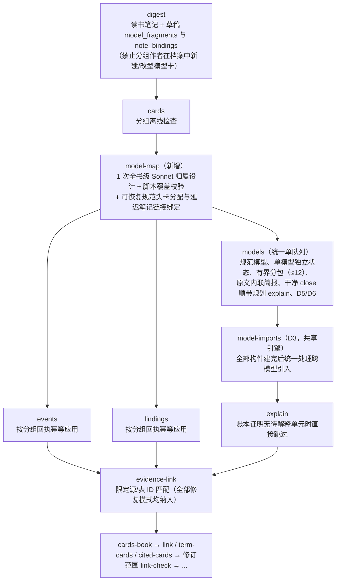

# 经济学精读工作流（`zt-econ-digest`）与后处理流程（`zt-post-digest`）提效提案

| 字段 | 内容 |
|---|---|
| **状态** | 提案——候选设计（只读分析；未修改代码、作业表行状态或线上卡片盒） |
| **日期** | 2026-11-24 |
| **代码基线** | `main` `b92d78f0`（`zt` 0.68.0、`zt-digest` 0.64.7、`zt-digest-base` 5.12.12、`zt-econ-digest` 6.12.13） |
| **实证基线** | `docs/model-passes/` 中 7 篇已核验论文的后处理记录（Arrocannarsa、Bedford、Bergin、Furceri、Riboni、Rotunno、Goldsmith-Pinkham）与保留暂存目录 `D:\zt-digest\bedford2026learning` |
| **联合评审** | 与 **Astra**（`gpt-6.2-astra`，`high` 推理强度，标准档；会话 `01a20e81-ba0a-7b13-91a4-024279c8cb4c`）完成两轮独立代码审计与架构收敛 |
| **英文版** | [`docs/econ-digest-efficiency-proposal.md`](econ-digest-efficiency-proposal.md)（共用决策编号 `O1`–`O6`、作业表行号与对照验收表） |
| **关联文档** | [`docs/agents/digest-job-map.md`](agents/digest-job-map.md)、[`docs/agents/workflow-principles.md`](agents/workflow-principles.md)、[`docs/digest-cost-experience.md`](digest-cost-experience.md)、[`docs/model-compiler-v2-proposal.md`](model-compiler-v2-proposal.md)、[`docs/empirical-models-proposal.md`](empirical-models-proposal.md)、[`docs/math-digest-redesign-proposal.md`](math-digest-redesign-proposal.md) |

---

## 执行摘要

**核心判断：** 当前经济学管线中绝大多数可避免的算力消耗与人工返工，源于**先按分组编译碎片化模型、再在后处理中手工折叠与删重**，并叠加了 `zt-econ-digest` 与 `zt-post-digest` 之间的**格式口径错配**、表格与实证对话中的**无过滤候选扩散**，以及**修复/重试路径上的静默缺陷**。

对 `main`（`b92d78f0`）、未合并分支 `model-speed-options`、`zt-post-digest` 全部 7 个技能及线上执行记录的只读审计，确立了五项事实：

1. **“先碎片编译、后手工折叠”是最大的结构性浪费。** 7 篇已核验经济学论文在精读阶段共完成了 **96 个模型编译单元**，后处理首轮折叠后仅保留 **25 个模型头**。在实证为主的论文中，后续阶段删除了大量重复构建分卡（`bergin2026exchange` 第 2 阶段删除 **127 张**；`furceri2026divide` 第 2–3 阶段合计删除 **95 + 59 = 154 张**；`riboni2026presidential` 合计删除 **54 + 18 = 72 张**）。这**并不**意味着总 token 会直接下降 74%——许多被折入的旧模型头贡献了最终模型仍需要的章节、证明、规格或附录估计。真正可省下的是重复的 Sonnet 规划、重复的设定/数据/变量表/规格阶梯构建、重复正文写作与手工搬树。正确的成本分母是**“每交付一个通过终检、原文证据完整的规范模型（canonical model）的总成本”**。
2. **三项线上正确性与可靠性缺陷正在直接制造返工或静默丢链：**
   - **修复模式静默漏跑 `evidence-link`：** `zt-econ-digest.blueprint.json:201` 的 `when` 条件允许 `models`、`findings`、`resume` 运行 `evidence-link`，但对应的三个显式 `modes` 阶段列表（`:260–339`）全部漏掉了该阶段，而冻结运行器优先按 `modes` 列表过滤（`.claude/workflows/zt-econ-digest.js:244`）。同类问题还有：`models` 列表包含独立 `explain`，但其 `when` 条件（`:157`）排除了 `models`。
   - **Findings 部分重试重复建卡：** `bedford2026learning` 中某次重试重新应用了已写入分组，制造出 **30 张重复 Finding 卡**（`workflow-principles.md:190`）；根因在于 `layer-steps.ps1` 走全书级 plan/apply，而 `event/layer.rs:626` 仅按 job ID 跳过，未按“源分组 + 已提交输出回执”幂等绑定。
   - **忽略面板（Panel）的表格查格静默写入错误数值：** `tables.rs:222` 按行名查格和 `N` 时不区分面板；在 `bedford2026learning/9|a` 中，所有估计卡在 Panel B 的标题与解读下静默写入了表 4 Panel A 的数值与样本量（`N = 42,678` 而非 `41,353`），且全部通过编译检查。
3. **两处隐蔽的候选扩散在零产出下消耗巨量上下文：**
   - **每个实证简报重复解析并保存全书表格：** `compiler.rs:2030` 对每个实证模型扫描本组、全部其余小节与后附材料。`bedford2026learning` 暂存目录里保留了 **11 份 `tables.json`，每份含全书全部 21 张表，合计 1,029,034 字节（~1 MB）**。若直接移植 `model-speed-options` 的“消息内联简报”而不先做“全书解析一次、按模型投影”，会把工具浏览成本转嫁为重复的大提示词膨胀。
   - **`zt-evidence-dialogue` 书内噪音爆炸：** `bedford2026learning` 第 6 阶段将 **2,147 对书内候选**发给 7 个 DeepSeek 对话，最终采纳 **0 条**；仅其中 6 个已计量对话就消耗了 **25.03M 缓存输入、1.44M 未缓存输入与 159K 输出 token**。同时，`unjudged()` 仅凭地址对命中就会跳过重审，哪怕原地址上的陈述已被实质修改。
4. **确定性格式缺口迫使每篇论文在后处理中重复手工改写。** `zt-econ-digest` 漏写了实证数据树子卡的 `**起点**` 与主线卡的 `**直觉**` 导语，形式模型的 `**直觉**` 未共用 `zt-model-illustrate` 的 `intuition.mjs` 校验规则，形式模型的符号表与术语表仍嵌在设定卡内（且 `zt-check` 与 `src/gate.rs` 目前就在设定卡里读 R6），形式推导仍被强制放在主线（`compiler.rs:1117`）。同时，`zt-post-digest` 缺少入库的规范执行脚本（每篇论文都从暂存目录拷贝 `fold.mjs`；临时 Bash heredoc 脚本还导致 **17 张线上卡的 TeX 反斜杠损坏**，`backslash-repair-2026-11-21.md`），且先画图（`illustrate`）再整理文献树（`literature-organize`）迫使外部 `.mjs` 图稿模块在地址重排后再次修补并重验。
5. **严格遵守作业表（Job Map）状态纪律。** 按 `docs/agents/digest-job-map.md:32` 的定义，`PROPOSED` 表示所有者**已下令执行**，`current` 表示已过副本对照验收并在 `main` 上线。因此本提案第 5 节全部条目当前均标为**候选变更（candidate）**，待所有者对 `O1`–`O6` 拍板后再转入 `PROPOSED`。

**建议的首批两项付费试点（在 P0 正确性修复完成后）：**
1. **Bergin（`bergin2026exchange`）**——验证“编译前规范模型归属 + 分包构建”（直接检验能否消除 127 张重复实证分卡，同时保住形式 DSGE 与实证检验的边界）。
2. **Bedford（`bedford2026learning`）**——验证 `dialogue.mjs` 候选过滤（直接以 2,147 对已判定的书内负例 + AJR / Deming / Brandimarti / Ebrill 已知正例作对照）。

---

## 1. 需要所有者拍板的事项（`O1`–`O6`）

以下六项决策决定实施范围、阶段顺序与作业表状态。在所有者批准之前，第 5 节所有作业表变动均为**候选**，不直接改写 `docs/agents/digest-job-map.md`。

| 编号 | 决策项 | 可选方案 | 联合建议（Antigravity + Astra） |
|---|---|---|---|
| **O1** | **编译前规范模型归属（P2a）** | **(A)** 分组作者在草稿 JSON 中记录 `model_fragments` 与延迟的 `note_bindings`（不建临时模型卡头）；全书级 Sonnet `model-map` 判定归属并在 `models` 领用前统一分配规范头卡。 **(B)** 继续在分组中建临时种子模型卡头，在 `models` 运行前折叠旧头。 | **批准方案 A**，先在 Bergin 复制库试点，正式发布前必过 Goldsmith-Pinkham §VI（跨 13–14 组零种子防漏）与 Arrocannarsa（256 分卡上尾压力）验收。方案 B 仍制造临时档案身份、删头改型、外部挂载风险，且单靠已有种子无法发现漏掉的整节。 |
| **O2** | **形式模型跨模型引入（D3）的归属权** | **(A)** 精读内部在自足构建后运行一套共享 import 引擎（D2+D3）；后处理第 4 阶段复用已接受决定，仅重开被 fold/settings/restructure 改动过的构件，再刷新受影响的推导解释。 **(B)** 将所有跨模型引入全部留给后处理第 4 阶段。 | **批准方案 A——保住“精读产出即完整自足”的契约。** 独立精读不应以挂起的待引入状态收尾；共用同一套引擎可避免同一对构件被判断两次，同时保留第 4 阶段对整模型 `整块` 引入的支持。 |
| **O3** | **后处理阶段顺序（`zt-post-digest`）** | **(A)** 维持现行顺序（`… → illustrate → dialogue → literature-organize`）。 **(B)** 将 `literature-organize` 提前到 `illustrate` **之前**：`fold → settings（全书）→ restructure（全书）→ import + explain（按借出顺序）→ literature-organize → illustrate（形式模型）`。 | **批准方案 B。** `zt-literature-organize` 仅依赖原文划分与下属卡片，完全不依赖配图。整理文献树之后再画图，外部 `.mjs` 图稿模块一次写定最终地址，免去整理后修地址和二次明暗渲染复查。 |
| **O4** | **实证对话与 `zt-term-sync` 节奏** | **(A)** 每次后处理自动强制跑 `zt-term-sync`。 **(B)** 将对话拆为两步：**（i）书内对话**在 import 与术语重链后运行（过滤仅由全书头术语相连的噪音对）；**（ii）跨书对话**在文献树整理完成且**所有者要求运行 `zt-term-sync` 之后**运行，并如实报告等价术语覆盖率。 | **批准方案 B。** 遵循所有者“仅在要求时运行 `zt-term-sync`”的规则（`zt-post-digest/SKILL.md:50`），立即止损 25M+ 缓存 token 的书内零产出噪音，并明确区分“跨书待比对（0 同步术语）”与“已比对、0 匹配”。 |
| **O5** | **架构师批量与形式复核的对照实验** | **(A)** 保持 `perSonnet: 8` 与同会话续写形式复核不变。 **(B)** 保留两者为基线，同时批准在复制库上**分别孤立对照测试** `perSonnet: 4` 与 `model-speed-options` 的独立整链并行复核（保留数学版的 `-IndependentReview`），推理强度固定为 `high`。 | **批准方案 B。** 绝不整支合并 `model-speed-options`：其并行形式复核丢失作者会话缓存前缀，且删掉了 `-IndependentReview`。每项加速杠杆须在相同快照上单独计量后再决定是否替换基线。 |
| **O6** | **后处理备份与术语重链粒度** | **(A)** P1 阶段保留各写卡阶段前的 `VACUUM INTO` 备份；在明确受影响卡片全集时开放 `term-relink.ps1 -Cards <列表>` 做阶段间局部重链，同时保留末尾强制全书零改动检查。 **(B)** 立即合并为全书只备份一次。 | **批准方案 A。** 在复制库完成“阶段中断→从检查点恢复→重放且 `card_id`/公式/链接/外部挂载完全一致”的演练之前，不缩减恢复检查点。 |

---

## 2. `zt-econ-digest` 与 `zt-post-digest` 现状实证审计

### 2.1 七篇经济学论文的量化返工证据

数据直接取自 `docs/model-passes/*.md` 与 `D:\zt-digest\bedford2026learning\run-report.json`：

| 论文 | 已完成模型单元 → 首轮折叠后存活头卡 | 后处理卡片变动与关键观察 | 来源 |
|---|---:|---|---|
| **`arrocannarsa2026flight`** | **22 → 3** | 折后形式模型头立时拥有 **256 张分卡**；两个实证测量模型独立保留（其一为理论提供校准输入）。是检验分包编译上限与防误合并的最佳压力样本。 | [`arrocannarsa2026flight.md:70`](model-passes/arrocannarsa2026flight.md) |
| **`bedford2026learning`** | **25 → 12** | Settings 删 11 卡（新建 3 张符号表）；Restructure 删 9 卡（新建 3 章）。Findings 重试缺陷另制造 **30 张重复 Finding 卡**。第 6 阶段实证对话发 **2,147 对书内候选**给 7 个对话，采纳 **0 条**（其中 6 个已计量对话消耗 25.03M 缓存输入 + 1.44M 未缓存输入）。 | [`bedford2026learning.md:53,147,457,588`](model-passes/bedford2026learning.md) |
| **`bergin2026exchange`** | **14 → 2** | 形式 DSGE（`7|a`）与实证面板（`6|a`）保持独立。折后实证头卡有 **217 张分卡**；Settings 阶段向存活卡**删除合并了 127 张重复卡**。是最强的“防止重复编译实证模型”证据。 | [`bergin2026exchange.md:28,57,104`](model-passes/bergin2026exchange.md) |
| **`furceri2026divide`** | **9 → 2** | 折后实证头卡有 **313 张分卡**；Settings **删 95 卡**（新建 2 卡），Restructure **删 59 卡**（新建 1 卡），合计删除 **154 张重复卡**。部分被删副本含独有数字需迁入存活卡，证明不能粗暴丢弃看似重复的卡。 | [`furceri2026divide.md:43,50,119`](model-passes/furceri2026divide.md) |
| **`riboni2026presidential`** | **11 → 2** | 两个存活头均为实证模型。Settings + Restructure 合计删除 **54 + 18 = 72 张卡**。`model-survey.mjs` 检出 11 个孤立候选组（无 rests-on 链接相连），2 处边界提交所有者决定。 | [`riboni2026presidential.md:9,47,117`](model-passes/riboni2026presidential.md) |
| **`rotunno2026industrial`** | **5 → 2** | Settings 净减 **17 张卡**（实证删 17；形式删 1 条重复假设、新建 1 张符号表）。第 5 阶段遗留 #1 明确记录：第 7 阶段文献树整理后须回改 `.mjs` 图稿模块的头地址与硬编码地址。 | [`rotunno2026industrial.md:30,40,237`](model-passes/rotunno2026industrial.md) |
| **`goldsmithpinkham2020bartik`** | **10 → 2** *（后补 1）* | 在旧版“只写完整模型”提示词下，§VI 跨第 13–14 组导致两组均报 0 模型，后补建为**第 3 个模型（59 张分卡）**。证明折叠前必须先保住零种子小节的覆盖率。 | [`workflow-principles.md:173`](agents/workflow-principles.md)；[`goldsmithpinkham2020bartik.md:154`](model-passes/goldsmithpinkham2020bartik.md) |
| **合计（7 篇）** | **96 → 25** *（+1 补建）* | **71 个多余模型头被折叠；超过 390 张重复分卡**在走完完整 Sonnet 规划与 DeepSeek fill/review/close/explain 后被删除。 | — |

**计量口径边界（如实报告）：** Bedford 的 `run-report.json`（总墙钟约 5 小时 42 分，`models` 历时 54.6 分钟）仅对 **277 次运行中的 10 次**记有用量，且各阶段 `elapsed_seconds` 与 `tool_seconds` 并行重叠，不能直接相加伪造关键路径。同理，后处理记录中的“no DeepSeek job”仅说明未花 DeepSeek 费用，不代表外层 Opus 会话零成本（`docs/digest-token-pilot-report.md:26`）。历史驱动开销也有不同口径：**84K** Claude token/次驱动（`digest-cost-experience.md:250`）与 Thompson 五次尝试 189 个驱动管理员的加权均值 **129K** Haiku token/次（`math-digest-redesign-proposal.md:398`）。因此第 6 节所有试点都必须在成对复制库上分别报告 DeepSeek、Haiku、Sonnet 与 Opus 用量。

### 2.2 `zt-econ-digest` 已核实的线上缺陷与运行浪费

| 编号 | 缺陷 / 瓶颈 | 核实代码位置 | 实际影响 |
|---|---|---|---|
| **B1** | **修复模式静默漏跑 `evidence-link`；`models` 列表含不可达的 `explain`** | `zt-econ-digest.blueprint.json:157,201,260-339`；`.claude/workflows/zt-econ-digest.js:244` | `evidence-link` 的 `when` 允许 `models`/`findings`/`resume`，但三个 `modes` 数组均未列出该阶段，而冻结运行器优先按 `modes` 筛选，导致修复后的实证模型或 Finding 永不连链。 |
| **B2** | **Findings/Events 部分重试重复写卡** | `layer-steps.ps1:174`；`tools/zt-digest/src/event/layer.rs:626`；`workflow-principles.md:190` | `event/layer.rs` 仅按已应用的 job ID 跳过；当层内仅部分分组失败并触发重试时，全书级 plan/apply 会重做已应用分组（Bedford 产生 30 张重复 Finding）。 |
| **B3** | **无面板标识的查格静默写入错误面板数字** | `tools/zt-digest/src/model/tables.rs:201,222`；`bedford2026learning.md:221` | `tables::find` 仅按表名与首个同名行/观测值行匹配。Bedford `9|a` 在 Panel B 标题下静默写入 Panel A 的系数与 `N=42,678`（实应 `41,353`），却通过所有检查。 |
| **B4** | **每个实证简报重复解析并存储全书全部表格** | `tools/zt-digest/src/model/compiler.rs:2030`；`D:\zt-digest\bedford2026learning\models` | 每个模型扫描本组、全部其余小节与后附材料（Bedford 暂存中有 **11 × 21 张表 = 1.03 MB**）。在未按模型投影前，直接移植消息内联简报会导致提示词严重膨胀。 |
| **B5** | **驱动环节脆弱：误领单元、拒跑缺证、400 字符截断/改写** | `zt-workflow-lib.js:174-231`；`workflow-principles.md:172,185-189` | Haiku 管理员偶发先用 Bash 亲自跑命令造成“幽灵领用”（Goldsmith-Pinkham、Kennedy、Rowlandson、Bedford）；拒跑的驱动会话未留证据导致 `cleanup` 失败；改写 JSON 行中断运行。 |
| **B6** | **八条 lane 重复发现清单与整批连坐失败** | `zt-model-layer.js:102`；`model-steps.ps1:183`；`model-compiler-v2-proposal.md:26,105` | 每次 lane 领用都重跑全书模型列举并遍历 `state.json`；单个模型写入被拒会导致整批失败（D5）；lanes 是目前唯一违背“单队列”原则的遗留层（`workflow-principles.md:35`）。 |
| **B7** | **`link-check` 全书付费重读与 `cardCycle` 串行删会话** | `zt-link-check.js:24`；`zt-digest-lib.js:590`；`zt-dsh-cleanup.js:37` | 全书级 cleanup 已改用批量 `deepseek_settle`，但 `cardCycle` 仍由单个管理员串行删除会话；非 resume 运行（含修复模式）的 `link-check` 仍对全书做付费复审。 |
| **B8** | **`finalize-plan` 账本外编辑回归边界与 `evidence-link` 地址分组耦合** | `finalize.rs:429`；`ledger.rs:5519`；`evidence_link.rs:33,120` | `zt-digest 0.64.3`（`3ab52458`）已修复账本前置发布过期的审计复用，但“账本外直接改卡导致图修订前进、前置清单不变”仍需回归护栏。`evidence-link` 从地址首段推分组，一旦规范头跨组或树重排就会失效。 |

### 2.3 `zt-econ-digest` 产出与 `zt-post-digest` 目标的格式错配

| 领域 | `zt-econ-digest` 当前产出 | `zt-post-digest` 目标要求 | 真实代码约束 |
|---|---|---|---|
| **实证数据子卡与主线导语** | `empirical.rs:359` 在前部输出设计/规格链接，但 `dsh-fill-instructions.zh.md:91` 漏掉 `样本`/`测量`/`描述` 的 `**起点**`，也漏掉 `数据`/`假说`/`设计`/`规格：基准` 的 `**直觉**` 导语。 | 第 2 阶段补全全部数据子卡 `**起点**`（Bedford 13 卡）；第 3 阶段手工补写全部主线块 `**直觉**` 导语（Bedford 37 卡；Deming+Brandimarti 41 卡）。 | 低风险：在现有 fill 消息内对齐模板与提示词（**P1**）。 |
| **形式设定 `**直觉**`** | `compiler.rs:356` 与 `dsh-fill-instructions.zh.md:123` 要求三行无链接，但未接入 `intuition.mjs` 规则（裸假设名、轻动词、句长、展示公式等）。 | 第 5 阶段（`zt-model-illustrate`）跑 `intuition.mjs:35` 并重写不合格段落（Bedford 重写 15/15；Furceri 两张设定卡各保留 2/3 行）。 | 将 `intuition.mjs` 精确规则共享给写作自查（**P1**）；章名准确度与经济学实质仍保留复核。 |
| **形式模型符号卡（`符号表与读法`）** | `model-architect.md:28` 与 `model/text.rs:76` 将符号表和术语表嵌在设定卡内。 | 第 2 阶段为每个形式模型新建 `<head>|a|a`（`符号表与读法`）并从设定卡移出两张表。 | **`tools/zt-check/src/check.rs:1059` 与 `src/gate.rs:1094` 直接从设定卡读取 R6 术语表。** 仅改提示词会静默削弱 R6，须编译器 + 检查器 + 写入门控协同发布（**P2b**）。 |
| **形式直觉主干** | 扁平主线（`设定 → 推导 → 命题`），推导必须在主线。 | 第 3 阶段重构为 `设定 → 第 k 章 → 结果 → 推导链`（侧枝），导致精读阶段写好的 `explain` 链位置行全部作废，迫使第 4 阶段第 8 步重跑 DeepSeek 解释。 | **`compiler.rs:1117` 拒绝非主线 `derive`，`:4189` 沿 `main` 计算推导链。** 须同步改造验证器、构树、链发现（复用 `proof_chains`/`stale_positions`）、拆分、复核与解释（**P2b**）。 |
| **作者风格自查 vs. 终审口径** | fill 已调用 `zt-check`，`compiler.rs:3464` 记 `style: N`，但 `ledger.rs:14101` 允许 `model-finish` 容忍阻断级风格错，留给 `cards-book`/`finalize` 善后。 | 违背所有者“自查口径即终审口径”原则（`workflow-principles.md:13`）。 | 赋予作者与终审一致的规则集、严重级与基线对比，在会话关闭前退回**本卡新增的阻断错**，区分建议项、遗留项与借入卡（**P0**）。 |

### 2.4 后处理执行与安全瓶颈

1. **缺少入库的规范执行器 & Bash 反斜杠损坏：** 每篇论文第 1 阶段都在暂存目录之间拷贝 `fold.mjs`（`bedford2026learning.md:41`）；第 2–3 阶段逐篇手写临时 Node 脚本。`backslash-repair-2026-11-21.md:46` 证实：通过 Bash heredoc 写入含 JS 字符串字面量的临时脚本会将 `\\` 减半，导致 **17 张线上卡**的 TeX 命令（`\delta`、`\sum`、`\quad`、`\mathrm`、`@BS@`）损坏。
2. **多树坐标约束（`zt 0.65–0.68`）：** 按 `CONTEXT.md:109, 135`，站台坐标不可写入正文 `[[…]]` 链接；折叠或合并时删除被外部连接树挂载的宿主卡，即使普通链接已重指向，仍会留下 **Missing mount**。临时删卡脚本目前不以不可变 `card_id` 引用卡片，也未检查外部挂载。
3. **阶段顺序错位（先 `illustrate` 后 `literature-organize`）：** 虽然 `zt 0.63+` 会在移动时自动改写存储图表内的 `data-zt`，但外部 `.mjs` 图稿模块仍硬编码旧 `head` 与跨模型地址，导致文献树整理后仍须修补模块并二次核验明暗 PNG（`rotunno2026industrial.md:237`；`bedford2026learning.md:559`）。
4. **实证对话候选爆炸与旧地址误屏蔽：** `dialogue.mjs:69,223` 对每个实证头重复扫描整个书架，且在估计卡无特有术语时退回全书级头术语（Bedford 2,147 对零命中、Dell `5|a` 152 对零命中）；`unjudged()`（`:130`）只要地址对命中就跳过，即使该地址上的陈述已被实质修改。
5. **`term-relink.ps1` 未暴露卡片范围参数：** `scripts/book-digest/term-relink.ps1:16` 每次全书重链，尽管底层 `tools/zt-digest/src/term_link.rs:125` 已支持 `-Cards`（`explain.mjs:62` 就在使用）。

---

## 3. 核心架构提案：编译前规范模型归属与分包编译

### 3.1 目标 `zt-econ-digest` 阶段图

`main` 当前装配依赖图（`zt-econ-digest.js:5353`）：
`digest → cards → {events, findings, models} → explain → evidence-link → cards-book → {link, term-cards, cited-cards} → link-check → organize → figures → bridge → term-link → audit → finalize → cleanup → report`

目标阶段图（P2a）：

*（注：`events` 与 `findings` 在语义上不依赖 `model-map`；首轮试点仅在共享同一锚点时将其档案写入排在 `model-map` 分配之后以减少并发争用，且独立修复模式 `events` 与 `findings` 仍可单独运行，无需重跑 `model-map`。）*

### 3.2 方案 A 契约：草稿片段清单 → 规范分配

保留分组内的本地发现（确保跨组模型不被漏掉），但把**模型身份与编译所有权**上收至唯一的书级验收边界：

| 边界 | 精确契约与不变量 |
|---|---|
| **1. `digest` / `group-finish`** | 为分组草稿升版（`ledger.rs:10196, 10329`）。接受 `model_fragments`（片段 ID、拟定层级、原文行段、原语/估计对象/表格面板摘要）与 `note_bindings`（本地笔记操作、片段 ID、关系词、插入槽位或预期文本哈希），均允许显式空数组；一并纳入计划哈希与已登记分组输出。**硬拒绝经济学分组作者新建或改型任何 `type: model` 卡。** 仅提交片段清单绝不能顶替实质性的读书笔记义务。 |
| **2. 全书级 `model-map`** | 在 `prepare` 时登记为书级单元，其输入锁定全部预期分组回执及涵盖小节、附录与表格面板的原文大纲。**一次 Sonnet 设计调用**（对单篇论文；对大部头教材先计量决策材料，仅将未决跨节边界送入全书判断）为每个片段指派唯一主归属模型、将其余引用标为参照，并**对每个零片段的潜在模型小节出具带证据的处置结论**（含“本节无模型”）。脚本校验 100% 片段覆盖、无重复主归属及引用有效；真正存疑的边界保留所有者拍板停顿（`zt-model-fold/SKILL.md:45`）。零种子防漏的必过用例：**Goldsmith-Pinkham §VI**。 |
| **3. 延迟的读书笔记链接绑定** | `digest` 阶段写出可读的笔记正文，不留悬空地址；分组回执记录 `(note card_id, fragment_id, relation_kind, insertion_slot, expected_text_hash)`。规范分配阶段由确定性脚本解析规范头卡的当前宿主地址，**精确应用一次**绑定。既不在 `digest` 留下坏链，也不把已知模型笔记链接下放给通用 `link` 补缺阶段。 |
| **4. 断点可恢复的分配协议** | 在首次修改档案**之前**，持久化已接受的 `model-map.json` 与以 `(map_revision, canonical_id, op_id)` 为键的操作意图（沿用数学分配先例 `math.rs:2496`）；逐项记录产出的 `card_id`、回执与前后指纹。崩溃恢复时先核对已提交操作，仅补做未完成项；若遇所有权冲突或意外编辑则中止该单元。回读校验通过后，在**同一账本事务**中发布映射、规范模型单元 `models/<canon-id>@1`（携带合并排序后的全部原文行段）与依赖边。 |

### 3.3 必须显式处理的三项耦合

1. **分组回执重放（`ledger.rs:9963, 10028`）：** `verify_done_group` 校验精确的子单元列举、输出键、所属卡片集与当前正文指纹。规范分配会向已完成分组的笔记写入授权绑定，因此须让重放逻辑验证“精确的授权绑定迁移”，同时对任何无关的单字符漂移依然报错；绝不把规范头卡塞进 `owned-gNNN.txt`，也绝不放松正文漂移检查。
2. **以行段驱动上下文与证据匹配（`context.rs:157, 303`；`evidence_link.rs:120`）：** 现有代码从地址首段反推**单个**源分组，会让挂在 `/3|a` 的规范头漏掉附录 C 的证明或表 7 面板。必须以 `model-map` 排序后的**完整源行段集合**作为 brief、架构师、表格投影与 `evidence-link` 的权威输入，与头卡挂靠锚点彻底解耦。
3. **`models:false`、修复与续跑（`zt-cards-book.js:24`；`ledger.rs:4404`）：** `models:false` 时仍分配规范草稿头卡并把源审义务交给 `cards-book`；`models:true` 时由模型链独占源审。旧版预映射暂存目录设置明确的版本/纳管边界，确保续跑复用已提交头卡与绑定。

### 3.4 分包编译与统一单队列

合并后的大型规范模型（如 Arrocannarsa 256 分卡、Bergin DSGE 81 分卡、Furceri 实证 159 分卡）**绝不能**把全部分卡塞进单轮 `fill` 或 `derive`（`compiler.rs:2550, 3820`），也不能简单向 `runJobs` 传入 `then` 列表了事。

**第二轮讨论发现的关键陷阱：** `zt-model-lib.js:148` 调用的 `runJobs` 虽然已经支持 `then`（`zt-digest-lib.js:555`），**但只返回最后一条消息的答复**，而 `zt-model-lib.js:214` 依赖返回答复行提取 `split` 拆分请求！若第 1 包请求拆分、第 2 包正常结束，第 1 包的拆分请求会被静默吞掉。

**统一分包器设计（大小模型同一套路径）：**
- **一套分包规划器覆盖所有规模：** 小模型自然产出 1 包（1 条消息）；大模型在同一作者会话中产出 $k$ 个有序包。
- **`fill` 分包：** 按依赖顺序输出（设定/数据基础与脚本生成的符号表/变量表先于下游卡），以**每条用户消息 ≤12 张作者卡**作为试点软上限，同时受原文字节数与预期输出约束。*（注：12 来自复审实验 `digest-cost-experience.md:184`，对写作任务的适用上限须在试点中实测。）*
- **`derive` 分包：** 整条证明链打包至相同试点上限（~12 张推导分卡）。13 张的链若在包络内可保持完整；超长或代数密集链须设置**显式中间边界**（携带前序结论、下一前提、链 ID 与起止端点），并在拼装后核查连贯性——不设无上限豁免。同时对上尾模型（Arrocannarsa）监控 Sonnet `plan.json` 体积与会话累计前缀长度。
- **逐包持久回执与恢复：** 在单模型独立状态文件（`models/<slug>/state.json`，消除 `compiler.rs:621` 的批共享状态竞态）中持久化 `(model_id, plan_hash, phase, packet_id, inputs, outcome, split_requests)`。仅当后续包输入已完全确定时使用 `then`；若发生拆分或新分配改变了下游输入，先应用拆分再用现有 `continue` 携带刷新后的输入继续。会话丢失时从已接受包回执重建，并保留 `zt-model-lib` v19 仅补写缺失分卡的恢复路径。
- **退役八条 lane 循环（`zt-model-layer.js:102`）：** 当单模型状态、写入围栏、D5 隔离与 D2（取消形式模型构建期 `take`）全部验收通过后，用全仓库统一的**单 start → 单有界队列 → 单 finish**结构（`workflow-principles.md:35`）替换八条 lane 与尾轮扫尾，维持全局 8×8 DSMP 上限。

---

## 4. 格式对齐、可靠性修复与后处理精简

### 4.1 精读侧格式对齐与自查口径一致

1. **实证 fill 模板对齐（P1）：** 在现有 fill 消息内，将已接受前提直接渲染为所有数据树子卡（`样本`、`测量`、`描述`）的 `**起点**`，原样保留基准与变体估计式，并为 `数据`、`假说`、`设计`、`规格：基准` 写出简明有实质内容的 `**直觉**` 导语。
2. **共用形式 `**直觉**` 校验（P1）：** 将 `zt-model-illustrate/scripts/intuition.mjs` 的精确规则接入形式 fill 的 SELF-CHECK，使第 5 阶段能直接复用干净的精读直觉（保留对经济学实质与章名准确度的复核）。
3. **作者自查与终审口径一致（P0）：** 让模型作者的 `zt-check` 调用与终审使用完全相同的规则集、阻断级别和基线比对；在会话未关前退回**本卡新增的阻断级风格错**，同时把建议项、既有遗留项和借入卡清晰分离（`workflow-principles.md:13`）。
4. **协同发布形式符号卡（P2b-1）：** 形式编译器直接输出 `<head>|a|a`（`符号表与读法`），**同步更新** `tools/zt-check/src/check.rs:1059` 与 `src/gate.rs:1094` 的 R6 术语表解析（同时兼容本地 `<head>|a|a` 与引入符号卡，附旧模型和共享块迁移测试）。
5. **形式直觉主干直接生成（P2b-2）：** 同步改造计划校验（`compiler.rs:1117`）、构树、链发现（`:4189`，复用 `proof_chains` / `stale_positions`）、拆分、复核与解释，使形式模型一次建成 `设定 → 第 k 章 → 结果 → 推导链`。

### 4.2 后处理规范工具箱与安全护栏（P1）

围绕现有技能脚本（`mask-links.mjs`、`tidy`、`tree-mover.mjs`、`check-drafts.mjs`、`imports.mjs`、`outline.mjs`、`batch.mjs`、`leads.mjs`、`check.mjs`），将 `docs/model-passes/` 中反复复制的暂存脚本沉淀为入库工具：

| 工具 | 职责与强制护栏 |
|---|---|
| **`fold-apply.mjs`** *（入库 `skills/zt-model-fold/scripts/`）* | 执行声明式折叠计划（`card_id`、存活头卡、分面、落位、预期基线）：剥离 `**结构**`/`**引入**`、屏蔽模型分卡链接、把读书笔记链移回锚点、暂存分卡、原子改型、按改名表恢复正文、剔除自引入，并校验 `model-survey` 与 `list_broken_links`。彻底取代暂存 `fold.mjs` 拷贝。 |
| **`batch-edit.mjs` + `formula-guard.mjs`** *（共享库）* | 严格从 JSON 数据文件读入修改（彻底根除导致 17 张卡损坏的 Bash heredoc 反斜杠丢失）。写前与回读后双校验：行内与展示公式、`\tag`/`(N)` 编号、数值与链接；合并删卡时按**指定目标卡**核对每条迁出公式（而非仅做全书集合对比）。**删卡前按 `card_id` 检查外部挂载**（`CONTEXT.md:135`）杜绝 Missing mount；拒绝站台坐标进入正文 `[[…]]` 链接（`CONTEXT.md:109`）。 |
| **`rebuild-structure.mjs`** | 从实时树确定性重建模型卡 `**结构**`（两级或构建序），取代第 2、3、4 阶段反复手写。 |
| **`auto-cite.mjs`** | 自动应用 `check-settings.mjs --json` 中无歧义的 `cite` 修复（`假设 N` → `[[地址]]`），遇多来源同名假设（如两处 `假设 1`）显式留待人工判断。 |
| **`verify-gate.mjs`** | 一条命令跑完该阶段全套门禁（`check-model`、`check-settings`、`check-network`、`check-premises`、`imports check`、`list_broken_links`、相对备份的公式/挂载比对）并输出结构化 JSON 摘要。 |
| **带范围的 `term-relink.ps1 -Cards`** | 在 `term-relink.ps1` 暴露底层 `zt-digest term-link -Cards`（`term_link.rs:125`），阶段间仅重链变动+改名+间接受影响的卡片（术语映射改变时自动扩回全书），并保留末尾强制全书 `-PlanOnly` 零改动校验。 |

### 4.3 修订后的后处理顺序与两阶段实证对话

- **新顺序（决策 `O3`）：** `fold` → `settings`（全书）→ `restructure`（全书）→ `import` + `explain` 刷新（按借出顺序）→ **`literature-organize`** → **`illustrate`**（形式模型，基于最终宿主地址）→ 最终索引、图表、链接与全书零改动术语检查。图表校验除检查 `data-zt` 死链外，还须校验**目标身份一致**（防止移动后指向另一张有效卡）。
- **实证对话提效（`dialogue.mjs`，决策 `O4`）：**
  1. **每次后处理仅构建一份带修订号的书架索引**，不再对每个实证头重复读取全部文献树（`dialogue.mjs:223`）。
  2. **抑制仅靠全书头术语相连的书内噪音对（P1 对照试点）：** 索引估计卡特有术语，过滤仅由全书共享头术语匹配的书内候选；保留共享结果变量/处理变量、同表格单元或原文显式对照的候选。以 AJR OLS/IV、Deming 年龄面板、Brandimarti 重复格为正例基线，以 Bedford 2,147 对为负例基线。
  3. **修复历史判定失效逻辑（`dialogue.mjs:130`，P0）：** 按**稳定端点身份 + 陈述/证据哈希**复用历史判定，不再仅凭 `from>to` 裸地址命中——纯改名免重审，原地址实质改动则正确重开评审。
  4. **拆分运行节奏：** 书内对话在 import 与重链后跑；跨书对话在文献树整理完成且**所有者要求 `zt-term-sync` 后**跑，并始终汇报等价术语覆盖率（`synced_terms / total_terms`）。

### 4.4 对 `model-speed-options` 与 `model-compiler-v2`（D2–D7）的处置结论

| 既有方案条目 | 处置结论 | 具体动作与理由 |
|---|---|---|
| **`model-speed-options` #1：并行形式复核** | **不原样合并；列为 P3 对照挑战者** | 丢失作者会话缓存前缀，采用软上限（超 12 卡长链仍整条塞一包），且全变体移除 `-IndependentReview`（破坏数学版）。保留同会话形式复核为基线，在保留数学 `-IndependentReview` 前提下作为独立对照实验评测。 |
| **`model-speed-options` #2：消息内联简报** | **P1 移植并做对照试验（须在 P0 表格投影之后）** | 搭配“全书解析一次 + 按模型投影 `tables.json`”后具备高确定性提速收益（否则 Bedford 21 张表会撑大每个简报提示词）。对比原文缺陷发现率与 token 账单。 |
| **`model-speed-options` #3：干净 `close` 顺带规划 `explain`** | **P1 移植并验收** | 每个干净的形式批次省 1 次驱动（`close -Explain`），并在账本证实无待解释单元时跳过空跑的 `zt-explain` 阶段。保留拒收修正轮与独立 `mode explain`。 |
| **`model-compiler-v2` D2+D3（取消形式构建期 `take` + 统一引入 pass）** | **P2a 采纳** | 彻底消除跨 lane 排序/延后与 `[[TN]]` 失败类。与后处理第 4 阶段共用一套权威引入引擎（`O2`），同时支持分卡块与整模型 `整块`。 |
| **`model-compiler-v2` D4（6 轮工具驱动循环）** | **拆分：P2a 采纳独立状态/围栏/终检；暂缓工具循环** | `digest-cost-experience.md:184` 已证实工具返回不会重置 DeepSeek 思考（自然缺陷检出率 1/12 vs. 用户消息 9/12）。采纳 D4 的单模型 `state.json`、所有权围栏与终检，以**有界用户消息分包**替代工具循环。 |
| **`model-compiler-v2` D5（单模型错误隔离）** | **P0 采纳** | 单卡写入被拒只令该模型失败，同批其余健康模型正常完成；仅 Tree Lock 或服务级故障中止阶段。 |
| **`model-compiler-v2` D6（从驱动结果文件权威读回）** | **P0 采纳并加固** | 从绑定 `(run, stage, attempt, lane/batch, claim)` 的原子结果文件读回；同时令同次调用领用幂等、拒绝外部活跃持有者（根治 Haiku-Bash 幽灵领用），并在重试/删会话前记录拒跑尝试的证据。 |
| **`model-compiler-v2` D7（缩窄 `link-check`、并行删会话、`perSonnet: 4`）** | **分属 P1 与 P3** | **P1：** 修订范围的付费 `link-check`（保留全书确定性检查）+ `cardCycle` 批量会话结算（全局 cleanup 已用 `deepseek_settle`）。**P3：** `perSonnet` 8 对 4 对照试验。 |

---

## 5. 作业表候选变更（`docs/agents/digest-job-map.md`）

### 5.1 状态与版本同步纪律

严格遵循 `docs/agents/digest-job-map.md:32, 69`：
- **下表全部为 `candidate` 候选变更**——本提案不直接修改 `docs/agents/digest-job-map.md`。
- 所有者批准 `O1`–`O6` 后，对应行转为 **`PROPOSED`**。
- 仅当复制库成对试验通过覆盖率与门禁对等验收、记清实际成本与墙钟、编译器默认值/范围与冻结蓝图参数**同步修改**、项目级与全局级工作流安装验证通过，并在同一版本删除旧路径后，对应行才升为 **`current`**。
- **原样保留不变的行：** 历史精读分组（第 36 行）、Cited 文献表读取 4×60（第 40 行）、Cited 卡 4×12（第 41 行）、术语表（第 43 行）、概念术语卡 4×12（第 44 行）、数学术语卡 2（第 45 行）、数学各阶段（第 53–55 行）、`zt-figure-explain` 8 图（第 57 行）、`zt-idea-grow`（第 60 行）。凡改动共享库或管理员（`zt-digest-lib`、`zt-workflow-lib`、`zt-model-lib`），必须对数学 `-IndependentReview` 与历史变体做回归验证。

### 5.2 逐行作业表候选差异（对应 `docs/agents/digest-job-map.md` 行号）

| 作业表行号 | 工作流 / 模块 | 现状（`main`） | 候选目标形态 | 会话模式 | 阶段与设置位置 | 关键风险与验收门槛 |
|---|---|---|---|---|---|---|
| **37** | Digest 分组，**econ** *（与 math 拆行）* | 1 组（≤25K 字、≤3 单元），1 条消息；直接建种子模型卡 | 初期维持分组大小与 1 条消息；写读书笔记 + 草稿 `model_fragments` 与 `note_bindings`（禁止新建/改型模型卡）。P3 再解耦读者锚点。 | One message | **P2a**（`ledger.rs:10196`、`dsh-model-cards.zh.md`）；**P3**（`prepare.rs`） | 风险：漏模型或漏笔记链。门槛：100% 回执重放 + Goldsmith-Pinkham §VI 召回。 |
| **新增** | **经济学模型归属（`model-map`）** | *（无——由后处理第 1 阶段手工处理）* | **1 次全书级 Sonnet 设计调用**（面向有界片段清单与原文大纲；大教材仅送未决跨节项）+ 确定性校验与可恢复分配（1 次驱动）。 | Design role + Drive | **P2a**（新增 `zt-model-map` 模块 + `zt-digest model-map`） | 风险：误合并理论与检验，或漏掉零种子小节。门槛：Bergin、Bedford、Goldsmith-Pinkham §VI 盲评对照人工后处理决定。 |
| **38–39** | 卡片复审（`cards-book` 与 `link-check`）及修正轮 | 整组打包 ≤40 卡，每 12 卡 1 条消息，每轮修正 +1；两阶段均扫全书 | **保留 40 卡 / 每消息 12 卡 / 续写修正。** 按职责拆分范围：`cards-book` 审全书初稿义务；`link-check` 保留全书确定性检查，仅对变动卡及其受影响邻域/孤立卡/术语与引文更新触发**付费复读**（按审阅目的 + 修订回执）。`cardCycle` 会话批量结算。 | Messages, then Continued | **P1**（`card.rs:48`、`zt-link-check.js`、`zt-digest-lib.js:590`） | 风险：漏检反向链接或新孤立卡。门槛：全模式与修复模式硬错/孤立卡零漏检；未变动已覆盖范围 0 次付费复读。 |
| **42, 46** | Links / Term link | Links：≤3 组 / ≤30 缺口，1 消息；Term link：脚本驱动 | 任务规模不变。独立脚本 `term-relink.ps1` 开放 `-Cards` 供后处理阶段间局部重链，末尾保留全书零改动计划校验。 | One message / Script | **P1**（`term-relink.ps1`、`term_link.rs:125`） | 门槛：末尾全书 `-PlanOnly` 改卡数为 0。 |
| **47** | Events / Findings | 3 组，1 消息 | 维持 3 组、1 消息。重试仅向未提交输出回执的源分组发任务。*（可选 P1 提示词试验：Finding 作者记录表/源定位及原文明确给出的系数。）* | One message | **P0**（`event/layer.rs:626`、`layer-steps.ps1`）；**P1**（提示词试验） | 门槛：重放 Bedford 33 已应用 + 2 失败分组 → 0 重复 Finding。 |
| **48** | 模型层（**形式模型**） | 1 个模型（碎片）；brief → plan → fill → derive → review → split → close → explain（6–8+ 消息，Continued） | 统一单队列下的 **1 个规范模型**、单模型独立状态 + D5/D6：**原文内联简报**（1 消息，P1）→ plan → **有界 `fill`/`derive` 分包**（试点 ≤12 卡/消息 + 逐包持久回执，P2a）→ 同会话形式复核（独立整链并行复核列为 P3 挑战者）→ 干净终轮 `close -Explain`（P1）→ explain。 | Continued，包内有界 Messages | **P0**（D5/D6、风格自查）、**P1**（简报、close-explain）、**P2a**（分包、D2、单队列）、**P2b**（符号卡、主干）、**P3**（挑战者） | 风险：`then` 吞掉前包 `split`；256 分卡前缀膨胀；并行复核丢缓存。门槛：逐包回执测试 + Arrocannarsa/Bergin 成对成本与保真试验。 |
| **49** | 模型层（**实证模型**，L3） | 1 个实证模型（碎片），`perEmpirical` 4；brief + fill + 并行 12 卡复核 + close | **1 个规范实证模型**：携带投影表格的**原文内联简报**（P1）→ plan → **有界 `fill` 分包**（≤12 卡/消息，直接写出 `起点` 与 `直觉` 导语，P1/P2a）→ **保留已验证的 12 卡独立并行复核** → close（面板限定查格保真）。 | Continued（brief/fill/close）；One message（review） | **P0**（面板限定格）、**P1**（投影表、简报、模板）、**P2a**（规范化+分包） | 门槛：Bedford 表 4 Panel B（`N=41,353`）零串行；Bergin 消除 127 重复卡且不丢独有估计。 |
| **新增（D3）** | **模型引入** *（若 `O2` 选 A）* | *（分散在构建期 `take` 与后处理第 4 阶段）* | 脚本处理无歧义机械引入；有歧义借入模型 **1 条消息/模型**（与第 4 阶段共语义，支持整模型 `整块`）。第 4 阶段复用已接受决定。 | Script / One message | **P2a**（`model-steps.ps1`，与 `imports.mjs` 共引擎） | 门槛：0 循环引入、0 非法目标、第 4 阶段不重复判断。 |
| **50** | 实证：`tables` | brief 内脚本（每模型重解析全书表格） | 纯脚本：**按源修订全书解析一次**并赋予面板限定格 ID（**P0**），再**按模型投影**（**P1**）。 | Script（无内容任务） | **P0**（`tables.rs:201,222`）、**P1**（`compiler.rs:2030`） | 门槛：P0 解析一次产出完全等价；P1 投影不丢面板与附录表格。 |
| **51** | `evidence-link` | 脚本驱动；在 `models`/`findings`/`resume` 列表中被静默遗漏 | 脚本驱动：**补齐全部修复与续跑模式**（**P0**）；改为按限定源/表 ID 匹配而非地址首段分组（**P1**）。 | Script（无内容任务） | **P0**（`zt-econ-digest.blueprint.json:260`）、**P1**（`evidence_link.rs:33,120`） | 门槛：harness 有效阶段断言 + 合格 Finding 查准/查全。 |
| **52** | `explain` 与 `explain-apply` | 即使 0 待解释单元也跑一次独立 `zt-explain` 驱动；最多 3 轮修正 | 账本证实 0 待解释单元时跳过独立 `zt-explain`（**P1**）；保留 `explain-apply` 拒收修正（≤3 轮）与独立 `mode explain`。 | Continued | **P1**（`zt-explain.js`、`zt-model-lib.js`） | 门槛：0 单元干净跳过；遗留/拒收分卡照常清空。 |
| **56** | Figures | ≤80 卡，1 消息，全书图清单 | 保持 80 卡基线；**P3 挑战者**：按小节裁剪图清单 + 明确图号由脚本精确绑定。 | One message / Script | **P3**（`figures.rs`） | 门槛：跨节引用原图零漏绑。 |
| **58–59** | Skeleton / Organize | Opus 决策 + 6 次结构驱动 + 基于临时锚点的 DeepSeek 骨架 | 保留 Opus 主题/批注决策与 Bridge 12 源卡。**P3：** `prepare`、Organize 与 `zt-literature-organize` 共用已接受源大纲，直接由规范划分与规范模型生成总索引和结构卡。 | Design role + One message | **P3**（`prepare.rs`、`zt-organize.js`） | 门槛：保留 `organize` 与 `skeleton` 两项账本发布；0 `anchor_moved` 错误。 |
| **61** | `zt-term-sync` | ~300 未决行，1 消息 | 任务规模不变（~300 行）；明确所有者触发同步后才运行跨书 `evidence-dialogue`（`O4`）。 | One message | **P1**（`zt-post-digest`、`zt-evidence-dialogue`） | — |
| **62** | Drive 驱动任务 | 1 条命令，1 消息；逐字抄写末行 JSON | 维持 1 命令/消息；**P0 D6：** 从调用唯一的原子 `drive-lines` 文件读回、同次调用领用幂等/拒绝外部活跃持有者、拒跑尝试先留证再重试或删除。净驱动数由 `close -Explain` 与跳过空 `zt-explain` 减少（P2a 增加 1 次 `model-map` 分配驱动）。 | One message | **P0**（`zt-workflow-lib.js`、`step-line.ps1`、`ledger.rs`）、**P1/P2a** | 门槛：重放幽灵领用、字段丢失与拒跑驱动尝试。 |

**配套表——后处理技能中的 DeepSeek 任务（与精读工作流分开登记）：**

| 技能 | 任务 | 现状 | 候选目标形态 | 阶段 | 验收门槛 |
|---|---|---|---|---|---|
| **`zt-evidence-dialogue`** | 估计对比评审（`dialogue.mjs`） | 每个实证头 1 对话、每消息 12 对；逐头重扫全书架；退回全书级头术语 | 有候选时保持 **12 对/消息**（0 候选 = 0 轮调用）。**P0：** 陈述/证据哈希失效 + 单次书架扫描。**P1：** 抑制仅由全书头术语相连的书内对；拆分书内与 `term-sync` 后跨书两阶段（`O4`）。 | **P0** 与 **P1**（`dialogue.mjs:69,130,223`） | 100% 保留 AJR、Deming、Brandimarti、Ebrill 已知正例，大幅削减 Bedford 2,147 零产出负例；同址实质修改能重开评审。 |
| **`zt-model-import` 第 8 步** | 后处理推导解释刷新（`explain.mjs`） | 每个存在缺失/过时解释的模型 1 个 DeepSeek 任务 | 任务形态不变；P2b 精读直接产出直觉主干后，该步工作量大幅下降。 | **P2b**（`explain.mjs`） | `explain.mjs finish` 返回 0 且 0 拒收。 |

### 5.3 `digest-job-map.md` “重启须知（第 66–72 行）”的对应更新

经所有者批准并实施后，对应更新“Facts a restarting agent needs”：
1. **第 66 行（`model-speed-options`）：** 在 P1/P3 试验期间保留该分支作溯源记录，逐项标注状态（消息内联简报：配表格投影移植；`close -Explain`：移植；并行形式复核：列为 P3 挑战者；整支永不合并）。
2. **第 68 行（哪些管理员发 `then`）：** 明确区分“管理员 `runJobs`（`zt-digest-lib.js:555`）已具备 `then` 能力”与“编译器仅在逐包持久回执落地后（P2a）才生成模型分包 `then` 列表”。
3. **第 67、70 行：** 原样保留已撤回的 Cited 缩包决定及 Term/Cited 4×12 缓存成本实测记录。
4. **第 71–72 行：** 仅针对 P1/P2 试点实际跑过会话报告的模块更新，绝不跨模块外推。

---

## 6. 分阶段路线图（`P0`–`P3`）、杠杆排序与复制库成对验收

### 6.1 杠杆排序（成本/耗时 与 返工/质量 两种货币分开计量）

| 改进杠杆 | 成本/耗时排序 | 返工/质量排序 | 核心实证依据 |
|---|---:|---:|---|
| **1. 编译前规范模型归属 + 分包构建（P2a）** | **1** | **1** | 7 篇论文 96 → 25 头卡；实证重度论文单篇删重 127–154 卡；解决 Goldsmith-Pinkham §VI 召回。 |
| **2. P0 正确性与可靠性修复（模式列表、重试幂等、面板格、D5/D6、对话失效）** | **4** | **1** | 消除静默漏跑 `evidence-link`、30 张重复 Finding、表 4 串面板、幽灵领用卡死与整批连坐失败。 |
| **3. 后处理规范工具箱 + 顺序调整（先整理后画图）+ 对话过滤（P1）** | **2** | **2** | 砍掉 Bedford 2,147 对 / 25M 缓存 token 噪音；杜绝 17 卡反斜杠损坏；终结暂存拷贝与整理后修图稿。 |
| **4. 精读低风险提速与格式试点（投影表+内联简报、`close -Explain`、修订范围 `link-check`、实证模板 + 共用 `intuition.mjs`）（P1）** | **2** | **3** | 消除 1.03 MB 表格扩散、简报浏览延迟、全书重复链接复审与每本书 13–41 次机械修卡。 |
| **5. 形式符号卡与直觉主干协同直出（P2b）** | **5** | **2** | 消除剩余的形式模型第 2/3 阶段机械重构与第 4 阶段解释重跑（须协同升级 R6/gate 与编译器校验）。 |
| **6. 共享源大纲与对照挑战者实验（P3）** | **3** | **4** | 消除 `anchor_moved` 与过期结构卡；在受控基线下评测并行形式复核、`perSonnet: 4` 与局部图清单。 |

### 6.2 分阶段实施计划

| 阶段 | 交付内容 | 退出门禁 |
|---|---|---|
| **P0 — 正确性、幂等性与故障隔离** *（不改任务形态）* | （1）补齐 `zt-econ-digest.blueprint.json` 模式列表与 `when` 一致性（`models`/`findings`/`resume` 纳入 `evidence-link`；对齐 `models` 与 `explain`）+ harness 有效阶段断言。（2）Findings/Events 按分组与已提交回执幂等重试。（3）`tables.rs` 面板限定格 ID + 按源修订全书解析一次（验证等价产出）。（4）D5 单模型隔离 + D6 原子调用唯一 `drive-lines`、同调用领用幂等/拒绝外部活跃持有者、拒跑先留证再重试/删除。（5）`finalize-plan` 账本外编辑回归测试；模型作者新增阻断风格错与终审口径统一；`dialogue.mjs` 单次书架扫描 + 陈述/证据哈希失效。 | 全部单元/集成测试与故障重放全绿（Bedford 33+2 Findings、表 4 Panel B、幽灵领用、拒跑驱动、单模型批内被拒、账本外改卡后 finalize、同址改陈述重开对话）。 |
| **P1 — 后处理工具箱与顺序 + 精读成对试点** | （1）入库共享工具箱（`fold-apply.mjs`、JSON 版 `batch-edit.mjs`、带目标与 `card_id` 挂载检查的 `formula-guard.mjs`、`rebuild-structure.mjs`、`auto-cite.mjs`、`verify-gate.mjs`、带 `-Cards` 的 `term-relink.ps1`）。（2）新后处理顺序（`O3`）与两阶段对话（`O4`）+ 书内噪音过滤。（3）实证 `**起点**`/`**直觉**` 模板对齐 + 形式 fill 共用 `intuition.mjs` 规则。（4）孤立成对试点：按模型投影表格 → 消息内联简报；`close -Explain` + 跳过空 `zt-explain`；修订范围付费 `link-check` + `cardCycle` 批量结算；限定源/表 ID `evidence-link`。 | 复制库成对试点通过盲审质量/召回核验，并完整发布 DeepSeek + Haiku/Sonnet/Opus 账单；通过 Bedford 与 Bergin 基线。 |
| **P2a — 规范模型归属与统一单队列** *（拆为 3 个独立验收子版本）* | **P2a-1：** 在现有模型头上先验收单模型状态、逐包持久回执、有界 `fill`/`derive` 分包（试点 ≤12 + 超 12 长链显式中间边界）及断包续跑。**P2a-2：** 在 Bergin 与 Goldsmith-Pinkham §VI 上离线校验 `model-map`，把稳定源小节 ID 与大纲清单从 P3 前移为映射输入，随后一次性切换 `group-finish` / `model-map` / 可恢复分配 / `verify_done_group` / 行段驱动 `context.rs`（单一路径，无回退）。**P2a-3：** 形式模型 D2+D3（与第 4 阶段共用引擎）+ 用统一单队列替换 8-lane 循环。 | Bergin、Goldsmith-Pinkham §VI、Bedford 与 Arrocannarsa 复制库全验收，含分配中途与分包中途崩溃恢复演练。 |
| **P2b — 精读直出形式目标结构** *（拆为 2 次独立格式发布）* | **P2b-1：** 形式符号卡（`<head>|a|a`）与 `zt-check`（`check.rs:1059`）/`src/gate.rs:1094` R6 解析协同发布 + 旧模型迁移测试。**P2b-2：** 形式直觉主干（`设定 → 第 k 章 → 结果 → 推导链`）跨校验器、构树、链发现、拆分、复核、解释与终审同步上线。 | 新旧形式模型门禁全对等；R6 零回归；第 2/3 阶段形式模型改动缩至纯判断例外。 |
| **P3 — 共享源大纲与挑战者对照试验** | （1）在 `prepare`、Organize 与 `zt-literature-organize` 间解耦读者划分锚点与作者分包大小（由规范大纲 + 规范模型直接生成总索引与结构卡）。（2）孤立对照试验：独立整链并行形式复核（保留数学 `-IndependentReview`）、`perSonnet: 4`、按小节裁剪图清单，以及（仅在所有者明确授权下）推理强度试验。 | 0 `anchor_moved` 故障；每项挑战者须在同等质量下跑赢“每规范模型成本”才予采纳。 |

### 6.3 复制库成对验收矩阵（`Q1`–`Q6`）

每组对照试验必须在**同一份档案与暂存目录的两份完全相同副本**上进行，隔离 `ZT_CONFIG_DIR` 与 `ZT_GUI_PORT`，使用干净的答复目录与单阶段或 `mode resume` 入口（配合 harness 检查新跑路径），在删会话前保存会话报告，并在单一供应源上顺序运行且无无关消费。分别报告**实际账单扣费、订阅用量、CNY 等值，以及 Haiku / Sonnet / Opus 三类 Claude 用量**（含后处理主会话）。

| 编号 | 对照组（现状 vs. 候选） | 基准论文与压力用例 | 验收与判定指标 |
|---|---|---|---|
| **Q1** | 现状碎片编译 vs. 方案 A 归属 + 分包编译 | **Bergin**（理论/检验边界 + 127 重复）、**Bedford**（多独立估计对象）、**Goldsmith-Pinkham §VI**（防漏召回）、**Arrocannarsa** 或 **Furceri**（上尾规模），外加 1 篇低重复小论文 | 盲评对照原文与人工后处理记录；每项原语/证明/结果/面板/附录唯一归属；演练“建头后/首条绑定后/账本发布前/前包 split 后/会话丢失后”中断恢复；对比**含下游后处理直至终检通过**的全链路成本与耗时。 |
| **Q2** | 全量表 vs. 投影表；再测浏览简报 vs. 内联简报；再测同会话复核 vs. 独立整链复核 | 相同已接受计划，覆盖短链、长链及至少 1 条 >12 分卡的链 | 原文缺陷发现率、自然错误检出、漏项、误报、拆分准确度、解释回读；记录未缓存/缓存/输出 token、工具调用次数、管理员数、最慢作业与总耗时。`perSonnet` 8 vs. 4 单独隔离。 |
| **Q3** | 全书 `link-check` vs. 修订范围筛选 | 未改书、改单端卡、删链造新孤立卡、Term/Cited 发布、模型修复 | 独立核验的硬错与孤立卡完全一致、发布修订有效、已覆盖未变动范围 **0 次付费复读**；测试缺失或过期回执的回退路径。 |
| **Q4** | 重试、驱动与面板故障重放 | Bedford 33+2 Findings、双领用、丢 JSON 字段、过期前次调用、拒跑驱动、Lock、批内单模型被拒、finalize 前账本外改卡、表 4 Panel B | 0 重复写、0 假空成功、健康兄弟模型正常完成、100% 会话 ID 留证并结算、Panel B `N=41,353` 与原文一致、终审匹配线上图修订、二次重跑零改动。 |
| **Q5** | 现行后处理 vs. 共享工具箱 + 新顺序（`O3`） | 含跨模型图表目标、被挂载卡片、公式迁移与中断结构批处理的混合论文 | 核验 `card_id` 与可达地址、公式迁移目标地、0 坏链、0 未解释 Missing mount、全部检查清零、明暗渲染过关、末尾全书术语零改动；统计人工决策数、重写卡数、图稿修补数、备份数与主会话耗时。 |
| **Q6** | 现行 `dialogue.mjs` vs. 过滤 + 哈希失效版 `dialogue.mjs` | **Bedford**（2,147 负例）与 **Dell** 负例 + **AJR、Deming、Brandimarti、Ebrill** 正例 + 同址改陈述 + 纯改名不变对 | 100% 保留已知正例及关系词；大幅压低零产出书内对；纯改名 0 重复评审；实质改陈述后正确重开；书架读取与评审轮次分开计量。 |

---

## 附录：与 Astra 两轮深度讨论纪要

遵循 `ask-astra` 报告规范，此处明确区分并致谢 **Astra**（`gpt-6.2-astra`，`high` 推理强度，标准档，会话 `01a20e81-ba0a-7b13-91a4-024279c8cb4c`）通过直接审计代码贡献的独立发现与修正：

- **Astra 通过代码审计独立发现的关键缺陷：**
  1. `zt-econ-digest.blueprint.json:260` 的 `models`、`findings`、`resume` 显式模式列表漏掉了 `evidence-link`，导致其 `when` 条件虽允许却被冻结运行器跳过（同时 `models` 列表包含被自身 `when` 排除的独立 `explain`）。
  2. `compiler.rs:2030` 对每个实证模型重复解析全书表格（Bedford 暂存中为 11 × 21 张表 = 1.03 MB），因此必须先做全书一次解析 + 按模型投影，再移植 `model-speed-options` 的内联简报。
  3. Bedford `evidence-dialogue` 发送了 2,147 对书内候选、0 采纳（其中 6 个已计量对话消耗 25.03M 缓存输入 + 1.44M 未缓存输入），且 `dialogue.mjs:130` 的地址对命中会掩盖原地址上的实质修改。
  4. `zt-digest-lib.js:555`（`runJobs`）虽已支持模型作业使用 `then`，但只返回**最后一条**答复——若不做逐包持久回执，前序分包的 `split` 拆分请求会被静默丢失（`zt-model-lib.js:214`）。
- **Astra 提出的架构约束与关键修正：**
  1. 将形式符号表/术语表移出设定卡至 `<head>|a|a`，必须与 `zt-check/src/check.rs:1059` 和 `src/gate.rs:1094` 的 R6 解析协同上线，否则会静默削弱 R6。
  2. 形式直觉主干直出涉及编译器主线校验与链发现（`compiler.rs:1117, 4189`），不能只靠改提示词。
  3. 多树坐标体系（`CONTEXT.md:109, 135`）要求后处理删卡前按 `card_id` 检查外部挂载，且禁止正文 `[[…]]` 出现站台坐标。
  4. `finalize-plan` 在 `zt-digest 0.64.3`（`3ab52458`）已获部分修复；全局 cleanup 已改用批量 `deepseek_settle`（`zt-dsh-cleanup.js:37`）；`model-speed-options` 的并行形式复核采用软上限且破坏数学 `-IndependentReview`。
  5. 不采纳 D4 的 6 轮工具循环（`digest-cost-experience.md:184`），改为采纳 D4 的单模型状态/围栏/终检 + 有界用户消息分包。
  6. 严格区分 **P0**（纯正确性/幂等）与 **P1**（凡改变作者可见材料或筛掉候选者必做对照试点），并将 **P2a** 拆为 3 步、**P2b** 拆为 2 步独立验收。
- **双方达成共识：** 方案 A 规范模型归属、P0–P3 阶段边界、`O1`–`O6` 所有者决策项、作业表候选状态纪律，以及以 **Bergin** + **Bedford** 作为首批两项付费对照试点。
