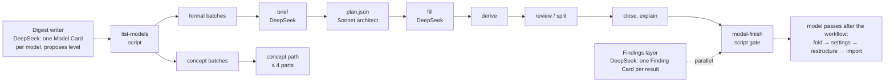
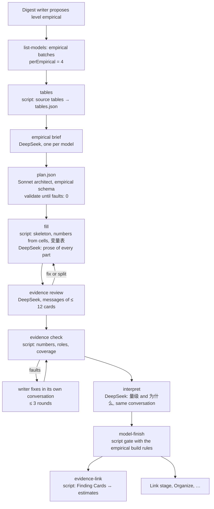

# Empirical models: a third model level — proposal

Status: implemented (2026-11-08), piloted on a copied box (2026-11-09) and completed overnight on 2026-11-09 (P3 on a fresh paper, P5 the model board, P6 the live migration); §14 records what was built, the pilots, the cost, the decisions taken and what is still open. The Chinese version is [empirical-models-proposal.zh.md](empirical-models-proposal.zh.md); the two say the same thing.

Related: [Model elaboration levels](model-elaboration-levels-design.md) (levels 1 and 2), [Finding Cards](finding-cards-design.md), [The model compiler](model-compiler-design.md), [Model compiler v2](model-compiler-v2-proposal.md) (D2, D3: no sharing while models are built), [Shared building blocks](model-shared-blocks-proposal.md) (the **引入** imports), [Self-sufficient models](self-sufficient-models-proposal.md), [Workflow principles](agents/workflow-principles.md), [Job map](agents/digest-job-map.md), and the skills `zt-model-fold`, `zt-model-settings`, `zt-model-restructure` and `zt-model-import`.

## 0. Summary

ZET has two kinds of models today. A **concept model** (level 1) states a mechanism in words. A **formal model** (level 2) states a model in mathematics and gets a self-sufficient build with Derivation parts. An economics paper often holds a third kind: a model that the author **estimates from data**. It has a question and an estimand, a sample, measured variables, an estimating equation, an identification argument, a ladder of specifications, tables of estimates with their uncertainty, tests of the identifying assumptions, robustness checks, heterogeneity and mechanisms, and sometimes a structural or counterfactual layer.

The digest has no place for this kind. It forces an empirical model into the formal template, or it scatters its results over Finding Cards that do not know which specification produced them. §3 shows both faults on the live box.

This proposal adds:

1. **Level 3, the empirical model** (`empirical`, 实证模型): its definition, its parts and their roles, its build order, its card formats, the way it shows results, its build rules, and the way it talks to other models (§4–§7).
2. **An empirical path in the econ digest's model layer** (strict, schema-bound): a deterministic table extractor, an empirical brief, an empirical architect plan, a fill whose numbers come from the source tables by script, an evidence review, an evidence check, and a script step that links the book's Finding Cards to the estimates they report (§8).
3. **Empirical branches in the model passes after the workflow** (flexible, judgement-led): fold, data-and-specification settings, an evidence spine, imports, and one new pass, the evidence dialogue between models and books (§9).

The design moves the critical parts of the formal path across, part by part (§5.6), so the empirical path is the same machine with different parts, not a second machine.

## 1. What this proposal read

| Source | What it gives |
| --- | --- |
| `CONTEXT.md` | Model Card, Model part, Model facet, Emphasis, Model relation, Relation kind, Build order, Derivation part, Building block, Import, Self-sufficient model, Elaboration level, Concept model, Formal model, Finding Card, Card language |
| `docs/model-elaboration-levels-design.md` | why levels exist, what each level builds, where the level is stored, who decides |
| `docs/model-compiler-design.md`, `docs/model-compiler-v2-proposal.md`, `scripts/book-digest/model-architect.md` | the roles (architect, compiler, driver, briefer, writer, reviewer), the rounds, `plan.json`, the source review, the D2/D3 rule that no model takes another model's part while models are built |
| `scripts/book-digest/dsh-model-cards.zh.md`, `dsh-finding-instructions.zh.md` | how the digest writer proposes a model and its level, and how the Findings layer writes one result per Card |
| `docs/agents/workflow-principles.md`, `docs/agents/digest-job-map.md` | one structure and no fallback; one start, one queue, one finish; long DeepSeek jobs with a SELF-CHECK; at most 12 Cards of review in one user message; scripts do deterministic work |
| the four model-pass skills | fold by the nature of the model; settings as a dependency tree with one notation card; an intuition spine of chapters, results and proof chains; imports with **引入** |
| the live box (archive revision 68593) | `hansen2021demand` (3 models, 28 Finding Cards), `ebrill2001modern/5|a` and `4|d|a` (regressions built as formal models), `atkinson2015lectures/13|b|a|a` (an estimating equation in a theory model), `atkinson2015lectures/16|c|a|a|a|e|a` (a formal model calibrated with an outside estimate) |
| the Scholar Archive | 215 full-text works, 73 of them empirical economics papers; §2 |

## 2. What the archive shows: the forms of real empirical models

### 2.1 The papers read

The Scholar Archive holds 215 works with a full-text Markdown file. The term count of the earlier report (2026-11-06) found 73 of them to be empirical economics papers: "specification" appears in 66 of the 73, "fixed effects" in 55, "instrument" in 32, "robustness check" in 32, "event study" in 14. For this proposal the empirical sections of 12 papers were read in full, chosen to cover every common design. File paths are below `E:/google_scholar_archive/data/files/`; numbers in brackets are line numbers.

| # | Paper | Design | Estimating equation | Ladder and tables | Further layers | Relation to theory and other papers |
| --- | --- | --- | --- | --- | --- | --- |
| 1 | Acemoglu, Naidu, Restrepo, Robinson, *Democracy Does Cause Growth* (`nber/w20004…`) | dynamic panel; GMM; semi-parametric; IV | (1) $y_{ct}=\beta D_{ct}+\sum_j\gamma_j y_{c,t-j}+\alpha_c+\delta_t+\varepsilon_{ct}$ [187–191]; the long-run effect is a derived estimand, $\hat\beta/(1-\sum\hat\gamma_j)$ (2) [203–207] | Table 2: three estimators × 1, 2, 4, 8 lags; column 3 preferred, β = 0.787 (s.e. 0.226) [211]; Table 3 adds covariates; Table 5 (IV) adds one control per named threat to the exclusion restriction [404–416] | numbered Assumptions 1, 1′, 2 [195, 299–329, 382–386]; AR2 and Hansen tests; first-stage F > 16 [390]; mechanisms as the same equation with each channel as outcome, eq. (5) [438–450]; heterogeneity by interactions [456–474] | tests verbal hypotheses of the literature; uses an outside index and an outside propensity score |
| 2 | Goldsmith-Pinkham, Sorkin, Swift 2020, *Bartik Instruments* (`aea/…`) | shift-share IV (methods) | $y_{lt}=D_{lt}\rho+x_{lt}\beta_0+\epsilon_{lt}$ [83–87]; $B_{lt}=\sum_k z_{lk0}g_{kt}$ [105–109] | rows are estimators (OLS, TSLS, MBTSLS, LIML, HFUL), columns no controls / controls / test p-values [584–588] | Assumptions and a Proposition [263–289]; Rotemberg weights [321–333]; a three-test protocol [462–510]; pre-trend figures [696–708] | re-estimates another paper: "our replication of … Card (2009)" [646–648] |
| 3 | Acemoglu, Hassan, Tahoun 2014, *Power of the Street* (`SatelliteImageLit/Aligned/…`) | event study on daily stock returns | (2) $CR[n,m]=N_i'\gamma+X_i'\nu+\eta_s+\epsilon_i$ [239–243]; panel (3) [337–349] | Table 3: parsimonious → baseline → without sector FE → adjusted s.e. → synthetic match → CAR [277–287]; Table 8: robustness ladder [371–383] | the condition written as a covariance [245]; five caveats [257–265]; placebo dates, placebo windows, a t-statistic distribution [289–299]; leads and lags [385–387]; Box–Cox [393] | benchmarks the size against two other studies [293] |
| 4 | Minni 2023, *Making the Invisible Hand Visible* (`TalentDiscovery/Aligned/…`) | event study of manager rotations | (2) $y_{it}=\sum_j\sum_{s}\beta_{j,s}D^j_{i,t+s}+\alpha_i+\xi_t+\epsilon_{it}$ [248–256]; companion (3), (4) [268–279] | event-study plots [288–290]; headline salary +13%, $11,962 a year, "about 7 years of raises" [463–465] | the measure first (high flyers by promotion age) [176–180]; balance regressions with a Bonferroni correction [219–235]; Sun–Abraham, placebo trait [564–579]; mediation [589]; heterogeneity eq. (5) [633–657] | a conceptual framework in an appendix gives rival predictions [663, 674]; uses an outside estimator |
| 5 | Autor and Scarborough 2004, job testing (`TalentDiscovery/Aligned/…`) | DiD of a phased rollout; 2SLS | (7) $D_{ijt}=\alpha+\delta T_i+X_i\beta+\theta_t+\varphi_j+e_{ijt}$ [371–381]; (8)–(11) [407–479] | leads and lags of the rollout [395–401] | theory section III [143–355] gives "empirical implications" [355–365]; T × race interactions test them, p = 0.36 [425–439]; the theory is simulated, calibrated to the moments, and six bias scenarios are compared with the estimates [491–539] | theory → prediction → test → structural comparison, in one paper |
| 6 | Grosz and Raval 2024, FTC website (`CustomerComplaints/Aligned/…`) | regression discontinuity in time | (1) $y_t=\beta Post_t+\gamma_1(t-C,t\ge C)+\gamma_2(t-C,t<C)+g(DOW_t)+\epsilon_t$ [545–551] | Table 1 columns are outcomes and channels; untreated channels act as placebos [916–920]; headline +28% [912] | no-anticipation argument [539]; RD plots [565]; mechanisms [951–959]; heterogeneity with outside weights [1087–1108] | uses another paper's victim weights |
| 7 | Shapiro, Hitsch, Tuchman 2020, TV advertising (`CustomerComplaints/Aligned/…`) | 288 brand-level regressions | (1) $\log Q_{st}=\beta^T\log(1+A_{d(s)t})+\alpha^T\log p_{st}+\epsilon_{st}$ with ad stock (2) [146–168] | Table 2: rows are specifications built by adding controls; columns are statistics of the distribution of estimates (median, mean, % significant) [529–533]; median 0.0140 [519] | two identification strategies, baseline and border [199–237]; SUTVA [235]; two-way clustering [313]; ROI counterfactual, median −87.8% [714–736] | benchmarks against a meta-analysis and a theory formula [523, 527] |
| 8 | Nosko and Tadelis 2015, eBay (`CustomerComplaints/Aligned/…`) | observational cohort, then a field experiment | (1) [408–416] | Table 2: OLS, quartiles, probit, marginal effects [418–430] | balance table [612]; ITT scaled by the shift in treatment [686–704]; IV/TOT 0.246 [743–757] | the experiment validates the observational estimate (0.157 against 0.139) |
| 9 | Balboni et al. 2022, *Why Do People Stay Poor?* (`TalentDiscovery/Aligned/…`) | RCT data; nonparametric; structural | transition (1) [73–109]; $k_{i,3}=\phi(k_{i,1})+\varepsilon_i$ (2) [127–131]; threshold regression (3) [159–163] | shape test [145]; −14% below and +16% above the threshold | parameters calibrated from first-order conditions [335–357]; out-of-sample fit [365–369]; misallocation [371–385]; policy counterfactuals [387–399] | reuses another study's RCT data |
| 10 | Hansen, Ramdas, Sadun, Fuller 2021 (`MissingMarket/Aligned/…`) | measurement; descriptive; cross-section | (7) [665–671]; "cross-sectional relationship" [679] | Table 2 adds one characteristic per column; Table 4 outcomes are other clusters, each cell a separate regression; Table 5 robustness [681–764] | a measurement pipeline with validation [131–199, 237]; stylized facts [249–255] | a theory section [418–660] gives the predictions that (7) tests |
| 11 | Bell, Chetty, Jaravel, Petkova, Van Reenen 2019 (`TalentDiscovery/Aligned/…`) | three designs on one question | (1), (2), (4) with their assumptions [313–427] | — | each design states its own assumption | takes over another paper's movers design and functional form [415, 429] |
| 12 | Bronnenberg, Dubé, Gentzkow 2010 (`CustomerComplaints/Aligned/…`) | measurement; descriptive; structural habit model | (1), (2) [172, 184]; habit (3)–(4) [217–238] | parameter estimates, fit and residual figures [365–371] | identifying assumptions tested in their own section [323–357]; counterfactuals [385–427]; a parameter varies with advertising across categories [437–447] | estimates an outside theory (Becker–Murphy habits) |

### 2.2 What every empirical model has

The twelve papers agree on nine components:

1. a question and an estimand (a coefficient, a long-run effect, a distribution of elasticities, a threshold);
2. a unit of observation, a sample, a period, data sources and sample rules;
3. constructed measures, often built by the authors (a democracy index, high-flyer managers, market betas, skill clusters, a relative share);
4. a numbered estimating equation that defines the outcome, the regressor of interest, the fixed effects, the controls, the error and the estimator;
5. an inference rule: the standard errors and their clustering, in the text or in the table notes;
6. an identifying assumption, often numbered, with named threats and tests;
7. a preferred specification inside a ladder of specifications;
8. a headline estimate with a magnitude translation (× 100, percent, dollars a year, "7 years of raises", a benchmark against the literature);
9. robustness, then heterogeneity or mechanisms.

### 2.3 What varies by design

| Design | Its own components |
| --- | --- |
| dynamic panel (1) | the lags; a family of estimators (within, GMM, HHK); the AR2 test; a derived long-run multiplier |
| IV and shift-share (1, 2, 5, 8) | the instrument's construction; the first stage and its F; the exclusion restriction and one control per threat to it; overidentification; Rotemberg weights; reduced form against 2SLS; LATE or TOT |
| DiD and event study (3, 4, 5) | the event; the window; the omitted period; the comparison group; pre- and post-period coefficient plots; a staggered-adoption estimator; in finance, abnormal returns, estimation-window betas and placebo dates |
| RD (6) | the running variable, the cutoff, the window, the polynomial order, the no-anticipation argument, the RD plot, untreated outcomes as placebos |
| experiment (8, 9) | the randomization unit, the balance table, ITT, compliance, TOT by IV, scaling by the shift in treatment |
| many-unit estimation (7) | the estimand is a distribution over units: medians, percentiles, the share significant, a meta-comparison |
| structural (5, 9, 12) | a model of the primitives; parameters estimated or calibrated from reduced-form moments; fit tests out of sample; counterfactual simulations |
| measurement and descriptive (10, 12) | a measurement pipeline with its validation; stylized facts; conditional correlations with no causal claim |

### 2.4 The order of dependence

Each paper builds its evidence in nearly the same order, and each later item rests on an earlier one:

```
question → institutional context (the source of variation) → data → measures → descriptive facts
→ [theory or framework: the predictions] → estimating equation → identifying assumption, threats, tests
→ baseline and preferred estimates → other estimators and robustness → heterogeneity → mechanisms and rival channels
→ external validity → structural layer or counterfactual → interpretation
```

Three reuse patterns tie the later items to the equation: a mechanism regression keeps the right-hand side and changes the outcome (1, eq. 5); a heterogeneity regression adds an interaction (4, eq. 5; 5, eq. 9); a counterfactual takes the estimated parameters as inputs (7, 9).

### 2.5 How results are reported

- **The regression table.** Rows are coefficients (with long-run or persistence rows); columns are a cumulative ladder; the bottom rows report the fixed effects, N, R² and test p-values (AR2, Hansen, first-stage F); the notes give the outcome, the estimator, the standard errors and the scaling.
- **Columns that are not specifications.** A column can be an estimator family (1, 2), a phase or a subsample (3), an outcome or a channel (6, 10), and a cell can be a separate regression (10). A table's columns must therefore be mapped one by one; they cannot be assumed to be a ladder.
- **Figures.** Event-study paths with confidence intervals (1, 4); RD plots (6); placebo histograms (3); distributions of unit estimates (7); β_k against F (2); nonparametric curves (9); model-against-data fit (9, 12).
- **The headline sentence.** The point estimate, its standard error and a magnitude translation.

### 2.6 How empirical models relate to other models

| Relation | Observed in |
| --- | --- |
| tests a prediction of a theory in the same paper | 5, 8, 9, 10 |
| supplies moments or targets for a structural model | 5, 9, 12 |
| re-estimates or replicates another paper's specification | 2 (Card 2009) |
| takes over another paper's design or estimator | 1, 4, 11 |
| uses another paper's data or measures | 6, 9, 10 |
| benchmarks against or contradicts another estimate | 1, 3, 7 |
| validates an observational estimate by an experiment | 8 |
| inside one paper: baseline → variant; main → mechanism; main → heterogeneity; reduced form → structural | all |

These relations, the nine common components, the design-specific components and the reporting forms are the requirements for §4–§7.

## 3. What the digest does with an empirical model today

### 3.1 How a model comes about now



The writer of a section group proposes a Model Card and its level. The model layer brings each Model Card to its level: the concept path writes at most four parts, the formal path plans, fills, derives, reviews and explains. Independently, the Findings layer writes one Finding Card per empirical result it finds in a group, with six labels (`测量`, `数据`, `方法`, `结果`, `局限`, `来源`), and links it from the Idea Card it supports. After the workflow, the owner runs the model passes by hand: fold the models the digest split, organize the settings, build the intuition spine, and write the imports.

Nothing in this chain knows what a specification, an estimate, a standard error, an identifying assumption or a robustness check is.

### 3.2 Faults found on the live box

**P1. A regression built as a formal model.** `ebrill2001modern/5|a` (*The Modern VAT*, §4.2) is a 99-country cross-section regression. The digest built it as a formal model:

- The Model Card's body holds a table of the coefficients. The parts do not hold them.
- The four columns of Table 4.2 (A–D: which regressors, which sample, N = 69, 89, 40, 55) are packed into one card titled `结果：收入消费比对税率与环境的回归`. A specification is filed as a result.
- `推导：系数 0.70 对应税率升 10%、收入升 7%` is a Derivation part for log arithmetic. The formal path asks for a derivation where the source skips algebra, so it made one.
- The White standard errors and the significance marks are in a sentence. No estimate card carries its uncertainty.

`ebrill2001modern/4|d|a` (the VAT revenue regression with interaction terms) has the same shape.

**P2. A theory and its test in one model, and the results outside it.** `hansen2021demand/5|b|b|a` is a formal model of managerial time. Its chapter 3, `第 3 章：两个命题合成一条可估计的回归`, holds the dependent variable, the proxies and regression (7) with its fixed effects and clustering. The estimates of Table 2 are not in the model. They are five Finding Cards (`5|c|a|c` … `5|c|a|g`). Each Finding says `横截面 OLS 回归，控制行业、大洲、职位与年份固定效应` in its `方法` line, restating the specification, and links only the Literature note `5|c|a`. No Finding links regression (7). The robustness results (`5|c|d|b`: Probit, `5|c|d|c`: document length) are Findings that say `结果与基准结果几乎相同` without a number. A reader cannot go from the theory's prediction to the specification, to the column, to the number.

**P3. A measurement framework as a concept model.** `hansen2021demand/3|d|a` (embeddings, k-means clusters, a relative 0/1 measure) is the measurement block of the paper's empirical model. It is a separate concept model, linked to nothing that uses the measure.

**P4. Calibration from an outside estimate.** `atkinson2015lectures/16|c|a|a|a|e|a` sets σ = 0.408, the Ashenfelter–Heckman (1973) estimate. That is a formal model that rests on an empirical estimate. ZET has no way to say so except a prose sentence.

**P5. Finding Cards without a home.** A Finding Card states one result, but an empirical result is a number of one specification in one column. The six labels cannot hold the specification, the column, the standard error and the identification together, so the writer repeats them in `方法`, and repeated text drifts (the `测量：测量：` doubling in `5|c|d|b` is one small sign).

**P6. The fold rule hides the problem.** `zt-model-fold` says a Model Card that "estimates or calibrates the model" is the same model. Under that rule the empirical part of a paper always folds into its theory, and the two different builds (derive a result; estimate a number) share one template.

## 4. The empirical model (level 3)

### 4.1 Definition

Proposed glossary entries for `CONTEXT.md`:

> **Empirical model**: A model of Elaboration level 3. The source estimates or measures a relation from data: it names what it estimates, the data, a specification and the argument that the estimate means what it claims, and it reports estimates with their size and uncertainty. A reduced-form regression, a design-based estimate (difference-in-differences, event study, instrumental variables, regression discontinuity, a randomized experiment), a structural estimation with its counterfactuals, and a measurement framework that the source builds and validates on data are empirical models. Its Model Card and parts follow the empirical roles. It has no Derivation part except one that derives an estimating equation or an estimator. _Avoid_: Regression model, econometric card, results model.
>
> **Estimand**: What an empirical model estimates, in words: the effect of what on what, for whom (估计对象).
>
> **Specification**: One estimating equation with everything that defines its estimate: the outcome, the regressor of interest, the fixed effects, the controls, the sample, the weights, the estimator and the standard errors (规格). A model's baseline specification is on its main line; every other specification is a variant filed under it and states what it changes.
>
> **Estimate part**: A part of an empirical model that states one reported estimate: the coefficient, its specification and table cell, its uncertainty, the sample size, and its magnitude in words (估计).
>
> **Evidence chain**: The parts filed under an estimate part that support or qualify it: the tests of the identifying assumptions, the table, the figure, a conversion of the magnitude. It plays the role a proof chain plays under a result.

The **Elaboration level** keeps its name and its column. Its meaning widens from "how fully a model is built out" to "how the source builds the model": in words (1, `concept`), in mathematics (2, `formal`), from data (3, `empirical`). Level 3 is not "more elaborate" than level 2. It is a sibling with its own rules. The number only names the value.

### 4.2 Where the boundary lies

| The source gives | ZET writes |
| --- | --- |
| its own estimating specification and estimates from data | an empirical model |
| a theory and a test of it in the same paper | two models: the formal (or concept) model, and an empirical model that imports the prediction it tests (§7) |
| a structural model estimated on data, with counterfactuals | two models: the formal model, and an empirical model that imports it whole (`整块`) and adds data, moments, estimator, estimates and counterfactuals |
| a measurement framework built and validated on data | an empirical model of design `measurement`, or the measurement block of the empirical model that uses it (the same paper: one model) |
| one number, a survey count, a stylized fact, with no specification | a Finding Card only |
| a summary of another paper's empirical design (a lecture, a textbook, a survey) | no empirical model: the summary stays a Literature note or a part of the concept or formal model that uses it; the outside paper is a Cited Card |
| a textbook illustration that estimates an equation of its own theory (`atkinson2015lectures/13|b|a|a`, 110 Swiss cities) | an example part of the formal model (`例子`), unless the source treats the estimation as a study with its own design and tests |

The last two rows keep the empirical level for studies, so a textbook does not turn every quoted regression into a model.

### 4.3 The design types

The plan names one design type for the model (several only when the source combines them on one estimand). The type decides which parts the build expects (§5.2):

| Design (`design`) | 中文 | Expected parts beyond the common ones |
| --- | --- | --- |
| `cross-section` | 横截面回归 | controls; the selection threat in 局限 |
| `many-unit` | 多单位估计 | one estimate per unit (brand, firm, region); the estimand is their distribution: median, percentiles, share significant |
| `panel` | 面板（固定效应、动态面板） | fixed effects, lags, the dynamic estimator, serial-correlation tests |
| `did` | 双重差分 | treated and control groups, timing, parallel trends, pre-trends test |
| `event-study` | 事件研究 | event time, leads and lags, the coefficient figure, pre-period test |
| `iv` | 工具变量 | instrument, first stage with its F, exclusion restriction, reduced form, overidentification |
| `shift-share` | 移位份额（Bartik） | shares, shocks, the weights, the share-exogeneity tests |
| `rd` | 断点回归 | running variable, cutoff, bandwidth, density test, covariate balance |
| `experiment` | 随机实验 | randomization, balance, attrition, ITT, compliance and LATE |
| `structural` | 结构估计 | the imported theory model, moments or likelihood, estimator, parameter estimates, fit, counterfactuals |
| `measurement` | 测量 | the construction, validation against other measures, descriptive results |
| `descriptive` | 描述性统计 | the sample, the measures, the patterns; no causal claim |

## 5. The anatomy of an empirical model

### 5.1 The roles

An empirical model uses the same machinery as every model: a Model Card, Model parts with facets and emphasis, Links with Relation kinds, filed in a tree under the Model Card. What differs is a fixed **role vocabulary**, read from the facet prefix, as `推导` is read today. A fixed vocabulary is what the math units already have; it lets the build report check the structure.

| Role (facet prefix) | Line | Holds | Rests on |
| --- | --- | --- | --- |
| `数据：` | main, first | the unit, the sample, the period, the place, the data sources, the sample rules | nothing (the primitive) |
| `变量表` | first Side of `数据：` | every variable and symbol of every specification: name, meaning, how measured, source, the card where a reader meets it | `数据：` |
| `样本：` | Side of `数据：` | a subsample or a linked data set | `数据：` |
| `测量：` | Side of `数据：` | how a constructed variable is built (an index, a text measure, a deflator) and how it is validated | `数据：`, earlier `测量：` |
| `描述：` | Side of `数据：` or of a descriptive chapter | one descriptive fact or summary statistic the source reports before it estimates | `数据：`, `测量：` |
| `假说：` | main | the prediction the model tests, normally an import of a theory part (§7) | the imported part |
| `设计：` | main | the design type, the source of variation, the comparison, the threats | `数据：`, `假说：` |
| `背景：` | Side of `设计：` | the institutional fact that supplies the variation (a rotation policy, an ad-buying process, an unannounced launch, a phased rollout) | `设计：` |
| `假设：` | Side of `设计：` | one identifying assumption, numbered (`假设 1`) | `设计：` |
| `规格：` | main (the baseline), Side (a variant) | one estimating equation with every term defined; a variant states only what it changes against the specification it is filed under. A change is one of: controls, fixed effects, sample, estimator, outcome (a mechanism: the same right-hand side, a new outcome), interaction (heterogeneity), functional form, standard errors, instrument | `数据：`, `测量：`, `设计：`; a variant also its base |
| `第 k 章：` | main | one stage of the evidence: main estimates, identification tests, robustness, heterogeneity, mechanisms, quantification | earlier chapters, the baseline `规格：` |
| `估计：` | Side of a chapter | one reported estimate (§5.3) | its `规格：` |
| `表 n：` | Side of a chapter | one source table in compact form, each column linked to its specification | the `规格：` cards of its columns |
| `图 n：` | Side of an estimate or chapter | one source figure (an event-study plot, a binned scatter, a distribution of estimates) | its `规格：` |
| `检验：` | Side of an estimate (its evidence chain) or of a chapter | one test of an identifying assumption or of a model's fit: first stage and its F, pre-trends, placebo dates or placebo outcomes, balance, density, AR2, overidentification, out-of-sample fit | the `假设：` it tests (or the `参数：` cards whose fit it tests), its `规格：` |
| `换算：` | Side of an estimate | the conversion of a coefficient into a magnitude (log points to percent, one standard deviation to a share) | the estimate |
| `参数：` | Side of a chapter (structural) | one estimated structural parameter with its uncertainty | its `规格：` (the estimator) |
| `反事实：` | Side of a chapter (structural) | one counterfactual result | the `参数：` cards and the imported theory |
| `推导：估计式` | Side of `规格：` | the derivation of an estimating equation or an estimator, when the source derives it | the theory parts it starts from |
| `局限：`, `外部有效性：` | off | what the estimates do not show | `设计：`, `数据：` |

### 5.2 The build order: the evidence spine

The restructure skill's principle holds unchanged: **lower the reader's working memory**. One idea per card, the claim before the detail, the main line short, the detail one step aside. For an empirical model the main line follows the order in which a reader comes to trust a number:

```
Main line   数据 → [假说] → 设计 → 规格：基准 → [第 0 章：描述性事实] → 第 1 章：主要估计 → 第 2 章：识别检验 → 第 3 章：稳健性 → 第 4 章：异质性与机制 → [第 5 章：量化或反事实]
  ├ Setting part   变量表, 样本, 测量 under 数据; 背景 and 假设 1…n under 设计; each 规格 variant under 规格：基准
  └ Under each chapter   估计 / 表 / 参数 / 反事实 cards as Side branches
       └ Under each estimate   its evidence chain: 检验, 图, 换算
Off line    局限, 外部有效性, 数据来源史
```

- A chapter that the source does not have is left out. A chapter appears only if it holds at least one estimate or one test.
- An estimate the source derives from other estimates (the long-run effect $\hat\beta/(1-\sum\hat\gamma_j)$ of paper 1) is an `估计：` card that rests on the estimates it uses and shows the formula. It is not a `换算：` card, because it is a reported estimate with its own uncertainty.
- Chapters follow the source's order when the source orders them differently (some papers report the tests first). The rests-on rule decides what may come first: a robustness estimate rests on its variant specification and never on a later chapter.
- The specification ladder is a Side tree: `规格：基准` on the main line, each variant filed under the specification it changes, a variant of a variant under it. This is the same rule as model variants in `zt-model-settings` ("the base model first, then the variants, each variant on its own branch").
- An estimate rests on its specification, not on the tests. A test rests on the assumption it tests and on its specification, and it `印证`s (or `反驳`s) the estimate it supports. Only rests-on Links place a card on the board, so the tests hang under the estimate without making it wait for them.

Every rule of a Self-sufficient model holds: no closure fault, no forward fault, no unanchored main-line part.

### 5.3 How results are shown

Papers show results in four forms (§2): a coefficient table whose columns are specifications, a figure of coefficients (event time, bins, a distribution), headline numbers in the text with a magnitude ("a one standard deviation increase raises … by 3.5 percentage points"), and the notes that define the uncertainty (clustering, N, the fixed-effect rows). The empirical model keeps all four, each on its own card:

- **One headline estimate, one `估计：` card.** It carries the number, its uncertainty, its sample size, its specification and its cell, and the magnitude in words. It is the only place where the number lives in the model.
- **One source table, one `表 n：` card.** It keeps the table's layout in a compact Markdown table: the rows the text uses, every column, the N row and the fixed-effect rows, and a header line per column that links what the column is. A column is not always a specification (§2.5): it can be an estimator, a subsample, an outcome, or a separate regression, so the plan maps each column to its `规格：` variant (whose `change` says which), and a table whose columns are statistics of a distribution of estimates (paper 7) maps its rows instead. The table card is the reader's map from the paper's table to the cards.
- **One source figure, one `图 n：` card,** with the book's own image (the figure layer already attaches figures and their DeepSeek explanations) and one sentence on what to read off it.
- **The conversion of a magnitude is a `换算：` card**, never a Derivation part. It holds at most a few lines of arithmetic.

**Every number comes from the source by script.** The workflow extracts the source's tables into `tables.json` (§8.2) and writes each number of an `估计：` and `表 n：` card from its cell. DeepSeek writes the prose around the numbers and never types a number that a cell holds. The evidence check (§8.2 step 6) refuses a card whose number appears in no source line of its span.

### 5.4 Card formats

The formats follow the restructure skill's rule: the claim first, in words; one format per role; each premise once. Labels are Chinese because the digest writes Chinese Cards.

**Model Card (empirical)**

```
**问题**
One or two sentences: what the study asks.

**估计对象**
The estimand in one sentence: the effect of what on what, for whom.

**设计**
The design type (§4.3) and the comparison in one or two sentences.

**数据**
Unit, sample size, period, place, source data, in one or two sentences.

**主要估计**
| 估计 | 值 | 不确定性 | 规格 |
| --- | --- | --- | --- |
| [[估计：…]] the estimate in words | 0.718 | s.e. 0.249 | [[规格：基准]] 表 2 第 1 列 |
(at most five rows: the estimates the paper's abstract and conclusion use)

**结构**
(the two-level list of the main line, as every Model Card)

**引入**
(the imports: the theory prediction it tests, a shared data block, a theory model it estimates)

**关联**
检验 / 对照 / 印证 / 反驳 lines to other models and books (§7).

来源：[[key]] §n
```

**`数据：` (the setting of the model)**

```
一句话：what the data are.

**起点**
- 原始设定：不依赖其他设定。

**内容**
1. 观测单位：…
2. 样本：N = …, period, place.
3. 数据来源：…
4. 样本规则：what is dropped and why.

**为什么需要它**
One sentence: which specifications use these data.

变量的含义见变量表 [[变量表]]。

来源：[[key]] §n
```

**`变量表`** — the notation card of an empirical model: `| 变量 | 含义 | 度量 | 来源 | 首次出现 |`, one row per variable and per symbol of every specification (outcome, regressors, fixed effects, error, indices), plus **统一用语** (the one term per concept). The coverage rules of `zt-model-settings` apply: every symbol of every `规格：` equation has a row (`uncovered`), no row is unused (`unused`), and each row names the card where a reader first meets it (`first`).

**`设计：`**

```
一句话：the comparison that identifies the estimate.

**起点**
- 依赖 [[数据：…]]：…
- 依赖 [[假说：…]]：the prediction this design tests. (when there is one)

**变异来源**
Where the variation comes from, and why it is plausibly unrelated to the error.

**比较**
Who is compared with whom (treated and control, before and after, near the cutoff).

**识别假设**
- [[假设 1：…]] one line each.

**威胁**
The threats the source names, one line each, with the card that addresses it.

来源：[[key]] §n
```

**`规格：` (the baseline, or a variant)**

```
一句话：what this specification estimates.

**起点**
- 依赖 [[数据：…]]、[[设计：…]]：…
- 变体：放宽 [[规格：基准]] 的…：the one change. (a variant only)

**估计式**
$$ … \tag{n} $$

**各项**
1. 因变量：…
2. 关注的回归元：… (its coefficient is the estimate)
3. 固定效应：…
4. 控制变量：…
5. 样本与权重：…
6. 估计方法：OLS / 2SLS / GMM / probit / MLE / …
7. 标准误：clustered by … / robust / bootstrap.

**相对基准的改动**   (a variant only)
The change in one or two lines, nothing else.

变量的含义见变量表 [[变量表]]。

来源：[[key]] §n, 表 n 第 k 列
```

When the source gives no equation, the card says `书中没有写出估计式` and lists the terms in words.

**`估计：`**

```
One sentence: the result, direction and size, no formula.

**估计**
- 估计量：[[规格：…]] 中 $\beta$（式 (n)），表 n 第 k 列。
- 值：0.718；标准误 0.249（按国家聚类）；N = 6,336。
- 显著性：1% 水平。   (or: 原书未写明)

**量级**
The magnitude in words, as the source states it. A conversion the source does not show goes to a 换算 card.

**为什么**
One to three sentences: the author's reading of the estimate.

**依据**
依赖 [[规格：…]]。识别见 [[设计：…]]。检验见 [[检验：…]]。

**对应**
对应 [[Finding Card]]：the book-level statement of this result. (written by script, §8.2 step 9)
印证 / 反驳 [[假说：…]]：what the estimate says about the prediction.

来源：[[key]] §n 表 n
```

**`检验：`**

```
One sentence: which assumption is tested and whether it holds.

**检验什么**
依赖 [[假设 k：…]]：the assumption.

**做法**
The test in one or two sentences, with its specification: 依赖 [[规格：…]].

**结果**
The statistic or the coefficients, with their uncertainty (from the cell or the figure).

**结论**
One sentence in the source's own strength: holds / does not reject / fails / the source does not say.

印证 [[估计：…]]：what this test does for the estimate.

来源：[[key]] §n
```

**`表 n：`, `图 n：`, `换算：`, `参数：`, `反事实：`, `局限：`** follow the same shape: one sentence first, then the content, then the Links, then the source line. A chapter card keeps the restructure format (`**直觉**`, `**本章结果**`, `**承上启下**`), with `**本章估计**` in place of `**本章结果**`.

### 5.5 Build rules and the build report

The build report already checks closure, forward, unanchored and import faults. For a Model Card of level `empirical` it adds role checks, read from the facet prefixes of §5.1:

| Fault | Rule |
| --- | --- |
| `empirical_shape` | the main line starts with a `数据：` part, holds one `设计：` part and at least one `规格：` part, and the model holds at least one `估计：` or `参数：` part |
| `estimate_unbound` | an `估计：` or `参数：` part has no rests-on Link to a `规格：` part of the model |
| `spec_unbound` | a `规格：` part rests on no `数据：` or `测量：` part (a baseline) or on no `规格：` part (a variant) |
| `test_unbound` | a `检验：` part rests on no `假设：` part |
| `variable_uncovered` | a symbol of a `规格：` display equation has no row in the `变量表` (as the settings check's `uncovered`) |
| `beyond_level` | a Derivation part whose facet is not `推导：估计式` or `推导：估计量` (the arithmetic of a magnitude is a `换算：` part) |

`self_sufficient` keeps its meaning. The level adds checks; it loosens none. The faults are reported, not enforced, as every build fault is today; the workflow's `model-finish` gate refuses a model with any of them, as it does for formal models.

`zt-check` gains card-format rules for the empirical roles, in the style of the F rules (proposed numbers EM1–EM5):

| Rule | Check | Default |
| --- | --- | --- |
| EM1 | an `估计：` part has the labels `估计`, `量级`, `依据`, and its `估计` section names a `规格：` Link and a table or figure | yes |
| EM2 | an `估计：` part states a value and an uncertainty (s.e., t, CI, p, a significance level) or `原书未写明` | yes |
| EM3 | a `规格：` part has `估计式` (or `书中没有写出估计式`) and `各项` with the outcome, the regressor of interest and the standard errors | yes |
| EM4 | a `设计：` part has `变异来源` and `识别假设` | yes |
| EM5 | a causal verb (`导致`、`使`、`提高了`、`causes`) in an `估计：` part of a model whose design is `descriptive` or `cross-section` | advice |

### 5.6 What moves across from the formal path

The empirical path is the formal path with its parts replaced, one for one. This table is the core of the design: each line is a part of today's machine that the empirical model keeps.

| Formal model today | Empirical model |
| --- | --- |
| `设定` part + `符号表与读法` | `数据：` part + `变量表` |
| assumptions (`假设`) in the setting part, cited by Link | identifying assumptions (`假设 k`) under `设计：`, cited by Link from every test |
| model variants as branches of the setting | specification variants as branches of `规格：基准`, each with `相对基准的改动` |
| main line: setting → chapters | main line: data → design → baseline specification → chapters |
| `结果：` cards under a chapter | `估计：` (and `参数：`, `反事实：`) cards under a chapter |
| the proof chain under a result (`推导：` parts) | the evidence chain under an estimate (`检验：`, `图 n：`, `换算：`) |
| a Derivation part for each step the book skips | no invented step: the numbers come from the tables; only an estimating equation or an estimator may be derived |
| the reviewer redoes every step of a chain | the reviewer checks every number, sign, significance word and claim strength against the source span |
| explain: `思路` / `说明` / `解读` | interpret: `量级` / `为什么` |
| `source_review` (supported, narrowed, supplied, absent) | the same, plus the cell of every number |
| `source_faults` (OCR faults in equations) | the same, plus OCR faults in tables (a shifted column, a lost minus sign) |
| imports of setting blocks between models | imports of a hypothesis, a data or measurement block, an instrument, or a whole theory model |
| Self-sufficient: every premise is a member | Self-sufficient and **evidence-bound**: every number is traceable from the estimate to its specification, its cell and its source line |

## 6. Worked examples

These sketches show the target trees. They are not built.

### 6.1 `hansen2021demand`: theory and test in two models

```
5|b|b|a  管理者时间模型（formal）            unchanged, except chapter 3 moves out
NEW      高管社交技能需求的横截面估计（empirical, design: cross-section + measurement）
  **引入** 单卡 [[5|b|b|a|a|2|b]] 命题 1；单卡 [[5|b|b|a|a|2|c]] 命题 2
  数据：4,618 个高管搜寻的职位描述，2000–2017 年
    变量表
    测量：HBR 词嵌入与六个技能集群（from 3|d|a, which folds in here）
    样本：703 个能匹配 Burning Glass 的美国搜寻
  假说：企业特征的系数为正（imports the two propositions）
  设计：横截面比较；特征在搜寻前三年取定
    假设 1：特征先于职位描述
  规格：基准 (7)  Social_ft = α + βX_ft + ψ_o + θ_i + φ_chq + φ_sl + δ_t + ε
    规格：Probit
    规格：加入文件长度控制
    规格：企业内部就业
  第 1 章：主要估计
    表 2：社交集群对企业特征
    估计：对数就业高一个标准差，社交技能要求的概率高 3.5 个百分点   ← Finding 5|c|a|c links it
    估计：跨国公司 …   估计：并购 …   估计：上市 …   估计：多元化不显著
  第 2 章：信息强度
    估计：信息技术技能占比高一个标准差，社交集群高 5.2 个百分点（表 3）
  第 3 章：其他集群
    表 4 …
  第 4 章：稳健性
    估计：Probit 下系数 …（rests on 规格：Probit）
  局限：横截面相关，不是因果效应
```

The theory's chapter 3 (`5|b|b|a|a|3`) is replaced by a one-line pointer: `本模型的预测由 [[the empirical model]] 检验`. The measurement concept model `3|d|a` becomes the `测量：` block, because it is built for this estimation (the same paper, the same data).

### 6.2 `ebrill2001modern/5|a`: a regression rebuilt at its level

```
增值税收入的跨国回归（empirical, design: cross-section）
  数据：99 个实行增值税的国家，每国一个观测
    变量表 (SR, OPEN, AGE, ILLITERACY, SI, RANGE, THRESH, RETAIL, GS)
  设计：横截面比较；规则 τ 随环境 α 而定，部分规则看不见
    假设 1：可观测规则与环境的系数是直接与间接效应之和
    推导：估计式 (the two existing Derivation parts on r(τ0, α) and dR/dα stay: they derive what the coefficient means)
  规格：A 列 (baseline)
    规格：B 列（删去文盲率，N +20）
    规格：C 列（A 加四个结构变量）
    规格：D 列（B 加四个结构变量）
  第 1 章：税率弹性
    表 4.2
    估计：ln(SR) 的系数 0.70
      换算：税率升 10%，收入消费比升约 7%   (was a Derivation part)
  第 2 章：环境变量
    估计：OPEN …  估计：ILLITERACY …  估计：SI …
  第 3 章：结构变量
    估计：只有 RANGE 在 C、D 两列都为正
      推导：需求转移 … (the two derivations that explain why RANGE can be positive are theory: they move to a small formal model, or stay as a 机制 aside; decision in §12)
  局限：不可观测规则使效应无法分解
```

### 6.3 A design-based paper from the archive

Autor and Scarborough (2004) shows the whole conversation in one paper (§2.1, paper 5). It would give three models:

```
A  职位测试的甄选模型（formal）
     设定：面试与测试两种甄选技术 [143–355]
     第 k 章：经验含义 — 测试使雇佣差距与生产率差距反向变化 [355–365]

B  职位测试对雇佣与任职期的影响（empirical, design: did + iv）
   **引入** 单卡 [[A 的经验含义]]
   数据：连锁零售企业的门店与雇员记录，1,363 个门店
     变量表
     测量：门店平均测试分数（用 (8) 验证其预测任职期）[407–421]
   假说：测试不扩大少数族裔的雇佣差距，并提高各族裔的任职期
   设计：分阶段推行测试的双重差分；门店采用作为工具变量 [393]
     假设 1：推行时点与门店的任职期趋势无关
   规格：基准 (7) 任职期对测试、门店与月份固定效应，按门店聚类 [371–381]
     规格：2SLS（门店采用作工具变量）
     规格：(9) 加入测试 × 族裔交互
     规格：(10) 条件 logit（雇佣），(11) 线性概率模型
   第 1 章：任职期
     估计：测试使白人雇员任职期增加 …（表 VI）
   第 2 章：识别检验
     检验：推行前后的前导与滞后项 [395–401]   (rests on 假设 1)
   第 3 章：族裔异质性 = the test of the prediction
     估计：各族裔效应相等，p = 0.36 [425–439]   印证 [[假说]]
   第 4 章：雇佣
     估计：(10)(11) 的雇佣效应；邻里族裔构成的第二个检验 [459–487]

C  偏差情景的模拟（empirical, design: structural）
   **引入** 整块 [[A]]；单卡 [[B 的主要估计]]
   参数：按经验矩校准的甄选参数 [491–539]
   第 1 章：六种偏差情景
     反事实：只有"两者都无偏"的情景与估计相符   印证 [[B 的估计]]
```

Whether C is its own model or a chapter of B is the fold decision of §9.1: C adds its own primitives (a calibration of A's parameters), so the rule makes it its own model.

## 7. How an empirical model talks to other models

ZET already has every tool this needs: imports for premises that come from another model, Relation kinds for everything else, Model neighbours for the reader. The proposal adds one convention per relation, no new kind (§12, decision 5).

| Relation | When | Written where | How | Kind |
| --- | --- | --- | --- | --- |
| tests a prediction | the paper derives a prediction and estimates it | the empirical model's `假说：` part | `单卡` import of the theory's result card; the `假说：` part restates nothing, it names the sign or size the theory predicts | rests-on (by import) |
| supports or contradicts | an estimate agrees or disagrees with the prediction | the `估计：` part, `**对应**` | `印证 [[假说：…]]` or `反驳 [[假说：…]]` | illustrates / objects |
| derives its equation from theory | the estimating equation follows from a theory model | `推导：估计式` under `规格：` | `整块` import of the theory block the derivation starts from | rests-on |
| estimates a theory model | structural estimation | the empirical model's Model Card | `整块` import of the whole formal model; `参数：` parts rest on the imported setting; `反事实：` parts rest on `参数：` and the imported results | rests-on |
| is calibrated by an estimate | a formal model takes a parameter value from an estimate | the formal model's parameter card | `单卡` import of the `估计：` part when the estimate is in the box; `参照 [[Cited Card]]` when it is not | rests-on / refers |
| uses another study's data, measure or instrument | the same data set, index or instrument | `数据：` or `测量：` | `整块` import of the other model's `数据：` or `测量：` block | rests-on |
| re-estimates another study's specification | a replication, an extension | `规格：` | `对照 [[规格：…]]` (same specification, new data) or `放宽 [[规格：…]]` (one change) | contrasts / relaxes |
| estimates the same estimand | two studies, two books, one effect | `估计：` | `对照 [[估计：…]]` with the two numbers; `印证` when they agree within their uncertainty, `反驳` when they do not | contrasts / illustrates / objects |
| the book-level statement of a result | every Finding Card that reports one estimate of the model | the Finding's last paragraph and the estimate's `**对应**` | `依赖 [[估计：…]]` in the Finding; `对应 [[Finding]]` in the estimate | rests-on / corresponds |
| discussed by a reading note | an Idea Card or Literature note about the result | the note | `依赖 [[估计：…]]`、`例示 …`、`反驳 …` as the digest already writes for models | as written |

Three rules keep the conversation clean:

1. **During the build, no model takes a part of another model** (model-compiler v2, D2). The architect writes each relation to another model as a prose Link (`检验 [[…]]`, `对照 [[…]]`). The import pass after the model stage (v2 D3, or `zt-model-import` by hand) turns the premises among them into `**引入**` lines.
2. **A Finding Card stays the book-level statement of one result.** It is not removed. It gains one Link to the estimate it reports, so the Finding layer, its F rules, search by type, and idea-grow keep working, and a reader of a Finding reaches the specification in one step.
3. **Across books, the conversation is Links, never moves.** A comparison of two books' estimates of one estimand is written in the agent Workspace by the evidence dialogue pass (§9.5). A pooled view of all estimates of an estimand is idea-grow's work (a Topic Card), outside this proposal.

## 8. The constructor workflow (strict)

The workflow is where the structure is enforced: fixed roles, a schema, a validator, a script gate. The empirical path is a third path in the econ variant's model layer, beside the concept and formal paths. It is not a new stage. It follows the module principle: one start, one queue of managers, one finish.

### 8.1 The flow



### 8.2 Stages and roles

| Step | Who | What | Output |
| --- | --- | --- | --- |
| 0 level | digest writer (DeepSeek) | `dsh-model-cards.zh.md` gains `"empirical"`: the section reports its own specification and estimates from data. A section that derives a theory and tests it writes two Model Cards | Model Card with `level` |
| 1 tables | script (`zt-digest model -Step tables`) | reads the HTML and Markdown tables in the model's source spans; writes `tables.json`: each table's label, caption, notes, column heads, row labels and cells, each with its file and line | `<model>\tables.json` |
| 2 brief | DeepSeek (`dsh-empirical-brief-instructions.zh.md`, high) | from the context pack, the source and `tables.json`: the estimand, the design type, the data, the measures, each estimating equation with its number and lines, each table and the change from column to column, each figure, each test, the robustness list, heterogeneity, mechanisms, counterfactuals, the theory parts it tests (addresses from the pack), the Finding Cards of its sections | `brief.md` (≤ 6000 characters) |
| 3 plan | Sonnet architect (`model-architect-empirical.md`) | the empirical `plan.json` (§8.3), validated until `faults: 0` | `plan.json`, `source-review.json` |
| 4 fill | script, then DeepSeek | the script builds the skeleton in build order, writes the `变量表` from `variables`, writes every number of `估计：`, `参数：` and `表 n：` cards from its cell, and the Model Card's `结构` and `主要估计`; DeepSeek writes the prose of every part in its model's conversation | filled Cards |
| 5 evidence review | DeepSeek (`dsh-empirical-review-instructions.zh.md`), the model's conversation | per message at most 12 cards with their source spans: is each specification term in the source; does each estimate's sign word match the sign; does a significance word match the stars or the standard error; does the claim strength match the design (no causal verb for a correlation); is each variant's change the only change; is each test's conclusion as strong as the source's. Verdict `ok`, `fix` (with the fix), `split` | `review-NN.json` |
| 6 evidence check | script (`zt-digest model -Step evidence-check`) | the role faults of §5.5, the EM rules, and **number fidelity**: every number in an `估计：`, `参数：`, `检验：`, `表 n：` card appears in a source line of its `src` span or in its cell | one line: what is open, and the file with the detail |
| 7 interpret | DeepSeek, same conversation | `量级` and `为什么` from the architect's `interpret` design (as `explain` does for chains) | filled sections |
| 8 finish | script (`model-finish`) | the empirical build rules; a model with a fault fails alone (v2 D5) | model report |
| 9 evidence-link | script, after both the model layer and the Findings layer | matches each Finding Card of the model's sections to an estimate: the same section, and the Finding's `结果` number equals the estimate's cell value (or the Finding's text names the column); writes `依赖 [[估计：…]]` in the Finding and `对应 [[Finding]]` in the estimate; an unmatched Finding is reported, never forced | link report |

The tables step and the evidence-link step are deterministic. No agent runs for them (workflow principle: a gap a script can close is closed by the script).

### 8.3 The empirical `plan.json`

The schema extends today's plan; every field of today's plan keeps its meaning.

```json
{
  "model": "Key/5|c|a",
  "level": "empirical",
  "design": "cross-section",
  "estimand": "企业特征与高管职位描述中社交技能要求的关联",
  "title": "高管社交技能需求的横截面估计",
  "card": "问题：…；数据：…；主要估计：表 2 第 1 列的五个系数。",
  "variables": [["$Social_{ft}$", "社交集群是否高于文档内中位数", "0/1", "职位描述", "D"],
                ["$X_{ft}$", "企业特征", "对数就业等", "Orbis", "S0"]],
  "parts": [
    {"id": "D", "role": "data", "facet": "数据", "emphasis": "core", "title": "数据：4,618 个高管搜寻的职位描述",
     "spec": "单位、样本、时期、来源", "src": ["sections/s07.md:10-40"]},
    {"id": "M", "role": "measure", "of": "D", "facet": "测量：技能集群", "title": "测量：…", "src": ["…"]},
    {"id": "H", "role": "hypothesis", "facet": "假说", "title": "假说：企业特征的系数为正",
     "tests": ["Key/5|b|b|a|a|2|b", "Key/5|b|b|a|a|2|c"]},
    {"id": "G", "role": "design", "facet": "设计", "rests": [["D", "用到样本"], ["H", "检验的预测"]], "src": ["…"]},
    {"id": "A1", "role": "assumption", "of": "G", "facet": "假设 1", "title": "假设 1：特征先于职位描述"},
    {"id": "S0", "role": "spec", "facet": "规格：基准", "equation": "(7)", "terms": {
        "outcome": "Social_ft", "regressor": "X_ft", "fe": ["ψ_o", "θ_i", "φ_chq", "φ_sl", "δ_t"],
        "controls": [], "estimator": "OLS", "se": "按企业聚类"}, "rests": [["D", "…"], ["G", "…"]]},
    {"id": "S1", "role": "spec", "base": "S0", "change": {"kind": "estimator", "text": "Probit 代替线性概率模型"}, "facet": "规格：Probit"},
    {"id": "C1", "role": "chapter", "facet": "第 1 章：主要估计"},
    {"id": "T2", "role": "table", "of": "C1", "table": "表 2", "columns": {"1": "S0"}},
    {"id": "E1", "role": "estimate", "of": "C1", "spec": "S0",
     "cell": {"table": "表 2", "row": "Log employment", "col": "1"},
     "facet": "估计：企业规模", "emphasis": "core", "title": "估计：…",
     "supports": [["H", "印证"]]},
    {"id": "K1", "role": "test", "of": "E1", "assumption": "A1", "spec": "S0"}
  ],
  "interpret": [{"id": "E1", "magnitude": "一个标准差 → 3.5 个百分点", "meaning": "规模代理问题数量，符合命题 1"}],
  "source_review": [], "source_faults": [], "notes": []
}
```

`validate` adds these plan faults: an unknown `role` or `design`; an estimate with no `spec` or no `cell` (or no `figure`, or `text: true` for a number the source states only in prose); a cell that `tables.json` does not hold; a variant `spec` with no `base`, no `change`, or a `change.kind` outside the list of §5.1; a test with no `assumption`; a chapter with no estimate or test; a variable of an equation missing from `variables`; a `take` (refused in the build, v2 D2). `hypothesis.tests` names theory parts by address; the compiler writes them as prose Links, and the import pass turns them into **引入** lines.

### 8.4 Jobs and the job map

The jobs follow the owner's rules for long DeepSeek jobs: one conversation per model (#194), review in user messages of at most 12 cards, a SELF-CHECK in each job, answers as ids where the decision is yes or no.

| Workflow / module | Job | One subagent covers | Messages per conversation | Pattern |
|---|---|---|---|---|
| Model layer, empirical | brief → fill → review → fix → interpret | one empirical model | brief 1, fill 1 per 12 parts, review 1 per 12 cards, +1 per fix round (≤ 3), interpret 1 | Continued, with Messages inside review |
| Model layer, empirical | tables | no content job (a drive step only) | — | — |
| Model layer, empirical | evidence-link | no content job (a drive step only) | — | — |

These rows go into `docs/agents/digest-job-map.md` in the commit that builds the path.

### 8.5 Arguments and modes

| Argument | Default | Meaning |
| --- | --- | --- |
| `perEmpirical` | 4 | empirical models per architect batch |
| `level` | each model's own | `empirical` forces the empirical path for a run (`only` + `rebuild` rebuilds named models) |
| `evidenceLink` | true | run the evidence-link step |

Mode `models` with `level: "empirical"`, `only` and `rebuild` rebuilds an existing model at level 3 (the migration of §10). Mode `findings` reruns the evidence-link step after it writes Findings.

### 8.6 Tests

- `model-compiler.tests.ps1` (or its Rust successor): tables extraction on a fixture with an HTML table and a Markdown table; validate (each new fault); fill writes numbers from cells; evidence-check flags a number not in the span; a variant without `change`; finish refuses `estimate_unbound`.
- `framework-harness.mjs`: the econ variant routes level 3 to the empirical path; `perEmpirical` batches; the evidence-link step runs after both layers; no stage waits in a pool slot.
- zt unit tests for the build report's role faults and the level value; zt-check unit tests for EM1–EM5.

## 9. The model passes after the workflow (flexible)

The workflow makes every model correct and complete. The passes after it make a model readable and connected. They are judgement work: Opus decides, scripts move and check, DeepSeek drafts text. For an empirical model the pass order stays the same, with one pass added at the end:

```
fold → settings (data and specifications) → restructure (evidence spine) → import → evidence dialogue
```

### 9.1 `zt-model-fold`: how many empirical models

Proposed rule changes:

- **The same empirical model**: the same estimand on the same data. Its estimator families and identification strategies on those data (paper 1: within, GMM, HHK, IPW and IV on one panel; paper 7: the baseline and the border strategy), its robustness tables, heterogeneity, mechanisms, appendix replications and the measurement built for it belong to it, each strategy as a branch of the specification ladder or a chapter.
- **An empirical model of its own**: a different data set for the same question (paper 8: an observational cohort, then a field experiment; it `印证`s or `对照`s the first one); a different estimand (paper 11's three designs each identify a different exposure); a test of a theory (never folded into the theory: the theory and its test are two models joined by an import).
- The current line "it estimates or calibrates the model" changes to: a calibration stays in the formal model (a parameter card that imports or cites the estimate); an estimation with its own data, moments and estimator is an empirical model that imports the theory whole.
- `model-survey.mjs` reports the level of each Model Card and flags a candidate group that mixes levels.

### 9.2 `zt-model-settings`: the data and the specifications

For an empirical model the setting part is the data tree and the specification ladder:

- `数据：` is the first main-line part; `变量表` is its first Side successor; samples and measures hang under `数据：`, each with its `**起点**`.
- `设计：` holds the identifying assumptions as numbered cards. Every test cites its assumption by Link (`设[[假设 1]]成立`), never by name.
- `规格：基准` comes before every variant; each variant hangs under the specification it changes, states only the change in `相对基准的改动`, and rests on its base.
- No specification is filed in a chapter. A robustness chapter holds the estimates of the variants, never the variants.
- `check-settings.mjs` gains the empirical checks: `uncovered`, `unused` and `first` against the `变量表`; `variant_change` (a variant with no change line); `spec_in_chapter`.

### 9.3 `zt-model-restructure`: the evidence spine

The spine of §5.2, with the restructure skill's card formats and checks:

- Main line: data → [hypothesis] → design → baseline specification → chapters. Chapters: main estimates, identification tests, robustness, heterogeneity and mechanisms, quantification or counterfactuals.
- Under a chapter: its estimates, tables and figures. Under an estimate: its evidence chain.
- `check-network.mjs` works unchanged on rests-on Links; a robustness chapter hangs under the main-estimates chapter it re-estimates, a mechanism chapter under the chapter whose estimate it explains.
- One `**直觉**` sentence per chapter states what the chapter establishes ("the estimate does not come from pre-existing trends").

### 9.4 `zt-model-import`: hypotheses, data and theories

The import skill handles three new kinds of block:

- the prediction an empirical model tests: `单卡` import of the theory's result, filed as `假说：`;
- a data, measurement or instrument block shared by two studies: `整块` import of `数据：` or `测量：`;
- a theory model that a structural estimation estimates: `整块` import of the whole formal model.

Its last step, the explanation refresh, becomes for an empirical model the interpretation refresh: `量级` and `为什么` of each estimate whose premises changed.

### 9.5 New: `zt-evidence-dialogue`

One new skill, judgement-led, run per empirical model after its import pass. It finds and writes the conversation of §7 across the box:

1. **Survey (script).** For the model: the theory parts it tests (its `假说：` imports); the formal models in the box whose parameter cards cite one of its estimates; the empirical models in other books with the same estimand (by Term Cards linked across books through `zt-term-sync`, and by the estimand line); the Finding Cards in other books on the same Terms.
2. **Judge (DeepSeek, one job per model, messages of ≤ 12 candidate pairs).** For each pair: same estimand or not; agree within uncertainty, disagree, or not comparable (different units, different populations); the relation kind and one reason sentence. Answers are ids and verdicts; a script applies them.
3. **Write (script).** The Links in agent Cards only, with the kind word first (`对照`, `印证`, `反驳`), in the `**关联**` section of the Model Card or the `**对应**` section of an estimate. A human Card is never a carrier.
4. **Check.** Every new Link resolves; a second survey proposes nothing new.

## 10. Migration of the existing models

A script survey (read-only) lists every Model Card whose parts name tables, coefficients, standard errors or regressions. On the live box today:

| Model | Now | Proposed |
| --- | --- | --- |
| `ebrill2001modern/5|a`, `4|d|a` | formal regressions | rebuild at level 3 (mode `models`, `level: empirical`, `only`, `rebuild`), §6.2 |
| `hansen2021demand/5|b|b|a` chapter 3 + Findings of §5.2 + `3|d|a` | a theory chapter, scattered Findings, a concept measurement model | one new empirical model that imports the two propositions; `3|d|a` folds into it as `测量：`; chapter 3 becomes a pointer, §6.1 |
| `becker2025division/4|a` (estimation branch of the open economy) | a setting branch of a formal model | read first: a structural estimation becomes an empirical model that imports the theory; a calibration stays (§12, decision 4) |
| `atkinson2015lectures/13|b|a|a` chapter 3 | an estimating equation in a theory model, with a Swiss example | stays: a textbook illustration (§4.2) |
| `acemoglu2025nobel/1|d|a|3` (settler mortality IV) | a part of a concept model | stays: the lecture summarizes another paper's design |
| `atkinson2015lectures/16|c|a|a|a|e|a` (σ = 0.408) | a prose citation | gets `参照 [[Cited Card]]` for Ashenfelter–Heckman (1973) |

Every rebuild runs on a copied box first. The live box changes only on the owner's word, one book at a time, with a `VACUUM INTO` backup (workflow principles).

## 11. Rollout and acceptance

| Phase | Work | Pilot | Acceptance |
| --- | --- | --- | --- |
| P0 | the owner decides §12 | — | decisions recorded in this file |
| P1 | zt: level value `empirical`, role faults in the build report, GUI stamp `model · L3 实证`; zt-check EM1–EM5; `CONTEXT.md`, wiki `models-and-math`, `zt-check` | scratch archive tests | unit tests; a level-3 model with each fault reports it |
| P2 | workflow: tables, empirical brief, architect doc and schema, fill with cells, evidence review, evidence check, interpret, finish rules, evidence-link; job map rows; harness | copied box: rebuild `ebrill2001modern/5|a` and `hansen2021demand` (mode `models`, `only`, `rebuild`) | every model ends clean; every number traced to a cell; every Finding of the pilot sections linked or reported; cost and time per model recorded against the formal baseline |
| P3 | a fresh digest of one design-based paper from the archive on a copied box | §6.3's paper | the model matches the paper's own structure (design, ladder, tests, figures) |
| P4 | skills: fold, settings, restructure, import branches; `zt-evidence-dialogue` | the P2 pilots, by hand | `check-model`, `check-settings`, `check-network` clean; a second dialogue survey proposes nothing |
| P5 | GUI: the estimate badge (value ± s.e.), the table card, the specification ladder on the model board | mockups first, then build (owner rule) | the owner accepts the mockups |
| P6 | live migration (§10) | one book at a time, on the owner's word | each book clean, backup taken |

## 12. Decisions for the owner

| # | Question | Options | Recommendation |
| --- | --- | --- | --- |
| 1 | Where the empirical kind lives | (a) a third value of the Elaboration level; (b) a separate "model kind" property beside the level | (a): one property, one place, and the level already decides the path in the workflow |
| 2 | Finding Cards and estimate parts | (a) keep both, linked by the evidence-link step; (b) no Finding Card for a result inside an empirical model | (a): Findings stay the book-level statements that search, idea-grow and other books use; the estimate holds the numbers once |
| 3 | A paper's theory and its test | (a) two models joined by an import; (b) the test as a chapter of the theory (today) | (a) |
| 4 | A structural estimation | (a) its own empirical model that imports the theory whole; (b) a chapter or branch of the theory (today's fold rule) | (a); a pure calibration stays in the theory |
| 5 | A new Relation kind `tests` (检验) | (a) no: hypotheses by import, verdicts by `印证`/`反驳`; (b) add the kind | (a) for now; add it only if the board needs to draw tests differently |
| 6 | A rests-on Link to a Cited Card | (a) a cited premise, no fault (like the book notation table); (b) a closure fault | (a): a formal model calibrated by an outside estimate rests on that study |
| 7 | Numbers | (a) written from cells by script, DeepSeek writes prose; (b) DeepSeek copies them, the check verifies | (a): the number fidelity rule then holds by construction |
| 8 | Role vocabulary | (a) fixed prefixes, checked; (b) free facets as for formal models | (a), as for math units |
| 9 | A measurement framework | (a) an empirical model of design `measurement` (or the measure block of the model that uses it); (b) a concept model | (a) |
| 10 | The theory parts inside `ebrill2001modern/5|a` (why RANGE can be positive) | (a) a small formal model the empirical model refers to; (b) `机制` asides of the estimate | (b) for this book; (a) when the theory is a model in its own right |
| 11 | Pilots | the two live books on a copied box, then one fresh paper | as listed in §11 |

## 13. Not in this proposal

- No pooled view of all estimates of one estimand across books (an idea-grow Topic Card can do it later).
- No new Card type: the empirical model uses Model Cards, Model parts and Finding Cards.
- No change to the concept and formal paths, the math units, or the history digest.
- No meta-analysis, no re-estimation and no new numbers: ZET records what the source reports.

## 14. Implementation record

The owner accepted every recommendation of §12 on 2026-11-08 and limited the pilot to one or two books. The work was done test-first and released as zt 0.61.0, zt-check 0.21.0, zt-digest 0.50.0, base 5.12.0, econ 6.12.0, math 5.12.0 and history 1.1.0.

### 14.1 What was built

| Phase | Status | What exists |
| --- | --- | --- |
| P0 | done | the decisions of §12, all as recommended |
| P1 | done | the level value `empirical` (number 3, labels 实证 and `L3 实证`), the cards-table migration that widens the level CHECK (backup `zt.sqlite3.pre-empirical-models-*.bak`), the role faults in the build report (`empirical_shape`, `estimate_unbound`, `spec_unbound`, `test_unbound`, `variable_uncovered`, `beyond_level`, `evidence_bound`, and `role` on each order entry), zt-check EM1–EM5 (EM5 advice, rule version 8) |
| P2 | done | `tables.json` in the brief, the empirical plan schema, role skeletons that write every number from its table cell, the evidence review, the evidence check in close, the role faults in `model-finish`, `zt-digest evidence-link` and its workflow stage, the job map rows, the framework harness cases |
| P3 | done (§14.6) | `autor2004will`, a fresh design-based paper, digested whole on the copied box |
| P4 | done | the empirical branches of `zt-model-fold`, `zt-model-settings`, `zt-model-restructure` and `zt-model-import`, and the new skill `zt-evidence-dialogue` |
| P5 | done (§14.6) | the estimate stamp, the table card's size, the chapter headline and the specification ladder, zt 0.61.0 |
| P6 | done (§14.6) | four live models at level 3 (ebrill2001modern 4\|d\|a and 5\|a, hansen2021demand 5\|c\|e, becker2025division 6\|g), after a backup |

### 14.2 The pilot

Two books on a copied box (`D:\zt-empirical-box`, built with `copy-tree.mjs`), rebuilt with mode `models`, `rebuild`, `only` and `level: empirical`:

| Model | Parts | Result |
| --- | --- | --- |
| `hansen2021demand/5|c|e` | 65 | clean; evidence-bound; every number equals its cell; 5 Findings linked |
| `ebrill2001modern/4|d|a` | 41 | clean; evidence-bound |
| `ebrill2001modern/5|a` | 39 | clean; evidence-bound; the book's evidence link: 101 Findings, 22 estimates, 5 linked, 1 ambiguous, 95 with no estimate of their number |

The model-pass checks ran on the pilot models: `check-model`, `check-premises` and `imports.mjs check` are clean; `check-settings` is clean on hansen and names the settings work left on 5|a (four unused 变量表 rows, an identifying assumption outside the design card); `check-network` names the forward Links and missing **直觉** leads that the restructure pass fixes. These are the passes' own work, not build faults.

### 14.3 Faults met on the pilot and fixed

Each fix has a test that failed first.

- A t statistic in parentheses was labelled 标准误. The table notes now decide what parentheses hold (`paren_kind`).
- A merge named a card that earlier inserts had renumbered. The compiler tracks renames (`track_renames`, `current_address`).
- `model-finish` refused a rebuilt model whose unit adoption had recorded as verified (`incomplete prepared contract: header`, then `fingerprint`). `ledger reopen` converts such a unit to the open form; `model_header` and `start_fingerprint` accept it.
- The evidence review ran as one conversation of messages, and the manager fell back on a continued conversation. It is now one job per twelve cards, each its own conversation, run in parallel.
- `evidence-link` matched a Finding by a t value and by a shared count. A value is now one plain number; uncertainty figures are removed from the Finding's result; an estimate that states several magnitudes needs two of them.
- A writer added variant equations whose symbols the 变量表 lacked (`variable_uncovered`). The fill rule forbids equations the source does not write, and the fault text names both remedies.
- `zt-evidence-dialogue` never proposed a pair. It read Terms from **估计对象** only, where a Term is rarely linked. It also found other models through a search capped at 200 rows, and it judged a pair again after every survey. It also never wrote a 对照 Link. All four are fixed (wiki `agent-skills`, 2026-11-09).
- `check-network.mjs` aborted on exit (a libuv assertion under Node 25) on every model. It now sets `process.exitCode`.

### 14.4 Cost and time

DeepSeek official source, `deepseek-flash`, effort high, from the usage ledger before and after each run:

| Run | Parts | Cost | Per part |
| --- | --- | --- | --- |
| hansen2021demand/5|c|e | 65 | about 4.0 CNY | about 0.06 CNY |
| ebrill2001modern, two models | 80 | 5.51 CNY | about 0.069 CNY |
| evidence dialogue, 5|a | 54 pairs | 0.125 CNY | about 0.0023 CNY a pair |

The two ebrill models took 22.8 min from start to finish: brief 5.0, validate and apply 2.0, fill 3.0, review 7.5, close 3.5, finish 0.5. With the review as one conversation the same run took about 40 min (review 15–19 min).

### 14.5 Speed: the next candidates

The model process is slow because each model passes through six sequential steps, and each step waits for its slowest job. Measured on the pilot, in order of expected gain:

1. **The formal review in parallel jobs.** The formal path still reviews a model as one conversation of messages. The empirical change (one job per twelve cards, each its own conversation) halved the review; the same change on the formal path should halve its longest step.
2. **A message-only brief.** The brief (5 min) lets the agent read the source and `tables.json` with tools. Sending the group's source slices and the tables in the message removes the tool round trips, as the cost experience showed for card jobs (docs/digest-cost-experience.md).
3. **Fewer drive steps.** Validate, apply and the start of the fill are three script steps, each run by its own drive job (2 min between the brief and the fill). One drive job can run all three.

Items 1 and 3 change no content and can be tested by resuming the pilot box; item 2 changes what a job is told and need a cost test first (docs/agents/workflow-principles.md).

### 14.6 The overnight completion (2026-11-09)

The owner asked for the proposal to be finished overnight and for every blocking decision to be taken without waiting. Each decision taken that way is named below as a decision.

**P3: a fresh design-based paper.** Autor and Scarborough (2004) (Scholar Archive Work 18315, its bilingual Markdown) was digested whole on the copied box as `autor2004will` (mode full, from `I 引言` to `IX 参考文献`, econ 6.12.0, then a resume on 6.12.1). The first invocation ran 09:56–12:43Z and stopped on the faults below; the resume ran 12:49–14:28Z. The book has 568 Cards: the reading notes of 20 groups, 36 Finding Cards, 11 Model Cards, 63 Term Cards, 37 Cited Cards and 6 figure Cards. Five models are empirical (11|a, 13|a, 14|a, 15|a and 17|b, with 36 to 56 parts each), four are formal and two are concepts. Every build report is clean (no closure, forward, unanchored, beyond-level or empirical fault), all 12 Derivation parts are explained, the coverage is 100 % of 204 units, no Link is broken and 18 Bridges were accepted. The evidence link wrote nothing: 35 Findings have no estimate of their number and one (17|d) matches two estimates. The Findings of this paper state each result in words (「略有增加」, 「小幅减少」) and not its coefficient, while the models carry the coefficients (15|a, table VII: logit 2.90, linear probability 0.41, 2SLS 0.78 for the white share). The link step never forces a match, so this is a limit of the Finding layer, not of the model.

Faults the run met, each fixed test-first and installed during the run:

- The paper sets its 22 tables after the reference list, outside the staged text, so the empirical brief saw none. `prepare` now writes the text after the end heading and of the skipped sections to `back-matter.zh.md` when it holds a table, and the brief reads its tables after the sections.
- Table captions in Roman numerals (表 VI) were untitled tables. A caption may now name its table so.
- The event finish passed 20 units to `finish-batch`, which holds 8, and all 20 failed. The layer step now finishes in batches of 8. The findings finish of the same run used the fixed step and recorded 19 of 20.
- One findings check failed as content because the title catalogue moved while the model layer wrote. A check that did not run is now transient.
- A formal model took `5#S` (a batch number for the model) and its build failed after validation. A take of another model's part must name that model's address.
- The reference heading `IX 参考文献` carries a section number, so the Cited layer skipped the list. A numbered reference heading now opens the list.

**P5: the model board.** Mockups (`docs/mockups/empirical-board.html`) showed two badge forms. Decision: option A, a one-line typed stamp (`0.014 (0.003)***`), because it keeps the strip's height and reads as ink on the card. Built: the estimate stamp, the table card's size, the closed chapter's headline estimate, and the specification ladder of a 规格 block. Checked on a snapshot of the pilot box: every stamp of hansen2021demand/5|c|e equals its table cell. Deployed in zt 0.61.0.

**P6: the live migration.** A `VACUUM INTO` backup was taken first (`D:\zt\backups\zt.sqlite3.pre-empirical-migration-20261109T105045Z`, integrity ok, 25,822 Cards).

- Every live book was reorganized after its digest (zt-literature-organize), so adoption refused it: group anchors and owned Cards had moved. Decision: a new `ledger adopt -Settled` closes every group adoption cannot verify (a terminal fault `settled_literature`, never resumed under a moved anchor) and lets a model of such a group stand on the prepared book.
- The model context took a model's source group from its address, which a reorganized tree renumbers. It now reads the group from the Model Card's source line (`§6、§6.1`) first; ebrill2001modern's headings carry no section numbers, so its staging names each model's group in the owned logs.
- Three live runs (mode `models`, econ 6.12.1), each on an adopted staging, one at a time: `ebrill2001modern/4|d|a` (empirical, 41 parts) and `5|a` (36 parts) rebuilt at level 3; `hansen2021demand/5|c|e` (64 parts) and `becker2025division/6|g` (50 parts: 3 structural parameters, 5 means, 6 distribution parameters, the fit and the counterfactuals) built new. Every build report is clean. Evidence links: ebrill 7, hansen 2, becker 3 Findings linked to their estimates, each pair read before it was written. Terms relinked on each book.
- The live runs met four more faults, fixed test-first and installed between runs. A drive job answered `Ok: {…}` and the brief read no jobs (zt-workflow-lib v14 reads the object after a short label; base 5.12.1, econ 6.12.1, math 5.12.1, history 1.1.1, idea-grow 4.0.14). The link preparation and the link check read the owned Cards of the closed groups (both now leave them out). The evidence link read only 估计 parts, so the 参数 and 反事实 parts of a structural model were never matched, and a Finding that rounds a value (σ = 5.666 in table 2, 5.67 in the text) did not match it; both are read now, rounding only for a number of three significant digits or more. Nothing was written by the failed attempt. These fixes are zt-digest 0.50.1.
- hansen: the concept measurement model `3|d|a` was folded into `5|c|e` as its 测量 block (`5|c|e|a|g`, the zt-model-fold steps, 69 parts, clean, no broken Link). Decision: the theory `5|b|b|a` keeps its chapter 3, because its prediction rests on the regression (7) it states, and moving (7) into the empirical model would make the theory rest on the model that imports it (an import cycle); the chapter card gets a 参照 pointer to `5|c|e`.
- becker: the same decision for the theory `3|a` chapter 10: its chapter 11 and the book's notes rest on chapter 10's results, so the chapter stays and points to `6|g` with 参照. Retiring it is an owner decision, since it would restructure the theory's conclusion chapter.
- atkinson2015lectures/16|c|a|a|a|e|a got `参照 [[atkinson2015lectures/23|cr]]` for Ashenfelter–Heckman (1973). acemoglu2025nobel and atkinson 13|b|a|a stay as they are (§10).
- The model-pass checks on the live models: settings clean on all four after one assumption move in ebrill 5|a and a check fix (a Greek letter written in prose uses its 变量表 row); the restructure check still asks for **直觉** leads on the data, hypothesis, design and specification blocks of the new models and names three forward Cards in ebrill 5|a. That is restructure-pass work (zt-model-restructure), not a build fault.

**Cost.** The DeepSeek official source charged 63.98 CNY on 2026-11-09 (UTC) for all work of the day, of which 47.73 CNY had been charged by 12:05Z, at a cache hit rate of 0.972. The runs do not state their own usage (268 of the 275 runs of P3 report none), so the night is measured from the usage ledger only.

**Not done, and why.**

- **The speed candidates of §14.5 are not released.** Item 1: the formal review continues the writer's conversation, whose cached prefix makes each review message cheap; fresh parallel conversations lose that cache, so the change needs a cost test before release (docs/agents/workflow-principles.md). Items 2 and 3 were not tried. The one speed change released is the event and findings finish in batches of 8, which was a fault fix.
- **The run-level cleanup left conversations — fixed in zt-digest 0.50.2 (2026-11-09, a session with the owner's word).** The cause, read from the ledgers: on the three adopted live stagings `cleanup/book@1` held a `settled` dependency on `audit/book@1`, which a mode `models` run that stops after the link layer never claimed (state `ready`, 0 attempts). The inherited failed digest units did settle. On the P3 box the run-level unit refused three times in 30 s inside one `cleanup-finish -Ready` call, because 8 Term Card conversations were not yet observed terminal, and the spent attempt budget failed it for good. The 31 conversations were deleted by hand on 2026-11-09, and the owner has since deleted every other leftover. The fix has three parts. (1) `cleanup/book@1` has no dependency: it is ready once no unit outside cleanup can still run (claimed, waiting to retry, or released after an attempt). A unit done, failed for good (inherited failures included), blocked or never started does not hold it back. (2) The settle plan names no conversation whose owner can still run, no run-owned conversation while any unit can, and no workspace that holds such a conversation. (3) A `cleanup_transient` refusal (an open conversation, an unconfirmed deletion, a workspace not yet removed) sends the unit back to waiting with its attempt unspent (fault `cleanup_waiting`). It waits for the next settle and never fails for good. Tests: `the_run_level_cleanup_waits_only_for_work_that_can_still_run` reproduces the adopted-staging ledger, `the_settle_plan_spares_the_conversations_of_work_that_can_still_run`, and `cleanup-resources.tests.ps1`.
- **Findings without numbers.** A Finding prompt that asks for the coefficient would let `evidence-link` match a paper like autor2004will. It changes what a job is told, so it needs a cost test and the owner's word.
- **The restructure pass on the new live models** (the **直觉** leads, the three forward Cards of ebrill 5|a) is pass work and was not run.
- **The theory chapters** of hansen (chapter 3) and becker (chapter 10) stay, as decided above; retiring them is the owner's decision.
