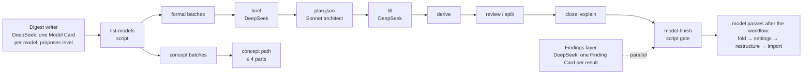
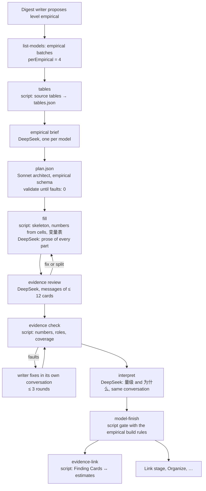

# Empirical models: a third model level — proposal

Status: implemented (2026-11-08), piloted on a copied box (2026-11-09) and completed overnight on 2026-11-09 (P3 on a fresh paper, P5 the model board, P6 the live migration); §14 records what was built, the pilots, the cost, the decisions taken and what is still open. The Chinese version is [empirical-models-proposal.zh.md](empirical-models-proposal.zh.md); the two say the same thing.

Related: [Model elaboration levels](model-elaboration-levels-design.md) (levels 1 and 2), [Finding Cards](finding-cards-design.md), [The model compiler](model-compiler-design.md), [Model compiler v2](model-compiler-v2-proposal.md) (D2, D3: no sharing while models are built), [Shared building blocks](model-shared-blocks-proposal.md) (the **引入** imports), [Self-sufficient models](self-sufficient-models-proposal.md), [Workflow principles](agents/workflow-principles.md), [Job map](agents/digest-job-map.md), and the skills `zt-model-fold`, `zt-model-settings`, `zt-model-restructure` and `zt-model-import`.

## 0. Summary

ZET has two kinds of models today. A **concept model** (level 1) states a mechanism in words. A **formal model** (level 2) states a model in mathematics and gets a self-sufficient build with Derivation parts. An economics paper often holds a third kind: a model that the author **estimates from data**. It has a question and an estimand, a sample, measured variables, an estimating equation, an identification argument, a ladder of specifications, tables of estimates with their uncertainty, tests of the identifying assumptions, robustness checks, heterogeneity and mechanisms, and sometimes a structural or counterfactual layer.

The digest has no place for this kind. It forces an empirical model into the formal template, or it scatters its results over Finding Cards that do not know which specification produced them. §3 shows both faults on the live box.

This proposal adds:

1. **Level 3, the empirical model** (`empirical`, 实证模型): its definition, its parts and their roles, its build order, its card formats, the way it shows results, its build rules, and the way it talks to other models (§4–§7).
2. **An empirical path in the econ digest's model layer** (strict, schema-bound): a deterministic table extractor, an empirical brief, an empirical architect plan, a fill whose numbers come from the source tables by script, an evidence review, an evidence check, and a script step that links the book's Finding Cards to the estimates they report (§8).
3. **Empirical branches in the model passes after the workflow** (flexible, judgement-led): fold, data-and-specification settings, an evidence spine, imports, and one new pass, the evidence dialogue between models and books (§9).

The design moves the critical parts of the formal path across, part by part (§5.6), so the empirical path is the same machine with different parts, not a second machine.

## 1. What this proposal read

| Source | What it gives |
| --- | --- |
| `CONTEXT.md` | Model Card, Model part, Model facet, Emphasis, Model relation, Relation kind, Build order, Derivation part, Building block, Import, Self-sufficient model, Elaboration level, Concept model, Formal model, Finding Card, Card language |
| `docs/model-elaboration-levels-design.md` | why levels exist, what each level builds, where the level is stored, who decides |
| `docs/model-compiler-design.md`, `docs/model-compiler-v2-proposal.md`, `scripts/book-digest/model-architect.md` | the roles (architect, compiler, driver, briefer, writer, reviewer), the rounds, `plan.json`, the source review, the D2/D3 rule that no model takes another model's part while models are built |
| `scripts/book-digest/dsh-model-cards.zh.md`, `dsh-finding-instructions.zh.md` | how the digest writer proposes a model and its level, and how the Findings layer writes one result per Card |
| `docs/agents/workflow-principles.md`, `docs/agents/digest-job-map.md` | one structure and no fallback; one start, one queue, one finish; long DeepSeek jobs with a SELF-CHECK; at most 12 Cards of review in one user message; scripts do deterministic work |
| the four model-pass skills | fold by the nature of the model; settings as a dependency tree with one notation card; an intuition spine of chapters, results and proof chains; imports with **引入** |
| the live box (archive revision 68593) | `hansen2021demand` (3 models, 28 Finding Cards), `ebrill2001modern/5|a` and `4|d|a` (regressions built as formal models), `atkinson2015lectures/13|b|a|a` (an estimating equation in a theory model), `atkinson2015lectures/16|c|a|a|a|e|a` (a formal model calibrated with an outside estimate) |
| the Scholar Archive | 215 full-text works, 73 of them empirical economics papers; §2 |

## 2. What the archive shows: the forms of real empirical models

### 2.1 The papers read

The Scholar Archive holds 215 works with a full-text Markdown file. The term count of the earlier report (2026-11-06) found 73 of them to be empirical economics papers: "specification" appears in 66 of the 73, "fixed effects" in 55, "instrument" in 32, "robustness check" in 32, "event study" in 14. For this proposal the empirical sections of 12 papers were read in full, chosen to cover every common design. File paths are below `E:/google_scholar_archive/data/files/`; numbers in brackets are line numbers.

| # | Paper | Design | Estimating equation | Ladder and tables | Further layers | Relation to theory and other papers |
| --- | --- | --- | --- | --- | --- | --- |
| 1 | Acemoglu, Naidu, Restrepo, Robinson, *Democracy Does Cause Growth* (`nber/w20004…`) | dynamic panel; GMM; semi-parametric; IV | (1) $y_{ct}=\beta D_{ct}+\sum_j\gamma_j y_{c,t-j}+\alpha_c+\delta_t+\varepsilon_{ct}$ [187–191]; the long-run effect is a derived estimand, $\hat\beta/(1-\sum\hat\gamma_j)$ (2) [203–207] | Table 2: three estimators × 1, 2, 4, 8 lags; column 3 preferred, β = 0.787 (s.e. 0.226) [211]; Table 3 adds covariates; Table 5 (IV) adds one control per named threat to the exclusion restriction [404–416] | numbered Assumptions 1, 1′, 2 [195, 299–329, 382–386]; AR2 and Hansen tests; first-stage F > 16 [390]; mechanisms as the same equation with each channel as outcome, eq. (5) [438–450]; heterogeneity by interactions [456–474] | tests verbal hypotheses of the literature; uses an outside index and an outside propensity score |
| 2 | Goldsmith-Pinkham, Sorkin, Swift 2020, *Bartik Instruments* (`aea/…`) | shift-share IV (methods) | $y_{lt}=D_{lt}\rho+x_{lt}\beta_0+\epsilon_{lt}$ [83–87]; $B_{lt}=\sum_k z_{lk0}g_{kt}$ [105–109] | rows are estimators (OLS, TSLS, MBTSLS, LIML, HFUL), columns no controls / controls / test p-values [584–588] | Assumptions and a Proposition [263–289]; Rotemberg weights [321–333]; a three-test protocol [462–510]; pre-trend figures [696–708] | re-estimates another paper: "our replication of … Card (2009)" [646–648] |
| 3 | Acemoglu, Hassan, Tahoun 2014, *Power of the Street* (`SatelliteImageLit/Aligned/…`) | event study on daily stock returns | (2) $CR[n,m]=N_i'\gamma+X_i'\nu+\eta_s+\epsilon_i$ [239–243]; panel (3) [337–349] | Table 3: parsimonious → baseline → without sector FE → adjusted s.e. → synthetic match → CAR [277–287]; Table 8: robustness ladder [371–383] | the condition written as a covariance [245]; five caveats [257–265]; placebo dates, placebo windows, a t-statistic distribution [289–299]; leads and lags [385–387]; Box–Cox [393] | benchmarks the size against two other studies [293] |
| 4 | Minni 2023, *Making the Invisible Hand Visible* (`TalentDiscovery/Aligned/…`) | event study of manager rotations | (2) $y_{it}=\sum_j\sum_{s}\beta_{j,s}D^j_{i,t+s}+\alpha_i+\xi_t+\epsilon_{it}$ [248–256]; companion (3), (4) [268–279] | event-study plots [288–290]; headline salary +13%, $11,962 a year, "about 7 years of raises" [463–465] | the measure first (high flyers by promotion age) [176–180]; balance regressions with a Bonferroni correction [219–235]; Sun–Abraham, placebo trait [564–579]; mediation [589]; heterogeneity eq. (5) [633–657] | a conceptual framework in an appendix gives rival predictions [663, 674]; uses an outside estimator |
| 5 | Autor and Scarborough 2004, job testing (`TalentDiscovery/Aligned/…`) | DiD of a phased rollout; 2SLS | (7) $D_{ijt}=\alpha+\delta T_i+X_i\beta+\theta_t+\varphi_j+e_{ijt}$ [371–381]; (8)–(11) [407–479] | leads and lags of the rollout [395–401] | theory section III [143–355] gives "empirical implications" [355–365]; T × race interactions test them, p = 0.36 [425–439]; the theory is simulated, calibrated to the moments, and six bias scenarios are compared with the estimates [491–539] | theory → prediction → test → structural comparison, in one paper |
| 6 | Grosz and Raval 2024, FTC website (`CustomerComplaints/Aligned/…`) | regression discontinuity in time | (1) $y_t=\beta Post_t+\gamma_1(t-C,t\ge C)+\gamma_2(t-C,t<C)+g(DOW_t)+\epsilon_t$ [545–551] | Table 1 columns are outcomes and channels; untreated channels act as placebos [916–920]; headline +28% [912] | no-anticipation argument [539]; RD plots [565]; mechanisms [951–959]; heterogeneity with outside weights [1087–1108] | uses another paper's victim weights |
| 7 | Shapiro, Hitsch, Tuchman 2020, TV advertising (`CustomerComplaints/Aligned/…`) | 288 brand-level regressions | (1) $\log Q_{st}=\beta^T\log(1+A_{d(s)t})+\alpha^T\log p_{st}+\epsilon_{st}$ with ad stock (2) [146–168] | Table 2: rows are specifications built by adding controls; columns are statistics of the distribution of estimates (median, mean, % significant) [529–533]; median 0.0140 [519] | two identification strategies, baseline and border [199–237]; SUTVA [235]; two-way clustering [313]; ROI counterfactual, median −87.8% [714–736] | benchmarks against a meta-analysis and a theory formula [523, 527] |
| 8 | Nosko and Tadelis 2015, eBay (`CustomerComplaints/Aligned/…`) | observational cohort, then a field experiment | (1) [408–416] | Table 2: OLS, quartiles, probit, marginal effects [418–430] | balance table [612]; ITT scaled by the shift in treatment [686–704]; IV/TOT 0.246 [743–757] | the experiment validates the observational estimate (0.157 against 0.139) |
| 9 | Balboni et al. 2022, *Why Do People Stay Poor?* (`TalentDiscovery/Aligned/…`) | RCT data; nonparametric; structural | transition (1) [73–109]; $k_{i,3}=\phi(k_{i,1})+\varepsilon_i$ (2) [127–131]; threshold regression (3) [159–163] | shape test [145]; −14% below and +16% above the threshold | parameters calibrated from first-order conditions [335–357]; out-of-sample fit [365–369]; misallocation [371–385]; policy counterfactuals [387–399] | reuses another study's RCT data |
| 10 | Hansen, Ramdas, Sadun, Fuller 2021 (`MissingMarket/Aligned/…`) | measurement; descriptive; cross-section | (7) [665–671]; "cross-sectional relationship" [679] | Table 2 adds one characteristic per column; Table 4 outcomes are other clusters, each cell a separate regression; Table 5 robustness [681–764] | a measurement pipeline with validation [131–199, 237]; stylized facts [249–255] | a theory section [418–660] gives the predictions that (7) tests |
| 11 | Bell, Chetty, Jaravel, Petkova, Van Reenen 2019 (`TalentDiscovery/Aligned/…`) | three designs on one question | (1), (2), (4) with their assumptions [313–427] | — | each design states its own assumption | takes over another paper's movers design and functional form [415, 429] |
| 12 | Bronnenberg, Dubé, Gentzkow 2010 (`CustomerComplaints/Aligned/…`) | measurement; descriptive; structural habit model | (1), (2) [172, 184]; habit (3)–(4) [217–238] | parameter estimates, fit and residual figures [365–371] | identifying assumptions tested in their own section [323–357]; counterfactuals [385–427]; a parameter varies with advertising across categories [437–447] | estimates an outside theory (Becker–Murphy habits) |

### 2.2 What every empirical model has

The twelve papers agree on nine components:

1. a question and an estimand (a coefficient, a long-run effect, a distribution of elasticities, a threshold);
2. a unit of observation, a sample, a period, data sources and sample rules;
3. constructed measures, often built by the authors (a democracy index, high-flyer managers, market betas, skill clusters, a relative share);
4. a numbered estimating equation that defines the outcome, the regressor of interest, the fixed effects, the controls, the error and the estimator;
5. an inference rule: the standard errors and their clustering, in the text or in the table notes;
6. an identifying assumption, often numbered, with named threats and tests;
7. a preferred specification inside a ladder of specifications;
8. a headline estimate with a magnitude translation (× 100, percent, dollars a year, "7 years of raises", a benchmark against the literature);
9. robustness, then heterogeneity or mechanisms.

### 2.3 What varies by design

| Design | Its own components |
| --- | --- |
| dynamic panel (1) | the lags; a family of estimators (within, GMM, HHK); the AR2 test; a derived long-run multiplier |
| IV and shift-share (1, 2, 5, 8) | the instrument's construction; the first stage and its F; the exclusion restriction and one control per threat to it; overidentification; Rotemberg weights; reduced form against 2SLS; LATE or TOT |
| DiD and event study (3, 4, 5) | the event; the window; the omitted period; the comparison group; pre- and post-period coefficient plots; a staggered-adoption estimator; in finance, abnormal returns, estimation-window betas and placebo dates |
| RD (6) | the running variable, the cutoff, the window, the polynomial order, the no-anticipation argument, the RD plot, untreated outcomes as placebos |
| experiment (8, 9) | the randomization unit, the balance table, ITT, compliance, TOT by IV, scaling by the shift in treatment |
| many-unit estimation (7) | the estimand is a distribution over units: medians, percentiles, the share significant, a meta-comparison |
| structural (5, 9, 12) | a model of the primitives; parameters estimated or calibrated from reduced-form moments; fit tests out of sample; counterfactual simulations |
| measurement and descriptive (10, 12) | a measurement pipeline with its validation; stylized facts; conditional correlations with no causal claim |

### 2.4 The order of dependence

Each paper builds its evidence in nearly the same order, and each later item rests on an earlier one:

```
question → institutional context (the source of variation) → data → measures → descriptive facts
→ [theory or framework: the predictions] → estimating equation → identifying assumption, threats, tests
→ baseline and preferred estimates → other estimators and robustness → heterogeneity → mechanisms and rival channels
→ external validity → structural layer or counterfactual → interpretation
```

Three reuse patterns tie the later items to the equation: a mechanism regression keeps the right-hand side and changes the outcome (1, eq. 5); a heterogeneity regression adds an interaction (4, eq. 5; 5, eq. 9); a counterfactual takes the estimated parameters as inputs (7, 9).

### 2.5 How results are reported

- **The regression table.** Rows are coefficients (with long-run or persistence rows); columns are a cumulative ladder; the bottom rows report the fixed effects, N, R² and test p-values (AR2, Hansen, first-stage F); the notes give the outcome, the estimator, the standard errors and the scaling.
- **Columns that are not specifications.** A column can be an estimator family (1, 2), a phase or a subsample (3), an outcome or a channel (6, 10), and a cell can be a separate regression (10). A table's columns must therefore be mapped one by one; they cannot be assumed to be a ladder.
- **Figures.** Event-study paths with confidence intervals (1, 4); RD plots (6); placebo histograms (3); distributions of unit estimates (7); β_k against F (2); nonparametric curves (9); model-against-data fit (9, 12).
- **The headline sentence.** The point estimate, its standard error and a magnitude translation.

### 2.6 How empirical models relate to other models

| Relation | Observed in |
| --- | --- |
| tests a prediction of a theory in the same paper | 5, 8, 9, 10 |
| supplies moments or targets for a structural model | 5, 9, 12 |
| re-estimates or replicates another paper's specification | 2 (Card 2009) |
| takes over another paper's design or estimator | 1, 4, 11 |
| uses another paper's data or measures | 6, 9, 10 |
| benchmarks against or contradicts another estimate | 1, 3, 7 |
| validates an observational estimate by an experiment | 8 |
| inside one paper: baseline → variant; main → mechanism; main → heterogeneity; reduced form → structural | all |

These relations, the nine common components, the design-specific components and the reporting forms are the requirements for §4–§7.

## 3. What the digest does with an empirical model today

### 3.1 How a model comes about now



The writer of a section group proposes a Model Card and its level. The model layer brings each Model Card to its level: the concept path writes at most four parts, the formal path plans, fills, derives, reviews and explains. Independently, the Findings layer writes one Finding Card per empirical result it finds in a group, with six labels (`测量`, `数据`, `方法`, `结果`, `局限`, `来源`), and links it from the Idea Card it supports. After the workflow, the owner runs the model passes by hand: fold the models the digest split, organize the settings, build the intuition spine, and write the imports.

Nothing in this chain knows what a specification, an estimate, a standard error, an identifying assumption or a robustness check is.

### 3.2 Faults found on the live box

**P1. A regression built as a formal model.** `ebrill2001modern/5|a` (*The Modern VAT*, §4.2) is a 99-country cross-section regression. The digest built it as a formal model:

- The Model Card's body holds a table of the coefficients. The parts do not hold them.
- The four columns of Table 4.2 (A–D: which regressors, which sample, N = 69, 89, 40, 55) are packed into one card titled `结果：收入消费比对税率与环境的回归`. A specification is filed as a result.
- `推导：系数 0.70 对应税率升 10%、收入升 7%` is a Derivation part for log arithmetic. The formal path asks for a derivation where the source skips algebra, so it made one.
- The White standard errors and the significance marks are in a sentence. No estimate card carries its uncertainty.

`ebrill2001modern/4|d|a` (the VAT revenue regression with interaction terms) has the same shape.

**P2. A theory and its test in one model, and the results outside it.** `hansen2021demand/5|b|b|a` is a formal model of managerial time. Its chapter 3, `第 3 章：两个命题合成一条可估计的回归`, holds the dependent variable, the proxies and regression (7) with its fixed effects and clustering. The estimates of Table 2 are not in the model. They are five Finding Cards (`5|c|a|c` … `5|c|a|g`). Each Finding says `横截面 OLS 回归，控制行业、大洲、职位与年份固定效应` in its `方法` line, restating the specification, and links only the Literature note `5|c|a`. No Finding links regression (7). The robustness results (`5|c|d|b`: Probit, `5|c|d|c`: document length) are Findings that say `结果与基准结果几乎相同` without a number. A reader cannot go from the theory's prediction to the specification, to the column, to the number.

**P3. A measurement framework as a concept model.** `hansen2021demand/3|d|a` (embeddings, k-means clusters, a relative 0/1 measure) is the measurement block of the paper's empirical model. It is a separate concept model, linked to nothing that uses the measure.

**P4. Calibration from an outside estimate.** `atkinson2015lectures/16|c|a|a|a|e|a` sets σ = 0.408, the Ashenfelter–Heckman (1973) estimate. That is a formal model that rests on an empirical estimate. ZET has no way to say so except a prose sentence.

**P5. Finding Cards without a home.** A Finding Card states one result, but an empirical result is a number of one specification in one column. The six labels cannot hold the specification, the column, the standard error and the identification together, so the writer repeats them in `方法`, and repeated text drifts (the `测量：测量：` doubling in `5|c|d|b` is one small sign).

**P6. The fold rule hides the problem.** `zt-model-fold` says a Model Card that "estimates or calibrates the model" is the same model. Under that rule the empirical part of a paper always folds into its theory, and the two different builds (derive a result; estimate a number) share one template.

## 4. The empirical model (level 3)

### 4.1 Definition

Proposed glossary entries for `CONTEXT.md`:

> **Empirical model**: A model of Elaboration level 3. The source estimates or measures a relation from data: it names what it estimates, the data, a specification and the argument that the estimate means what it claims, and it reports estimates with their size and uncertainty. A reduced-form regression, a design-based estimate (difference-in-differences, event study, instrumental variables, regression discontinuity, a randomized experiment), a structural estimation with its counterfactuals, and a measurement framework that the source builds and validates on data are empirical models. Its Model Card and parts follow the empirical roles. It has no Derivation part except one that derives an estimating equation or an estimator. _Avoid_: Regression model, econometric card, results model.
>
> **Estimand**: What an empirical model estimates, in words: the effect of what on what, for whom (估计对象).
>
> **Specification**: One estimating equation with everything that defines its estimate: the outcome, the regressor of interest, the fixed effects, the controls, the sample, the weights, the estimator and the standard errors (规格). A model's baseline specification is on its main line; every other specification is a variant filed under it and states what it changes.
>
> **Estimate part**: A part of an empirical model that states one reported estimate: the coefficient, its specification and table cell, its uncertainty, the sample size, and its magnitude in words (估计).
>
> **Evidence chain**: The parts filed under an estimate part that support or qualify it: the tests of the identifying assumptions, the table, the figure, a conversion of the magnitude. It plays the role a proof chain plays under a result.

The **Elaboration level** keeps its name and its column. Its meaning widens from "how fully a model is built out" to "how the source builds the model": in words (1, `concept`), in mathematics (2, `formal`), from data (3, `empirical`). Level 3 is not "more elaborate" than level 2. It is a sibling with its own rules. The number only names the value.

### 4.2 Where the boundary lies

| The source gives | ZET writes |
| --- | --- |
| its own estimating specification and estimates from data | an empirical model |
| a theory and a test of it in the same paper | two models: the formal (or concept) model, and an empirical model that imports the prediction it tests (§7) |
| a structural model estimated on data, with counterfactuals | two models: the formal model, and an empirical model that imports it whole (`整块`) and adds data, moments, estimator, estimates and counterfactuals |
| a measurement framework built and validated on data | an empirical model of design `measurement`, or the measurement block of the empirical model that uses it (the same paper: one model) |
| one number, a survey count, a stylized fact, with no specification | a Finding Card only |
| a summary of another paper's empirical design (a lecture, a textbook, a survey) | no empirical model: the summary stays a Literature note or a part of the concept or formal model that uses it; the outside paper is a Cited Card |
| a textbook illustration that estimates an equation of its own theory (`atkinson2015lectures/13|b|a|a`, 110 Swiss cities) | an example part of the formal model (`例子`), unless the source treats the estimation as a study with its own design and tests |

The last two rows keep the empirical level for studies, so a textbook does not turn every quoted regression into a model.

### 4.3 The design types

The plan names one design type for the model (several only when the source combines them on one estimand). The type decides which parts the build expects (§5.2):

| Design (`design`) | 中文 | Expected parts beyond the common ones |
| --- | --- | --- |
| `cross-section` | 横截面回归 | controls; the selection threat in 局限 |
| `many-unit` | 多单位估计 | one estimate per unit (brand, firm, region); the estimand is their distribution: median, percentiles, share significant |
| `panel` | 面板（固定效应、动态面板） | fixed effects, lags, the dynamic estimator, serial-correlation tests |
| `did` | 双重差分 | treated and control groups, timing, parallel trends, pre-trends test |
| `event-study` | 事件研究 | event time, leads and lags, the coefficient figure, pre-period test |
| `iv` | 工具变量 | instrument, first stage with its F, exclusion restriction, reduced form, overidentification |
| `shift-share` | 移位份额（Bartik） | shares, shocks, the weights, the share-exogeneity tests |
| `rd` | 断点回归 | running variable, cutoff, bandwidth, density test, covariate balance |
| `experiment` | 随机实验 | randomization, balance, attrition, ITT, compliance and LATE |
| `structural` | 结构估计 | the imported theory model, moments or likelihood, estimator, parameter estimates, fit, counterfactuals |
| `measurement` | 测量 | the construction, validation against other measures, descriptive results |
| `descriptive` | 描述性统计 | the sample, the measures, the patterns; no causal claim |

## 5. The anatomy of an empirical model

### 5.1 The roles

An empirical model uses the same machinery as every model: a Model Card, Model parts with facets and emphasis, Links with Relation kinds, filed in a tree under the Model Card. What differs is a fixed **role vocabulary**, read from the facet prefix, as `推导` is read today. A fixed vocabulary is what the math units already have; it lets the build report check the structure.

| Role (facet prefix) | Line | Holds | Rests on |
| --- | --- | --- | --- |
| `数据：` | main, first | the unit, the sample, the period, the place, the data sources, the sample rules | nothing (the primitive) |
| `变量表` | first Side of `数据：` | every variable and symbol of every specification: name, meaning, how measured, source, the card where a reader meets it | `数据：` |
| `样本：` | Side of `数据：` | a subsample or a linked data set | `数据：` |
| `测量：` | Side of `数据：` | how a constructed variable is built (an index, a text measure, a deflator) and how it is validated | `数据：`, earlier `测量：` |
| `描述：` | Side of `数据：` or of a descriptive chapter | one descriptive fact or summary statistic the source reports before it estimates | `数据：`, `测量：` |
| `假说：` | main | the prediction the model tests, normally an import of a theory part (§7) | the imported part |
| `设计：` | main | the design type, the source of variation, the comparison, the threats | `数据：`, `假说：` |
| `背景：` | Side of `设计：` | the institutional fact that supplies the variation (a rotation policy, an ad-buying process, an unannounced launch, a phased rollout) | `设计：` |
| `假设：` | Side of `设计：` | one identifying assumption, numbered (`假设 1`) | `设计：` |
| `规格：` | main (the baseline), Side (a variant) | one estimating equation with every term defined; a variant states only what it changes against the specification it is filed under. A change is one of: controls, fixed effects, sample, estimator, outcome (a mechanism: the same right-hand side, a new outcome), interaction (heterogeneity), functional form, standard errors, instrument | `数据：`, `测量：`, `设计：`; a variant also its base |
| `第 k 章：` | main | one stage of the evidence: main estimates, identification tests, robustness, heterogeneity, mechanisms, quantification | earlier chapters, the baseline `规格：` |
| `估计：` | Side of a chapter | one reported estimate (§5.3) | its `规格：` |
| `表 n：` | Side of a chapter | one source table in compact form, each column linked to its specification | the `规格：` cards of its columns |
| `图 n：` | Side of an estimate or chapter | one source figure (an event-study plot, a binned scatter, a distribution of estimates) | its `规格：` |
| `检验：` | Side of an estimate (its evidence chain) or of a chapter | one test of an identifying assumption or of a model's fit: first stage and its F, pre-trends, placebo dates or placebo outcomes, balance, density, AR2, overidentification, out-of-sample fit | the `假设：` it tests (or the `参数：` cards whose fit it tests), its `规格：` |
| `换算：` | Side of an estimate | the conversion of a coefficient into a magnitude (log points to percent, one standard deviation to a share) | the estimate |
| `参数：` | Side of a chapter (structural) | one estimated structural parameter with its uncertainty | its `规格：` (the estimator) |
| `反事实：` | Side of a chapter (structural) | one counterfactual result | the `参数：` cards and the imported theory |
| `推导：估计式` | Side of `规格：` | the derivation of an estimating equation or an estimator, when the source derives it | the theory parts it starts from |
| `局限：`, `外部有效性：` | off | what the estimates do not show | `设计：`, `数据：` |

### 5.2 The build order: the evidence spine

The restructure skill's principle holds unchanged: **lower the reader's working memory**. One idea per card, the claim before the detail, the main line short, the detail one step aside. For an empirical model the main line follows the order in which a reader comes to trust a number:

```
Main line   数据 → [假说] → 设计 → 规格：基准 → [第 0 章：描述性事实] → 第 1 章：主要估计 → 第 2 章：识别检验 → 第 3 章：稳健性 → 第 4 章：异质性与机制 → [第 5 章：量化或反事实]
  ├ Setting part   变量表, 样本, 测量 under 数据; 背景 and 假设 1…n under 设计; each 规格 variant under 规格：基准
  └ Under each chapter   估计 / 表 / 参数 / 反事实 cards as Side branches
       └ Under each estimate   its evidence chain: 检验, 图, 换算
Off line    局限, 外部有效性, 数据来源史
```

- A chapter that the source does not have is left out. A chapter appears only if it holds at least one estimate or one test.
- An estimate the source derives from other estimates (the long-run effect $\hat\beta/(1-\sum\hat\gamma_j)$ of paper 1) is an `估计：` card that rests on the estimates it uses and shows the formula. It is not a `换算：` card, because it is a reported estimate with its own uncertainty.
- Chapters follow the source's order when the source orders them differently (some papers report the tests first). The rests-on rule decides what may come first: a robustness estimate rests on its variant specification and never on a later chapter.
- The specification ladder is a Side tree: `规格：基准` on the main line, each variant filed under the specification it changes, a variant of a variant under it. This is the same rule as model variants in `zt-model-settings` ("the base model first, then the variants, each variant on its own branch").
- An estimate rests on its specification, not on the tests. A test rests on the assumption it tests and on its specification, and it `印证`s (or `反驳`s) the estimate it supports. Only rests-on Links place a card on the board, so the tests hang under the estimate without making it wait for them.

Every rule of a Self-sufficient model holds: no closure fault, no forward fault, no unanchored main-line part.

### 5.3 How results are shown

Papers show results in four forms (§2): a coefficient table whose columns are specifications, a figure of coefficients (event time, bins, a distribution), headline numbers in the text with a magnitude ("a one standard deviation increase raises … by 3.5 percentage points"), and the notes that define the uncertainty (clustering, N, the fixed-effect rows). The empirical model keeps all four, each on its own card:

- **One headline estimate, one `估计：` card.** It carries the number, its uncertainty, its sample size, its specification and its cell, and the magnitude in words. It is the only place where the number lives in the model.
- **One source table, one `表 n：` card.** It keeps the table's layout in a compact Markdown table: the rows the text uses, every column, the N row and the fixed-effect rows, and a header line per column that links what the column is. A column is not always a specification (§2.5): it can be an estimator, a subsample, an outcome, or a separate regression, so the plan maps each column to its `规格：` variant (whose `change` says which), and a table whose columns are statistics of a distribution of estimates (paper 7) maps its rows instead. The table card is the reader's map from the paper's table to the cards.
- **One source figure, one `图 n：` card,** with the book's own image (the figure layer already attaches figures and their DeepSeek explanations) and one sentence on what to read off it.
- **The conversion of a magnitude is a `换算：` card**, never a Derivation part. It holds at most a few lines of arithmetic.

**Every number comes from the source by script.** The workflow extracts the source's tables into `tables.json` (§8.2) and writes each number of an `估计：` and `表 n：` card from its cell. DeepSeek writes the prose around the numbers and never types a number that a cell holds. The evidence check (§8.2 step 6) refuses a card whose number appears in no source line of its span.

### 5.4 Card formats

The formats follow the restructure skill's rule: the claim first, in words; one format per role; each premise once. Labels are Chinese because the digest writes Chinese Cards.

**Model Card (empirical)**

```
**问题**
One or two sentences: what the study asks.

**估计对象**
The estimand in one sentence: the effect of what on what, for whom.

**设计**
The design type (§4.3) and the comparison in one or two sentences.

**数据**
Unit, sample size, period, place, source data, in one or two sentences.

**主要估计**
| 估计 | 值 | 不确定性 | 规格 |
| --- | --- | --- | --- |
| [[估计：…]] the estimate in words | 0.718 | s.e. 0.249 | [[规格：基准]] 表 2 第 1 列 |
(at most five rows: the estimates the paper's abstract and conclusion use)

**结构**
(the two-level list of the main line, as every Model Card)

**引入**
(the imports: the theory prediction it tests, a shared data block, a theory model it estimates)

**关联**
检验 / 对照 / 印证 / 反驳 lines to other models and books (§7).

来源：[[key]] §n
```

**`数据：` (the setting of the model)**

```
一句话：what the data are.

**起点**
- 原始设定：不依赖其他设定。

**内容**
1. 观测单位：…
2. 样本：N = …, period, place.
3. 数据来源：…
4. 样本规则：what is dropped and why.

**为什么需要它**
One sentence: which specifications use these data.

变量的含义见变量表 [[变量表]]。

来源：[[key]] §n
```

**`变量表`** — the notation card of an empirical model: `| 变量 | 含义 | 度量 | 来源 | 首次出现 |`, one row per variable and per symbol of every specification (outcome, regressors, fixed effects, error, indices), plus **统一用语** (the one term per concept). The coverage rules of `zt-model-settings` apply: every symbol of every `规格：` equation has a row (`uncovered`), no row is unused (`unused`), and each row names the card where a reader first meets it (`first`).

**`设计：`**

```
一句话：the comparison that identifies the estimate.

**起点**
- 依赖 [[数据：…]]：…
- 依赖 [[假说：…]]：the prediction this design tests. (when there is one)

**变异来源**
Where the variation comes from, and why it is plausibly unrelated to the error.

**比较**
Who is compared with whom (treated and control, before and after, near the cutoff).

**识别假设**
- [[假设 1：…]] one line each.

**威胁**
The threats the source names, one line each, with the card that addresses it.

来源：[[key]] §n
```

**`规格：` (the baseline, or a variant)**

```
一句话：what this specification estimates.

**起点**
- 依赖 [[数据：…]]、[[设计：…]]：…
- 变体：放宽 [[规格：基准]] 的…：the one change. (a variant only)

**估计式**
$$ … \tag{n} $$

**各项**
1. 因变量：…
2. 关注的回归元：… (its coefficient is the estimate)
3. 固定效应：…
4. 控制变量：…
5. 样本与权重：…
6. 估计方法：OLS / 2SLS / GMM / probit / MLE / …
7. 标准误：clustered by … / robust / bootstrap.

**相对基准的改动**   (a variant only)
The change in one or two lines, nothing else.

变量的含义见变量表 [[变量表]]。

来源：[[key]] §n, 表 n 第 k 列
```

When the source gives no equation, the card says `书中没有写出估计式` and lists the terms in words.

**`估计：`**

```
One sentence: the result, direction and size, no formula.

**估计**
- 估计量：[[规格：…]] 中 $\beta$（式 (n)），表 n 第 k 列。
- 值：0.718；标准误 0.249（按国家聚类）；N = 6,336。
- 显著性：1% 水平。   (or: 原书未写明)

**量级**
The magnitude in words, as the source states it. A conversion the source does not show goes to a 换算 card.

**为什么**
One to three sentences: the author's reading of the estimate.

**依据**
依赖 [[规格：…]]。识别见 [[设计：…]]。检验见 [[检验：…]]。

**对应**
对应 [[Finding Card]]：the book-level statement of this result. (written by script, §8.2 step 9)
印证 / 反驳 [[假说：…]]：what the estimate says about the prediction.

来源：[[key]] §n 表 n
```

**`检验：`**

```
One sentence: which assumption is tested and whether it holds.

**检验什么**
依赖 [[假设 k：…]]：the assumption.

**做法**
The test in one or two sentences, with its specification: 依赖 [[规格：…]].

**结果**
The statistic or the coefficients, with their uncertainty (from the cell or the figure).

**结论**
One sentence in the source's own strength: holds / does not reject / fails / the source does not say.

印证 [[估计：…]]：what this test does for the estimate.

来源：[[key]] §n
```

**`表 n：`, `图 n：`, `换算：`, `参数：`, `反事实：`, `局限：`** follow the same shape: one sentence first, then the content, then the Links, then the source line. A chapter card keeps the restructure format (`**直觉**`, `**本章结果**`, `**承上启下**`), with `**本章估计**` in place of `**本章结果**`.

### 5.5 Build rules and the build report

The build report already checks closure, forward, unanchored and import faults. For a Model Card of level `empirical` it adds role checks, read from the facet prefixes of §5.1:

| Fault | Rule |
| --- | --- |
| `empirical_shape` | the main line starts with a `数据：` part, holds one `设计：` part and at least one `规格：` part, and the model holds at least one `估计：` or `参数：` part |
| `estimate_unbound` | an `估计：` or `参数：` part has no rests-on Link to a `规格：` part of the model |
| `spec_unbound` | a `规格：` part rests on no `数据：` or `测量：` part (a baseline) or on no `规格：` part (a variant) |
| `test_unbound` | a `检验：` part rests on no `假设：` part |
| `variable_uncovered` | a symbol of a `规格：` display equation has no row in the `变量表` (as the settings check's `uncovered`) |
| `beyond_level` | a Derivation part whose facet is not `推导：估计式` or `推导：估计量` (the arithmetic of a magnitude is a `换算：` part) |

`self_sufficient` keeps its meaning. The level adds checks; it loosens none. The faults are reported, not enforced, as every build fault is today; the workflow's `model-finish` gate refuses a model with any of them, as it does for formal models.

`zt-check` gains card-format rules for the empirical roles, in the style of the F rules (proposed numbers EM1–EM5):

| Rule | Check | Default |
| --- | --- | --- |
| EM1 | an `估计：` part has the labels `估计`, `量级`, `依据`, and its `估计` section names a `规格：` Link and a table or figure | yes |
| EM2 | an `估计：` part states a value and an uncertainty (s.e., t, CI, p, a significance level) or `原书未写明` | yes |
| EM3 | a `规格：` part has `估计式` (or `书中没有写出估计式`) and `各项` with the outcome, the regressor of interest and the standard errors | yes |
| EM4 | a `设计：` part has `变异来源` and `识别假设` | yes |
| EM5 | a causal verb (`导致`、`使`、`提高了`、`causes`) in an `估计：` part of a model whose design is `descriptive` or `cross-section` | advice |

### 5.6 What moves across from the formal path

The empirical path is the formal path with its parts replaced, one for one. This table is the core of the design: each line is a part of today's machine that the empirical model keeps.

| Formal model today | Empirical model |
| --- | --- |
| `设定` part + `符号表与读法` | `数据：` part + `变量表` |
| assumptions (`假设`) in the setting part, cited by Link | identifying assumptions (`假设 k`) under `设计：`, cited by Link from every test |
| model variants as branches of the setting | specification variants as branches of `规格：基准`, each with `相对基准的改动` |
| main line: setting → chapters | main line: data → design → baseline specification → chapters |
| `结果：` cards under a chapter | `估计：` (and `参数：`, `反事实：`) cards under a chapter |
| the proof chain under a result (`推导：` parts) | the evidence chain under an estimate (`检验：`, `图 n：`, `换算：`) |
| a Derivation part for each step the book skips | no invented step: the numbers come from the tables; only an estimating equation or an estimator may be derived |
| the reviewer redoes every step of a chain | the reviewer checks every number, sign, significance word and claim strength against the source span |
| explain: `思路` / `说明` / `解读` | interpret: `量级` / `为什么` |
| `source_review` (supported, narrowed, supplied, absent) | the same, plus the cell of every number |
| `source_faults` (OCR faults in equations) | the same, plus OCR faults in tables (a shifted column, a lost minus sign) |
| imports of setting blocks between models | imports of a hypothesis, a data or measurement block, an instrument, or a whole theory model |
| Self-sufficient: every premise is a member | Self-sufficient and **evidence-bound**: every number is traceable from the estimate to its specification, its cell and its source line |

## 6. Worked examples

These sketches show the target trees. They are not built.

### 6.1 `hansen2021demand`: theory and test in two models

```
5|b|b|a  管理者时间模型（formal）            unchanged, except chapter 3 moves out
NEW      高管社交技能需求的横截面估计（empirical, design: cross-section + measurement）
  **引入** 单卡 [[5|b|b|a|a|2|b]] 命题 1；单卡 [[5|b|b|a|a|2|c]] 命题 2
  数据：4,618 个高管搜寻的职位描述，2000–2017 年
    变量表
    测量：HBR 词嵌入与六个技能集群（from 3|d|a, which folds in here）
    样本：703 个能匹配 Burning Glass 的美国搜寻
  假说：企业特征的系数为正（imports the two propositions）
  设计：横截面比较；特征在搜寻前三年取定
    假设 1：特征先于职位描述
  规格：基准 (7)  Social_ft = α + βX_ft + ψ_o + θ_i + φ_chq + φ_sl + δ_t + ε
    规格：Probit
    规格：加入文件长度控制
    规格：企业内部就业
  第 1 章：主要估计
    表 2：社交集群对企业特征
    估计：对数就业高一个标准差，社交技能要求的概率高 3.5 个百分点   ← Finding 5|c|a|c links it
    估计：跨国公司 …   估计：并购 …   估计：上市 …   估计：多元化不显著
  第 2 章：信息强度
    估计：信息技术技能占比高一个标准差，社交集群高 5.2 个百分点（表 3）
  第 3 章：其他集群
    表 4 …
  第 4 章：稳健性
    估计：Probit 下系数 …（rests on 规格：Probit）
  局限：横截面相关，不是因果效应
```

The theory's chapter 3 (`5|b|b|a|a|3`) is replaced by a one-line pointer: `本模型的预测由 [[the empirical model]] 检验`. The measurement concept model `3|d|a` becomes the `测量：` block, because it is built for this estimation (the same paper, the same data).

### 6.2 `ebrill2001modern/5|a`: a regression rebuilt at its level

```
增值税收入的跨国回归（empirical, design: cross-section）
  数据：99 个实行增值税的国家，每国一个观测
    变量表 (SR, OPEN, AGE, ILLITERACY, SI, RANGE, THRESH, RETAIL, GS)
  设计：横截面比较；规则 τ 随环境 α 而定，部分规则看不见
    假设 1：可观测规则与环境的系数是直接与间接效应之和
    推导：估计式 (the two existing Derivation parts on r(τ0, α) and dR/dα stay: they derive what the coefficient means)
  规格：A 列 (baseline)
    规格：B 列（删去文盲率，N +20）
    规格：C 列（A 加四个结构变量）
    规格：D 列（B 加四个结构变量）
  第 1 章：税率弹性
    表 4.2
    估计：ln(SR) 的系数 0.70
      换算：税率升 10%，收入消费比升约 7%   (was a Derivation part)
  第 2 章：环境变量
    估计：OPEN …  估计：ILLITERACY …  估计：SI …
  第 3 章：结构变量
    估计：只有 RANGE 在 C、D 两列都为正
      推导：需求转移 … (the two derivations that explain why RANGE can be positive are theory: they move to a small formal model, or stay as a 机制 aside; decision in §12)
  局限：不可观测规则使效应无法分解
```

### 6.3 A design-based paper from the archive

Autor and Scarborough (2004) shows the whole conversation in one paper (§2.1, paper 5). It would give three models:

```
A  职位测试的甄选模型（formal）
     设定：面试与测试两种甄选技术 [143–355]
     第 k 章：经验含义 — 测试使雇佣差距与生产率差距反向变化 [355–365]

B  职位测试对雇佣与任职期的影响（empirical, design: did + iv）
   **引入** 单卡 [[A 的经验含义]]
   数据：连锁零售企业的门店与雇员记录，1,363 个门店
     变量表
     测量：门店平均测试分数（用 (8) 验证其预测任职期）[407–421]
   假说：测试不扩大少数族裔的雇佣差距，并提高各族裔的任职期
   设计：分阶段推行测试的双重差分；门店采用作为工具变量 [393]
     假设 1：推行时点与门店的任职期趋势无关
   规格：基准 (7) 任职期对测试、门店与月份固定效应，按门店聚类 [371–381]
     规格：2SLS（门店采用作工具变量）
     规格：(9) 加入测试 × 族裔交互
     规格：(10) 条件 logit（雇佣），(11) 线性概率模型
   第 1 章：任职期
     估计：测试使白人雇员任职期增加 …（表 VI）
   第 2 章：识别检验
     检验：推行前后的前导与滞后项 [395–401]   (rests on 假设 1)
   第 3 章：族裔异质性 = the test of the prediction
     估计：各族裔效应相等，p = 0.36 [425–439]   印证 [[假说]]
   第 4 章：雇佣
     估计：(10)(11) 的雇佣效应；邻里族裔构成的第二个检验 [459–487]

C  偏差情景的模拟（empirical, design: structural）
   **引入** 整块 [[A]]；单卡 [[B 的主要估计]]
   参数：按经验矩校准的甄选参数 [491–539]
   第 1 章：六种偏差情景
     反事实：只有"两者都无偏"的情景与估计相符   印证 [[B 的估计]]
```

Whether C is its own model or a chapter of B is the fold decision of §9.1: C adds its own primitives (a calibration of A's parameters), so the rule makes it its own model.

## 7. How an empirical model talks to other models

ZET already has every tool this needs: imports for premises that come from another model, Relation kinds for everything else, Model neighbours for the reader. The proposal adds one convention per relation, no new kind (§12, decision 5).

| Relation | When | Written where | How | Kind |
| --- | --- | --- | --- | --- |
| tests a prediction | the paper derives a prediction and estimates it | the empirical model's `假说：` part | `单卡` import of the theory's result card; the `假说：` part restates nothing, it names the sign or size the theory predicts | rests-on (by import) |
| supports or contradicts | an estimate agrees or disagrees with the prediction | the `估计：` part, `**对应**` | `印证 [[假说：…]]` or `反驳 [[假说：…]]` | illustrates / objects |
| derives its equation from theory | the estimating equation follows from a theory model | `推导：估计式` under `规格：` | `整块` import of the theory block the derivation starts from | rests-on |
| estimates a theory model | structural estimation | the empirical model's Model Card | `整块` import of the whole formal model; `参数：` parts rest on the imported setting; `反事实：` parts rest on `参数：` and the imported results | rests-on |
| is calibrated by an estimate | a formal model takes a parameter value from an estimate | the formal model's parameter card | `单卡` import of the `估计：` part when the estimate is in the box; `参照 [[Cited Card]]` when it is not | rests-on / refers |
| uses another study's data, measure or instrument | the same data set, index or instrument | `数据：` or `测量：` | `整块` import of the other model's `数据：` or `测量：` block | rests-on |
| re-estimates another study's specification | a replication, an extension | `规格：` | `对照 [[规格：…]]` (same specification, new data) or `放宽 [[规格：…]]` (one change) | contrasts / relaxes |
| estimates the same estimand | two studies, two books, one effect | `估计：` | `对照 [[估计：…]]` with the two numbers; `印证` when they agree within their uncertainty, `反驳` when they do not | contrasts / illustrates / objects |
| the book-level statement of a result | every Finding Card that reports one estimate of the model | the Finding's last paragraph and the estimate's `**对应**` | `依赖 [[估计：…]]` in the Finding; `对应 [[Finding]]` in the estimate | rests-on / corresponds |
| discussed by a reading note | an Idea Card or Literature note about the result | the note | `依赖 [[估计：…]]`、`例示 …`、`反驳 …` as the digest already writes for models | as written |

Three rules keep the conversation clean:

1. **During the build, no model takes a part of another model** (model-compiler v2, D2). The architect writes each relation to another model as a prose Link (`检验 [[…]]`, `对照 [[…]]`). The import pass after the model stage (v2 D3, or `zt-model-import` by hand) turns the premises among them into `**引入**` lines.
2. **A Finding Card stays the book-level statement of one result.** It is not removed. It gains one Link to the estimate it reports, so the Finding layer, its F rules, search by type, and idea-grow keep working, and a reader of a Finding reaches the specification in one step.
3. **Across books, the conversation is Links, never moves.** A comparison of two books' estimates of one estimand is written in the agent Workspace by the evidence dialogue pass (§9.5). A pooled view of all estimates of an estimand is idea-grow's work (a Topic Card), outside this proposal.

## 8. The constructor workflow (strict)

The workflow is where the structure is enforced: fixed roles, a schema, a validator, a script gate. The empirical path is a third path in the econ variant's model layer, beside the concept and formal paths. It is not a new stage. It follows the module principle: one start, one queue of managers, one finish.

### 8.1 The flow



### 8.2 Stages and roles

| Step | Who | What | Output |
| --- | --- | --- | --- |
| 0 level | digest writer (DeepSeek) | `dsh-model-cards.zh.md` gains `"empirical"`: the section reports its own specification and estimates from data. A section that derives a theory and tests it writes two Model Cards | Model Card with `level` |
| 1 tables | script (`zt-digest model -Step tables`) | reads the HTML and Markdown tables in the model's source spans; writes `tables.json`: each table's label, caption, notes, column heads, row labels and cells, each with its file and line | `<model>\tables.json` |
| 2 brief | DeepSeek (`dsh-empirical-brief-instructions.zh.md`, high) | from the context pack, the source and `tables.json`: the estimand, the design type, the data, the measures, each estimating equation with its number and lines, each table and the change from column to column, each figure, each test, the robustness list, heterogeneity, mechanisms, counterfactuals, the theory parts it tests (addresses from the pack), the Finding Cards of its sections | `brief.md` (≤ 6000 characters) |
| 3 plan | Sonnet architect (`model-architect-empirical.md`) | the empirical `plan.json` (§8.3), validated until `faults: 0` | `plan.json`, `source-review.json` |
| 4 fill | script, then DeepSeek | the script builds the skeleton in build order, writes the `变量表` from `variables`, writes every number of `估计：`, `参数：` and `表 n：` cards from its cell, and the Model Card's `结构` and `主要估计`; DeepSeek writes the prose of every part in its model's conversation | filled Cards |
| 5 evidence review | DeepSeek (`dsh-empirical-review-instructions.zh.md`), the model's conversation | per message at most 12 cards with their source spans: is each specification term in the source; does each estimate's sign word match the sign; does a significance word match the stars or the standard error; does the claim strength match the design (no causal verb for a correlation); is each variant's change the only change; is each test's conclusion as strong as the source's. Verdict `ok`, `fix` (with the fix), `split` | `review-NN.json` |
| 6 evidence check | script (`zt-digest model -Step evidence-check`) | the role faults of §5.5, the EM rules, and **number fidelity**: every number in an `估计：`, `参数：`, `检验：`, `表 n：` card appears in a source line of its `src` span or in its cell | one line: what is open, and the file with the detail |
| 7 interpret | DeepSeek, same conversation | `量级` and `为什么` from the architect's `interpret` design (as `explain` does for chains) | filled sections |
| 8 finish | script (`model-finish`) | the empirical build rules; a model with a fault fails alone (v2 D5) | model report |
| 9 evidence-link | script, after both the model layer and the Findings layer | matches each Finding Card of the model's sections to an estimate: the same section, and the Finding's `结果` number equals the estimate's cell value (or the Finding's text names the column); writes `依赖 [[估计：…]]` in the Finding and `对应 [[Finding]]` in the estimate; an unmatched Finding is reported, never forced | link report |

The tables step and the evidence-link step are deterministic. No agent runs for them (workflow principle: a gap a script can close is closed by the script).

### 8.3 The empirical `plan.json`

The schema extends today's plan; every field of today's plan keeps its meaning.

```json
{
  "model": "Key/5|c|a",
  "level": "empirical",
  "design": "cross-section",
  "estimand": "企业特征与高管职位描述中社交技能要求的关联",
  "title": "高管社交技能需求的横截面估计",
  "card": "问题：…；数据：…；主要估计：表 2 第 1 列的五个系数。",
  "variables": [["$Social_{ft}$", "社交集群是否高于文档内中位数", "0/1", "职位描述", "D"],
                ["$X_{ft}$", "企业特征", "对数就业等", "Orbis", "S0"]],
  "parts": [
    {"id": "D", "role": "data", "facet": "数据", "emphasis": "core", "title": "数据：4,618 个高管搜寻的职位描述",
     "spec": "单位、样本、时期、来源", "src": ["sections/s07.md:10-40"]},
    {"id": "M", "role": "measure", "of": "D", "facet": "测量：技能集群", "title": "测量：…", "src": ["…"]},
    {"id": "H", "role": "hypothesis", "facet": "假说", "title": "假说：企业特征的系数为正",
     "tests": ["Key/5|b|b|a|a|2|b", "Key/5|b|b|a|a|2|c"]},
    {"id": "G", "role": "design", "facet": "设计", "rests": [["D", "用到样本"], ["H", "检验的预测"]], "src": ["…"]},
    {"id": "A1", "role": "assumption", "of": "G", "facet": "假设 1", "title": "假设 1：特征先于职位描述"},
    {"id": "S0", "role": "spec", "facet": "规格：基准", "equation": "(7)", "terms": {
        "outcome": "Social_ft", "regressor": "X_ft", "fe": ["ψ_o", "θ_i", "φ_chq", "φ_sl", "δ_t"],
        "controls": [], "estimator": "OLS", "se": "按企业聚类"}, "rests": [["D", "…"], ["G", "…"]]},
    {"id": "S1", "role": "spec", "base": "S0", "change": {"kind": "estimator", "text": "Probit 代替线性概率模型"}, "facet": "规格：Probit"},
    {"id": "C1", "role": "chapter", "facet": "第 1 章：主要估计"},
    {"id": "T2", "role": "table", "of": "C1", "table": "表 2", "columns": {"1": "S0"}},
    {"id": "E1", "role": "estimate", "of": "C1", "spec": "S0",
     "cell": {"table": "表 2", "row": "Log employment", "col": "1"},
     "facet": "估计：企业规模", "emphasis": "core", "title": "估计：…",
     "supports": [["H", "印证"]]},
    {"id": "K1", "role": "test", "of": "E1", "assumption": "A1", "spec": "S0"}
  ],
  "interpret": [{"id": "E1", "magnitude": "一个标准差 → 3.5 个百分点", "meaning": "规模代理问题数量，符合命题 1"}],
  "source_review": [], "source_faults": [], "notes": []
}
```

`validate` adds these plan faults: an unknown `role` or `design`; an estimate with no `spec` or no `cell` (or no `figure`, or `text: true` for a number the source states only in prose); a cell that `tables.json` does not hold; a variant `spec` with no `base`, no `change`, or a `change.kind` outside the list of §5.1; a test with no `assumption`; a chapter with no estimate or test; a variable of an equation missing from `variables`; a `take` (refused in the build, v2 D2). `hypothesis.tests` names theory parts by address; the compiler writes them as prose Links, and the import pass turns them into **引入** lines.

### 8.4 Jobs and the job map

The jobs follow the owner's rules for long DeepSeek jobs: one conversation per model (#194), review in user messages of at most 12 cards, a SELF-CHECK in each job, answers as ids where the decision is yes or no.

| Workflow / module | Job | One subagent covers | Messages per conversation | Pattern |
|---|---|---|---|---|
| Model layer, empirical | brief → fill → review → fix → interpret | one empirical model | brief 1, fill 1 per 12 parts, review 1 per 12 cards, +1 per fix round (≤ 3), interpret 1 | Continued, with Messages inside review |
| Model layer, empirical | tables | no content job (a drive step only) | — | — |
| Model layer, empirical | evidence-link | no content job (a drive step only) | — | — |

These rows go into `docs/agents/digest-job-map.md` in the commit that builds the path.

### 8.5 Arguments and modes

| Argument | Default | Meaning |
| --- | --- | --- |
| `perEmpirical` | 4 | empirical models per architect batch |
| `level` | each model's own | `empirical` forces the empirical path for a run (`only` + `rebuild` rebuilds named models) |
| `evidenceLink` | true | run the evidence-link step |

Mode `models` with `level: "empirical"`, `only` and `rebuild` rebuilds an existing model at level 3 (the migration of §10). Mode `findings` reruns the evidence-link step after it writes Findings.

### 8.6 Tests

- `model-compiler.tests.ps1` (or its Rust successor): tables extraction on a fixture with an HTML table and a Markdown table; validate (each new fault); fill writes numbers from cells; evidence-check flags a number not in the span; a variant without `change`; finish refuses `estimate_unbound`.
- `framework-harness.mjs`: the econ variant routes level 3 to the empirical path; `perEmpirical` batches; the evidence-link step runs after both layers; no stage waits in a pool slot.
- zt unit tests for the build report's role faults and the level value; zt-check unit tests for EM1–EM5.

## 9. The model passes after the workflow (flexible)

The workflow makes every model correct and complete. The passes after it make a model readable and connected. They are judgement work: Opus decides, scripts move and check, DeepSeek drafts text. For an empirical model the pass order stays the same, with one pass added at the end. The owner's order of 2026-11-10 then closes the sequence of every book, after a digest or an appendix extension, with the Literature organize:

```
fold → settings (data and specifications) → restructure (evidence spine) → import → evidence dialogue → literature organize
```

The evidence dialogue runs on the empirical models whose estimates or premises changed. The Literature organize (`zt-literature-organize`) runs once per book, last, because the folds move Cards between sections and an extension adds its groups after the Term and Cited lists (§9.6).

### 9.1 `zt-model-fold`: how many empirical models

Proposed rule changes:

- **The same empirical model**: the same estimand on the same data. Its estimator families and identification strategies on those data (paper 1: within, GMM, HHK, IPW and IV on one panel; paper 7: the baseline and the border strategy), its robustness tables, heterogeneity, mechanisms, appendix replications and the measurement built for it belong to it, each strategy as a branch of the specification ladder or a chapter.
- **An empirical model of its own**: a different data set for the same question (paper 8: an observational cohort, then a field experiment; it `印证`s or `对照`s the first one); a different estimand (paper 11's three designs each identify a different exposure); a test of a theory (never folded into the theory: the theory and its test are two models joined by an import).
- The current line "it estimates or calibrates the model" changes to: a calibration stays in the formal model (a parameter card that imports or cites the estimate); an estimation with its own data, moments and estimator is an empirical model that imports the theory whole.
- `model-survey.mjs` reports the level of each Model Card and flags a candidate group that mixes levels.

### 9.2 `zt-model-settings`: the data and the specifications

For an empirical model the setting part is the data tree and the specification ladder:

- `数据：` is the first main-line part; `变量表` is its first Side successor; samples and measures hang under `数据：`, each with its `**起点**`.
- `设计：` holds the identifying assumptions as numbered cards. Every test cites its assumption by Link (`设[[假设 1]]成立`), never by name.
- `规格：基准` comes before every variant; each variant hangs under the specification it changes, states only the change in `相对基准的改动`, and rests on its base.
- No specification is filed in a chapter. A robustness chapter holds the estimates of the variants, never the variants.
- `check-settings.mjs` gains the empirical checks: `uncovered`, `unused` and `first` against the `变量表`; `variant_change` (a variant with no change line); `spec_in_chapter`.

### 9.3 `zt-model-restructure`: the evidence spine

The spine of §5.2, with the restructure skill's card formats and checks:

- Main line: data → [hypothesis] → design → baseline specification → chapters. Chapters: main estimates, identification tests, robustness, heterogeneity and mechanisms, quantification or counterfactuals.
- Under a chapter: its estimates, tables and figures. Under an estimate: its evidence chain.
- `check-network.mjs` works unchanged on rests-on Links; a robustness chapter hangs under the main-estimates chapter it re-estimates, a mechanism chapter under the chapter whose estimate it explains.
- One `**直觉**` sentence per chapter states what the chapter establishes ("the estimate does not come from pre-existing trends").

### 9.4 `zt-model-import`: hypotheses, data and theories

The import skill handles three new kinds of block:

- the prediction an empirical model tests: `单卡` import of the theory's result, filed as `假说：`;
- a data, measurement or instrument block shared by two studies: `整块` import of `数据：` or `测量：`;
- a theory model that a structural estimation estimates: `整块` import of the whole formal model.

Its last step, the explanation refresh, becomes for an empirical model the interpretation refresh: `量级` and `为什么` of each estimate whose premises changed.

### 9.5 New: `zt-evidence-dialogue`

One new skill, judgement-led, run per empirical model after its import pass. It finds and writes the conversation of §7 across the box:

1. **Survey (script).** For the model: the theory parts it tests (its `假说：` imports); the formal models in the box whose parameter cards cite one of its estimates; the empirical models in other books with the same estimand (by Term Cards linked across books through `zt-term-sync`, and by the estimand line); the Finding Cards in other books on the same Terms.
2. **Judge (DeepSeek, one job per model, messages of ≤ 12 candidate pairs).** For each pair: same estimand or not; agree within uncertainty, disagree, or not comparable (different units, different populations); the relation kind and one reason sentence. Answers are ids and verdicts; a script applies them.
3. **Write (script).** The Links in agent Cards only, with the kind word first (`对照`, `印证`, `反驳`), in the `**关联**` section of the Model Card or the `**对应**` section of an estimate. A human Card is never a carrier.
4. **Check.** Every new Link resolves; a second survey proposes nothing new.

### 9.6 Last: `zt-literature-organize`

After the model passes, the book's Literature tree is organized by its source: the top line takes the source's own divisions, the appendices and supplements stand where the source puts them, and the Term list and the Cited list are the last top Cards. The model passes come first, so the organize moves each whole model once, where its final head stands, and the summary leads describe the final tree. First run in this order on becker2025division and hansen2021demand (§14.16).

## 10. Migration of the existing models

A script survey (read-only) lists every Model Card whose parts name tables, coefficients, standard errors or regressions. On the live box today:

| Model | Now | Proposed |
| --- | --- | --- |
| `ebrill2001modern/5|a`, `4|d|a` | formal regressions | rebuild at level 3 (mode `models`, `level: empirical`, `only`, `rebuild`), §6.2 |
| `hansen2021demand/5|b|b|a` chapter 3 + Findings of §5.2 + `3|d|a` | a theory chapter, scattered Findings, a concept measurement model | one new empirical model that imports the two propositions; `3|d|a` folds into it as `测量：`; chapter 3 becomes a pointer, §6.1 |
| `becker2025division/4|a` (estimation branch of the open economy) | a setting branch of a formal model | read first: a structural estimation becomes an empirical model that imports the theory; a calibration stays (§12, decision 4) |
| `atkinson2015lectures/13|b|a|a` chapter 3 | an estimating equation in a theory model, with a Swiss example | stays: a textbook illustration (§4.2) |
| `acemoglu2025nobel/1|d|a|3` (settler mortality IV) | a part of a concept model | stays: the lecture summarizes another paper's design |
| `atkinson2015lectures/16|c|a|a|a|e|a` (σ = 0.408) | a prose citation | gets `参照 [[Cited Card]]` for Ashenfelter–Heckman (1973) |

Every rebuild runs on a copied box first. The live box changes only on the owner's word, one book at a time, with a `VACUUM INTO` backup (workflow principles).

## 11. Rollout and acceptance

| Phase | Work | Pilot | Acceptance |
| --- | --- | --- | --- |
| P0 | the owner decides §12 | — | decisions recorded in this file |
| P1 | zt: level value `empirical`, role faults in the build report, GUI stamp `model · L3 实证`; zt-check EM1–EM5; `CONTEXT.md`, wiki `models-and-math`, `zt-check` | scratch archive tests | unit tests; a level-3 model with each fault reports it |
| P2 | workflow: tables, empirical brief, architect doc and schema, fill with cells, evidence review, evidence check, interpret, finish rules, evidence-link; job map rows; harness | copied box: rebuild `ebrill2001modern/5|a` and `hansen2021demand` (mode `models`, `only`, `rebuild`) | every model ends clean; every number traced to a cell; every Finding of the pilot sections linked or reported; cost and time per model recorded against the formal baseline |
| P3 | a fresh digest of one design-based paper from the archive on a copied box | §6.3's paper | the model matches the paper's own structure (design, ladder, tests, figures) |
| P4 | skills: fold, settings, restructure, import branches; `zt-evidence-dialogue` | the P2 pilots, by hand | `check-model`, `check-settings`, `check-network` clean; a second dialogue survey proposes nothing |
| P5 | GUI: the estimate badge (value ± s.e.), the table card, the specification ladder on the model board | mockups first, then build (owner rule) | the owner accepts the mockups |
| P6 | live migration (§10) | one book at a time, on the owner's word | each book clean, backup taken |

## 12. Decisions for the owner

| # | Question | Options | Recommendation |
| --- | --- | --- | --- |
| 1 | Where the empirical kind lives | (a) a third value of the Elaboration level; (b) a separate "model kind" property beside the level | (a): one property, one place, and the level already decides the path in the workflow |
| 2 | Finding Cards and estimate parts | (a) keep both, linked by the evidence-link step; (b) no Finding Card for a result inside an empirical model | (a): Findings stay the book-level statements that search, idea-grow and other books use; the estimate holds the numbers once |
| 3 | A paper's theory and its test | (a) two models joined by an import; (b) the test as a chapter of the theory (today) | (a) |
| 4 | A structural estimation | (a) its own empirical model that imports the theory whole; (b) a chapter or branch of the theory (today's fold rule) | (a); a pure calibration stays in the theory |
| 5 | A new Relation kind `tests` (检验) | (a) no: hypotheses by import, verdicts by `印证`/`反驳`; (b) add the kind | (a) for now; add it only if the board needs to draw tests differently |
| 6 | A rests-on Link to a Cited Card | (a) a cited premise, no fault (like the book notation table); (b) a closure fault | (a): a formal model calibrated by an outside estimate rests on that study |
| 7 | Numbers | (a) written from cells by script, DeepSeek writes prose; (b) DeepSeek copies them, the check verifies | (a): the number fidelity rule then holds by construction |
| 8 | Role vocabulary | (a) fixed prefixes, checked; (b) free facets as for formal models | (a), as for math units |
| 9 | A measurement framework | (a) an empirical model of design `measurement` (or the measure block of the model that uses it); (b) a concept model | (a) |
| 10 | The theory parts inside `ebrill2001modern/5|a` (why RANGE can be positive) | (a) a small formal model the empirical model refers to; (b) `机制` asides of the estimate | (b) for this book; (a) when the theory is a model in its own right |
| 11 | Pilots | the two live books on a copied box, then one fresh paper | as listed in §11 |

## 13. Not in this proposal

- No pooled view of all estimates of one estimand across books (an idea-grow Topic Card can do it later).
- No new Card type: the empirical model uses Model Cards, Model parts and Finding Cards.
- No change to the concept and formal paths, the math units, or the history digest.
- No meta-analysis, no re-estimation and no new numbers: ZET records what the source reports.

## 14. Implementation record

The owner accepted every recommendation of §12 on 2026-11-08 and limited the pilot to one or two books. The work was done test-first and released as zt 0.61.0, zt-check 0.21.0, zt-digest 0.50.0, base 5.12.0, econ 6.12.0, math 5.12.0 and history 1.1.0.

### 14.1 What was built

| Phase | Status | What exists |
| --- | --- | --- |
| P0 | done | the decisions of §12, all as recommended |
| P1 | done | the level value `empirical` (number 3, labels 实证 and `L3 实证`), the cards-table migration that widens the level CHECK (backup `zt.sqlite3.pre-empirical-models-*.bak`), the role faults in the build report (`empirical_shape`, `estimate_unbound`, `spec_unbound`, `test_unbound`, `variable_uncovered`, `beyond_level`, `evidence_bound`, and `role` on each order entry), zt-check EM1–EM5 (EM5 advice, rule version 8) |
| P2 | done | `tables.json` in the brief, the empirical plan schema, role skeletons that write every number from its table cell, the evidence review, the evidence check in close, the role faults in `model-finish`, `zt-digest evidence-link` and its workflow stage, the job map rows, the framework harness cases |
| P3 | done (§14.6) | `autor2004will`, a fresh design-based paper, digested whole on the copied box |
| P4 | done | the empirical branches of `zt-model-fold`, `zt-model-settings`, `zt-model-restructure` and `zt-model-import`, and the new skill `zt-evidence-dialogue` |
| P5 | done (§14.6) | the estimate stamp, the table card's size, the chapter headline and the specification ladder, zt 0.61.0 |
| P6 | done (§14.6) | four live models at level 3 (ebrill2001modern 4\|d\|a and 5\|a, hansen2021demand 5\|c\|e, becker2025division 6\|g), after a backup |

### 14.2 The pilot

Two books on a copied box (`D:\zt-empirical-box`, built with `copy-tree.mjs`), rebuilt with mode `models`, `rebuild`, `only` and `level: empirical`:

| Model | Parts | Result |
| --- | --- | --- |
| `hansen2021demand/5|c|e` | 65 | clean; evidence-bound; every number equals its cell; 5 Findings linked |
| `ebrill2001modern/4|d|a` | 41 | clean; evidence-bound |
| `ebrill2001modern/5|a` | 39 | clean; evidence-bound; the book's evidence link: 101 Findings, 22 estimates, 5 linked, 1 ambiguous, 95 with no estimate of their number |

The model-pass checks ran on the pilot models: `check-model`, `check-premises` and `imports.mjs check` are clean; `check-settings` is clean on hansen and names the settings work left on 5|a (four unused 变量表 rows, an identifying assumption outside the design card); `check-network` names the forward Links and missing **直觉** leads that the restructure pass fixes. These are the passes' own work, not build faults.

### 14.3 Faults met on the pilot and fixed

Each fix has a test that failed first.

- A t statistic in parentheses was labelled 标准误. The table notes now decide what parentheses hold (`paren_kind`).
- A merge named a card that earlier inserts had renumbered. The compiler tracks renames (`track_renames`, `current_address`).
- `model-finish` refused a rebuilt model whose unit adoption had recorded as verified (`incomplete prepared contract: header`, then `fingerprint`). `ledger reopen` converts such a unit to the open form; `model_header` and `start_fingerprint` accept it.
- The evidence review ran as one conversation of messages, and the manager fell back on a continued conversation. It is now one job per twelve cards, each its own conversation, run in parallel.
- `evidence-link` matched a Finding by a t value and by a shared count. A value is now one plain number; uncertainty figures are removed from the Finding's result; an estimate that states several magnitudes needs two of them.
- A writer added variant equations whose symbols the 变量表 lacked (`variable_uncovered`). The fill rule forbids equations the source does not write, and the fault text names both remedies.
- `zt-evidence-dialogue` never proposed a pair. It read Terms from **估计对象** only, where a Term is rarely linked. It also found other models through a search capped at 200 rows, and it judged a pair again after every survey. It also never wrote a 对照 Link. All four are fixed (wiki `agent-skills`, 2026-11-09).
- `check-network.mjs` aborted on exit (a libuv assertion under Node 25) on every model. It now sets `process.exitCode`.

### 14.4 Cost and time

DeepSeek official source, `deepseek-flash`, effort high, from the usage ledger before and after each run:

| Run | Parts | Cost | Per part |
| --- | --- | --- | --- |
| hansen2021demand/5|c|e | 65 | about 4.0 CNY | about 0.06 CNY |
| ebrill2001modern, two models | 80 | 5.51 CNY | about 0.069 CNY |
| evidence dialogue, 5|a | 54 pairs | 0.125 CNY | about 0.0023 CNY a pair |

The two ebrill models took 22.8 min from start to finish: brief 5.0, validate and apply 2.0, fill 3.0, review 7.5, close 3.5, finish 0.5. With the review as one conversation the same run took about 40 min (review 15–19 min).

### 14.5 Speed: the next candidates

The model process is slow because each model passes through six sequential steps, and each step waits for its slowest job. Measured on the pilot, in order of expected gain:

1. **The formal review in parallel jobs.** The formal path still reviews a model as one conversation of messages. The empirical change (one job per twelve cards, each its own conversation) halved the review; the same change on the formal path should halve its longest step.
2. **A message-only brief.** The brief (5 min) lets the agent read the source and `tables.json` with tools. Sending the group's source slices and the tables in the message removes the tool round trips, as the cost experience showed for card jobs (docs/digest-cost-experience.md).
3. **Fewer drive steps.** Validate, apply and the start of the fill are three script steps, each run by its own drive job (2 min between the brief and the fill). One drive job can run all three.

Items 1 and 3 change no content and can be tested by resuming the pilot box; item 2 changes what a job is told and need a cost test first (docs/agents/workflow-principles.md).

**The speed options are built on the branch `model-speed-options` (2026-11-09; commits b8567226 and 613585c3, pushed to origin).** The branch is an option the owner keeps on purpose and a backup of the model layer's structure; it is not merged into main, and nothing from it is installed. It holds all three items with their tests: (1) the formal review as parallel jobs of whole chains, at most 12 Derivation parts a job, each its own conversation carrying the bodies, in every variant (`-IndependentReview` is gone); (2) a message-only brief (`context.md`, `source.md` with numbered lines, `tables.json` in the prompt files, no file reads); (3) one drive job less per batch: the premise of item 3 was stale, because validate, apply and the fill start already share one step (S10), so the branch merges the next pair instead, and the close round that sends nothing back plans the explain jobs. No DeepSeek job ran for it, so the cost of the review split is not measured: it loses the writer conversation's cached prefix. Before anyone adopts the branch, run a cost test (docs/digest-cost-experience.md) on a copied box, then bump base, econ, math and history together, rebuild zt-digest and install.

### 14.6 The overnight completion (2026-11-09)

The owner asked for the proposal to be finished overnight and for every blocking decision to be taken without waiting. Each decision taken that way is named below as a decision.

**P3: a fresh design-based paper.** Autor and Scarborough (2004) (Scholar Archive Work 18315, its bilingual Markdown) was digested whole on the copied box as `autor2004will` (mode full, from `I 引言` to `IX 参考文献`, econ 6.12.0, then a resume on 6.12.1). The first invocation ran 09:56–12:43Z and stopped on the faults below; the resume ran 12:49–14:28Z. The book has 568 Cards: the reading notes of 20 groups, 36 Finding Cards, 11 Model Cards, 63 Term Cards, 37 Cited Cards and 6 figure Cards. Five models are empirical (11|a, 13|a, 14|a, 15|a and 17|b, with 36 to 56 parts each), four are formal and two are concepts. Every build report is clean (no closure, forward, unanchored, beyond-level or empirical fault), all 12 Derivation parts are explained, the coverage is 100 % of 204 units, no Link is broken and 18 Bridges were accepted. The evidence link wrote nothing: 35 Findings have no estimate of their number and one (17|d) matches two estimates. The Findings of this paper state each result in words (「略有增加」, 「小幅减少」) and not its coefficient, while the models carry the coefficients (15|a, table VII: logit 2.90, linear probability 0.41, 2SLS 0.78 for the white share). The link step never forces a match, so this is a limit of the Finding layer, not of the model.

Faults the run met, each fixed test-first and installed during the run:

- The paper sets its 22 tables after the reference list, outside the staged text, so the empirical brief saw none. `prepare` now writes the text after the end heading and of the skipped sections to `back-matter.zh.md` when it holds a table, and the brief reads its tables after the sections.
- Table captions in Roman numerals (表 VI) were untitled tables. A caption may now name its table so.
- The event finish passed 20 units to `finish-batch`, which holds 8, and all 20 failed. The layer step now finishes in batches of 8. The findings finish of the same run used the fixed step and recorded 19 of 20.
- One findings check failed as content because the title catalogue moved while the model layer wrote. A check that did not run is now transient.
- A formal model took `5#S` (a batch number for the model) and its build failed after validation. A take of another model's part must name that model's address.
- The reference heading `IX 参考文献` carries a section number, so the Cited layer skipped the list. A numbered reference heading now opens the list.

**P5: the model board.** Mockups (`docs/mockups/empirical-board.html`) showed two badge forms. Decision: option A, a one-line typed stamp (`0.014 (0.003)***`), because it keeps the strip's height and reads as ink on the card. Built: the estimate stamp, the table card's size, the closed chapter's headline estimate, and the specification ladder of a 规格 block. Checked on a snapshot of the pilot box: every stamp of hansen2021demand/5|c|e equals its table cell. Deployed in zt 0.61.0.

**P6: the live migration.** A `VACUUM INTO` backup was taken first (`D:\zt\backups\zt.sqlite3.pre-empirical-migration-20261109T105045Z`, integrity ok, 25,822 Cards).

- Every live book was reorganized after its digest (zt-literature-organize), so adoption refused it: group anchors and owned Cards had moved. Decision: a new `ledger adopt -Settled` closes every group adoption cannot verify (a terminal fault `settled_literature`, never resumed under a moved anchor) and lets a model of such a group stand on the prepared book.
- The model context took a model's source group from its address, which a reorganized tree renumbers. It now reads the group from the Model Card's source line (`§6、§6.1`) first; ebrill2001modern's headings carry no section numbers, so its staging names each model's group in the owned logs.
- Three live runs (mode `models`, econ 6.12.1), each on an adopted staging, one at a time: `ebrill2001modern/4|d|a` (empirical, 41 parts) and `5|a` (36 parts) rebuilt at level 3; `hansen2021demand/5|c|e` (64 parts) and `becker2025division/6|g` (50 parts: 3 structural parameters, 5 means, 6 distribution parameters, the fit and the counterfactuals) built new. Every build report is clean. Evidence links: ebrill 7, hansen 2, becker 3 Findings linked to their estimates, each pair read before it was written. Terms relinked on each book.
- The live runs met four more faults, fixed test-first and installed between runs. A drive job answered `Ok: {…}` and the brief read no jobs (zt-workflow-lib v14 reads the object after a short label; base 5.12.1, econ 6.12.1, math 5.12.1, history 1.1.1, idea-grow 4.0.14). The link preparation and the link check read the owned Cards of the closed groups (both now leave them out). The evidence link read only 估计 parts, so the 参数 and 反事实 parts of a structural model were never matched, and a Finding that rounds a value (σ = 5.666 in table 2, 5.67 in the text) did not match it; both are read now, rounding only for a number of three significant digits or more. Nothing was written by the failed attempt. These fixes are zt-digest 0.50.1.
- hansen: the concept measurement model `3|d|a` was folded into `5|c|e` as its 测量 block (`5|c|e|a|g`, the zt-model-fold steps, 69 parts, clean, no broken Link). Decision: the theory `5|b|b|a` keeps its chapter 3, because its prediction rests on the regression (7) it states, and moving (7) into the empirical model would make the theory rest on the model that imports it (an import cycle); the chapter card gets a 参照 pointer to `5|c|e`.
- becker: the same decision for the theory `3|a` chapter 10: its chapter 11 and the book's notes rest on chapter 10's results, so the chapter stays and points to `6|g` with 参照. Retiring it is an owner decision, since it would restructure the theory's conclusion chapter.
- atkinson2015lectures/16|c|a|a|a|e|a got `参照 [[atkinson2015lectures/23|cr]]` for Ashenfelter–Heckman (1973). acemoglu2025nobel and atkinson 13|b|a|a stay as they are (§10).
- The model-pass checks on the live models: settings clean on all four after one assumption move in ebrill 5|a and a check fix (a Greek letter written in prose uses its 变量表 row); the restructure check still asks for **直觉** leads on the data, hypothesis, design and specification blocks of the new models and names three forward Cards in ebrill 5|a. That is restructure-pass work (zt-model-restructure), not a build fault.

**Cost.** The DeepSeek official source charged 63.98 CNY on 2026-11-09 (UTC) for all work of the day, of which 47.73 CNY had been charged by 12:05Z, at a cache hit rate of 0.972. The runs do not state their own usage (268 of the 275 runs of P3 report none), so the night is measured from the usage ledger only.

**Not done, and why.**

- **The speed candidates of §14.5 are not released.** Item 1: the formal review continues the writer's conversation, whose cached prefix makes each review message cheap; fresh parallel conversations lose that cache, so the change needs a cost test before release (docs/agents/workflow-principles.md). Items 2 and 3 were not tried. The one speed change released is the event and findings finish in batches of 8, which was a fault fix.
- **The run-level cleanup left conversations — fixed in zt-digest 0.50.2 (2026-11-09, a session with the owner's word).** The cause, read from the ledgers: on the three adopted live stagings `cleanup/book@1` held a `settled` dependency on `audit/book@1`, which a mode `models` run that stops after the link layer never claimed (state `ready`, 0 attempts). The inherited failed digest units did settle. On the P3 box the run-level unit refused three times in 30 s inside one `cleanup-finish -Ready` call, because 8 Term Card conversations were not yet observed terminal, and the spent attempt budget failed it for good. The 31 conversations were deleted by hand on 2026-11-09, and the owner has since deleted every other leftover. The fix has three parts. (1) `cleanup/book@1` has no dependency: it is ready once no unit outside cleanup can still run (claimed, waiting to retry, or released after an attempt). A unit done, failed for good (inherited failures included), blocked or never started does not hold it back. (2) The settle plan names no conversation whose owner can still run, no run-owned conversation while any unit can, and no workspace that holds such a conversation. (3) A `cleanup_transient` refusal (an open conversation, an unconfirmed deletion, a workspace not yet removed) sends the unit back to waiting with its attempt unspent (fault `cleanup_waiting`). It waits for the next settle and never fails for good. Tests: `the_run_level_cleanup_waits_only_for_work_that_can_still_run` reproduces the adopted-staging ledger, `the_settle_plan_spares_the_conversations_of_work_that_can_still_run`, and `cleanup-resources.tests.ps1`.
- **Findings without numbers.** A Finding prompt that asks for the coefficient would let `evidence-link` match a paper like autor2004will. It changes what a job is told, so it needs a cost test and the owner's word.
- **The restructure pass on the new live models** (the **直觉** leads, the three forward Cards of ebrill 5|a) is pass work and was not run.
- **The theory chapters** of hansen (chapter 3) and becker (chapter 10) stay, as decided above; retiring them is the owner's decision.

### 14.7 The backfill of two missed sections (2026-11-09)

The §10 survey read only existing Model Cards, so two sections that report the authors' own estimates and had no Model Card were missed. A search of the live Cards for regressions and standard errors found them. The owner approved the backfill of both. A `VACUUM INTO` backup was taken first (`D:\zt\backups\zt.sqlite3.pre-empirical-backfill-20261109T180933Z`, integrity ok, 25,978 Cards). Each model got a seed head filed beside its source group, a fresh staging (`becker2025division-empirical-s24`, `ebrill2001modern-empirical-ch16`), its head added to the owned log of its group (becker group 3, ebrill group 58), a `ledger adopt -Settled`, and one run of mode `models` with `only`, `rebuild` and `level: empirical` (econ 6.12.1). The runs went one after the other.

- `becker2025division/2|g|f` (§2.4, Table 1 and Figure 3): 43 parts. The eight columns of Table 1 are eight specifications (OLS and 2SLS of the occupation count, the residual wage dispersion and the normalized task number on employment, and of the dispersion on the task number), with the Figure 3 plant fixed-effects check as a ninth. Every estimate equals its cell (0.597 (0.015), 0.144, 0.308, −0.130, −0.099, −0.473, −3.130). The run took 44 minutes and cost about 4.00 CNY.
- `ebrill2001modern/17|c|m` (§16.2, Table 16.2 and footnote 146): 23 parts, three columns and the auxiliary regression of openness on population. The run took 56 minutes and cost about 9.67 CNY (the ledger delta of the window; the book's link check and organize stages run over its 41 models).
- Both build reports are clean, both models are self-sufficient, the settings checks pass, no Link is broken and the Term relink found nothing to change. Both runs left no DeepSeek conversation, which confirms the cleanup fix of zt-digest 0.50.2 on live runs. The restructure check asks for **直觉** leads, as on the other new models.
- Evidence links: ebrill 2 more Findings linked (17|c|k ↔ 4|c, 0.34; 17|c|l ↔ 6|b, 0.08), each pair read before it was written. becker none: the four Findings of §2.4 state their results in words (「约 6%」, 「显著越小」), the limit of the Finding layer named in §14.6.
- One fault, fixed test-first as zt-digest 0.50.3 and installed: the notes of Table 16.2 write 「括号内为$t$统计量」 in TeX and mark 10 % with a dagger (「0.096†(1.81)」). The tables step read the parentheses as standard errors and lost the dagger cell's t statistic and level. `paren_kind` now drops TeX marks, a dagger is a significance mark like a star, and its level is read from the notes. The five estimate Cards of 17|c|m were corrected by hand on the live box (t 统计量, and 「10% 水平（表中标 †）」 for the dagger cell); the model was not rebuilt.

With these two models, every own-data estimation section of the nine economics books on the live box has an empirical model, except the ones §10 keeps as they are.

### 14.8 The model passes on the six live empirical models (2026-11-09)

The owner asked for the passes after the workflow (§9) on the six empirical models of the live box: `ebrill2001modern/4|d|a`, `5|a` and `17|c|m`, `hansen2021demand/5|c|e` and `becker2025division/6|g` and `2|g|f`. They ran in a side session on Opus at medium effort, one pass at a time over the six models, in the order settings → restructure → import → evidence dialogue. The fold was already done (§14.6). A `VACUUM INTO` backup was taken first (`D:\zt\backups\zt.sqlite3.pre-empirical-passes-20261109T201355Z`, integrity ok, 26,077 Cards). Every change is an agent-Workspace Card of these three books. No lock was met.

**Settings (`zt-model-settings`).** The check reported clean on all six before the pass. A reading against the skill found three rules the empirical check did not test, and `check-settings.mjs` now tests them (`start`, `order`, and `assumption` as a Side successor of the design). The pass changed 15 Cards and made two moves:

- ebrill `5|a`: 假设 2 stood as the Direct successor of 假设 1. It is now a Side successor of the design (`5|a|a|2|d`; 假设 3–5 moved to `|e`–`|g`). The two 描述 cards got a **起点**.
- hansen `5|c|e`: the measure card of the social-cluster dummy rested on the measurement framework, which was filed after it. The data card's Side branches were reordered (the framework is now `|a|d`, the dummy `|a|e`, the IT measure `|a|f`). Nine data-tree cards got a **起点**, and the five cards of the folded measurement block got their role prefix in the title (`测量：`, `描述：`).
- becker `6|g`: the measure card got a **起点**. becker `2|g|f`: the two measure cards got a **起点**, and 假设 5 no longer restates the estimates −3.130 and −0.473; it points to the test card `2|g|f|a|5|b|a` that holds them.
- ebrill `4|d|a` and `17|c|m`: nothing to change.

**Restructure (`zt-model-restructure`).** Twenty **直觉** leads were written, one per block that `check-network.mjs` named: the data and hypothesis blocks of all six, and the design and specification blocks of `17|c|m`, hansen and both becker models. Each lead states what its block establishes, from the card's own content. The three forward cards of ebrill `5|a` were fixed by moves, with no Link deleted or reworded: the estimate of the tax-rate elasticity (with its two 换算 cards) moved from the design to chapter 1 (`5|a|a|4|a`), table 4.2 moved from the design to chapter 1 (`|4|e`), and the two 换算 cards that read the RANGE estimate moved from specification C to that estimate (`|6|a|a`). Chapter 1 now lists both. `check-premises.mjs` names two hits that stay: becker `6|g` 假设 1 names the system (34a)–(34c), which is a pointer to the specification; becker `2|g|f` 假设 5 names column (7), which the check reads as an equation number.

**Import (`zt-model-import`).** The import lines that §7 names:

- hansen `5|c|e`: `单卡 [[hansen2021demand/5|b|b|a|a|3|a]]` (the prediction β > 0). The 假说 card rests on it in place of its 参照 to the theory's Model Card.
- becker `6|g`: `整块 [[becker2025division/3|a]]`, the formal model it estimates (151 shared members). The 假说 rests on proposition 3 (`3|a|a|9|c`), the baseline specification on the system (34) (`3|a|a|10|a`), and the counterfactual chapter on `3|a|a|9|c` and the full-model expressions (33) (`3|a|a|9|e`).
- becker `2|g|f`: three `单卡` lines, one per tested direction (`3|a|a|5|b`, `3|a|a|2|a`, `3|a|a|3|a`), and the 假说 rests on the three.
- ebrill `17|c|m`: `单卡 [[ebrill2001modern/5|a|a]]`, the chapter 4 data that chapter 16 reuses. Its data card rests on it, and its column A carries `对照 [[ebrill2001modern/5|a|a|3|a]]` (it reproduces column B of table 4.2).
- ebrill `4|d|a` and `5|a`: no import. The book has no model of its chapter 1 framework, and `4|d|a` already imports the Diamond–Mirrlees theorem.

`imports.mjs plan` proposed to upgrade the tested predictions to `整块`, which would take each prediction's whole proof into the test. Decision: a test imports the prediction alone (§7, §9.4), and `plan` no longer proposes that upgrade for a result that only 假说 parts rest on. `imports.mjs check` exits 0 on all six, with no import cycle. The explanation refresh found nothing to explain, and no premise change contradicts the 量级 or 为什么 of an estimate, so no interpretation was rewritten. The theory chapters (hansen chapter 3, becker chapter 10) stay where they are for the owner's decision.

**Evidence dialogue (`zt-evidence-dialogue`).** One DeepSeek conversation per model (official source, effort high), one message per twelve pairs, each conversation deleted after its last answer. Each model was surveyed after the previous one was applied, so the judged record dropped the mirror pairs (ebrill `5|a` fell from 112 pairs to 79).

| Model | Pairs | Messages | Same estimand | Written |
| --- | --- | --- | --- | --- |
| ebrill `4\|d\|a` | 66 | 6 | 0 | — |
| ebrill `5\|a` | 79 | 7 | 3 | 2 × 印证, 1 × 对照, both ways |
| ebrill `17\|c\|m` | 53 | 5 | 0 | — |
| hansen `5\|c\|e` | 0 | — | — | — |
| becker `6\|g` | 161 | 14 | 0 | — |
| becker `2\|g\|f` | 0 | — | — | — |

Every same-estimand pair was read before it was written. Two agree within their uncertainty: openness (0.005 in table 4.2 A, 0.006 in table 16.2 A) and the small-island dummy (0.44 and 0.34). The third set the small-island coefficient without a size control (0.44) against the one with the inverse of population (0.20, not significant); the judge called it 印证, and the review changed it to 对照, because the point of the second estimate is that the island effect fades once size is held fixed. Most pairs met only on the book-wide Term 增值税 or set structural parameters against reduced-form coefficients; DeepSeek judged all of them not the same estimand, rightly. Every check is clean, and a second survey proposes no pair for any model.

**Checks at the end.** On all six models: `check-model.mjs` self-sufficient with no closure, forward or unanchored fault; `check-network.mjs` `network: clean`; `check-settings.mjs` clean; `imports.mjs check` exit 0; `dialogue.mjs check` ok. `list_broken_links` is empty for the three books. Terms were relinked on the three books after the passes (14 Cards, 19 Links) and once more on ebrill after the dialogue (1 Card).

**Script faults fixed test-first** (skills only; no zt or zt-digest build): `check-settings.mjs` (`start`, `order`, `assumption`; 17 tests), `imports.mjs plan` (the tested-prediction rule; 7 tests), `dialogue.mjs` (`survey` removes the message files of an earlier survey, and `check` runs on a model with no pair; 12 tests).

**Cost.** The four judging conversations sent 32 messages for 359 pairs, about 0.8 CNY at the pilot's rate of 0.0023 CNY a pair. The usage ledger rose from 77.65 to 88.04 CNY on 2026-11-09 (UTC) during this session, but that figure includes the parent session's digest runs on other books at the same time.

**Left open.**

- On all six models the design, assumption and specification cards keep their premise lines at the end of the card and have no **起点** section, unlike the formats of §5.4. The empirical check does not ask for it there. A deterministic move of the `依赖` lines would fix the live cards, and the empirical writer should write **起点** from the start.
- ebrill `4|d|a`: its two 背景 cards rest on each other (`依赖` both ways). Moving cards cannot fix a cycle; one of the two lines is a pointer by its meaning, and the owner may decide which.
- The theory chapters that restate the empirical model (hansen `5|b|b|a` chapter 3, becker `3|a` chapter 10) stay for the owner's decision (§14.6).

### 14.9 Two new empirical papers digested live (2026-11-09)

The owner asked for three more literatures with empirical models. Every economics book on the live box already had its models (§14.7), so three undigested empirical papers of the Scholar Archive were chosen for the evidence dialogue they open: Acemoglu, Johnson and Robinson (2001), Dell (2010) and Deming (2015). A `VACUUM INTO` backup was taken first (`D:\zt\backups\zt.sqlite3.pre-empirical-papers-20261109T201430Z`, integrity ok). AJR and Dell ran in parallel (econ 6.12.1, mode full). The owner cancelled Deming before it started.

| Paper | Citation key | Cards | Models | Findings linked | Run |
|---|---|---|---|---|---|
| AJR 2001, settler mortality IV | `acemoglu2001colonial` | 479 | 7: 2 empirical (OLS 3\|a, IV 5\|b), 2 formal, 3 concept | 3 of 41 | 2 h 25 min |
| Dell 2010, the mining mita RD | `dell2010persistent` | 542 | 8: 7 empirical, 1 concept | 8 of 44 | 2 h 33 min |

Both run reports are complete, no Link is broken and every model builds with no fault. The DeepSeek ledger grew by about 48 CNY over the window of the two runs (the passes of §14.8 ran in the same window), about 24 CNY a paper. The cleanup fix of 0.50.2 held on full live runs: Dell settled by itself, and AJR waited for its last drive conversation and settled on one `cleanup-finish -Ready`.

- One fault, fixed test-first as zt-digest 0.50.4: the Bridge appended its `跨书关联：` paragraphs after a Model Card's **引入** section, so they were read as imports (`import_target`; acemoglu2001colonial/2|b lost its self-sufficiency). A Bridge paragraph now goes before that section. Six live Model Cards had the same shape (ebrill 3|b|a, acemoglu2001colonial 2|b and 5|a, atkinson 11|d|a|a, 12|a|c|a, 17|c|b|a); their Bridge lines were moved by hand and all six are clean.
- The cost of the parallel runs: 12 Bridges between the two papers were planned against Cards the other run then changed, and apply reported them `stale` (Dell 11, AJR 1). A Bridge report is immutable, so `mode bridge` reuses it and does not propose again. The 12 links are left as a recorded gap; 26 + 52 Bridges were verified. Two digests whose papers will link to each other should run one after the other.

### 14.10 The model passes on AJR 2001 and Dell 2010 (2026-11-10)

The owner asked for the passes of §9 on every model of the two papers digested in §14.9, `acemoglu2001colonial` and `dell2010persistent`. They ran in a side session on Opus at medium effort, one model at a time and book by book, in the order fold → settings → restructure → import → evidence dialogue. Meanwhile the parent session digested two other papers on the live box. A `VACUUM INTO` backup was taken first (`D:\zt\backups\zt.sqlite3.pre-ajr-dell-passes-20261110T031110Z`, integrity ok, 27,098 Cards). Every change is an agent-Workspace Card of these two books, made through the zt tools. No lock was met. At the end `list_broken_links` is empty.

**Fold.** AJR keeps its 7 models. Decision: the OLS model `3|a` and the IV model `5|b` are two empirical models, not one. `3|a` states its estimand as an association that it does not read as causal, while `5|b` estimates the causal α. `3|a` also uses the 110-country sample, and `5|b` keeps its own OLS contrast column. The concept models `1|c` (the paper's framework, which `2|a`, `5|a` and `5|b` each fill in), `2|a` (the historical hypothesis) and `2|b` (persistence mechanisms) and the formal models `5|a` (the identifying system (1)–(5)) and `10|a` (appendix C) each ask their own question. Dell had 8 Model Cards and now has 7. `4|a` (§3.2) and `5|a` (§3.3) were one model: the same estimand, the same data and the same Table II estimates. 5|a held a superset of 4|a's specification ladder, so a plain fold would have left two data trees and two ladders. With the parent session's approval (on the owner's authority for the whole pass sequence), 4|a was merged into 5|a in four steps:

1. Its parts that 5|a lacked moved into 5|a: 假设 4 (now `5|a|a|2|f`, renumbered 假设 6), the two 75-km estimates (`5|a|a|4|g`, `|4|h`), Table I and its five balance tests (`5|a|a|5|i`–`|5|m`), the polynomial cross-check (`5|a|a|6|f`, chapter 3), and the two limitations (`5|a|d`, `5|a|e`).
2. Each of the 25 remaining 4|a cards gave its twin the lines the twin did not state, under **另述（§3.2）**. This kept every formula (the continuity condition $E[c_1|x,y]$, $E[c_0|x,y]$ and estimating equation (1) included) and every Link the twin lacked (the notes `4|f` and `4|g`, `3|a`). The bridge to `atkinson2015lectures/11|c|a|a|3` moved into the 5|a head.
3. Each twin card was deleted into its twin (`delete_card` with `into`), one leaf at a time, each identified by its title. All Links were redirected: `4|a` → `5|a`, `4|a|a` → `5|a|a`, `4|a|a|a` → `5|a|a|a`, `4|a|a|b` → `5|a|a|b`, `4|a|a|1` → `5|a|a|2`, `4|a|a|1|a` → `5|a|a|2|a`, `4|a|a|1|b` → `5|a|a|2|b`, `4|a|a|1|c` → `5|a|a|2|e`, `4|a|a|2` → `5|a|a|3`, `4|a|a|2|a` → `5|a|a|3|a`, `4|a|a|2|b` → `5|a|a|3|b`, `4|a|a|2|c` → `5|a|a|3|c`, `4|a|a|2|c|a` → `5|a|a|3|c|a`, `4|a|a|2|c|b` → `5|a|a|3|c|b`, `4|a|a|2|c|c` → `5|a|a|3|c|c`, `4|a|a|2|d` → `5|a|a|3|d`, `4|a|a|2|e` → `5|a|a|3|e`, `4|a|a|3` → `5|a|a|4`, `4|a|a|3|a` → `5|a|a|4|a`, `4|a|a|3|b` → `5|a|a|4|b`, `4|a|a|3|d` → `5|a|a|4|c`, `4|a|a|3|e` → `5|a|a|4|d`, `4|a|a|3|g` → `5|a|a|4|e`, `4|a|a|3|h` → `5|a|a|4|f`, `4|a|a|4` → `5|a|a|5` (addresses before the fold).
4. Before each delete, the check confirmed that no 4|a card was pinned or locked and that none had a Link from another tree. Afterwards no Link was broken. The one rewording: 5|a's `对应 [[4|a]]` line was removed, because after the merge it would have linked 5|a to itself. The 另述 intro lines, which then named their own card, now read as plain text.

Deleting 4|a moved the note section `4|b` up to `4|a`. Its Links followed it.

**Concept models.** The concept models (AJR 1|c, 2|a, 2|b; Dell 1|c) got no settings or restructure pass, as the concept models of ebrill2001modern did not. Their parts serve the imports below.

**Settings (`zt-model-settings`).**
- AJR `5|a`:
  - Strict pass: the setting card is now `5|a|a` (the Literature note before it was put second) and has the **起点**/**设定**/**说明** format.
  - Notation card: new, holding the symbol and term tables the setting card used to carry.
  - Placement: the assumption moved into the setting part as `假设 1`, and the first stage (5) with the exclusion restriction became a setting card.
- AJR `10|a`:
  - The setting card got the same format and a new notation card.
  - The sign and regularity conditions became `假设 1`.
  - `cov` in a setting is written `\operatorname{cov}` so it is not read as three symbols.
- AJR `3|a` and `5|b`: a **起点** was added to one data-tree card each.
- Dell: a **起点** was added to three data-tree cards (`6|b`, `7|b`, `8|a`). A `\text` in the 7|a 变量表 that had lost its backslash to a tab was restored; it had made eight letters of "geographic location" read as unused symbols.
- Folded Dell `5|a`:
  - Its 20 specification variants stated their change only in a `放宽 [[…]]` line. Each got a **相对基准的改动** section, taken from that line.
  - The measure card got a **起点**.

**Restructure (`zt-model-restructure`).**
- AJR `5|a` and `10|a` each now read setting → one chapter card → its result → the proof chain under the result. The chapter and result texts were written by hand.
- AJR `5|a`'s Table 3 example moved from the setting part to the chapter.
- 37 **直觉** leads were written: 11 for AJR (`3|a`, `5|b`) and 26 for Dell. Each states what its block establishes, from the card's own content.
- AJR `3|a`'s hypothesis was unanchored, because a `见 [[data]]` line before its `依赖 [[data]]` line made the relation `refers`. The redundant `见` line was dropped.
- `check-premises.mjs` hits that stay: Dell `7|b`'s design names column (1) as a pointer, and AJR `5|b`'s design names (5) as a roadmap.

**Import (`zt-model-import`).**
- AJR `3|a`: `单卡 [[acemoglu2001colonial/1|c|a|1]]`, the framework's last link (better institutions, higher income). The hypothesis rests on it.
- AJR `5|b`: `单卡 [[1|c|a|1]]` (the directions of the chain), on which the hypothesis rests. Also `整块 [[acemoglu2001colonial/5|a|a|1|a]]`, the identification result and its proof, on which the design rests. `plan` proposed the upgrade from 单卡 to 整块, because the design is not a 假说 part.
- Dell `6|b`: `单卡 [[dell2010persistent/1|c|a]]` (colonial policy kept haciendas out of the mita district).
- Dell `5|a`, `7|a`, `7|b` and `8|a`: `单卡 [[dell2010persistent/1|c|a|1]]` (landowners with secure title have the returns and the connections to obtain public goods). Each hypothesis rests on it.
- `imports.mjs check` exits 0 on every model, with no cycle, and the explanation refresh found nothing to explain. The Terms of both books were relinked (AJR 60 Links, Dell 30 Links).

**Evidence dialogue (`zt-evidence-dialogue`).** One DeepSeek conversation per model (official source, effort high), one message per twelve pairs, each conversation deleted after its last answer. Each survey ran after the previous model's apply.

| Model | Pairs | Same estimand | Written |
| --- | --- | --- | --- |
| AJR `3\|a` | 76 | 52 judged, 2 kept | 2 × 对照, both ways |
| AJR `5\|b` | 0 | — | — |
| Dell `3\|a`, `6\|b`, `7\|a`, `7\|b`, `8\|a` | 5, 17, 20, 48, 9 | 0 | — |
| Dell `5\|a` | 152 | 0 | — |

Every AJR pair set an OLS estimate against an IV estimate of the same paper. The judge called 52 of them the same estimand. The review kept the two pairs on the same sample with the same controls, 0.52 against 0.95 (`3|a|a|4|c`, `5|b|a|4|c`) and 0.46 against 0.98 (`3|a|a|6|c`, `5|b|a|4|d`), which the paper itself sets side by side. It recorded the other 50 as `same: false`, by the fold decision above. Every Dell pair set the mita effect on one outcome against its effect on another outcome, and no pair was the same estimand. A second survey proposes nothing for any model.

**Script faults fixed test-first** (skills only, commit d3fdb351, installed for Claude Code and Codex):
- `check-settings.mjs`: a bare notation symbol is no longer found inside a longer row symbol of the same card. $\beta$ inside $\beta_R$ had given a false `first` fault.
- `check-settings.mjs` (`auditEmpirical`): a card another model lends is no longer audited. AJR 5|b's imported 假设 1 had been called an assumption outside its design.
- `dialogue.mjs survey`: a Term that at least half of a model's estimates link is the model's reporting frame (标准误, 设定, 点估计) and forms no pair. Dell's surveys fell from 1,105 candidate pairs, nearly all on 标准误 alone, to 129.

Tests: `check-settings.test.mjs` 19, `dialogue.test.mjs` 13.

**Cost.** Only the judging used DeepSeek: 7 judging conversations sent 30 judge messages for 327 pairs, plus one message that asked for the answer file. At the pilot's rate of 0.0023 CNY a pair that is about 0.2 CNY for AJR and 0.6 CNY for Dell. The usage ledger rose from 129.97 to 163.39 CNY on 2026-11-09 (UTC) during this session, but that figure includes the parent session's two live digests.

**Left open.**
- The 12 stale AJR↔Dell Bridges of §14.9 are still a gap. The Dell 4|a Links they would have named now resolve to 5|a.
- `dialogue.mjs` still pairs the estimates of different models of one book on the book-wide estimand Terms (米塔地区, 米塔处理) when an estimate has no Term of its own. Dell 5|a's 152 pairs came from this. A rule that a Term most of a book's model heads share pairs nothing within that book would remove them; it needs a test on the ebrill pilot case first.
- The **另述（§3.2）** sections on Dell 5|a keep 4|a's wording beside 5|a's. A later pass may fold each into its card's own sections.

### 14.11 Two more papers digested live in parallel (2026-11-09 to 11-10)

The owner named two papers: Deming 2015, *The Growing Importance of Social Skills in the Labor Market* (`deming2015growing`, Work 29899, file 1472), and Brandimarti, Minni, Sadun and Tamayo 2026, *Reorganizing work inside the firm* (`brandimarti2026reorganizing`, Work 29960, file 1965). Both ran in parallel on the live box from 21:10 local time, after the backup `D:\zt\backups\zt.sqlite3.pre-deming-brandimarti-20261110T031029Z` (integrity ok). The AJR/Dell pass subsession (§14.10) wrote to the box at the same time. Both papers digest from the introduction to `参考文献`. Their tables, and Brandimarti's model appendix B, follow the reference list and are read as back matter, as in autor2004will.

**Results.**
- `deming2015growing`: run report `complete: true` after one resume. 551 Cards, 10 models (2|a, 3|a, 4|a formal; 1|c, 6|a concept; 8|a, 9|a, 9|b, 10|b, 10|c empirical), 34 Findings with 6 linked to their estimates, 82 Links, 76 Term Cards, 84 Cited Cards, 44 Bridges.
- `brandimarti2026reorganizing`: content complete through mode `complete` (its one resume was spent). 10 groups, 2 models (1|d concept, 10|b empirical), 33 Findings with 1 linked, 80 Links, 59 Terms, 43 Cited rows, 36 of 37 Bridges verified. Open units: link-check, organize and skeleton, which mode `complete` does not run.
- Cost: about 69.7 CNY of DeepSeek for the two papers together (ledger rise 70.5 CNY less about 0.8 CNY for the §14.10 dialogue judging).

**Faults met and fixed.**
1. Brandimarti's Digest start claimed its 10 groups, then `group-start` answered `read_view_changed` (the parallel writers changed the archive), and the step failed holding the claims. The drive job's retry was refused as `claim_recent`, and the run went on with no reading note written. Fix (33e09ace, test-first, `layer-steps.tests.ps1`): a unit's start command is tried three times, and a release refused only as `claim_recent` waits out the 125 s quiet window once. The run was stopped, its 8 orphan Term/Cited conversations deleted, and resumed.
2. `watch-run.mjs` missed that failure because the answer string held an escaped `\"ok\":false`. Fixed in the same commit; checked on that run's journal.
3. Brandimarti's Link finish completed (10 groups, 80 Links, gate complete), but the DeepSeek drive job copied its line as `{:true,…` and the workflow halted. The run's one resume was spent, so mode `complete` finished it. Not fixed yet: the workflow should read a step's line from the detail file the script writes when the copied line is not one JSON object.
4. Deming's two Findings units (g010, g011) wrote their Cards, but the check met "changing read view" three times; the resume passed them. Deming's Link preparation met the same and passed on its one retry. Lesson kept from §14.9: parallel writers on the live box cost retries.

**Left open.**
- Brandimarti has empirical models for only its counterfactual (§7.2). Its own-data estimation sections (§4.1–4.2 technology roll-out, §6.1–6.4 task intervention, §7.1 profitability) have Findings but no empirical model. A §14.7-style backfill would close it.
- Brandimarti's link-check, Organize and skeleton units; Organize can run through `zt-literature-organize`.
- One stale Bridge (b027, Brandimarti 5|b|2 → Deming 2|a|1): Deming changed that Card while Brandimarti's Bridge ran.
- The post-digest passes have not run on either paper's models.

### 14.12 The model passes on Deming 2015 and Brandimarti et al. 2026 (2026-11-10)

The owner asked for the passes of §9 on every model of the two papers digested in §14.11, `deming2015growing` and `brandimarti2026reorganizing` (with its appendices, added by an extension digest). They ran in a side session on Opus while the owner slept, one model at a time and book by book, in the order fold → settings → restructure → import → evidence dialogue. Every decision below was taken in the session under the owner's authorization for the whole sequence. A `VACUUM INTO` backup was taken first (`D:\zt\backups\zt.sqlite3.pre-deming-brandimarti-passes-20261110T121807Z`, integrity ok, 28,413 Cards). Every change is an agent-Workspace Card of these two books, made through the zt tools. No lock was met and no Card had `pinned_by`. At the end `list_broken_links` is empty, and each tree has one Card more than before (the new notation card): Deming 552, Brandimarti 786.

**Fold (`zt-model-fold`).**
- Deming had 10 Model Cards and now has 6. The formal Model Cards `2|a` (§II setup), `3|a` (§II.B costless trade) and `4|a` (§II.C trade with social skills) and the concept Model Cards `1|c` (the verbal model of the introduction) and `6|a` (§II.E, the two-occupation extension) are one model: the same question (why social skills earn a return) and the same primitives (two workers, a continuum of tasks, Cobb-Douglas aggregation, the trade cost $S^*$, the dispersion $\theta$). `3|a` and `4|a` already imported the setting of `2|a`; `1|c` is the verbal version of the formal model and `6|a` changes one assumption (two occupations with limited slots). The survivor is `2|a`. The five empirical models stay apart: each has its own estimand (the cross-section wage return, the sorting into task content, the within-worker gain, the cohort change in returns, the cohort change in the sorting gain). They test the theory and are joined to it by imports.
- Brandimarti had 10 Model Cards and now has 6. The concept model `1|d` (§5) and the Appendix B formal model written as four Model Cards (`15|a` setup, `16|a` worker effort, `18|a` redesign, `19|a` coaching) are one model, as the owner said: §5 states in words what Appendix B derives. The survivor is `15|a`. The empirical models `4|f`, `6|g`, `7|e`, `9|f` and the counterfactual `10|b` stay apart. Decision: `7|e` (tenure heterogeneity of both interventions) and `9|f` (manager quality) are not folded into `4|f` or `6|g`, because each spans both interventions and tests its own predictions (3–4 and 5).
- Method. These were not twins, so the §14.10 option A (另述 and delete-into-twin) was not needed and no Card was deleted. Each folded Model Card X was handled in two batches: first X's Idea-note chain went to its section card as a Side branch and X's parts were parked under the head; then X's 结构 and 引入 sections were removed (every 引入 line named a part of the survivor), its Model-part Links were masked, X was retyped into a chapter card, moved after the head's last main-line card, its parts were moved back under it, and its unmasked body was written. A tree-operation batch needs `base_fingerprint` (or `base_receipt`) on every `edit_card` item; it is the SHA-256 of the canonical JSON of the authored fields, as `zt-digest` computes it. Deming: `1|c` → `2|a|a|1`, `3|a` → `2|a|a|2`, `4|a` → `2|a|a|3`, `6|a` → `2|a|a|4`. Brandimarti: `1|d` → `15|a|a|1`, `16|a` → `15|a|a|2`, `18|a` → `15|a|a|3`, `19|a` → `15|a|a|4`. The emptied Side slots of the section cards were closed with `reorder`, so the note chains took the places of the Model Cards they followed (Deming `1|c`, `3|a`, `4|a`, `6|b` → `6|a`; Brandimarti `16|a`, `18|a`, `19|a`, and section 1's Sides).

**Settings (`zt-model-settings`, strict).**
- Deming `2|a`. The setting part is now a dependency tree under `2|a|a` (primitive: tasks, skills, output (1)–(4)): a new notation card `|a`, the introduction's verbal setting as `设定：概述（引言）` `|b`, `假设 1` (the exchange depreciation $S_{i,n}$) `|c`, the market and comparative-advantage setting (5) `|d` with `设定：任务价格` (7) `|d|a` and `假设 2` (the exponential form (6)) `|d|b`, the trade cost $S^*$ `|e`, and the two-occupation variant `|f`. Every setting has the format **起点**/**设定** (or **假设**)/**说明**; the three symbol tables and term tables moved into the notation card. The $S^*$ setting had rested on the costless-trade result (a forward premise); it now rests on `假设 1` and the price setting, and points to the result in **说明**.
- Brandimarti `15|a`. The setting part under `15|a|a` (types, the demand pool, output (A.1)): notation card `|a` (95 rows, built by script from the twelve symbol tables of the setting cards, each row pointed to the card where a reader first meets the symbol), the §5 verbal setting `|b`, `假设 1` `|c`, KPI and pay `|d`, effort cost (A.4) `|e` with `假设 2` `|e|a`, the worker problem (A.5) `|f` with the stage settings of B.2 `|f|a` and B.4 `|f|a|a`, and the branch problem (A.6) `|g` with `假设 3`–`假设 5` and the coaching comparison of B.5. The B.4 setting had rested on the B.2 first-order condition; that line is now a pointer in **说明**. The cost card's sentence on $\chi>0$ and $\chi=0$ repeated `假设 2` and now points to it. Seven lines of the proofs and of `假设 3` that named `假设 N` without a Link now carry the Link.
- Empirical models. Deming `8|a`: an Idea note filed before the data card went to its section (`8|g`), and the six variants of Table I got **相对基准的改动**. Deming `9|a|a|b`, `|c`, `10|b|a|b` and fifteen Brandimarti data-tree cards got a **起点**. Brandimarti `7|e` and `6|g`: the 变量表 rows whose variables no equation writes (`Post`, `HighTenure`, the event window) are written as names, not as math. `check-settings.mjs` is clean on all twelve models.

**Restructure (`zt-model-restructure`).**
- Both formal models now read setting → four chapter cards → results as Side branches → each proof chain as a Side branch of its result. Deming: 第 1 章 the verbal model, 第 2 章 costless trade, 第 3 章 trade with social skills, 第 4 章 the two-occupation sorting. Brandimarti: 第 1 章 the §5 framework, 第 2 章 worker effort (B.2), 第 3 章 redesign (B.4, propositions A.2 and corollaries A.4–A.5), 第 4 章 coaching (B.5, proposition A.3 and corollary A.6). The chapter texts (**直觉**, **本章结果**, **承上启下**) were written by hand; the former Model Cards' 问题, 概要, 关联 and 跨书关联 lines are kept in each chapter card. Result facets start with `结果：`. Deming's worked example under the threshold result named (14) and (15), which later results derive, and moved to the uniqueness result. The heads' **结构** sections were rebuilt.
- Twenty Deming and twenty-one Brandimarti **直觉** leads were written for the data, hypothesis, design and baseline blocks, and three short chapter leads (Brandimarti `4|f|a|4`, `6|g|a|6`, `7|e|a|7`) were lengthened. `check-premises.mjs` hits that stay, as pointers: Deming `9|a` names column (3) of Table II, and Deming `10|c`'s `假设 1` names equation (21).
- `check-model.mjs` (self-sufficient, no closure, forward or unanchored fault), `check-network.mjs` (`network: clean`) and `check-premises.mjs` pass on all twelve models.

**Import (`zt-model-import`).**
- Deming. Each hypothesis now rests on the theory result it tests, imported `单卡`: `8|a` ← `2|a|a|1|b` (the three verbal predictions; predictions 1–2), `9|a` ← `2|a|a|4|b` (sorting, prediction 3), `9|b` ← `2|a|a|4|a` (complementarity of $S^*$ and $\theta$, prediction 4), `10|b` ← `2|a|a|2|a` (the return rises with the dispersion of task productivity), `10|c` ← `2|a|a|4|a`. Shared data: `9|a` and `9|b` import the NLSY79 data card `8|a|a`, `10|c` imports the merged NLSY79/97 sample `10|b|a`, and `9|b` and `10|c` import the O*NET task-intensity measure `9|a|a|c`, which `plan` upgraded to `整块`. The Model Cards of `10|b` and `10|c` named `1|c` in **关联**; after the fold that Link was a false share, and it now names the head `2|a`.
- Brandimarti. Predictions 1–5 come from the folded model: `4|f` ← `15|a|a|1|b` (the three adjustment margins; predictions 1 and 3), `6|g` ← `15|a|a|3|a` (proposition A.2(i), prediction 2), `7|e` ← `15|a|a|3|d` and `15|a|a|3|j` (proposition A.2(iv) and corollary A.5(ii), predictions 3 and 4), `9|f` ← `15|a|a|4|c` (proposition A.3(ii), prediction 5), and `10|b` ← `15|a|a|1|b`. Shared data: `6|g`, `7|e`, `9|f` and `10|b` import the bank's roll-out panel `4|f|a`, and `7|e` and `9|f` also the task-intervention panel `6|g|a`. The empirical heads' mentions of the former `1|d` now name `15|a`.
- `imports.mjs check` exits 0 on all twelve models, with no cycle, and `plan` proposes nothing. The explanation refresh found nothing in Deming and two Brandimarti Derivation parts (`15|a|a|4|e|a`, `|e|a|1`); one DeepSeek job wrote them (2 applied, 0 refused).

**Evidence dialogue (`zt-evidence-dialogue`).** One DeepSeek conversation per model (official source, effort high), one message per twelve pairs, each conversation deleted after its last message and its folder removed from the sidebar. The judge appended its answer lines to `answers.jsonl` itself and reported only the same-estimand lines; every one of those was read against both Cards before apply.

| Model | Pairs | Judged same | Kept | Written |
| --- | --- | --- | --- | --- |
| Deming `8\|a` | 60 | 3 | 0 | — |
| Deming `9\|a` | 129 | 0 | 0 | — |
| Deming `9\|b` | 34 | 1 | 1 | 对照 with `10\|c\|a\|4\|b`, both ways |
| Deming `10\|b` | 189 | 0 | 0 | — |
| Deming `10\|c` | 2 | 0 | 0 | — |
| Brandimarti `4\|f` | 128 | 5 | 1 | 对照 with `7\|e\|a\|4\|e`, both ways |
| Brandimarti `6\|g` | 194 | 0 | 0 | — |
| Brandimarti `7\|e` | 0 | — | — | — |
| Brandimarti `9\|f` | 188 | 0 | 0 | — |
| Brandimarti `10\|b` | 0 | — | — | — |

- Kept: Deming's within-worker return to social-skill task intensity in the full NLSY79 panel, 0.0039 (s.e. 0.0013), against the same return for ages 25–33, 0.0004 (s.e. 0.0013): same estimand, different sample and specification, so 对照. Brandimarti's technology × high-tenure coefficient on SME loans appears in both `4|f` and `7|e` (Table A.3 panel A column 4, −0.0484): the judge called it 印证, and the review wrote 对照, because it is one cell recorded twice, not two estimates.
- Overruled to `same: false`: Deming's three pairs of an individual-skill wage return against an occupational task-intensity return, and Brandimarti's four pairs of a technology-roll-out effect against a task-intervention effect on the same outcome. For the later Brandimarti messages the prompt stated that the two interventions are two treatments, and the judge then found no such pair.
- A second survey proposes nothing for any model, and `dialogue.mjs check` is ok on all ten. Terms were relinked on both books after the passes (Deming 99 + 3 Links, Brandimarti 53 Links) and a last relink changed nothing.

**Cost.** DeepSeek did the judging (924 pairs in 78 judge messages) and one explanation job. At the pilot's rate of 0.0023 CNY a pair the judging is about 1.0 CNY for Deming (414 pairs) and 1.2 CNY for Brandimarti (510 pairs). The usage ledger (official source, 2026-11-10 UTC) rose from 54.45 to 57.82 CNY during the Deming passes and from 59.01 to 65.84 CNY during the Brandimarti passes; these figures include the parent session's appendix-extension digests in the same windows.

**Script faults.** None in the skills' scripts. The session's own helpers (fold batches with fingerprints, the notation rebuild from the setting tables, the citation fix from `check-settings.mjs --json`) stayed in the scratchpad.

**Left open.**
- Brandimarti's Appendix B results on technology under the old priorities (§B.3: proposition A.1, corollaries A.1–A.3) and on the gains from redesign (§B.6) exist only as Idea notes in sections 17 and 20; the digest wrote no Model parts for them. Prediction 1 is therefore imported from the §5 statement (`15|a|a|1|b`), not from proposition A.1. A backfill of those parts is digest work and was not done by hand.
- Brandimarti `4|f` records the tenure-heterogeneity cells of Table A.3 that `7|e` also records (one pair is now linked by 对照). Folding those cells into `7|e` would remove the duplication; it changes two empirical models and waits for the owner.
- Deming's model appendix (the proofs that §II.E cites as appendix 3.6–3.7) is not in the digested source; `2|a|a|4|a` says so.
- The balance advice on two long setting cards (Brandimarti `15|a|a` with 11 statements, `15|a|a|f|a|a` with 19) was not acted on.
- `dialogue.mjs` still pairs estimates of different models of one book on the book-wide Terms (the §14.10 open item); most of the 924 pairs here were such pairs.

**中文记录（§14.12）**

所有者在入睡前授权对 §14.11 新消化的两篇论文 `deming2015growing` 与 `brandimarti2026reorganizing`（含扩展消化补入的附录）的全部模型执行 §9 的模型处理，顺序为合并 → 设定 → 重构 → 引入 → 证据对话，一次一个模型、一本书接一本书，所有决定由本会话自行作出。开始前用 `VACUUM INTO` 备份了实时库（`D:\zt\backups\zt.sqlite3.pre-deming-brandimarti-passes-20261110T121807Z`，完整性检查通过，28,413 张卡）。全部改动都是这两本书在 agent 工作区中的卡片，均经 zt 工具写入；没有遇到锁定，也没有卡片被其他锁定树钉住。结束时 `list_broken_links` 为空，两棵树各多出一张新建的符号表卡（Deming 552 张，Brandimarti 786 张）。

**合并。** Deming 原有 10 张 Model Card，现为 6 个模型。形式模型 `2|a`、`3|a`、`4|a` 与概念模型 `1|c`（引言的文字模型）、`6|a`（§II.E 两种职业的扩展）问的是同一个问题（社会技能为何有回报），用的是同一组原语（两名工人、连续任务、柯布-道格拉斯加总、交换成本 $S^*$、离散度 $\theta$），因此合并为一个模型，保留 `2|a`。五个实证模型各有自己的估计对象，保持独立，并通过引入与理论相连。Brandimarti 原有 10 张 Model Card，现为 6 个模型：第 5 节的概念模型 `1|d` 与附录 B 的四张 Model Card（`15|a`、`16|a`、`18|a`、`19|a`）是同一个模型，保留 `15|a`；`7|e` 与 `9|f` 横跨两项干预并检验各自的预测，不并入 `4|f` 或 `6|g`。这些卡片不是重复卡，所以没有用 §14.10 的方案 A，也没有删除任何卡片。每张被合并的 Model Card 分两个批次处理：先把它的笔记链移到所在小节卡下、把它的部件暂放在保留的模型卡下，再去掉它的结构与引入段、遮蔽链接、改为章卡、移入主线、移回部件并恢复正文。

**设定。** 两个形式模型的设定部分都整理成依赖树：每张设定卡采用 **起点**/**设定**（或 **假设**）/**说明** 的格式，各卡原有的符号表与术语表并入新的符号表卡，每一行指向读者首次遇到该符号的卡。Deming 的交换成本设定原先依赖无成本贸易的结果，Brandimarti 的 B.4 设定原先依赖 B.2 的一阶条件；两处都改为依赖相应的设定，并在 **说明** 中指向该结果。Brandimarti 成本卡中关于 $\chi$ 的句子与假设 2 重复，改为指向假设 2；证明与假设 3 中七行未加链接的“假设 N”改为链接。实证模型补写了 **起点**、规格变体的 **相对基准的改动**，并把没有出现在任何式子里的变量表行改写为名称。十二个模型的 `check-settings.mjs` 均通过。

**重构。** 两个形式模型现在都按“设定 → 四张章卡 → 各章结果 → 每个结果下的推导链”排列；章卡的 **直觉**、**本章结果**、**承上启下** 为手写，原 Model Card 的问题、概要、关联与跨书关联保留在章卡中。实证模型的数据、假说、设计与基准规格共补写 41 条 **直觉**，三条过短的章首句已加长。Deming 一张数值例子用到后面才推出的式 (14)(15)，已移到唯一性结果之下。十二个模型的 `check-model.mjs`、`check-network.mjs` 与 `check-premises.mjs` 均通过；`check-premises.mjs` 剩下的两处命中（Deming `9|a` 指向表 II 第 (3) 列，`10|c` 的假设 1 指向式 (21)）只是指引。

**引入。** 每个实证模型的假说现在依赖它所检验的理论结果，以“单卡”引入：Deming 的预测一至四分别来自合并后模型的第 1、2、4 章结果；Brandimarti 的预测 1–5 来自合并后的模型（`15|a|a|1|b`、命题 A.2(i)、A.2(iv)、推论 A.5(ii)、命题 A.3(ii)）。共享数据也以引入相连：Deming 的 NLSY79 数据卡、NLSY79/97 合并样本与 O*NET 任务强度度量（后者经 `plan` 升为“整块”），Brandimarti 的技术推广面板与任务干预面板。合并后成为“假共享”的链接（实证模型卡指向原概念模型卡）改为指向保留的模型卡。十二个模型的 `imports.mjs check` 均返回 0，没有循环；解释刷新在 Brandimarti 写入两张推导卡的说明，Deming 无需刷新。

**证据对话。** 每个模型一个 DeepSeek 对话（官方源，effort high），每条消息 12 对，结束后删除对话并移除工作区。共判断 924 对，判为同一估计对象的 9 对全部逐一核读：保留 2 对并写成双向“对照”（Deming 劳动者内部社会技能任务强度回报的全样本与 25—33 岁样本；Brandimarti `4|f` 与 `7|e` 记录的同一表格单元格），其余 7 对改为不同估计对象（个人技能回报对职业任务强度回报；技术推广效应对任务干预效应）。第二次调查对任何模型都不再提出新对。

**成本。** 按试点每对 0.0023 元计，判断费用约为 Deming 1.0 元、Brandimarti 1.2 元；用量账本在 Deming 处理期间由 54.45 元升至 57.82 元，在 Brandimarti 处理期间由 59.01 元升至 65.84 元，这些数字包含父会话同时进行的附录扩展消化。

**遗留问题。** Brandimarti 附录 B 中旧优先次序下的技术结果（命题 A.1、推论 A.1–A.3）与重新设计收益（§B.6）只有阅读笔记，没有模型部件，因此预测 1 引自第 5 节的表述；补写这些部件属于消化工作，没有手工完成。`4|f` 与 `7|e` 重复记录表 A.3 的任职年限交互单元格，是否把这些单元格并入 `7|e` 留待所有者决定。Deming 的模型附录（§II.E 引用的附录 3.6–3.7）不在消化来源中。两张较长的设定卡的均衡建议没有处理。`dialogue.mjs` 仍按全书通用术语在同一本书的不同模型之间配对，这仍是 §14.10 的遗留问题。

### 14.13 Brandimarti et al. 2026: every model built on the appendix (2026-11-10)

The owner asked, after the strict appendix rule of 2026-11-10, that the model fold and the model restructure of `brandimarti2026reorganizing` use the paper's appendix in every model, formal and empirical. A side session on Opus did it for this paper only, under the owner's authorization for every decision; each decision is recorded below. A `VACUUM INTO` backup was taken first (`D:\zt\backups\zt.sqlite3.pre-brandimarti-appendix-models-20261110T142044Z`, integrity ok, 28,641 Cards). Every change is an agent-Workspace Card of this tree, made through the zt tools. No lock was met and no deleted Card had `pinned_by`. The tree went from 786 to 837 Cards (61 created, 10 deleted into their twins); `list_broken_links` is empty.

**Formal model `15|a`: Appendix B in full.**
- §14.12 had left §B.3 (proposition A.1, corollaries A.1–A.3) and §B.6 (proposition A.4) as reading notes only (groups `/17`, `/20`), and several §B.7 proofs had no chain. The model now has six chapters, in the order of Appendix B: 第 1 章 the §5 framework (the intuition chapter), 第 2 章 worker effort (§B.2), **第 3 章 technology under the old priorities (§B.3, new)**, 第 4 章 redesign (§B.4), 第 5 章 coaching (§B.5), **第 6 章 the gains from redesign (§B.6, new)**. A new stage setting `15|a|a|f|a|a` (fix $p^0$ and coaching, vary $m$) sits before the §B.4 setting, which became `|f|a|b`.
- Decision on the fold: the group `/17` and `/20` notes stay Idea notes. They are the Literature coverage of §B.3 and §B.6 (the Literature-notes rule), and retyping them would remove that coverage. The Model parts were written beside them from the source (`D:\zt-digest\brandimarti2026reorganizing-appendix\book.zh.md` §B.3, §B.6, §B.7), as the digest did for §B.2, §B.4 and §B.5.
- New parts (38, drafted by DeepSeek from the source in one conversation, checked by script for Links, formats, equation tags and lengths, then created by script): chapter 3 holds proposition A.1, corollary A.1 (A.10), the separable benchmark (A.9), corollary A.2(i) and (ii), and corollary A.3(i), (ii) and (iii), each with its §B.7 proof chain (13 derivation cards, with (A.18)–(A.20)), and an aside on the three channels of $\theta$. Chapter 6 holds the definition of the redesign gain (A.16) and its split, and proposition A.4(i), (ii) (A.17) and (iii), each with its proof chain (7 cards). The proofs missing under the chapter 4 and 5 results were added: corollary A.4(i), (ii), (iii), corollary A.5(ii) and corollary A.6(ii). Every §B.7 proof is now a chain under its result.
- Settings (strict): 30 notation rows for the new symbols; $v_i$, $E_i$, $\eta$, $\kappa$ and $F$ carry both of the paper's meanings in one row. Twenty-one bare 假设 N became Links (`cite`). Restructure: the Model Card's **结构** was rebuilt for six chapters, a **分部** section was added (构件; 员工与技术 from 第 1 章; 重新设计、辅导与收益 from 第 4 章), the chapter numbers in the later chapters' text were updated, and the 概要 names propositions A.1–A.4 and corollaries A.1–A.6.
- Explanation refresh: `explain.mjs` found the 25 new derivation parts; one DeepSeek job wrote them (25 applied, 0 refused).
- Checks on `15|a`: `check-settings.mjs` (all in the setting part, as a dependency tree), `check-model.mjs` (self-sufficient, no fault), `check-network.mjs` (`network: clean`), `check-premises.mjs` (none used before their card). The balance advice on `15|a|a` (11 statements) and `|f|a|b` (19) stays, as in §14.12.

**Empirical models: the appendix tables and figures.**
- Table A.3 belongs to `7|e` (decision of the brief). Option A: the four interaction cells `4|f|a|7|f`–`|i`, the table card `4|f|a|7|a`, the interacted specification `4|f|a|3|a|b|b` with its three variants and the city-branch sample `4|f|a|d` were deleted into their twins in `7|e` (`7|e|a|4|b`–`|e`, `|4|a`, `7|e|a|3|a` with `|a`–`|c`, `7|e|a|d`). Each twin first received, under **另述**, the lines only the deleted card had (source lines, the 印证 to `4|f|a|1`, the city-branch note). The §14.12 对照 "same cell twice" pair between `4|f|a|7|i` and `7|e|a|4|e` was removed with the duplicate. The four main-effect cells of Table A.3 panel A (`4|f|a|7|b`–`|e`) had no twin. In the interacted regression they are the effect for workers without high tenure, so they moved to `7|e` chapter 1 as `7|e|a|4|f`–`|i`, rewritten in `7|e`'s format (numbers unchanged, each with a 对照 to the interaction cell of its column).
- Decision on Table A.4: it stays in both models. `4|f` and `6|g` use its Intervention row (turnover and hiring unchanged, their identification test), `7|e` its interaction row; no cell is recorded twice.
- `4|f` chapter 4 is now 任务构成, with two new tests from the appendix figures: `4|f|a|7|a` (Figure A.5 (a)(b)(e): the complex-to-simple ratio falls, the SME share stays, specialization rises) and `4|f|a|7|b` (Figure A.12 (a)(b): balances and active accounts rise, the demand-pool channel of prediction 2), with a 对照 line to the Table A.3 cells in `7|e`.
- Appendix figures, each a figure card with its images and the source's reading, under the card for which the main text uses it: A.1(a) under `4|f|a|2|a`, A.1(b) under `6|g|a|2|a`, A.2 under `4|f|a|4|b`, A.4(a)(b) under `4|f|a|5|c|a`, A.4(c)(d) and A.12(c)(d) under `6|g|a|5|d|a`, A.5(b)(d)(f) under `6|g|a|7|a`. In `7|e`, two new tests of 假设 4 (tenure proxies adaptation cost) use A.6 (`7|e|a|6|h`) and A.7, A.8, A.9 (`7|e|a|6|i`). In `9|f`, a new test of 假设 3 uses A.10 (`9|f|a|6|c`), and A.11 is filed under `9|f|a|6|b`. Tables A.1 (`4|f`, `6|g`), A.2 panels A and B (`4|f`, `6|g`), Table 2 (`9|f`) and Table 3 (`10|b`) were already in place from the extension rebuild.
- `6|g`'s hypothesis named prediction 2; it tests prediction 3 (the paper's §5.3), so it now says so, and its two lines on the demand-pool channel moved to `4|f|a|1`, where prediction 2 is tested.
- The heads' **结构** were rebuilt from the build order (own parts only), and `4|f`'s **主要估计** lost its two Table A.3 rows, with a line that names `7|e`.

**Imports (`zt-model-import`).** Each hypothesis rests on the exact results it tests, as footnote 12 of the paper assigns them, imported `单卡`:
- `4|f` (predictions 1 and 2): `15|a|a|3|b` (corollary A.1), `|3|d` (A.2(i)), `|3|f`, `|3|h` (A.3(i), (iii)), `|3|a` (proposition A.1), `|3|e` (A.2(ii)), `|3|g` (A.3(ii)).
- `6|g` (prediction 3): `15|a|a|4|a` (proposition A.2(i)).
- `7|e` (predictions 3 and 4, and the tenure part of 1): `|4|d` (A.2(iv)), `|4|j`, `|4|i` (corollary A.5(ii), (i)), `|4|c` (A.2(iii)), `|3|f`, `|3|h`.
- `9|f` (prediction 5): `|5|b`, `|5|c` (proposition A.3(i), (ii)), `|5|c|b` (the §B.5 coaching allocation), `|5|e`, `|5|f`, `|5|g` (corollary A.6).
- `10|b`: `|3|f`, `|3|g`, `|3|h` (corollary A.3).
- The `单卡` imports of the §5 statement `15|a|a|1|b` in `4|f` and `10|b` were removed, since nothing rests on it any more. `imports.mjs check` exits 0 on all six models (no cycle), and `plan` proposes nothing.

**Evidence dialogue.** Terms were relinked first (148 Links on 56 Cards). Only the survey of `7|e` found pairs (3, all on the moved SME-loan cell); the survey of `4|f` after its apply found none. One DeepSeek message judged the three pairs not the same estimand (a different outcome or a different treatment), and nothing was written. `dialogue.mjs check` is ok on all five empirical models.

**Script faults, fixed test-first.** `check-settings.mjs` read `记 $\sigma_i:=…$` as the symbol `\sigma_i:` (false `notation` faults). `imports.mjs plan` counted an imported prediction that rests on another imported prediction as a user of it and proposed a `整块` upgrade (`7|e`: A.5(ii) on A.5(i); `9|f`: A.6(ii) on A.6(i)). Both are fixed with a test, the installed copies are refreshed, and wiki `agent-skills.md` records them.

**Cost.** Five DeepSeek conversations (drafting in three messages, the explanation job, one judge message), each deleted with its folder. The usage ledger (official source, 2026-11-10) rose from 70.23 to 73.86 CNY during the session; that window includes the parent session's Becker repair on the same source.

**Left open.**
- A `create_successor` with `before` was refused when its body linked the Side sibling it displaces (the Link was checked against the renamed address). The setting was created without the Link, and the Link was added afterwards. This is worth a fix in zt.
- The notation `first` check points the row of a new symbol to the first card whose formula contains the letter, even when that card uses another meaning of it ($F$, $R_i$); those rows now name both meanings.

**中文记录（§14.13）**

所有者在 2026-11-10 规定经济学消化必须包含附录之后，要求 `brandimarti2026reorganizing` 的模型合并与模型重构让每个模型（形式模型与实证模型）都用上论文的附录。本会话只处理这篇论文，所有决定由本会话在所有者授权下作出并记录于此。开始前用 `VACUUM INTO` 备份了实时库（`D:\zt\backups\zt.sqlite3.pre-brandimarti-appendix-models-20261110T142044Z`，完整性检查通过，28,641 张卡）。全部改动都是这棵树在 agent 工作区中的卡片，均经 zt 工具写入；没有遇到锁定，被删除的卡片都没有 `pinned_by`。树由 786 张变为 837 张（新建 61 张，删入孪生卡 10 张），`list_broken_links` 为空。

**形式模型 `15|a`：完整的附录 B。** §14.12 时，§B.3（命题 A.1、推论 A.1–A.3）与 §B.6（命题 A.4）只有 `/17`、`/20` 两组阅读笔记，§B.7 的若干证明也没有推导链。现在模型按附录 B 的顺序分为六章：第 1 章是第 5 节的直觉，第 2 章是员工努力（§B.2），新增的第 3 章是旧优先次序下的技术（§B.3），第 4 章是绩效重新设计（§B.4），第 5 章是辅导（§B.5），新增的第 6 章是重新设计的收益（§B.6）。新增的阶段设定 `15|a|a|f|a|a`（固定 $p^0$ 与辅导，只让 $m$ 变化）排在 §B.4 的设定（现为 `|f|a|b`）之前。关于合并的决定：`/17`、`/20` 的笔记仍是阅读笔记，因为它们是 §B.3 与 §B.6 的文献覆盖，改型会使这两节失去覆盖；模型部件按原文另写，与消化对 §B.2、§B.4、§B.5 的做法相同。DeepSeek 在一个对话中按原文起草了 38 张部件卡，经脚本检查链接、格式、式号与长度后由脚本写入。第 3 章有命题 A.1、推论 A.1 (A.10)、可分离基准 (A.9)、推论 A.2(i)(ii)、推论 A.3(i)(ii)(iii) 及各自的 §B.7 推导链，以及一张关于 $\theta$ 三条渠道的旁注。第 6 章有重新设计收益 (A.16) 及其分解的定义，以及命题 A.4(i)、(ii) (A.17)、(iii) 及各自的推导链。第 4、5 章补上了推论 A.4(i)(ii)(iii)、推论 A.5(ii)、推论 A.6(ii) 的证明。现在 §B.7 的每个证明都是其结果之下的推导链。设定方面新增 30 行符号，$v_i$、$E_i$、$\eta$、$\kappa$、$F$ 在一行中写明论文的两种含义；21 处未加链接的“假设 N”改为链接。重构方面重建了模型卡的结构段，新增分部段，并更新了后续各章正文中的章号。解释刷新为 25 张新推导卡写入说明（25 张采用，0 张拒绝）。`check-settings.mjs`、`check-model.mjs`、`check-network.mjs`、`check-premises.mjs` 全部通过。

**实证模型：附录表格与附录图。** 按任务说明，表 A.3 属于 `7|e`。按方案 A，`4|f` 的四个交互项单元格、表卡、交互规格及其三个变体、城市分行样本卡删入 `7|e` 的孪生卡；删除前先把被删卡独有的内容写进孪生卡的“另述”。§14.12 写下的“同一单元格”对照随重复记录一起去掉。表 A.3 面板 A 的四个主效应单元格在 `7|e` 中没有孪生卡；在交互回归中它们是非高任期员工的效应，因此移入 `7|e` 第 1 章（`7|e|a|4|f`–`|i`），按 `7|e` 的格式改写，数字不变。关于表 A.4 的决定：它在两个模型中都保留，`4|f` 与 `6|g` 用其处理行（离职与招聘不变，是各自的识别检验），`7|e` 用其交互行，没有单元格被记录两次。`4|f` 第 4 章改为任务构成，用附录图 A.5(a)(b)(e) 与 A.12(a)(b) 各写一项检验，并以对照链接指向 `7|e` 的表 A.3 单元格。正文用到的附录图 A.1、A.2、A.4、A.5、A.6–A.9、A.10–A.12 都作为图卡挂在正文所用的卡下；`7|e` 新增两项检验假设 4 的检验（A.6；A.7–A.9），`9|f` 新增一项检验假设 3 的检验（A.10）。表 A.1、表 A.2 的两个面板、表 2 与表 3 在扩展重建时已经就位。`6|g` 的假说原写作预测 2，实际检验的是预测 3，现已改正；其中关于客户需求池渠道的两行移到检验预测 2 的 `4|f|a|1`。各实证模型卡的结构段按构建顺序重建。

**引入。** 每个假说现在依赖它所检验的确切结果，按论文脚注 12 的对应关系以“单卡”引入。`4|f`（预测 1、2）引入推论 A.1、A.2(i)(ii)、A.3(i)(ii)(iii) 与命题 A.1；`6|g`（预测 3）引入命题 A.2(i)；`7|e`（预测 3、4 与预测 1 的任职年限部分）引入命题 A.2(iii)(iv)、推论 A.5(i)(ii) 与推论 A.3(i)(iii)；`9|f`（预测 5）引入命题 A.3(i)(ii)、§B.5 的辅导配置结果与推论 A.6；`10|b` 引入推论 A.3。`4|f` 与 `10|b` 对第 5 节表述 `15|a|a|1|b` 的引入已无卡依赖，因此删除。六个模型的 `imports.mjs check` 均返回 0，没有循环，`plan` 不再提出任何引入。

**证据对话。** 先重新链接术语（56 张卡、148 个链接）。只有 `7|e` 的调查找到 3 对（都涉及移入的中小企业贷款单元格），`4|f` 在其后的调查为 0 对。DeepSeek 用一条消息判定三对都不是同一估计对象，没有写入链接。五个实证模型的 `dialogue.mjs check` 均通过。

**脚本问题（均先写测试再修复）。** `check-settings.mjs` 把 `记 $\sigma_i:=…$` 读成符号 `\sigma_i:`。`imports.mjs plan` 把依赖另一项引入预测的引入预测算作使用者，因而提议升为“整块”。两处均已修复，已安装的副本已刷新，wiki 已更新。

**成本。** 共五个 DeepSeek 对话（起草三条消息、解释一项任务、判断一条消息），完成后均已删除并移除工作区。用量账本（官方源）在本会话期间由 70.23 元升至 73.86 元，其中包含父会话同时进行的 Becker 修复。

**遗留问题。** `create_successor` 带 `before` 时，若正文链接被挤开的同级卡，会按改名后的地址检查而被拒绝；本次先建卡再补链接，建议在 zt 中修复。符号表的 `first` 检查把新符号的行指向第一张公式中含该字母的卡，即使那张卡用的是另一种含义（$F$、$R_i$）；这些行已写明两种含义。

### 14.14 Brandimarti et al. 2026: the Literature tree organized by the paper (2026-11-10)

After §14.13 the owner asked for `zt-literature-organize` on `brandimarti2026reorganizing`; the two digest runs had left the tree in two layers (main text groups 1–10, appendix groups 11–21), with §6 split over four top Cards, §4.2 and §8 filed in the neighbouring sections and the Term and Cited lists under §1. A `VACUUM INTO` backup was taken first (`D:\zt\backups\zt.sqlite3.pre-brandimarti-organize-20261110T151250Z`, integrity ok). Twelve move batches (`batch.mjs`, each previewed clean, 0 broken Links) and one leads run did the work; the tree has 838 Cards (one new summary).

**Top line.** §1 引言, §2 背景, §3 数据与实证策略, §4 技术推广, §5 概念框架, §6 任务干预, §7 重组的经济价值, §8 结论, §9 图, §10 表格, A.1 附录图, A.2 附录表格, B 模型附录, then the Term list and the Cited list. Decisions: the main text's sections are the top line and their subsections nest; Appendix A has no text of its own, so its wrapper yields and A.1 and A.2 are top Cards; Appendix B has its own introduction, so it is one top Card with §B.1–§B.7 as Side branches.

**Crossers and how each was settled.**
- §6: §6.2, §6.3 and §6.4 were top Cards 7, 8, 9; they are now Side branches of §6, after §6.1, which came out of the §6 intro's Direct chain.
- §4.2 (the tenure gradient of output and wages, with its finding) was the head of §5's chain; it moved to §4 as its second subsection. §5's lead text no longer says it reports that heterogeneity.
- §8 was the end of §7's chain; it is a top Card, and §7's lead no longer carries the conclusion.
- Footnote 12 (which result of Appendix B gives each prediction) was filed under §6 with a §6.1 label; its call-out is in §5.3, so it moved under §5.3.
- Sections whose notes ran as one Direct chain across subsections (§2, §3, §4, §7) were cut at the subsection boundaries; each subsection is a Side branch of the section lead, and the findings and empirical models of a subsection hang under its head.
- Whole units moved whole: `15|a` → `13|a|a`, `4|f` → `4|b|e`, `6|g` → `6|b|g`, `7|e` → `6|c|e`, `9|f` → `6|e|f`, `10|b` → `7|c|f` (Links followed; settings, model, network, premises and imports checks are clean on all six).

**Summary leads.** §2–§7 were rewritten (their summaries kept, the sentences the moves made false corrected, a linked 小节索引, the position and the source line); Appendix B was demoted: a new summary takes the top place and the former §B.1 Card is its first Side branch, with the formal model. The root index lists the new top line (the extension had left only groups 11–21 in it). Terms were relinked (6 Cards).

**Script fault, fixed test-first.** `check.mjs` matched whole units by type and title, so units with one title (the same specification in two empirical models) were reported as changed after a move; it now compares each title's sizes as a set (`unitChanges`, `check.test.mjs`, 2 cases).

**Calls that could go the other way.** A.1 and A.2 as top Cards next to section-level Cards; the B introduction's note (`13|a|a|1`, the notation $b_k$) stays in the formal model's chain instead of under the B summary; `6|d|a|2` (age and remaining career) keeps its §6.2 label in §6.3, where the source has it; the §10 lead's title still says 附录表格 and the structure Card `1|e` still lists the pre-fold models, which no move made false; §5.2 has no note of its own. The dialogue's judged record keys pairs by address, so a later survey of a renamed estimate may propose a pair again.

**中文记录（§14.14）**

§14.13 之后，所有者要求对 `brandimarti2026reorganizing` 运行 `zt-literature-organize`。两次消化把树留成两层（正文第 1–10 组、附录第 11–21 组），第 6 节分在四张顶层卡上，§4.2 与 §8 归在相邻的节里，术语表与参考文献挂在 §1 之下。开始前用 `VACUUM INTO` 备份了实时库（`D:\zt\backups\zt.sqlite3.pre-brandimarti-organize-20261110T151250Z`，完整性检查通过）。十二个移动批次（`batch.mjs`，每次预览都通过，0 个断链）与一次总述卡运行完成了全部工作，树现有 838 张卡（新增一张总述卡）。

**顶层。** §1 至 §8、§9 图、§10 表格、A.1 附录图、A.2 附录表格、B 模型附录，然后是术语表与参考文献。决定：正文以节为顶层，小节嵌套在节之下；附录 A 没有自己的正文，外层让位，A.1 与 A.2 各为顶层卡；附录 B 有自己的引言，因此是一张顶层卡，§B.1–§B.7 为其侧枝。

**跨界卡的处理。** §6.2–§6.4 原为顶层卡，现为第 6 节的侧枝，排在从第 6 节引言链中分出的 §6.1 之后。§4.2（产出与工资随任职年限的梯度及其发现卡）原为第 5 节链的开头，现移入第 4 节作为第二个小节，第 5 节总述不再说它报告这一异质性。§8 原在第 7 节链尾，现为顶层卡，第 7 节总述不再包含结论。脚注 12 原挂在第 6 节下，其引用处在 §5.3，现移到 §5.3 之下。§2、§3、§4、§7 原本跨小节连成一条直接链，现按小节边界切开，每个小节是节总述卡的侧枝，小节的发现卡与实证模型挂在小节首卡之下。整体单元整体移动，六个模型的新地址如上，链接自动跟随，六个模型的设定、模型、网络、前提与引入检查均通过。

**总述卡。** §2–§7 的总述卡改写：保留原有总述，改正被移动改错的句子，加上带链接的小节索引、位置与来源行；附录 B 降级处理：新总述卡占据顶层位置，原 §B.1 卡连同形式模型成为其第一个侧枝。根卡索引改为列出新的顶层（扩展消化后它只列第 11–21 组）。术语已重新链接（6 张卡）。

**脚本问题（先写测试再修复）。** `check.mjs` 按类型与标题匹配整体单元，两个实证模型中同名的规格因此在移动后被报为大小变化；现在按每个标题的大小集合比较（`unitChanges`，`check.test.mjs`，2 个用例）。

**可以另作决定之处。** A.1、A.2 与节一级的卡同列顶层；附录 B 引言的笔记（`13|a|a|1`，记号 $b_k$）仍在形式模型的链中，没有移到 B 总述卡之下；`6|d|a|2`（年龄与剩余职业期限）在 §6.3 中保留 §6.2 的标签，原文即在 §6.3；§10 首卡标题仍写“附录表格”，结构卡 `1|e` 仍列合并前的模型，这两处都不是移动造成的；§5.2 没有自己的笔记。证据对话的已判记录按地址记配对，改名后的估计在以后的调查中可能被再次提出。

### 14.15 Appendices are always digested: the rule and the three extensions (2026-11-10)

The owner ruled (strict): every digest reads the whole work, appendices included. Brandimarti had been launched with `endHeading: 参考文献`, which left out §9 figures, §10 tables, Appendix A and the model Appendix B. A survey of the 14 live economics trees found two more books whose appendices were never digested: becker2025division (Appendix A and B, and the supplement S1–S4) and hansen2021demand (Appendix A and B). The Acemoglu papers had digested theirs; Deming's archived file has no appendix beyond its tables.

**The rule (zt-digest 0.51.0–0.51.2).** An appendix is never back matter. The end is the first back heading after which every top heading is back matter; a reference list with content after it is skipped; a repeated tail title (Becker's two 参考文献) runs the range to the end and skips each. An end heading or skip that would leave out content or an appendix is refused, also for a `-Source` file. The skill `zt-digest-protocol` and the workflow wiki tell the feeding agent never to pass an end heading that cuts a work short.

**The extension (`prepare -Extend <old staging>`).** A book digested before the rule is extended, not re-digested: a prepared run of only the units the old range left out, numbered after the tree's last top-line Card, writing into the same tree, reusing the book's Term table, run with mode `resume` and `cited:false, citedCards:false`.
- brandimarti2026reorganizing: groups 11–21, run report complete:true. Its empirical models were rebuilt on the appendix tables, and §14.13 rebuilt every model on the appendix.
- hansen2021demand: groups 9–11, content complete. Three earlier Cards lacked a source line (I3); they were fixed by hand, and the published cards-book record still lists them.
- becker2025division: groups 10–27 (18 groups), content complete, cleanup settled. One earlier Card (`5|a`) lacked a source line; fixed by hand, and the published record still lists it.

**Faults met and fixed (test-first, each pushed).** zt-digest 0.51.1 (an extension's book Card cycle and its finish see only the extension's own anchors), 0.51.3 (a Link unit reads a relocated owned manifest through its recorded moves), 0.51.4 (the model listing counts only parts filed under the Model Card; a model build that merges a Card into a part records the move), 0.51.5 (the run coverage reads a producer's outputs through the recorded moves); zt-workflow-lib v15 (a drive line whose `ok` key name was dropped), zt-link-prepare v9 (a missing zero count reads as 0), `step-line.ps1` (a long-path prefix, then the detail path, is left out of an over-long line), `book-steps.ps1` and `layer-steps.ps1` (a check or start that meets a changing read view is retried).

**Why Becker took many runs.** The extension path was new, it met trees already reorganized and post-processed, and several writers worked on the live box at once (two extensions, the pass agent, three organize sessions). Two Becker faults came from the new path meeting a post-processed tree (the part count, the unrecorded merge), three from concurrent writers (changing read views), and two from operator mistakes. Lesson kept: one heavy writer on the live box at a time.

**Cost.** About 46.7 CNY for the Brandimarti appendix extension and its empirical models; about 40 CNY for the Becker and Hansen extensions together with the model passes of §14.12 and §14.13 run in the same window.

### 14.16 The post-digest passes on Becker and Hansen after their appendix extensions (2026-11-10)

After the extensions of §14.15 the appendix models of `becker2025division` and `hansen2021demand` had had no model pass, and Becker's appendix groups stood after its Term and Cited lists. The owner asked for the post-digest passes on both books, one book at a time, Becker first, in a side session on Opus at medium effort, with every decision taken and recorded there. The order is the owner's of 2026-11-10, with the Literature organize as a new last step (§9): fold → settings → restructure → import → evidence dialogue → literature organize. A `VACUUM INTO` backup was taken first (`D:\zt\backups\zt.sqlite3.pre-becker-hansen-passes-20261110T172551Z`, integrity ok, 28,694 Cards). Every change is an agent-Workspace Card of these two trees, made through the zt tools. No lock was met, no Card had `pinned_by`, and no Card was deleted. At the end `list_broken_links` is empty. Becker went from 773 to 776 Cards (three new summary leads); Hansen keeps its count.

**Becker: fold.** 6 Model Cards, now 3 models.

| Model Card | Decision | Reason |
| --- | --- | --- |
| `16\|a` (S2.1, Stole-Zwiebel bargaining) | into `3\|a`, 第 12 章 | the same factories, tasks and occupations; one assumption changes (the wage is bargained, not set by the wage schedule (7)) |
| `24\|a` (S3, welfare formulas) | into `3\|a`, 第 13 章 | derives welfare and trade elasticities in the benchmark open economy of `3\|a` ($\tilde\delta=1$) |
| `26\|a` (S4, estimation model) | into `3\|a`, 第 14 章 | continues chapter 10 of `3\|a` (the system (34), truncated ML, the variance normalization) on the same primitives $u,v,z$ |
| `6\|g`, `2\|g\|f` | stay | the structural estimation and the plant regressions: an estimation and a test of the theory, joined to it by imports |

- Decision on `26|a`: it is the formal derivation of the likelihood system and holds no data, so it belongs to the formal model and not to the empirical `6|g`; `6|g` imports `3|a` whole and so carries it. `26|a` had imported 假设 1 of `6|g` (`单卡`). After the fold that import would close a cycle, so the S4 assumption now rests on the trivariate-normal setting `3|a|a|e` of `3|a` and names `6|g|a|2|a` with `对应`.
- Method: no twins, so the option A of §14.10 was not needed. For each Model Card the **结构** section (and the **引入** of `26|a`) was removed, its Links masked, its Idea-note chain moved to its section card (`16`: 9 notes, `24`: 17 notes; the emptied Side slot closed with `reorder`), its parts parked, the card retyped into a chapter, moved after 第 11 章, its parts moved back and its body restored. In the first run the Direct chain of the `16|a` setting stayed parked; a second batch moved it back, and the session's fold script was corrected before the other two.

**Becker: settings (strict) on `3|a`.** The whole setting part was still in the older format (sections **内容** and **为什么需要它**, two cards with their **起点** written twice, three titles without `设定：`): 19 format, 14 notation and 7 uncovered faults after the fold. Now:
- The old settings have the format **起点** / **设定** / **说明**, and the three titles open with `设定：`.
- New branches: `3|a|a|h` 设定：讨价还价扩展 (S2.1), a variant beside the closed and the open economy, with `假设 S1` (S.1) `|h|a` and `假设 S2` (recruiting before bargaining, the advertising cost) `|h|b`; `3|a|a|g|a|a`, the S3 setting under the benchmark open economy, with `假设 S3` ($f_x>f_0(t-1)$) `|g|a|a|a`; `3|a|a|g|b|a`, the system (S.14) under the estimation data, with `假设 S4` (the trivariate normal of $(u,v,e)$) `|g|b|a|a`.
- The three symbol tables and three term tables of the folded settings went to the notation card. The card was rebuilt with a 首次出现 column: each row links the card where a reader meets its symbols first, as `check-settings.mjs` names it, and rows whose symbols are met first in different cards were split. One letter with two meanings has one row that names both ($A$, $B$, $e$, $u$, $H$, $w$, $\psi$, $U$).
- In `13|c|a|2` a `记` that stated an identity became `利用`. Every display formula is unchanged, compared by script before the write.
- `check-settings.mjs`: all in the setting part, as a dependency tree (advice only).

**Becker: restructure.** Chapters 12–14 were rebuilt from the former heads: **直觉**, **本章结果** and **承上启下** written by hand, each chapter resting on the chapter it builds on (12 on 5, 13 on 9, 14 on 10), and the former 问题, 概要, 关联 and 跨书关联 lines kept. Chapter 12 has 2 results, chapter 13 has 4 and a limitation, chapter 14 has 1, each with its proof chain as a Side branch and a `结果：` facet. The closing sentence of chapter 11 names the three new chapters. The **结构** of the Model Card was rebuilt (the main line and one level), a **分部** section was added (构件与机制, 三阶段求解, 封闭与开放经济, 量化, 补充附录), and its 概要 names the supplement chapters. Two wordings made relations and were rewritten: `扩展` read as `relaxes`, and a `用到` in the S3 setting read as a premise on chapter 13. `check-model.mjs`: self-sufficient. `check-network.mjs`: `network: clean`. `check-premises.mjs` lists 33 hits: the 31 earlier roadmaps and pointers, and two pointers of `假设 S3` to (24) and (29).

**Becker: import and dialogue.** `imports.mjs check` exits 0 on `3|a`, `6|g` and `2|g|f`, and `plan` proposes nothing. One advice stays: `假设 S4` corresponds to 假设 1 of `6|g`, and `3|a` cannot import from `6|g`, which imports `3|a` whole, so it stays a `对应` Link. `explain.mjs plan` found nothing to explain (the digest had written the 思路 and 解读 of the appendix derivations). Terms relinked (21 Links on 7 Cards). The estimates of `6|g` and `2|g|f` did not change; a survey proposed 0 pairs for each, and `dialogue.mjs check` is ok.

**Becker: Literature organize.** The source has §1–§7, then 附录 (A 经验附录 with A.1; B 理论附录 with B.1–B.5) and 补充附录 (S1–S4). Decisions: the top line is §1–§7, A, B, S1, S2, S3, S4, the Term list, the Cited list; the wrappers 附录 and 补充附录 hold little of their own and yield, as Appendix A did in §14.14; the intro note of the supplement opens S1.1.
- Crossers: group 10 held A.1 and B.1–B.3 in one chain; the B.1, B.2 and B.3 runs moved to B, and the A.1 Findings went under A.1. Group 15 held S1.3, S1.4 and footnote 2 of S1.2 (the subsample frequencies, with a Finding labelled §S1.3); S1.4 became its own branch, and the footnote and its Finding went to S1.2.
- Nesting: B.5 under B; S1.2–S1.4 under S1; S2.2–S2.5 under S2; S2.4.2–S2.4.4 under S2.4; S3.1.2–S3.2 under S3; S4.1 under S4. One batch of 23 items (322 Cards renamed, 0 broken Links).
- Leads: A, S2.4, S3 and S4 rewritten; B, S1 and S2 demoted (new summaries; the old leads became B.4, S1.1 and S2.1 with those titles); the S1.3 lead rewritten, since the move of S1.4 made it false. The root index now lists the whole top line (it listed only the appendix groups). Two Side-letter gaps the moves left were closed. `check.mjs`: no fault, 773 → 776 Cards; a last Term relink changed nothing.
- Calls that could go the other way: S3.1.2 and S3.2 stay one branch under S3, since the summary of group 25 speaks for both; the S3.1 lead holds S3.1.1 as its Direct chain; the structure card `1|e` was not updated.

**Hansen.** 4 Model Cards, now 3 models. The appendix model `8|b|b` (concept, B.2: the IT-intensity measure from the principal components of 27 skill shares) is the measurement built for `5|c|e`: columns (3) and (5) of Table 3 use its two factor measures (§9.1). It was folded into `5|c|e` as `测量：IT 因子的构造 (B.2)` under `测量：工人 IT 技能` (`5|c|e|a|f|a`), with its sample card (695 firms, the seven-year window, the shares $z_{ij}$), its projection card and its loading example, each with a **起点**. No twin, no delete; the Side slots of `8|b` were closed. `3|c|a` (the CBOW model) and `5|b|b|a` (the manager-time model) are models of their own and were not touched. On `5|c|e`: the data tree and the specification ladder are in place, self-sufficient, `network: clean`, no premise before its card, `imports.mjs check` 0, nothing to import, nothing to explain; Terms relinked (1 Link). The estimates did not change; the survey proposed 0 pairs. The Hansen tree had been organized after its extension (a sibling session, 2026-11-10, 16:21 UTC): §1–§6, 附录 A, 附录 B, the Term list, the Cited list. After the fold, `check.mjs` reports only the expected unit change (`5|c|e`, 70 → 74 Cards), and the B summary is still true.

**Cost.** No DeepSeek job ran: nothing needed an explanation, and no survey found a pair. The usage ledger (official source, 2026-11-10 UTC) stood at 88.998 CNY before Becker, after Becker and after Hansen: 0 CNY for each book.

**Script faults, fixed test-first** (installed for Claude Code and Codex). `check-settings.mjs` read an environment name and an array column spec (`\begin{array}{l l}`) as the symbols $a$ and $l$ (uncovered faults on the S4 setting). `outline.mjs` stopped at a whole unit on the top line, so the Becker Term list at `/8` hid groups 10–27. Tests: `check-settings.test.mjs` 21, `outline.test.mjs` 1.

**Left open.** The Hansen formal models `3|c|a` and `5|b|b|a` are not in the strict settings format (3 and 11 format faults, with notation faults); they predate the appendix rule and were not part of this pass.
