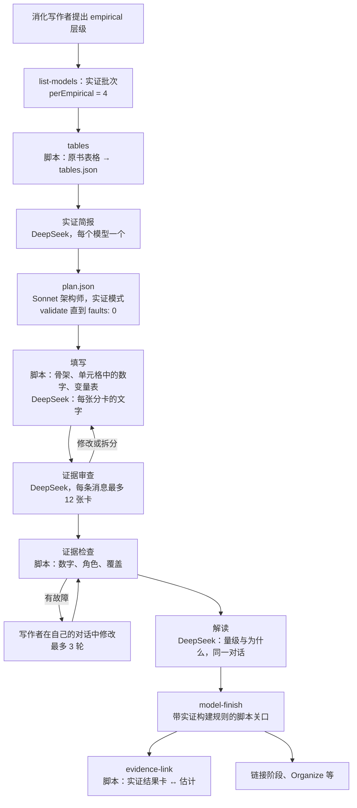

# 实证模型：模型的第三个层级（提案）

状态：已实施（2026-11-08），已在复制的卡片盒上试点（2026-11-09），并于 2026-11-09 夜间完成（P3 新论文试点、P5 模型板、P6 正式卡片盒迁移）；§14 记录已完成的内容、各次试点、成本、所作的决定与尚未完成的事项。英文版是 [empirical-models-proposal.md](empirical-models-proposal.md)，两版内容相同。

相关文档：[模型细化层级](model-elaboration-levels-design.md)（第 1、2 层）、[实证结果卡](finding-cards-design.md)、[模型编译器](model-compiler-design.md)、[模型编译器 v2](model-compiler-v2-proposal.md)（D2、D3：建模型时不在模型之间共用分卡）、[共享构件](model-shared-blocks-proposal.md)（**引入**）、[自足模型](self-sufficient-models-proposal.md)、[工作流原则](agents/workflow-principles.md)、[任务地图](agents/digest-job-map.md)，以及技能 `zt-model-fold`、`zt-model-settings`、`zt-model-restructure`、`zt-model-import`。

## 0. 摘要

ZET 现在有两类模型。**概念模型**（第 1 层）用文字陈述机制。**形式模型**（第 2 层）用数学陈述模型，按自足模型构建，并补出推导分卡。经济学论文常常还有第三类：作者**用数据估计**的模型。它有问题和估计对象、样本、测量的变量、估计式、识别论证、一组规格阶梯、带不确定性的估计表、对识别假设的检验、稳健性检验、异质性与机制，有时还有结构层或反事实层。

消化流程没有容纳这类模型的位置。它把实证模型硬塞进形式模型的模板，或者把结果散写成实证结果卡（Finding Card），而这些卡不知道自己来自哪个规格。§3 在实盘上展示这两种故障。

本提案增加三部分：

1. **第 3 层：实证模型**（`empirical`）：定义、分卡与角色、构建顺序、卡片格式、结果的展示方式、构建规则，以及它与其他模型的对话方式（§4–§7）。
2. **经济学消化流程模型层中的实证路径**（严格，受模式约束）：确定性的表格提取、实证简报、实证架构师计划、由脚本从原表填入数字的填写、证据审查、证据检查，以及一个把本书实证结果卡链接到对应估计的脚本步骤（§8）。
3. **工作流之后的模型整理技能中的实证分支**（灵活，靠判断）：合并、数据与规格的设定整理、证据主线、引入，以及一个新步骤：模型之间、书与书之间的证据对话（§9）。

本设计把形式路径的关键部分逐一迁移过来（§5.6）。实证路径是同一台机器换上不同的零件，不是第二台机器。

## 1. 本提案读了什么

| 来源 | 提供的内容 |
| --- | --- |
| `CONTEXT.md` | 模型卡、模型分卡、模型侧面（facet）、注意力（emphasis）、模型关系、关系类型、构建顺序、推导分卡、构件、引入、自足模型、细化层级、概念模型、形式模型、实证结果卡、卡片语言 |
| `docs/model-elaboration-levels-design.md` | 为什么有层级，每层建什么，层级存在哪里，谁决定 |
| `docs/model-compiler-design.md`、`docs/model-compiler-v2-proposal.md`、`scripts/book-digest/model-architect.md` | 角色（架构师、编译器、驱动、简报者、写作者、审查者）、各轮次、`plan.json`、原文核查、v2 D2/D3 的规则：建模型时一个模型不取另一个模型的分卡 |
| `scripts/book-digest/dsh-model-cards.zh.md`、`dsh-finding-instructions.zh.md` | 消化写作者怎样提出模型和层级；实证结果层怎样一卡写一个结果 |
| `docs/agents/workflow-principles.md`、`docs/agents/digest-job-map.md` | 一种结构、不留后备路径；一个开始、一个队列、一个结束；长的 DeepSeek 任务带 SELF-CHECK；一条用户消息最多审 12 张卡；确定性工作由脚本做 |
| 四个模型整理技能 | 按模型的性质合并；设定整理成依赖树并配一张符号卡；直觉主线：章、结果、证明链；用 **引入** 共享构件 |
| 实盘（档案版本 68593） | `hansen2021demand`（3 个模型、28 张实证结果卡）、`ebrill2001modern/5|a` 与 `4|d|a`（按形式模型建的回归）、`atkinson2015lectures/13|b|a|a`（理论模型中的估计方程）、`atkinson2015lectures/16|c|a|a|a|e|a`（用外部估计值校准的形式模型） |
| Scholar Archive | 215 篇全文作品，其中 73 篇是实证经济学论文；见 §2 |

## 2. 档案中的证据：真实实证模型的形态

### 2.1 读过的论文

Scholar Archive 有 215 篇带全文 Markdown 的作品。前一份报告（2026-11-06）的术语统计显示其中 73 篇是实证经济学论文："specification" 出现在 73 篇中的 66 篇，"fixed effects" 55 篇，"instrument" 32 篇，"robustness check" 32 篇，"event study" 14 篇。为本提案，我们完整阅读了 12 篇论文的实证部分，选择时覆盖每种常见设计。文件路径都在 `E:/google_scholar_archive/data/files/` 下，方括号中是行号。

| # | 论文 | 设计 | 估计式 | 规格阶梯与表 | 其他层 | 与理论和其他论文的关系 |
| --- | --- | --- | --- | --- | --- | --- |
| 1 | Acemoglu、Naidu、Restrepo、Robinson，*Democracy Does Cause Growth*（`nber/w20004…`） | 动态面板；GMM；半参数；工具变量 | (1) $y_{ct}=\beta D_{ct}+\sum_j\gamma_j y_{c,t-j}+\alpha_c+\delta_t+\varepsilon_{ct}$ [187–191]；长期效应是派生的估计对象 $\hat\beta/(1-\sum\hat\gamma_j)$ (2) [203–207] | 表 2：三种估计量 × 1、2、4、8 期滞后；第 3 列为首选，β = 0.787（标准误 0.226）[211]；表 3 逐列加协变量；表 5（IV）对排除性限制的每个已命名威胁加一个控制 [404–416] | 编号的假设 1、1′、2 [195, 299–329, 382–386]；AR2 与 Hansen 检验；第一阶段 F > 16 [390]；机制：同一方程换成各渠道作因变量，式 (5) [438–450]；异质性用交互项 [456–474] | 检验文献中的文字假说；使用外部指数和外部倾向得分 |
| 2 | Goldsmith-Pinkham、Sorkin、Swift 2020，*Bartik Instruments*（`aea/…`） | 移位份额工具变量（方法论文） | $y_{lt}=D_{lt}\rho+x_{lt}\beta_0+\epsilon_{lt}$ [83–87]；$B_{lt}=\sum_k z_{lk0}g_{kt}$ [105–109] | 行是估计量（OLS、TSLS、MBTSLS、LIML、HFUL），列是无控制 / 有控制 / 检验 p 值 [584–588] | 假设与命题 [263–289]；Rotemberg 权重 [321–333]；三项检验流程 [462–510]；预趋势图 [696–708] | 重估另一篇论文："our replication of … Card (2009)" [646–648] |
| 3 | Acemoglu、Hassan、Tahoun 2014，*Power of the Street*（`SatelliteImageLit/Aligned/…`） | 日度股票收益的事件研究 | (2) $CR[n,m]=N_i'\gamma+X_i'\nu+\eta_s+\epsilon_i$ [239–243]；面板式 (3) [337–349] | 表 3：最简 → 基准 → 去掉行业固定效应 → 调整标准误 → 合成匹配 → 累计异常收益 [277–287]；表 8：稳健性阶梯 [371–383] | 识别条件写成协方差 [245]；五条注意事项 [257–265]；安慰剂日期、安慰剂窗口、t 统计量分布 [289–299]；前导与滞后 [385–387]；Box–Cox [393] | 用另两项研究对照量级 [293] |
| 4 | Minni 2023，*Making the Invisible Hand Visible*（`TalentDiscovery/Aligned/…`） | 经理轮岗的事件研究 | (2) $y_{it}=\sum_j\sum_{s}\beta_{j,s}D^j_{i,t+s}+\alpha_i+\xi_t+\epsilon_{it}$ [248–256]；配套式 (3)、(4) [268–279] | 事件研究图 [288–290]；核心结果：工资 +13%，每年 11,962 美元，约等于 7 年的加薪 [463–465] | 先做测量（按晋升年龄定义高潜经理）[176–180]；带 Bonferroni 校正的平衡回归 [219–235]；Sun–Abraham、安慰剂特征 [564–579]；中介分析 [589]；异质性式 (5) [633–657] | 附录中的概念框架给出对立预测 [663, 674]；使用外部估计量 |
| 5 | Autor 与 Scarborough 2004，职位测试（`TalentDiscovery/Aligned/…`） | 分阶段推行的双重差分；2SLS | (7) $D_{ijt}=\alpha+\delta T_i+X_i\beta+\theta_t+\varphi_j+e_{ijt}$ [371–381]；(8)–(11) [407–479] | 推行的前导与滞后项 [395–401] | 第三节理论 [143–355] 给出"经验含义"[355–365]；T × 族裔交互检验它，p = 0.36 [425–439]；理论经参数化模拟、按经验矩校准，六种偏差情景与估计比较 [491–539] | 一篇之内：理论 → 预测 → 检验 → 结构比较 |
| 6 | Grosz 与 Raval 2024，FTC 网站改版（`CustomerComplaints/Aligned/…`） | 时间上的断点回归 | (1) $y_t=\beta Post_t+\gamma_1(t-C,t\ge C)+\gamma_2(t-C,t<C)+g(DOW_t)+\epsilon_t$ [545–551] | 表 1 的列是结果变量与渠道；未处理的渠道作安慰剂 [916–920]；核心结果 +28% [912] | 无预期论证 [539]；断点图 [565]；机制 [951–959]；用外部权重做异质性 [1087–1108] | 使用另一篇论文的受害者权重 |
| 7 | Shapiro、Hitsch、Tuchman 2020，电视广告（`CustomerComplaints/Aligned/…`） | 288 个品牌各自回归 | (1) $\log Q_{st}=\beta^T\log(1+A_{d(s)t})+\alpha^T\log p_{st}+\epsilon_{st}$，含广告存量 (2) [146–168] | 表 2：行是逐步加控制的规格；列是估计值分布的统计量（中位数、均值、显著比例）[529–533]；中位数 0.0140 [519] | 基准与边界两种识别策略 [199–237]；SUTVA [235]；双向聚类 [313]；ROI 反事实，中位数 −87.8% [714–736] | 与一项元分析和一个理论公式对照 [523, 527] |
| 8 | Nosko 与 Tadelis 2015，eBay（`CustomerComplaints/Aligned/…`） | 观察性队列，再加现场实验 | (1) [408–416] | 表 2：OLS、四分位、Probit、边际效应 [418–430] | 平衡表 [612]；按处理强度变化缩放的 ITT [686–704]；IV/TOT 0.246 [743–757] | 用实验验证观察性估计（0.157 对 0.139） |
| 9 | Balboni 等 2022，*Why Do People Stay Poor?*（`TalentDiscovery/Aligned/…`） | RCT 数据；非参数；结构 | 转移方程 (1) [73–109]；$k_{i,3}=\phi(k_{i,1})+\varepsilon_i$ (2) [127–131]；门槛回归 (3) [159–163] | 形状检验 [145]；门槛以下 −14%，以上 +16% | 由一阶条件校准参数 [335–357]；样本外拟合 [365–369]；错配 [371–385]；政策反事实 [387–399] | 复用另一项研究的 RCT 数据 |
| 10 | Hansen、Ramdas、Sadun、Fuller 2021（`MissingMarket/Aligned/…`） | 测量；描述；横截面 | (7) [665–671]；作者称之为"cross-sectional relationship"[679] | 表 2 每列加一个企业特征；表 4 的因变量是其他集群，每格是一个独立回归；表 5 稳健性 [681–764] | 带验证的测量流程 [131–199, 237]；典型事实 [249–255] | 理论部分 [418–660] 给出式 (7) 检验的预测 |
| 11 | Bell、Chetty、Jaravel、Petkova、Van Reenen 2019（`TalentDiscovery/Aligned/…`） | 一个问题，三种设计 | (1)、(2)、(4) 及各自的假设 [313–427] | — | 每种设计写明自己的假设 | 沿用另一篇论文的迁移者设计和函数形式 [415, 429] |
| 12 | Bronnenberg、Dubé、Gentzkow 2010（`CustomerComplaints/Aligned/…`） | 测量；描述；结构习惯模型 | (1)、(2) [172, 184]；习惯 (3)–(4) [217–238] | 参数估计、拟合与残差图 [365–371] | 在专门一节检验识别假设 [323–357]；反事实 [385–427]；参数随各品类的广告强度变化 [437–447] | 估计一个外部理论（Becker–Murphy 习惯形成） |

### 2.2 每个实证模型都有的成分

十二篇论文都有九个成分：

1. 问题与估计对象（一个系数、一个长期效应、一个弹性分布、一个门槛）；
2. 观测单位、样本、时期、数据来源与样本规则；
3. 构造的测量，常由作者自建（民主指数、高潜经理、市场贝塔、技能集群、相对份额）；
4. 一个编号的估计式，写明因变量、关注的回归元、固定效应、控制变量、误差项和估计方法；
5. 推断规则：标准误类型和聚类层级，写在正文或表注中；
6. 识别假设，常有编号，并列出已知威胁和检验；
7. 规格阶梯中的一个首选规格；
8. 一个核心估计，配上量级换算（× 100、百分比、每年多少美元、"7 年的加薪"、与文献对照）；
9. 稳健性，然后是异质性或机制。

### 2.3 随设计而变的成分

| 设计 | 自有成分 |
| --- | --- |
| 动态面板（1） | 滞后期；一族估计量（组内、GMM、HHK）；AR2 检验；派生的长期乘数 |
| 工具变量与移位份额（1、2、5、8） | 工具的构造；第一阶段及其 F；排除性限制，以及针对每个威胁的控制；过度识别检验；Rotemberg 权重；简化式对 2SLS；LATE 或 TOT |
| 双重差分与事件研究（3、4、5） | 事件；窗口；省略的基期；对照组；事前事后系数图；交错采用的估计量；金融中还有异常收益、估计窗口贝塔和安慰剂日期 |
| 断点回归（6） | 驱动变量、断点、窗口、多项式阶数、无预期论证、断点图、未处理结果作安慰剂 |
| 实验（8、9） | 随机化单位、平衡表、ITT、依从、用 IV 求 TOT、按处理强度变化缩放 |
| 多单位估计（7） | 估计对象是各单位估计值的分布：中位数、分位数、显著比例、与元分析对照 |
| 结构估计（5、9、12） | 原始设定的模型；由简化式矩估计或校准参数；样本外拟合检验；反事实模拟 |
| 测量与描述（10、12） | 测量流程及其验证；典型事实；不作因果解释的条件相关 |

### 2.4 依赖顺序

各篇论文构建证据的顺序几乎一样，后一项都依赖前一项：

```
问题 → 制度背景（变异的来源）→ 数据 → 测量 → 描述性事实
→ [理论或框架：预测] → 估计式 → 识别假设、威胁、检验
→ 基准与首选估计 → 其他估计量与稳健性 → 异质性 → 机制与竞争性渠道
→ 外部有效性 → 结构层或反事实 → 解释
```

三种复用方式把后面各项绑到估计式上：机制回归保留右侧、换因变量（论文 1，式 5）；异质性回归加交互项（论文 4，式 5；论文 5，式 9）；反事实以估计出的参数为输入（论文 7、9）。

### 2.5 结果的报告方式

- **回归表。** 行是系数（有时加长期效应或持续性行）；列是逐步累加的阶梯；底部各行报告固定效应、N、R² 和检验 p 值（AR2、Hansen、第一阶段 F）；表注写明因变量、估计方法、标准误和缩放。
- **列不一定是规格。** 一列可以是一族估计量（1、2）、一个阶段或子样本（3）、一个结果变量或渠道（6、10），一格也可以是一个独立回归（10）。所以必须逐列映射，不能假设列就是阶梯。
- **图。** 带置信区间的事件研究路径（1、4）；断点图（6）；安慰剂直方图（3）；单位估计值的分布（7）；β_k 对 F 的气泡图（2）；非参数曲线（9）；模型与数据的拟合图（9、12）。
- **核心结论句。** 点估计、标准误和量级换算。

### 2.6 实证模型与其他模型的关系

| 关系 | 出现在 |
| --- | --- |
| 检验同一篇论文中理论的预测 | 5、8、9、10 |
| 为结构模型提供矩或目标 | 5、9、12 |
| 重估或复现另一篇论文的规格 | 2（Card 2009） |
| 沿用另一篇论文的设计或估计量 | 1、4、11 |
| 使用另一篇论文的数据或测量 | 6、9、10 |
| 与另一个估计对照或相左 | 1、3、7 |
| 用实验验证观察性估计 | 8 |
| 一篇之内：基准 → 变体；主估计 → 机制；主估计 → 异质性；简化式 → 结构 | 全部 |

这些关系、九个共有成分、各设计的自有成分和报告方式，就是 §4–§7 的需求。

## 3. 消化流程现在怎样处理实证模型

### 3.1 现在模型怎样产生


每个小节组的写作者提出一张模型卡和它的层级。模型层把每张模型卡建到它的层级：概念路径最多写四张分卡；形式路径做计划、填写、推导、审查和解释。实证结果层独立运行，为它在一组中找到的每个实证结果写一张实证结果卡，含六个标签（`测量`、`数据`、`方法`、`结果`、`局限`、`来源`），并由它支持的观点卡链接。工作流结束后，所有者手工运行模型整理：合并被拆开的模型，整理设定，建直觉主线，写引入。

这条链上没有一环知道什么是规格、估计、标准误、识别假设或稳健性检验。

### 3.2 实盘上的故障

**P1. 回归按形式模型建。** `ebrill2001modern/5|a`（*The Modern VAT* §4.2）是 99 国横截面回归。消化流程把它建成形式模型：

- 系数表写在模型卡正文中，不在分卡中。
- 表 4.2 的四列（A–D：哪些回归元、哪个样本、N = 69、89、40、55）挤在一张题为 `结果：收入消费比对税率与环境的回归` 的卡中。规格被当成结果。
- `推导：系数 0.70 对应税率升 10%、收入升 7%` 是为对数算术建的推导分卡。形式路径要求在原书略去代数的地方补推导，于是造出了一张。
- White 标准误和显著性标记写在一句话里，没有一张估计卡带着它的不确定性。

`ebrill2001modern/4|d|a`（带交互项的增值税收入回归）形状相同。

**P2. 理论与检验在同一个模型里，结果在模型外。** `hansen2021demand/5|b|b|a` 是管理者时间的形式模型。它的第 3 章 `第 3 章：两个命题合成一条可估计的回归` 写了因变量、代理变量和带固定效应与聚类的回归式 (7)。表 2 的估计不在模型中，而是五张实证结果卡（`5|c|a|c` … `5|c|a|g`）。每张在 `方法` 一行重写规格（`横截面 OLS 回归，控制行业、大洲、职位与年份固定效应`），只链接文献笔记 `5|c|a`，没有一张链接回归式 (7)。稳健性结果（`5|c|d|b`：Probit；`5|c|d|c`：文件长度）写成 `结果与基准结果几乎相同`，没有数字。读者无法从理论的预测走到规格、走到列、再走到数字。

**P3. 测量框架是一个孤立的概念模型。** `hansen2021demand/3|d|a`（词嵌入、k-means 集群、0/1 相对度量）是这篇论文实证模型的测量块。它现在是一个独立的概念模型，没有链接到任何使用这个度量的卡。

**P4. 用外部估计校准。** `atkinson2015lectures/16|c|a|a|a|e|a` 取 σ = 0.408，即 Ashenfelter–Heckman（1973）的估计值。这是一个依赖实证估计的形式模型。ZET 只能用一句散文说明这一点。

**P5. 实证结果卡没有归属。** 一张实证结果卡陈述一个结果，但一个实证结果是某个规格在某一列中的一个数。六个标签装不下规格、列、标准误和识别，所以写作者在 `方法` 中重复它们，重复的文字会走样（`5|c|d|b` 中的 `测量：测量：` 就是一个小迹象）。

**P6. 合并规则掩盖了问题。** `zt-model-fold` 规定，一张"估计或校准这个模型"的模型卡属于同一个模型。按这条规则，论文的实证部分总是并入理论，两种不同的构建（推导一个结果；估计一个数）共用一个模板。

## 4. 实证模型（第 3 层）

### 4.1 定义

建议加入 `CONTEXT.md` 的术语条目：

> **实证模型**：细化层级为 3 的模型。原书用数据估计或测量一个关系：它说明估计什么、用什么数据、用什么规格，以及为什么估计值能表示它所声称的含义，并报告估计值的大小和不确定性。简化式回归、基于设计的估计（双重差分、事件研究、工具变量、断点回归、随机实验）、带反事实的结构估计，以及原书在数据上构建并验证的测量框架，都是实证模型。它的模型卡和分卡遵守实证角色。除推导估计式或估计量的推导分卡外，它没有推导分卡。_不用_：回归模型、计量卡、结果模型。
>
> **估计对象**：实证模型估计的东西，用文字写：什么对什么的效应，对谁。
>
> **规格**：一个估计式，以及决定其估计值的全部内容：因变量、关注的回归元、固定效应、控制变量、样本、权重、估计方法和标准误。模型的基准规格在主线上；其他规格都是挂在它下面的变体，并写明改了什么。
>
> **估计分卡**：实证模型中陈述一个报告估计的分卡：系数、它的规格和表格单元、不确定性、样本量，以及用文字写的量级。
>
> **证据链**：挂在一张估计分卡下、支持或限定它的分卡：对识别假设的检验、表、图、量级换算。它的作用与结果下的证明链相同。

**细化层级**保留名称和存储列。它的含义从"模型建得多完整"放宽为"原书怎样构建这个模型"：用文字（1，`concept`）、用数学（2，`formal`）、用数据（3，`empirical`）。第 3 层并不比第 2 层"更细"，它是同级的另一种模型，有自己的规则。编号只是取值的名字。

### 4.2 边界在哪里

| 原书给出 | ZET 写成 |
| --- | --- |
| 自己的估计规格和由数据得到的估计 | 实证模型 |
| 同一篇中的理论及其检验 | 两个模型：形式（或概念）模型，以及一个实证模型，它引入所检验的预测（§7） |
| 在数据上估计的结构模型及其反事实 | 两个模型：形式模型，以及一个实证模型，它整块（`整块`）引入形式模型，再加上数据、矩、估计量、估计值和反事实 |
| 在数据上构建并验证的测量框架 | 设计为 `measurement` 的实证模型，或者使用它的那个实证模型的测量块（同一篇论文：一个模型） |
| 一个数字、一个调查计数、一个典型事实，没有规格 | 只写实证结果卡 |
| 对另一篇论文实证设计的概述（讲座、教材、综述） | 不建实证模型：概述留作文献笔记，或作为使用它的概念或形式模型的一张分卡；外部论文写成引用文献卡 |
| 教材为说明自己的理论而估计一个方程（`atkinson2015lectures/13|b|a|a`，110 个瑞士城市） | 形式模型的一张例子分卡（`例子`），除非原书把这次估计当作一项有自己的设计和检验的研究 |

最后两行把实证层级留给研究本身，免得教材中每个被引用的回归都变成模型。

### 4.3 设计类型

计划为模型写明一种设计类型（只有原书在同一个估计对象上组合几种设计时才写多种）。设计类型决定构建预期有哪些分卡（§5.2）：

| 设计（`design`） | 中文 | 共有分卡以外预期的分卡 |
| --- | --- | --- |
| `cross-section` | 横截面回归 | 控制变量；局限中的选择问题 |
| `many-unit` | 多单位估计 | 每个单位（品牌、企业、地区）一个估计；估计对象是它们的分布：中位数、分位数、显著比例 |
| `panel` | 面板（固定效应、动态面板） | 固定效应、滞后期、动态估计量、序列相关检验 |
| `did` | 双重差分 | 处理组与对照组、时点、平行趋势、预趋势检验 |
| `event-study` | 事件研究 | 事件时间、前导与滞后、系数图、事前检验 |
| `iv` | 工具变量 | 工具、第一阶段及其 F、排除性限制、简化式、过度识别 |
| `shift-share` | 移位份额（Bartik） | 份额、冲击、权重、份额外生性检验 |
| `rd` | 断点回归 | 驱动变量、断点、带宽、密度检验、协变量平衡 |
| `experiment` | 随机实验 | 随机化、平衡、样本流失、ITT、依从与 LATE |
| `structural` | 结构估计 | 引入的理论模型、矩或似然、估计量、参数估计、拟合、反事实 |
| `measurement` | 测量 | 构造、与其他度量对照的验证、描述性结果 |
| `descriptive` | 描述性统计 | 样本、度量、规律；不作因果断言 |

## 5. 实证模型的结构

### 5.1 角色

实证模型使用与所有模型相同的机制：一张模型卡，带侧面和注意力的模型分卡，带关系类型的链接，在模型卡下按树归档。不同的是一套固定的**角色词表**，从侧面的前缀读出，就像今天从 `推导` 前缀读出推导分卡。数学单元已经有固定词表；固定词表让构建报告能检查结构。

| 角色（侧面前缀） | 线 | 内容 | 依赖 |
| --- | --- | --- | --- |
| `数据：` | 主线，第一张 | 观测单位、样本、时期、地点、数据来源、样本规则 | 无（原始设定） |
| `变量表` | `数据：` 的第一个侧后继 | 每个规格中的每个变量和符号：名称、含义、度量方式、来源、读者首次遇到它的卡 | `数据：` |
| `样本：` | `数据：` 的侧后继 | 一个子样本或一个链接的数据集 | `数据：` |
| `测量：` | `数据：` 的侧后继 | 一个构造变量怎样构造（指数、文本度量、平减指数），怎样验证 | `数据：`、更早的 `测量：` |
| `描述：` | `数据：` 或描述性章的侧后继 | 原书在估计之前报告的一个描述性事实或汇总统计 | `数据：`、`测量：` |
| `假说：` | 主线 | 模型检验的预测，通常是对一张理论分卡的引入（§7） | 被引入的分卡 |
| `设计：` | 主线 | 设计类型、变异来源、比较、威胁 | `数据：`、`假说：` |
| `背景：` | `设计：` 的侧后继 | 提供变异的制度事实（轮岗政策、广告购买流程、未预告的上线、分阶段推行） | `设计：` |
| `假设：` | `设计：` 的侧后继 | 一条识别假设，带编号（`假设 1`） | `设计：` |
| `规格：` | 主线（基准）、侧线（变体） | 一个估计式，每一项都有定义；变体只写它相对所挂规格改了什么。改动是以下之一：控制变量、固定效应、样本、估计方法、因变量（机制：右侧不变，换因变量）、交互项（异质性）、函数形式、标准误、工具变量 | `数据：`、`测量：`、`设计：`；变体还依赖它的基准 |
| `第 k 章：` | 主线 | 证据的一个阶段：主要估计、识别检验、稳健性、异质性、机制、量化 | 更早的章、基准 `规格：` |
| `估计：` | 章的侧后继 | 一个报告的估计（§5.3） | 它的 `规格：` |
| `表 n：` | 章的侧后继 | 一张原书表格的紧凑形式，每列链接到它的规格 | 各列的 `规格：` |
| `图 n：` | 估计或章的侧后继 | 一张原书的图（事件研究图、分组散点图、估计值分布） | 它的 `规格：` |
| `检验：` | 估计的侧后继（证据链）或章的侧后继 | 一项对识别假设或模型拟合的检验：第一阶段及其 F、预趋势、安慰剂日期或安慰剂结果、平衡、密度、AR2、过度识别、样本外拟合 | 它检验的 `假设：`（或它检验其拟合的 `参数：`）、它的 `规格：` |
| `换算：` | 估计的侧后继 | 把系数换成量级（对数点到百分比、一个标准差到一个比例） | 该估计 |
| `参数：` | 章的侧后继（结构） | 一个估计出的结构参数及其不确定性 | 它的 `规格：`（估计量） |
| `反事实：` | 章的侧后继（结构） | 一个反事实结果 | `参数：` 各卡与引入的理论 |
| `推导：估计式` | `规格：` 的侧后继 | 原书推导估计式或估计量时的推导 | 推导起点的理论分卡 |
| `局限：`、`外部有效性：` | 线外 | 估计不能说明什么 | `设计：`、`数据：` |

### 5.2 构建顺序：证据主线

重构技能的原则不变：**降低读者的工作记忆负担**。一卡一个意思，先结论后细节，主线短，细节退到一侧。对实证模型，主线按读者逐步信任一个数字的顺序排列：

```
主线   数据 → [假说] → 设计 → 规格：基准 → [第 0 章：描述性事实] → 第 1 章：主要估计 → 第 2 章：识别检验 → 第 3 章：稳健性 → 第 4 章：异质性与机制 → [第 5 章：量化或反事实]
  ├ 设定部分   数据下有 变量表、样本、测量；设计下有 背景 与 假设 1…n；规格：基准 下有各规格变体
  └ 每章之下   估计 / 表 / 参数 / 反事实 卡，作侧分支
       └ 每个估计之下   它的证据链：检验、图、换算
线外   局限、外部有效性、数据来源史
```

- 原书没有的章不写。一章至少有一个估计或一项检验才出现。
- 原书由其他估计派生出的估计（论文 1 的长期效应 $\hat\beta/(1-\sum\hat\gamma_j)$）是一张 `估计：` 卡，依赖它用到的估计，并写出公式。它不是 `换算：` 卡，因为它是一个有自己不确定性的报告估计。
- 原书的顺序不同时（有些论文先报告检验），章按原书排列。依赖规则决定什么可以在前：稳健性估计依赖它的变体规格，从不依赖更后的章。
- 规格阶梯是一棵侧树：`规格：基准` 在主线上，每个变体挂在它所改的规格下，变体的变体挂在变体下。这与 `zt-model-settings` 中模型变体的规则相同（"先基准模型，后变体，每个变体一条分支"）。
- 估计依赖规格，不依赖检验。检验依赖它检验的假设和它的规格，并对它支持的估计写 `印证`（或 `反驳`）。只有依赖链接决定卡在看板上的位置，所以检验挂在估计之下，而估计不必等待检验。

自足模型的规则全部成立：没有闭包、前向或无锚故障。

### 5.3 结果怎样展示

论文用四种形式展示结果（§2）：列为规格的系数表；系数图（事件时间、分组、分布）；正文中带量级的核心数字（"一个标准差的提高使……上升 3.5 个百分点"）；以及定义不确定性的表注（聚类、N、固定效应行）。实证模型保留这四种形式，每种放在自己的卡上：

- **一个核心估计，一张 `估计：` 卡。** 它带着数字、不确定性、样本量、规格和单元格，以及用文字写的量级。这个数字在模型中只出现在这里。
- **一张原书表格，一张 `表 n：` 卡。** 它用紧凑的 Markdown 表保留原表布局：正文用到的行、每一列、N 行和固定效应行，每列有一行表头链接这一列是什么。列不一定是规格（§2.5）：它可以是估计量、子样本、因变量或独立回归，所以计划把每列映射到它的 `规格：` 变体（变体的 `change` 写明是哪一种）；如果一张表的列是估计值分布的统计量（论文 7），就改为映射它的行。表卡是读者从原书表格走到各卡的地图。
- **一张原书的图，一张 `图 n：` 卡**，用原书自己的图（图层已经附上图及其 DeepSeek 说明），加一句话说明从图上读什么。
- **量级换算是一张 `换算：` 卡**，不是推导分卡。它最多几行算术。

**每个数字都由脚本从原书取出。** 工作流把原书的表格提取到 `tables.json`（§8.2），按单元格写出 `估计：` 与 `表 n：` 卡中的每个数字。DeepSeek 只写数字周围的文字，从不手打单元格中已有的数字。证据检查（§8.2 第 6 步）拒绝数字没有出现在其原文范围任何一行中的卡。

### 5.4 卡片格式

格式遵守重构技能的规则：先用文字写结论；每种角色一种格式；每个前提只写一次。标签用中文，因为消化流程写中文卡片。

**模型卡（实证）**

```
**问题**
一两句：研究问什么。

**估计对象**
一句话：什么对什么的效应，对谁。

**设计**
设计类型（§4.3）和比较，一两句。

**数据**
单位、样本量、时期、地点、数据来源，一两句。

**主要估计**
| 估计 | 值 | 不确定性 | 规格 |
| --- | --- | --- | --- |
| [[估计：…]] 用文字写的估计 | 0.718 | 标准误 0.249 | [[规格：基准]] 表 2 第 1 列 |
（最多五行：论文摘要和结论使用的估计）

**结构**
（主线的两层列表，与每张模型卡相同）

**引入**
（引入：它检验的理论预测、共享的数据块、它估计的理论模型）

**关联**
与其他模型和其他书的 检验 / 对照 / 印证 / 反驳 各行（§7）。

来源：[[key]] §n
```

**`数据：`（模型的设定）**

```
一句话：数据是什么。

**起点**
- 原始设定：不依赖其他设定。

**内容**
1. 观测单位：…
2. 样本：N = …，时期，地点。
3. 数据来源：…
4. 样本规则：去掉什么，为什么。

**为什么需要它**
一句话：哪些规格用这些数据。

变量的含义见变量表 [[变量表]]。

来源：[[key]] §n
```

**`变量表`**：实证模型的符号卡。`| 变量 | 含义 | 度量 | 来源 | 首次出现 |`，每个规格中每个变量和每个符号（因变量、回归元、固定效应、误差项、下标）一行，再加 **统一用语**（每个概念一个词）。`zt-model-settings` 的覆盖规则适用：每个 `规格：` 公式中的每个符号都有一行（`uncovered`）；没有不用的行（`unused`）；每行写明读者首次遇到它的卡（`first`）。

**`设计：`**

```
一句话：识别估计的比较。

**起点**
- 依赖 [[数据：…]]：…
- 依赖 [[假说：…]]：本设计检验的预测。（有预测时）

**变异来源**
变异从哪里来，为什么它可以认为与误差项无关。

**比较**
谁与谁比较（处理组与对照组、前与后、断点附近）。

**识别假设**
- [[假设 1：…]] 每条一行。

**威胁**
原书列出的威胁，每条一行，并链接处理它的卡。

来源：[[key]] §n
```

**`规格：`（基准或变体）**

```
一句话：这个规格估计什么。

**起点**
- 依赖 [[数据：…]]、[[设计：…]]：…
- 变体：放宽 [[规格：基准]] 的…：唯一的改动。（只有变体写）

**估计式**
$$ … \tag{n} $$

**各项**
1. 因变量：…
2. 关注的回归元：…（它的系数就是估计）
3. 固定效应：…
4. 控制变量：…
5. 样本与权重：…
6. 估计方法：OLS / 2SLS / GMM / Probit / MLE / …
7. 标准误：按…聚类 / 稳健 / 自助法。

**相对基准的改动**   （只有变体写）
用一两行写改动，不写别的。

变量的含义见变量表 [[变量表]]。

来源：[[key]] §n，表 n 第 k 列
```

原书没有写出估计式时，卡上写 `书中没有写出估计式`，并用文字列出各项。

**`估计：`**

```
一句话：结果的方向与大小，不写公式。

**估计**
- 估计量：[[规格：…]] 中 $\beta$（式 (n)），表 n 第 k 列。
- 值：0.718；标准误 0.249（按国家聚类）；N = 6,336。
- 显著性：1% 水平。   （或：原书未写明）

**量级**
按原书的说法用文字写量级。原书没有给出的换算写在换算卡中。

**为什么**
一到三句：作者怎样解读这个估计。

**依据**
依赖 [[规格：…]]。识别见 [[设计：…]]。检验见 [[检验：…]]。

**对应**
对应 [[实证结果卡]]：这个结果在全书层面的陈述。（由脚本写入，§8.2 第 9 步）
印证 / 反驳 [[假说：…]]：这个估计对预测说明了什么。

来源：[[key]] §n 表 n
```

**`检验：`**

```
一句话：检验哪条假设，是否成立。

**检验什么**
依赖 [[假设 k：…]]：这条假设。

**做法**
一两句写检验，带上它的规格：依赖 [[规格：…]]。

**结果**
统计量或系数，带不确定性（取自单元格或图）。

**结论**
一句话，强度与原书一致：成立 / 不能拒绝 / 不成立 / 原书未说明。

印证 [[估计：…]]：这项检验对估计的作用。

来源：[[key]] §n
```

**`表 n：`、`图 n：`、`换算：`、`参数：`、`反事实：`、`局限：`** 形状相同：先一句话，再写内容，再写链接，最后写来源行。章卡沿用重构格式（`**直觉**`、`**本章结果**`、`**承上启下**`），用 `**本章估计**` 代替 `**本章结果**`。

### 5.5 构建规则与构建报告

构建报告已经检查闭包、前向、无锚和引入故障。对层级为 `empirical` 的模型卡，它再按 §5.1 的侧面前缀检查角色：

| 故障 | 规则 |
| --- | --- |
| `empirical_shape` | 主线以 `数据：` 分卡开始，有一张 `设计：` 分卡和至少一张 `规格：` 分卡，模型至少有一张 `估计：` 或 `参数：` 分卡 |
| `estimate_unbound` | 一张 `估计：` 或 `参数：` 分卡没有依赖本模型任何 `规格：` 分卡 |
| `spec_unbound` | 一张基准 `规格：` 分卡不依赖任何 `数据：` 或 `测量：` 分卡，或一张变体不依赖任何 `规格：` 分卡 |
| `test_unbound` | 一张 `检验：` 分卡不依赖任何 `假设：` 分卡 |
| `variable_uncovered` | `规格：` 展示公式中的一个符号在 `变量表` 中没有行（同设定检查的 `uncovered`） |
| `beyond_level` | 一张推导分卡的侧面不是 `推导：估计式` 或 `推导：估计量`（量级的算术是 `换算：` 分卡） |

`self_sufficient` 含义不变。层级只增加检查，不放松任何检查。这些故障只报告、不强制，与今天所有构建故障一样；工作流的 `model-finish` 关口拒绝有任何一项故障的模型，与形式模型相同。

`zt-check` 为实证角色增加卡片格式规则，风格与 F 规则相同（建议编号 EM1–EM5）：

| 规则 | 检查 | 默认 |
| --- | --- | --- |
| EM1 | `估计：` 分卡有标签 `估计`、`量级`、`依据`，其 `估计` 一节写明一个 `规格：` 链接和一张表或图 | 是 |
| EM2 | `估计：` 分卡写出一个值和一个不确定性（标准误、t、置信区间、p、显著性水平），或写 `原书未写明` | 是 |
| EM3 | `规格：` 分卡有 `估计式`（或 `书中没有写出估计式`）和 `各项`，各项写明因变量、关注的回归元和标准误 | 是 |
| EM4 | `设计：` 分卡有 `变异来源` 和 `识别假设` | 是 |
| EM5 | 设计为 `descriptive` 或 `cross-section` 的模型中，`估计：` 分卡用了因果动词（`导致`、`使`、`提高了`、`causes`） | 建议 |

### 5.6 从形式路径迁移过来的部分

实证路径就是把形式路径的零件逐一替换。这张表是本设计的核心：每一行是今天机器中实证模型保留的一个部分。

| 今天的形式模型 | 实证模型 |
| --- | --- |
| `设定` 分卡 + `符号表与读法` | `数据：` 分卡 + `变量表` |
| 设定部分中的假设（`假设`），用链接引用 | `设计：` 下的识别假设（`假设 k`），每项检验用链接引用 |
| 模型变体作设定的分支 | 规格变体作 `规格：基准` 的分支，每个带 `相对基准的改动` |
| 主线：设定 → 各章 | 主线：数据 → 设计 → 基准规格 → 各章 |
| 章下的 `结果：` 卡 | 章下的 `估计：`（以及 `参数：`、`反事实：`）卡 |
| 结果下的证明链（`推导：` 分卡） | 估计下的证据链（`检验：`、`图 n：`、`换算：`） |
| 原书略去的每一步都补一张推导分卡 | 不编造步骤：数字取自表格；只有估计式或估计量可以推导 |
| 审查者重做链上的每一步 | 审查者对照原文范围检查每个数字、符号、显著性用词和断言强度 |
| 解释：`思路` / `说明` / `解读` | 解读：`量级` / `为什么` |
| `source_review`（supported、narrowed、supplied、absent） | 同上，再加每个数字的单元格 |
| `source_faults`（方程中的 OCR 错误） | 同上，再加表格中的 OCR 错误（列错位、负号丢失） |
| 模型之间引入设定块 | 引入假说、数据或测量块、工具变量，或整个理论模型 |
| 自足：每个前提都是成员 | 自足且**证据可追溯**：每个数字都能从估计追到规格、单元格和原文行 |

## 6. 示例

这些草图展示目标树形，并未构建。

### 6.1 `hansen2021demand`：理论与检验分成两个模型

```
5|b|b|a  管理者时间模型（formal）            不变，只把第 3 章移出
新建      高管社交技能需求的横截面估计（empirical，设计：cross-section + measurement）
  **引入** 单卡 [[5|b|b|a|a|2|b]] 命题 1；单卡 [[5|b|b|a|a|2|c]] 命题 2
  数据：4,618 个高管搜寻的职位描述，2000–2017 年
    变量表
    测量：HBR 词嵌入与六个技能集群（来自 3|d|a，并入此处）
    样本：703 个能匹配 Burning Glass 的美国搜寻
  假说：企业特征的系数为正（引入两个命题）
  设计：横截面比较；特征在搜寻前三年取定
    假设 1：特征先于职位描述
  规格：基准 (7)  Social_ft = α + βX_ft + ψ_o + θ_i + φ_chq + φ_sl + δ_t + ε
    规格：Probit
    规格：加入文件长度控制
    规格：企业内部就业
  第 1 章：主要估计
    表 2：社交集群对企业特征
    估计：对数就业高一个标准差，社交技能要求的概率高 3.5 个百分点   ← 实证结果卡 5|c|a|c 链接它
    估计：跨国公司 …   估计：并购 …   估计：上市 …   估计：多元化不显著
  第 2 章：信息强度
    估计：信息技术技能占比高一个标准差，社交集群高 5.2 个百分点（表 3）
  第 3 章：其他集群
    表 4 …
  第 4 章：稳健性
    估计：Probit 下的系数 …（依赖 规格：Probit）
  局限：横截面相关，不是因果效应
```

理论的第 3 章（`5|b|b|a|a|3`）换成一行指引：`本模型的预测由 [[该实证模型]] 检验`。测量概念模型 `3|d|a` 成为 `测量：` 块，因为它是为这次估计构建的（同一篇论文，同一份数据）。

### 6.2 `ebrill2001modern/5|a`：按自己的层级重建回归

```
增值税收入的跨国回归（empirical，设计：cross-section）
  数据：99 个实行增值税的国家，每国一个观测
    变量表（SR、OPEN、AGE、ILLITERACY、SI、RANGE、THRESH、RETAIL、GS）
  设计：横截面比较；规则 τ 随环境 α 而定，部分规则看不见
    假设 1：可观测规则与环境的系数是直接与间接效应之和
    推导：估计式（现有关于 r(τ0, α) 与 dR/dα 的两张推导分卡保留：它们推出系数的含义）
  规格：A 列（基准）
    规格：B 列（删去文盲率，N 增加 20）
    规格：C 列（A 加四个结构变量）
    规格：D 列（B 加四个结构变量）
  第 1 章：税率弹性
    表 4.2
    估计：ln(SR) 的系数 0.70
      换算：税率升 10%，收入消费比升约 7%   （原为推导分卡）
  第 2 章：环境变量
    估计：OPEN …  估计：ILLITERACY …  估计：SI …
  第 3 章：结构变量
    估计：只有 RANGE 在 C、D 两列都为正
      推导：需求转移 …（解释 RANGE 为什么可以为正的两张推导属于理论：移入一个小的形式模型，或作 机制 旁注；见 §12 决定 10）
  局限：不可观测规则使效应无法分解
```

### 6.3 档案中一篇基于设计的论文

Autor 与 Scarborough（2004）在一篇论文中展示了完整的对话（§2.1 论文 5）。它会得到三个模型：

```
A  职位测试的甄选模型（formal）
     设定：面试与测试两种甄选技术 [143–355]
     第 k 章：经验含义 — 测试使雇佣差距与生产率差距反向变化 [355–365]

B  职位测试对雇佣与任职期的影响（empirical，设计：did + iv）
   **引入** 单卡 [[A 的经验含义]]
   数据：连锁零售企业的门店与雇员记录，1,363 个门店
     变量表
     测量：门店平均测试分数（用 (8) 验证它预测任职期）[407–421]
   假说：测试不扩大少数族裔的雇佣差距，并提高各族裔的任职期
   设计：分阶段推行测试的双重差分；门店采用作为工具变量 [393]
     假设 1：推行时点与门店的任职期趋势无关
   规格：基准 (7) 任职期对测试、门店与月份固定效应，按门店聚类 [371–381]
     规格：2SLS（门店采用作工具变量）
     规格：(9) 加入测试 × 族裔交互
     规格：(10) 条件 logit（雇佣），(11) 线性概率模型
   第 1 章：任职期
     估计：测试使白人雇员任职期增加 …（表 VI）
   第 2 章：识别检验
     检验：推行前后的前导与滞后项 [395–401]   （依赖 假设 1）
   第 3 章：族裔异质性 = 对预测的检验
     估计：各族裔效应相等，p = 0.36 [425–439]   印证 [[假说]]
   第 4 章：雇佣
     估计：(10)(11) 的雇佣效应；邻里族裔构成的第二个检验 [459–487]

C  偏差情景的模拟（empirical，设计：structural）
   **引入** 整块 [[A]]；单卡 [[B 的主要估计]]
   参数：按经验矩校准的甄选参数 [491–539]
   第 1 章：六种偏差情景
     反事实：只有"两者都无偏"的情景与估计相符   印证 [[B 的估计]]
```

C 是独立模型还是 B 的一章，由 §9.1 的合并规则决定：C 增加了自己的原始设定（对 A 参数的校准），所以按规则它是独立模型。

## 7. 实证模型怎样与其他模型对话

ZET 已经有所需的全部工具：前提来自另一个模型时用引入，其他关系用关系类型，读者看到模型邻居。本提案为每种关系定一条写法，不增加新的关系类型（§12 决定 5）。

| 关系 | 何时 | 写在哪里 | 怎样写 | 关系类型 |
| --- | --- | --- | --- | --- |
| 检验一个预测 | 论文推出一个预测并估计它 | 实证模型的 `假说：` 分卡 | `单卡` 引入理论的结果卡；`假说：` 分卡不重述内容，只写理论预测的符号或大小 | 依赖（经引入） |
| 支持或否定 | 估计与预测一致或不一致 | `估计：` 分卡的 `**对应**` | `印证 [[假说：…]]` 或 `反驳 [[假说：…]]` | 例示 / 反驳 |
| 由理论推出估计式 | 估计式来自一个理论模型 | `规格：` 下的 `推导：估计式` | `整块` 引入推导所起始的理论块 | 依赖 |
| 估计一个理论模型 | 结构估计 | 实证模型的模型卡 | `整块` 引入整个形式模型；`参数：` 分卡依赖引入的设定；`反事实：` 分卡依赖 `参数：` 与引入的结果 | 依赖 |
| 用估计值校准 | 形式模型从一个估计取参数值 | 形式模型的参数卡 | 估计在卡片盒中时，`单卡` 引入该 `估计：` 分卡；不在时，写 `参照 [[引用文献卡]]` | 依赖 / 参照 |
| 使用另一项研究的数据、测量或工具 | 同一个数据集、指数或工具 | `数据：` 或 `测量：` | `整块` 引入另一个模型的 `数据：` 或 `测量：` 块 | 依赖 |
| 重估另一项研究的规格 | 复现、扩展 | `规格：` | `对照 [[规格：…]]`（同一规格，新数据）或 `放宽 [[规格：…]]`（一处改动） | 对照 / 放宽 |
| 估计同一个估计对象 | 两项研究、两本书、一个效应 | `估计：` | `对照 [[估计：…]]`，写出两个数字；在不确定性范围内一致时写 `印证`，不一致时写 `反驳` | 对照 / 例示 / 反驳 |
| 一个结果在全书层面的陈述 | 报告模型中某个估计的每张实证结果卡 | 实证结果卡的最后一段与估计的 `**对应**` | 实证结果卡写 `依赖 [[估计：…]]`；估计写 `对应 [[实证结果卡]]` | 依赖 / 对应 |
| 被阅读笔记讨论 | 关于该结果的观点卡或文献笔记 | 该笔记 | `依赖 [[估计：…]]`、`例示 …`、`反驳 …`，与消化流程为模型写的相同 | 按所写 |

三条规则让对话保持清楚：

1. **构建期间，模型不取另一个模型的分卡**（模型编译器 v2，D2）。架构师把与其他模型的每种关系写成散文链接（`检验 [[…]]`、`对照 [[…]]`）。模型阶段之后的引入步骤（v2 D3，或手工运行 `zt-model-import`）再把其中的前提变成 `**引入**` 行。
2. **实证结果卡仍是一个结果在全书层面的陈述。** 它不被删除，只增加一个链接，指向它报告的估计。这样实证结果层、它的 F 规则、按类型搜索和 idea-grow 照常工作，读者从一张实证结果卡一步就能走到规格。
3. **跨书的对话只用链接，从不移动卡片。** 两本书对同一个估计对象的估计比较，由证据对话步骤（§9.5）写在 agent 工作区。把一个估计对象的全部估计汇总成一个视图，是 idea-grow 的工作（一张主题卡），不在本提案之内。

## 8. 构建工作流（严格）

结构在工作流中强制执行：固定的角色、一个模式（schema）、一个验证器、一个脚本关口。实证路径是经济学变体模型层中的第三条路径，与概念路径、形式路径并列。它不是新阶段。它遵守模块原则：一个开始、一个管理者队列、一个结束。

### 8.1 流程



### 8.2 步骤与角色

| 步骤 | 谁 | 做什么 | 输出 |
| --- | --- | --- | --- |
| 0 层级 | 消化写作者（DeepSeek） | `dsh-model-cards.zh.md` 增加 `"empirical"`：小节报告自己的规格和由数据得到的估计。一个推导理论又检验它的小节写两张模型卡 | 带 `level` 的模型卡 |
| 1 表格 | 脚本（`zt-digest model -Step tables`） | 读取模型原文范围中的 HTML 与 Markdown 表格，写出 `tables.json`：每张表的标签、标题、表注、列头、行标签和单元格，各带文件与行号 | `<model>\tables.json` |
| 2 简报 | DeepSeek（`dsh-empirical-brief-instructions.zh.md`，high） | 根据上下文包、原文和 `tables.json` 写出：估计对象、设计类型、数据、测量、每个估计式及其编号与行号、每张表及各列之间的改动、每张图、每项检验、稳健性清单、异质性、机制、反事实、它检验的理论分卡（地址取自上下文包）、本组小节的实证结果卡 | `brief.md`（≤ 6000 字） |
| 3 计划 | Sonnet 架构师（`model-architect-empirical.md`） | 实证 `plan.json`（§8.3），验证到 `faults: 0` | `plan.json`、`source-review.json` |
| 4 填写 | 先脚本，后 DeepSeek | 脚本按构建顺序建骨架，按 `variables` 写 `变量表`，按单元格写出 `估计：`、`参数：`、`表 n：` 卡中的每个数字，以及模型卡的 `结构` 和 `主要估计`；DeepSeek 在本模型的对话中写每张分卡的文字 | 填好的卡 |
| 5 证据审查 | DeepSeek（`dsh-empirical-review-instructions.zh.md`），本模型的对话 | 每条消息最多 12 张卡及其原文范围：每个规格项是否在原文中；每个估计的方向词是否与符号一致；显著性用词是否与星号或标准误一致；断言强度是否与设计一致（相关不用因果动词）；每个变体的改动是否是唯一的改动；每项检验的结论是否与原文同样强。结论为 `ok`、`fix`（附修改）、`split` | `review-NN.json` |
| 6 证据检查 | 脚本（`zt-digest model -Step evidence-check`） | §5.5 的角色故障、EM 规则，以及**数字忠实**：`估计：`、`参数：`、`检验：`、`表 n：` 卡中的每个数字都出现在其 `src` 范围的某一原文行或其单元格中 | 一行：还有哪些未解决，以及详情文件 |
| 7 解读 | DeepSeek，同一对话 | 按架构师的 `interpret` 设计写 `量级` 与 `为什么`（与 `explain` 为推导链所做的一样） | 填好的小节 |
| 8 完成 | 脚本（`model-finish`） | 实证构建规则；一个有故障的模型单独失败（v2 D5） | 模型报告 |
| 9 evidence-link | 脚本，在模型层与实证结果层都结束后 | 把模型所在小节的每张实证结果卡匹配到一个估计：同一小节，并且实证结果卡 `结果` 中的数字等于估计的单元格值（或卡中写明了列）；在实证结果卡中写 `依赖 [[估计：…]]`，在估计中写 `对应 [[实证结果卡]]`；匹配不上的卡只报告，不强配 | 链接报告 |

表格步骤和 evidence-link 步骤是确定性的，不为它们启动代理（工作流原则：脚本能补的缺口由脚本补）。

### 8.3 实证 `plan.json`

模式扩展今天的计划；今天计划中的每个字段含义不变。

```json
{
  "model": "Key/5|c|a",
  "level": "empirical",
  "design": "cross-section",
  "estimand": "企业特征与高管职位描述中社交技能要求的关联",
  "title": "高管社交技能需求的横截面估计",
  "card": "问题：…；数据：…；主要估计：表 2 第 1 列的五个系数。",
  "variables": [["$Social_{ft}$", "社交集群是否高于文档内中位数", "0/1", "职位描述", "D"],
                ["$X_{ft}$", "企业特征", "对数就业等", "Orbis", "S0"]],
  "parts": [
    {"id": "D", "role": "data", "facet": "数据", "emphasis": "core", "title": "数据：4,618 个高管搜寻的职位描述",
     "spec": "单位、样本、时期、来源", "src": ["sections/s07.md:10-40"]},
    {"id": "M", "role": "measure", "of": "D", "facet": "测量：技能集群", "title": "测量：…", "src": ["…"]},
    {"id": "H", "role": "hypothesis", "facet": "假说", "title": "假说：企业特征的系数为正",
     "tests": ["Key/5|b|b|a|a|2|b", "Key/5|b|b|a|a|2|c"]},
    {"id": "G", "role": "design", "facet": "设计", "rests": [["D", "用到样本"], ["H", "检验的预测"]], "src": ["…"]},
    {"id": "A1", "role": "assumption", "of": "G", "facet": "假设 1", "title": "假设 1：特征先于职位描述"},
    {"id": "S0", "role": "spec", "facet": "规格：基准", "equation": "(7)", "terms": {
        "outcome": "Social_ft", "regressor": "X_ft", "fe": ["ψ_o", "θ_i", "φ_chq", "φ_sl", "δ_t"],
        "controls": [], "estimator": "OLS", "se": "按企业聚类"}, "rests": [["D", "…"], ["G", "…"]]},
    {"id": "S1", "role": "spec", "base": "S0", "change": {"kind": "estimator", "text": "Probit 代替线性概率模型"}, "facet": "规格：Probit"},
    {"id": "C1", "role": "chapter", "facet": "第 1 章：主要估计"},
    {"id": "T2", "role": "table", "of": "C1", "table": "表 2", "columns": {"1": "S0"}},
    {"id": "E1", "role": "estimate", "of": "C1", "spec": "S0",
     "cell": {"table": "表 2", "row": "Log employment", "col": "1"},
     "facet": "估计：企业规模", "emphasis": "core", "title": "估计：…",
     "supports": [["H", "印证"]]},
    {"id": "K1", "role": "test", "of": "E1", "assumption": "A1", "spec": "S0"}
  ],
  "interpret": [{"id": "E1", "magnitude": "一个标准差 → 3.5 个百分点", "meaning": "规模代理问题数量，符合命题 1"}],
  "source_review": [], "source_faults": [], "notes": []
}
```

`validate` 增加这些计划故障：未知的 `role` 或 `design`；估计没有 `spec`，或没有 `cell`（也没有 `figure`，也没有对原书只在正文中给出的数字标 `text: true`）；`tables.json` 中没有的单元格；变体 `spec` 没有 `base`、没有 `change`，或 `change.kind` 不在 §5.1 的列表中；检验没有 `assumption`；一章没有估计也没有检验；估计式中的变量不在 `variables` 中；一个 `take`（构建中拒绝，v2 D2）。`hypothesis.tests` 用地址写理论分卡；编译器把它们写成散文链接，引入步骤再把它们变成 **引入** 行。

### 8.4 任务与任务地图

任务遵守所有者关于长 DeepSeek 任务的规则：每个模型一个对话（#194），审查按每条用户消息最多 12 张卡，每个任务有 SELF-CHECK，是否判断用 id 作答。

| 工作流 / 模块 | 任务 | 一个子代理覆盖 | 每个对话的消息数 | 模式 |
|---|---|---|---|---|
| 模型层，实证 | 简报 → 填写 → 审查 → 修改 → 解读 | 一个实证模型 | 简报 1，填写每 12 张分卡 1 条，审查每 12 张卡 1 条，每轮修改 +1（≤ 3），解读 1 | 续写（Continued），审查内部用消息（Messages） |
| 模型层，实证 | tables | 无内容任务（只是一个驱动步骤） | — | — |
| 模型层，实证 | evidence-link | 无内容任务（只是一个驱动步骤） | — | — |

这些行在构建此路径的同一次提交中写入 `docs/agents/digest-job-map.md`。

### 8.5 参数与模式

| 参数 | 默认 | 含义 |
| --- | --- | --- |
| `perEmpirical` | 4 | 每个架构师批次的实证模型数 |
| `level` | 各模型自己的层级 | `empirical` 让一次运行全部走实证路径（`only` + `rebuild` 重建指定模型） |
| `evidenceLink` | true | 运行 evidence-link 步骤 |

模式 `models` 加 `level: "empirical"`、`only` 和 `rebuild`，在第 3 层重建现有模型（§10 的迁移）。模式 `findings` 写完实证结果卡后再运行 evidence-link 步骤。

### 8.6 测试

- `model-compiler.tests.ps1`（或其 Rust 后继）：在带一张 HTML 表和一张 Markdown 表的样例上提取表格；validate（每个新故障）；填写按单元格写数字；证据检查标出不在范围内的数字；没有 `change` 的变体；完成步骤拒绝 `estimate_unbound`。
- `framework-harness.mjs`：经济学变体把第 3 层送入实证路径；`perEmpirical` 分批；evidence-link 在两层之后运行；没有阶段在占用池位时等待。
- zt 单元测试覆盖构建报告的角色故障和层级取值；zt-check 单元测试覆盖 EM1–EM5。

## 9. 工作流之后的模型整理（灵活）

工作流让每个模型正确、完整。之后的整理让模型可读、相互连接。这是判断性的工作：Opus 决定，脚本移动和检查，DeepSeek 起草文字。对实证模型，整理顺序不变，最后加一步：

```
合并 → 设定（数据与规格）→ 重构（证据主线）→ 引入 → 证据对话
```

### 9.1 `zt-model-fold`：有多少个实证模型

建议修改的规则：

- **同一个实证模型**：在同一份数据上估计同一个估计对象。它在这份数据上的各族估计量和各种识别策略（论文 1：同一面板上的组内、GMM、HHK、IPW 与 IV；论文 7：基准与边界策略）、稳健性表、异质性、机制、附录中的复现，以及为它构建的测量，都属于它，每种策略作规格阶梯的一个分支或一章。
- **独立的实证模型**：对同一个问题使用不同的数据集（论文 8：先观察性队列，后现场实验；它对第一个模型写 `印证` 或 `对照`）；不同的估计对象（论文 11 的三种设计各自识别不同的暴露）；对理论的检验（从不并入理论：理论和它的检验是由引入连接的两个模型）。
- 现在的一句"它估计或校准这个模型"改为：校准留在形式模型中（一张引入或引用该估计的参数卡）；有自己的数据、矩和估计量的估计，是一个整块引入理论的实证模型。
- `model-survey.mjs` 报告每张模型卡的层级，并标出混合层级的候选组。

### 9.2 `zt-model-settings`：数据与规格

对实证模型，设定部分就是数据树和规格阶梯：

- `数据：` 是第一张主线分卡；`变量表` 是它的第一个侧后继；样本和测量挂在 `数据：` 下，各带 `**起点**`。
- `设计：` 把识别假设写成编号的卡。每项检验用链接引用它的假设（`设[[假设 1]]成立`），不只写名字。
- `规格：基准` 在所有变体之前；每个变体挂在它所改的规格下，在 `相对基准的改动` 中只写改动，并依赖它的基准。
- 规格不归档在章中。稳健性一章放各变体的估计，不放变体本身。
- `check-settings.mjs` 增加实证检查：对照 `变量表` 的 `uncovered`、`unused`、`first`；`variant_change`（变体没有改动行）；`spec_in_chapter`。

### 9.3 `zt-model-restructure`：证据主线

按 §5.2 的主线，沿用重构技能的卡片格式和检查：

- 主线：数据 → [假说] → 设计 → 基准规格 → 各章。各章：主要估计、识别检验、稳健性、异质性与机制、量化或反事实。
- 章之下：它的估计、表和图。估计之下：它的证据链。
- `check-network.mjs` 按依赖链接照常工作；稳健性一章挂在它重估的主要估计一章下，机制一章挂在它解释其估计的那一章下。
- 每章一句 `**直觉**`，写明本章确立了什么（"估计不来自事前已有的趋势"）。

### 9.4 `zt-model-import`：假说、数据与理论

引入技能处理三种新的块：

- 实证模型检验的预测：`单卡` 引入理论的结果，归档为 `假说：`；
- 两项研究共享的数据、测量或工具块：`整块` 引入 `数据：` 或 `测量：`；
- 结构估计所估计的理论模型：`整块` 引入整个形式模型。

它的最后一步（刷新解释）对实证模型变为刷新解读：前提变动的每个估计的 `量级` 与 `为什么`。

### 9.5 新技能：`zt-evidence-dialogue`

一个新技能，靠判断，在每个实证模型的引入步骤之后运行。它在整个卡片盒中找到并写出 §7 的对话：

1. **调查（脚本）。** 针对该模型：它检验的理论分卡（它的 `假说：` 引入）；卡片盒中参数卡引用了它某个估计的形式模型；其他书中估计同一个估计对象的实证模型（通过 `zt-term-sync` 跨书链接的术语卡，以及估计对象一行）；其他书中关于同一术语的实证结果卡。
2. **判断（DeepSeek，每个模型一个任务，每条消息最多 12 对候选）。** 对每一对：是否同一个估计对象；在不确定性范围内一致、不一致，还是不可比（单位不同、总体不同）；关系类型和一句理由。答案是 id 和结论，由脚本应用。
3. **写入（脚本）。** 链接只写在 agent 卡中，关系词在前（`对照`、`印证`、`反驳`），写在模型卡的 `**关联**` 一节或估计的 `**对应**` 一节。人工卡从不作为承载卡。
4. **检查。** 每个新链接都能解析；第二次调查不再提出新的链接。

## 10. 现有模型的迁移

一个只读的脚本调查列出分卡中提到表格、系数、标准误或回归的每张模型卡。今天实盘上：

| 模型 | 现在 | 建议 |
| --- | --- | --- |
| `ebrill2001modern/5|a`、`4|d|a` | 按形式模型建的回归 | 在第 3 层重建（模式 `models`，`level: empirical`，`only`，`rebuild`），见 §6.2 |
| `hansen2021demand/5|b|b|a` 第 3 章 + §5.2 的实证结果卡 + `3|d|a` | 理论中的一章、分散的实证结果卡、一个测量概念模型 | 新建一个实证模型，引入两个命题；`3|d|a` 并入为 `测量：`；第 3 章变为一行指引，见 §6.1 |
| `becker2025division/4|a`（开放经济下的估计分支） | 形式模型的一个设定分支 | 先读：结构估计成为一个引入理论的实证模型；校准则留下（§12 决定 4） |
| `atkinson2015lectures/13|b|a|a` 第 3 章 | 理论模型中的估计方程，带瑞士例子 | 保留：教材的示例（§4.2） |
| `acemoglu2025nobel/1|d|a|3`（定居者死亡率工具变量） | 概念模型的一张分卡 | 保留：讲座只是概述另一篇论文的设计 |
| `atkinson2015lectures/16|c|a|a|a|e|a`（σ = 0.408） | 一句散文引用 | 增加 `参照 [[引用文献卡]]`，指向 Ashenfelter–Heckman（1973） |

每次重建都先在复制的卡片盒上运行。实盘只在所有者同意后才改，一次一本书，先用 `VACUUM INTO` 备份（工作流原则）。

## 11. 推行与验收

| 阶段 | 工作 | 试点 | 验收 |
| --- | --- | --- | --- |
| P0 | 所有者决定 §12 | — | 决定记录在本文件中 |
| P1 | zt：层级取值 `empirical`、构建报告中的角色故障、GUI 标记 `model · L3 实证`；zt-check EM1–EM5；`CONTEXT.md`、wiki `models-and-math`、`zt-check` | 临时档案测试 | 单元测试；带每种故障的第 3 层模型都能报告该故障 |
| P2 | 工作流：tables、实证简报、架构师文档与模式、按单元格填写、证据审查、证据检查、解读、完成规则、evidence-link；任务地图各行；测试框架 | 复制的卡片盒：重建 `ebrill2001modern/5|a` 与 `hansen2021demand`（模式 `models`、`only`、`rebuild`） | 每个模型干净完成；每个数字都能追到单元格；试点小节的每张实证结果卡都已链接或已报告；记录每个模型的成本和时间，与形式路径基线比较 |
| P3 | 在复制的卡片盒上新消化一篇档案中基于设计的论文 | §6.3 的论文 | 模型与论文自身的结构一致（设计、阶梯、检验、图） |
| P4 | 技能：fold、settings、restructure、import 的实证分支；`zt-evidence-dialogue` | 手工处理 P2 的试点 | `check-model`、`check-settings`、`check-network` 干净；第二次对话调查不再提出新的链接 |
| P5 | GUI：估计徽标（值 ± 标准误）、表卡、模型看板上的规格阶梯 | 先出样稿，再构建（所有者规则） | 所有者接受样稿 |
| P6 | 实盘迁移（§10） | 一次一本书，经所有者同意 | 每本书干净，已备份 |

## 12. 由所有者决定的事项

| # | 问题 | 选项 | 建议 |
| --- | --- | --- | --- |
| 1 | 实证这一类放在哪里 | (a) 细化层级的第三个取值；(b) 与层级并列的另一个"模型类别"属性 | (a)：一个属性、一个位置，而且层级已经决定工作流走哪条路径 |
| 2 | 实证结果卡与估计分卡 | (a) 两者都保留，由 evidence-link 步骤连接；(b) 实证模型内的结果不写实证结果卡 | (a)：实证结果卡仍是搜索、idea-grow 和其他书使用的全书层面陈述；数字只在估计中保存一次 |
| 3 | 论文的理论与它的检验 | (a) 由引入连接的两个模型；(b) 检验作理论的一章（今天的做法） | (a) |
| 4 | 结构估计 | (a) 一个整块引入理论的独立实证模型；(b) 理论的一章或一个分支（今天的合并规则） | (a)；纯校准留在理论中 |
| 5 | 新的关系类型 `tests`（检验） | (a) 不增加：假说用引入，结论用 `印证` / `反驳`；(b) 增加 | 暂时选 (a)；只有看板需要用不同方式画检验时才增加 |
| 6 | 依赖一张引用文献卡的链接 | (a) 作为引用前提，不算故障（同书的符号表）；(b) 算闭包故障 | (a)：用外部估计校准的形式模型依赖那项研究 |
| 7 | 数字 | (a) 由脚本按单元格写入，DeepSeek 写文字；(b) DeepSeek 抄写，检查核对 | (a)：数字忠实规则由构造保证 |
| 8 | 角色词表 | (a) 固定前缀并检查；(b) 与形式模型一样自由取侧面 | (a)，与数学单元相同 |
| 9 | 测量框架 | (a) 设计为 `measurement` 的实证模型（或使用它的模型的测量块）；(b) 概念模型 | (a) |
| 10 | `ebrill2001modern/5|a` 中的理论部分（RANGE 为什么可以为正） | (a) 一个由实证模型参照的小形式模型；(b) 估计下的 `机制` 旁注 | 这本书选 (b)；理论本身是一个模型时选 (a) |
| 11 | 试点 | 先在复制的卡片盒上做两本实盘书，再做一篇新论文 | 见 §11 |

## 13. 不在本提案之内

- 不做跨书汇总同一估计对象全部估计的视图（以后可由 idea-grow 的一张主题卡完成）。
- 不新增卡片类型：实证模型使用模型卡、模型分卡和实证结果卡。
- 不改概念路径、形式路径、数学单元或历史消化流程。
- 不做元分析、不重新估计、不产生新数字：ZET 只记录原书报告的内容。

## 14. 实施记录

所有者于 2026-11-08 接受 §12 的全部建议，并把试点限定为一到两本书。开发按测试先行进行，发布版本为 zt 0.61.0、zt-check 0.21.0、zt-digest 0.50.0、base 5.12.0、econ 6.12.0、math 5.12.0 与 history 1.1.0。

### 14.1 已完成的内容

| 阶段 | 状态 | 内容 |
| --- | --- | --- |
| P0 | 完成 | §12 的决定，全部按建议 |
| P1 | 完成 | 层级值 `empirical`（编号 3，标签 实证 与 `L3 实证`）；放宽层级 CHECK 的卡片表迁移（备份 `zt.sqlite3.pre-empirical-models-*.bak`）；构建报告中的角色故障（`empirical_shape`、`estimate_unbound`、`spec_unbound`、`test_unbound`、`variable_uncovered`、`beyond_level`、`evidence_bound`，以及每个顺序条目上的 `role`）；zt-check EM1–EM5（EM5 为建议，规则版本 8） |
| P2 | 完成 | 简报中的 `tables.json`、实证计划格式、由表格单元格写出全部数字的角色骨架、证据审查、收尾中的证据检查、`model-finish` 中的角色故障、`zt-digest evidence-link` 及其工作流阶段、任务图中的行、框架测试用例 |
| P3 | 完成（§14.6） | 在复制的卡片盒上完整消化一篇新的设计型论文 `autor2004will` |
| P4 | 完成 | `zt-model-fold`、`zt-model-settings`、`zt-model-restructure` 与 `zt-model-import` 的实证分支，以及新技能 `zt-evidence-dialogue` |
| P5 | 完成（§14.6） | 估计印记、表格卡的尺寸、章节的主估计与规格阶梯，zt 0.61.0 |
| P6 | 完成（§14.6） | 备份之后，正式卡片盒上四个模型升为第 3 层（ebrill2001modern 4\|d\|a 与 5\|a、hansen2021demand 5\|c\|e、becker2025division 6\|g） |

### 14.2 试点

两本书在复制的卡片盒上（`D:\zt-empirical-box`，由 `copy-tree.mjs` 建立）以模式 `models`、`rebuild`、`only` 与 `level: empirical` 重建：

| 模型 | 分卡 | 结果 |
| --- | --- | --- |
| `hansen2021demand/5|c|e` | 65 | 无故障；证据已绑定；每个数字等于其单元格；链接 5 张实证结果卡 |
| `ebrill2001modern/4|d|a` | 41 | 无故障；证据已绑定 |
| `ebrill2001modern/5|a` | 39 | 无故障；证据已绑定；全书的证据链接：101 张实证结果卡、22 个估计、链接 5 张、1 张有歧义、95 张没有报告其数字的估计 |

模型整理技能的检查已在试点模型上运行：`check-model`、`check-premises` 与 `imports.mjs check` 均无故障；`check-settings` 在 hansen 上无故障，在 5|a 上列出设定整理尚需完成的工作（变量表中四行未被使用，一条识别假设不在设计卡之下）；`check-network` 列出重构步骤要修正的前向链接与缺少的 **直觉** 引导句。这些是整理步骤本身的工作，不是构建故障。

### 14.3 试点中发现并修正的故障

每项修正都先有一个失败的测试。

- 括号中的 t 统计量被标为 标准误。现在由表注决定括号中的内容（`paren_kind`）。
- 合并步骤指向一张已被前面的插入重新编号的卡。编译器现在跟踪重新编号（`track_renames`、`current_address`）。
- `model-finish` 拒绝一个重建的模型，因为采纳时其单元被记为已验证（`incomplete prepared contract: header`，随后是 `fingerprint`）。`ledger reopen` 现在把这样的单元转为未完成的形式；`model_header` 与 `start_fingerprint` 接受它。
- 证据审查原为一个对话中的多条消息，管理者在继续的对话上退回到备用路径。现在每 12 张卡一个任务，每个任务一个独立对话，并行运行。
- `evidence-link` 曾按 t 值和共同的计数匹配实证结果卡。现在一个值是一个单独的数字；实证结果卡结果中的不确定性数字被移除；给出多个量级的估计需要其中两个相符。
- 写作者加入了变量表中没有符号的变体估计式（`variable_uncovered`）。填写规则禁止原书没有写出的估计式，故障说明给出两种修正方法。
- `zt-evidence-dialogue` 从未提出过一对卡。它只从 **估计对象** 读取术语，而术语很少在那里链接。它通过上限为 200 行的搜索查找其他模型。每次调查后它都会重新判断已判断过的卡对。它也从不写 对照 链接。四个问题均已修正（wiki `agent-skills`，2026-11-09）。
- `check-network.mjs` 在每个模型上退出时中止（Node 25 下的 libuv 断言）。现在它设置 `process.exitCode`。

### 14.4 成本与时间

DeepSeek 官方来源，`deepseek-flash`，推理强度 high，数字取自每次运行前后的用量记录：

| 运行 | 分卡 | 成本 | 每张分卡 |
| --- | --- | --- | --- |
| hansen2021demand/5|c|e | 65 | 约 4.0 元 | 约 0.06 元 |
| ebrill2001modern，两个模型 | 80 | 5.51 元 | 约 0.069 元 |
| 证据对话，5|a | 54 对 | 0.125 元 | 每对约 0.0023 元 |

两个 ebrill 模型从开始到结束用时 22.8 分钟：简报 5.0、验证与应用 2.0、填写 3.0、审查 7.5、收尾 3.5、完成 0.5。审查为单一对话时，同一运行约用 40 分钟（审查 15–19 分钟）。

### 14.5 速度：下一步的候选

模型流程慢，是因为每个模型要依次经过六个步骤，而每个步骤都要等待其中最慢的任务。按试点的测量，依预期收益排序：

1. **形式模型的审查改为并行任务。** 形式路径仍以一个对话中的多条消息审查一个模型。实证路径的同一改动（每 12 张卡一个任务，每个任务一个独立对话）使审查时间减半；在形式路径上做同一改动，预期能使其最长的步骤减半。
2. **只用消息的简报。** 简报（5 分钟）让智能体用工具读取原文与 `tables.json`。把该组的原文片段与表格放入消息中，可以省去工具往返，卡片任务的成本经验已经说明了这一点（docs/digest-cost-experience.md）。
3. **更少的驱动步骤。** 验证、应用与填写的开始是三个脚本步骤，每个由各自的驱动任务运行（简报与填写之间有 2 分钟）。一个驱动任务可以运行全部三个。

第 1 项与第 3 项不改内容，可以通过在试点卡片盒上续跑来测试；第 2 项改变任务所收到的说明，需要先做成本测试（docs/agents/workflow-principles.md）。

**速度候选已在分支 `model-speed-options` 上实现（2026-11-09；提交 b8567226 与 613585c3，已推送到 origin）。** 这个分支是所有者有意保留的一个选项，也是模型层结构的备份；它不合并进 main，也不从它安装任何东西。它包含三项及其测试：(1) 形式模型的审查改为并行任务，按整条链装入，每个任务最多 12 张推导分卡，每个任务是自己的对话并带有卡片正文，适用于所有变体（`-IndependentReview` 已删除）；(2) 只用消息的简报（`context.md`、带行号的 `source.md` 和 `tables.json` 放在提示文件里，不读文件）；(3) 每批少一个驱动任务：第 3 项的前提已经过时，因为验证、应用与填写的开始已经是同一个步骤（S10），所以分支合并了下一对步骤：不再发回任何任务的收尾轮同时规划讲解任务。没有为它运行任何 DeepSeek 任务，所以审查拆分的成本尚未测量：拆分后的审查会失去写作者对话的缓存前缀。任何人采用这个分支之前，先在复制的卡片盒上做成本测试（docs/digest-cost-experience.md），再同时提升 base、econ、math 与 history 的版本，重新构建 zt-digest 并安装。

### 14.6 夜间完成（2026-11-09）

所有者要求在夜间完成本提案，并要求不等待、自行作出所有阻碍进度的决定。下文把这样作出的每个决定都标为“决定”。

**P3：一篇新的设计型论文。** Autor 与 Scarborough（2004）（Scholar Archive 作品 18315，其双语 Markdown）在复制的卡片盒上以 `autor2004will` 完整消化（模式 full，从 `I 引言` 到 `IX 参考文献`，先用 econ 6.12.0，续跑用 6.12.1）。第一次运行为 09:56–12:43Z，因下列故障停止；续跑为 12:49–14:28Z。该书共有 568 张卡：20 个分组的阅读笔记、36 张实证结果卡、11 张模型卡、63 张术语卡、37 张引文卡与 6 张图卡。五个模型是实证模型（11|a、13|a、14|a、15|a 与 17|b，各有 36 到 56 张分卡），四个是形式模型，两个是概念模型。每份构建报告都无故障（无闭合、前向、无锚、超出层级或实证故障），12 张推导分卡全部有解释，204 个单元的覆盖率为 100%，没有断链，18 条桥接被接受。证据链接没有写入任何内容：35 张实证结果卡找不到与其数字对应的估计，一张（17|d）同时对应两个估计。本文的实证结果卡用文字陈述每个结果（「略有增加」「小幅减少」），不写系数；系数在模型中（15|a，表 VII：白人比例的 logit 2.90、线性概率 0.41、2SLS 0.78）。链接步骤从不强行匹配，所以这是实证结果层的局限，不是模型的局限。

运行中遇到的故障，每个都先写失败的测试再修正，并在运行中安装：

- 本文把 22 张表放在参考文献之后，处于暂存文本之外，所以实证简报看不到任何表。`prepare` 现在把结束标题之后的文本与被跳过各节的文本写入 `back-matter.zh.md`（当其中含有表格时），简报在读完各节之后读取其中的表格。
- 用罗马数字编号的表题（表 VI）被当作无题表格。现在表题可以用罗马数字指明其表格。
- 事件层的完成步骤把 20 个单元交给只能容纳 8 个单元的 `finish-batch`，20 个全部失败。该层步骤现在每批完成 8 个。同一运行中实证结果层的完成步骤使用了修正后的步骤，记录了 20 个中的 19 个。
- 一次实证结果检查因模型层写入时标题目录发生变化而被判为内容失败。没有运行的检查现在判为暂时性故障。
- 一个形式模型引用了 `5#S`（用批次编号指代模型），验证之后构建失败。引用另一个模型的分卡时，现在必须写出该模型的地址。
- 参考文献标题 `IX 参考文献` 带有节号，所以引文层跳过了该列表。带编号的参考文献标题现在也会开启列表。

**P5：模型板。** 样图（`docs/mockups/empirical-board.html`）给出两种徽标形式。决定：采用方案 A，即单行的打字印记（`0.014 (0.003)***`），因为它保持卡条的高度，读起来像卡上的墨迹。已构建：估计印记、表格卡的尺寸、已收起章节的主估计，以及 规格 块的规格阶梯。在试点卡片盒的快照上检查：hansen2021demand/5|c|e 的每个印记都等于其表格单元格。部署于 zt 0.61.0。

**P6：正式卡片盒迁移。** 先用 `VACUUM INTO` 做了备份（`D:\zt\backups\zt.sqlite3.pre-empirical-migration-20261109T105045Z`，完整性检查通过，25,822 张卡）。

- 正式卡片盒上的每本书在消化之后都经过重组（zt-literature-organize），所以采纳（adopt）拒绝了它们：分组锚点与所属卡片已经移动。决定：新增 `ledger adopt -Settled`，关闭采纳无法核实的每个分组（终止性故障 `settled_literature`，不会在移动后的锚点下续跑），并允许这类分组中的模型建立在已准备的书上。
- 模型上下文曾按模型的地址确定其原文分组，而重组后的树会重新编号。现在先从模型卡的来源行（`§6、§6.1`）读取分组；ebrill2001modern 的标题不带节号，所以在其暂存目录的所属日志中写明每个模型的分组。
- 三次正式运行（模式 `models`，econ 6.12.1），每次在一个已采纳的暂存目录上，依次进行：`ebrill2001modern/4|d|a`（实证，41 张分卡）与 `5|a`（36 张分卡）重建为第 3 层；`hansen2021demand/5|c|e`（64 张分卡）与 `becker2025division/6|g`（50 张分卡：3 个结构参数、5 个均值、6 个分布参数、拟合与反事实）为新建。每份构建报告都无故障。证据链接：ebrill 7 张、hansen 2 张、becker 3 张实证结果卡链接到各自的估计，每一对都在写入前读过。每本书都重新做了术语链接。
- 正式运行又遇到四个故障，都先写失败的测试再修正，并在两次运行之间安装。一个驱动任务回答 `Ok: {…}`，简报因此读不到任务（zt-workflow-lib v14 读取短标签之后的对象；base 5.12.1、econ 6.12.1、math 5.12.1、history 1.1.1、idea-grow 4.0.14）。链接准备与链接检查读取了已关闭分组的所属卡片（两者现在都排除它们）。证据链接只读 估计 分卡，所以结构模型的 参数 与 反事实 分卡从未被匹配；实证结果卡对某个值四舍五入（表 2 中 σ = 5.666，正文中为 5.67）时也不匹配。两者现在都会读取，四舍五入只适用于三位或以上有效数字的数。失败的那次尝试没有写入任何内容。这些修正属于 zt-digest 0.50.1。
- hansen：概念测量模型 `3|d|a` 并入 `5|c|e`，作为其 测量 块（`5|c|e|a|g`，按 zt-model-fold 的步骤，69 张分卡，无故障，无断链）。决定：理论模型 `5|b|b|a` 保留其第 3 章，因为它的预测建立在它所陈述的回归式 (7) 上；把 (7) 移入实证模型，会使理论建立在引入它的模型上（引入循环）。该章节卡加上指向 `5|c|e` 的 参照。
- becker：对理论模型 `3|a` 的第 10 章作同样的决定：其第 11 章与本书的笔记建立在第 10 章的结果上，所以该章保留，并用 参照 指向 `6|g`。是否撤下该章由所有者决定，因为这会改变理论模型结论章的结构。
- atkinson2015lectures/16|c|a|a|a|e|a 加上了 `参照 [[atkinson2015lectures/23|cr]]`，对应 Ashenfelter–Heckman（1973）。acemoglu2025nobel 与 atkinson 13|b|a|a 保持原样（§10）。
- 正式模型上的模型整理检查：在 ebrill 5|a 中移动一条假设，并修正一处检查（散文中写出的希腊字母算作使用了对应的 变量表 行）之后，四个模型的设定检查全部通过；结构检查仍要求新模型的数据、假说、设计与规格块补上 **直觉** 引言，并指出 ebrill 5|a 中三张前向卡。这是结构整理（zt-model-restructure）的工作，不是构建故障。

**成本。** DeepSeek 官方来源在 2026-11-09（UTC）对当天的全部工作计费 63.98 元，其中到 12:05Z 已计费 47.73 元，缓存命中率为 0.972。各次运行不报告自己的用量（P3 的 275 次运行中有 268 次没有报告），所以夜间的成本只能从用量记录中测量。

**未完成的事项及原因。**

- **§14.5 的速度候选尚未发布。** 第 1 项：形式模型的审查延续写作者的对话，其缓存前缀使每条审查消息都很便宜；新开的并行对话会失去这一缓存，所以该改动在发布前需要做成本测试（docs/agents/workflow-principles.md）。第 2 项与第 3 项没有尝试。已发布的唯一速度改动是事件层与实证结果层的完成步骤按每批 8 个进行，这是一处故障修正。
- **运行级清理留下了对话——已在 zt-digest 0.50.2 修正（2026-11-09，有所有者授权的会话）。** 从账本读出的原因：在三个已采纳的正式暂存目录上，`cleanup/book@1` 带有一条对 `audit/book@1` 的 `settled` 依赖；模式 `models` 的运行在链接层之后停止，从未认领该审计单元（状态 `ready`，尝试次数 0）。继承来的失败摘要单元实际上已经结清。在 P3 卡片盒上，运行级单元在一次 `cleanup-finish -Ready` 调用内 30 秒中拒绝了三次，因为 8 个术语卡对话尚未被观察到结束，尝试预算用尽后它被永久判为失败。这 31 个对话已于 2026-11-09 手工删除，所有者此后也删除了其余所有遗留对话。修正分三部分。(1) `cleanup/book@1` 不再有依赖：当清理层之外没有任何单元还能运行（已认领、等待重试、或在一次尝试后被释放）时，它即就绪。已完成、永久失败（包括继承来的失败）、被阻塞或从未开始的单元都不会阻止它。(2) 结清计划不列出其所有者仍能运行的对话；只要还有单元能运行，就不列出运行级对话，也不列出含有这类对话的工作区。(3) 一次 `cleanup_transient` 拒绝（对话未结束、删除未确认、工作区未移除）使该单元回到等待状态，且不消耗尝试次数（故障 `cleanup_waiting`）；它等待下一次结清，永远不会因此永久失败。测试：`the_run_level_cleanup_waits_only_for_work_that_can_still_run` 复现已采纳暂存目录的账本，`the_settle_plan_spares_the_conversations_of_work_that_can_still_run`，以及 `cleanup-resources.tests.ps1`。
- **不带数字的实证结果卡。** 若实证结果卡的提示要求写出系数，`evidence-link` 就能在 autor2004will 这样的论文上匹配。这会改变任务所收到的说明，所以需要成本测试与所有者的同意。
- **新正式模型上的结构整理**（**直觉** 引言、ebrill 5|a 的三张前向卡）属于整理工作，没有运行。
- **理论章节**：hansen 的第 3 章与 becker 的第 10 章按上述决定保留；是否撤下由所有者决定。

### 14.7 补建两处遗漏的章节（2026-11-09）

§10 的调查只读取已有的模型卡，因此遗漏了两处报告作者本人估计、却没有模型卡的章节。对在线卡片盒中的回归与标准误进行搜索后找到了它们。所有者批准补建这两处。补建前先做了 `VACUUM INTO` 备份（`D:\zt\backups\zt.sqlite3.pre-empirical-backfill-20261109T180933Z`，完整性检查通过，25,978 张卡）。每个模型都有一张放在其来源组旁的种子首卡、一个新的暂存目录（`becker2025division-empirical-s24`、`ebrill2001modern-empirical-ch16`），其首卡被加入所属组的 owned 记录（becker 第 3 组，ebrill 第 58 组），然后执行 `ledger adopt -Settled`，并以 `only`、`rebuild` 与 `level: empirical`（econ 6.12.1）运行一次模式 `models`。两次运行依次进行。

- `becker2025division/2|g|f`（§2.4，表 1 与图 3）：43 个部分。表 1 的八列是八个规格（职业数量、残差工资离散度与标准化任务数对就业的 OLS 与 2SLS，以及离散度对任务数的 OLS 与 2SLS），图 3 的工厂固定效应检验是第九个。每个估计都等于其单元格（0.597 (0.015)、0.144、0.308、−0.130、−0.099、−0.473、−3.130）。运行用时 44 分钟，成本约 4.00 元。
- `ebrill2001modern/17|c|m`（§16.2，表 16.2 与脚注 146）：23 个部分，三列加上开放度对人口的辅助回归。运行用时 56 分钟，成本约 9.67 元（该时段用量记录的差额；本书的链接检查与组织阶段要遍历其 41 个模型）。
- 两份构建报告都没有故障，两个模型都能自足，设定检查通过，没有失效链接，术语重链没有需要改动之处。两次运行都没有留下 DeepSeek 对话，这在在线运行上证实了 zt-digest 0.50.2 的清理修正。结构检查要求补上 **直觉** 引言，与其他新模型相同。
- 证据链接：ebrill 又链接了 2 张实证结果卡（17|c|k ↔ 4|c，0.34；17|c|l ↔ 6|b，0.08），每一对在写入前都核读过。becker 没有：§2.4 的四张实证结果卡用文字陈述结果（「约 6%」「显著越小」），即 §14.6 所说的实证结果层的局限。
- 一处故障，已先写测试再修正，作为 zt-digest 0.50.3 安装：表 16.2 的表注用 TeX 写「括号内为$t$统计量」，并用剑号标 10% 显著（「0.096†(1.81)」）。表格步骤把括号读成标准误，并丢失了剑号单元格的 t 统计量与显著水平。现在 `paren_kind` 先去掉 TeX 标记，剑号与星号一样是显著性标记，其水平从表注读取。17|c|m 的五张估计卡已在在线卡片盒上手工修正（改为 t 统计量，剑号单元格写「10% 水平（表中标 †）」）；模型没有重建。

有了这两个模型，在线卡片盒九本经济学书中每一处作者用自己数据所做的估计都有了实证模型，§10 决定保持原样的几处除外。

### 14.8 六个在线实证模型的模型处理（2026-11-09）

所有者要求在在线卡片盒的六个实证模型上运行工作流之后的处理（§9）：`ebrill2001modern/4|d|a`、`5|a` 与 `17|c|m`，`hansen2021demand/5|c|e`，`becker2025division/6|g` 与 `2|g|f`。处理在一个子会话中进行，使用 Opus，努力程度为中等，每次对六个模型做一步，顺序为设定 → 重构 → 引入 → 证据对话。合并已在 §14.6 完成。开始前先用 `VACUUM INTO` 做了备份（`D:\zt\backups\zt.sqlite3.pre-empirical-passes-20261109T201355Z`，完整性检查通过，26,077 张卡）。每一处改动都是这三本书的 agent 工作区卡片。没有遇到锁。

**设定（`zt-model-settings`）。** 处理之前，检查在六个模型上都报告无故障。按技能逐条阅读时发现三条规则，实证检查没有检验它们，现在 `check-settings.mjs` 检验这三条（`start`、`order`，以及 `assumption` 必须是设计卡的侧枝）。这一步改了 15 张卡，做了两次移动：

- ebrill `5|a`：假设 2 原是假设 1 的直接后继，现在是设计卡的侧枝（`5|a|a|2|d`；假设 3–5 移到 `|e`–`|g`）。两张描述卡加了 **起点**。
- hansen `5|c|e`：社交集群虚拟变量的测量卡依赖测量框架，而测量框架排在它后面。数据卡的侧枝已重新排序（框架现为 `|a|d`，虚拟变量为 `|a|e`，IT 测量为 `|a|f`）。九张数据树卡加了 **起点**，合并进来的测量块的五张卡在标题前加了角色前缀（`测量：`、`描述：`）。
- becker `6|g`：测量卡加了 **起点**。becker `2|g|f`：两张测量卡加了 **起点**；假设 5 不再重述估计值 −3.130 与 −0.473，改为指向载有这两个数的检验卡 `2|g|f|a|5|b|a`。
- ebrill `4|d|a` 与 `17|c|m`：没有需要改的地方。

**重构（`zt-model-restructure`）。** 写了二十条 **直觉** 引语，每个 `check-network.mjs` 点名的块一条：六个模型的数据块与假说块，以及 `17|c|m`、hansen 和两个 becker 模型的设计块与规格块。每条引语依据卡片自己的内容，说明这个块确立了什么。ebrill `5|a` 的三张前向卡用移动卡片修正，没有删除或改写任何链接：税率弹性的估计卡（连同它的两张换算卡）从设计卡移到第 1 章（`5|a|a|4|a`），表 4.2 从设计卡移到第 1 章（`|4|e`），解读 RANGE 估计的两张换算卡从规格 C 移到该估计之下（`|6|a|a`）。第 1 章现在列出这两张卡。`check-premises.mjs` 报出两处，保留不改：becker `6|g` 的假设 1 提到方程组 (34a)–(34c)，这是指向规格卡的指引；becker `2|g|f` 的假设 5 提到第 (7) 列，检查把它读成了式号。

**引入（`zt-model-import`）。** §7 所说的引入行：

- hansen `5|c|e`：`单卡 [[hansen2021demand/5|b|b|a|a|3|a]]`（预测 β > 0）。假说卡改为依赖这张卡，取代原来对理论模型卡的参照。
- becker `6|g`：`整块 [[becker2025division/3|a]]`，即它所估计的形式模型（151 个共用成员）。假说依赖命题 3（`3|a|a|9|c`），基准规格依赖方程组 (34)（`3|a|a|10|a`），反事实一章依赖 `3|a|a|9|c` 与完整模型的表达式 (33)（`3|a|a|9|e`）。
- becker `2|g|f`：三行 `单卡`，每个被检验的方向一行（`3|a|a|5|b`、`3|a|a|2|a`、`3|a|a|3|a`），假说依赖这三张卡。
- ebrill `17|c|m`：`单卡 [[ebrill2001modern/5|a|a]]`，即第 16 章沿用的第 4 章数据。它的数据卡依赖这张卡，它的 A 列加了 `对照 [[ebrill2001modern/5|a|a|3|a]]`（A 列复现表 4.2 的 B 列）。
- ebrill `4|d|a` 与 `5|a`：没有引入。本书第 1 章的理论框架没有对应的模型，`4|d|a` 已经引入了 Diamond–Mirrlees 定理。

`imports.mjs plan` 提议把被检验的预测升级为 `整块`，这会把每个预测的整套证明带进检验模型。决定：检验只引入预测本身（§7、§9.4）；对于只有假说卡依赖的结果，`plan` 不再提议这种升级。`imports.mjs check` 在六个模型上都以 0 退出，没有引入环。解释刷新没有找到需要解释的部分；前提的改动也没有与任何估计的「量级」或「为什么」相矛盾，所以没有改写解读。理论章节（hansen 第 3 章、becker 第 10 章）保持原位，等所有者决定。

**证据对话（`zt-evidence-dialogue`）。** 每个模型一个 DeepSeek 对话（官方来源，努力程度 high），每 12 对一条消息，每个对话在最后一个回答之后删除。每个模型都在前一个模型写入之后才做调查，所以判断记录去掉了镜像配对（ebrill `5|a` 从 112 对降到 79 对）。

| 模型 | 配对 | 消息 | 同一估计对象 | 写入 |
| --- | --- | --- | --- | --- |
| ebrill `4\|d\|a` | 66 | 6 | 0 | — |
| ebrill `5\|a` | 79 | 7 | 3 | 2 条印证、1 条对照，双向 |
| ebrill `17\|c\|m` | 53 | 5 | 0 | — |
| hansen `5\|c\|e` | 0 | — | — | — |
| becker `6\|g` | 161 | 14 | 0 | — |
| becker `2\|g\|f` | 0 | — | — | — |

每一对同一估计对象的配对都在写入前读过。两对在不确定性之内一致：开放度（表 4.2 A 列 0.005，表 16.2 A 列 0.006）与小岛屿虚拟变量（0.44 与 0.34）。第三对把不控制规模的小岛屿系数（0.44）与控制人口倒数后的系数（0.20，不显著）并列；判断给出印证，复核改为对照，因为第二个估计要说明的正是控制规模后小岛屿效应消失。其余配对大多只在全书共用的术语「增值税」上相遇，或把结构参数与简约式系数并列；DeepSeek 都判为不是同一估计对象，判断正确。所有检查都通过，第二次调查对任何模型都不再提出配对。

**最后的检查。** 六个模型上：`check-model.mjs` 自足，没有闭包、前向或无锚故障；`check-network.mjs` 输出 `network: clean`；`check-settings.mjs` 无故障；`imports.mjs check` 以 0 退出；`dialogue.mjs check` 通过。三本书的 `list_broken_links` 都为空。各步处理之后，三本书都重新链接了术语（14 张卡，19 条链接），对话之后又对 ebrill 重链一次（1 张卡）。

**先写测试再修正的脚本故障**（只涉及技能，没有构建 zt 或 zt-digest）：`check-settings.mjs`（`start`、`order`、`assumption`；17 个测试），`imports.mjs plan`（被检验预测的规则；7 个测试），`dialogue.mjs`（`survey` 删除先前调查留下的消息文件，`check` 可在没有配对的模型上运行；12 个测试）。

**成本。** 四个判断对话为 359 对发出 32 条消息，按试点的每对 0.0023 元计约 0.8 元。本会话期间，用量账本在 2026-11-09（UTC）从 77.65 元升到 88.04 元，但这个数包括母会话同时在其他书上运行的摘要工作流。

**未完成的事项。**

- 六个模型的设计卡、假设卡与规格卡都把前提行放在卡片末尾，没有 **起点** 一节，与 §5.4 的格式不同。实证检查在这些卡上不要求它。把 `依赖` 行确定性地移入 **起点** 即可修正在线卡片；实证写作者应从一开始就写 **起点**。
- ebrill `4|d|a`：两张背景卡互相依赖（双向 `依赖`）。移动卡片无法修正一个环；按含义，两行中有一行是指引，可由所有者决定是哪一行。
- 重述实证模型的理论章节（hansen `5|b|b|a` 第 3 章、becker `3|a` 第 10 章）保持原位，等所有者决定（§14.6）。

### 14.9 两篇新的实证论文在线完成消化（2026-11-09）

所有者要求再处理三篇带实证模型的文献。在线卡片盒中的每本经济学书都已有其模型（§14.7），因此从 Scholar Archive 中选了三篇尚未消化的实证论文，选择依据是它们能开启的证据对话：Acemoglu、Johnson 与 Robinson（2001），Dell（2010），Deming（2015）。开始前先做了 `VACUUM INTO` 备份（`D:\zt\backups\zt.sqlite3.pre-empirical-papers-20261109T201430Z`，完整性检查通过）。AJR 与 Dell 并行运行（econ 6.12.1，完整模式）。Deming 在开始前被所有者取消。

| 论文 | 引用键 | 卡片 | 模型 | 已链接的实证结果卡 | 运行时间 |
|---|---|---|---|---|---|
| AJR 2001，定居者死亡率工具变量 | `acemoglu2001colonial` | 479 | 7：2 个实证（OLS 3\|a，IV 5\|b），2 个正式，3 个概念 | 41 张中 3 张 | 2 小时 25 分 |
| Dell 2010，采矿米塔制断点回归 | `dell2010persistent` | 542 | 8：7 个实证，1 个概念 | 44 张中 8 张 | 2 小时 33 分 |

两份运行报告都是完整的，没有失效链接，每个模型的构建都没有故障。在两次运行的时段内，DeepSeek 用量记录增加约 48 元（§14.8 的模型处理也在同一时段运行），约每篇 24 元。0.50.2 的清理修正在完整的在线运行上得到验证：Dell 自行结清；AJR 等待其最后一个驱动对话，并在一次 `cleanup-finish -Ready` 后结清。

- 一处故障，已先写测试再修正，作为 zt-digest 0.50.4：跨书关联阶段把 `跨书关联：` 段落追加在模型卡的 **引入** 部分之后，因此它们被当作引入读取（`import_target`；acemoglu2001colonial/2|b 因此不再自足）。现在跨书关联段落放在该部分之前。在线卡片盒中有六张模型卡形状相同（ebrill 3|b|a、acemoglu2001colonial 2|b 与 5|a、atkinson 11|d|a|a、12|a|c|a、17|c|b|a）；其跨书关联行已手工移动，六个模型全部通过检查。
- 并行运行的代价：两篇论文之间有 12 条跨书关联是对照另一次运行随后改动的卡片拟定的，应用时被报告为 `stale`（Dell 11 条，AJR 1 条）。跨书关联报告不可变，所以 `mode bridge` 会重用它而不重新提议。这 12 条链接作为已记录的缺口保留；另有 26 + 52 条跨书关联已验证。两篇彼此会相互链接的论文应依次消化，而不是并行。

### 14.10 AJR 2001 与 Dell 2010 的模型处理（2026-11-10）

所有者要求对 §14.9 消化的两篇论文 `acemoglu2001colonial` 与 `dell2010persistent` 的每个模型做 §9 的各项处理。处理在一个子会话中进行（Opus，中等推理强度），逐书、逐个模型，顺序为折叠 → 设定 → 重构 → 引入 → 证据对话。同一时段，父会话在在线库上消化另两篇论文。开始前先用 `VACUUM INTO` 做了备份（`D:\zt\backups\zt.sqlite3.pre-ajr-dell-passes-20261110T031110Z`，完整性检查通过，27,098 张卡）。所有改动都是这两本书在智能体工作区中的卡片，都经 zt 工具完成，没有遇到锁。结束时 `list_broken_links` 为空。

**折叠。** AJR 保留 7 个模型。决定：普通最小二乘模型 `3|a` 与工具变量模型 `5|b` 是两个实证模型，不是一个。`3|a` 把估计对象写成相关，并说明不读作因果；`5|b` 估计因果意义上的 α。`3|a` 还使用 110 国样本，`5|b` 自带普通最小二乘对照列。概念模型 `1|c`（全文框架，`2|a`、`5|a`、`5|b` 各自填充它）、`2|a`（历史假说）、`2|b`（持续机制），以及形式模型 `5|a`（识别方程组 (1)–(5)）与 `10|a`（附录 C），各自提出自己的问题。Dell 原有 8 张模型卡，现在有 7 张。`4|a`（§3.2）与 `5|a`（§3.3）是同一个模型：估计对象相同，数据相同，表 II 的估计相同。5|a 的规格阶梯包含 4|a 的全部规格，简单折叠会留下两棵数据树和两条阶梯。经父会话批准（所有者授权了整套处理），4|a 分四步并入 5|a：

1. 5|a 没有的部分移入 5|a：假设 4（现为 `5|a|a|2|f`，改编号为假设 6）、两个 75 公里估计（`5|a|a|4|g`、`|4|h`）、表 I 及其五项平衡检验（`5|a|a|5|i`–`|5|m`）、多项式互校（`5|a|a|6|f`，第 3 章）、两张局限卡（`5|a|d`、`5|a|e`）。
2. 其余 25 张 4|a 卡各把孪生卡没有写到的句子，放在孪生卡的 **另述（§3.2）** 部分下。这样保留了每个公式（包括连续性条件 $E[c_1|x,y]$、$E[c_0|x,y]$ 与估计式 (1)），也保留了孪生卡缺少的每条链接（笔记 `4|f`、`4|g` 与 `3|a`）。指向 `atkinson2015lectures/11|c|a|a|3` 的跨书关联移入 5|a 的模型卡。
3. 每张孪生卡并入其孪生卡（`delete_card` 加 `into`），一次一张叶卡，按标题识别。全部链接都改指孪生卡：`4|a` → `5|a`，`4|a|a` → `5|a|a`，`4|a|a|a` → `5|a|a|a`，`4|a|a|b` → `5|a|a|b`，`4|a|a|1` → `5|a|a|2`，`4|a|a|1|a` → `5|a|a|2|a`，`4|a|a|1|b` → `5|a|a|2|b`，`4|a|a|1|c` → `5|a|a|2|e`，`4|a|a|2` → `5|a|a|3`，`4|a|a|2|a` → `5|a|a|3|a`，`4|a|a|2|b` → `5|a|a|3|b`，`4|a|a|2|c` → `5|a|a|3|c`，`4|a|a|2|c|a` → `5|a|a|3|c|a`，`4|a|a|2|c|b` → `5|a|a|3|c|b`，`4|a|a|2|c|c` → `5|a|a|3|c|c`，`4|a|a|2|d` → `5|a|a|3|d`，`4|a|a|2|e` → `5|a|a|3|e`，`4|a|a|3` → `5|a|a|4`，`4|a|a|3|a` → `5|a|a|4|a`，`4|a|a|3|b` → `5|a|a|4|b`，`4|a|a|3|d` → `5|a|a|4|c`，`4|a|a|3|e` → `5|a|a|4|d`，`4|a|a|3|g` → `5|a|a|4|e`，`4|a|a|3|h` → `5|a|a|4|f`，`4|a|a|4` → `5|a|a|5`（折叠前的地址）。
4. 每次删除前都检查过：没有一张 4|a 卡被钉住或加锁，也没有来自其他树的链接。删除后没有失效链接。唯一的改写：删去 5|a 的 `对应 [[4|a]]` 一行，因为合并后它会指向 5|a 自己。另述的引导句原本会指向所在的卡，现在改为纯文字。

删除 4|a 后，笔记部分 `4|b` 上移为 `4|a`，它的链接随之更新。

**概念模型。** 概念模型（AJR 的 1|c、2|a、2|b；Dell 的 1|c）不做设定与重构处理，与 ebrill2001modern 的概念模型相同。它们的部分供下面的引入使用。

**设定（`zt-model-settings`）。**
- AJR `5|a`：
  - 严格处理：设定卡现为 `5|a|a`（原先排在它前面的文献笔记移到第二位），格式为 **起点**/**设定**/**说明**。
  - 符号表卡：新建，收入设定卡原有的符号表与术语表。
  - 位置：假设移入设定部分，成为 `假设 1`；第一阶段 (5) 与排除性约束成为一张设定卡。
- AJR `10|a`：
  - 设定卡改为同样的格式，并新建符号表卡。
  - 符号条件与正则条件成为 `假设 1`。
  - 设定中的 `cov` 写作 `\operatorname{cov}`，避免被读成三个符号。
- AJR `3|a` 与 `5|b`：各有一张数据树卡补上 **起点**。
- Dell：三张数据树卡（`6|b`、`7|b`、`8|a`）补上 **起点**。7|a 变量表中一个 `\text` 的反斜杠被制表符吞掉，已恢复；它曾使 "geographic location" 的八个字母被读成未用的符号。
- 折叠后的 Dell `5|a`：
  - 20 个规格变体原先只在 `放宽 [[…]]` 一行里写改动，现在各有一个 **相对基准的改动** 部分，内容取自那一行。
  - 测量卡补上 **起点**。

**重构（`zt-model-restructure`）。**
- AJR `5|a` 与 `10|a` 现在都是：设定 → 一张章卡 → 其结果 → 结果下的证明链。章卡与结果卡的文字为手写。
- AJR `5|a` 的表 3 例子从设定部分移到该章。
- 共写了 37 条 **直觉** 首句：AJR 11 条（`3|a`、`5|b`），Dell 26 条。每条都根据卡片本身的内容，说明该块确立了什么。
- AJR `3|a` 的假说原本无锚：`依赖 [[数据卡]]` 一行前面有一行 `见 [[数据卡]]`，使关系被读成 `refers`。这行多余的 `见` 已删去。
- `check-premises.mjs` 留下的两处：Dell `7|b` 的设计把第 (1) 列作为指引提到，AJR `5|b` 的设计把 (5) 作为路线提到。

**引入（`zt-model-import`）。**
- AJR `3|a`：`单卡 [[acemoglu2001colonial/1|c|a|1]]`，即框架的最后一环（制度越好，收入越高），假说依赖它。
- AJR `5|b`：`单卡 [[1|c|a|1]]`（链条各环的方向），假说依赖它；另有 `整块 [[acemoglu2001colonial/5|a|a|1|a]]`，即识别结果及其证明，设计依赖它。因为设计不是假说部分，`plan` 提议从单卡升级为整块。
- Dell `6|b`：`单卡 [[dell2010persistent/1|c|a]]`（殖民政策不让庄园进入米塔辖区）。
- Dell `5|a`、`7|a`、`7|b`、`8|a`：`单卡 [[dell2010persistent/1|c|a|1]]`（产权安全的地主从公共品中得到回报，也有争取公共品的关系），各假说依赖它。
- `imports.mjs check` 在每个模型上都以 0 退出，没有循环；解释更新没有需要解释的部分。两本书都重新链接了术语（AJR 60 条链接，Dell 30 条链接）。

**证据对话（`zt-evidence-dialogue`）。** 每个模型一次 DeepSeek 对话（官方来源，推理强度 high），每十二对一条消息，最后一次回答后删除对话。每次调查都在上一个模型应用之后进行。

| 模型 | 对数 | 同一估计对象 | 写入 |
| --- | --- | --- | --- |
| AJR `3\|a` | 76 | 判为 52，保留 2 | 2 × 对照，双向 |
| AJR `5\|b` | 0 | — | — |
| Dell `3\|a`、`6\|b`、`7\|a`、`7\|b`、`8\|a` | 5、17、20、48、9 | 0 | — |
| Dell `5\|a` | 152 | 0 | — |

AJR 的每一对都是同一篇论文的普通最小二乘估计对工具变量估计。评判把其中 52 对判为同一估计对象。复核只保留样本与控制变量都相同的两对：0.52 对 0.95（`3|a|a|4|c`、`5|b|a|4|c`），0.46 对 0.98（`3|a|a|6|c`、`5|b|a|4|d`），论文本身也把它们并列。其余 50 对按上面的折叠决定记为 `same: false`。Dell 的每一对都是米塔对一个结果的效应对它对另一个结果的效应，没有一对是同一估计对象。第二次调查对任何模型都不再提议。

**先写测试再修正的脚本故障**（只涉及技能，提交 d3fdb351，已为 Claude Code 与 Codex 安装）：
- `check-settings.mjs`：不再在同一张卡中更长的行符号里找到裸符号。$\beta_R$ 中的 $\beta$ 曾造成一个误报的 `first` 故障。
- `check-settings.mjs`（`auditEmpirical`）：不再审查另一个模型借出的卡。AJR 5|b 引入的假设 1 曾被说成设计之外的假设。
- `dialogue.mjs survey`：一个模型至少一半的估计都链接的术语是该模型的报告框架（标准误、设定、点估计），不再形成配对。Dell 的调查从 1,105 个候选对（几乎全部只因标准误）降到 129 个。

测试：`check-settings.test.mjs` 19 项，`dialogue.test.mjs` 13 项。

**成本。** 只有评判用了 DeepSeek：7 次评判对话为 327 对发出 30 条评判消息，另有一条消息要求写出答案文件。按试点每对 0.0023 元计，AJR 约 0.2 元，Dell 约 0.6 元。本会话期间，用量记录在 2026-11-09（UTC）从 129.97 元升到 163.39 元，但这个数包括父会话的两次在线消化。

**留待处理。**
- §14.9 中 12 条过时的 AJR↔Dell 跨书关联仍是缺口。它们原本会指向的 Dell 4|a 链接现在都解析到 5|a。
- 当一个估计没有自己的术语时，`dialogue.mjs` 仍按全书共有的估计对象术语（米塔地区、米塔处理）把同一本书中不同模型的估计配成对。Dell 5|a 的 152 对就来自这里。可以加一条规则：一本书多数模型卡共有的术语，在书内不形成配对。这条规则要先在 ebrill 试点的情形上测试。
- Dell 5|a 的 **另述（§3.2）** 部分把 4|a 的措辞与 5|a 的并存。以后的处理可以把它们并入各卡自己的部分。

### 14.11 又两篇论文并行在线完成消化（2026-11-09 至 11-10）

所有者指定了两篇论文：Deming 2015《The Growing Importance of Social Skills in the Labor Market》（`deming2015growing`，Work 29899，文件 1472），以及 Brandimarti、Minni、Sadun 与 Tamayo 2026《Reorganizing work inside the firm》（`brandimarti2026reorganizing`，Work 29960，文件 1965）。两篇从当地时间 21:10 起在线上库中并行运行，运行前做了备份 `D:\zt\backups\zt.sqlite3.pre-deming-brandimarti-20261110T031029Z`（完整性检查通过）。同一时间，AJR/Dell 的模型处理子会话（§14.10）也在写入。两篇都从引言消化到 `参考文献`。它们的表格以及 Brandimarti 的模型附录 B 位于参考文献之后，按后置材料读取，与 autor2004will 相同。

**结果。**
- `deming2015growing`：经一次续跑后运行报告 `complete: true`。551 张卡，10 个模型（2|a、3|a、4|a 为形式模型；1|c、6|a 为概念模型；8|a、9|a、9|b、10|b、10|c 为实证模型），34 张 Finding 卡中 6 张连到其估计，82 条链接，76 张术语卡，84 张文献引用卡，44 条跨书关联。
- `brandimarti2026reorganizing`：通过 `complete` 模式完成内容（其唯一一次续跑已用掉）。10 组，2 个模型（1|d 概念模型，10|b 实证模型），33 张 Finding 卡中 1 张连到估计，80 条链接，59 个术语，43 条参考文献，37 条跨书关联中 36 条通过验证。未完成的单元：link-check、organize 与 skeleton，`complete` 模式不运行它们。
- 成本：两篇合计约 69.7 元人民币的 DeepSeek 费用（账本上升 70.5 元，减去 §14.10 对话判定的约 0.8 元）。

**遇到并修正的故障。**
1. Brandimarti 的 Digest 起始步骤认领了 10 个组，随后 `group-start` 返回 `read_view_changed`（并行写入者改变了档案），该步骤在持有认领的状态下失败。驱动任务的重试因 `claim_recent` 被拒，运行在没有写出任何阅读笔记的情况下继续。修正（33e09ace，先写测试，`layer-steps.tests.ps1`）：一个单元的起始命令最多尝试三次；仅因 `claim_recent` 被拒的释放会等待 125 秒静默窗口一次后再试。运行被停止，删除了 8 个无人收集的术语/引用对话，然后续跑。
2. `watch-run.mjs` 漏报了这次失败，因为答案字符串中是转义的 `\"ok\":false`。同一提交中修正，并在该运行的日志上验证。
3. Brandimarti 的 Link 收尾已完成（10 组，80 条链接，闸门完成），但 DeepSeek 驱动任务把它的结果行抄成 `{:true,…`，工作流因此停止。该运行唯一的续跑已用掉，于是用 `complete` 模式完成。尚未修正：当抄回的行不是一个 JSON 对象时，工作流应读取脚本写出的明细文件中的结果行。
4. Deming 的两个 Findings 单元（g010、g011）写出了卡片，但检查三次遇到 "changing read view"；续跑时通过。Deming 的链接准备也遇到同样情况，并在唯一的重试中通过。沿用 §14.9 的教训：线上库的并行写入者会带来重试。

**仍未完成。**
- Brandimarti 只有反事实部分（§7.2）有实证模型。它自有数据的估计章节（§4.1–4.2 技术推广，§6.1–6.4 任务干预，§7.1 盈利能力）只有 Finding 卡，没有实证模型。按 §14.7 的方式补建即可补上。
- Brandimarti 的 link-check、Organize 与 skeleton 单元；Organize 可以通过 `zt-literature-organize` 运行。
- 一条过时的跨书关联（b027，Brandimarti 5|b|2 → Deming 2|a|1）：Brandimarti 的跨书关联运行时，Deming 改动了那张卡。
- 两篇论文的模型都还没有运行消化后的模型处理。

### 14.15 附录一律消化：规则与三次扩展（2026-11-10）

所有者裁定（严格执行）：每次消化都读完整部作品，包括附录。Brandimarti 启动时用了 `endHeading: 参考文献`，因此 §9 图、§10 表、附录 A 与模型附录 B 都没有消化。对 14 棵在线经济学树的普查又发现两本附录从未消化的书：becker2025division（附录 A、B 与补充附录 S1–S4）和 hansen2021demand（附录 A、B）。两篇 Acemoglu 论文已消化其附录；Deming 的存档文件在表格之外没有附录。

**规则（zt-digest 0.51.0–0.51.2）。** 附录从不算后置材料。终点是这样一个后置标题：其后的每个顶层标题都是后置材料；其后还有正文的参考文献表被跳过；尾部标题重复时（Becker 的两个参考文献），范围一直读到文件末尾，每一处都跳过。会遗漏正文或附录的终点标题或跳过项一律拒绝，`-Source` 文件同样适用。技能 `zt-digest-protocol` 与工作流 wiki 写明：投喂工作流的代理不得用终点标题截短作品。

**扩展（`prepare -Extend <旧暂存目录>`）。** 规则之前已消化的书用扩展补齐，不重新消化：一次只准备旧范围遗漏单元的运行，组号接在树的最后一张顶层卡之后，写入同一棵树，沿用该书的术语表，用 `resume` 模式并设 `cited:false, citedCards:false` 运行。
- brandimarti2026reorganizing：第 11–21 组，运行报告 complete:true。其实证模型依附录表格重建，§14.13 又把每个模型都建在附录之上。
- hansen2021demand：第 9–11 组，内容完整。三张旧卡缺来源行（I3），已手工补上，已发布的 cards-book 记录仍列出它们。
- becker2025division：第 10–27 组（18 组），内容完整，清理已结算。一张旧卡（`5|a`）缺来源行，已手工补上，已发布的记录仍列出它。

**遇到并修正的故障（均先写测试，逐一推送）。** zt-digest 0.51.1（扩展的全书卡片循环及其收尾只看扩展自己的锚点）、0.51.3（Link 单元按记录的移动读取被 relocate 改写的拥有清单）、0.51.4（模型列表只计入归在模型卡之下的部分；模型构建把卡并入部分时记录移动）、0.51.5（运行覆盖按记录的移动读取产出单元的输出）；zt-workflow-lib v15（驱动行丢了 `ok` 键名）、zt-link-prepare v9（缺失的零计数读作 0）、`step-line.ps1`（过长的行先去掉长路径前缀，再去掉明细路径）、`book-steps.ps1` 与 `layer-steps.ps1`（检查或起始步骤遇到读视图变化时重试）。

**Becker 为何运行多次。** 扩展路径是新的，它遇到的是已整理、已做过模型处理的树，而且线上库同时有多个写入者（两次扩展、模型处理代理、三个整理会话）。Becker 的两个故障来自新路径与已处理树的冲突（部分计数、未记录的合并），三个来自并发写入（读视图变化），两个来自操作失误。保留的教训：线上库一次只运行一个重写入者。

**成本。** Brandimarti 附录扩展及其实证模型约 46.7 元；Becker 与 Hansen 两次扩展，连同同一时段运行的 §14.12 与 §14.13 模型处理，合计约 40 元。
