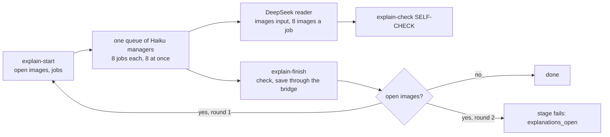

# Figure explanations: design

Status: built on branch `claude/figure-explain` of this repository and of the Scholar Archive (2026-11-05). Owner's request: every figure of a book has an explanation that a DeepSeek agent writes by looking at the image; no OCR text serves as an explanation; the explanation is stored in the Scholar Archive beside the original image; the figure module cites figures through it; a click on a figure in the GUI shows the text from the archive.

## 1. What is wrong now

MinerU writes a block after each image of a Markdown:

```


<details>
<summary>text_image</summary>

AL-SHAMMASIYYA
AL-RUSĀFA
Tsuch of Tāha
</details>
```

The summary line names MinerU's class. `natural_image` holds one English line a vision model wrote. `text_image`, `seal`, `bar` and others hold OCR of the text inside the picture: for a map, a list of place names with errors; for an Arabic manuscript, garbled letters. In scheiner2022baghdad 46 of 105 blocks are `text_image`.

Five places take this text or fail on it:

| Where | What happens |
|---|---|
| `prepare::chinese_blocks` | The whole `<details>` block enters `book.zh.md`, so Card writers read OCR as if it were the book's text. |
| `figures::caption_of` | The figure reader's list takes the two lines after the image. They are `<details>` and `<summary>…`, so most rows of `figures/list.md` say `<details> <summary>text_image</summary>` and give the reader no information. |
| `archive/artifacts.py::_caption` | The caption search reads lines inside the block; a line of OCR that starts with `Map` or `图` can become the caption. |
| `src/gui/document.rs` (reading page) | The block is shown as an open-able OCR text under each figure. |
| `showFigure` in `src/gui/app.js` | A click shows only the alt text (the label). The GUI has no explanation at all. |

## 2. Principles that decide the structure

- **The explanation belongs to the image, not to a digest.** It is a fact about one archive file, so it lives with that file and needs no Card, no run ledger and no book staging. It follows that one pass makes it, for a new book and for an old one alike.
- **The archive's Markdown is the record and is never rewritten** (`archive/artifacts.py`, the archive's `AGENTS.md`). No table holds artifacts. So the explanation is a new file beside the image; the `<details>` blocks stay in the Markdown, and every reader leaves them out.
- **One structure, no fallback.** One start, one queue of managers, one finish; the digest and the backfill run the same module. There is no OCR path kept as a fallback: a figure with no explanation fails the stage that needs one.
- **Scripts do deterministic work.** DeepSeek writes the text; a script checks it, saves it and carries it.
- **A resume reruns no finished work.** The archive is the record of what is done: the start step lists only the images that have no explanation for their current bytes.

## 3. Storage: a sidecar beside the image

For the image `<folder>/c921b.jpg`, the archive keeps `<folder>/c921b.jpg.explanation.json`:

```json
{
  "schema": 1,
  "path": "Books/Baghdad .../images/c921b.jpg",
  "image_sha256": "ebe51539…",
  "kind": "map",
  "title": "九世纪巴格达城区平面图",
  "explanation": "这是一幅……",
  "made_by": "deepseek-official/deepseek-flash",
  "made_at": "2026-11-05T12:00:00+00:00"
}
```

Why this is stable:

- It sits in `data/files/`, so `copy_tree` (the archive's move) carries it with the images. The file scanner takes only `.pdf` and `.md`, and the artifact code takes only image types, so the file adds no document, no artifact and no unused image.
- `image_sha256` binds it to the bytes. A replaced image makes the explanation stale, not wrong: every reader compares the hash.
- One small file per image needs no shared file, no merge and no database migration. A write is a temporary file and a rename.
- `kind` is one of `chart`, `map`, `photo`, `diagram`, `table`, `text`, `logo`, `other`. `logo` marks a publisher's mark, a seal, a barcode or an ornament; these get a short explanation and are not offered to the figure readers.

## 4. The connection

The owner's direction (2026-11-05): the ZET–Scholar Archive connection is put into use for this. The bridge has been read-only; it now has exactly one write action.

- `POST /bridge/v1/explanations` with `{file_id, items:[{path, image_sha256, kind, title, explanation, made_by}], overwrite?}`. The archive checks each item: the path is an artifact of that Markdown, the hash equals the file's bytes, the fields are in range. It writes only sidecars. It touches no database row, no Markdown and no image. A refused item is reported by name; the others are saved.
- `hello` now says `read_only: false` and `writes: ["explanations"]`. The bridge's other actions, its SQL authorizer and its read-tool list stay as they are.
- Reads use tools already on the bridge. `list_work_artifacts` adds `explanation` to each item. A new read tool `get_artifact_explanation {file_id, path}` reads one sidecar, for the GUI.
- ZET's side: `zt scholar explain-save <file-id> --in <json>`, the one writer; `zt-digest` calls it like the other `zt scholar` commands.

The scope is narrow on purpose: the same signature, the same pairing, and no other write can go through it.

## 5. The explanation pass

Module `zt-figure-explain` (no ledger, no Card, no zt write). It has one shape:



- **`zt-digest figures -Step explain-start -FileIds 95,1283 -Work <dir>`** keeps each document's figures (`zt scholar keep-figures`, which gives the bytes' hash and the file in ZET's store), takes the ones without a current explanation, and writes `jobs.json`, `jobs-NNN.json` (one file per manager) and one job file each. A job carries up to eight images of one document in reading order. Images below 3,000 bytes are not figures (`keep_figures`' existing rule).
- **The job file gives the book's title, each image's label and caption, and the book text around the image, with every `<details>` block removed.** OCR never reaches the agent, so it cannot copy it. The images themselves go through `deepseek_run`'s `images` input.
- **`explain-check` is the job's SELF-CHECK and the finish's gate.** It refuses an answer that names the wrong images, that uses an unknown kind, that is too short or too long, that is not mainly Chinese, or that repeats the image's OCR: the OCR text stays in the job's scope file, which the agent does not read, and an explanation of which half or more of the characters lie in runs of eight shared with the OCR is `ocr_copy`.
- **`explain-finish`** runs the same check on every answer, saves the good ones through the bridge, and answers `{ok, saved, open}`. The module repeats start, queue and finish once for what stayed open. When images stay open after that, the stage fails with `explanations_open`.

Conversations are deleted as DSMP requires. The manager prompt names the job's `images` field, and the approval rule allows only the `explain-check` command and JSON writes under the job's `out` folder.

Eight images per job, the most one `deepseek_run` takes (`images` has `maxItems: 8`): 317 figures across the 12 books need about 40 jobs and 5 managers. The owner asked for 6 to 15 images per job on 2026-11-05 to save tokens; the first backfill ran at four (83 jobs, 11 managers, no job failed). A larger job needs the bridge's limit raised first.

## 6. Where the pass runs

- **In a digest:** a new stage `figure-explain` right after `source` and before `prepare`, in mode full only. It takes the book through the same `resolve` the preparation uses. It stands before `prepare` so that `book.zh.md` is written once, with the explanations in it.
- **Standalone:** the workflow `zt-figure-explain`, args `{fileIds: [...]}`. It runs the same module over many documents in one queue. This is the backfill. It writes nothing but sidecars, so it needs no staging, no adoption and no Lock check, and a finished book is not rerun.

## 7. What each reader does

- **`prepare`** drops every `<details>` block that follows an image (`strip_converter_blocks`) and writes the explanation under the figure line: `图表说明（据图像）：……`. It is a source block like any other, so the Literature notes cover it. `<details>` that does not follow an image stays.
- **The figure stage**: `figures/list.md` rows read `- 7.8（地图）：图注 ｜ 图像说明：…`. A figure with no printed label joins the list under the id `F<number>` unless its kind is `logo`; a reader cites it like a label, and the Card shows it with its `title` as the alt text. `figures -Step plan` refuses with `explanations_open` when a kept figure has no current explanation: run the backfill first. The answer check and `read_answers` take these ids. `caption_of` leaves `<details>` blocks out.
- **Cards** keep ``. The explanation is not copied into a Card; the archive stays its one home.
- **The GUI click:** `showFigure` asks `/scholar/explanation/<file_id>?path=…` after `/api/artifact` names the source. The route runs on the document thread (a stopped archive blocks only that thread), reads `get_artifact_explanation` through the bridge, and answers the text only when `image_sha256` equals the Card's artifact. The overlay shows it under the caption, marked as coming from the Scholar Archive.
- **The reading page** leaves the `<details>` blocks out and shows each figure's explanation under it.
- **The portable export** has no archive, so `export` writes each figure's explanation into `cards.json`, and the portable GUI shows that copy. When the archive does not answer, the export goes without the texts.
- **The archive's own page** shows the explanation under each figure, and `_caption` skips `<details>` blocks.

## 8. Backfill

1. After the Donner run: deploy the archive and `zt`/`zt-digest`, install the workflows.
2. Run `zt-figure-explain` with the 12 books' Markdown file ids: 75, 61, 95, 101, 465, 603, 609, 800, 806, 1028, 1277, 1283.
3. Check that a second start lists no job and that `list_work_artifacts` shows an explanation for each kept figure.

No Card changes. A later `mode figures` of a book can use the new readers; that is the owner's choice per book, because it adds figures to Cards of a finished book.

## 9. What is left as it is

- The archive's Markdown keeps its `<details>` blocks, by the archive's rule.
- Cards of finished books that already quote OCR text stay as they are; §7 stops new ones.
- A paper that no digest reads has explanations only when `zt-figure-explain` runs on it.
