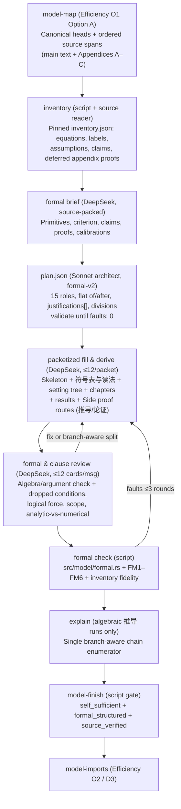

# Formal models (v2): handling high structural variance in economic theory — final proposal

Owner: Xingtong Chen

| Field | Value |
|---|---|
| **Status** | **Implemented on `main` (sole L2 formal design)** — `F1(a)`–`F8(a)` approved by Xingtong Chen on 2026-11-26 and implemented across `zt`, `zt-check`, `zt-digest`, GUI board badges, and `zt-post-digest` (`390da3cb` + post-digest completion). **Superseding implementation note:** the codebase adopted `level == Formal && form.is_none()` unconditionally as the sole Level 2 formal economic model design (excluding mathematical units carrying `form`), superseding the earlier `schema: "formal-v2"` version-marker rollout gate in §§11–12; optional `zt-theory-dialogue` remains separately qualified per `F7`. |
| **Date** | 2026-11-26 |
| **Repo baseline** | `main` at `cac3dabd` (`zt` 0.69.1, `zt-check` 0.22.1, `zt-digest` 0.64.7, `zt-econ-digest` 6.12.13) |
| **Archive & box evidence** | Scholar Archive (`archive_uuid` `16f6c458-09c3-4ef5-ab2e-e3741db0bf50`, 542 canonical Works with present Markdown; 25 classic & modern theory works inspected, 5 built as specimen plans) and live ZET archive (`D:/zt/zt.sqlite3`: 230 formal heads total, 166 economics formal heads outside `thompson1914calculus`, 4,542 filed economics formal parts) |
| **Design review** | Two-round architecture & specimen review with **Astra** (`gpt-6.2-astra`, effort `high`, standard tier; session `01a21914-b002-7e03-99ca-540a9d55ace0`) |
| **Chinese edition** | [formal-models-proposal.zh.md](formal-models-proposal.zh.md) (shared decision IDs `F1`–`F8`, role names, section numbering §0–§14, and rollout phases `P0`–`P6`) |
| **Related** | [Empirical models](empirical-models-proposal.md) (level 3), [Economics digest efficiency](econ-digest-efficiency-proposal.md) (`O1`–`O6`, `P2a`, `P2b-1`, `P2b-2`), [Model elaboration levels](model-elaboration-levels-design.md) (levels 1 and 2), [Self-sufficient models](self-sufficient-models-proposal.md), [Shared building blocks](model-shared-blocks-proposal.md), [Model board in blocks](model-board-blocks-proposal.md), [Model compiler v2](model-compiler-v2-proposal.md), [Workflow principles](agents/workflow-principles.md), [Job map](agents/digest-job-map.md), and the skills `zt-model-fold`, `zt-model-settings`, `zt-model-restructure`, `zt-model-import`, `zt-model-illustrate`, `zt-post-digest` |

---

## 0. Summary

ZET's empirical model architecture ([empirical-models-proposal.md](empirical-models-proposal.md), level 3) works cleanly because empirical economics papers have **low structural variance**: nearly every empirical paper shares one spine (`数据 → [假说] → 设计 → 规格：基准 → 章节`), a closed 20-role vocabulary, one deterministic anchor (`tables.json` cell fidelity), five card-format rules (`EM1`–`EM5`), and board badges that let a reader scan estimates at a glance.

**Formal economic models** (level 2, `formal`) have much **higher structural variance**. Across classic and modern economics literature, a formal model may be an unnumbered constructive signaling example (Spence 1973), a constrained optimal-taxation problem with necessary conditions and a numerical illustration (Mirrlees 1971), a cooperative Shapley-value property-rights model (Hart & Moore 1990), an axiomatic sufficient-statistics welfare representation (Arkolakis, Costinot & Rodríguez-Clare 2009), a nonlinear dynamical system analyzed by phase diagrams (Galor & Weil 2000), a nonparametric identification theorem for latent skill technologies (Cunha, Heckman & Schennach 2010), or a 256-Card two-country DSGE model with log-linearization, steady-state calibration, four policy regimes, and Appendix B proofs (Arro-Cannarsa 2026).

Because formal models were designed early (`zt 0.12.0`) with free-form facets and a flat main-line compiler, ZET currently suffers from **free-form facet drift** (361 distinct literal facet prefixes across 4,542 filed economics formal parts), **zero mechanical role or format checks** in `src/model.rs` and `zt-check`, **severe digest-to-post-digest impedance mismatch** (section-level model over-splitting and main-line-only derivation validation forcing 100–250 manual card moves per paper), and **weak source-claim grounding** (equation tags can match while hypotheses are dropped or necessary conditions are rewritten as sufficient).

This proposal upgrades **Level 2 economics formal models** (`schema: "formal-v2"`) by standardizing **three things** without imposing a rigid subfield outline: **(1) what counts as one canonical model**, **(2) how a reader moves from primitives and criteria to scoped claims and justifications**, and **(3) how each claim is checked against its pinned source**:

1. **Six nonexclusive claim/solution objects** (§4) that classify the logical and economic obligation a result must discharge (instead of a rigid subfield enum that forces every paper into one outline), plus crisp boundaries against Level 1 `concept`, `math_form`, and Level 3 `empirical`.
2. **A 15-role canonical `FormalRole` vocabulary** (§5) parsed from facet prefixes (shared between `zt-check` and `src/model/formal.rs`), including first-class **criteria** (`判据` / `均衡定义` / `解概念`), **benchmarks** (`基准`), **algebraic derivations vs. non-algebraic arguments** (`推导` vs. `论证`), **result-level boundaries vs. off-line model limits** (`边界` vs. `局限`), and **calibration vs. numerical experiments** (`校准` vs. `数值实验`), paired with a **multi-justification claim schema**, role-aware build faults, and version-gated card-format rules (`FM1`–`FM6`).
3. **A strict `formal-v2` constructor path** (§8) that plugs directly into the canonical ownership (`O1` Option A) and notation (`P2b-1`) architecture of [econ-digest-efficiency-proposal.md](econ-digest-efficiency-proposal.md), supplies the normative specification and test contract for branch-aware proof compilation (`P2b-2`) via flat `of`/`after` placement, and grounds every model in a **staged source inventory (`inventory.json`) + clause review**.
4. **Updated post-digest passes, board badges, optional formal dialogue, and staged migration** (§9–§11) so the digest builds reader-ready formal models on the first pass while keeping legacy models safe behind explicit version gating.

**Page-one release criterion:** a reader opening Arro-Cannarsa's Proposition 1 gets precisely its two claims and its own Appendix B proof; a reader opening Mirrlees's Theorem 1 sees both conditions, the cited rigorous proof, and the limited force of the printed heuristic; and a reader opening Cunha–Heckman–Schennach can follow the unnumbered step from an identified latent distribution (§3.3) to an identified technology (§3.4).

---

## 1. What this proposal read

| Source | What it gives |
| --- | --- |
| `CONTEXT.md` | Model Card, Model part, Model facet, Emphasis, Elaboration level (`concept`, `formal`, `empirical`), Math form (`theory`, `definition`, …, `corollary`), Build order, Derivation part/chain, Building block, Import, Self-sufficient model, Card-check policy |
| `docs/empirical-models-proposal.md`, `src/model/empirical.rs`, `tools/zt-check/src/empirical.rs` | the level-3 template: facet-prefix role parsing shared from `zt-check` to `src/model.rs`, build-report role faults, `EM1`–`EM5`, deterministic source extraction, board `badge()`, rollout phases, owner decisions |
| `docs/econ-digest-efficiency-proposal.md` | `O1` Option A pre-compile canonical ownership (`model_fragments` + book-level `model-map`), packetized single-queue compilation, `P2b-1` R6 notation-table move, `P2b-2` intuition-spine compiler upgrade, `O3` post-digest ordering |
| `src/model.rs`, `src/math.rs`, `tools/zt-digest/src/model/compiler.rs` | `test_plan` refusing Side derivations (`:1673`), `plan_chains` walking `main` only (`:1902`), `split` consulting `main` (`:3403, 3472`), `proof_chains` already reading Side chains (`:5128`), `child_value` calling `empirical::badge` and counting all descendants as `proof.steps` (`:1709`), `build_report` (`:2342–2402`) |
| `scripts/book-digest/model-architect.md`, `skills/zt-model-*/SKILL.md`, `docs/model-passes/*.md` | current formal architect prompt, post-digest skill rules (`fold`, `settings`, `restructure`, `import`, `illustrate`), and live rework logs (`arrocannarsa2026flight`, `ozhan2026monetary`, `bergin2026exchange`, `gomezcram2026government`, `hart1995firms`, `goldsmithpinkham2020bartik`, `deming2015growing`, `brandimarti2026reorganizing`) |
| Live ZET archive (`D:/zt/zt.sqlite3`) | 230 formal heads (4,865 filed parts), of which 64 belong to `thompson1914calculus` (36 without `math_form`, 28 with `math_form`) and **166 are economics formal heads** (4,542 filed parts, 1,593 `推导` parts, 361 distinct literal facet prefixes); compared against 132 empirical heads (4,740 filed parts, 168 prefixes) |
| Scholar Archive (`E:/google_scholar_archive/data/`) | 542 canonical Works with present Markdown; **25 classic & modern formal economics works** inspected in full structure across nine paradigms (§2), with line-numbered verification on five discriminating specimens (§6) |

---

## 2. What the archive shows: the real variance of formal economic models

### 2.1 Twenty-five classic and modern works inspected

All 25 works below resolve to present, linked Markdown files under `E:/google_scholar_archive/data/files/`. Work IDs identify the exact canonical Scholar Archive editions inspected (bracketed numbers are 1-based line numbers in the retained English Markdown).

| # | Work (ID) | Paradigm / Subfield | Principal claim object(s) | Structural features the constructor must preserve |
| --- | --- | --- | --- | --- |
| 1 | Spence (1973), *Job Market Signaling* (`26651`) | Signaling / information | Market equilibrium with beliefs; choice | **Zero numbered propositions**; §3 unnumbered critical assumption [L47]; §4 self-confirming belief fixed point over *observed* signals [L82–86]; §5 constructive numerical example (Table I, Figs II–III) proves multiplicity and welfare ranking [L93–179]; §6 immutable indices [L264] |
| 2 | Acemoglu, Makhdoumi, Malekian, Ozdaglar (2017), *Fast and Slow Learning from Reviews* (`304`) | Bayesian social learning | Law of motion & limiting object | Varying information environments (full history §4 vs. summary statistics §5); asymptotic learning vs. exponential learning speed (KL divergence Def. 1) require distinct Theorems 1–8; Appendix proofs [L881] |
| 3 | Board, Meyer-ter-Vehn, Sadzik (2026), *Recruiting Talent* (`28646`) | Screening & dynamic labor | Market equilibrium; dynamics | Explicit market clearing; screening order feeds welfare analysis; endogenous screening skill adds a dynamic layer |
| 4 | Gibbons & Waldman (1998), *Internal Labor Markets* (`28651`) | Symmetric learning & sorting | Allocation under two info regimes | §III full-information benchmark (Prop. 1) vs. §IV symmetric learning (Prop. 2 + Corollaries 2.1–2.4) share a job ladder; every result must name which information regime delivers it |
| 5 | Hart & Moore (1990), *Property Rights and the Nature of the Firm* (`26245`) | Incomplete contracts / property rights | Strategic allocation; choice optimum | First-best benchmark eq. (1) [L150–162]; coalition value $v(S,A\|x)$ + Shapley bargaining + control mapping $\alpha$ [L166]; Assumptions 1–6 [L113–144]; Propositions 1–12 + asset applications (1/2/3/many assets); Appendix A proofs [L692] |
| 6 | Aghion & Bolton (1992), *Incomplete Financial Contracting* (`2673`) | Financial contracting / control rights | Implementable strategic allocation | Timing figure [L49–65]; observable vs. verifiable distinction [L81–91]; renegotiation game [L146–158]; §III non-verifiable actions (E-control, I-control, contingent control) vs. §IV verifiable actions |
| 7 | Mirrlees (1971), *Optimum Income Taxation* (`29916`) | Mechanism design / optimal taxation | Constrained optimum (no market eq.) | **No market equilibrium**; individual IC (4) + planner problem (7)–(8); Assumption (B) monotonicity + boundedness [L338–342]; Theorem 1 (`iff` with **two** conditions, rigorous proof cited to `[4]` + printed heuristic (28)–(31) [L346–394]); Theorem 2 (7 clauses, **necessary** only, §3's 4 weaknesses [L325–336, 398]); §6 additive utility; §7 conjectural tail cases; §9 numerical illustration with Lydall $\sigma=0.39$ [L1284–1353] |
| 8 | Stole & Zwiebel (1996), *Intra-Firm Bargaining* (`29890`) | Bargaining / cooperative–noncooperative | Strategic allocation; representation | Successive characterizations in §2 (axiomatic stable profile → extensive-form SPE → continuous limit → Shapley value, Defs 1–3, Thms 1–4); the **equivalence** between characterizations is itself a theorem; §4 over-employment & frontloading; Appendix A proofs [L714] |
| 9 | Aghion & Howitt (1990), *Growth Through Creative Destruction* (`2669`) | Schumpeterian endogenous growth | Perfect-foresight equilibrium & paths | Continuous-time Poisson arrival + intermediate monopoly → 1st-order difference eq. (3.2) [L294]; Perfect Foresight Equilibria include stationary eq., no-growth trap, and **real 2-cycles** (Props 1–2 [L312, 424]); balanced growth, welfare, extensions (§§4–7) |
| 10 | Acemoglu & Restrepo (2018), *The Race Between Man and Machine* (`11`) | Task-based growth & automation | Static eq.; BGP; endogenous tech | §2 static task allocation (Props 1–3) feeds §3 exogenous-tech BGP (Props 4–5) feeds §4 endogenous automation/new tasks & saddle-path stability (Prop. 6, Assump. 1, 1′, 1′′, 2–4); Appendices A–B proofs [L961, 1390] |
| 11 | Galor & Weil (2000), *Malthusian Stagnation to Modern Growth* (`30053`) | Nonlinear macro dynamics | Law of motion & regime transition | §I micro optimization → §II piecewise dynamical system (17)–(18) across Malthusian Frontier $MM$ (19) [L391–442]; **phase diagrams** (Figs 3–6) carry global stability & regime-switch arguments, with explicit discrete-time caveat [L646] |
| 12 | Loury (1981), *Intergenerational Transfers* (`30042`) | Dynamic stochastic distribution | Recursive choice; invariant distribution | Household Bellman / consistent indirect utility (Thm 1 [L103]) induces Markov transition kernel $P$ (Def. 1 [L111]); unique invariant distribution $\nu^*$ (Def. 2, Thm 2 [L135, 151]); egalitarian tax partial ordering (Defs 3–4, Thms 3–5); §6 proofs citing Futia [L313–381] |
| 13 | Acemoglu (2007), *Equilibrium Bias of Technology* (`99`) | Monotone comparative statics | Multi-institution eq. & comparison | **Four institutional environments** (Economies D, C, M, O, Defs 1–4, Props 1–4 [L61–264]) reduced to optimization problems, then monotone comparative statics (relative, absolute, strong absolute bias, Defs 5–7, Thm 1+) without functional forms |
| 14 | Arkolakis, Costinot & Rodríguez-Clare (2009), *New Trade Models, Same Old Gains?* (`29896`) | Sufficient-statistics trade theory | Market eq. **and** welfare representation | Two macro restrictions (CES import demand (2) + gravity (3) [L153–171]) + explicit equilibrium conditions under perfect competition (§3.1) and monopolistic competition (§4.1) → welfare representation Lemma 1–2, Props 1–4; Appendices A–D proofs [L601] |
| 15 | Helpman, Itskhoki & Redding (2010), *Inequality & Unemployment in a Global Economy* (`29891`) | Trade + search + screening | Sectoral eq. & alternative GE closures | §2 Melitz + DMP search + Pareto screening → §§3–5 closed vs. open sectoral comparisons (Props 1–7) → §6 **three alternative GE closures** (outside sector RN, single sector RN, outside sector RA; Props 8–10 [L593–751]) |
| 16 | Wolthoff (2018), *Applications and Interviews* (`28648`) | Directed search & matching | Directed-search eq. + calibration | §2 environment, urn-ball queues, value functions → §3.1 explicit Equilibrium Definition [L293] → §3.2 ($A=1$, unique) vs. §3.3 ($A>1$, multiplicity region, Props 5–6) → §4 Calibration (exogenous params + matched moments [L457–507]); Appendix B proofs [L627] |
| 17 | Arro-Cannarsa (2026), *Flight to Safety* (`29954`) | Open-economy DSGE | Nonlinear eq.; linear approx.; policy experiments | Two countries, 3 assets, Calvo pricing → §3 nonlinear equilibrium [L357] → §3.1 13-eq/19-var → 17-eq/17-var log-linear system [L461–521] → §4 steady-state calibration (300 bp vs. 287 bp proxy, 1.0212% rate [L535–586]) → §5 ZLB/balance-sheet regimes & Props 1–4 [L720, 884] → Apps A–C proofs [L1331, 1371] |
| 18 | Ozhan et al. (2026), *Monetary Policy Under Network Bottlenecks* (`29957`) | Multi-sector NK / DSGE | Multiple models + empirical fit | 4 distinct models: §2 stylized 2-sector model, §3/§5/App A quantitative 2-region 11-sector DSGE + OLG, §6.1 closed-economy DC-index weighting experiment, and §4/§6.2 empirical shock extraction (2020Q1–2023Q4, 48 observables) |
| 19 | Bergin et al. (2026), *Exchange Rate Policy* (`29951`) | Open-economy DSGE w/ entry | Dynamic eq. + separate empirical panel | §3–§5 two-country DSGE with firm entry/exit and policy simulations (formal) vs. §2 45-country panel estimation (empirical) importing theory predictions |
| 20 | Gómez-Cram, Kung & Lustig (2026), *Financial Repression* (`29953`) | Macro-finance / fiscal-monetary | Monetary–fiscal eq. + wedge microfoundations | Baseline model with 4 determinacy regimes (Assumptions 1–5) + stochastic-duration variant; **two separate microfoundation models** (mandatory-holdings regulation §2.2.1–2, QE leverage constraint §2.2.3/C.1) supplying the repression wedge $\Omega$ |
| 21 | Acemoglu & Robinson (2000), *Why Did the West Extend the Franchise?* (`23`) | Dynamic political economy | Dynamic political equilibrium (MPE) | Dynamic commitment game, Assumptions 1–2, Prop. 1 under MPE [L68–116]; Appendix extends to **non-Markovian equilibria** [L333], changing the strategy space |
| 22 | Acemoglu, Egorov & Sonin (2015), *Political Economy in a Changing World* (`230`) | Dynamic institutional games | Markov Voting Equilibrium | Ordered transitions, increasing differences, winning coalitions, quasi-median voter (Assumptions 1–5, Defs 1–3 [L106–201]) → Lemmas 1–4, Existence Thm 1, Uniqueness Thm 2, Stochastic Thm 3 + counterexample Example 2 [L323]; Appendix proofs [L679] |
| 23 | Cunha, Heckman & Schennach (2010), *Estimating the Technology of Skill Formation* (`20270`) | Econometric identification + structural | Identification; choice optimum; empirical | §2 dynamic skill technology (2.1)–(2.5) + parental optimum (2.6)–(2.7) [L98]; §3 **three identification results**: Thm 1 [L235], Thm 2 [L283], and **unnumbered §3.4 technology identification** [L318] + §3.5 anchoring; external Econometrica proof supplement (A3.1–A3.2); §4 parametric MLE via nonlinear filtering on CNLSY/79 (2,207 children) |
| 24 | Goldsmith-Pinkham, Sorkin & Swift (2020), *Bartik Instruments* (`27318`) | Applied econometric theory | Representation; identification; empirical | 2SLS/GMM algebraic identity (Prop. 1), share-exogeneity identification, Rotemberg weight decomposition; separate empirical replication applications |
| 25 | Bordalo et al. (2025), *Ads as Cues* (`22485`) | Behavioral theory + empirical | Behavioral choice & testable predictions | §2 cued-memory similarity primitive (Assump. 1) → consumer demand → Props 1–3 [L177–212] (Appendix A proofs [L655]); §§3–5 empirical scanner-data tests importing the propositions |

### 2.2 Why formal variance is fundamentally higher than empirical variance

Empirical papers vary mostly in **identification design** (DiD, IV, RD, panel, experiment), yet all share the same evidentiary object (a point estimate with uncertainty produced by a specification on a data sample) and the same epistemic progression (data → design → baseline specification → estimates → tests & robustness).

Formal economic models vary along **four orthogonal dimensions**:

1. **What counts as a solution or claim object.** Mirrlees (1971) has no market equilibrium (it solves a constrained planner optimum); Cunha, Heckman & Schennach (2010) proves nonparametric identification of latent distributions and technology functions; Arkolakis et al. (2009) derives a welfare representation formula across a class of gravity equilibria; Loury (1981) proves existence and uniqueness of a Markov invariant distribution; Stole & Zwiebel (1996) proves equivalence across four characterizations (axiomatic, extensive-form SPE, continuous, Shapley).
2. **How claims are stated and justified.** Spence (1973) has zero numbered propositions and establishes existence and multiplicity through a constructive example and feedback diagrams; Galor & Weil (2000) argues global regime transitions via phase diagrams with an explicit discrete-time caveat; Mirrlees (1971) pairs a cited rigorous proof (`[4]`) with a printed heuristic under stronger differentiability assumptions for the very same Theorem 1; Acemoglu (2007) uses lattice/monotone comparative statics without functional forms; Arro-Cannarsa (2026) combines nonlinear equilibrium, log-linearization, steady-state calibration, and four Appendix B proofs.
3. **Where the model's scope branches.** Some models compare institutional environments (Acemoglu 2007: Economies D, C, M, O), some vary policy regimes or constraints (Arro-Cannarsa: ZLB, balance-sheet rules; Gómez-Cram: 4 monetary–fiscal regimes), some compare information structures (Gibbons–Waldman: full info vs. symmetric learning; Acemoglu et al. 2017: full history vs. summary stats), and some nest alternative general-equilibrium closures (Helpman et al. 2010 §6).
4. **How the source physically lays out the model.** In almost every classic theory paper, setup, statements, and intuitions live in §§2–5 while proofs, auxiliary lemmas, and full nonlinear systems live in Appendices A–C (or even an external online supplement, as in Cunha–Heckman–Schennach 2010).

### 2.3 What every formal economic model still shares

Despite that variance, the 25 papers obey **four universal content obligations**:

1. **Question & claim object:** what economic or econometric question the model asks and what kind of answer it seeks.
2. **Primitives & maintained scope:** the agents, choices, technologies, preferences, timing, information, assumptions, notation, and variant/regime restrictions.
3. **A criterion for what counts as an answer:** an equilibrium definition, a solution concept / refinement, an optimization program, a stability/implementation rule, a dynamical law, or an identification criterion.
4. **Scoped claims with explicit justifications:** one or more results (numbered or unnumbered), each stating its exact conditions/scope, its logical force, why it holds economically, and how it is justified (local algebraic derivation, non-algebraic argument/construction/diagram, cited external proof, heuristic, numerical experiment, or explicitly unproved).

Three papers discriminate sharply between good and bad architectures: **Spence (1973)** defeats mandatory numbered propositions; **Mirrlees (1971)** defeats mandatory market equilibrium; **Arkolakis et al. (2009)** defeats mutually exclusive subfield buckets ("axiomatic" vs. "equilibrium"). Together they prove that ZET must **place obligations at the level of the claim while keeping shared primitives at the level of the model**, never letting a subfield label dictate a paper's outline.

---

## 3. What ZET does with formal models today — live box audit

### 3.1 Live population (read-only audit of `D:/zt/zt.sqlite3`)

Counting each filed Model part once under its nearest ancestor Model Card (excluding extra memberships acquired via imports):

| Live population | Heads | Filed parts | Facets beginning `推导` | Distinct literal prefixes before `：` or `:` |
| --- | ---: | ---: | ---: | ---: |
| All heads marked `formal` (or `NULL` without `math_form`) | 230 | 4,865 | 1,704 (35.0%) | 374 |
| Formal heads outside `thompson1914calculus` (**economics cohort**) | **166** | **4,542** | **1,593 (35.1%)** | **361** |
| Heads marked `empirical` (level 3) | 132 | 4,740 | 0 | 168 |

Two immediate structural facts emerge from this census:

1. **`thompson1914calculus` accounts for 64 formal heads** (36 without `math_form`, 28 with `math_form`). Therefore `level == formal && math_form == null` is **insufficient** to identify economics models; formal-v2 rules must target positively identified economics trees (`literature_type == 'economics'`) and an explicit constructor schema version.
2. **361 distinct literal facet prefixes** across 4,542 filed economics formal parts (more than double the empirical prefix count on a smaller part corpus) create a severe retrieval, checking, and UI-rendering problem — not because 361 distinct intellectual roles exist, but because formal facets are unconstrained.

### 3.2 Concrete faults found on the live box and in code

**P1. Section-level model over-splitting and appendix detachment.** Because group writers create Model Cards independently per section group, the econ digest splits a single theory paper across **6 to 20 formal Model Cards**: `arrocannarsa2026flight` emitted 20 formal heads (folded to 1 model of 256 parts), `ozhan2026monetary` emitted 15 formal heads (folded to 3), `gomezcram2026government` emitted 15 formal heads (folded to 3), `jones2009burden` still holds 9 formal heads (with Appendix A proofs detached as a separate 15-part Model Card `14|a`), `akcigit2025transformative` holds 10, `acemoglu2018innovation` holds 8 (splitting §§I.A–C, I.D–F, I.G–I), and `chatterjee2012spinoffs` holds 6. Post-digest Stage 1 (`zt-model-fold`) must strip, mask, park, retype, and move dozens of heads by hand. *(Addressed structurally by `O1` Option A in [econ-digest-efficiency-proposal.md](econ-digest-efficiency-proposal.md).)*

**P2. Compiler-to-post-digest structural contradiction in Rust.** `zt-model-restructure` requires an intuition spine (`设定 → 第 k 章 → 结果 → 推导链` as Side branches under each result) and `zt-model-settings` requires a separate notation Card (`<head>|a|a`, `符号表与读法`). Yet today:
- `tools/zt-digest/src/model/compiler.rs:1673` (`test_plan`) **hard-refuses any Derivation part off `main`** (`a Derivation part stands on the main line`);
- `compiler.rs:1902` (`plan_chains`) and `:1923` (`plan_derivation_chains`) scan `main` only;
- `compiler.rs:3403, 3472` (`split`) looks up continuations on `main` only;
- `src/model.rs:2353` (`build_report`) skips `"side"` entries when computing `build.chains`, forcing `compiler.rs:5128` (`proof_chains`) to reconstruct Side chains separately after restructuring;
- `tools/zt-check/src/check.rs:1059` and `src/gate.rs:1094` still read the setting card itself (not `<head>|a|a`) for R6 Term tables.

As a result, the digest still emits flat chains on `main` with symbol tables embedded in the setting card (15 long live economics formal models ≥10 parts remain flat without chapters, e.g., `klepper2010disagreements/2|a`, `hellmann2011circulation/2|a`, `akcigit2023happened/5|a`, `klette2004innovating/3|a`; 63/166 lack a `符号表与读法` Card), and every restructured paper requires massive hand surgery (e.g., `arrocannarsa2026flight` Stage 2 ran 40 batch operations renaming 252 Cards, plus 6 restated `前提：` appendix cards kept only to preserve display formulas).

**P3. Free-form facets and zero formal-role checks.** Unlike `src/model/empirical.rs` and `tools/zt-check/src/empirical.rs` (`EM1`–`EM5`), ZET has **no `FormalRole` enum**, **no formal build-report role faults**, and **no `FM` card-format rules**. Even restructured live models mix result facets (`结果`, `命题`, `引理`, `推论`, `结论` in 27 models), mix `局限` placements (63 economics formal `局限` parts split into 21 off-line, 41 Side, 1 main), and leave 89 economics formal heads without a literal `**为什么**` section on their result parts. Furthermore, `tools/zt-check/src/empirical.rs:97` cannot parse parenthesized assumption labels such as Mirrlees's `假设 (B)`.

**P4. Missing first-class criteria, non-algebraic arguments, and calibration/experiment roles.** In real economic theory, the **equilibrium definition / solution criterion** is the hinge between primitives and results, yet ZET gives it no role (`均衡定义` appears only 8 times and `均衡条件` 7 times across 4,542 parts). Non-algebraic proofs (Spence's constructive example, Galor–Weil's phase diagrams) are forced into `推导：` (which demands `to` as a math equation) or ad-hoc `机制`/`例子` parts. Calibration tables and numerical experiments (54/166 models have simulations/numerical examples) lack structured provenance distinguishing assigned values, externally estimated parameters, and moment-matched values.

**P5. Equation-only fidelity misses logical and conditional drift.** A formal Card can copy every display equation byte for byte and still misstate the theorem: dropping one condition (e.g., Arro-Cannarsa Prop. 3's **"separately"** clause on private vs. government foreign positions, or Mirrlees Thm. 1's second condition $0 \le z_n < n$), turning a **necessary** condition (Mirrlees Thm. 2) into a sufficient characterization, turning **existence** into uniqueness, turning a **local** linearized result into a global claim, or presenting a **numerical** exercise as an analytic theorem.

**P6. Unaware GUI board rendering.** `src/model.rs:1709` (`child_value`) calls `empirical::badge` unconditionally by facet/body and counts **every descendant** of a child as `proof.steps` — meaning a `边界`, `例示`, or `基准` filed under a result inflates its proof count, while formal results show no statement badge, regime/case tag, or external-proof distinction.

---

## 4. The formal model (v2): claim objects and boundaries

### 4.1 Six nonexclusive claim objects (replacing rigid subfield templates)

Instead of a closed `FormalFamily` enum that forces every paper into a fixed subfield outline, a `formal-v2` model declares **one or more claim objects** (`claim_objects`) for its principal question (and, where a chapter or result shifts objects, on that chapter or result). Each object defines **what a reader must be able to recover** — a content obligation, not a mandatory chapter count.

| Object (`claim_object`) | 中文 | What the reader must be able to recover | Representative papers |
| --- | --- | --- | --- |
| `choice-optimum` | 最优选择 | Decision maker, choice variables, objective/ordering, feasible set, and whether the result states necessary conditions, sufficient conditions, or a characterization | Mirrlees 1971; Cunha–Heckman–Schennach §2 |
| `strategic-allocation` | 策略与配置 | Players or coalitions, feasible actions/allocations, information/verifiability, and the deviation, stability, bargaining, or implementation criterion | Hart & Moore 1990; Aghion & Bolton 1992; Stole & Zwiebel 1996 |
| `market-equilibrium` | 市场均衡 | Candidate prices, quantities, policies, or beliefs; whose choices must be consistent; what clears; and which expectations/beliefs must be self-confirming | Spence 1973; Acemoglu 2007; Helpman et al. 2010; Wolthoff 2018; Arro-Cannarsa 2026 |
| `dynamics-limit` | 动态与极限 | State variables, law of motion / transition, initial or boundary conditions where material, and the exact target (fixed point, invariant distribution, convergence, or rate are four distinct claims) | Aghion & Howitt 1990; Galor & Weil 2000; Loury 1981; Acemoglu et al. 2017; Acemoglu & Restrepo 2018 |
| `representation-comparison` | 表示与比较 | Objects being related, domain, maintained restrictions, and what property the identity, equivalence, or comparative-statics ordering preserves | Arkolakis et al. 2009; Goldsmith-Pinkham et al. 2020; Acemoglu 2007 |
| `identification` | 识别 | Observables, latent target object, admissible structures, normalizations, and what equality of observable implications lets one recover (complete before any estimation) | Cunha, Heckman & Schennach 2010 §3; Goldsmith-Pinkham et al. 2020 |

**Optional descriptive metadata (never structural):** `family_tags` (e.g., `signaling`, `incomplete-contracts`, `optimal-taxation`, `dsge`, `directed-search`, `political-economy`, `econometric-theory`, `behavioral`) and concise qualifiers (time structure, uncertainty/information, mode of argument) may be recorded on the Model Card for search and discovery. They **never** impose required chapters or trigger build faults.

### 4.2 Proposed glossary refinement for `CONTEXT.md`

> **Formal model** (updated for `formal-v2`): A model of Elaboration level 2. The source builds an economic or econometric object and establishes claims from stated primitives, maintained restrictions, and an explicit criterion (an equilibrium definition, solution concept, optimization problem, dynamical law, or identification criterion). Its justification may be an algebraic derivation chain (`推导`), a verbal, constructive, or diagrammatic argument (`论证`), a cited external proof, a heuristic, or a numerical experiment (`数值实验`). A `formal-v2` economics model uses the 15 canonical formal roles, keeps its notation card at `<head>|a|a`, files proofs beneath their results as Side branches, and separates source attribution, logical force, and evidentiary status.

### 4.3 Operational boundaries

| Boundary | Operational decision |
| --- | --- |
| **Level 1 `concept`** | The source supplies a verbal mechanism, typology, framework, or cited model without building and checking formal claims. **Spence (1973) is Level 2**, not Level 1: it defines a self-confirming equilibrium and constructs/checks equilibria; the absence of numbered propositions never demotes a model to Level 1. |
| **Level 2 economics `formal`** | The source constructs an economic or econometric object and establishes claims from stated primitives, restrictions, and a criterion. Constructive examples, phase-diagram arguments, and illustrative numerical solutions can justify claims inside Level 2. |
| **`math_form` (mathematical units)** | Used when the reading unit is a standalone mathematical `definition`, `axiom`, `lemma`, `theorem`, `proposition`, or `corollary` (a math textbook or reusable mathematical tool). A theorem inside an economics paper stays a `结果：` part of its economic model; when an economic proof uses a reusable math unit in the box, it cites that unit's Model Card as a `Cited premise` (`CONTEXT.md`). |
| **Level 3 `empirical` (`structural` / `measurement`)** | Any exercise that estimates parameters or extracts shocks from its own data via moments, likelihood, or an estimating system — or builds and validates a measurement system on data — is Level 3 (`empirical`) and imports the formal model (`整块` for structural estimation; `单卡` for a tested prediction). An assigned parameter, an externally cited estimate used as input (`校准：`), or an illustrative policy simulation (`数值实验：`) stays inside Level 2. Fitted-moment exercises near the boundary must state explicitly what the source claims to learn from observations. |
| **Theory + empirical test in one paper** | Two models joined by imports (`Bergin 2026`, `Bordalo et al. 2025`, `Cunha–Heckman–Schennach 2010`, `Ozhan et al. 2026`). A theory and its empirical estimation/test are never folded together. |

---

## 5. The anatomy of a formal-v2 model

### 5.1 The 15 canonical roles (`FormalRole`)

As with `EmpiricalRole`, `FormalRole` is **never stored** as a separate database column: it is parsed deterministically from the facet prefix in `tools/zt-check/src/formal.rs` and re-exported into `src/model/formal.rs`. The general open ZET facet contract remains unchanged for human-authored and legacy models; strict canonical role validation applies only to versioned economics constructor output (`schema: "formal-v2"`).

| # | `FormalRole` | Canonical facet prefix(es) | Typical line / placement | What it owns | Primary rests-on |
| --- | --- | --- | --- | --- | --- |
| 1 | `Setting` | `设定` (`设定：…`) | `main` (first: `<head>|a`) and its Side branches | Setting root and economic setting blocks (agents, sectors, timing, information, technologies, policy rules, named variants/regimes) | Primitive (`原始设定`) or earlier setting blocks |
| 2 | `Notation` | `符号表与读法` | first Side of `<head>|a` (`<head>|a|a`) | Model's single notation & term entry: symbols, meanings, domains where material, first-use Card Link, multi-meaning notes, imported notation bindings (`沿用 … 的全部符号`), term table (`术语 \| 不用`) | `<head>|a` |
| 3 | `Assumption` | `假设` (`假设：…`, `假设 k`, `假设 (B)`, `假设 A1′`) | Side inside the setting tree beside the block it restricts | Maintained restriction with exact source label (if any) and explicit scope (base vs. variant/regime) | The setting block it restricts |
| 4 | `Definition` | `定义` (`定义：…`) | Setting tree (if primitive) or chapter Side (if constructed from earlier results) | Primitive or derived object definition (e.g., KL divergence, composite linearization parameter, frontload factor) | Setting or earlier results it builds from |
| 5 | `Criterion` | **`判据`**, **`均衡定义`**, **`解概念`** (three canonical display spellings for one role) | Setting tree (if stated in primitives) or chapter Side (if using a derived representation) | What qualifies a candidate as a solution: `均衡定义：两国竞争均衡`, `解概念：子博弈精炼均衡`, `判据：最优所得税配置`, `判据：非参数可识别性` | Setting blocks, assumptions, definitions it binds |
| 6 | `Chapter` | `第 k 章` (`第 k 章：…`) | `main` (after `<head>|a`) | One stage or economic mechanism in plain language (intuition spine), directing the reader to its results | Earlier chapter(s) and the setting/variant blocks it activates |
| 7 | `Benchmark` | `基准` (`基准：…`) | Chapter Side (derived benchmark, e.g., first-best allocation, no-signaling wage $2-q_1$) or setting branch (benchmark restrictions) | Economically meaningful reference case (first best, full info, frictionless, Hulten benchmark) | Setting / criterion it evaluates under benchmark restrictions |
| 8 | `Result` | `结果` (`结果：…`, preserving source kind & label: `结果：命题 1 …`, `结果：定理 2 …`, or unnumbered claim) | Chapter Side (`of: <chapter>`) | A source claim (numbered or unnumbered): exact scoped statement, conditions, logical force, intuition (`为什么`), and `justifications[]` | Its `Criterion` (where applicable), `Assumption`s, earlier results, and its proof route |
| 9 | `Derivation` | `推导` (`推导：…`) | Side proof branch under a `Result` (or `Benchmark`) | Checkable symbolic/algebraic step or chain (`from`/`to` math, `MaxSteps` cap, `思路`/`起点`/`步骤`/`结果`/`解读`, `explain` refresh) | Premise settings, assumptions, earlier results, or prior proof step |
| 10 | `Argument` | `论证` (`论证：…`) | Side proof branch under a `Result` (or `Benchmark`) | Non-algebraic justification: verbal proof, constructive example establishing existence/multiplicity, or graphical/phase-diagram argument (`目标`/`依据`/`论证`/`结论`) | Premise settings, assumptions, figures, earlier results, or prior proof step |
| 11 | `Boundary` | `边界` (`边界：…`) | Side of a `Result`, `Assumption`, or `Criterion` | Hypothesis role / necessity, counterexample, special case (`特例`), approximation limit, or scope caveat qualifying a specific claim | The claim, assumption, or criterion it qualifies |
| 12 | `Calibration` | `校准` (`校准：…`) | Chapter Side (or dedicated calibration chapter) | Parameter values or mappings used to solve the model, with units, targets/sources, and explicit per-parameter provenance (`assigned`, `external-estimate`, `moment-matched`) | Setting blocks and imported empirical `估计：` (if any) |
| 13 | `Experiment` | `数值实验` (`数值实验：…`) | Chapter Side | Quantitative simulation, impulse response, policy counterfactual, comparative-statics sweep, or numerical illustration; names baseline, change, outcome, and numerical source | `Calibration` (or parameterization) and the model case/equilibrium it simulates |
| 14 | `Example` | `例示` (`例示：…`) | Side of a `Result` or `Chapter` | Pedagogical or numerical example that *illustrates* a result (an example that *proves* existence/multiplicity is an `论证：` card) | The result it illustrates |
| 15 | `Limits` | `局限` (`局限：…`) | `off` (Side of Model Card) | Whole-model scope limitations and abstractions (matching empirical `局限：`) | Setting / criterion |

**Parser & naming rules:**
- `FormalRole::Criterion` accepts **`{判据, 均衡定义, 解概念}`** (leaving `规划` outside the alias set, because `规划` ambiguously names a problem, an algorithm, or a computed solution).
- `FormalRole::Assumption` accepts bare `假设`, alphanumeric labels (`假设 1`, `假设 A2`, `假设 1′`), **and** a single balanced ASCII or full-width parenthesized source label (`假设 (B)`, `假设：(B) …`, `假设（A1）`), while rejecting non-assumption compounds such as `假设前提`.
- Legacy aliases (`命题`, `定理`, `引理`, `推论`, `结论`, `数值例子`, `例子`, `条件`, `均衡条件`) are recognized **read-only** for legacy audits and migration diagnostics, never emitted by a `formal-v2` constructor.

### 5.2 The build order: setting dependency tree + intuition spine + proof routes

```
Model Card (formal-v2)
├── <head>|a  设定 (Setting root: primitives & scope)
│     ├── a   符号表与读法 (Notation & terms card; R6 reads here)
│     ├── b   设定：<economic block 1> (e.g., agents / timing / info)
│     │     ├── a  假设 <label>：…
│     │     └── b  定义：… / 均衡定义：… (if stated purely in primitives)
│     ├── c   设定：<economic block 2> (e.g., firms / assets / market clearing)
│     └── d   设定：变体一 / 体制：… (named variant/regime scope, with its own 假设)
├── <head>|a|1  第 1 章：<economic mechanism in plain words>
│     ├── a   基准：… (if derived benchmark precedes comparison)
│     ├── b   结果：<source kind + label + claim>
│     │     ├── a      推导：… (or 论证：…) → a|1 推导：… → a|2 论证：…  [bound proof route]
│     │     ├── b      边界：… (hypothesis role / counterexample / approximation limit)
│     │     └── c      例示：… (pedagogical example)
│     └── c   定义：… / 判据：… (if constructed from chapter results)
├── <head>|a|2  第 2 章：…   (with **分部** divisions on head when ≥ 5 chapters)
│     └── …   (including 校准：… and 数值实验：… chapters where quantitative)
└── <head>|b  局限：… (off-line whole-model limits)
```

Key structural principles:
- **Short models stay short.** The four obligations of §2.3 need not inflate a short model into artificial chapters: a short model (< 5 results on one mechanism) may state its criterion in the setting tree and use one chapter (or direct results), while a long model uses chapters and `**分部**` (2–5 reading divisions when ≥ 5 chapters).
- **Group large settings by economic dependency, not by Card type.** In a 250-Card DSGE model, organize `<head>|a`'s children into economic blocks (shared timing/assets, H country, F country, equilibrium criterion, approximation/steady-state anchor, baseline & policy-regime variants) with each assumption filed beside the block it restricts. Keep `wide` (> 7 children) advisory so eight clean independent primitives are never hidden under empty wrapper headings.
- **Separate reading order from proof direction.** The reader meets `第 k 章` → `结果` → `推导`/`论证` branch. The chapter links its results as navigation (`结果：[[…]]`), never as premises. The result names its proof route (and may rest on the route's endpoint under the existing Card format). The first proof step rests on the settings, assumptions, definitions, and earlier results it actually uses; it names the current result as its **goal** (`目标`), never as a premise (preventing circularity).
- **Proof routes vs. algebraic chains (crucial Rust unification):**
  - **`proof.steps`** counts Cards on a result's **bound proof route** (both `推导` and `论证` Cards). A `边界`, `例示`, or `基准` Card filed under a result contributes **zero** proof steps unless a proof Card rests on it.
  - **`build.chains`** counts **maximal contiguous algebraic runs** (`推导` Cards) along any main-line (legacy) or Side-branch proof route. A mixed route `推导 → 论证 → 推导` has **3 proof steps** and **2 one-Card algebra runs**. Alternative proofs have separate branch roots. One chain enumerator becomes authoritative for both `src/model.rs` and `zt-digest`, eliminating duplicate explanation passes.
- **Attention (`core` emphasis):** `core` stays an attention marker. A decisive proof move (crux step) may carry `emphasis: core` on a `推导` or `论证` Card with a sentence stating the key idea. Do **not** import `src/math.rs`'s 3-core cap across a 250-Card economics model; instead apply emphasis sparingly per chapter and highlight the paper's main results in the Model Card's `**主要结果**` table.

### 5.3 The multi-justification claim schema (separating kind, force, and justification)

Round 2 testing on Mirrlees (1971) and Spence (1973) exposed a critical design requirement: **a single `logical_strength` or `proof_status` field conflates four orthogonal facts** (e.g., Mirrlees Theorem 1 has *both* an external rigorous proof `[4]` *and* a local printed heuristic under extra differentiability assumptions; `welfare` is a subject, `numerical` is a method, `constructive` is an argument form, `iff` is logical force).

Every `Result` Card and plan entry therefore separates three explicit attributes:

1. **Source identity:** `source_kind` (`proposition` | `theorem` | `lemma` | `corollary` | `unnumbered`) + optional verbatim `source_label` (`Proposition 1`, `Theorem 2`, or `null` when unnumbered).
2. **Logical force** (`logical_force`, where applicable): `necessary` | `sufficient` | `iff` | `existence` | `uniqueness` | `existence-uniqueness` | `characterization` | `comparative-statics` | `equivalence` | `identification` | `conjecture` | `numerical-finding`. An author-stated conjecture stays `conjecture` even if a reviewer finds it plausible.
3. **`justifications[]` (list of 1+ entries):** each entry specifies:
   - `force`: `proof` | `constructive` | `diagrammatic` | `heuristic` | `illustration` | `numerical` | `conjectural` | `omitted`;
   - `location`: `local` (bound to a Side route root Card or named inline section) | `external` (cited outside reference or unpinned supplement, e.g., Mirrlees `[4]` or CHS A3.1/A3.2) | `supplied` (explicitly marked `补写`, pointing to printed premises and endpoint);
   - `ref`: route root plan ID / address, external citation locator, or source span;
   - `extra_assumptions` (optional): any stronger conditions added by that specific justification (e.g., Mirrlees (28)–(31) adding twice-differentiability to Theorem 1).

### 5.4 Card formats

All formats follow ZET's low-working-memory rule (claim first, plain language, formulas preserved byte for byte, one format per role, no `本模型`).

**Model Card (`formal-v2`)**

```markdown
**问题**
One or two sentences: the economic or econometric question.

**目标对象与标签**
- 对象：market-equilibrium；choice-optimum   (1+ of the 6 claim objects)
- 标签：signaling、information-economics   (optional descriptive tags)

**原语与判据**
Two to three sentences: core agents/environment, maintained scope, and the equilibrium or solution criterion (with Link to the primary `判据` / `均衡定义` / `解概念` card).

**主要结果**
| 结果 | 逻辑力度 | 作用域 / 条件 | 依据状态 |
| --- | --- | --- | --- |
| [[结果：命题 1 …]] conditional proportionality | characterization | 固定便利资产供给；泰勒原理 | 附录 B 证明（3 步） |
(at most five to seven headline claims carrying the paper)

**引入**
(explicit `单卡` / `整块` imports of blocks from other models, if any)

**结构**
(two-level main line: setting tree, chapters)

**分部**
(2–5 reading divisions when ≥ 5 chapters)

**关联**
Comparisons / correspondences / empirical tests to other models (`对照`, `对应`, `检验`).

来源：[[key]] §n
```

**`判据：` / `均衡定义：` / `解概念：` (Criterion card)**

```markdown
一句话：what object this criterion defines and what makes a candidate valid.

**起点**
- 依赖 [[设定：…]]：the primitives and spaces entering the criterion.

**判据**   (or **均衡定义** / **解概念**)
1. 候选对象：the exact tuple of prices, quantities, strategies, policies, beliefs, or latent distributions.
2. 必须满足的条件：numbered list (optimality, feasibility/clearing, belief consistency over observed signals, no-Ponzi, normalization, etc.) with original display equations and `\tag{n}`.

**作用域**
Which regime, strategy class (e.g., Markov vs. history-dependent), or information structure this criterion covers.

**说明**
Pointers to chapters/results that establish existence, uniqueness, or characterization under this criterion.

来源：[[key]] §n
```

**`结果：` (Result card — upgraded for `formal-v2`)**

```markdown
One sentence: the economic claim in plain words, matching the source's exact logical strength.

**陈述**
- 出处与力度：命题 1（原文 §5.2）；力度：characterization。
- 条件与作用域：依赖 [[假设 1]]、[[假设 2]]；在 [[均衡定义：…]] 与 [[设定：基准]] 下成立。
The exact statement with original formulas and equation numbers.

**为什么**
One to three sentences of economic intuition: the mechanism, binding constraint, or mathematical reason the claim holds.

**依据**
- 局部证明：附录 B 证明见 [[推导：…]] 起（3 步）；依赖 [[推导：最后一步]]。
- （若另有启发式或外部引用）启发式推导：见 [[推导：…]]（额外假定二阶可微）；严格证明见原文引证 [4]。

来源：[[key]] §n；证明见附录 B
```

**`论证：` (Non-algebraic argument card)**

```markdown
目标：one sentence naming the claim this argument establishes (never a premise).

**依据**
- 依赖 [[设定：…]]、[[假设：…]]、[[判据：…]]：each premise once.

**论证**
Structured verbal, constructive, or graphical/phase-diagram argument (inline equations and figure links allowed; if a figure is cited, state exactly what the reader must read off it).

**结论**
What this step establishes and how it closes (or hands off to the next proof Card).

来源：[[key]] §n
```

**`校准：` (Calibration card) & `数值实验：` (Numerical experiment card)**
- **`校准：`** lists `**起点**` (setting blocks), `**参数与出处**` (Markdown table `| 参数 | 含义 | 取值 | 单位/频率 | 来源类型 | 目标或出处 |` with per-row provenance `assigned` / `external-estimate` / `moment-matched`, linking imported `估计：` cards where applicable), and `**映射说明**` (recording discrepancies such as 287 bp empirical proxy vs. 300 bp benchmark calibration).
- **`数值实验：`** opens with a one-sentence summary clearly marked as numerical, then `**实验设定**` (baseline `依赖 [[校准：…]]` + model case/regime + exact shock or parameter change), `**数值结果**` (reported numbers/IRFs/tables/figures with source spans), and `**边界**` (explicitly noting that the finding is conditional on the calibrated parameterization).

**Unchanged formats kept verbatim:** `设定：` / `假设：` (`**起点**` / `**设定**` or `**假设**` / `**直觉**` / `**说明**`), `符号表与读法` (`**怎样读卡片上的记号**` + block-ordered symbol tables with `首次出现` Links + `沿用` bindings + `**统一用语**`), `第 k 章：` (`**直觉**` 20+ char lead / `**本章结果**` / `**承上启下**`), and `推导：` (`目的` / `**思路**` / `**起点**` / `**步骤**` / `**结果**` / `**解读**`).

### 5.5 Three layers of checks: model graph, Card form (`FM1`–`FM6`), and source fidelity

Checks are strictly separated by what evidence is available at the time they run (an ordinary Card edit or portable export sees the Card and model graph, never the staging source inventory):

#### Layer 1: Model-graph faults in `src/model/formal.rs` (version-gated to `formal-v2` economics models)

| Fault | Trigger condition (blocking on `formal-v2` builds; reported, never enforced on human edits) |
| --- | --- |
| `formal_shape` | Main line does not start with `<head>|a` (`设定`), lacks `<head>|a|a` (`符号表与读法`, unless imported or bound by `沿用 … 的全部符号`), or holds zero `结果` parts |
| `setting_dependency` | A maintained `设定` or `假设` is filed under a chapter, or a setting card rests on a chapter result |
| `criterion_unbound` | A `Result` declares a criterion (or a model declares `market-equilibrium`, `strategic-allocation`, or `identification` as a primary object) with no reachable `Criterion` Card in members/imports |
| `result_unbound` | A `Result` has no source attribution or lacks any declared justification disposition (`local`, `external`, `supplied`, or `omitted`) |
| `proof_unbound` | A `Result` declares a `local` justification whose route root is missing, misfiled outside the result's Side branch, or disconnected (`Derivation`/`Argument` Card in no route or resting on the result as a circular premise) |
| `experiment_unbound` | A `数值实验` Card rests on no `校准` / parameterization and no model case/setting |
| `symbol_uncovered` | A symbol in a `设定` or `判据` display equation has no row in local or imported `符号表与读法` (promoted from `check-settings.mjs` into Rust, sharing the TeX symbol reader with `empirical.rs`) |

*Note:* `self_sufficient` keeps its exact existing graph meaning (`closure`, `reach_in`, `forward`, `unanchored`, `import_target`, `import_cycle`). Formal role cleanliness is reported alongside it as `formal_structured: bool` (parallel to `evidence_bound` on empirical models), and source-inventory verification is reported separately as `source_verified: "verified" | "stale" | "not_checked"`.

#### Layer 2: Card-form rules `FM1`–`FM6` in `tools/zt-check/src/formal.rs` (version-gated)

| Rule | Role(s) | Check | Severity |
| --- | --- | --- | --- |
| `FM1` | Model Card (`formal-v2`) | Has `问题`, `目标对象与标签` (≥1 valid claim object), `原语与判据`, `主要结果`, `结构` | block (v2) |
| `FM2` | `假设`, `定义`, `判据`/`均衡定义`/`解概念` | Has `起点` and content section (`假设`/`定义`/`判据`/`均衡定义`/`解概念`), plus `作用域` on `Criterion` and variant assumptions; rejects malformed or duplicate local labels | block (v2) |
| `FM3` | `结果` | Has `陈述` (with source identity/scope and logical force), `为什么`, and `依据` (explicit justification entries; a declared `local` justification links an existing route root, an `external` one names its locator) | block (v2) |
| `FM4` | `推导`, `论证` | `推导` keeps existing derivation rules (`目的`/`思路`/`起点`/`步骤`/`结果`/`解读`, math `to`, `MaxSteps`); `论证` has `目标`/`依据`/`论证`/`结论` (no mandatory math `to` or algebraic step cap) | block (v2) |
| `FM5` | `符号表与读法` | Valid symbol table rows (`符号 \| 含义 \| 首次出现`) or valid `沿用 [[…]] 的全部符号` binding, plus `统一用语` term table | block (v2) |
| `FM6` | `校准`, `数值实验` | `校准` states value + per-row provenance (`assigned` / `external-estimate` / `moment-matched`) + source/target; `数值实验` states baseline, change, outcome, and numerical status | block (v2) |

#### Layer 3: Digest source checks on pinned `inventory.json` (strict constructor gate)

| Fault | Trigger condition |
| --- | --- |
| `source_stale` | Source Markdown SHA-256 or file ID differs from pinned `inventory.json` |
| `anchor_invalid` | A plan `src` or `inventory_ref` points to a nonexistent span or wrong file |
| `printed_mismatch` | A copied display equation, `\tag{n}`, or literal printed label disagrees with the pinned source span |
| `ownership_conflict` | Two canonical models claim primary ownership of the same substantive source obligation |
| `obligation_unsettled` | An accepted claim, assumption, or proof in `inventory.json` has neither an owning Card nor an explicit disposition |

**What stays strictly advisory (never blocking):** wide setting tree (>7 siblings), long flat legacy model, vocabulary-inferred suspected missing equilibrium, excessive `core` emphasis, cross-regime symbol reuse documented in `符号表与读法`, ambiguous bare text matches, and legacy role aliases.

### 5.6 Side-by-side comparison: empirical (L3) vs. formal-v2 (L2)

| Dimension | Empirical model (Level 3) | Formal-v2 model (Level 2) |
| --- | --- | --- |
| Classification | 12 `design` types (closed list) | 6 nonexclusive `claim_objects` (obligations) + optional descriptive `family_tags` |
| Fixed role vocabulary | 20 `EmpiricalRole` prefixes (`zt-check/src/empirical.rs`) | 15 `FormalRole` prefixes (`zt-check/src/formal.rs`; `Criterion` accepts 3 spellings) |
| Setting foundation | `数据` + `变量表` + `设计` + `规格：基准` & variants | `设定` dependency tree + `符号表与读法` (`<head>|a|a`) + `假设` + `判据`/`均衡定义`/`解概念` + variant branches |
| Main line spine | Evidence spine: data → [hypothesis] → design → baseline spec → chapters | Intuition spine: setting → chapters (`第 k 章`, with `**分部**` when ≥ 5) |
| Headline children | `估计` / `参数` / `反事实` / `表 n` / `图 n` | `结果` / `基准` / `定义` / `校准` / `数值实验` |
| Justification branch | Evidence chain (`检验`, `图 n`, `换算`) | Bound proof route (`推导` algebraic chains + `论证` verbal/constructive/diagrammatic steps) + `边界` + `例示` |
| Deterministic anchor | `tables.json` + cell-level number fidelity | Pinned `inventory.json` (equations, labels, spans, hashes, deferred proofs) + **clause review** (dropped conditions, logical force, scope) |
| Build-report verdict | `evidence_bound` (`empirical_shape`, `estimate_unbound`, `spec_unbound`, `test_unbound`, `variable_uncovered`) | `formal_structured` (`formal_shape`, `setting_dependency`, `criterion_unbound`, `result_unbound`, `proof_unbound`, `experiment_unbound`, `symbol_uncovered`) + separate `source_verified` |
| `zt-check` rules | `EM1`–`EM5` | `FM1`–`FM6` (version-gated to `formal-v2` economics builds) |
| Board badges | Value `(s.e.)***`, table size, variant change | Claim label (`命题 1`), case/regime qualifier, proof route (`证明 B · 3 步`) or `外部证明` / `数值实验` |

---

## 6. Five worked specimens (verified against retained Scholar Archive sources)

These five specimens were audited line by line with Astra against the retained files in `E:/google_scholar_archive/data/files/` and serve as the P0–P5 acceptance fixtures.

### 6.1 Spence (1973), *Job Market Signaling* (`26651`) — unnumbered constructive argument

- **Claim objects:** `["market-equilibrium", "choice-optimum"]` · **Tags:** `signaling`, `information-economics`
- **Setting tree (`<head>|a`):**
  - `设定：雇主不确定雇佣、求职者信号与不可变指标` (§2–§3, L21–46)
    - `符号表与读法` (`<head>|a|a`)
    - `假设：信号成本与生产率负相关` (§3 unnumbered critical assumption, L47–50; source wording preserved; "single crossing" kept as scoped explanatory gloss)
    - `均衡定义：信号均衡` (§4, L82–86: employer conditional beliefs confirmed by realized productivity **over the signals actually observed** — never strengthened to unobserved signals)
    - `设定：两群体数值环境（表 I）` (§5, L95–105: Group I prod 1 cost $y$ share $q_1$; Group II prod 2 cost $y/2$ share $1-q_1$)
    - `设定：变体：不可变指标（性别等）` (§6, L264–275)
- **Main line:**
  - `第 1 章：信号均衡的存在、多重性与福利排序（§5）`
    - `基准：无信号时的混同工资 $2-q_1$` (derived expectation resting on Table I; filed *before* the welfare comparison)
    - `结果：一族分离均衡（$1 < y^* < 2$）` (`source_kind: "unnumbered"`, `logical_force: "sufficient"` establishing existence & multiplicity under Table I + threshold schedule; endpoints involve indifference and §5 constructs other equilibria at L183, so never over-claimed as full characterization)
      - `论证：阈值工资使两组自我选择` (ONE Card showing optimal-choice inequalities $1 > 2-y^*$ and $2-y^*/2 > 1$ inline + Figures II–III closing the feedback loop, L127–151; "最优选择/激励约束", not "无套利")
      - `边界：本例中教育不提高生产率（脚注 6）` (scoped to this example, since §5 L262 later allows productive education)
      - `边界：个体稳定不排除联盟偏离（脚注 5）` (L163)
    - `结果：分离均衡的帕累托排序与无信号对比` (distinguishes fixed-$y^*$ comparison $y^* < 2q_1$ from general-linear-cost **existence** of a favorable equilibrium $q_1 > a_2/a_1$, L153–179) → `推导：两群体净收益比较`
    - *(Remaining §5 equilibria at L183+ receive explicit owning Cards or recorded dispositions in a full plan.)*
  - `第 2 章：不可变指标分割信号均衡（§6）`
    - `结果：能力与成本分布相同的两群体可在指标下陷入不同均衡` (L266–350) → `论证：…`

### 6.2 Mirrlees (1971), *Optimum Income Taxation* (`29916`) — clause-review fixture

- **Claim objects:** `["choice-optimum"]` (attaching `strategic-allocation` only to the explicit implementability question) · **Tags:** `optimal-taxation`, `mechanism-design`
- **Setting tree (`<head>|a`):**
  - `设定：异质能力 $n$、偏好 $u(x,y)$ 与可行配置 (1)–(3)` (§2, L51–83)
    - `符号表与读法` (`<head>|a|a`)
    - `判据：最优所得税配置问题` (binds individual maximization (4), attained utility (5), welfare objective (7), feasibility (8), and assumption (A) on choice multiplicity, L85–95, L147)
    - `假设 (B)：单交叉与矩形有界条件` (§4, L338–342: preserves **both** increasing $V(x,y)=-yu_2/u_1$ in $y$ for $x>0$ **and** boundedness on rectangles; tests the upgraded parenthesized assumption parser)
    - `设定：变体：可加效用（§6）` and nested functional/distributional specializations only where §§8–9 introduce them
- **Main line:**
  - `第 1 章：激励相容与可实现性（§2, §4）`
    - `结果：命题 1 存在不工作能力门槛 $n_0 \ge 0$` (L97; explicitly allows $n_0 = 0$) → `推导：…`
    - `结果：命题 2 可实现配置可由单调右连续 $c'$ 实现` (L115, 141; starts from an allocation already implementable under an upper semicontinuous $c$; notes $c'$ is a constructed function, not a derivative)
    - `结果：定理 1 激励相容的充要条件` (`source_label: "Theorem 1"`, `logical_force: "iff"`, requires **both** non-decreasing $z_n$ on $n>0$ **and** $0 \le z_n < n$ for all $n>0$, L346–350). **`justifications[]` has TWO entries:**
      1. `{force: "proof", location: "external", ref: "Mirrlees [4]"}` (rigorous proof)
      2. `{force: "heuristic", location: "local", ref: "<推导：可微情形二阶条件>", extra_assumptions: "z_n 可微、c 二阶可微"}` (eqs. (28)–(31), L368–394, preserving zero-work caveat and global-maximization gap)
  - `第 2 章：最优所得税的必要条件（§3–§5）`
    - `结果：定理 2 最优所得税的七条必要条件 (32)–(40)` (`logical_force: "necessary"`, **all seven clauses** through (40), distinguishing points of increase, bunching intervals, and discontinuities, L398+; external rigorous proof `[4]`)
      - `边界：§3 启发式变分推导的四项弱点` (L325–336, filed with §3 and linked from Theorem 2)
    - `结果：命题 3 实际发生收入上的税负函数 $wz-c(z)$ 非递减` (L475)
  - `第 3 章：可加效用与尾部特征（§6–§7）`
    - `结果：命题 4` (L507) + scoped §7 tail results (explicitly preserving **conjectural** status where the paper conjectures, and case-dependent limiting rates — never flattened to an unqualified "zero top marginal rate", L601+)
  - `第 4 章：数值例示（§8–§9）`
    - `校准：§9 参数设定与来源` (per-row provenance: unit normalizations `assigned`, illustrative comparison values `assigned`, $\sigma = 0.39$ from Lydall's figures `external-estimate`, L1284–1353)
    - `数值实验：近似线性最优税表` (`logical_force: "numerical-finding"`, explicitly scoped to §9's parameterized exercises)

### 6.3 Arro-Cannarsa (2026), *Flight to Safety* (`29954`) — large DSGE & Appendix B proofs

- **Canonical ownership:** 1 formal head (consolidating the 20 legacy formal heads) + 2 separate empirical heads (`§4.2` Swiss convenience-yield measurement; `§5.6` 2008Q3–2009Q2 acute-phase comparison).
- **Setting tree (`<head>|a`):** grouped into 6 economic blocks (avoiding the legacy 14-sibling flat pile):
  1. `符号表与读法` (`<head>|a|a`)
  2. `设定：时间、三类资产与调整成本` (with `假设：外国政策债券无便利服务`, `假设：二次调整成本`)
  3. `设定：H 国部门` (household preferences (1), budget (2), differentiated demand (8), price index (9), Calvo pricing (10), gov budget (13))
  4. `设定：F 国部门` (foreign household & gov budget (14), (17))
  5. `均衡定义：两国非线性竞争均衡` (§3, L357–359: candidate sequences, optimization, gov budgets, five market clearings (24)–(28); no-Ponzi attached where invoked, e.g., C.7 [L1543])
  6. `设定：稳态锚定、一阶近似与政策体制变体` (base point & approximation choice; baseline AR(1) $\theta^*$ shock + `变体一：ZLB` + `变体二：资产负债表规则` + `变体二之一：储备支持` + `变体三：永久外逃` + `变体四：有限期外逃`)
- **Main line (4 `**分部**` divisions):**
  - *Part 1 部门最优与均衡* (H/F optimality, UIP wedge, derived nonlinear aggregate demand/CA, log-linearized system: **13 equations in 19 variables** before policy closure → **17 equations in 17 unknowns** after closure [L461–521]; A.1 expenditure minimization and A.2 Calvo Phillips curve absorbed directly as Side proof routes of their main-text results)
  - *Part 2 稳态与基准校准* (`校准：稳态识别` distinguishing the **287 bp** empirical proxy imported `单卡` from `§4.2` vs. the **300 bp** benchmark calibration and **1.0212%** annual policy rate [L535–586]; `数值实验：基准外逃冲击脉冲响应`)
  - *Part 3 解析命题与政策体制* (Propositions 1–4 each owning their exact Appendix B proof branch):
    - `结果：命题 1 固定供给与泰勒原理下国内块的条件比例性` (`src: L720–727`, `proof_src: L1331–1349` — stopping before L1351's Prop. 2! Preserves fixed convenient-asset supply, Taylor principle, and $\nu/(1-\nu)$ scaling given inflow & tradable-consumption paths) → Side `推导` branch (with crux step `emphasis: core`)
    - `结果：命题 3 资产腿中性` (`src: L884–887`, `proof_src: L1371–1373` — clause review enforces $\psi=0$, the word **"separately"** on private vs. government foreign positions, and both implications while keeping the liability leg active)
    - Explicit owners for Propositions 2 and 4 and distinct Appendix A.3 / C.5 / C.7 / C.8 contributions (no duplicate `前提：` restatement cards)

### 6.4 Ozhan et al. (2026), *Monetary Policy Under Network-Level Bottlenecks* (`29957`) — canonical ownership fixture

Under `O1` Option A `model-map`, the book resolves upfront to the **4 owner-approved canonical heads** (instead of 22 fragmented heads):
1. **Stylized 2-sector bottleneck model** (§2, `formal-v2`).
2. **Quantitative 2-region 11-sector DSGE + Appendix A OLG** (§3, §5, App. A, `formal-v2`; imports the stylized feedback rule `单卡`).
3. **DC-index weighting experiment** (§6.1, `formal-v2` — own policy question and closed-economy, flexible-wage, frictionless-mobility, undistorted-steady-state benchmark [L1235]).
4. **2020Q1–2023Q4 shock extraction & counterfactual decomposition** (§4, §6.2, `empirical`, 48 observables/quarter [L923] — imports the quantitative DSGE `整块`).

### 6.5 Cunha, Heckman & Schennach (2010), *Estimating the Technology of Skill Formation* (`20270`) — identification–estimation boundary

Resolves cleanly to **2 canonical heads**:
1. **Formal model (`formal-v2`, `claim_objects: ["identification", "choice-optimum"]`):**
   - §2 dynamic cognitive/noncognitive skill technology (2.1)–(2.5) + CES specialization + **parental optimal investment ratio (2.6)–(2.7)** [L98] (the concrete owner of `choice-optimum`).
   - §3 linear/nonlinear latent factor measurement system (3.1)–(3.7) + `判据：非参数可识别性`.
   - **Three explicit identification results:** `结果：定理 1` (linear repeated-measurement joint latent density, L235, with conditional-mean, independence, existence & nonvanishing provisos), `结果：定理 2` (general nonlinear distribution of $\theta$ under conditions (i)–(v), L283), and **`结果：技能形成技术函数的非参数识别（§3.4，未编号）`** [L318] — explicitly distinguishing statistical scale normalization from §3.5's substantive anchoring in adult outcomes. Proofs A3.1–A3.2 carry `{force: "proof", location: "external", ref: "Econometrica online supplement A3.1–A3.2"}` until a pinned supplement enters the build.
2. **Empirical model (`empirical`, `design: "structural"`, §4):**
   - Imports the formal model `整块` (with precise `依赖` Links on `规格：` and `参数：` to the technology and identification results they consume), adds CNLSY/79 sample (**2,207 firstborn white children** [L519]), **parametric maximum likelihood** (implemented via nonlinear filtering), parameter estimates, and §4.3's fitted social-planner schooling/crime counterfactuals [L749].

---

## 7. How formal-v2 models talk to other models

ZET already has the exact machinery needed (`**引入**` for premises, `RelationKind` for non-premise links, `Model neighbour` for readers). No new `RelationKind` is added.

| Relation | Direction & placement | Mechanism | Evidence required |
| --- | --- | --- | --- |
| Reuses a setting, block, or whole model | Borrower Model Card `**引入**` + part `**起点**` | `单卡` or `整块` import (`rests-on`) | Exact target part/model + symbol binding (`沿用` or rename) |
| Supplies a microfoundation | Receiving model imports derived wedge/object (`Ozhan`, `Gómez-Cram`) | `单卡` / `整块` import (`依赖`); prose says "提供微基础" | Exact derived object and where it enters receiving model |
| Calibrated by an empirical estimate | Formal `校准：` Card | `单卡` import of `估计：` (if in box) or `参照 [[Cited Card]]` | Value, unit, and any mapping adjustment (e.g., 287 bp → 300 bp) |
| Tested by or structurally estimated by an empirical model | Empirical `假说：` (`单卡` of `结果：`) or structural Model Card (`整块` of formal head) | Empirical model imports formal model; formal model never folds empirical in | Exact prediction or technology/identification block consumed |
| Uses a reusable pure-math theorem | Formal `推导：` / `论证：` Card | `Cited premise` (`依赖 [[math unit head]]`) | Statement-level citation only (never `reach_in`) |
| Cross-book theory comparison (`特例`, `放宽`, `对应`, `对照`) | Written on the relevant `结果：`, `判据：`, or `边界：` Card (**never** on the Model Card, avoiding false shares) | Existing `RelationKind` (`specializes`, `relaxes`, `corresponds`, `contrasts`) | Must pass the directional evidence bar of §9.5 |

---

## 8. The constructor workflow (strict) and coordination with the efficiency proposal

### 8.1 Explicit division of labor with `docs/econ-digest-efficiency-proposal.md`

There is **one** implementation, **one** job-map update, and **one** qualification record across both proposals:

- **[econ-digest-efficiency-proposal.md](econ-digest-efficiency-proposal.md) owns the pipeline mechanics:** P0 correctness fixes, `O1` Option A pre-compile canonical ownership (`model_fragments` + deferred `note_bindings` + book-level `model-map`), packetized single-queue compilation (≤12 parts/packet, per-model state, `D5`/`D6`), `P2b-1` coordinated notation Card + R6 lookup (`tools/zt-check/src/check.rs:1059`, `src/gate.rs:1094`), `O2` shared import engine, `O3` post-digest ordering (`literature-organize` before `illustrate`), and `O5` budget challengers.
- **This proposal (`formal-models-proposal.md`) owns the Level 2 economics domain specification and serves as the normative specification and test contract for `P2b-2`:** claim objects, 15 `FormalRole`s, `inventory.json`, `formal-v2` `plan.json` (flat `of`/`after` + multi-justification schema), branch-aware proof compilation/splitting/explanation, clause review, `src/model/formal.rs`, `FM1`–`FM6`, GUI formal badges, and legacy migration.

### 8.2 The `formal-v2` constructor flow



### 8.3 Staged source inventory (`inventory.json`)

The formal counterpart to empirical `tables.json` is a **staged source inventory** (`<model>/inventory.json`) pinned to `(work_id, file_id, file_sha256)`. It combines **deterministic script extraction** with **source-reading identification** (following the owner's established math-digest precedent in `docs/agents/digest-job-map.md`):

- **Script extracts deterministically:** every display math block, printed `\tag{n}` / `(n)`, explicit headings (`Assumption`, `Definition`, `Lemma`, `Proposition`, `Theorem`, `Corollary`, `Proof of …`), exact line spans, and verbatim excerpts/fingerprints, scoped by `(file_id, section_path)` so restarted numbering never collides.
- **Source-reading job identifies meaning:** unnumbered claims (Spence §5, CHS §3.4), unnumbered assumptions (Spence §3), where conditions begin and end, deferred appendix proofs (Arro-Cannarsa Prop. 1 `L720–727` ↔ `L1331–1349`), external proof citations (Mirrlees `[4]`, CHS A3.1–A3.2), and multi-claim proofs.
- **Script validates accounting:** every accepted item in `inventory.json` must have a valid span/hash and either an owning plan part or an explicit recorded disposition (`obligation_unsettled` otherwise).

### 8.4 The `formal-v2` `plan.json` wire format (flat `parts[]` with `of` and `after`)

Keep `parts[]` flat and extend placement with **one field: `after`**, mutually exclusive with `of` on `line: "side"` parts:

- A Side **branch root** carries `line: "side", of: "<parent_id>"` (allocated as `<parent>|a`, `|b`, … in plan-array order).
- A **Direct continuation** inside a Side branch carries `line: "side", after: "<prev_side_id>"` (allocated as `<prev>|1`, `|2`, … — matching `zt-model-restructure`'s exact Folgezettel tree!).
- `rests` continues to express intellectual dependence (`依赖`). A filing edge (`of` or `after`) never by itself licenses a premise Link; the current writer hint that defaults `of` to `illustrates` (`compiler.rs:2470`) is suppressed for `formal-v2` placements.

```json
{
  "schema": "formal-v2",
  "model": "Key/3|e",
  "level": "formal",
  "claim_objects": ["market-equilibrium", "dynamics-limit"],
  "family_tags": ["open-economy-dsge", "monetary-policy"],
  "inventory": "inventory.json",
  "title": "两国便利收益外逃模型：便利资产供给与货币政策传导",
  "card": "问题：…；原语与判据：…；主要结果：命题 1–4。",
  "symbols": [["$\\nu$", "稳态便利收益份额", "S0"], ["$\\psi$", "资产调整成本参数", "S_A"]],
  "terms": [["便利收益", "流动性溢价"]],
  "divisions": [{"name": "第一部分 设定与均衡", "start": "S0"}, {"name": "第二部分 政策体制与命题", "start": "C8"}],
  "parts": [
    {"id": "S0", "line": "main", "facet": "设定", "title": "设定：H 与 F 两国、三类资产与时序", "src": ["s02.md:141-164"]},
    {"id": "N",  "line": "side", "of": "S0", "facet": "符号表与读法", "title": "符号表与读法：本模型的符号与术语", "src": ["s02.md:141-164"]},
    {"id": "SH", "line": "side", "of": "S0", "facet": "设定：H 国部门", "title": "设定：H 国家庭、厂商与政府", "src": ["s02.md:165-270"]},
    {"id": "HP", "line": "side", "of": "SH", "facet": "设定：家庭偏好", "title": "设定：H 国家庭偏好 (1)", "src": ["s02.md:165-190"]},
    {"id": "HB", "line": "side", "of": "SH", "facet": "设定：家庭预算", "title": "设定：H 国家庭预算约束 (2)", "src": ["s02.md:191-215"]},
    {"id": "EQ", "line": "side", "of": "S0", "facet": "均衡定义：两国竞争均衡", "title": "均衡定义：两国非线性竞争均衡 (24)–(28)", "src": ["s03.md:357-390"]},
    {"id": "C8", "line": "main", "facet": "第 8 章：便利收益与区制依赖", "title": "第 8 章：固定供给下便利收益决定国内块的条件比例性", "rests": [["EQ", "在竞争均衡与线性系统下分析"]], "src": ["s05.md:694-736"]},
    {"id": "R1", "line": "side", "of": "C8", "facet": "结果：命题 1 区制依赖", "emphasis": "core",
     "title": "结果：命题 1，固定供给与泰勒原理下国内响应按 ν/(1-ν) 缩放",
     "inventory_ref": "claim:prop1", "source_kind": "proposition", "source_label": "Proposition 1",
     "logical_force": "characterization", "criterion": "EQ", "assumptions": ["A_fix", "A_tp"],
     "justifications": [{"force": "proof", "location": "local", "ref": "D1"}],
     "src": ["s05.md:720-727"]},
    {"id": "D1", "line": "side", "of": "R1", "facet": "推导：便利收益楔子代入", "from": "(39)–(43)", "to": "$$\\hat{y}_t = \\dots$$", "steps": 5, "src": ["appB.md:1331-1338"]},
    {"id": "D2", "line": "side", "after": "D1", "facet": "推导：解出国内通胀与产出", "emphasis": "core", "to": "$$\\hat{\\pi}_{N,t} = \\frac{\\nu}{1-\\nu}(\\dots)$$", "steps": 6, "src": ["appB.md:1339-1345"]},
    {"id": "W3", "line": "side", "after": "D2", "facet": "论证：条件比例性与泰勒原理唯一性", "spec": "结合泰勒原理排除爆炸解，得出给定路径下的比例性结论", "src": ["appB.md:1346-1349"]}
  ],
  "explain": [{"chain": ["D1", "D2"], "route": "先用固定供给消去便利资产数量，再在泰勒原理下解出国内块的唯一有界解。", "parts": [{"id": "D1", "shows": "…", "notes": "", "meaning": "…"}, {"id": "D2", "shows": "…", "notes": "关键一步：按 ν/(1-ν) 提公因子", "meaning": "…"}]}],
  "source_review": [], "source_faults": [], "notes": []
}
```

### 8.5 Five implementation invariants for branch-aware compilation (`P2b-2`)

1. **Mutually exclusive placement.** Every new `side` part supplies **exactly one** of `of` or `after`. An `after` target must be a local `side` part of the same model. Reject cycles, missing IDs, and two Direct continuations of the same predecessor.
2. **Stable identity on resume.** Resolve plan IDs before writes and use native successor/insert/rename operations. A valid existing continuation keeps its `card_id` on resume; an unrelated Card occupying the Direct slot triggers insertion/rebase or a placement fault (never silently skipping to a free slot).
3. **Single source of truth.** Parse `FormalRole` from `facet`. Derive route root, position, proof owner, and algebra-run boundaries from placement plus the result's `justifications[]`. No redundant author-written `proof_of`, `chain_prev`, or `chain_pos` fields.
4. **Middle-of-branch split preservation.** Splitting `D2` in `D1 → D2 → W3` (or `D1 → D2 → D3`) preserves `D2`'s first `card_id`, inserts `D2b` before `W3`, re-points downstream premises to the split piece establishing the old endpoint, preserves clause coverage and chart targets, and refreshes only affected explanations. *(Must be tested on both mixed `推导→论证` and pure `推导→推导` Side branches!)*
5. **Versioned head metadata for offline / portable recovery.** Persist an explicit `formal-v2` marker on the model's authored metadata (or head/export) and keep justification locators and status inside Result Cards so the portable GUI renders routes and badges without staging, while legacy heads retain their existing contract.

### 8.6 Clause review (catching what equation checks miss)

Formal review (`≤ 12` Cards per message, with source spans from `inventory.json`) adds an explicit **clause checklist** alongside algebraic verification:

- **Condition completeness:** every hypothesis, parameter restriction, regime qualifier, and exception word (e.g., *"separately"*, *"for observed signals"*, *"on incomes that occur"*) in the source claim appears in the Card's `**陈述**`.
- **Logical force fidelity:** `necessary` never upgraded to `sufficient` or `iff`; `existence` never upgraded to `uniqueness`; `local` (linearized / interior) never upgraded to `global`; `conjecture` never upgraded to `theorem`; `numerical` never upgraded to analytic theorem.
- **Justification honesty:** an external citation (`[4]`, online supplement) or printed heuristic is never presented as a complete local proof; extra assumptions introduced by a heuristic are explicitly labeled.

---

## 9. Post-digest passes (flexible) and optional formal dialogue

Because a `formal-v2` digest builds canonical models directly into the setting tree + intuition spine + Side proof branches + `<head>|a|a` notation card, post-digest passes shift from **250-move structural surgery** to **light editorial judgment and cross-model integration**, keeping the revised order of `O3` (`fold → settings → restructure → import + explain → literature-organize → illustrate`):

1. **`zt-model-fold`:** On `formal-v2` books built with `O1` Option A `model-map`, fold becomes a verification/override check (verifying canonical ownership decisions and handling edge cases or externally supplied appendix extensions). Legacy pre-v2 books keep the full fold workflow (using `fold-apply.mjs`).
2. **`zt-model-settings`:** Recognizes the 15 `FormalRole`s, parenthesized assumptions (`假设 (B)`), `Criterion` cards (`判据`/`均衡定义`/`解概念`), and economic-block grouping in large setting trees; aligns its symbol check with `src/model/formal.rs`'s `symbol_uncovered`.
3. **`zt-model-restructure`:** Updates `check-network.mjs` and `card-formats.md` to recognize `FormalRole::Result`, `Benchmark`, `Calibration`, `Experiment`, `Argument`, and `Boundary` (eliminating false "empty chapter" advice on calibration/simulation chapters, and validating `**陈述**`/`**为什么**`/`**依据**`).
4. **`zt-model-import`:** Preserves `单卡`/`整块` semantics, handles `校准：` importing empirical `估计：` Cards (`单卡`), and uses the single unified branch-aware `explain` chain enumerator.
5. **Optional `zt-theory-dialogue` (separate post-import pass, outside the first release gate):**
   - Mirrors `zt-evidence-dialogue`'s discipline while guarding against the far lower selectivity of theory terms ("equilibrium" matches hundreds of unrelated models).
   - **Placement rule:** dialogue Links go on the relevant `结果：`, `判据：`, or `边界：` Card — **never** on the Model Card (preventing legacy false shares).
   - **Candidate sources:** explicit source citations (`Cited Cards`), existing imports, and `zt-term-sync` equivalent Terms qualified by shared claim object — never raw word overlap.
   - **Directional evidence bar (plus mandatory abstention):**
     - `特例` (narrower → general): parameter restriction or primitive mapping + recovered result.
     - `放宽`: exact weakened/removed assumption + retained assumptions + surviving/changed conclusion.
     - `对应`: explicit map between named objects + preserved property + scope.
     - `对照`: shared question/outcome + exact difference in information, institution, or criterion.
     - `微基础`: handled by `**引入**` + `依赖` when actual reuse occurs, with "提供微基础" in prose (no new `RelationKind`).
   - **Dedup & cadence:** record accepted/rejected pairs by stable endpoint `card_id` + statement hash (never bare address), run cross-book shelf dialogue only after owner-requested `zt-term-sync`, and distinguish *"0 candidates (missing Term sync)"* from *"candidates reviewed, 0 supported"*.

---

## 10. GUI model board: formal badges and accurate proof counts

Following the attention-first desk principles of [model-board-blocks-proposal.md](model-board-blocks-proposal.md) and empirical P5 (`docs/mockups/empirical-board.html`), `src/model.rs` dispatches board badges by the **owning model's level and form** (including imported blocks), rather than calling `empirical::badge` unconditionally:

1. **Result strip badge (3 pieces of ink, zero fabricated verdicts):**
   - **Claim label:** `命题 1`, `定理 2`, `引理 1`, or `未编号` (from verified `陈述`).
   - **Case / scope tag:** short qualifier such as `固定供给` or `线性近似` (when scoped to a regime/variant).
   - **Justification stamp:** actual local bound proof count (`证明 · 3 步`, clicking opens the branch), or `外部证明 [4]`, `启发式 · 2 步`, `数值实验`, `原文未证`. **Never** show a green "proved" checkmark that overstates what software verified.
2. **Accurate `proof.steps`:** For `formal-v2`, `child_value` counts only `Derivation` and `Argument` Cards on the result's bound proof route (not `边界`, `例示`, or `基准` siblings).
3. **Criterion, Calibration & Variant badges:**
   - `判据`/`均衡定义`/`解概念` shows its claim-object tag (e.g., `均衡定义`).
   - `校准` shows parameter count + provenance summary (e.g., `12 参数 · 2 外部估计`).
   - `数值实验` shows `数值` + case/regime tag, visually distinct from analytic theorems.
   - Variant setting cards show their scope diff (e.g., `变体 · ZLB`), mirroring empirical specification variants.
4. **Head stamp:** Displays `model · L2 形式` with optional concise `family_tags` once on the Model Card, keeping the Focus view, chapter tabs, `分部` strip, and folded stacks unchanged. Mockups first before any GUI build (owner rule).

---

## 11. Rollout, migration, and acceptance (`P0`–`P6`)

### 11.1 Legacy migration policy (166 economics formal heads)

Legacy heads (no `formal-v2` marker) keep their existing contract and write-gate legacy ratchet:
- Recognize canonical roles read-only, accept legacy aliases (`命题`, `结论`, `数值例子`, etc.), report unclassified facets as advice, and display missing v2 fields as `unknown` — **zero new blocking faults** on legacy economics models, empirical models, or math units.
- Migrate legacy books **only on copied boxes first, one book at a time, on the owner's word**, preserving `card_id`s, display formulas and their destinations, imports, Links, Connection-tree mounts, and chart `data-zt` targets.
- For the 63 legacy `局限` parts (21 off, 41 Side, 1 main), provide a read-only placement audit rather than bulk-moving them, since deciding whole-model `局限` vs. claim-level `边界` requires reading.

### 11.2 Phased rollout (aligned with `econ-digest-efficiency-proposal.md`)

Preserves the efficiency proposal's first two **paid** pilots (**Bergin** for canonical ownership, **Bedford** for dialogue) while making **Spence** and **Mirrlees** the first **offline formal-schema** fixtures:

| Phase | Scope & Efficiency alignment | Pilot / Fixture | Acceptance gate |
| --- | --- | --- | --- |
| **P0** | Freeze evidence, fixtures & owner decisions (`F1`–`F8`) | Pin the 5 specimen editions (`Spence`, `Mirrlees`, `Arro-Cannarsa`, `Ozhan`, `CHS`) + independently reviewed required claims, clauses, appendix pairings, ownership tables, and **seeded negative controls** (Spence endpoints, Mirrlees missing 2nd condition, Arro-Cannarsa overlong proof span & missing *"separately"*, CHS omitted §3.4) | Decisions `F1`–`F8` recorded; baseline copied-box outputs and costs logged |
| **P1** | Roles, `FM1`–`FM6`, `src/model/formal.rs` & `inventory.json` in shadow mode | Offline fixtures: **Spence** & **Mirrlees** | All 15 roles + 3 `Criterion` spellings + `假设 (B)` parse cleanly; inline/cited/mixed/heuristic justifications pass; **every seeded negative control is caught** by its check or clause reviewer; **zero new blocking faults** on the 166 legacy economics models, 132 empirical models, and math units |
| **P2** | Canonical ownership & notation (`Efficiency P2a` + `P2b-1`) | **Bergin** (paid ownership pilot), **Goldsmith-Pinkham §VI** (zero-seed recall), **Ozhan** (4 heads), **CHS** (2 heads) | Exact canonical head counts; zero duplicate heads/bindings on allocation replay; local & imported `<head>|a|a` pass identical R6 lookup in CLI and write gate |
| **P3** | Branch-aware proof compilation (`Efficiency P2b-2`, normative contract here) | Small specimens, then **Arro-Cannarsa Appendix B** | Plan, stored tree, board, and `explain` agree on route root, order, owner, and algebra-run count; interrupt & resume after allocation, during a **middle-of-branch split** (both mixed `推导→论证` and pure `推导→推导`), and before receipt publication yields identical `card_id`s, Links, formulas, and zero duplicate explanations |
| **P4** | Complete full-scale `formal-v2` build | **Arro-Cannarsa** whole paper on copied box | All 4 propositions paired with their own Appendix B proofs; each accepted appendix obligation has 1 owner; measured (287 bp) vs. assigned (300 bp) calibration values distinguished; both empirical heads survive; independent clause reading finds zero lost conditions; measure total tokens/CNY and wall time **through post-digest acceptance** vs. baseline |
| **P5** | Reader UX, GUI mockups/badges & cross-level acceptance | **Ozhan** & **CHS** (+ optional `zt-theory-dialogue` on adjudicated +/- pairs) | Owner approves GUI mockups first; board shows exact local step counts and distinguishes external evidence; CHS empirical model opens formal identification inputs cleanly; dialogue produces zero repeat judgments after pure renames |
| **P6** | Staged legacy adoption | Read-only census over the 166 economics formal heads, then selected copied books one by one | Verified `card_id`, formula-destination, mount, and chart-target invariance; restorable `VACUUM INTO` snapshot; idempotent second pass; paired quality/cost report before switching default constructor |

---

## 12. Approved owner decisions (`F1`–`F8`)

On **2026-11-26**, Xingtong Chen approved all eight recommendations **`F1(a)`–`F8(a)`**. The decisions below are locked as the normative contract for `formal-v2` implementation (`P0`–`P6`):

| ID | Decision | Approved Choice | Locked Implementation Contract |
| --- | --- | --- | --- |
| **F1** | **Handling formal variance (taxonomy)** | **Approved: (a)** 6 nonexclusive **claim objects** + optional descriptive `family_tags` | Obligations live on claims (`choice-optimum`, `strategic-allocation`, `market-equilibrium`, `dynamics-limit`, `representation-comparison`, `identification`); no closed subfield enum drives model outlines. |
| **F2** | **Canonical `FormalRole` vocabulary** | **Approved: (a)** **15 roles** parsed from facet prefixes (`zt-check` → `src/model/formal.rs`) | `Criterion` accepts `{判据, 均衡定义, 解概念}`; `Assumption` accepts bare `假设`, `假设 k`, and balanced parenthesized labels such as `假设 (B)`; `局限` (off-line) stays distinct from `边界` (Side); `论证` stays distinct from `推导`; `校准` stays distinct from `数值实验`. |
| **F3** | **Source grounding & multi-justification claims** | **Approved: (a)** Pinned `inventory.json` + **clause review** + `justifications[]` list | Script extracts deterministic equations/tags/spans/hashes; source-reading identifies unnumbered claims and deferred appendix proofs; claims separate `source_kind`/`source_label`, `logical_force`, and `justifications[]`; clause review enforces condition completeness, logical force, scope, and justification honesty. |
| **F4** | **Branch-aware proof compilation (`P2b-2`)** | **Approved: (a)** Flat `parts[]` with mutually exclusive `of` / `after` | Side branch roots use `of`, Direct continuations inside Side branches use `after`; mixed `推导`/`论证` routes are supported; `build.chains` and `explain` cover maximal contiguous `推导` runs only; one authoritative chain enumerator governs `zt-digest`, `src/model.rs`, and `explain`. |
| **F5** | **Canonical ownership & imports** | **Approved: (a)** Reuse `O1` Option A (`model_fragments` + `model-map`) and `O2` shared import engine | One unified canonical ownership and import pipeline across formal and empirical models; every accepted substantive source obligation has exactly one primary owner. |
| **F6** | **Version-gated checks (`FM1`–`FM6` & formal build faults)** | **Approved: (a)** Enforce strictly on `formal-v2` economics builds only | Self-check, apply, and final audit share the same blocking rules on `formal-v2` (`literature_type == 'economics'`); width, legacy aliases, and ambiguous matches remain advisory; zero new blocking faults on the 166 legacy economics heads, 64 Thompson calculus heads, 132 empirical models, and math units. |
| **F7** | **GUI formal badges & optional `zt-theory-dialogue`** | **Approved: (a)** Level/form-dispatched board badges; qualify optional dialogue separately after `P5` | Result badges show claim label, scope/regime tag, and accurate local bound proof count or external status (never a fabricated green "proved" mark); static GUI mockups require owner sign-off first; optional `zt-theory-dialogue` stays outside the P1–P4 release gate with directional evidence bars and `card_id` + statement-hash deduplication. |
| **F8** | **Legacy migration & rollout order** | **Approved: (a)** Offline Spence/Mirrlees fixtures → Bergin/Bedford efficiency pilots → Arro-Cannarsa, Ozhan, CHS → copied-box book-by-book migration | Measure reader-ready quality, clause fidelity, resume safety, and total cost through post-digest acceptance before switching default constructors or migrating live trees. |

---

## 13. Implementation blueprint & job-map delta

### 13.1 Exact codebase and skill work packages (`P0`–`P6`)

| Phase | Target files & crates | Deliverables & verification gates |
| --- | --- | --- |
| **P0** | Fixture specs under `tests/` / `docs/model-passes/` (pinned editions of Spence `26651`, Mirrlees `29916`, Arro-Cannarsa `29954`, Ozhan `29957`, CHS `20270`) | Freeze line-numbered expected claim/clause/proof/ownership tables and seeded negative controls; record copied-box baseline cost and quality metrics. |
| **P1** | `tools/zt-check/src/formal.rs`, `tools/zt-check/src/check.rs`, `src/model/formal.rs`, `src/model.rs`, `tools/zt-digest/src/model/inventory.rs` | Implement 15-role prefix parser (shared `zt-check` → `src/model/formal.rs`), `FM1`–`FM6` (version-gated on `formal-v2`), formal build faults, and deterministic `inventory.json` extractor + validator. Pass offline Spence/Mirrlees fixtures + all negative controls + zero-regression check across all 230 live formal heads, 132 empirical heads, and math units. |
| **P2** | `tools/zt-digest/src/model/` (`O1` Option A `model_fragments` + `model-map`), `tools/zt-check/src/check.rs:1059`, `src/gate.rs:1094` (`P2b-1` R6 notation lookup) | Deliver canonical ownership and `<head>\|a\|a` notation lookup identically in CLI and write gate. Verify on Bergin (paid pilot), Goldsmith-Pinkham §VI, Ozhan (4 heads), and CHS (2 heads). |
| **P3** | `tools/zt-digest/src/model/compiler.rs`, `scripts/book-digest/model-architect.md`, formal review/clause-check prompt & drive scripts, `docs/wiki/models-and-math.md`, `docs/wiki/zt-digest.md`, `docs/wiki/zt-check.md` | Replace `:1673` main-line-only derivation refusal with flat `of`/`after` placement; share one branch-aware chain enumerator across `plan_chains`, `split`, `proof_chains`, and `explain`; add clause-review checklist (`≤ 12` Cards/message). Verify middle-of-branch splits (mixed `推导→论证` and pure `推导→推导`) and interrupt/resume idempotency on Arro-Cannarsa Appendix B. |
| **P4** | Copied-box full-paper run of **Arro-Cannarsa (2026)** | End-to-end `formal-v2` digest + post-digest verification: all 4 propositions paired to exact Appendix B proofs, `287 bp` proxy vs. `300 bp` calibration separated, 2 empirical heads preserved, independent clause reading finds 0 dropped conditions, full token/CNY/wall-time report logged. |
| **P5** | `docs/mockups/formal-board.html` (owner sign-off first), `src/model.rs` (`child_value` role-filtered `proof.steps` + level/form badge dispatch), GUI board components, `skills/zt-model-{fold,settings,restructure,import}/`, `skills/zt-post-digest/SKILL.md` | Ship formal board badges and accurate proof counts after mockup approval; update post-digest skills for 15 roles and `O3` order; pass cross-level Ozhan & CHS pilots; separately qualify optional `zt-theory-dialogue` on adjudicated +/- pairs. |
| **P6** | Read-only audit script over the 166 live economics formal heads (including the 63 `局限` placement census), then owner-approved copied-box book-by-book migration | Verify `card_id`, formula-destination, Link, Connection-tree mount, and chart `data-zt` invariance with restorable `VACUUM INTO` backups and idempotent replay before switching the default formal constructor. |

### 13.2 Job-map delta (for `docs/agents/digest-job-map.md` when implementation opens)

No existing DeepSeek conversation size is widened by `formal-v2`; budget challengers remain governed separately by `O5`. When `P1`/`P3` implementation begins, `docs/agents/digest-job-map.md` will record these `PROPOSED` additions on the economics model layer:

| Workflow / module | Job | One subagent covers | Messages per conversation | Pattern | Target status |
| --- | --- | --- | --- | --- | --- |
| Model layer, **formal (v2)**: inventory | Extract equations, tags, headings, spans & hashes into `inventory.json` | No content job (deterministic script inside brief/inventory step) | — | — | `PROPOSED` (P1) |
| Model layer, **formal (v2)** | inventory-backed brief → `formal-v2` plan (`of`/`after`, `justifications[]`) → packetized fill & derive (≤12 parts/packet) → formal & clause review (≤12 cards/msg) → branch-aware split → close → `explain` (maximal `推导` runs only) | One canonical formal model (`O1` Option A `model-map`, architect batch baseline `perSonnet: 8`, effort `high`) | Continued per model conversation for brief/fill/close/explain; ≤12 cards per message for formal + clause review | Continued (build) / Messages or One message (review, ≤12 cards) | `PROPOSED` (P2–P3) |

### 13.3 Release sign-off criteria

`formal-v2` becomes the default economics formal constructor only after every gate below passes on copied boxes:

1. **Page-one release criterion:** Arro-Cannarsa Prop. 1 shows its exact two claims and Appendix B proof (`L1331–1349`); Mirrlees Thm. 1 shows both `iff` conditions, cited proof `[4]`, and the heuristic's extra differentiability assumption; CHS links §3.3 latent-distribution identification cleanly to §3.4's unnumbered technology identification.
2. **Zero regression on existing box:** 0 new blocking faults across all 166 legacy economics formal heads, 64 `thompson1914calculus` heads, 132 empirical heads, and all math units.
3. **Resumability & identity invariance:** Interrupt-and-resume across allocation, middle-of-branch splits (mixed and pure), and pre-receipt checkpoints produces identical `card_id`s, Links, display formulas, and zero duplicate explanations.
4. **Honest total-cost accounting:** Paired copied-box report records DeepSeek, Haiku, Sonnet, and Opus usage plus wall time through post-digest acceptance (including `CONTEXT.md` and `docs/wiki/` updates in the same release commits).

---

## 14. Not in this proposal

- **No new Card type or stored role column:** `formal-v2` uses existing `model` Cards, facets, emphasis, `level: "formal"`, and Links; roles are computed from facet prefixes.
- **No new `RelationKind`:** cross-model comparisons and microfoundations use existing kinds (`rests-on`, `specializes`, `relaxes`, `corresponds`, `contrasts`, `illustrates`, `objects`).
- **No change to `math_form` (mathematical units), Level 1 `concept`, Level 3 `empirical`, or history digests.**
- **No automated formal theorem proving (Lean/Coq) or numerical re-solving:** ZET records, structures, and verifies faithfulness to what the source proves and computes.
- **No cross-book synthesis hubs:** pooling all models on one mechanism into a Topic tree remains `zt-idea-grow`'s work.
