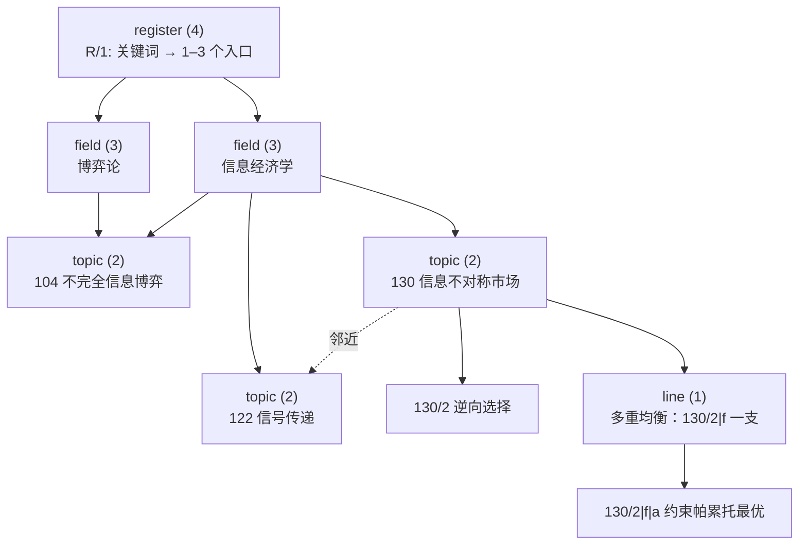
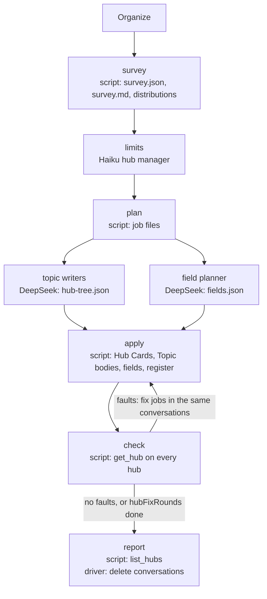

# Hub Cards Design

> **2026-10-22: the digests build only Literature trees** (base 5.0.0, econ 6.0.0, math 5.0.0; `docs/literature-only-digest-design.md`). Topic trees, Topic Cards, Hub Cards and the register are written only by zt-idea-grow 3.0.0 (`docs/idea-grow-design.md`). Where this document describes a digest stage that writes them (concepts, review, hubs, mode hubs, Topic placement, Organize merges and Topic bodies), that stage is gone from the digests.

Status: implemented in zt 0.16.0 and the `zt-book-digest` workflow (2026-10-14). The user approved the
proposal the same day and decided who does the work of the hub stage (see *Decisions*). The text
follows ASD-STE100 (Simplified Technical English) as the other design documents do. Card text in the examples is in
Chinese and follows the Card language rules.

## Source Authority

- `CONTEXT.md` defines Card, Card type, Topic, Location, Link, Reverse link, and the Direct and Side
  successors. This document proposes new terms for it (see *Glossary entries*).
- `skills/zettelkasten/SKILL.md` (*Entry points, hubs, and structure Cards*) and
  `skills/zettelkasten/references/luhmann-and-practice.md` hold the current hub rules. They are
  prompt text only.
- `open-models-design.md` decides that a Model Card declares its members by Link. This design uses
  the same rule for hubs.
- `model-compiler-design.md` decides the division of work in the book digest: a planner model plans
  the structure, DeepSeek writes, and scripts build and check. The hub compiler copies that division,
  with Haiku in place of Sonnet.
- `zt-digest-workflow.md` describes the stages. Before 0.16.0 the Organize stage wrote the hubs.

## The problem

A hub is a Card that opens one subject: it lists the Cards that carry the subject and says what each
one adds. Today a hub is only a sentence in a prompt. Step 4 of the Organize prompt tells Opus to
write one, and the zettelkasten skill tells an agent when to write one. ZT does not know that a hub
exists. No script checks one.

A survey of the agent Workspace on 2026-10-14 shows the result:

| Measure | Value |
| --- | --- |
| Agent Topic trees | 131 (1,872 Cards, median 11 Cards, largest 79) |
| Topic trees with 7 or more Cards | 117 |
| Hub-like Cards (8 or more Links, filed under `<n>/1`) | 123, in 100 trees |
| Trees with 7 or more Cards and no hub | about 17 |
| Hubs that link no Card outside their own tree | 87 of 123 |
| Hubs whose subject is two or more Topics | 0 |
| Where the hub sits under `<n>/1` | any letter from `a` to `u` |
| Card type of every hub | `idea`, so no tool can find the hubs |
| The book structure Card of `mascolell1995microeconomic` | one Card with 1,068 Links and 75,092 characters |

The survey shows five faults:

1. **No fixed policy.** Whether a tree gets a hub, where it sits, and what it holds depend on how one
   Opus call reads one prompt. A rerun gives a different result.
2. **Hubs copy the tree.** The hub of `130` (信息不对称市场) lists the tree's own Cards in address
   order, with the note "按树中顺序". The Folgezettel map already shows that order. The hub does not
   name Topic `122` (信号传递), `135` (甄别均衡), or `136` (均衡精炼), which continue its subject.
3. **One level only.** There is a hub per tree and one flat structure Card per book. Nothing joins
   the 15 game-theory Topics (`65`, `75`, `76`, `78`, `84`, `86`, `90`, `92`, `94`, `97`, `103`,
   `104`, `107`, `108`, `140`). A reader of 131 Topics has no map between the Topic list and the
   Topic.
4. **No size limit.** A hub grows until it stops being a way in. The 1,068-Link structure Card is a
   list that no reader can use.
5. **No identity.** A hub is an Idea Card with many Links. The link pass guesses hubs by "8 or more
   outbound Links" (`prepare-link-pass.ps1`). The GUI cannot show a hub differently, and an agent
   cannot ask for the hubs of a Card.

## What Luhmann did

The evidence comes from Luhmann's own texts, from his cards in the online archive, and from Johannes
F. K. Schmidt, who edits the archive in Bielefeld. The research for this design checked every card number
below on the archive portal on 2026-10-14. It made the counts marked *(count)* from the archive's TEI data.
They are not published figures.

### Luhmann's three ways in

Luhmann's box had no table of contents. A reader entered it in three ways:

| Way in | What it is | Evidence | ZET today | This design |
| --- | --- | --- | --- | --- |
| Keyword register (Schlagwortregister) | An alphabetical list outside the box. Each term points to one to three cards. | ZK II register, version 4: 3,016 terms, 1.30 card numbers per term. 78.8% of terms name one card, and 15.2% name two. *(count)* "System → 21/3d" names one card for his most central term. | No register. `list_trees`, `search_cards`, and Topic bodies do its job. | the `register` hub, and Topic bodies as register entries |
| Collective reference card (Sammelverweis) | A card at the head of a section. It lists up to about 25 references to cards on its subject, with the concept written beside each number. Most targets lie in other sections. | ZK I 17(2), "Ideologie / Verweisungen", holds 17 references, for example "Ideologie / Hierarchie 49,20". They point into sections 7, 13, 28, 44, 45, 49, 54, 60, 70, 71, and 83. Schmidt 2018, p. 57, describes the kind. | The hubs under `<n>/1`. 87 of 123 stay in their own tree. | the `topic` hub, with its `邻近` group |
| Outline card | The first card of a major line of thought. It marks aspects A, B, C and points to the subsequences filed just behind it. | ZK I 17,11e: five aspects, A to F, lead to 17,11eA to 17,11eF. Schmidt says this kind is closest to a table of contents and does not use the potential of the web. | The hubs that copy their tree in address order. | the `line` hub, and the `mirror` advice |

Schmidt calls the cards that collect references **hubs**: nodes with more references than average
that open large parts of the box from one point (Schmidt 2018, p. 58).

### What Luhmann said about order

- **No order by subject.** An order by topics and sub-topics binds the writer for decades. A fixed
  number needs no system (1981, §II).
- **References solve every order problem.** A misplaced slip gets a reference, not a new place (1968
  lecture, Ms. 2906). A slip is filed once. References record its other places ("multiple
  storage").
- **Orientation is not the core problem.** A rough first scheme helps to find regions, but he calls
  it "kein Kernproblem" (1968). The 11 top-level sections of ZK II come from his reading history.
  They are not a taxonomy, and lower subjects are only loosely coupled to them (Schmidt 2018, p. 55).
- **No privileged positions.** A card's position says nothing about its weight (1981, p. 225, after
  Schmidt). Most cards on *autopoiesis*, a central concept, sit at the deep position 21/3d26g1i.
- **The register needs constant upkeep.** Luhmann rewrote the ZK II register four times. A stale
  pointer still survived: the entry "Absurdität" names 32/8g8j10 after the card became 32/3g8j10,
  and every later version copied the error (archive note on SW2d 001).
- **Unlinked regions are lost.** A card or region that no reference reaches is "lost irretrievably".
  Schmidt calls such regions black holes (Schmidt 2018, p. 58).
- **No hub of hubs.** The archive shows hubs at section heads and outlines inside lines. The research
  for this design found no card of Luhmann's that lists other hub cards. Above the hubs there is only
  the section number and the register.

### Later practice

| Who | What they call it | What it adds |
| --- | --- | --- |
| Sönke Ahrens (2017) | index entries, overview notes | Each index term points to one or two notes that open a line of thought. A note must be reachable from the index, or from an entry note that the index names. |
| Sascha Fast, zettelkasten.de (2016, 2018, 2020) | hubs, structure notes, top-level structure notes | Structure came in layers as his archive grew: hub-like notes at about 500 to 700 notes, structure notes at about 1,000 to 1,500. Top-level structure notes then point to structure notes. Overlapping structure notes form a semilattice, not a tree. Folders hinder work across subjects. |
| Christian Tietze, zettelkasten.de (2016) | tag overview hubs | Hubs built from tags gave a shallow structure and cost bookkeeping. |
| Bob Doto (2024) | hub notes, structure notes | A hub note points to where trains of thought start. A structure note arranges one train into an argument. The two work together, and one cannot replace the other. |
| Nick Milo, LYT | Maps of Content (MOC), Home note | Home note → MOCs → notes. Write a MOC at the "mental squeeze point" (his example: about 20 scattered notes). Several MOCs may map the same notes. |
| Andy Matuschak | associative ontologies, labeled links | Prefer associations to early hierarchies. Tags are a weak signal. Links need labels. |
| Scott Scheper, Antinet | index of key terms | The index maps a term to a card address. It is the map of the tree. |

Practitioners do not agree on the words. A forum question in 2018 about the difference between hub
notes and structure notes found no settled answer. This design uses the ZET terms Hub Card and
structure Card and defines both.

### Where ZET differs from Luhmann

- **Scale and speed.** ZET's agent Workspace grew to 131 Topics in a few days of book digests.
  Luhmann's ZK II grew to 11 top-level sections and about 100 subsections in 34 years. His section
  numbers grouped his subjects. ZET Topic numbers are flat and group nothing. The `field` hub gives
  ZET the grouping that his section numbers gave him. It is an extension, not a copy: Luhmann had no
  hub of hubs.
- **Links follow Cards.** ZT rewrites every Link when a Card moves. A ZET hub cannot keep a stale
  pointer such as 32/8g8j10.
- **Reverse links.** Luhmann's hub pointed down only. ZET can show every Card the hubs that list it,
  so a reader can climb from any Card.
- **The writer is an agent.** An agent writes many Cards fast and does not feel the "squeeze point".
  So a size rule must decide when a hub is due, not a feeling.

## Principles

Each principle comes from the evidence above. The rules in *Fixed policy* apply them.

1. **A hub is a way in, not a full list.** Luhmann's register named 1.3 cards per term, and his
   collective cards held at most about 25 references. A topic hub names the strong starting Cards and
   the lower hubs. The tree and its Links carry the reader on.
2. **Every line carries a label.** Luhmann wrote the concept beside each number. A hub line says what
   the Card adds.
3. **A hub reaches outside its tree.** Distant targets were the normal case for Luhmann's collective
   cards. A hub that lists only its own tree in address order is an outline card. It repeats the
   Folgezettel map.
4. **A hub is filed where its subject starts.** ZK I 17(2) stands at the head of its section. A line
   hub and a topic hub stand beside the first Card of their subject.
5. **Overlap is normal.** A Card may sit in several hubs, and a hub in several upper hubs. The hub
   graph is a directed graph without cycles, not a tree.
6. **Hubs come with size.** Hubs appear when a region grows, not when a Topic opens. For an agent, a
   size rule replaces the squeeze point.
7. **Keep the depth shallow.** Register, hub, sequence is Luhmann's depth. One more level (`field`)
   replaces his section numbers. Nothing supports a deeper fixed hierarchy.
8. **Maintain the hubs.** Luhmann rewrote his register four times and still kept a stale pointer. ZT
   rewrites Links on moves, reports faults, and the compiler rebuilds a hub when its range changes.
9. **Show the black holes.** A Card that no hub reaches is lost. The hub report lists such Cards.
10. **A hub does not rank Cards.** A position says nothing about weight. The GUI marks hubs as ways in.
    It does not size or ink a Card by its depth or by the number of hubs that list it.
11. **A hub points. A structure Card argues.** Navigation and the order of one argument are two jobs
    (Doto, and Schmidt on outline cards). This design covers hubs only.

## Options compared

### How much is fixed

| | A. Prompt only (today) | B. Compiled convention | C. Hub type and hub compiler (proposed) | D. Computed hubs |
| --- | --- | --- | --- | --- |
| What a hub is | an Idea Card that a prompt asked for | an Idea Card in a fixed body format, found by a marker line | a Card of type `hub` with a stored Hub level | a view that ZT computes from Links and text, with no Card |
| Who decides which hubs exist | one Opus call | a script, from rules | a script, from rules | ZT, from a clustering algorithm |
| Who groups the members and writes the reasons | Opus | planner and DeepSeek | planner and DeepSeek | nobody: groups are clusters, reasons are absent |
| Levels | none | by a marker word | stored and checked | the depth of the clustering |
| Checks | none | a script in the workflow | ZT reports faults for every client (agent, GUI, human) | not needed |
| Works for the human Workspace | no | no | yes: the human writes a hub, ZT checks it | yes |
| GUI can show it | no | by a text match | yes, as a guide card | yes |
| ZT change | none | none | a Card type, a level, a report, a GUI view | a clustering engine and a view |
| Luhmann fidelity | low | medium | high: hand-picked members, stated reasons, filed where the subject starts | low: a hub without a selection and without reasons is an index, not a hub |
| Cost per digest | one Opus pass | small | small: one planner call for the upper levels, cheap DeepSeek runs, scripts | none |

**Recommendation: C.** B is the first half of C: the workflow part of C works before the ZT part
exists. D skips the work that gives a hub its value. A hub is a selection with reasons, and a
selection is a decision.

### How levels work

| | 1. Named levels (proposed) | 2. Free depth number | 3. Computed depth only |
| --- | --- | --- | --- |
| Stored value | `line`, `topic`, `field`, `register` | an integer | nothing |
| Meaning of a level | the width of the subject: one line of thought, one tree, several trees, the Workspace | a number with no fixed meaning | the height of the hub in the hub graph |
| Rules can say | "every tree with 7 or more Cards has a topic hub" | nothing fixed | nothing before the hubs exist |
| Fault when a hub lists a wider hub | yes (`upward`) | yes | not possible: depth follows the Links |

Named levels let the rules require hubs before any hub exists. That is what "fixed policy" means.

### Where a hub is filed

| | i. By anchor, found by type (proposed) | ii. A fixed Location such as `<n>/1|a` | iii. One hub tree for all hubs |
| --- | --- | --- | --- |
| Line and topic hubs | the Side successor of the subject's first Card | a reserved letter | the hub tree |
| Cost | none | An Insert before `<n>/1|a` makes the old `|a` the hub's Direct successor. Every existing tree changes. | The hub leaves its subject. Luhmann did not do this. |
| How a tool finds it | `type: hub` and its level | its address | its tree |
| Field hubs and the register | in the register tree (they have no single subject tree) | — | in the hub tree |

The address of a Card says where it was filed. The type and the level say what it is. This repeats the
decision of `open-models-design.md`: membership comes from Links, not from where a Card is filed.

## The proposed design

### The Hub Card

A **Hub Card** is a Regular Card of type `hub`. It opens one subject. Its body lists Links to the
Cards that carry the subject, in named groups, one line for each Card. Each line says what that Card
adds to the subject. A Hub Card states no claim of its own. Its title is the subject's main claim and
uses the words that a search for the subject uses.

A hub is not a structure Card. A structure Card puts an argument in reading order for one text. A hub
maps a subject so that a reader can choose where to go. A hub is also not a Model Card: a Link from a
hub does not take a Model part into a model.

### The four levels

| Level | Name | Subject | Lists | Filed as | Required when | Luhmann's form |
| --- | --- | --- | --- | --- | --- | --- |
| 1 | `line` | one line of thought inside one tree | Cards of its branch, and Cards of other trees that continue it | a Side successor of the Card where the line starts | a branch holds `lineHubMin` (12) Cards or 2 Model Cards | the outline card (ZK I 17,11e), but with reasons and with Links out of the branch |
| 2 | `topic` | one Topic tree | its line hubs, its core Cards, its Model Cards, and a 邻近 group of Cards and hubs in other trees | a Side successor of `<n>/1` | the tree holds `topicHubMin` (7) Cards | the collective reference card (ZK I 17(2)) |
| 3 | `field` | several Topic trees that share one subject | topic hubs, and Topic roots of small trees | a Side successor of the register | the compiler finds a cluster of `fieldMin` (3) or more related Topics | none: his section numbers did this job |
| 4 | `register` | the Workspace | key terms, each with Links to one to three field or topic hubs | `<R>/1`, the first Card of the register tree | the Workspace holds a hub | the keyword register |



The hub graph is a directed graph, not a tree. A topic hub may sit in two fields (Topic `104` above).
Luhmann called this multiple storage, and his references solved it the same way.

**The register tree.** Each Workspace that holds hubs has one Topic named `索引`. Its first Card is
the register. Every field hub is a Side successor of the register. Field hubs live there because
their subject has no single tree. `list_trees` shows the Topic `索引`, so a reader reaches the
register in one step, with no search.

**A Topic body is a register entry.** It keeps its form: two or three sentences, then Links to one
to three entry Cards. Its last line links the topic hub. This is the current rule, unchanged.

### The body of a Hub Card

```markdown
范围：<一句话：这张枢纽管哪些卡。>

## <组名：这一组回答的问题>
- [[130/2]]：逆向选择让知情者按私人信息决定是否交易。
- [[<线索枢纽>]]（枢纽）：逆向选择市场可以有多重竞争均衡，这一支有十二张卡。

## <组名>
- …

## 邻近
- 对照 [[122/1]]：信号传递是知情一方的应对，本主题只讲市场后果。
- 依赖 [[136/1]]：多重均衡的筛选要用均衡精炼。
```

- `范围` states the range in one sentence. The compiler writes it from the level and the anchor.
- Groups have a heading. A group answers one question or holds one stage of the subject.
- Each line starts with one Link. The text after the colon is the reason: what the Card adds.
- The `邻近` group holds Links to other trees. The word before each Link gives the Relation kind, as
  in every other Card.
- A line for a lower hub says `（枢纽）`, so a reader knows that the Link opens a list.

### Fixed policy

These rules are fixed. The hub compiler applies them, and ZT reports each break as a fault. The
numbers are limits. The Haiku hub manager chooses them for each run from the survey (see *The hub
compiler*), and `get_hub` and `list_hubs` take them as arguments. The defaults are in brackets.

| Rule | Statement | Fault in the hub report |
| --- | --- | --- |
| H1 Required topic hub | Every Topic tree with `topic_min` (7) or more Cards has exactly one topic hub. | `missing` (in `list_hubs`), `duplicate` |
| H2 Required line hub | A branch with `line_min` (12) or more Cards, or with 2 or more Model Cards, has a line hub filed under the branch's first Card. A branch starts at a Side successor (an Idea Card); a Direct successor starts none. | `missing` (in `list_hubs`) |
| H3 Required field hub | A field hub or the register lists every topic hub. | `unanchored` |
| H4 One register | A Workspace with hubs has one register. It lists every field hub. | `missing` (in `list_hubs`), `unanchored` |
| H5 Size | A hub holds at most `max_groups` (7) groups and `max_lines` (25) lines. The `邻近` group does not count, because it points out of the subject. A hub of more than 8 lines has 2 or more groups. A register term names 1 to 3 hubs or Cards. | `oversize`, `flat` |
| H6 Downward | A hub lists only hubs of a lower level. Levels may be skipped. One exception: a line hub lists the line hub of a branch inside its own branch. The hub graph has no cycle. | `upward`, `cycle` |
| H7 Anchored | A hub of a higher level lists every hub except the register. The Topic body also links its topic hub. | `unanchored` |
| H8 Reasons | Every line has a reason of at least `min_reason` (8) characters after its Link. A register line has its term. | `bare` |
| H9 Coverage | The hub, directly or through its lower hubs, lists every Model Card and every line hub in its range. | `unlisted` |
| H10 Neighbours | A topic hub lists a Card outside its tree when its tree shares `neighbour_links` (3) or more Links with another tree. | `isolated` |
| H11 Not a mirror | A hub that lists only Cards of its own tree in address order adds nothing to the Folgezettel map. | none: `mirror` is advice |
| H12 Fresh | Cards of the range that link 2 or more members but are in no line are candidates. | none: `candidates` is a list |
| H13 Reach | A hub reaches a Card when it lists the Card or a Card above it in its tree. A Card that no hub reaches is a black hole. | none: `unreached` is a list |

`get_hub` also reports `level` (a Hub Card without a level) and `broken` (a line whose Card does not
exist). H11, H12, and H13 are advice. The other rules are faults. ZT reports faults and does not
enforce them, as it does for models (`closure`, `forward`, `unanchored`). The hub compiler sends
`mirror` back to the writer as if it were a fault.

## ZT changes (0.16.0, 0.16.1)

### Storage

- A new Card type `hub`. Only Regular Cards may be Hub Cards, as for Event and Model Cards.
- A new column `hub_level` (`line`, `topic`, `field`, `register`, or NULL), with a CHECK that only a
  Hub Card has one. The proposal reused the `model_level` column. SQLite cannot change a CHECK in
  place, so the type CHECK needs a table rebuild in any case, and a separate column keeps the two
  kinds of level apart. `zt up` rebuilds the cards table once in an older archive, after a backup
  copy `zt.sqlite3.pre-hub-cards-<time>.bak`. Every Card keeps its row id and fields.
- A Card that stops being a Hub Card loses its hub level, as a Model Card loses its elaboration level.

### Interfaces

| Interface | Change |
| --- | --- |
| `create_successor`, `edit_card` | accept `type: "hub"`. `level` takes a hub level (`line`, `topic`, `field`, `register`, or `线索`, `主题`, `领域`, `索引`) for a Hub Card, or an elaboration level for a Model Card. An empty `level` clears either. |
| `search_cards` | `type: "hub"` |
| `get_hub` (new) | The hub's `level`, `anchor`, `groups`, and `lines`. Each line gives the member, group, title, type, tree, Relation kind, and reason. Then the `lower` and `upper` hubs, the size of its range, the `faults`, and the advice `mirror`, `candidates`, and `unreached`. |
| `list_hubs` (new) | Every hub of a Workspace with its level, tree, line count, upper and lower hubs, fault names, `mirror`, and unreached count. Then `counts` per level, and `missing`: the hubs that H1, H2, and H4 require. |
| `get_card` | a new `hubs` field: the hubs that list this Card, lowest level first |
| `get_tree`, `search_cards`, `get_card` | `level` shows a Hub Card's hub level |
| Session | `ty hub` makes a Hub Card. `lv <level|none>` sets either kind of level. |
| `prepare-link-pass.ps1` | leaves Hub Cards unowned by type, and other Cards with 8 or more Links as before |

The limits (`topic_min`, `line_min`, `max_lines`, `max_groups`, `min_reason`, `neighbour_links`) are
optional arguments of `get_hub` and `list_hubs`.

### The GUI: a hub is a guide card

A real card file separates its cards with guide cards. A guide card is taller than an index card, and
a tab rises above its top edge. The tabs stand at different positions, so the eye reads the levels of
the file at a glance. The GUI draws a Hub Card the same way:

- A hub is drawn as a guide card: the same paper, a green top edge, and a tab above it that names its
  level.
- The tab position shows the level. The register's tab stands at the left, the field tab next, the
  topic tab in the middle, and the line tab at the right. The Folgezettel map and the Table draw a
  small tab at the same place.
- Every Card shows the hubs that list it as small tab chips above its title. A click climbs to that
  hub. A reader is one click from a way out of a Card.
- `ty hub` and the type picker know the Hub type. `lv` sets a hub level.

A tab marks a way in. It does not mark weight: the GUI never sizes or inks a Card by its depth or by
the number of hubs that list it.

Not built yet: a hub view in which each group is a small stack behind its own tab, and the group the
reader opens fans out. Today the GUI shows a hub's body as Markdown.

## The hub compiler

The user decided (2026-10-14) how the stage divides the work:

- A hub is easier to plan than a model, so **Haiku** is enough as the hub manager. No Sonnet or Opus
  call plans hubs.
- **DeepSeek does the manual work**: it plans the fields and the register's terms, and it writes every
  topic and line hub.
- The DeepSeek Harness control follows the model compiler: the stage has its own DeepSeek workspace,
  and when the stage finishes, its conversations are **deleted**, not archived.
- The thresholds are not fixed numbers. The **Haiku hub manager chooses them** for each run from the
  survey's distributions, with written rules.

The hub stage runs last in a full digest, after Organize, so it sees the trees as Organize left them
(merged Topics, rewritten Topic bodies). `mode: "hubs"` runs it alone. Field hubs cross books, so the
stage always surveys every agent Topic tree. It rewrites only the trees whose hubs are missing,
faulty, mirrors, or legacy Idea Cards, or whose Cards changed since the last run.

### Who does what

| Role | Model | Does | Never does |
| --- | --- | --- | --- |
| Hub manager | Haiku, one call | Runs `survey`. Reads the distributions of tree sizes, branch sizes, and Links between trees. Chooses the limits by the rules below and gives a reason for each. | read Cards, write Cards |
| Compiler | `hub-compiler.ps1` (no model) | `survey`: reads every tree and the hub graph, finds legacy hubs, writes `survey.json` and `survey.md`. `plan`: clamps the limits, picks the trees, writes the job files. `apply`: builds or rewrites the Hub Cards, links each topic hub from its Topic body, writes the field hubs and the register. `check`: `get_hub` on every hub, one fix job per writer. `report`: `list_hubs`. | write prose, except fixed lines |
| Driver | Haiku, one call per step | Runs one compiler step, starts the DeepSeek jobs it prints, waits, approves, retries once. The last driver deletes the conversations and the workspace entry in the DeepSeek sidebar. | read the book or a Card, decide anything |
| Topic writer | DeepSeek (`hubEffort`, high), one run per `per_job` trees | Reads its trees from the job file, and a Card when it needs one (read-only helper). Writes `out\hub-<tree>.json`: the topic hub, the required line hubs, and the `邻近` group. | create, move, or delete Cards |
| Field planner | DeepSeek, one run | Reads `survey.md`, one line per Topic. Writes `out\fields.json`: the fields with their Topics in groups, and 30 to 80 register terms. | create, move, or delete Cards |
| Fixer | the writer's own conversation | Receives the faults that `get_hub` reports and fixes its JSON file. | change Cards |

The hub manager's rules for the limits:

| Limit | Rule | Bounds |
| --- | --- | --- |
| `topic_min` | the 25th percentile of tree sizes | 5 to 12 |
| `line_min` | the 90th percentile of branch sizes, and not below `topic_min` | 6 to 20 |
| `max_lines` | the 75th percentile of tree sizes | 15 to 25 |
| `max_groups` | 7, or 5 when `max_lines` is below 18 | |
| `min_reason` | 8 | |
| `neighbour_links` | the median of the Links between two neighbouring trees | 2 to 6 |
| `field_min`, `field_max` | 3, and the square root of the number of Topics | `field_max` 6 to 15 |
| `per_job` | 6 trees when the median tree has 15 Cards or fewer, 4 up to 30, else 2 | |

The compiler clamps every limit again, so a wrong answer cannot ask for a hub per Card or a hub of a
hundred lines. `hubLimits` overrides any limit.



### Files

Everything lives in `hubWork` (default `D:\zt-digest\hubs`), which is also the DeepSeek cwd. The
folder stays after the run, because `state.json` remembers each tree's hubs for the next run.

| File | Written by | Read by |
| --- | --- | --- |
| `survey.json`, `survey.md` | compiler (`survey`) | compiler, field planner |
| `limits.json` | compiler (`plan`) | compiler (`check`, `report`) |
| `job-t<NN>.md`, `job-f<NN>.md`, `fix-*.md` | compiler | writers, field planner |
| `out\hub-<tree>.json`, `out\fields.json` | DeepSeek | compiler (`apply`) |
| `state.json` | compiler | compiler: each tree's topic and line hubs, the field hubs, the register, the jobs, and the hash of each tree's Cards |
| `report.json` | compiler (`report`) | the workflow result |

A new plan deletes the job files and the `out` files of the run before, so `apply` never applies an
old answer.

### Arguments

| Argument | Default | Meaning |
| --- | --- | --- |
| `hubs` | true in mode `full`, false in mode `link` | run the hub stage |
| `hubWork` | `D:\zt-digest\hubs` | the stage's folder and DeepSeek workspace |
| `hubLimits` | none | an object that overrides limits the hub manager chose |
| `hubTrees` | all | only these Topic trees, for example a pilot (`"130,122"`) |
| `hubRebuild` | false | rewrite every hub, not only the changed ones |
| `hubEffort` | high | DeepSeek effort of the writers and the field planner (at least medium, by the user's decision) |
| `hubFixRounds` | 1 | check, fix, and apply again |

## A worked example: Topic `130`

Today `130/1|b` lists 16 Cards of tree `130` in address order. Under this design:

1. The survey finds `130/1|b` as a legacy hub: an Idea Card under `130/1` with many Links. The writer
   rewrites it, and `apply` makes it a topic hub (`type: hub`, `level: topic`).
2. Its groups follow the subject, not the addresses: 逆向选择的后果, 约束帕累托最优, 应对：信号与甄别.
3. The branch `130/2|f` has 12 Cards. When `line_min` is 12 or less, it gets a line hub, and the topic
   hub lists that hub in one line.
4. The `邻近` group links Topics `122` (信号传递), `135` (甄别均衡), and `136` (均衡精炼), each
   with its kind word.
5. The field hub 信息经济学 lists the topic hubs of `130`, `122`, `135`, `121`, `123`, `164`,
   `176`, and `104`. The field hub 博弈论 also lists `104`.
6. The register entry 逆向选择 links the field hub 信息经济学 and the topic hub of `130`.

A reader who opens the slip-box at the register reaches the subject in three steps: register, field,
topic. From any Card of `130` a chip climbs back to the topic hub in one click.

## Migration

1. **Upgrade ZT.** `zt up` adds the `hub` type and the `hub_level` column after a backup copy. No
   Card is a Hub Card yet.
2. **Run the hub stage** with `mode: "hubs"`. The survey finds the legacy hubs (Idea Cards under
   `<n>/1` with 8 or more Links that call themselves a hub or a list). The writers rewrite them, and
   `apply` retypes them in place, so their addresses and the Links to them stay. The stage also writes
   the missing topic hubs, the line hubs, the field hubs, and the register.
3. **Split the book structure Card.** The 1,068-Link Card of `mascolell1995microeconomic` is a
   structure Card, not a hub. The same size limit should apply to it: one book structure Card with one
   line per chapter, and one structure Card per chapter. This design does not cover structure Cards.
4. **Prompts.** The Organize prompt no longer writes hubs: it leaves Hub Cards alone and keeps the
   Topic body's Link to its hub. The zettelkasten skill tells an agent to write a hub by hand with
   `type: hub` and a level.

## Glossary entries

`CONTEXT.md` holds these terms since 0.16.0: **Hub Card**, **Hub level**, **Hub range**, and
**Register**.

## Decisions

The user approved the design on 2026-10-14 and decided:

1. **Type or convention.** Option C: a Card type, a stored level, and the ZT report.
2. **Who manages the stage.** A Haiku hub manager and Haiku drivers, not Sonnet. DeepSeek plans the
   fields and writes every hub.
3. **Thresholds.** The hub manager chooses them for each run from the survey. The numbers in this
   document are defaults and bounds.
4. **DeepSeek control.** One workspace for the stage. When the stage finishes, its conversations are
   deleted.

Still open:

1. **The register.** One Topic `索引` per Workspace holds the register and the field hubs, as built.
   Alternative: field hubs filed in the tree of their most central Topic, and no register.
2. **Structure Cards.** Give structure Cards the same size limit now, or design them in a separate
   document.
3. **The human Workspace.** ZT reports hub faults in the human Workspace too. The agent never writes
   a hub there. `list_hubs` with `workspace: "human"` shows the human's missing hubs. The GUI shows no
   fault list yet.

## Pilot (2026-10-14)

`mode: "hubs"`, `hubTrees: "130,122,135"`. The Haiku hub manager chose `topic_min` 7, `line_min` 7,
`max_lines` 15, `max_groups` 5, and `neighbour_links` 2. Topic `135` (6 Cards) needs no hub. The stage
rewrote the two legacy hubs in place, wrote three line hubs and the register, and deleted its DeepSeek
conversations. The pilot found two faults in the rules, which 0.16.1 fixes:

1. H6 and H9 contradicted each other for nested branches. H9 asked the line hub of `130/2|f` to
   list the line hub of `130/2|f|a`, inside its branch. H6 refused a line hub that lists another line
   hub. Now a line hub may list the line hub of a sub-branch.
2. The `邻近` group counted toward the size limits, so both topic hubs were `oversize` although their
   subject groups fit. Now `邻近` does not count.

## Line-hub branch starts (2026-10-22)

The idea-grow hubs round (2.5.1) built the topic hub `412/1|j` and three line hubs for Topic `412`, but
`list_hubs` still reported a line hub missing at `412/1` (38 Cards). `missing` took every Idea Card as a
branch start, so the doorway, whose Side successors hold nearly the whole Topic, always needed a line
hub of its own.

Decision: only a Side successor starts a branch, as in Luhmann's box, where a branch is the `a`, `b`, …
beside a Card. A Direct chain does not count. The doorway line `n/1, n/2, …` is the Topic's main line,
which the topic hub maps (H1); a Direct chain inside a branch (`n/1|a|1`, …) is part of that branch and
its line hub. A line hub at `n/1` would repeat the topic hub. `zt-digest hub`'s survey already counted
only `edge: side` Cards, so the stage and `list_hubs` now agree. zt 0.26.2.

## Full run (2026-10-14)

`mode: "hubs"` on the whole agent Workspace, `hubEffort: "high"` (the user asked for at least medium
effort). A first attempt stopped when the DeepSeek platform failed. The user paused it and resumed
it later. The rerun took about 100 minutes, with the same limits as the pilot.

| Result | Count |
| --- | --- |
| Topic hubs | 100 (98 rewritten from legacy Idea-Card hubs, in place) |
| Line hubs | 32 |
| Field hubs | 20, each listed by the register |
| Register terms | 85, each with one to three ways in |
| Faults, `mirror`, required hubs missing | 0, 0, 0 |
| Broken Links in the agent Workspace | 0 |

Every topic hub is listed by a field hub. A field hub links a small Topic (fewer than `topic_min`
Cards) by its root. The run marked such a root `（枢纽）`. The compiler now marks only real hubs.

A second full run on 2026-10-15 rebuilt every hub (`hubRebuild: true`) on DeepSeek V4.1 Flash from the
OpenCode Go source (`dshSource: "opencode"`), at high effort, in about 31 minutes. It gave the same 153
hubs with 0 faults, 0 broken Links, 76 register terms, and 8 Cards that no hub reaches.


- It does not compute hubs. A cluster only proposes a field. A planner names it and a writer gives
  each member its reason.
- It does not move Cards. A hub is a new Card or a retyped Card at its anchor.
- It does not change models. A hub may list a Model Card or a Model part, and that Link adds nothing
  to the model.
- It does not replace search. The register is a set of entry points, not a full index.

## Sources

Luhmann:

- Niklas Luhmann, "Kommunikation mit Zettelkästen. Ein Erfahrungsbericht" (1981), in Baier,
  Kepplinger, and Reumann (eds.), *Öffentliche Meinung und sozialer Wandel*, pp. 222–228. English:
  [Kuehn translation](https://luhmann.surge.sh/communicating-with-slip-boxes) and
  [Fast translation](https://zettelkasten.de/communications-with-zettelkastens/). The German original
  was not available for this design.
- Niklas Luhmann, "Technik des Zettelkastens", lecture typescript, Münster, 13 January 1968,
  [Ms. 2906](https://niklas-luhmann-archiv.de/bestand/manuskripte/manuskript/MS_2906_0001).
- Cards: [ZK I 17(2)](https://niklas-luhmann-archiv.de/bestand/zettelkasten/zettel/ZK_1_NB_17_2_V)
  (collective references), [ZK I 17,11e](https://niklas-luhmann-archiv.de/bestand/zettelkasten/zettel/ZK_1_NB_17-11e_V)
  (outline), [ZK II 9/8](https://niklas-luhmann-archiv.de/bestand/zettelkasten/zettel/ZK_2_NB_9-8_V)
  and [9/8b](https://niklas-luhmann-archiv.de/bestand/zettelkasten/zettel/ZK_2_NB_9-8b_V) (the box
  about itself), and the register cards
  [SW2d 129](https://niklas-luhmann-archiv.de/bestand/zettelkasten/zettel/ZK_2_SW2d_129_V)
  (System → 21/3d), [SW2d 001](https://niklas-luhmann-archiv.de/bestand/zettelkasten/zettel/ZK_2_SW2d_001_V)
  (the stale pointer), and [SW1 001](https://niklas-luhmann-archiv.de/bestand/zettelkasten/zettel/ZK_2_SW1_001_V).
- The register count (3,016 terms, 3,920 card numbers) covers all 155 cards of ZK II register
  version 4, read through the archive's TEI API. It ignores editorial notes.

Schmidt and the archive:

- Johannes F. K. Schmidt, "Niklas Luhmann's Card Index: The Fabrication of Serendipity",
  *Sociologica* 12(1), 2018, [doi:10.6092/issn.1971-8853/8350](https://doi.org/10.6092/issn.1971-8853/8350).
  It is a revised version of "Niklas Luhmann's Card Index: Thinking Tool, Communication Partner,
  Publication Machine", in Cevolini (ed.), *Forgetting Machines*, Brill 2016.
- Johannes F. K. Schmidt, ["Der Zettelkasten Niklas Luhmanns als Überraschungsgenerator"](https://www.uni-bielefeld.de/fakultaeten/soziologie/forschung/luhmann-archiv/pdf/jschmidt_zettelkasten-als-uberraschungsgenerator.pdf).
  It says that a register entry names "one or two, at most three" places. The English article says
  "one to four". The register count above fits the German text.
- [Bielefeld digitization talk, 2018-04-19](https://uni-bielefeld.de/einrichtungen/bits/ueber-uns/knowledge-transfer/2018/2018-04-19_Vortrag_Das_Digitalisierungsprojekt_Luhmann-Zettelkasten.pdf).
- The counts differ between sources: ZK I has 23,000 or 24,000 cards, and ZK II has 66,000 or
  67,000. No decision in this design depends on the difference.

Later practice:

- Sönke Ahrens, *How to Take Smart Notes* (2017), through
  [Andy Matuschak's reading notes](https://notes.andymatuschak.org/How_to_Take_Smart_Notes_-_Ahrens).
  The book itself was not read for this design.
- Sascha Fast, ["The Money Is in the Hubs"](https://zettelkasten.de/posts/zettelkasten-hubs/) (2016),
  ["A Tale of Complexity – Structural Layers in Note Taking"](https://zettelkasten.de/posts/three-layers-structure-zettelkasten/) (2018),
  and ["Introduction to the Zettelkasten Method"](https://zettelkasten.de/introduction/) (2020).
- [Forum: the difference between hub notes and structure notes](https://forum.zettelkasten.de/discussion/362/whats-the-difference-between-hub-notes-and-structure-notes) (2018).
- Bob Doto, ["The Difference Between Hub Notes and Structure Notes Explained"](https://writing.bobdoto.computer/the-difference-between-hub-notes-and-structure-notes-explained/) (2024).
- Scott Scheper, ["Introducing the Antinet Zettelkasten"](https://zettelkasten.de/posts/introduction-antinet-zettelkasten/) (2022).
- Nick Milo, [LYT glossary](https://blog.linkingyourthinking.com/notes/lyt-glossary) and
  [MOCs overview](https://blog.linkingyourthinking.com/notes/mocs-overview).
- Andy Matuschak, ["Prefer associative ontologies to hierarchical taxonomies"](https://notes.andymatuschak.org/Prefer_associative_ontologies_to_hierarchical_taxonomies)
  and ["Tags are an ineffective association structure"](https://notes.andymatuschak.org/Tags_are_an_ineffective_association_structure).

ZET:

- The survey of the agent Workspace (2026-10-14) ran `list_trees` and `get_tree` on every agent
  tree. A hub-like Card is a non-root Card with 8 or more Links. The survey script is not in the
  repository.
