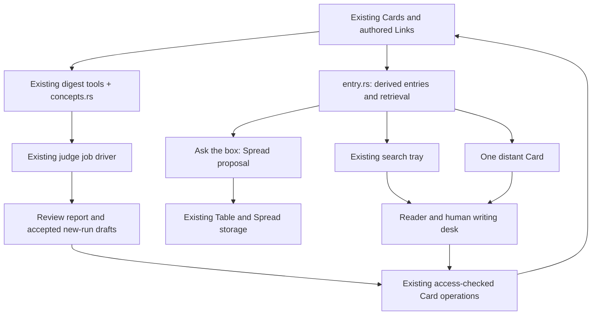

# ZT after the second Luhmann comparison: implementation design

Status: proposed implementation design. Date: 2026-10-18.

This document designs the thirteen proposals marked **Kept** in [luhmann-comparison-proposals.md](luhmann-comparison-proposals.md). P6 and P10 stay dropped. This is a design deliverable; it does not authorize an archive migration, change a Workflow, or claim that the features have been implemented.

The design was checked against repository source at `e833cfe4b7e9f289f556498bb1137de6530edddd`, including the local source available when this document was written. The proposal's archive counts are observations from its 2026-10-18 audit, not a fresh archive measurement made for this design. Example addresses refer to that audit and must be resolved again before an operation.

## 1. The simplest structure

Keep Cards and their authored Links as the durable knowledge. Build the concept register out of ordinary Cards. Read those entries through one small Rust module. Extend the existing digest tools to retrieve context before writing, check the new Cards, and produce review reports. Extend the existing reader, search tray, and Table to use the entries.

There are two new production code modules:

1. `src/entry.rs`: reads register entries, computes entry-first results, follows a bounded number of Links for a question, and selects one distant Card. The GUI and MCP server call the same functions.
2. `tools/zt-digest/src/concepts.rs`: prepares concept candidates and judge jobs, validates the answers, implements the digest's concept gate, and renders concept/restatement/filing review reports. It reuses the current MCP client, relatedness code, hashing, receipts, and job driver.

One new Chinese prompt file, `scripts/book-digest/dsh-concept-instructions.zh.md`, gives the concept judge its narrow task. Existing writer, Card, Link, and hub prompts receive the rest of the changes. New tests and wiki updates accompany implementation. No new crate, background service, database, stored concept identifier, Card type, Hub level, Relation kind, embedding system, or general workflow engine is needed.



The two modules do different jobs. The digest module can ask a judge whether two claims mean the same thing. The entry module reads accepted Card text and performs deterministic retrieval. A search request never starts a model run.

### 1.1 Why these are the minimum additions

| Existing mechanism | Use it for | Addition actually needed |
| --- | --- | --- |
| `zt-digest prepare`, `prepare-link`, and TF-IDF relatedness | Find earlier Cards and cross-part candidates | Run candidate preparation before writing; bound and retain the result |
| Card cycle and its `merge` verdict | Review standalone faults and restatements | Supply comparison pairs; distinguish a recommendation from an applied change |
| Topic gate and its file lock | Serialize digest Topic creation | Check concept evidence as well as title spelling |
| Hub compiler and ordinary Markdown lists | Concept crossings and register entries | Choose stronger entries and support register parts |
| `Snapshot::find` and `search_in` | GUI ranking and MCP search | One entry ranking contract, with the current plain mode retained |
| Existing Link parser and Relation kinds | Explain traversal, replies, and Table threads | Reuse them without adding a semantic edge store |
| `src/spread.rs` and the Table | A question's selected Cards | Produce a Spread proposal and preserve its question |
| `openEditor`, `newCard`, Owner access | Human replies | Fix the destination Workspace and supply a reply draft |
| Immutable Bridge reports and guarded Bridge apply | Optional reviewed distant candidates | Read a selected report through the existing digest binary; preserve its apply boundary |

The code footprint is not thirteen independent implementations. P1–P4 change production and checking; P5, P7, and P8 improve the entries; P12–P15 read those entries through the same small retrieval module.

## 2. Scope and proposal coverage

| Proposal | Result the implementation must deliver | Main sections |
| --- | --- | --- |
| P1 | New Topic claims pass the Topic test; old failures receive proposed remedies | 5, 6, 11 |
| P2 | New restatements are reviewed against model parts, anchors, and earlier Topic Cards; one statement has one substantive home | 4, 5, 6 |
| P3 | Writers see earlier Cards before writing and can file beside them | 5 |
| P4 | Writers put Links into the relevant sentences; only remaining gaps go to the Link pass | 5, 6 |
| P5 | A concept-aware Topic gate and a report of existing candidate Topic pairs | 4, 7, 11 |
| P7 | Existing Hub levels hold concept crossings; mirror hubs are avoided; one-book advice has evidence | 8 |
| P8 | Terms from book term tables and model names lead to one to three useful Cards, including Literature-tree Cards | 4, 8 |
| P9 | Titles and Topic bodies are checked for unexplained local numbers and unnamed referents | 6 |
| P11 | Hub titles differ from anchor titles; I6 compares against the whole Workspace | 6, 8 |
| P12 | A question produces a deterministic set of five to nine useful Cards when that many are available, ready for the Table | 9 |
| P13 | Search shows ways in first, explains hit roles, and folds only demonstrated restatements | 9 |
| P14 | A human can draft and save a reply to an agent Card with one reader action | 10 |
| P15 | Reader and Table offer at most one explained distant Card, without creating a Link | 10 |

P6's Link-count cap and symmetric-Link suppression are absent. P4 reduces unnecessary *work* and fixes how a Link reads; it does not limit how many useful Links a Card may hold. P10's shortened Literature Card and footprint panel are absent. The historical comparison and the accepted earlier mechanics remain unchanged.

The Link-scope defect assigned to issue #92 is a separate delivery. This design can specify a restricted gap pass, but cannot count existing scope violations as fixed merely because the new writer prompt is present.

### 2.1 Boundaries carried forward from the proposal

- Changes to existing Cards start as reports and require the user's go-ahead for the identified changes. New pilot Cards follow the authorized pilot's scope.
- Finished models retain their structure, statements, derivations, membership, and build order. Detecting a duplicate is not permission to rewrite them.
- Agents read both Workspaces and write only the agent Workspace. A Reply uses the human's GUI action and Owner access.
- Digest behavior is released through a new frozen Workflow version and one pilot book. Existing prepared runs retain their original versions and inputs.
- Existing Card addresses, source Links, and model boundaries remain valid contracts. No broad cleanup is implicit in the design.

## 3. What the current code already provides

These findings affect the implementation choices. They take precedence over descriptions of an older PowerShell implementation.

| Verified source | Current behavior | Consequence |
| --- | --- | --- |
| [`tools/zt-digest/src/main.rs`](../tools/zt-digest/src/main.rs), [`docs/wiki/zt-digest.md`](wiki/zt-digest.md) | Digest preparation, Cards, hubs, Bridge, terms, and audit already have Rust implementations | Implement behavior in Rust; maintain script forwarding compatibility |
| [`tools/zt-digest/src/card/relatedness.rs`](../tools/zt-digest/src/card/relatedness.rs), [`prepare.rs`](../tools/zt-digest/src/prepare.rs) | Character-bigram TF-IDF retrieval and cross-group candidate preparation exist | Reuse candidate retrieval; do not buy or build a vector service |
| [`tools/zt-digest/src/calls.rs`](../tools/zt-digest/src/calls.rs) | TopicGate checks normalized titles and Dice similarity while holding a file lock | Add semantic review around this gate; preserve its race protection |
| Same file | `-OperationPrefix` currently refuses `-TopicGate` and legacy resume/log options | The new gate must explicitly work with receipt-owned creation; a prompt alone cannot provide this |
| [`tools/zt-digest/src/card.rs`](../tools/zt-digest/src/card.rs) | `merge` is recorded in state; it does not merge or delete the Cards | Expose pending resolutions honestly; add controlled draft resolution rather than assuming a merge already happens |
| [`tools/zt-check/src/check.rs`](../tools/zt-check/src/check.rs) | I6 groups Idea titles by tree; several graph checks need supplied context | Supply Workspace title context and named premise evidence, without rewriting unrelated Cards |
| [`src/ops.rs`](../src/ops.rs) | GUI `find` already ranks matches; MCP `search_in` follows a different path | P13 extends and reconciles ranking; it is not the first ranked search |
| [`src/read.rs`](../src/read.rs) | Bulk reads expose completeness/revision evidence; scoped hub reads fetch full hub bodies but only headings of ordinary Cards | New register parts require a deliberate projection extension; they will otherwise appear empty |
| [`src/hub.rs`](../src/hub.rs) | Register lines already permit up to three targets; ordinary hub lists have size/hierarchy checks; `mirror` advice already exists | Extend register parsing and policy; retain existing Hub levels |
| Same file | Some membership functions use only a line's first target | Register entry membership, backlinks-to-hubs, and coverage must account for all one to three targets |
| [`src/spread.rs`](../src/spread.rs) | Spreads store id, name, and positions in `metadata.gui_spreads`; normalization drops other fields | Add an optional question field deliberately; extra response fields alone will not persist it |
| [`src/gui/app.js`](../src/gui/app.js) | `fileSpread()` makes a generic Idea draft through `newCard`; its Workspace follows current GUI state | P12 needs an explicit agent Hub draft, rather than assuming that behavior exists |
| [`src/ops.rs`](../src/ops.rs), [`src/place.rs`](../src/place.rs) | Moves preserve Workspace and Zone boundaries; Topic Cards cannot move into Literature trees | P1's historical remediation needs a content transfer and retained entry, not an invalid `move_card` call |
| [`src/model.rs`](../src/model.rs) | `印证`, `反驳`, `放宽`, and `对应` already map to existing Relation kinds | P14 requires no new relation vocabulary |
| [`tools/zt-digest/src/ps.rs`](../tools/zt-digest/src/ps.rs) | The current culture comparator gives Han characters codepoint-derived weights; it does not transliterate them to pinyin | Pinyin partition labels need explicit accepted reading evidence; this comparator cannot supply it |

The relevant developer docs are [Card operations](wiki/card-operations.md), [Hub Cards](wiki/hub-cards.md), [GUI](wiki/gui.md), [MCP server](wiki/mcp-server.md), [zt-check](wiki/zt-check.md), [digest workflows](wiki/digest-workflows.md), and [digest prompts](wiki/digest-prompts.md). During implementation, update the corresponding block docs with their code.

## 4. Data: accepted entries in Cards, uncertain judgments in reports

### 4.1 No concept database

A concept is represented for navigation by a register term, its one to three entry addresses, and the explanatory prose of those Cards. A conceptual distinction remains visible in the term: for example, `学习（个体行为）` and `学习（产业生产率）` may be different entries.

`src/entry.rs` constructs an in-memory view:

```text
Entry {
    term,
    entries: [address; 1..3],
    register_card,
    register_line
}

EntryView {
    archive identity and revision,
    entries,
    terms_by_card,
    confirmed restatement-entry references
}
```

The notation describes fields, not a new database schema. The view is derived from a consistent Card read. It is disposable and keyed to the archive revision. Addresses are never permanent concept ids. Normal Link rewriting keeps the durable register entries current after an accepted move.

The service parses the accepted register. It does not repeatedly reinterpret the books' term tables on every search. The digest reads those tables to propose register entries. This separation prevents the service and digest from maintaining two competing semantic catalogs.

### 4.2 Terms and meanings

Use the existing book term table columns: `术语`, `不用`, `意思`, `首次定义`. Expose the checker's existing term-table parser as a small public library function for the digest if needed; preserve its current R6 interpretation.

The `不用` column is evidence about naming within that book. It is neither a list of globally interchangeable search synonyms nor proof that two Topics have the same meaning. The judge sees the preferred word, rejected word, meaning, book, definition location, Topic question, and candidate Cards together.

For example, the gate may accept that `均衡的多重性` and `多重均衡` describe the same question after reading their claims. It must not infer that every occurrence of `学习` describes the same concept. If the evidence is insufficient, it returns `uncertain` and names what must be read.

Different accepted spellings can remain separate term lines pointing to the same entry Cards. That supports search through either spelling without an alias table. Distinct senses carry distinct labels and targets.

### 4.3 Book evidence is a set, not stored ownership

Keep the existing digest book-attribution code for its current scope and reports. Do not silently change that algorithm while implementing these features.

For new cross-book advice and retrieval, also retain explicit source evidence as a set:

- A Literature-tree Card has its tree's Citation key as direct source evidence.
- A Topic Card can have one or several source-labelled Links to Literature Cards or anchors.
- A model part can use its model's source evidence when no direct source is present; expose that derivation in the result.
- A semantic Link to another book alone does not make that book the Card's source.
- Missing or conflicting source evidence stays `unknown` or multiple; it is not forced to a single owner.

The audit shows both the existing inferred attribution and this source set where they differ. P1 checks all identifiable own-source books. P3's cross-book filing metric and P15's distance claim use explicit evidence rather than a tree's numeric address or its newest contributor.

These are derived facts. If adding a Bridge changes an older attribution heuristic, that must not silently reverse the meaning of an already reviewed report.

### 4.4 One shared review report

The concept scan produces `concept-review.json` and its rendered `concept-review.md` under the run's existing staging directory. It combines three related kinds of finding instead of inventing three report systems:

| Kind | Evidence | Proposed resolution |
| --- | --- | --- |
| `topic-concept` | Two Topic questions, term meanings, representative Cards | Reuse one Topic, keep distinct, or join through an existing Hub level |
| `restatement` | Two full statements, assumptions, formulas, source evidence | Keep one statement, rewrite the other as an interpretation, or retain both with their distinction |
| `topic-home` | A Topic claim, own-book dependencies, suggested Literature anchor | Rewrite to stand alone or transfer the statement and retain an addressable entry |

A report contains schema version, archive identity/revision, selection bounds, completeness, endpoint snapshots or their retained evidence paths, authored fingerprints, exact proposed edits where available, and unresolved questions. It uses the existing canonical JSON/hash utilities for its `report_id`; no new hash protocol is introduced.

Each finding has a report-local id such as `c001`, its evidence, verdict (`same`, `different`, `uncertain`), reason, and affected addresses. `same` applies to a stated scope and assumptions. A title match, a shared formula, or a shared term is a candidate signal, not a semantic verdict.

Discovery writes only staging files. Report generation cannot call Card write tools. A report with missing endpoint reads is incomplete, never a clean audit. Candidate limits and unjudged pairs appear in the report so that an empty reviewed set cannot masquerade as a complete conceptual comparison.

### 4.5 Restatement entries for accepted resolutions

When keeping an old address is necessary, use an ordinary Idea Card with a small explicit navigation section:

```markdown
# 斯卢茨基分解的陈述入口

## 同述入口

- [[88/2|a]] 给出补偿需求项与收入效应项的完整定义。

来源：[[mascolell1995microeconomic]]
```

This convention is produced only by an accepted restatement resolution. It means that the substantive statement is held at the named address. The section must name exactly one existing substantive Card in the same Workspace; it cannot point to itself. Cycles and chains of such entries are reported; the compiler resolves a new entry directly to the terminal substantive Card.

This adds no Card type, Relation kind, or generic redirect mechanism. The Card remains readable through ordinary Links. The derived navigation role lets I1/I2 and duplicate-title reporting distinguish an entry from a substantive claim. Source and Broken link checks still apply.

Only these explicit entries and exact duplicate statement fingerprints qualify for P13 folding. Similarity findings that remain in a report never hide Cards in search. Exact comparison retains formulas, numerical values, negation, assumptions, and scope; it ignores only line endings, outer whitespace, and separately labelled source lines. Formula normalization never renames variables or deletes signs.

## 5. Production: read earlier Cards, then write once

### 5.1 Prepare context before each group

Extend the existing preparation path rather than run the full Link pass in advance. After source/terms preparation and before the group writer starts:

1. Read the current title catalog and accepted register entries with revision evidence.
2. Query the existing relatedness implementation using the group's title, source excerpt, term meanings, and proposed claims when available.
3. Select up to 20 earlier substantive Cards, normally 10–20 when the archive contains enough relevant matches. Include relevant model heads and parts, not just Topic titles.
4. Read the selected Cards in bounded `get_cards(view: text)` batches. Give the writer title, type, source evidence, concise excerpt, full-content locator, and why each is a candidate.
5. Retain the candidate ids, actual contents/hashes, cutoffs, and revision in the group's existing startup evidence. A resumed group reads the same pack.

Selection excludes the group's own uncompleted placeholders. It gives human Cards as read-only references, never as destinations. Earlier agent Cards can be destinations, but their bodies are not placed on the group's editable allow-list.

Candidate packs have a hard text budget of 16,000 Unicode characters, with at most 800 excerpt characters per candidate. Metadata and full-content locators remain available when an excerpt is shortened. The writer must read a full candidate before asserting identity, contradiction, or an exact formula match. Fewer than ten matches is valid and is reported; unrelated Cards do not fill a quota.

Reuse prepared section metadata for source attribution and group membership. Avoid a new title/body scan per Card. Rebuild the candidate index once per revision used for a preparation step, not once per candidate.

### 5.2 The placement decision

The writer applies this ordered decision:

| Question | If yes | If no |
| --- | --- | --- |
| Is this a model-bound derivation, interpretation, or claim that needs this book's numbering or assumptions to say what it means? | Keep it under the relevant Literature anchor and existing model rules | Continue |
| Does an existing Card state the same claim under the same assumptions? | Link to it; write only a distinct interpretation or consequence if useful | Continue |
| Does the new standalone claim continue, qualify, or contradict an earlier agent Topic Card? | File a Side successor there and state the Relation in its first substantive sentence | Continue |
| Does an existing Topic address the same concept and question? | File beside its best fitting Regular Card | Continue |
| Has the concept gate cleared creation of a new Topic? | Create that Topic and its first claim | Return to the gate; do not improvise another title to bypass it |

A substantive Card must still be read alone. Its first sentence can say, for example, `本文的学习外部性放宽 [[113/1|e]] 的固定技术假设。` The actual Card must name its setting and claim; `这扩展了那里` is insufficient.

Filing beside an earlier Card appends a new Side successor. It changes no earlier authored text and does not move the earlier chain. If an operation would rewrite human authored text, Agent access refuses it. A human Card can be linked, but a new agent Card must be filed in an agent tree.

### 5.3 P1: the Topic test

A new Topic Idea Card passes when its claim and necessary conditions are stated locally, its title does not depend on book numbering, and it has no `rests-on` Link into its own source's Literature tree. A source line and `illustrates`, `corresponds`, or `contrasts` Links can remain. The automatic dependency check is a warning signal; a semantic review decides whether an unlinked but book-bound statement fails too.

When source evidence is unknown, the checker reports missing context. It must not call that a pass. When several sources are named, it checks each identified source tree and includes the matched premise in its message.

An automatic rule does not decide that a claim is true without a model. The writer and Card reviewer must either state sufficient assumptions, change the Relation to express the actual relation truthfully, or file the statement in the Literature tree. Merely replacing `依赖` with `对应` to silence a fault is not a resolution.

For the pilot, retain the proposal's outcome target: under 30% of new Topic Idea Cards have own-book `rests-on` dependencies. The intended steady behavior is that new reviewed Topic claims pass the Topic test; 30% is an evaluation threshold, not a permission to misfile a particular Card.

### 5.4 P2: handle restatements during the Card cycle

Compare each new Topic Idea Card with its own book's anchors and model parts and with earlier Topic Cards. Candidate generation combines the current TF-IDF score, normalized title similarity, and exact shared-formula evidence. No candidate signal alone triggers a write.

The reviewer reads both complete statements and returns one of:

- `same`: identify the canonical statement and explain why assumptions and scope coincide.
- `different`: state the distinction, such as a definition versus an empirical finding, or a theorem versus an interpretation.
- `uncertain`: name the missing source or premise; retain both until reviewed.

Within a new pilot run, a confirmed duplicate new Card is resolved by rewriting that new Card into a distinct implication or the explicit entry in section 4.5. If a formula or statement already has its necessary home in a finished model, keep that home and change only the new Card. The pilot does not delete or restructure the model.

The existing `merge` verdict remains a *pending resolution* until the replacement text has been accepted, written through the current receipt path, read back, and checked. Reports distinguish `recommended`, `resolved-by-rewrite`, and `pending-existing-card-change`. They do not count a recorded verdict as an applied merge.

Existing duplicates are report-only. Physical deletion with `into` remains an optional later operation subject to its existing plans and access checks. The minimum implementation does not need deletion to reduce duplicate substantive content.

### 5.5 P4: the Link pass fills gaps

The initial writer uses the prepared candidates and writes semantic Links inside the sentences that use them. It is never told to append a fixed number of Links.

After creation, compute a gap set from the new run's owned Cards:

1. Cards with no valid kinded semantic Link to another digest group or relevant earlier material.
2. Substantive orphans according to the existing authored-Link evidence.
3. Anchors whose single coordinator-owned `在全书中的位置` paragraph needs replacement.

Source-reference Links, register membership, generated Reverse links, and a parent-only Link do not close a semantic gap. Existing group ownership receipts/logs determine scope even when a Card is filed inside an earlier book's Topic tree. Unknown group ownership is an explicit preparation fault.

Only the gap set receives Link jobs. The job edits the relevant sentence, preserving the claim and source. The anchor's owned paragraph uses the existing owned-paragraph/receipt mechanism to replace that paragraph idempotently. It never appends a second copy.

If no defensible Link exists, record `none` with a reason. This is not permission to invent a relation or edit unrelated Cards. Orphan correction retains the existing required-check policy; an unresolved required fault is reported as such. An empty gap set skips model jobs altogether.

## 6. Checking: small rules with explicit evidence

Use the next available stable rule ids after confirming the implementation branch. At the source reviewed here, R2–R19 and I1–I6 exist. The proposed names below are R20, R21, and I7; reserving them is part of implementation, not a change made by this document.

### 6.1 New and extended checks

| Rule | Scope | Deterministic finding | Resolution path |
| --- | --- | --- | --- |
| R20: unexplained local reference | Every title; authored Topic prose; Literature prose when a local number replaces content | Local equation/proposition/chapter/model label without a nearby content description | Reviewer supplies the content; number may remain as a secondary label in Literature prose |
| R21: unnamed referent | Every title and relevant authored prose | `那里`, `那张卡`, `该卡`, or equivalent deictic phrase without an explicit named referent in the same sentence | Name the relevant concept/model/claim and keep the Link where needed |
| I7: own-source dependency | Topic Idea Cards with known source and kinded-Link context | A `rests-on` Link points into an identified own-source Literature tree | Apply the Topic test; rewrite new Cards or report an old one |
| I6: similar titles | New or changed Idea titles against all titles in their Workspace | Exact equality or current Dice threshold at least 0.8 | Advice, with candidate addresses and excerpts; judge scope before changing anything |
| Hub `anchor-title` | Every line/topic hub with an anchor | Normalized hub title equals the anchor title | New draft must use a title explaining its navigation purpose |

P11's existing I6 behavior remains advisory; expanding comparison scope does not silently convert it to a deletion rule. The hub compiler refuses a new `anchor-title` fault in its precheck. Existing hub faults appear in read-only reports until their correction is authorized.

### 6.2 Parsing and false positives

Run text checks on authored prose, excluding code, chart fences, quotations, TeX labels, bibliographic fields, and generated Reverse links. A source-labelled locator such as `来源：[[book]] §11.D` is allowed in a body. A title still needs to name the content.

R20 uses specific label patterns such as `式 (12)`, `命题 3.G.3`, `第 6 章`, `模型 1`, and `本节`. It does not flag every digit, every `第`, or a recognized named concept such as `第一福利定理`. A label followed by substantial content is not automatically wrong: `式 (12) 的加成项来自需求弹性` is a reviewable statement, whereas `式 (12) 有该项` does not supply the content.

R21 can reliably detect a deictic word and a same-sentence named Link reference; it cannot reliably determine all Chinese coreference. Both rules emit a location, matched fragment, evidence, and reason for review. Start as advice on the pilot, calibrate on annotated examples, and promote only unambiguous cases to blocking faults in a later frozen version. The semantic Card review still requires standalone text during the pilot.

### 6.3 Context is part of the checker contract

Offline `--json` accepts the new scope/source/relationship evidence and a separate Workspace title context. Context Cards are read-only comparisons; they never become repair targets or add unrelated faults to the run.

`--cards`/`--addresses` must obtain that evidence explicitly through the current bulk readers. The digest passes it through its scoped quality reader. A mode unable to obtain Workspace-wide context marks I6 incomplete, rather than silently claiming a Workspace-wide check from one tree.

Use an inverted bigram index for I6 candidates instead of a full quadratic comparison of all archive titles on each Card. Preserve the existing exact similarity function on the shortlisted pairs. Deduplicate unordered pairs and report only those touching the current change scope during a new digest. A global audit can request every pair.

Changing defaults requires updates to `DEFAULT_RULES`, `DEFAULT_CARD_RULES`, rule parsing, fault counts, prompts, and fixtures together. Current advisory-count semantics differ by checker mode; tests must pin the intended result. A report must separate advice, blocking faults, and unknown checks.

## 7. P5: concept-aware Topic creation

### 7.1 Candidate gate, then semantic decision

Preserve the existing exact/near-title gate as the fast first check. Extend it with the proposed Topic's *question*, not just its name. For managed digest calls, `create_topic` must supply a body question and a frozen concept decision when the candidate stage finds a plausible existing Topic.

The gate compares the new title/question against all agent Topic titles/questions, matching register terms, and relevant term-table meanings and rejected spellings. Cheap literal, bigram, and existing TF-IDF comparisons produce a bounded shortlist of at most ten Topics. Read full representative Cards for that shortlist; include source-labelled definitions when meanings differ.

When the shortlist is empty and all required inputs are complete, the deterministic gate can return `new`. When it is nonempty, the existing Workflow driver runs the narrow concept judge. It returns:

```json
{
  "proposed_title": "多重均衡",
  "question": "何种条件使同一经济具有多个均衡？",
  "verdict": "same",
  "topic": "161/0",
  "entry": "161/1",
  "reason": "两个入口讨论同一条件与同一均衡概念。",
  "evidence": ["161/0", "161/1", "254/0"]
}
```

This is illustrative JSON, not permission to choose those live destinations. Legal verdicts are `same`, `different`, and `uncertain`; `different` must account for every shortlisted candidate before it clears `new`. Unknown enum values, missing evidence, unread endpoints, duplicate keys, and contradictory decisions are refused.

`same` refuses Topic creation and returns the Topic and best fitting Regular Card. `different` permits creation subject to the locked recheck. `uncertain` requests more context inside the current job cycle; it does not automatically create another Topic after a timeout. A genuine unresolved ambiguity is shown in the run report and, if necessary, brought to the user as a concrete filing decision.

There is no claim that lexical shortlisting can detect every semantic equivalence. Missed pairs are found by the later concept audit and pilot review. The gate is an evidence-based improvement over title similarity, not a global semantic uniqueness constraint.

### 7.2 Locking and receipt compatibility

Do not hold the TopicGate lock while waiting for a judge. The sequence is:

1. Prepare and judge against a frozen input fingerprint.
2. Acquire the existing TopicGate lock shared by managed digest runs for this archive.
3. Re-read the Topic catalog and the decision's relevant register/term evidence.
4. If the concept inputs changed, release the lock and regenerate the decision. An unrelated Card edit alone need not invalidate it.
5. If `same`, return the existing destination. If cleared, create the Topic through the existing receipt-owned write path while retaining the lock.
6. Release the lock after the receipt result is known; verify the persisted result through the normal path.

This requires an explicit compatibility change in `calls.rs`: permit the new concept-gate option with `-OperationPrefix` for Topic creation, while continuing to refuse unrelated legacy resume/log combinations. A replay of an already committed operation must return its existing Topic receipt before attempting to make a new concept decision. The same operation cannot create a second Topic after a response is lost.

The helper lock coordinates participating digest processes. Raw Owner/GUI Topic creation remains available and does not become a mandatory semantic-judge operation. Do not promise archive-wide race-free semantic uniqueness against clients that bypass this managed gate. Refresh the concept report if another client creates a competing Topic.

### 7.3 Existing Topic pairs

The same scanner produces the P5 report. For each pair it lists the full meanings, proposed keeper, best joining Card, source mix, and a concrete operation alternative:

- Keep both when senses or questions differ.
- Keep both and create a concept crossing when both lines have value.
- Move an identified agent subtree to a chosen agent Topic location when the existing operation permits it.

Never infer a safe move from the smaller tree's Card count alone. A Topic root cannot be moved as an ordinary subtree; enumerate each movable entry chain and every address change. Use current `move_card` plans, account for their Direct-successor-chain semantics, and preserve finished model membership. Historical movement remains report-only until approved.

## 8. P7 and P8: crossings and a concept register

### 8.1 A concept crossing uses existing Hub levels

`Concept hub` describes a purpose, not a new type or level.

- If one Topic is the useful home and its entry can list the other treatments in `邻近`, use its existing topic hub.
- If a concept genuinely spans several Topic trees, use a field hub under the register. It lists selected treatments from those trees and the substantive Literature-tree Cards needed to explain the concept.
- A book's internal argument stays on its structure Card and model structure. It is not rebuilt as a concept hub.

Use groups that expose the relation, such as definitions, differing assumptions, and consequences. Lines state what the linked Card adds and use existing kind words where appropriate. A shared keyword alone is not enough to write `对应` or `反驳`.

Reuse an existing hub for the same navigation purpose before creating another. The concept judge's `different` verdict can justify two hubs with scoped titles; a similar name alone cannot merge them.

### 8.2 `one-book`, `mirror`, and title checks

`one-book` advice applies only when a relevant treatment with different source evidence is known and the topic hub's `邻近` contains none. At runtime, accepted register terms linking those treatments provide that evidence; the compiler can also use its current concept-review evidence before register publication. An unaccepted local report is not automatically loaded by the service. The advice includes the missing candidate address and its source. It is absent if no supported other-book candidate exists; unknown source evidence is shown separately.

Retain the current `mirror` calculation as a signal. The compiler may skip a new topic hub when its only useful lines would repeat the tree map. It then proposes one to three entry Links in the Topic body instead. Existing mirror hubs are reported; they are not deleted automatically.

The policy in `Graph::missing` must change with this compiler behavior. A tree with enough Cards and an accepted, valid Topic-body entry section can satisfy the entry requirement without a redundant topic hub. If the entries disappear or break, the missing-entry advice returns. This is one documented exception to the current size-based topic-hub requirement, not an unrecorded compiler skip.

`anchor-title` is a new hub fault. Normalize case and whitespace using the existing title normalization; do not use broad semantic similarity as an automatic refusal. A title such as `消费需求的分解入口` tells the reader the hub's role better than repeating a claim title word for word.

### 8.3 Register entry selection

The hub compiler reads all available agent book term tables and model-head names. It uses the concept review to keep senses distinct and to combine accepted equivalent spellings. It selects up to three entries per term in this order:

1. A clear definition or statement Card, including a model part when it is the actual definition.
2. A Model Card that explains the relevant model as a whole.
3. A strong standalone Topic Card or a concept crossing that opens another treatment.

These are preferences, not compulsory slots. A term with one good target gets one. A term with no defensible target is reported as unresolved, with its source row; the compiler does not manufacture an address or point at a Topic root solely to fill the row. Human Cards may be read-only targets when explicitly selected, but agent register maintenance must not modify them.

The entry must name its defining object/assumptions. A formula shared by several Cards is not enough to choose the definition. Model names are candidates; a name with no meaningful substantive treatment remains unresolved.

### 8.4 Register Markdown and parts

The root remains the one Hub Card of level `register`. Its existing field-hub navigation remains. Small registers keep term rows on the root:

```markdown
## 词条

- 多重均衡：[[161/1]] [[stiglitz2014learning/109|a]]
- 斯卢茨基分解：[[88/2|a]] [[mascolell1995microeconomic/19|a]]
```

The grammar is one term before `：`, followed by one to three distinct Link targets. Scope belongs in the term label. Explanations belong in the target Cards, so a line is an entry rather than a paragraph-sized definition. Use the existing Markdown/Link parser to ignore code and preserve normal Link validation.

When the register exceeds 120 term lines, put its term rows into ordinary Idea Cards filed as Side successors of the register. The root declares them under an explicit section:

```markdown
## 词条分册

- [[196/1|a]] A–F
- [[196/1|b]] G–L
- [[196/1|c]] M–R
- [[196/1|d]] S–Z、其他
```

These addresses are examples only. A part has a descriptive title, `## 词条`, and the same term-row grammar. It is a navigation Card, not another register Hub Card. Thus the archive still has one register per Workspace and no same-level hub cycle.

Part identity is derived from the root's `词条分册` Links and their location as its immediate Side successors in the same Workspace. No new metadata field or hidden marker is needed. A manually moved or unlisted part is reported, not silently treated as a new register. Parts cannot recursively contain parts.

For Chinese entries, have the existing concept/hub drafting job supply a pinyin reading and initial in the accepted register plan. This is one additional output field, not a new transliteration service or a new archive column. The compiler checks the field shape, sorts the accepted Latin readings, and groups their initials, with separate Latin, digit, and unclassified buckets. Review representative Chinese/polyphonic readings in the pilot; syntactic validation alone does not prove pronunciation. A missing or uncertain reading remains in the explicitly labelled `其他` bucket and the unresolved-reading report until corrected. Split an over-120-term bucket into contiguous labelled parts.

The current `ps::culture_cmp` does not implement pinyin and must not be advertised as doing so. Preserve accepted bucket labels and term ordering in Card text; runtime search does not transliterate again. A rebuild from the same accepted plan is deterministic on every platform, with no new library dependency. A changed reading is an explicit new plan input.

Keep part addresses stable on rebuild. Allocate a new Side successor only for a genuinely new part; update existing parts in place. When terms move between parts, edit their rows and the root's labels. An obsolete empty part can remain as an empty navigation entry pending a separate deletion plan; a rebuild does not renumber the register tree.

### 8.5 Parser and publication consequences

Implement the register-part conventions in `src/entry.rs` and expose flattened entries through an additive `entries` field on the register's `get_hub` report. Include `parts`, per-term targets, originating Card/line, faults, completeness, and revision evidence. For this new projection, accept `entry_offset` and `entry_limit` (default 200, maximum 1,000), and return `entry_total` and `entry_next_offset`. These arguments apply only to the entry projection; they do not truncate the existing hub report silently. Every page declares the revision. A digest must read all required pages at one revision before calling its catalog complete; `entry_next_offset: null` identifies the last page. The digest reads this same accepted entry projection rather than maintaining another register parser.

`src/read.rs::hubs` must fetch the full bodies of declared parts inside the same read transaction, not just their headings. Graph/member code must validate every term target, not merely the first, and `hubs_of` must report a term's second and third targets too. Hub hierarchy calculations still follow actual Hub Cards; register parts do not enter the Hub-level graph.

The checker and audit derive a `register-part` navigation category from the root declaration. These Cards do not trigger substantive Idea-size/claim-title requirements or cause the register tree to require a topic hub. They still receive syntax, target, source, and cycle checks appropriate to their role.

The compiler stages a complete new register body and part edits before any writes. Publish new/changed parts first, verify them, then publish the root last through existing identified operations. An interrupted publication may expose old and new term rows temporarily; readers deduplicate equivalent rows and report contradictory targets. They never accept an incomplete publication as a completed rebuild. Retrying the same accepted plan reuses receipts and finishes the root.

For updates that fit one existing batch transaction, use it. Do not invent a global transaction spanning model jobs and files. Mark the hub publication unit complete only after a fresh read confirms the exact root, parts, targets, and revision.

Existing register rebuilds are changes to existing Cards and therefore remain review-first. New-run maintenance can be included in a later explicit authorization for deterministic register publication; that authorization is not inferred merely from permission to write a book's new Cards.

## 9. One retrieval path for search and questions

### 9.1 Shared functions and coherent reads

`src/entry.rs` owns small pure computations over a supplied view:

```text
read_entries(cards, links) -> EntryView
rank(query, filters, entries, cards) -> ranked rows
gather(question, filters, entries, links, cards, limits) -> SpreadProposal
distant(at, entries, links, cards, optional_bridge_candidates) -> zero or one result
```

Storage/read adapters remain in `src/read.rs`; presentation and authentication remain in `src/gui.rs`; MCP schemas remain in `src/mcp.rs`. The module does not open files, launch models, or save Cards.

The GUI can memoize the view with its cached Snapshot. MCP requests read one coherent revision in a read transaction, following the current indexed read architecture. Do not construct a whole `Snapshot` for each expansion step or each search hit. A cached view must be invalidated by register/part/Link changes as well as title/body changes.

Derive `terms_by_card` from explicit register targets and literal accepted term occurrences in substantive titles/prose, excluding source locators and navigation lists. A scoped term is not reduced to an ambiguous bare word for a confident distant recommendation. Model-name evidence comes from actual model heads. This lets a held Card share a term even when it is not itself one of that term's selected entry targets. Unknown sense matches remain weak evidence and cannot supply the cross-book assertion.

For digest multi-call reads, require matching archive identity/revision and complete result sets. Retry the read set once on a changing revision, then report the changing view. Existing 200-address/8 MiB read bounds continue to apply; callers reduce batches after an explicit `read_limit` error.

### 9.2 P13: entry-first ranking

Keep the default MCP `search_cards` order and shape compatible. Add `mode: plain|entry`, with `plain` as the MCP default. On the GUI, `All matches` retains the existing `Snapshot::find` lexical ordering and tree presentation; it does not silently switch to MCP address order. The GUI uses `entry` by default. Both clients share the new entry ranking; each legacy plain path remains compatible.

In entry mode use this lexicographic priority, rather than a pile of unrelated weights:

1. An exact address query opens that Card first.
2. A matching register term and its entry Cards.
3. A matching hub member line and the Card it opens.
4. Matching model heads.
5. Matching Card titles.
6. Matching authored bodies.

Inside a tier, exact label/title matches precede prefixes and partial matches; the current lexical score orders the remaining ties; natural address order breaks the final tie. Register and hub rows open their substantive entry, with the originating navigation Card available as a secondary reference. A part containing one matching row does not outrank the actual target merely because its body contains many terms.

Return `role`, `matched_term` or `matched_line`, `reason`, `rank_tier`, and `members` for folded rows, while retaining existing Card summary fields. An entry row can display up to three destinations; it does not pretend that a term is a new Card.

Workspace/type/form filters apply to target Cards before counting and folding. Do not place a model in an Idea-only result through a register row. A term with no surviving targets is not returned as a usable result. Counts distinguish matching Cards from displayed rows so `+N` does not distort filter chips.

Fold only the confirmed entries/exact restatements defined in section 4.5. Prefer the canonical substantive Card as representative; expose every member on expansion. Fold after computing the full scoped match set and before the page/limit, so hidden members are neither lost nor double-counted. If the representative is filtered out but a member matches, show the matching member and its canonical reference rather than hide the group. A form/type listing with an empty query retains its existing behavior.

Do not regroup the first entry-ranked results by tree in a way that destroys the rank. The entry tray presents a short ranked list with roles; the plain view may retain the existing tree groups. Existing Enter and Shift+Enter actions continue to open and lay a Card on the Table.

### 9.3 P12: extract entry terms from a question

The question path is not the same as requiring every word of a sentence to appear in a Card. That would fail for ordinary questions such as `为什么学习可能造成多重均衡？`.

Normalize case/whitespace, then find accepted register labels as substrings of the question. Prefer longer labels over contained shorter labels, while retaining distinct overlapping concepts. Match accepted alternative spelling rows independently. For an explicitly scoped label such as `学习（产业生产率）`, a bare `学习` match exposes every accepted sense with `ambiguous: true`; it does not select one sense silently. Prefer a full scoped-label match over its bare-word match. If no term matches, use deterministic character-bigram overlap against titles/model names, with a low-confidence explanation. This is a small pure overlap calculation in `entry.rs`; the digest's existing TF-IDF implementation remains in its own crate and is not copied into the service or imported as a compiler dependency.

Take at most six matched terms and twelve distinct entry seeds. Preserve their evidence and order. If the question contains several senses of an ambiguous short word, retain separate scoped candidates rather than silently equate them. The GUI can expose the matched terms above the resulting set; the user may edit the question.

No model translates the question into hidden synonyms. An agent using the MCP tool may reformulate it explicitly or refine the returned set.

### 9.4 Bounded Link walk and selection

Expand at most two semantic steps from the entry seeds. Follow both directions, preserving the actual authored direction and kind of every Link. An inbound `rests-on` Link is not displayed as though the current Card rests on its source.

Use existing Link classification to exclude generated Reverse links, source locators, structure/member lists, and Broken links from semantic expansion. Hubs supply their member Cards as entries without turning every register term into a two-hop connection to every other term. Traversal does not use a source Literature Card as a hub joining all Cards of its book.

Default fixed bounds are twelve seeds, 200 distinct visited substantive Cards, 1,000 examined authored semantic Links, and depth two. Process each frontier in a stable order based on term evidence, lexical relevance, and address. When a bound is reached, return `truncated: true` with the bound and actual counts. Do not call a bounded result a complete search of the archive.

Choose up to nine Cards greedily with this ordered preference:

1. Keep the best entry Card as the held Card.
2. Prefer a distinct statement over another member of the same confirmed restatement set.
3. Prefer a directly relevant match and a shorter justified path over a weaker two-step match.
4. Among comparably relevant candidates, prefer a new source/book, tree, or complementary Relation kind.
5. Break ties by stable address order.

Aim for five to nine Cards. If only three justified Cards exist, return three with `sparse: true`; never fill the Table with unrelated Cards. Diversity is a tie preference among useful Cards, not a requirement to include a different book at any cost.

Each selected Card carries the term or exact path that explains its inclusion. An unkinded `refers` Link can be a last-resort navigation step and is labelled as such. The response cannot upgrade it to a semantic relation. Threads on the Table represent existing authored Links and their kinds, not inferred causal connections between the selected Cards.

### 9.5 GUI and MCP contracts

Add one read-only MCP tool and one GUI endpoint for questions:

```text
ask_box({ question, workspace?: human|agent|all, limit?: 5..9 })
POST /api/ask { question, workspace?, limit? }
```

The default Workspace filter is `all`; the default selection size is seven. The question is nonblank and at most 512 Unicode characters. The GUI request and MCP call use the same retrieval function. Existing token checks apply to the HTTP endpoint.

The response is a proposal, not a hidden save:

```json
{
  "archive_revision": 42,
  "question": "为什么学习可能造成多重均衡？",
  "matched_terms": ["学习（个体行为）", "学习（产业生产率）", "多重均衡"],
  "ambiguous_terms": ["学习"],
  "held": "161/1",
  "spread": {
    "name": "为什么学习可能造成多重均衡？",
    "question": "为什么学习可能造成多重均衡？",
    "cards": [{ "at": "161/1", "x": 0, "y": 0 }]
  },
  "reasons": [{ "at": "161/1", "term": "多重均衡", "path": [] }],
  "sparse": true,
  "truncated": false
}
```

The single Card illustrates response shape only; it is not the expected result for that real question. Include archive identity and actual traversal counts in the complete implementation response.

The GUI's `Ask the box` command previews the selected Cards on a temporary Table. `Keep` creates a normal named Spread through the existing `/api/spreads` save path; `Cancel` restores the previous Table. Opening another candidate or changing the question does not mutate Cards. The MCP tool returns the same set and reasons for agent reasoning; it does not silently replace the user's saved Table.

Add `question?: string` to Spread normalization and preserve it in load/save/follow. Keep the existing name limit of 80 characters by truncating only the display name; retain the full question in the optional field. Old Spreads lacking it load unchanged. Retrieval reasons and transient held state remain response/browser state; they are not another durable graph. Saved positions use the current Spread schema, and move/delete handling continues through `spread::follow`.

The proposal also returns an authored fingerprint for each selected endpoint. At save time recheck both address existence and those fingerprints. If any endpoint changed or disappeared, refresh its context, show the changed set, and let the user keep it; do not silently treat a new occupant of an old address as the previously selected Card. Never overwrite the current Spread on a failed query. Reuse existing layout functions for readable placement; a stable input ordering should produce stable layout.

### 9.6 File a kept Spread as an agent hub draft

Extend the existing `fileSpread()` rather than add another composer. For an Ask Spread, it opens the writing desk with its question, selected Links, and inclusion reasons, explicitly in the **agent** Workspace with type `hub`. It requires a valid Hub level and permitted destination selected in the existing placement controls.

For a set spanning Topics, default to a field-hub draft under the agent register. For a set contained in one Topic, offer its topic/line context and reuse an existing hub where appropriate. If the required parent/register does not exist, request a destination inside the editor flow; do not save to the currently viewed human tree.

Suggested line reasons are drafts. The user or agent must edit them into a proper grouped hub and pass the existing hub precheck. Saving a Spread itself creates no Card. Filing requires a separate Save action; cancelling creates nothing. Creating a hub does not modify its member Cards or take parts into a model.

## 10. Reader actions

### 10.1 P14: Reply

Put a small `Reply` action next to the open agent Card's existing actions. Add `r` only in reader/Table navigation context when no input, editor, or modal owns the key. The command bar also exposes `reply`.

Reply captures the target address, title, and authored fingerprint, then opens the existing writing desk with:

- Workspace fixed to `human` for this operation, independent of the cabinet's current Workspace.
- An empty claim title and an editable body beginning with the chosen relation word and `[[target]]`.
- A compact selector for `印证`, `反驳`, `放宽`, and `对应`, using their existing Relation kinds.
- A destination in the last successfully used human Topic, with an explicit destination label.

The relation selector changes only the draft's supplied relation prefix. It must not rewrite text the user has already composed without preserving their edits. A bare Link plus no reply text cannot be saved as a completed substantive reply; the user supplies the thought and its conditions.

Use a Side successor of the selected Topic's last suitable Regular entry for replies; if the Topic has no Regular Card, create its first Direct successor. Compute this from the current tree and normal placement rules at save time. The reply destination is in the human tree, not physically beneath the agent Card. Its Link and the generated Reverse link give the connection across Workspaces.

If no recent human Topic exists, the editor offers the default human Topic `回应`. Create it only as part of the user's save path. Creating a Topic root and first reply is one transaction through a narrowly scoped Owner operation if no existing batch route can do so. Cancel does not create an empty Topic.

Before saving, re-read the target. If it disappeared or its content changed, retain the draft and show the new target context; require the user's renewed Save with that visible context. The parent/destination is also checked fresh. A browser-local human reply preference is updated only after success, and a deleted/moved preference falls back to a valid Topic rather than following a stale numeric address blindly.

The POST route is GUI-only and uses Owner access. There is no new MCP tool that writes human Cards. The normal Reverse link regeneration makes the reply appear on the agent Card, and agents can read that reply through existing tools. No body text is appended to the agent Card by Reply.

### 10.2 P15: one distant Card

Add one low-salience slot beside existing neighbours in the reader and Table. Its subject is the currently open/held Card. It shows an address/title, one line of evidence, and the ordinary open/lay-on-Table actions.

Candidate sources, in order:

1. A still-valid target from a user-selected immutable Bridge report for this Card.
2. Another book's substantive Card reached through a shared accepted register term, where the term originated in a term table or an accepted model-name entry.
3. Another book's model head with the same scoped model name and compatible source evidence.

An explanation says `Shares register term 多重均衡; source …` or `Bridge report …, proposal b003: contrasts`. It does not say a relation has been proven merely because two Cards share a term.

Exclude the focus, Cards already on the Table, its immediate filing neighbours, existing direct semantic neighbours, Broken links, register parts, and confirmed restatements of the same statement. Require supported different-source evidence. Where source evidence is mixed, choose a target whose evidence includes a source absent from the focus and state that limited claim. Unknown attribution never becomes a confident cross-book suggestion.

Return zero or one, with stable tie-breaking. Do not rotate it on refresh, record viewing telemetry, or add a random Card just because no candidate exists. It stays faint until focus/hover; it does not compete with the held Card for ink or motion.

### 10.3 Optional Bridge report input without another report store

No directory is scanned for a guessed latest report. The user chooses an existing report path once through a `Use Bridge report` reader action. Retain that choice in the current browser session, not as archive ownership metadata.

Extend the existing `zt-digest bridge` command with a read-only projection step that validates the selected immutable report and returns only current candidates for the requested address. Reuse its existing report-id, endpoint-fingerprint, and eligibility validation. `src/gui.rs` can call this installed helper through a fixed argument vector when the user explicitly selects a report, and cache its bounded projection by report hash and endpoint fingerprints. It never builds a shell command from the path.

The helper is optional for ordinary term/model suggestions: missing binary, missing report, schema mismatch, or stale endpoints produce a small report status and fall back to those candidates. They do not prevent reading a Card. The pure `entry::distant` function takes the validated projection as input and does not spawn the process itself. Do not start a helper per repaint or hover; a changed archive revision invalidates endpoint evidence and triggers validation only when that distant slot is requested again.

The helper reads only the selected local report, runs no judges, writes no Cards, and publishes no new Bridge report. Bound its output to 20 candidates and its lifetime to ten seconds; on failure cancel the helper and keep the current reader usable. The optional step belongs to the existing Bridge compiler, not a third new code module.

Opening or laying down a suggestion writes no Link. `Reply` opens a human draft. Applying a Bridge still requires the existing exact report/proposal selection and its guarded apply path. A click in the distant slot is never equivalent to accepting all proposals or editing an earlier carrier.

## 11. Historical changes: concrete reports before writes

### 11.1 Topic-to-Literature transfer

The current move operation refuses crossing this Zone boundary. Preserve that rule. A `topic-home` report proposes:

1. A target Literature anchor/model context and a new ordinary Card draft containing the book-bound statement.
2. An edit of the old Topic Card into a distinct standalone interpretation or an explicit entry linking the new statement.
3. The source Links and statement/formula checks needed to prove that content was preserved.

After approval, create the Literature statement first and verify it, then rewrite the old Card with an authored-base check. Existing inbound Links continue to reach the old address and can follow its explicit entry. Human bodies are untouched. There is only one substantive statement after completion; the navigation entry is not a second copy.

This transfer is not automatically allowed to create a Model part, take a part into a model, or change a finished model. If that is required, mark the finding blocked on a separate explicit model design decision. A plain Literature Idea Card beside the model can be sufficient.

The two operations are not described as a single atomic move. A crash after the first leaves a temporary duplicate and a pending resolution in the accepted plan. Reuse the creation receipt on retry, then finish the old-Card edit; never create another copy. If the old Card changed, preserve the created statement and produce a revised review item before overwriting anything.

### 11.2 Topic merging within the allowed Zone

For accepted moves, obtain the actual `move_card` plan, every mapped address, Link rewrite implications, and protected-model effects. A call's confirmation word is not a frozen plan id: current move operations replan on confirmation. Therefore compare a fresh plan with the reviewed plan immediately before execution and serialize controlled migration work; do not promise immutable-plan enforcement that the API lacks.

If other writers can change the affected locations during that interval, stop the automated move and request a quiet migration window rather than weakening correctness. The existing access check remains authoritative if human Links would need rewriting. The report can offer the nonmoving hub alternative instead.

Apply one accepted move at a time. Read back its returned address mapping, refresh affected references in pending report items, and invalidate old retrieval caches. Do not send a list of moves using addresses from before the first move.

### 11.3 What an accepted plan must bind

Every old-Card write binds the exact report id, selected finding ids, affected authored fingerprints, exact new text or operation, archive identity, and explicit treatment of any earlier-book carrier. Use existing receipt ids/accepted-plan storage where supported rather than introducing a new approval service.

Before applying, check Agent writability and model boundaries and obtain fresh raw bases where an ordinary `edit_card` requires them. Generated Reverse links can change raw `base`; use the existing authored-fingerprint receipt path for deterministic edits where available. A failed base check is a conflict, not permission to remove the guard.

After applying, verify persisted authored text, sources, targets, actual Relation kinds, Broken links, and model reports where relevant. Report per-item results: unchanged, applied-and-verified, conflict, refused, or pending. No finding is marked applied solely because a tool returned without a process error.

## 12. Interfaces, resources, and failure behavior

### 12.1 Surface changes

| Surface | Change | Compatibility |
| --- | --- | --- |
| `search_cards` | Optional `mode` (`plain` or `entry`); entry mode adds explanation/cluster fields | Omitted mode preserves existing MCP behavior |
| `get_hub` on a register | Add paged flattened `entries`, declared parts, completeness/revision evidence | Existing report fields remain; non-register reports retain their meaning |
| `ask_box` | New read-only tool returning an unsaved Spread proposal | No Card or saved-Table write permission |
| `/api/search` | Entry mode shared with MCP; plain presentation remains | Existing navigation actions work |
| `/api/ask` | Compute a question proposal | Existing token guard |
| `/api/distant` | At most one candidate; optional selected-report context | Read-only |
| GUI Reply save | Owner-only human creation through normal operations | No corresponding human-write MCP route |
| `gui_spreads` JSON | Optional `question` | No new SQLite table or column; legacy values remain valid |
| `zt-digest concepts` | Prepare/judge/report and gate-decision validation steps | Staging-only unless called from an explicitly authorized new-run resolution |
| `zt-digest bridge` | Read-only nearby-candidate projection of one selected report | Existing report/apply contract remains authoritative |

Implement `zt-digest concepts` as a subcommand with a few explicit steps, following current compiler conventions. It is not an arbitrary query language. Existing `audit`, `card`, `prepare`, `hub`, and `calls` invoke its reusable functions where necessary.

### 12.2 Initial fixed bounds

| Operation | Bound | At the bound |
| --- | --- | --- |
| Earlier context per group | 20 Cards; 16,000 excerpt characters | Keep evidence/locators; report omitted candidates |
| Concept judge shortlist | 10 Topic candidates per proposal | Record coverage and unresolved candidates; do not claim exhaustive semantic equivalence |
| Restatement candidates | 10 per new Topic Card, deduplicated by pair | Report candidate coverage separately from judged results |
| Register targets | 1–3 distinct existing Cards per term | Refuse a malformed new row |
| Register part | 120 term rows | Split a bucket while preserving existing part addresses |
| Ask | 6 terms, 12 seeds, depth 2, 200 Cards, 1,000 Links | Return explicit truncation/sparse evidence |
| Distant display | 1 Card | Never expand into a second recommendation tray |
| Optional Bridge projection | 20 candidates, ten-second helper lifetime | Fall back to term/model evidence |

These are named constants first. Do not add a settings screen and a dozen Workflow arguments before pilot evidence demonstrates a need. Report the effective constants so comparisons can be reproduced.

The source/audit baseline scan can stream all title/relationship projections and bounded bodies. It may be expensive once; it must not be repeated on every reader action. Bulk-read failures or resource limits are explicit report faults. There is no unbounded graph expansion or model job from a search request.

### 12.3 Failure and recovery matrix

| Failure | Required behavior |
| --- | --- |
| Register absent | Plain search and lexical Ask fallback remain available; report `register_missing` |
| Broken/invalid register row | Ignore that row for retrieval; report its exact Card/line; keep other valid entries |
| Incomplete register-part read | Do not describe the register as complete; use labelled fallback or refuse the dependent rebuild |
| Identical term labels with conflicting senses | Show an ambiguity fault and separate destinations; never choose arbitrarily |
| Archive revision changes between digest reads | Retry the set once, then return a changing-view fault |
| Old report endpoint changes | Regenerate/review that item; do not apply stale text |
| Judge fails or times out | Keep job pending under current retry/cap policy; no create/merge inferred from failure |
| Lost write response | Reuse the existing operation receipt; verify readback |
| Missing earlier destination | Regenerate the filing decision; do not file under the next numeric occupant |
| Existing operation refuses a human rewrite | Preserve the refusal; report a nonmoving or retained-entry alternative |
| New register root publication fails | Keep accepted plan pending; retry identified part/root operations |
| Ask finds too little | Show the justified subset and matched terms; retain previous saved Spread |
| Reply save fails | Keep editor text and destination visible; do not claim a saved human Card |
| Selected Bridge report fails validation | Show report status, offer term/model result if valid, and write nothing |

## 13. Workflow integration and file changes

### 13.1 Fit the work into the existing stages

Use the current base/variant framework and ledger. No second scheduling database is added.

```text
Prepare and source terms
  -> prepare earlier-entry context and concept decisions
  -> group writers (Topic test, earlier filing, inline Links)
  -> existing model/event/finding work
  -> scoped Card cycle (standalone/title checks, restatement reviews)
  -> gap-only Link preparation and Link jobs
  -> existing Bridge report stage
  -> hubs and concept-register plan/publication within its authorization
  -> existing finite finalization and read-only final audit
```

This is a dependency description, not a wholesale reorder of the current blueprint. Place each change in its existing corresponding stage and preserve variant-specific model/math prerequisites. Terms used for a group must exist before that group's context pack; candidates that become available later can be used by the gap pass.

The concept report, accepted candidate packs, and register publication are outputs of existing prepare/Card/hub publication units where possible. Extend their frozen input/output hashes and changed-Card manifests. Add a ledger unit only when a genuinely separately resumable job is needed; do not create a new table for concepts.

The existing finite finalization contract still limits correction cycles. These features cannot launch an open-ended global rewrite or repeatedly rebuild the register until every metric improves. New faults produce a targeted correction within the allowed cycle or an explicit remaining gap.

### 13.2 Implementation map

| Files/block | Planned work |
| --- | --- |
| New `src/entry.rs`; `src/main.rs` module declaration | Accepted entry view, ranking, bounded gather, distant selection |
| `src/read.rs`, `src/ops.rs` | Consistent entry projections, register-part body loading, Snapshot cache integration; preserve scoped read behavior |
| `src/hub.rs` | All register targets, part navigation, `anchor-title`, conditional `one-book`, mirror-entry exception |
| `src/mcp.rs`, `src/gui.rs` | Search mode, register projection, Ask and distant routes, Owner-only reply orchestration |
| `src/gui/app.js`, `app.css`, `index.html` only as needed | Ranked rows, Ask preview/Keep, one distant slot, Reply editor, correct agent Hub draft |
| `src/spread.rs` | Optional full question; preserve it through normalization and address following |
| New `tools/zt-digest/src/concepts.rs`; its `main.rs` | Narrow concept review command, candidate evidence, gate decisions, report rendering |
| `tools/zt-digest/src/prepare.rs`, `calls.rs` | Earlier context and managed concept gate, including receipts |
| `tools/zt-digest/src/card.rs`, `audit.rs`, `audit/markdown.rs` | Pair review inputs, explicit resolution status, repeated audit measures |
| `tools/zt-digest/src/hub.rs`, `terms.rs` | Concept crossings, term/model candidate entry selection, register publication |
| `tools/zt-digest/src/bridge.rs` and existing Bridge submodules | Selected-report nearby projection, reusing validation |
| `tools/zt-check/src/check.rs`, `graph.rs` as needed | New evidence-aware rules, Workspace title context, navigation categories, shared term-row parser API |
| New `dsh-concept-instructions.zh.md`; existing digest/Card/Link/hub prompts | Meaning judgments, Topic test, inline Links, scoped gaps, explanatory hub titles |
| Existing `zt-digest-prepare`, group, Card, Link, hub, audit/finalize Workflow modules and blueprint sources | Changed inputs, job selection, publication evidence, new versions |
| `skills/zt`, `skills/zettelkasten`, protocol references where behavior is exposed | Tool/search/reply boundaries and writing rules consistent with implementation |
| Corresponding `docs/wiki/` blocks and index | Describe the delivered contracts; add `entry.rs` to an existing owning block's coverage |

Compatibility wrapper scripts remain wrappers. Do not implement the new classifier independently in `relatedness.ps1`, `book-of.ps1`, or the old compiler scripts. Preserve their tested public outputs unless an explicitly versioned contract changes them.

There are already local Workflow-related changes in the checkout used for this design. Implementation must inspect and preserve that work. Build from source modules/blueprints, raise affected versions, use the repository's pre-flight process, install and verify the generated frozen variants, and test their simulation contracts. Do not hand-edit frozen generated files to make checks pass.

## 14. Validation: prove behavior, not just compilation

### 14.1 Deterministic fixtures

| Area | Required examples |
| --- | --- |
| Topic test | Own-book premise flags; source locator does not; allowed illustration/correspondence does not; multiple sources are checked; unknown source is unknown |
| Local references | `式 (12)` without content; content-bearing Literature label; `第一福利定理`; section number in source line; formulas/code/quotes; title with a book-local model number |
| Referents | `那里` alone; named concept plus Link in same sentence; named reference only in preceding sentence; code/quote exclusion |
| I6 | Similar titles across two trees in one Workspace; same title in another Workspace; unchanged context is not a repair target; pair deduplication |
| Concept gate | Two spellings of equilibrium multiplicity; distinct meanings of learning; missing meaning; stale decision; concurrent managed writers; lost response and receipt replay |
| Restatements | Identical claim; same formula with different conditions; theorem versus interpretation; negative versus positive sign; model part versus new Topic copy; unresolved report never folds |
| Register | One/two/three targets; broken second target; conflicting senses; large split; pinyin fixtures; full body of ordinary part loaded; old unsplit register; interrupted publication |
| Hubs | Anchor-title fault; supported other-book treatment; no such treatment; mirror skip satisfies entry policy; removed Topic entries reintroduce missing-entry advice |
| Search | Exact address; tier order; filters before counts/folding; canonical filtered out; all cluster members recoverable; empty-query type/form listing; plain mode compatibility |
| Ask | Natural Chinese question; no term match; zero matches; three useful Cards; cycles; high-degree source root excluded; inbound direction; deterministic result; bounds reported |
| Spreads | Old JSON loads; full question survives; name truncation only; move/delete updates addresses; failed query preserves saved set |
| Reply | Agent target creates human reply; current cabinet Workspace irrelevant; empty human archive; cancel leaves no Topic; stale target keeps draft; keyboard does not fire in inputs |
| Distant | Different supported book; mixed sources; unknown sources; already-linked/restatement excluded; no candidate; stable result; stale/invalid Bridge report fallback |
| Access/migration | Raw Agent human-write refusal; human Link rewrite refusal; Topic-to-Literature `move` remains refused; transfer resumes without duplicate creation; finished model unchanged |

### 14.2 Integration checks

Use the existing scratch-archive integration harness, MCP seam, and Workflow simulations. Do not run write tests against the user's live archive.

An implementation verification run should include:

```powershell
cargo test --all-targets --locked
cargo test --manifest-path tools/zt-check/Cargo.toml --locked
cargo test --manifest-path tools/zt-digest/Cargo.toml --locked
pwsh -NoProfile -File scripts/book-digest/tests/run-all.ps1
node scripts/book-digest/tests/framework-harness.mjs
node "$HOME/.agents/skills/project-wiki/scripts/wiki.mjs" check
```

Add focused integration coverage in the existing MCP, hub, Card-type, GUI/Spread, and receipt suites. The root crate has no library target; pure `entry.rs` tests belong with its binary modules. Add focused test filters during development; run the complete appropriate suites at release.

These are future implementation checks, not commands claimed to have passed for this design-only change. Workflow simulations validate assembly/control contracts; they do not prove a real judge run, pilot Card quality, human Reply behavior, or live deployment.

For UI verification, inspect the search tray, Ask preview and Keep/Cancel, reader Reply and changed-target error, Table distant slot, and light/dark/focus states. Confirm the held Card remains the visual focus and no secondary tray dominates it. Exercise keyboard shortcuts with the editor and command bar open.

### 14.3 Repeatable audit and metrics

Extend the existing audit report rather than introduce a monitoring service. Record archive identity/revision, exact scope, sample seed/addresses if sampled, software/rule versions, thresholds, counts and denominators, and missing evidence.

| Goal | Measure | Interpretation |
| --- | --- | --- |
| P1 | New Topic Idea Cards with own-source `rests-on` / all checked new Topic Idea Cards | Pilot target below 30%; report unknown-source Cards separately |
| P2 | Candidate, judged-same, resolved, and pending restatement pairs per 100 new Cards | A detected pair is not a verified duplicate or a completed merge |
| P3/P5 | New Cards filed in earlier mixed-source Topic trees; Topics with supported sources from multiple books | Provenance comes from evidence, not numeric tree age alone |
| P4 | Appended `关联：` tails; duplicate owned paragraphs; Link-job count and exact provider usage per run | Compare with the same scope; keep quality-fault rates beside cost |
| P7 | Cross-book hub lines; justified `one-book` and `mirror` advice | No incentive to add an unsupported Link to improve a ratio |
| P8 | Accepted terms, unresolved rows, and substantive Cards reachable within two semantic Links of entry targets | Navigation through a register part is not a semantic hop |
| P9 | Local-reference and unnamed-referent rates; manually annotated false-positive rate | Counts from a heuristic are not proof of incomprehensibility |
| P11 | Exact and near title pairs, anchor-title faults | Report Idea and navigation/hub populations separately |
| P12/P13 | Time to first useful Card/kept Spread in fixed user tasks; removed Cards; entry-target rank | Small repeatable task sheet, not automatic claims about usefulness |
| P14 | Human Cards and human-to-agent authored Links over the comparison interval | An observation, not a production quota |
| P15 | Offered/opened/laid distant Cards in the pilot task sheet | Manual observation initially; no new telemetry store |

For P8's two-Link measure, start at substantive entry targets, traverse existing authored semantic Links with the same classification as Ask, and state whether both directions are allowed. Report direct register destinations, semantic reach, and the existing hub `unreached` measure separately: their definitions differ.

Retain the proposal's baseline values with their original scope. A full Workspace baseline cannot be compared directly with a selected new-book percentage without reporting that scope change. Use a fixed task sheet and a matched old/new sample for time/usefulness comparisons.

## 15. Delivery order and completion gates

### Phase 1: read-only baseline and checker visibility

Deliver repeatable audit fields, the first advice-only standalone checks, Workspace I6, and the anchor-title fault. Calibrate against a hand-reviewed set containing the proposal's examples and valid counterexamples. No existing Card correction occurs.

Done when report coverage is explicit, known examples reproduce, false-positive cases are retained, and incomplete context cannot produce `faults: 0` as a false complete result.

### Phase 2: concept decisions and one new-book pilot

Deliver earlier context, managed concept gate, writer placement/inline-Link rules, new-Card restatement resolution, and the gap-only Link pass. Run one explicitly authorized pilot under a new frozen version, with the old run/version available for comparison.

Done when receipt recovery and concurrency tests pass, all new pilot Cards have review outcomes, the Topic dependency target is measured, finished models are preserved, and Link quality is checked alongside reduced job cost. Pilot completion does not authorize rewriting older books.

### Phase 3: crossing hubs and concept register

Deliver concept-pair reports, conditional hub advice, register entries/parts, and the shared entry projection. Present the exact proposed existing-register/hub changes before any approved publication.

Done when valid terms reach substantive Topic and Literature Cards, every target and part is checked, rebuild/retry is stable, hub policy matches mirror suppression, and semantic ambiguities remain visible.

### Phase 4: entry search and Ask

Deliver shared ranking, confirmed cluster folding, bounded gathering, Ask preview, Keep, and agent Hub draft filing. Plain search remains available.

Done when API parity, filters/counts, sparse/truncated results, Spread compatibility, and fixed task-sheet behavior pass. Do not call lexical retrieval a general semantic question-answering system.

### Phase 5: Reply and the distant slot

Deliver the Owner-only human reply flow and single distant suggestion. Add the optional selected-Bridge-report projection without weakening Bridge acceptance.

Done when saving a reply creates a valid human Card with the expected Reverse link, cancelling creates nothing, agents still cannot write human Cards, and opening a distant Card writes no Link. Verify that the reader's attention stays on its current Card.

### Phase 6: optional historical resolutions

Use the already produced reports to select particular old restatements, misfiled Cards, or Topic pairs. There is no automatic archive-wide migration phase. Apply only the identified approved plans, preserving rollback evidence and per-item verification.

Done for a selected batch when every item is verified or explicitly unresolved, all addresses/mappings are current, and no protected human body or finished model changed.

### Release and rollback

Release code and affected wiki blocks together. Install/verify new frozen Workflow variants through the existing pre-flight/assembler process, then qualify the one-book run. If skills or tool schemas change, reinstall the agent integrations so new conversations receive the new contract.

Older prepared runs stay pinned to their original contracts. Search/Ask/Reply can be disabled independently in the GUI while leaving existing Cards and Spreads readable. An old Spread reader drops the new optional question field on save, so preserve the exported Spread document before a binary rollback if that field matters.

For code rollback, retain the previous installed build and Workflow versions. For approved archive writes, retain the current supported verified backup/export and the exact accepted edit evidence before execution. Do not assert that a dump succeeded merely because the command started; check its output. Existing history does not promise automatic undo for multi-step content transfers.

## 16. Final design decisions

The implementation keeps one place for accepted knowledge: ordinary Cards and authored Links. The concept register gives the ways in. A disposable entry view serves search, Ask, and distant suggestions. Existing digest tools produce better new Cards and concrete reports; semantic judgments use the existing job driver, while reading stays deterministic.

The deliberate limits are part of this design: lexical retrieval can miss concepts, standalone checks need semantic review, managed Topic locking does not govern raw Owner creation, and historical changes need exact approved operations. These limits remain visible in results rather than being covered by more services or hidden state.

All thirteen kept proposals have a delivery path. The implementation structure stays small because the existing Card operations, receipt system, Link parser, Hub levels, Table, writing desk, and Workflow framework continue to carry the work.
