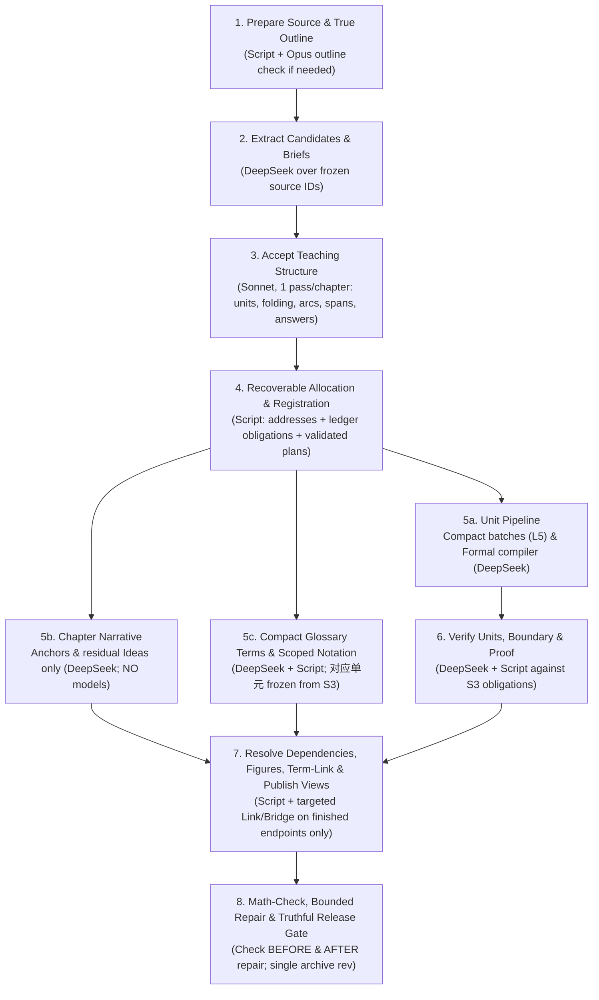

# Math Digest Redesign Proposal: Human-Centered Comprehension, Clean Ontology, and Truthful Pipeline Execution

| Field | Value |
|---|---|
| Status | Proposal (read-only analysis & design; no code or live archive modified) |
| Date | 2026-11-22 |
| Repo baseline | `0bb1b3a4` (`zt` 0.63.0, `zt-check` 0.22.0, `zt-digest` 0.55.0, `zt-math-digest` 5.12.12, `zt-digest-base` 5.12.9) |
| Live archive baseline | `thompson1914calculus` and comparison books (`becker2025division`, `hart1995firms`, `goldsmithpinkham2020bartik`, `hoyland2015path`) read at revisions `123354`–`123580` |
| Staging baseline | `D:\zt-digest\thompson1914calculus` |
| Live recheck | Round 3 recheck at archive revision `123583` (Thompson 1,406 Cards; Term layer 143 rows, 124 math + 19 concept heads, 84 continuations, 0 T faults). Earlier counts below are dated to the retained audit. |
| Design discussion | Four-round review with **Astra** (`gpt-6.2-astra`, effort `high`, standard tier; session `01a20267-721b-7b50-8d38-18d0ea32b49f`): rounds 1–2 with Antigravity (ontology, bugs), rounds 3–4 with Claude Opus 5.5 (job map, cost, attention budgets, efficiency balance); full verbatim record in [`docs/math-digest-redesign-discussion-log.md`](math-digest-redesign-discussion-log.md) |
| Related docs | `docs/math-cards-proposal.md`, `docs/math-cards-design.md`, `docs/math-cards-luhmann-comparison.md`, `docs/agents/workflow-principles.md`, `docs/agents/digest-job-map.md`, `docs/digest-cost-experience.md` |

---

## Executive Summary

**First principle:** Human attention is strictly limited, and humans learn mathematics best from **well-shown material** and **clearly linked concepts**. Every Card, diagram, and Link must earn its place in working memory.

An end-to-end audit of `zt-math-digest` and its first live mathematics tree, `thompson1914calculus` (*Calculus Made Easy*, Silvanus P. Thompson, 1914 — a ~200-page, 21-chapter introductory calculus book), shows that **the current tree is not fit for a human to learn calculus from**:

1. **The intended study interface is broken end-to-end.** Every single one of the **158 mathematical units** (62 definitions, 62 propositions, 28 theorems, 6 corollaries) still contains the unwritten placeholder `**陈述**：待写。` and title `……：待写`. All **96 results** have **zero parts**; all **30 Theory Cards** point at `待写` titles with **zero `unit -> unit` prerequisite links** (`unit->unit links: 0`). The better a reader follows ZET's Theory Board and Study Desk, the worse their experience becomes.
2. **Severe five-layer redundancy exhausts attention.** Even if the pipeline bugs were patched tomorrow, the current design splits a single elementary concept across **five overlapping card layers**: (a) chapter/section `idea` notes (503 cards) re-narrating every step of every proof, (b) 158 mathematical unit heads + 123 boundary parts, (c) 30 fragmented Theory Cards (including singletons titled `情形 2` and `另一道练习。`), (d) 37 parallel untyped (`NO_FORM`) economics-style models with 327 parts, and (e) **217 bloated mathematical Term Cards** (704,418 characters / ~1.13 MiB UTF-8, 80 multi-card `推导（续 2/2）` derivations, 109 carrying `（补：书中未写）` with anachronistic $\varepsilon$-$\delta$ proofs and factual math errors). On top of that, 96 cards under `/38`–`/48` hold disconnected answer keys and **21 cards summarizing the Project Gutenberg license**.
3. **The root causes are both infrastructural (P0) and architectural/pedagogical (P1–P2).** `zt-math-digest` was designed for the pre-ledger digest and never re-wired cleanly into draft-only `group-start`/`group-finish`, ledger unit registration, `zt-term-cards`, or `coverage`. Simultaneously, forcing a Bourbaki/Rudin unit template and formal-derivation Term template onto every sentence of an intuitive textbook fragments concepts and destroys reading flow.
4. **The money went to the wrong place.** The workflow paid to explain the mathematics several times while it left the designated place to learn it empty. The 37 untyped-model writer and review conversations alone cost **35.00 CNY-equivalent** (reconstructed from the retained Thompson sessions, §5.3). Card review made **953 selections on 500 distinct addresses**. Drive managers spent **24.41M of 46.94M** weighted Haiku tokens (52%) across the Thompson attempts. The genre explains why a calculus book needs more retrievable rules, worked examples and exercises than an economics paper needs models. It does not explain any of these costs.

**Why the math tree is inconsistent with the other Literatures.** The comparable measure across genres is not a card count. It is whether a reader can find one trustworthy answer and stop there. Hoyland sustains 569 Ideas (66 more than Thompson) because each level answers a different historical question. Becker sustains 296 model parts because a reader chooses one derivation after reading the model overview. Thompson fails this test at the power rule: its chapter route points to the parallel untyped model, its designated theorem is empty, and its exercise omits the link to an answer that is already in the tree.

**Core architectural thesis (agreed with Astra):**

> **The chapter owns the reading route; the typed mathematical unit owns the mathematics; the Term head owns lookup; and one accepted source plan lets scripts verify that each has done its job.**

This proposal lays out:
- **Part 1:** Live empirical comparison (`thompson1914calculus` vs. economics and history trees in ZET) and concrete comprehension failures.
- **Part 2:** Complete forensic root-cause catalog of the 9 verified pipeline/code bugs (Bugs A–I).
- **Part 3:** First-principles redesign of the mathematical knowledge ontology (one authoritative owner per learning task, unit-pipeline sole authorship, compact glossary Terms, L5 one-Card units, thematic Theory arcs, primary-owner coverage).
- **Part 4:** Visual pedagogy, link discipline, and an acceptance blueprint of Thompson's power-rule chapter.
- **Part 5:** Redesigned 8-stage dynamic workflow obeying `docs/agents/workflow-principles.md` ("one structure, no fallback", recoverable allocation, truthful fail-fast release gates), with the **job-map delta** (§5.2), the **Thompson cost ledger and planning case** (§5.3), and the **efficiency rules** that decide which work earns another message (§5.4).
- **Part 6:** Lever ranking, phased delivery plan (`P0` / `P1` / `P2`) with **cost per reader outcome**, clean rebuild & cutover protocol for `thompson1914calculus`, and explicit open decisions for the owner.

---

## Part 1: Empirical Audit & Cross-Literature Comparison

### 1.1 Quantitative Comparison Across ZET Literatures

Measured from live ZET `get_tree` exports (archive revisions `123354`–`123580`):

| Literature | Type | Total Cards (incl. root) | Top-Level Anchors | Model Heads | Model Parts | `term` Cards (incl. list & continuations) | `idea` Cards | `finding` / `cited` |
|---|---|---:|---:|---:|---:|---:|---:|---:|
| **`thompson1914calculus`** | `mathematics` | **1,396** | **48** | **225** | **450** | **218** (143 rows; 137 heads; 80 continuations) | 503 | 0 / 0 |
| `becker2025division` | `economics` | 776 | 15 | 3 | 296 | 129 (57 rows) | 263 | 26 / 59 |
| `hart1995firms` | `economics` | 1,096 | 11 | 19 | 291 | 92 (50 rows) | 457 (+4 Events) | 9 / 224 |
| `goldsmithpinkham2020bartik` | `economics` | 533 | 11 | 3 | 165 | 128 (105 rows) | 155 | 35 / 47 |
| `hoyland2015path` | `history` | 978 | 11 | 0 | 0 | 228 (227 rows) | 569 | 0 / 181 |

*Dating:* the Thompson row is the retained-audit snapshot. At revision `123583` Thompson has 1,406 Cards, 143 Term rows (124 math + 19 concept heads), 84 continuations and 0 T faults; the math failure is unchanged. Hart was corrected in round 3 (an earlier draft gave 507 parts and 254 Ideas). Top-level anchors include reference furniture (Becker `/14` glossary, `/15` bibliography).

*Note on denominators:* `term` counts include the Term table card and any `推导（续 2/2）` continuation cards; top-level anchors include chapter/section anchors plus furniture such as the Term table and Cited list. Raw card count alone is not reading load — what matters is **whether each depth level answers a distinct reader question**.

### 1.2 Anatomy of `thompson1914calculus` (1,396 Cards)

| Category | Count | State & Quality |
|---|---:|---|
| **Typed math units (`definition`)** | 62 | **62/62 still `待写`** on Model Card; 123 boundary `例子`/`非例` parts bolted onto empty `待写` heads |
| **Typed math units (`proposition`, `theorem`, `corollary`)** | 96 | **96/96 still `待写`**; **0 owned parts** across all 96 results (`zeroParts = 96/96`); 0 `前提`, 0 `证明思路`, 0 `证明：…`, 0 `假设作用` |
| **Theory Cards (`form=theory`)** | 30 | **30/30 reference `待写` unit titles**; **0 `unit -> unit` cites** across all 30 live `math.order` projections; includes singleton/subheading theories (`情形 1`, `情形 2`, `例。`, `另一道练习。`) |
| **Untyped models (`form=null`)** | 37 | **327 parts** built with economics facets (`推导`: 111, `命题`: 53, `设定`: 41, `数值例子`: 21, `假设`: 19, `猜想`: 2) — duplicating the 158 math units |
| **Idea / Literature notes** | 503 | Includes 48 flat anchors, step-by-step prose duplicating the 37 models, and **96 back-matter cards** under `/38`–`/48` (70 disconnected answer-key cards, 5 booklist cards, **21 Project Gutenberg license cards** under `/48`) |
| **Term Cards (`type=term`)** | 218 | 1 table (143 rows) + 137 published heads (**120 math, 17 concept**) + **80 continuation parts** (`推导（续 2/2）`); 704,418 body chars (~1.13 MiB UTF-8, avg 3,246 chars, max 7,134 chars); **109/217 carry `（补：书中未写）`**; status **degraded** (6 missing rows, 6 T-faults) |
| **Book Notation Table (`1|a`)** | 1 | 67 symbols pointing mostly to `待写` units and unvalidated chapter strings (`第 24 章`, `第 40 章` in a 21-chapter book) |
| **Link graph** | 4,526 ordinary links | **`unit -> unit` links: 0**; `zeroInbound`: 301 cards (21.6% of tree); 14 outbound cross-book Bridge links (some from `待写` heads), **0 external inbound links** |

### 1.3 Why Other Literatures Feel Readable While Thompson Fails

- **Economics (`becker2025division`, `hart1995firms`, `goldsmithpinkham2020bartik`):** Depth has a clear purpose. `becker2025division` has 15 top-level anchors matching the paper's true sections/appendices and **3 cohesive models** (`3|a` formal, `2|g|f` and `6|g` empirical). Opening `becker2025division/3|a` states the economic question and lets a reader drill down to `/3|a|a|5|a|a|1` only when they want the exact derivation of equation (14) from (13). Where an empirical result appears in both an Idea note (`/2|a|2`) and a Finding/empirical card (`/2|b`), the two reads buy different things (narrative reasoning vs. structured measurement, sample, result, limitation, and figure).
- **History (`hoyland2015path`):** Every level gives the reader a reason to enter and a clean place to stop. `hoyland2015path/2` states Chapter 1's thesis and lists its sections; `/2|d` opens a focused sub-question (imperial subsidies creating frontier states); `/2|f|a` gives the author's qualified claim and primary testimony. There are 11 top-level anchors matching the real book outline.
- **Thompson Case Study — Chapter 4, Power Rule (`thompson1914calculus/5`, 29 cards in the subtree, with competing routes):** A reader does not necessarily open all 29 cards; the fault is that the authored route from `/5` leads to the untyped `/5|c` (its only non-Term destinations are `/5|c` and the neighbouring sections) while the designated theorem `/5|a` is empty. For **one single formula** ($\frac{d}{dx}x^n = nx^{n-1}$), the subtree offers **four competing destinations**:
  1. Chapter anchor `/5` (1,306 chars) + **10 Idea notes** (`/5|d`..`/5|d|3|a|5`) narrating $x^3, x^4, x^5, x^n, x^{-2}, x^{1/2}$ and Exercise I.
  2. Official theorem `/5|a` (`form=theorem`, `level=formal`): **79 chars — `**陈述**：待写。`**.
  3. Singleton Theory Card `/5|b` (`form=theory`): titled `情形 2：...`, `**对象**：待写。`, 1-box SVG with zero edges pointing at `/5|a`.
  4. Parallel untyped model `/5|c` (`form=null`, **16 cards**: `设定`, 6 `推导`, 6 `命题`, 2 `猜想`, 1 `习题 I`), duplicating the 10 Idea notes step for step.
  5. Meanwhile, Exercise I at `/5|c|b` tells the reader *"答案见第 252 页"* — even though the ten answers already exist in this very tree at `/38|a`!

### 1.4 Concrete Mathematical & Pedagogical Defects Observed in Live Cards

1. **Fabricated formalism that introduces math errors (`thompson1914calculus/1|b|g`, `常数`):** Forced by the mathematical Term template to write a formal derivation for the word "constant," the card claims that adding any increment to a constant leaves its value unchanged — confusing *"varying $x$ leaves the constant function $f(x)=c$ unchanged"* with *$c+h=c$* (false whenever $h \ne 0$).
2. **Anachronistic rigor (`thompson1914calculus/1|b|b`, `无限小`):** Injects formal $\varepsilon$-$\delta$ real-analysis machinery (`（补：书中未写）`, 3,939 + 3,204 = 7,143 chars across two cards) onto Thompson's playful 1914 intuitive notion of "a little bit."
3. **Misleading numerical explanation (`thompson1914calculus/5|d`):** Title says *"数值例子：$dx$ 从 1 缩到 0.1，$\frac{dy}{dx}$ 仍得 200."* For $y=x^2$ at $x=100$ the increment is $200h+h^2$; the second-order contribution is $h^2$. After division by nonzero $h$ the exact finite quotient is $200 + h$, with residual $h$: **201** at $h=1$, **200.1** at $h=0.1$, limit **200**. Thompson gets 200 *only after discarding the second-order term*. The wording invites a beginner to miss the core lesson of the chapter.
4. **Incorrect inverse reasoning on disconnected answers (`thompson1914calculus/38|a`):** Because Exercise I answers were digested separately from the questions, the answer-card commentary attempts to infer the original problem from the derivative alone, ignoring the arbitrary constant $+C$ (e.g. $x^{13}$ vs. $x^{13}+C$).
5. **Over-fragmentation of visual intuition (`thompson1914calculus/12`):** The statement finder turned Thompson's single geometric discussion of curve slope into **17 separate units** (`45° 斜率的导数`, `大于 45° 的斜率`, `平缓上升的斜率`, `水平线的导数`, `下降曲线的负导数`, `直线的常数斜率`, ...) — concepts that belong in one unified slope comparison table/diagram.
6. **Low-value Bridge on an empty endpoint (`thompson1914calculus/10|b`):** Cross-book Bridge connected Thompson's `待写` acceleration unit to a macroeconomics card about recessions accelerating with duration.
7. **Editorial provenance buried inside boilerplate (`thompson1914calculus/48`, a 21-card mixed editorial/legal branch):** most cards summarize the Project Gutenberg license, burying `/48|a` (which holds genuine editorial provenance: redrawn figures and corrected numerical tables in Ch. 14) inside legal noise.

### 1.5 Genre or Pipeline? The Causal Chain

| Cause | Kind | Effect |
|---|---|---|
| **Genre decides which questions are worth retrieving.** A calculus reader asks how to recognize a rule, why it works, where it stops working, and whether an answer is right. A history reader asks what happened and what supports a claim. An economics reader enters one large model and selects one derivation. | Genre (legitimate) | Three Becker model heads, zero Hoyland model heads and many Thompson unit heads are all plausible. No genre gives a numerical card standard for another. |
| **The writer and the compiler received different definitions of the book's units.** `group_start` built the prompt from sections; `group_finish` restricted edits and registered model obligations from its own receipts; the math skeletons came by another path; the model stage intersected discovered models with claimable ledger units. | Pipeline (Bugs A, B) | 158 empty typed heads, and 37 untyped models that received all the compiler's work. This is the strongest causal finding. |
| **Downstream checks measured what survived.** Proof review selected units that already had proof parts; the generic audit reported 0 insufficient models while the math audit found 505 faults. The staged `math/index.json` already holds **125 resolved citation entries**. | Pipeline (Bugs C, E) | Zero published unit-to-unit links is not an extraction failure: the evidence existed upstream and had no path into accepted, linked heads. |
| **Batch boundaries and extraction candidates became reader-visible structure.** A flat heading changed chapter identity; the finder was told to list even unnumbered statements; nothing decided what to promote. | Pipeline (Bugs F, I) | A slope comparison became 17 units; a subheading became a singleton Theory Card. |
| **The Term template rewarded the wrong work.** The retained plan classified 86 math and 57 concept rows; writer promotion moved live publication to 124 math heads. The Term report shows 143/143 committed. | Pipeline (Bug I) | The workflow met its Term contract while it imposed a derivation on elementary words. |
| **Coverage made the narrative writer accountable for math-bearing paragraphs** (`coverage.rs` C1 uncovered block, C2 file-only span) while no accepted unit writer existed. | Pipeline (contract) | Coverage did not require ten prose cards for the power rule. The prompt, the coverage ownership and the missing unit writer together created that incentive. |

---

## Part 2: Forensic Root-Cause Analysis of `zt-math-digest`

`zt-math-digest` was originally authored for the pre-ledger digest (October 2026), where `groups/gNN.md` went straight to DeepSeek and `models` scanned every Model Card in the tree. Subsequent platform upgrades — the run ledger and draft-only `group-start`/`group-finish`, `zt-term-cards`, and `zt-math-skeleton` v4 — left the math variant structurally disconnected from the base.

| ID | Component & Verified Location | Root Cause | Concrete Effect on `thompson1914calculus` |
|---|---|---|---|
| **Bug A** | `tools/zt-digest/src/ledger.rs:7987-8030, 8086, 9818-9820` (`group_start`, `group_finish`); `tools/zt-digest/src/math.rs:285, 710-780` | `math::step_docs` writes `math-prefix.md` and `step_skeleton` appends `## 本组的数学单元` + `## 本组的例与习题` to `groups/gNN.md`. However, `group_start` builds `prompt.md` from raw `sections/sNN.md` (dropping the appended unit list) and hardcodes `shared-prefix.md` (containing `dsh-model-cards.zh.md`). Worse, `group_finish:9818` refuses any `edit_card` outside the owned anchor and earlier accepted outputs, so even if the writer *saw* `/5|a`, it could not edit it. | Digest writers never saw or filled any of the 158 unit skeletons, and instead followed `dsh-model-cards.zh.md` to create **37 parallel untyped (`NO_FORM`) models**. |
| **Bug B** | `tools/zt-digest/src/ledger.rs:2725, 10049-10082`; `scripts/book-digest/model-steps.ps1:191` | `models/gNNN-mIIII@1` ledger units are registered **only** from `group_finish` receipts. `math-skeleton` creates the 158 unit heads directly outside `group_finish` and registers no model-build units. `model-steps.ps1` intersects `models-all` with claimed ledger units. | All 158 math units have `group: null` in `models-all.l1.json`; **0 of 158 math units** were ever claimed or compiled by `models` (`model-architect-math.md` never processed a typed unit); only the 37 `NO_FORM` models ran. |
| **Bug C** | `tools/zt-digest/src/math.rs:1292, 1529`; `scripts/book-digest/workflow/modules/zt-math-proof.js:25`; `tools/zt-digest/src/audit.rs:767` | Downstream math stages derive their work queue from surviving live cards rather than the accepted source plan: `math-proof` enqueues only formal results that *already have* main-line proof parts (`units: []` → `status: done`); `math-boundary` bolts examples onto `待写` definitions and writes 0 `假设作用` because results have no `(H1)` labels; `audit.rs` computes `self_sufficient: true` on 0-part `待写` skeletons. | `math-proof` silently succeeded on 0 units; `math-boundary` produced 123 orphan-like parts on `待写` definitions; `math-theory` produced 30 `待写` boards with 0 edges; `audit.md` reported `Not self-sufficient: 0 of 225`. |
| **Bug D** | `scripts/book-digest/math-steps.ps1:88`; `tools/zt-digest/src/ledger.rs:3242`; `D:\zt-digest\thompson1914calculus\ledger.sqlite3` | **Ledger settlement split-brain:** `math-steps.ps1` executes `index-apply`, `docs`, `skeleton`, `theory-apply`, and `check` directly without settling the corresponding ledger units. Meanwhile `math-check` prints `ok: true` with 505 faults and the run report marks `complete: false` while local stage outputs look green. | In `ledger.sqlite3`, `math-index/book@1` remained `ready` and `math-skeleton/book@1`, `theory/book@1`, `math-check/book@1` remained `registered` despite live cards existing; `run-report.md` drifted from live DB state. |
| **Bug E** | `tools/zt-digest/src/ledger.rs:11390` (`link_start`) | `link_start` hardcodes `p.out.join("link-prefix.md")`, ignoring `profile.linkPrefix = "math-link-prefix.md"`. Gap-only linking checks generic connectivity on receipt-owned cards, not whether mathematical premises are expressed. | Math link rules (`按定义`, `特例`, no reach-ins, don't edit Theory Cards) never reached Link jobs; **0 `unit -> unit` links** exist across the book. |
| **Bug F** | `tools/zt-digest/src/math/index.rs:73, 219-225` | Index validation checks only quote presence, line bounds, and unit overlap — not whether a remark merits a unit. During resolution, first matching alias wins, unresolved citations silently vanish via `filter_map`, examples with unresolved owners can fall back to an arbitrary preceding unit, and `proof > 0` blindly sets `level = formal` (contradicting `model-architect-math.md:5`, where a one-line proof is `concept`). | 158 over-fragmented units; 16/173 examples and 6/21 exercises have no resolved `after` owner; `/5|a` marked `formal` from a one-sentence binomial appeal at `s05.md:123`. |
| **Bug G** | `tools/zt-digest/src/math.rs:335`; `scripts/book-digest/dsh-math-notation-instructions.zh.md:7` | `notation_table` deduplicates strictly on symbol string (contradicting the prompt rule to keep two senses across chapters) and accepts unvalidated text in the "defined at" column. | Live `/1|a` points to `"第 24 章"` and staged `notation.md:60` points to `"第 40 章"` in a 21-chapter book. |
| **Bug H** | `scripts/book-digest/workflow/zt-math-digest.blueprint.json:89, 114, 301, 418`; `zt-digest-base.blueprint.json:1341`; `math-steps.ps1:99` | Mode `math` lists `math-skeleton` and `models`, whose `when` predicates exclude mode `math`. `math-check` runs *after* `finalize` (so `finalize` cannot repair math faults) and gates on raw `args.citationKey` instead of the prepared key. On replay, `skeleton_units` reports newly `created` (`0`), conflating replay with empty allocation. | Repair mode `math` cannot rebuild missing math units; math audit cannot trigger bounded finalization repair. |
| **Bug I** | `src/math.rs:341, 810`; `tools/zt-digest/src/prepare.rs:296, 397`; `tools/zt-digest/src/term_cards.rs:157, 2072, 2248, 2715`; `tools/zt-digest/src/coverage.rs:6, 381, 397` | (1) `src/math.rs`: BOTH `theory_report` (`:810`) and `theories_of` (`:341`) treat *any* link from a Theory Card body to a unit head as theory membership — citing an external prerequisite accidentally enrolls it. (This does not explain Thompson's zero edges; it becomes damaging *once good links are added*.) (2) `prepare.rs` updates `chapter` on every flat H1 heading, turning 21 chapters into 48 groups / 47 chapter strings / 30 theories. (3) `term_cards.rs` classified 84 rows as math via broad formula/notation heuristics AND allowed asymmetric writer promotion (+36 rows, no downgrade) → 120 math Term cards. (4) `coverage.rs` ignores headings, figures, short blocks (<20 chars), and standalone equations, while letting any overlap discharge coverage. | Broken theory graphs if external links are added; 30 hyper-fragmented theories; 1.13 MiB of duplicated/error-prone Term derivations; coverage blind spots on short exercises/figures while forcing `digest` to duplicate unit algebra. |

---

## Part 3: First-Principles Redesign of the Math Knowledge Ontology

### 3.1 One Learning Task, One Authoritative Destination

Repetition is only harmful when two destinations both claim to be the authoritative explanation, or when a learner must visit three places to complete one task. Every artifact in a mathematics Literature tree must have **one clear reader question and one primary owner**:

| Reader's Question | Authoritative Owner | What Belongs There | What Must NOT Live There |
|---|---|---|---|
| *"Why did the author turn to this problem, and what is the chapter's arc?"* | **Chapter Anchor & Residual Narrative (`idea`)** | Motivating question, sequence of discoveries, historical/editorial context, distinctive analogies/voice (e.g. Swift's verse), and a curated reading route linking to the chapter's canonical units. | Step-by-step re-derivation of proofs/calculations already owned by a unit; `type: model` cards. |
| *"What is this concept/rule/method, when does it apply, and why is it true?"* | **Typed Mathematical Unit (`model` with `form`)** | Canonical statement or operational rule, declared scope & labels `(C1)/(H1)` where meaningful, source treatment (*derived / illustrated / asserted / supplied*), decisive reasoning or proof, intuition, and worked examples/contrast pairs. | Duplicate parallel untyped models; unverified anachronistic proofs. |
| *"How do these results build on one another across chapters?"* | **Thematic Theory Card (`form=theory`)** | One coherent mathematical arc's overarching question, ≤7 main results, key objects, explicit `**结构**` membership list, and prerequisite-ordered study route. | Singleton chapters or subheadings (`情形 2`, `例。`); incidental enrollment of external prerequisites via prose links. |
| *"What does this term mean in this book, and where is it defined?"* | **Compact Glossary Term Card (`type=term`)** | Term identity, avoid-words, book wording, concise gloss, verified source locator, and **one optional `对应单元：[[addr]]` link** to the canonical unit (definition, theorem, or rule). | Multi-card formal proofs (`推导（续 2/2）`), invented `（补：书中未写）` theorems, or symbol tables duplicating the unit/notation table. |
| *"What does this symbol mean in this scope?"* | **Scoped Notation Row (`符号表`)** | Keyed by `(symbol, sense, scope)`: symbol, concise meaning, active chapter/arc scope, and verified locator to the defining unit or first-use card. | Local dummy variables from a single proof; unvalidated free-text chapter numbers. |
| *"How do I recognize and execute this move?"* | **Worked Example (under owning unit)** | Input, choice of move, decisive transformation, result, and sanity check. Parallel repetitions of one move (e.g. $x^3, x^4, x^5$) fold into one comparison table; distinct moves or boundary cases get their own card. | Ten separate Idea cards repeating identical algebra. |
| *"Can I solve it myself and check my answer?"* | **Exercise / Exercise Set (under owning unit or chapter)** | Original problem(s) and subpart IDs, with the author's matched answer folded under `## 答案` (hidden on first attempt in Study Desk), keeping separate source locators for question and answer. | Unlinked answer-key chapters (`/38`–`/46`) or inferred problems that drop $+C$. |

### 3.1a Reader Attention Budget (Gate What a Publisher Can Prove, Pilot What Only Readers Can)

The first principle becomes measurable here. A release can prove that Exercise I has a reachable, correctly paired answer. It cannot prove by counting cards or characters that a learner understood higher-order smallness. So the mechanical measures are hard gates and the reader measures are pilot measurements.

| Measure | Standard | Evidence and use |
|---|---|---|
| **Canonical destinations per learning task** | **Hard gate.** Exactly one accepted endpoint for each promoted statement, definition, worked method or exercise-set ID. Aliases and references may be many. No route may advertise an unfinished endpoint as the answer. | `/5` recommends `/5|c` while `/5|a` is the designated theorem. A count of valid links would pass this defect; test the rendered chapter route and the Study Desk lookup against the same accepted ID. |
| **Chapter-to-statement distance** | **Hard gate.** Each chapter's designated main result is within **two** deliberate navigation clicks of its anchor (default **one**), counting only labeled reading routes or visible section navigation. | Becker `/3` → `/3|a` and Hoyland `/2` → `/2|d` are one labeled move. Thompson `/5` has a short route to the wrong owner: endpoint identity and distance both matter. |
| **Exercise-to-answer distance** | **Hard gate.** For an exercise with a source answer: zero extra searches and one intentional reveal from the exercise or subpart, matched by exercise and subpart ID. Record `no source answer` explicitly; never manufacture one. | `/5|c|b` → "page 252" while `/38|a` holds the answers. |
| **Theory Arc membership** | **Hard gate** on explicit membership, existing endpoints and valid prerequisite order. **Pilot** 4–10 members, 2–4 main results initially visible, inspect above 12. A one-member arc needs no board. Every displayed edge needs evidence; never impose a minimum edge count. | Thirty boards with no unit links offered no dependency route. |
| **Work for a single task** | **Pilot.** Statement lookup ≤ 2 cards opened including the anchor in the usual case; explaining one decisive derivation usually 3. Record median, worst case and wrong turns. A *wrong turn* is opening a destination presented as relevant and leaving without the promised information. Failed tasks are reported, never dropped from the mean. | Reading a whole proof and locating its decisive step are different tasks; the budget applies to the latter. |
| **Length by role** (projected Markdown characters) | **Pilot.** Chapter overview 350–800 (inspect > 1,000); glossary lookup 60–250 (> 400); compact unit 250–800 (> 1,000); proof or worked step 250–900 (> 1,200); Theory introduction 200–500 (> 700). | Top-level median / P90: Thompson `/1–37` 736 / 1,039, Becker `/1–13` 643 / 821, Hoyland `/1–9` 626 / 1,152. The ranges overlap, so a hard cap would harm useful overviews and still admit the empty 79-character theorem. |
| **Cards per source page** | **Pilot only.** Thompson planning case 350–450 Cards ≈ 1.75–2.25 per page against 7.03 live. Proof-led fixture: inspect chapters outside 2–5 teaching cards per instructional page. Publish total-tree and teaching-only density with denominators. | Freeze the edition and count instructional pages first (Thompson's answers sit on printed page 252, so "200 pages" is approximate). |
| **Human comprehension** | **Pilot qualification of P1** (not deferred to P2). The four reader tasks of §6.3 on matched slices; all reference answers correct in the artifact; provisional learner target ≥ 80% correct, no regression on transfer or source attribution; publish counts and sample size. | No live reader comparison exists yet. |

### 3.2 Sole Authorship of Units & Two Execution Shapes (`L5`)

1. **Remove unit-head authoring from `digest` completely.**
   - In a math digest, the narrative writer (`digest`) **never creates or edits any `type: model` Card**. `group_finish` hard-enforces this on the effective operation at apply time: it rejects editing an existing model (even if `type` is omitted), retyping an Idea as a model, creating a model part, or filing narrative cards inside a unit's proof chain.
   - Instead, **Stage 4 (Allocate & Register)** allocates immutable canonical addresses before narrative dispatch and passes the narrative writer each unit's ID, address, one-line summary, and owned source scope. The narrative writer links cleanly to those addresses (`引出` / `依赖` / route list); if a unit later fails review, the chapter's reader-ready status is withheld.
   - **Couplings handled explicitly:**
     - *Units → Narrative:* Chapter anchors exist from Stage 4; a unit links to a residual Idea card only if that Idea supplies something essential (ZET's reverse links already provide the return route to the chapter).
     - *`earlier-context` & `cards-book`:* `earlier-context` includes settled earlier cards plus clearly labeled accepted outlines of unfinished units. `cards-book` can review the whole reading route, but routes any fix touching a unit back to the unit owner rather than letting a generic prose fixer rewrite mathematics.

2. **Two execution shapes inside one Unit Pipeline (implementing approved decision `L5`):**
   - Choose execution shape by **what the learner needs to do**, not merely by `proof > 0`:
     - **Compact unit (`level: concept`, or short 1–3 sentence corollary/definition):** Written in batched DeepSeek unit jobs (first pilot: **4 independently receipted units per conversation, 2 per user message**, compared on the same source against 1 message of 4 and 4 messages of 1; failure of one item never erases accepted siblings) with an evidence-returning `SELF-CHECK`. Lives as **one self-contained Model Card** with structured bold sections (`**动机**`, `**定义**`/`**陈述**`, `**直觉**`, `**例子**`, `**非例**`, and short `**证明**` where applicable) — avoiding 3–4 thin stub cards per trivial definition. No separate Sonnet model-architect round.
     - **Substantive unit (`level: formal`, or complex definition/method with multi-step derivations or multiple worked examples):** Enters the one-conversation model compiler (`model-architect-math.md` + DeepSeek fill/derive/review/close/explain), which writes **both** the Model Card head and its planned parts from one validated plan.
   - **One Sonnet reading per arc packet (revised in round 4):** Merge formal architectural planning into **Stage 3 (Accept Teaching Structure)**. DeepSeek extracts source-backed candidates and **proposes every disposition** (promote or fold, compact or substantive, owner) with evidence. Sonnet plans **one provisional arc per request**, normally 2–4 short chapters or one dense chapter: it sees the whole manifest so it can catch a plausible but mistaken fold, and spends its design effort on disputed folds, cross-chapter ownership and substantive unit plans. Pilot packet target **24,000 Unicode characters** of candidate briefs plus source excerpts, **split threshold 32,000**, split at a dependency boundary with shared IDs carried across; an indivisible proof keeps its full evidence and the oversize exception is recorded. Opus handles only unresolved book-wide organization. The outline pass freezes **chapter identities** and only *proposes* packet boundaries; Theory membership is frozen after the architect has seen the dependencies, so a batching guess never becomes reader-facing structure. Stage 4 binds logical IDs to real addresses and materializes validated `plan.json` files.
   - **Why arcs, not chapters:** 21 chapter packets would cost about **15.1M** weighted Sonnet tokens at the historical mean per Sonnet agent, more than the 5 Sonnet agents of all Thompson attempts together (3.59M). Chapter-local architects also cannot settle folds that cross chapters. About 7 arc packets is the Thompson planning estimate; report packet size, requests, cache reads and accepted plans per request, since 7 requests say nothing about tokens if each packet is three times larger.
   - **The compiler's accepted-plan entry:** A math unit enters the compiler through its validated accepted plan. This entry omits brief generation and the architect call (`zt-model-lib.js:159`), rejects a missing or stale plan, and returns failed IDs to the plan owner. Keeping the architect call beside `plan.json` would be a second architectural route. Economics keeps its own entry.

### 3.3 Primary-Owner Source Coverage (Ending Forced Duplication)

Currently `coverage.rs` (`C1`: uncovered paragraph; `C2`: missing/invalid line range) forces `digest` to cover every paragraph of a section while ignoring headings, figures, blocks `<20` chars, and standalone display equations.

**Proposed rule:**
1. **Frozen source inventory with explicit object IDs:** Stage 1 assigns stable IDs not only to paragraphs, but also to **display equations, worked examples, exercises, answer entries, figures, and front/back-matter blocks**.
2. **Exactly one primary owner per source ID:** Stage 3 assigns every source ID a single primary destination (`unit:<id>`, `narrative:<chapter>`, `exercise:<id>`, `figure:<id>`, `provenance`, or `boilerplate_skip`). Any other card may cite the passage read-only, but **only the primary owner discharges coverage**.
3. **Handling mixed narrative/derivation passages cleanly:**
   - If an analogy **does the mathematical work** (e.g. Thompson's millionaire → secretary → boy giving $\frac{1}{100}$ of $\frac{1}{100}$ in `s02.md:87`), assign it to the owning unit with an explicit brief note to preserve the story as the worked example.
   - If a passage provides **distinctive voice, historical allusion, or literary color** (e.g. Dean Swift's flea verse in `s02.md:93`), assign it to a narrative Idea card; the unit may link to it without claiming duplicate coverage.
   - Split at existing block boundaries where functions clearly diverge; never ask a model to split half a sentence between two writers.
4. **Separate accountability counts at release:** Every frozen source ID must reach a verified disposition (`narrative_covered`, `unit_covered`, `exercise_answer_matched`, `figure_placed_or_justified`, `editorial_provenance`, `excluded_boilerplate`), with zero duplicate primary owners and zero silently dropped short objects.

**P1a interim projection (2026-11-23).** Until Stage 3 exists, the first P1 slice ([`docs/math-digest-p1a-design.md`](math-digest-p1a-design.md)) supplies the same projection from `math/index.json` schema 2. It keeps identity (`object_id`), primary destination and writer binding apart. DeepSeek proposes objects and destinations; the script accepts statements first and then binds dependent fragments (proofs, hints, answers, exercises) to them; an ambiguous assignment stays open and blocks its dependents. Residual exposition is a positive declaration, never a default for unclaimed text. The accepted teaching plan of Stage 3 later replaces this file as the one source of the same projection, and its consumers do not change.

### 3.4 Compact Glossary Term Contract (Option B for Mathematics)

In `thompson1914calculus`, 120 of 137 Term heads became massive mathematical derivation cards because `term_cards.rs` combined broad positive heuristics (84 planned math rows) with **asymmetric writer promotion** (+36 promoted rows, including `二项式定理`, `乘积求导法则`, `商求导法则`; no downgrade allowed; `term_cards.rs:2715`).

**Proposed contract (Option B — unified glossary format for `literature_type = mathematics`):**
- Every Term Card newly produced by `zt-math-digest` uses **one versioned compact glossary format** — the math writer cannot elect the legacy multi-card derivation template, and writer promotion to formal derivation is disabled for math books.
- **Fields:** standard Term metadata (`术语：`, optional `原文：`, `不用：`, `自动链接：`), explicit format marker, optional **`对应单元：[[addr]]`** (frozen from the accepted Stage-3 plan; named `对应单元` rather than `定义单元` so terms like *乘积求导法则* or *二项式定理* cleanly open a `theorem`, while vocabulary like *法新* has no target), `## 释义` (concise explanation; short formula allowed when clearest; no minimum-length padding), `## 书中的说法`, and verified `来源：`.
- **Checker & consumer updates:**
  - `zt-check` **T1–T2**: recognize the versioned glossary format, field order, optional `对应单元` ordinary link, and exact list/head/title identity.
  - **T3–T5**: for glossary format, validate compact structure and **forbid** `## 数学定义` / derivation sections and continuation parts (`推导（续 2/2）`). Legacy economics/science formal math Terms remain untouched.
  - **T6**: keep enabled (catches hand-wavy "obviously" / skipped-step language even in short glosses).
  - **T7–T10**: unchanged (`[[label@address]]` still targets Term heads for vocabulary lookup, keeping reasoning links and vocabulary links strictly separate; the applying service validates `对应单元` against the book, form, and accepted plan).
  - **`zt-term-sync`**: preserves Term head and `## 释义` (`等义术语` insertion remains idempotent). Because `term_standard.rs:229` hashes only sorted spellings, any rebuild that keeps spellings while changing addresses or senses must explicitly revalidate alignment and cross-book links.

### 3.5 Genre Fit, Unit Promotion Threshold, and Thematic Theory Arcs

1. **Keep the 6 stored `MathForm` values (`definition`, `axiom`, `theorem`, `proposition`, `lemma`, `corollary`), but stop treating them as an exhaustive bucket for every paragraph.**
   - Promote a candidate to a canonical unit only when it has: **(a) a source-identifiable statement or operational rule, (b) a distinct reader question, and (c) a genuine reason to retrieve it independently** (later dependency, substantive proof/derivation, consequential applicability boundary, or choice of technique).
   - Explicitly numbered environments in proof-led books (Rudin, Axler, Tao) always keep their source identities.
   - Repeated calculations ($x^3, x^4, x^5$), parallel readings of one picture (Ch. 10's 17 slope remarks), and prose paraphrases are **folded** into the owning unit (or a comparison table/gallery) while remaining traceable in the coverage inventory.
   - For computational methods without an independently stated theorem, use a narrative/method entry linked to the units it applies; introduce a 7th stored `method` form only if pilots prove a distinct Study Desk behavior that existing forms cannot express.
   - **Epistemic honesty:** Explicitly distinguish **derived**, **illustrated by example**, **asserted without proof**, and **editorially supplied** (`（补：书中未给）`). Never fabricate $\varepsilon$-$\delta$ proofs to satisfy a formal template; optional modern remarks must be clearly labeled and pedagogically justified.

2. **Decouple Chapter Spine, Writer Batches, and Thematic Theory Arcs.**
   - `prepare` must resolve the book's **true chapter outline** (against the table of contents and heading hierarchy, preserving real appendices, routing answer keys to exercise matching, booklists to reference material, editorial notes like `/48|a` to provenance, and Gutenberg license text to `boilerplate_skip`).
   - Job batching (`max_chars`) may split a long chapter into multiple writer batches without creating new top-level reader anchors.
   - **Thematic Theory Arcs (`form=theory`):** One Theory Card represents a coherent conceptual arc (1 chapter in a dense graduate text; 2–4 tightly coupled short chapters in an introductory text like Thompson — roughly **6–8 Theory Arcs** for Thompson, e.g. *Infinitesimals & Differentials [Ch 1–3]*, *Core Differentiation Rules [Ch 4–7]*, *Rates, Geometry & Extrema [Ch 8–12]*, *Algebraic Tricks & Inverse Functions [Ch 13]*, *Exponential, Logarithmic & Trigonometric Calculus [Ch 14–15]*, *Partial Differentiation [Ch 16]*, *Integration, Areas & Volumes [Ch 17–20]*, *Elementary Differential Equations [Ch 21]*). Never generate singleton Theory Cards or pad weak dependencies to hit a size floor.

3. **Sizing Hypothesis for a Redesigned `thompson1914calculus` (for Pilot Validation, Not a Hard Quota):**
   - Current broken tree: **1,396 cards** (48 top-level anchors, 225 model heads, 30 theories, 218 bloated term cards, 96 back-matter cards).
   - Redesigned estimate: **~350–450 cards** (~21 chapter anchors, ~7 Theory Arcs, ~50–80 promoted unit heads, ~80–110 substantive proof/worked-example parts, ~50–60 narrative notes, ~20–25 exercise-set cards with folded matched answers, ~90–137 compact glossary Term heads, and ~5 root/index/notation/reference cards).
   - These counts are **planning hypotheses**, not targets. The baseline for accepted typed units and unit edges is zero, so ratio claims ("3× less noise", "10× more links") are meaningless. Publish absolute accepted units, justified typed edges, unmatched obligations, lookup distance and task success (§3.1a). Keep a short unit on one card when the reader can finish the task there, and permit a section route without a separate Theory Card. Never impose a minimum arc size.

### 3.6 Core `src/math.rs` and GUI Updates (Bidirectional Membership + Section-Aware `L5`)

Two targeted Rust/GUI upgrades unlock the full value of ZET's existing Theory Board and Study Desk:

1. **Explicit bidirectional Theory membership (`src/math.rs:341` and `src/math.rs:810`):**
   - Change **both** `theory_report` (forward membership) and `theories_of` (reverse membership) to share one parser reading explicit member entries from `**结构**` (initially written by the allocator, reordered by dependency).
   - Prose links to external prerequisites or motivating examples inside a Theory Card body will no longer enroll external units into the local theory. Missing or malformed `**结构**` sections surface as an explicit membership fault.
2. **Section-aware compact units (`L5`) in `src/math.rs` (`:475, :649`), `src/gui/layout.js` (`:677`), and `src/gui/app.js` (`:5570, :6095`):**
   - Keep the Card address as the sole ZET identity (no synthetic sub-addresses), and add an optional **section selector** to Study Desk stations so a compact `concept` unit can present its bold sections (`**动机**`, `**定义**`/`**陈述**`, `**直觉**`, `**例子**`, `**非例**`, short `**证明**`) cleanly across Learn, Review, and Look-up modes.
   - Allow a compact card to occupy a **single Learn station** (preventing a two-sentence proof from forcing four clicks), ensure two panels for the same card never spoiler-leak each other's hidden sections (especially `## 答案` before recall), and validate nonempty section content (including TeX, bold quotes, and `chart` fences).
   - Update `unit_report` so `no_example`, `no_nonexample`, and `no_intuition` accept either a dedicated part OR a validated inline section (never double-counting both for M13 core budget; allowing explicitly justified plan omissions rather than fabricated contrasts).

---

## Part 4: Visual Pedagogy, Concept Linking, and Acceptance Blueprint

### 4.1 Acceptance Blueprint: What Thompson's Power-Rule Chapter (`/5`) Should Look Like

Instead of 29 fragmented cards across 4 competing layers, a beginner opening Chapter 4 (*Simplest Cases / Power Rule*) should experience one clean learning arc supporting four concrete tasks:

1. **See what is being discarded (Numerical Intuition):** For $y = x^2$ at $x = 100$, display a concise, labeled comparison table (and in P2, an optional secant-to-tangent $h$-slider):

   | Increment $h$ | Increment of $y$: $200h + h^2$ | Second-order part $h^2$ | Exact quotient $200 + h$ | Residual after division $h$ | Derivative (limit) |
   |---:|---:|---:|---:|---:|---:|
   | $1$ | $201$ | $1$ | $201$ | $1$ | $200$ |
   | $0.1$ | $20.01$ | $0.01$ | $200.1$ | $0.1$ | $200$ |

   The quantities are named exactly (an earlier draft called $h$ "the discarded higher-order term", which keeps part of the original teaching error); these values are the deterministic P1 table/figure fixture. This fixes `/5|d`'s misleading prose immediately and makes the role of `高阶小量可略去` (`rests-on` Ch. 2) visible at a glance.
2. **Inspect the decisive algebra once (Canonical Theorem Unit):** One authoritative `theorem` unit presents the cube expansion ($y=x^3$), compact comparison rows for $x^4$ and $x^5$, the binomial coefficient of the linear term ($nx^{n-1}dx$) as the crux for positive integers, and explicit scope testing for $n = -2$ and $n = \frac{1}{2}$ — preserving Thompson's honest caveat that negative/fractional powers are checked by example here rather than proved in full generality.
3. **Attempt Exercise I and reveal the matched answer:** One Exercise I card (linked from the unit) carries all 10 problems with their matched answers from `/38|a` folded under `## 答案` (hidden until reveal), retaining separate source locators for question and answer. Unmatched or colliding answers stay explicitly flagged; answers are never reverse-engineered by dropping $+C$.
4. **Follow verified conceptual links:**
   - *Within-book prerequisites:* Explicit `依赖` links from the power-rule derivation step to Ch. 2's higher-order-smallness unit and Ch. 3's differential-coefficient definition.
   - *Cross-book Bridge (P2, finished endpoints only):* Connect Thompson's power/chain-rule units to concrete operational uses in economics — for example, `becker2025division/3|a|a|5|a|a|1` differentiates powers of an affine quantity $H$ using the inner derivative $\pi\nu$ to derive a first-order condition. Bridges must name the exact shared mathematical operation and verify domain/exponent scope, rather than matching surface words like "acceleration" or "growth."

### 4.2 Visual Presentation Strategy (P1 Essential vs. P2 Selective Enrichment)

Visuals must clarify a misconception or structural relationship — never decorate a singleton card.

| Tier | Visual Deliverable | Rules & Verification |
|---|---|---|
| **P1 (Required for readable release)** | 1. **Original `artifact:` figures** bound to the exact unit, proof step, or narrative card that explains them (preserving printed figure number, caption, and editorial redrawing notes such as `/48|a`). 2. **One end-to-end static/structured visual acceptance fixture** (the power-rule $h=1, 0.1$ exact-vs-discarded comparison table/diagram). 3. **Truthful Theory Board navigation** driven strictly by verified `rests-on` premise edges; when an arc has no non-trivial DAG edges, render a clean ordered route instead of a disconnected box stack. | Verify rendered Chinese, KaTeX, labels, light/dark themes, narrow-viewport legibility, and spoiler-free answer reveal. Store visual brief, owner, and checks with the unit so repair/resume can verify them. |
| **P2 (Selective interactive enrichment)** | **Architect-nominated `图示` visuals** (NOT wholesale `zt-model-illustrate` over every head/setting): Sonnet nominates a visual only by naming *(i) the learner's misconception, (ii) what varies, (iii) what stays fixed, and (iv) what the learner should observe*. High-value Thompson candidates: secant-to-tangent $h$-slider; $(x+dx)^2$ area decomposition ($x^2 + 2x\,dx + (dx)^2$); common-axis slope-sign vs. concavity/extremum gallery (Ch. 10–12); narrow-strip Riemann area slider (Ch. 19). | Claude visual-composer role designs the interactive HTML/SVG (`src/gui/chart-frame.js`); DeepSeek writes source-grounded explanatory prose; scripts run numeric/data/placement checks. Every interactive visual must have a legible static initial state and caption, and must not be restricted solely to `core`-marked cards (a supporting example can merit the book's best diagram). |

### 4.3 Typed Link Discipline

- **`rests-on`** (`依赖`/`基于`/`按定义`): mathematical premise used in a statement or proof step. **Only `rests-on` drives prerequisite ordering and Theory Board dependency edges.** Reach-ins into another unit's proof parts remain blocked.
- **`specializes` / `relaxes`** (`特例` / `推广`): concept hierarchy (e.g., $y=x^2$ specializes $y=x^n$; $y=e^{ax}$ relaxes $y=e^x$).
- **`contrasts`** (`对照`/`反例`): discriminating boundary pair or counterexample.
- **`corresponds`** (`对应`/`等价`): equivalent characterizations, geometric↔algebraic correspondences, or cross-book operational bridges.
- **Term links (`[[label@address]]`)**: strictly vocabulary lookup to compact Term heads — never counted as reasoning links or model membership.
- **Ordering and receipts:** topologically order directed prerequisite (`rests-on`) edges only; render `contrasts` and `corresponds` separately. Key every review receipt to its purpose, source hash and relevant content revision, and recheck affected obligations after the last mutation (a link, figure or repair can make a faithful receipt stale).

---

## Part 5: Redesigned Dynamic Workflow Architecture

The redesigned `zt-math-digest` adheres strictly to `docs/agents/workflow-principles.md`: **one structure, no fallback**; DeepSeek for extraction/writing/verification labor; Sonnet for single-pass chapter structure & formal planning; Opus for book-level outline/organization judgment; scripts for deterministic allocation, validation, receipt recording, and release gating; Haiku managers running DSMP pools (≤8 jobs/manager, ≤8 managers).

**The eight stages are data and acceptance boundaries, not eight dispatches.** Three rules keep them cheap:

1. **Each decision is made once, by one role.** Scripts freeze the edition, source boundaries, identifiers and exact matches. DeepSeek proposes semantic roles, dispositions and evidence. Sonnet decides promotion, disputed ownership and cross-chapter structure from one shared arc outline. Each accepted decision is stored once; unambiguous mechanical matches bypass architectural review.
2. **One authoring queue.** Stage 5a (compact and substantive units) and 5b (narrative) are **one module**: one authoring start, one ready queue, one finish (`workflow-principles.md`, one queue, no lanes). Job kind decides the conversation shape and the write permissions; at most 8 jobs per Haiku manager and 8 managers. Stage 5c's glossary runs **after `cards-book`**, not beside the writers: the repository records that a Term plan frozen beside digest writers went stale when notation and evidence changed (`workflow-principles.md`, stale Term plan).
3. **A dispatch boundary needs a real verdict.** A job that needs another agent's verdict justifies a start/finish pair; two consecutive script operations do not. Preparation joins extraction start; allocation joins authoring start after Sonnet returns its validated plan; publication, exact figure binding, Term-link, math-check and final readback join the last finish.

**Drive budget.** Four dispatched modules (extraction, authoring, verification + `cards-book`, glossary) give **eight outer drives** on the clean path, before other base modules. The accepted-plan unit compiler uses two authoring drives per invocation, shared by all ready units (claim and package → write head, derivation and explanation in the unit's own conversation, several content messages, no drive between them → validate and commit → independent proof review → settle), and independent verification uses its own start and finish: **four drives through verified acceptance, zero per-unit drives**. An ambiguous relation queue or a repair that needs a new dispatch adds two drives each and is reported separately. Today the math-only modules alone hold **12 nominal drives** (index/skeleton/notation 4, boundary 3, proof 2, theory 2, check 1), on top of the base layers and the compiler's per-step transitions (fill, derive, review, close, explain, explain-apply; `zt-model-lib.js:223`). **Pilot target: drive-manager weighted Haiku tokens ≤ 25% of all workflow Haiku weighted tokens on the clean path** (historical Thompson: 52%), with absolute drive count and drive tokens per reader-ready chapter reported separately for clean runs and retries. Sonnet and Opus stay out of this denominator, so a costlier architect cannot make orchestration look efficient.

### 5.1 Stage-by-Stage Contracts

| Stage | Roles | Contract, Inputs & Acceptance Invariants |
|---|---|---|
| **1. Prepare Source & True Outline** | Script (+ Opus only if outline is ambiguous) | Freeze edition, SHA-256, true chapter IDs (distinct from writer batch splits), section spans, and **frozen source object inventory** (paragraphs, display equations, examples, exercises, answer entries, figures, editorial notes, boilerplate). Every span gets a source role (`exposition`, `example`, `exercise`, `answer`, `appendix`, `editorial_note`, `boilerplate`). |
| **2. Extract Candidates & Briefs** | DeepSeek (finder jobs) + Script | DeepSeek reads bounded source spans with line numbers and extracts candidate statements, operational rules, proof/worked-step briefs, exercise/answer IDs, symbol introductions, and proposed dependencies. Script validates quotes and bounds; **unresolved or ambiguous citations and example owners stay explicitly open** (never silently dropped by `filter_map`). |
| **3. Accept Teaching Structure** | Sonnet (1 request per arc packet; DeepSeek has proposed every disposition) | Reviews candidates by true chapter/arc. Emits the authoritative `teaching-plan.json`: (a) promoted canonical units vs. folded observations/tables, (b) compact (`L5`) vs. substantive (`formal`) shape + logical-ID formal plans (including `explain` designs), (c) Thematic Theory Arcs and explicit member lists, (d) primary-owner assignment for every frozen source ID, (e) Term→`对应单元` mapping, (f) exercise↔answer pairings, and (g) P1 figure bindings & P2 visual nominations. |
| **4. Recoverable Allocation & Registration** | Script | Binds logical IDs to real ZET addresses (`chapter` anchors, unit heads, Theory Cards), materializes validated `plan.json` files (failing plans return once with exact faults), and registers all unit-build, narrative, term, and verification obligations in `ledger.sqlite3`. **Recoverable protocol:** write allocation intent → execute identified archive batch → persist receipt → register/settle ledger obligation (crash-safe & idempotent on fresh run and resume). **Removes receipt-discovery as a source of math-unit births** (retained only for economics/ordinary variants). |
| **5. Write Units, Narrative, Terms & Notation** | DeepSeek (one authoring queue for 5a + 5b; glossary module after `cards-book`) + Script apply | **5a (Units):** Compact units run in independently receipted batches (4–8 units/job); substantive units run the one-conversation model compiler (`model-architect-math.md` plan, writing head + parts). **5b (Narrative):** Receives frozen chapter outline + allocated unit addresses/summaries; writes ONLY chapter anchors and assigned narrative `idea` cards (`group_finish` hard-rejects any `type: model` create/edit). **5c (Terms & Notation):** Writes compact glossary Term Cards (no derivation format, no writer promotion) and scoped `(symbol, sense, scope)` notation rows with validated locators. |
| **6. Verify Units, Boundary & Proof** | DeepSeek + Script | Compares read-back cards against `teaching-plan.json`: non-placeholder statements, scope/labels where meaningful, primary-owner source ID coverage, exercise↔answer fidelity, and proof obligations derived from Stage 3 (**a planned proof with 0 written steps is a hard unmet obligation**, never an empty-queue success). Boundary and proof review run **only** on accepted heads; a missing head blocks its dependents while independent units complete. |
| **7. Resolve Dependencies, Figures, Links & Views** | Script + DeepSeek (targeted links/bridge) | Resolves every proposed dependency from Stage 2/3 as `accepted`, `rejected(reason)`, or `unresolved` — writing verified `rests-on` / `specializes` / `contrasts` / `corresponds` links using `math-link-prefix.md` (fixing Bug E). Attaches book `artifact:` figures to their exact owners with editorial provenance. Publishes Theory Cards (explicit `**结构**`, verified DAG/route) and runs deterministic Term-linking *after* all writers finish. Bridge discovery admits **only finished, verified endpoints**. |
| **8. Math-Check, Bounded Repair & Release Gate** | Script + bounded DeepSeek repair | Runs `math-check` (M1–M18 + placeholder/obligation checks) **before** `finalize` so bounded repair can actually fix math faults (fixing Bug H), then re-runs after the last write so final audit, link checks, Term state, and reader projections bind to the **same archive revision**. Release gate compares accepted IDs, built IDs, reviewed obligations, and published IDs, separating `checks_executed`, `blocking_faults`, and `ready_for_study`. An empty review queue passes **only** when the Stage-3 expected set is independently empty. |

In P1a the Stage 1 inventory and the Stage 3 ownership columns are supplied by the interim projection of §3.3 ([`docs/math-digest-p1a-design.md`](math-digest-p1a-design.md) §2). Stages 1, 2 and 4 keep their roles: the script freezes leaves and chapters, DeepSeek proposes, the script accepts and allocates. No role decides an object twice.

### 5.2 Job-Map Delta for `docs/agents/digest-job-map.md`

The map's columns, current → PROPOSED. Right-hand sizes are **pilot settings**: a row turns `current` only after an instrumented real-book run (§5.4). The compiler default and range and the frozen blueprint argument change together (the map records one release whose old blueprint default overrode the binary). Two map corrections independent of the redesign: Theory uses a literal **4 Theory Cards per job** (`math.rs:1466`), not `-UnitsPerJob`; Bridge judges **12 selected sources per content job** (`bridge.rs:728`; `CHUNK = 40` at `:300` only limits archive reads). Rows marked **DELETE** are the cheapest jobs: the design no longer needs them.

| Workflow/module | Job | One subagent covers | Messages per conversation | Pattern | Status | Where the size is set |
|---|---|---|---|---|---|---|
| Math statement finder | Statements and exercises → source-backed candidates, proposed dispositions, briefs, symbol and Term evidence | Whole groups ≤ 30,000 chars → bounded adjacent source objects within one true chapter, same ceiling | 1 → 1 | One message | current → PROPOSED reshape (DeepSeek extraction kept) | `math-steps.ps1:34` `-IndexChars`, `math.rs:194` `index_jobs`, `dsh-math-index-instructions.zh.md`; add true-chapter boundary |
| Teaching structure (Sonnet) | Per-model architect inside the compiler → arc packet: accept manifest, resolve disputed folds/owners, plan substantive units | Compiler batch → **one provisional arc** (target 24,000 chars, split at 32,000) | One design request per batch → one per arc, + one scoped correction only for an invalid plan | Design role | PROPOSED replacement | `zt-model-lib.js:137,181`, `model-architect-math.md`; new arc-packet planner at S3, accepted-plan input at S4 |
| Compact math unit | New L5 writer | **4 compact units**, separate obligations and receipts | **2** (2 related units each), first pilot | Messages | PROPOSED new (inside the unit module) | compact job builder beside `math.rs` unit planning; blueprint `compactUnitsPerMessage=2`, `compactMessages=2` |
| Substantive math unit | brief → architect → fill → derive → review → split → close → explain → accepted-plan entry: write head + parts | 1 model → **1 substantive unit** | ~6–8+ → fill, derive when planned, close/explain as needed; independent review in its own row | Continued | PROPOSED reshape (brief, architect, split removed for math) | `zt-model-lib.js:137,159,197,226,251,266`, `model-steps.ps1`, blueprint `independentReview` |
| Ordinary model discovery in math | Register and compile narrative-created models | 1 model per writer conversation → 0 | — | — | **DELETE in math** (economics keeps it) | `ledger.rs:9818,10049`, `model-steps.ps1:191`; enforce on effective mutation and accepted-plan ID |
| Digest groups, **math** (split from econ row) | Full reading notes → chapter route + residual narrative only | ≤ 25,000 chars / 3 units → **one true chapter**, one residual source unit per message (none → one short anchor job) | 1 → one per nonempty residual packet | Messages | PROPOSED split of the row by genre; econ unchanged | `prepare.rs:397,680`, `ledger.rs` `message_parts`, math blueprint grouping |
| Term and notation discovery | Explorers + merge + book notation job → evidence gathered once by the finder, identities and scopes reconciled at plan acceptance | Explorer chunks + notation job → no second whole-source read | 1 each → 0 duplicate reads | Script projection | PROPOSED removal **after glossary recall is qualified** | `terms.rs`, `math-steps.ps1` notation, `math.rs:335`; scoped rows in finder schema |
| Term Cards, mathematical | write → self-check → review → fix → compact glossary Terms | 2 terms → **12 glossary terms** | 1 → 4 messages of 12 (owner size); 1 × 12 is a copied-box experiment | Messages | **DELETE heavy template in mathematics**; PROPOSED compact writer, after `cards-book` | `term_cards.rs:101,104,2715`, `termCardsPerJob`, `termCardsMathPerJob`; math-profile contract in planner and `zt-check` |
| Math boundary | Blanket contrast/hypothesis writing + review → owner writes planned boundary evidence | 4 units → inside each relevant unit | separate write/review → 0 standalone | inside unit fill | **DELETE standalone writer** | `math-steps.ps1:31,120`, `math.rs:956`, `zt-math-boundary.js:19` |
| Math proof / independent review | Review units with extant parts → review planned proof, domain, answer or supplement obligations | ≤ 4 units → **one substantial proof** or ≤ **4 short related obligations** with source and draft | 1 per reviewer, +1 to the writer only on a fault | One message, then Continued | PROPOSED reshape; one verdict discharges compiler and S6 obligations for the same revision | `math.rs:1292,1317`, `zt-model-lib.js:231`, blueprint `independentReview`; key by obligation + content hash |
| Math Theory | Theory writer (4 theories a job) → render accepted arc, rationale and verified edges | 4 theories → 0 writer jobs | 1 → 0 | Script | **DELETE standalone writer** | `math.rs:1466`, `zt-math-theory.js:19`; rationale accepted in S3, rendered in S7 |
| Links, math | Generic gap fill → resolve known dependencies by script; judge only ambiguous ones | ≤ 3 groups / 30 gaps → **≤ 12 candidate relations** with both endpoints and evidence | 1 → 1, only for ambiguity | One message | PROPOSED reshape | `layer-steps.ps1:146,166`, `ledger.rs:11390` (use `math-link-prefix.md`) |
| Card review and fix | Whole-book cycle + link-check cycle → selected fidelity/route review with receipt reuse | 40 Cards/job, 12/message (owner size, kept) | 3–4 + fix rounds → same, only for uncovered or changed obligations | Messages, then Continued | PROPOSED change of **denominator** (Thompson: 953 selections on 500 addresses) | `card.rs:48,2015,2044`, `cardFixRounds`; review purpose + input hash in selection |
| Figures | Scan ≤ 80 Cards → script binds exact figure IDs to accepted owners; judge exceptions | 80 Cards → ≤ **8 ambiguous figure/owner decisions** | 1 → 0 exact, 1 for exceptions | Script / One message | PROPOSED reshape | `figures.rs:588,596`; `figure_explain.rs` `IMAGES_PER_JOB=8` unchanged |
| Bridge | Judge cross-book uses → only finished, verified endpoints naming the shared operation | 12 sources → ≤ 12 nominated endpoints with short target excerpts | 1 → 1 | One message | PROPOSED narrower eligibility (P2) | `bridge.rs:728` content, `:46` reads |
| Math check and repair | Read-only report after finalize → deterministic pre-release check, owner correction, final reread | book-wide script; correction scoped to **one owning job's failed IDs** | 0 → 0 clean, +1 bounded correction | Script / Continued | PROPOSED change; no permanent math-fix pool | `zt-math-check.js:14`, `math.rs:1614,1764`, base finalize, `cardFixRounds` |
| Term-link, visual composer, organize | Deterministic linking; optional design | Term-link after final writes; P2: one nominated visual question per composer; Opus only for unresolved outline | 0 / 1 per approved visual or unresolved outline | Script / Design role | PROPOSED placement | `term-steps.ps1 -Step link`, `zt-organize`, `src/gui/chart-frame.js` |

**P1a interim rows (2026-11-23).** The first P1 slice changes payloads only, at today's sizes (interim P0 sizing; [`docs/math-digest-p1a-design.md`](math-digest-p1a-design.md) §5): the statement finder (typed keys, statement and step spans, relations, hints and answers, 30,000-character packing target), the math digest groups (assigned leaves, `route` and zero-write dispositions, exercise sets without unsourced answers), Card review and fix (residual coverage and route fidelity, 40 Cards a job, 12 a message), math unit builds (owned spans as source input) and math proof review (proof and statement fidelity against the source spans, ≤ 4 units). The right-hand sizes above stay proposals for later slices.

### 5.3 Thompson Cost Ledger and Planning Case

**The full Thompson bill is unknown; substantial parts are measurable.** The run report carries usage for 1 of 409 records (151,937 input tokens). `deepseek_usage` aggregates by day and provider and cannot isolate Thompson. The retained Thompson sessions support this attribution (CNY-equivalent at the cost study's fixed 1.0 / 0.14 / 3.2 CNY per million cache-miss / cached / output tokens):

| Thompson evidence | Measured quantity | Interpretation |
|---|---:|---|
| 37 untyped-model writer conversations + 36 derivation-review conversations | 1,400 calls; 4.806M cache-miss, 144.004M cached, 3.136M output; **35.00 CNY** (25.57 writer, 9.43 review) | All of it served the parallel `NO_FORM` branch. ≈ 0.107 CNY per published part (327). Excludes Claude and other stages. |
| Card review | `cards/report.json` 500 picked in 16 jobs; `cards-link/report.json` 453 in 16 jobs, all within the first 500 | **953 selections on 500 distinct addresses** (not "review over 1,396 Cards"). |
| Terms, finder, figures, Bridge | Plans: Terms 75 jobs, finder 9, figures 6, Bridge 60 sources / 5 jobs | A plan does not prove each job ran once; stage CNY is missing. |
| Claude, five Thompson attempts incl. resumes | 295 Haiku agents 46.94M weighted; 5 Sonnet 3.59M; 1 Opus 0.125M. **189 drive managers 24.41M** (≈ 129K each) | Historical spend across attempts, not a clean-path cost. Weighted = input + 1.25 × cache write + 0.1 × cache read + 5 × output (`token-usage.mjs:22`). |

**Two rate corrections.** 0.0021–0.0047 CNY per Card is **figure attachment**, not review; fidelity review cost **0.0190 per Card pooled** (0.0113–0.0228 across the two samples). The 0.35/0.42 vs 0.81/0.92 CNY figures are per-chapter comparisons on two source chapters; multiplying them by Thompson's 48 groups uses the wrong denominator.

**Planning case (DeepSeek CNY-equivalent; assumptions, not quotas):** 21 chapters, 65 units (45 compact, 20 substantive), 100 substantive parts, 110 glossary Terms, 150 eligible review selections.

| Component | Current Thompson or comparator | Proposed |
|---|---|---:|
| Chapter narrative | 503 Ideas, price missing; old chapter benchmark × 21 = 17.01–19.32 (comparator only) | **8.40** (21 × 0.40; range 7.35–8.82); residual-only writing needs its own measurement |
| Substantive units | **35.00** measured on the wrong branch (≈ 0.107/part); empirical pilot ≈ 0.07, Hansen 0.078 | **10.00** (100 × 0.10, incl. independent review; 7.00–10.70) |
| Compact units | heads stayed empty; no price | **5.40** (45 × 0.12, unmeasured allowance; 3.60–9.00) |
| Glossary Terms | 124 math heads, 1.13 MiB of output; stage cost unknown | **2.21** (110 × 0.0201, the concept-Term rate; an estimate) |
| Fidelity and route review | 953 selections × 0.019 = 18.08 (10.75–21.75), a workload valuation | **2.85** (150 × 0.019) |
| Finder, figure binding, base work, bounded repair | charges missing | **2.25** finder + **0.35** figure exceptions + **5.00** base, notation, checks, repair |
| **Total** | **unknown** (summing the subtotal and the proxies would be false precision) | **36.46 central; 28–52 planning envelope**; Claude extra |

Two conclusions. First, the whole redesigned book may cost about what the old run spent on the untyped-model branch alone: a testable target, not a demonstrated saving. Second, the largest known waste is not the `/48` license branch. It is a well-funded compiler pointed at the wrong heads plus an orchestration layer that rivals the content work.

**Sonnet budget.** Report Sonnet requests, packet characters, cache reads and accepted plans per request. "Once per arc" prevents rereading; it does not by itself prove a saving over the historical 3.59M.

### 5.4 Which Work Earns Another Message (Efficiency Rules)

- **Spend on source judgment that changes what the learner sees.** Keep DeepSeek extraction of unnamed rules, worked cases and exercises. Give Sonnet the excerpts, proposed folds, ambiguous owners and substantive proof briefs in one arc packet. Scripts match unique exercise numbers, bind exact IDs, validate labels and render an accepted order; sending such items to Sonnet buys no judgment.
- **Message-only jobs.** Each job carries its assigned spans, needed adjacent context, fixed IDs and acceptance rule, so it never browses (browsing was the cost in every measured module). A self-check returns item IDs, locators, values or exact faults; "checked" is not evidence. Independent verification is reserved for consequential algebra, scope, proof, supplied material and ambiguous answer matching; a second review of an unchanged proof needs a distinct obligation.
- **Size each job in the unit of the work, and measure before adopting.** Compact units: 4 per conversation, 2 per message, against 1 × 4 and 4 × 1 on the same source, scored on correctness, source treatment, useful example, omissions and cost incl. the manager. The card-review test (1 of 12 faults found with 40 Cards in one message, 9 of 12 with messages of 12) supports controlling the work per message; it does not fix the best size for short definitions. Glossary: the owner's 4 × 12 stays; 1 × 12 on the shorter payload is a paired test only (controlled test +18% for 4 × 12; real manager 0.0201 vs 0.0230 per term).
- **Qualification for `current`.** Paid paired variants run on copied baby-Rudin slices (owner rule, 2026-11-23: every paid math pilot uses the first chapters of Rudin's *Principles of Mathematical Analysis*); Thompson's paired answers, arithmetic and figure provenance stay as offline fixtures. Same model, effort and source revision, with an isolated provider window or reconstruction from session IDs. Measure with `session-report.mjs` (calls, browsing, faults, evidence), per-session tokens and `deepseek_usage`, `token-usage.mjs` for Claude, and drive counts, retries and wall time. Score against a frozen inventory of units, owned spans, answer pairs, figure bindings, prerequisite decisions and the §3.1a reader tasks. All hard gates pass, no required source object or seeded serious defect is lost, and cost per accepted outcome is published. A promising slice earns a pilot row; a successful instrumented real-book run earns `current`.

---

## Part 6: Phased Delivery Plan, Cutover Strategy & Open Decisions

### 6.0 Lever Ranking (Two Currencies Kept Separate)

The reader ranks are pilot hypotheses.

| Change | Savings rank | Reader-attention rank | Basis |
|---|---:|---:|---|
| Accepted units own the mathematics; no `NO_FORM` compilation in math | 1 | 1 | 35.00 CNY measured on the displaced branch (net of the cost of writing the right units); the reader gets a canonical statement that exists |
| Collapse deterministic drives; plan substantive units once per arc | 2 | 5 | 24.41M weighted Haiku tokens in historical drives, only part recoverable; little direct reader benefit |
| Reuse review receipts by purpose, source and content revision | 3 | 4 | 453 repeated selections, ≤ 8.6 CNY if all qualified; changed evidence still earns review |
| Compact glossary Terms instead of heavy math Terms | 4 | 3 | 124 math heads + 84 continuations live; stage CNY unknown, so the savings rank is provisional |
| Fold repeated algebra, true chapter routes, answers bound to exercises | 5 | 2 | the power rule read once, Exercise I checked with one reveal; savings not separable from narrative and model work |

**If only one P0 change ships, ship the acceptance gate.** It will correctly fail Thompson before it improves a single Card. That is the right first result: every later cost-per-outcome figure depends on knowing what was delivered.

### 6.1 P0 — Make Completion Truthful (Stop Shipping Broken Trees)

**Objective:** Eliminate silent `待写` publication, split-brain ownership, and fake-green audits without redesigning pedagogy yet.

**The gate (first change):** At finalization, reconcile every expected unit ID from the frozen source plan against an accepted, non-placeholder head and its required obligations at the final archive revision. A missing receipt, a placeholder, or an undischarged planned proof blocks book completion. (Today `audit.md:46` reports 0 insufficient models while `math-audit.md` reports 505 faults.)

- **Key changes:**
  1. Wire math allocation to ledger obligations (`math-steps.ps1` + `ledger.rs` recoverable allocation & settlement; fix Bug B & Bug D).
  2. Remove unit-head editing from `digest`, hard-forbid creating/editing `type: model` cards in math `group_finish`, and fix `link_start` to use `math-link-prefix.md` (fix Bug A & Bug E).
  3. Derive `math-boundary` and `math-proof` queues from the accepted source plan rather than surviving parts; fail loudly on unmet proof obligations and authored `待写` placeholders (fix Bug C).
  4. Fix `zt-math-digest.blueprint.json` mode `math` predicates, move `math-check` ahead of `finalize` (plus post-repair re-check), key on prepared citation key, and distinguish `created: 0` replay from empty allocation (fix Bug H).
  5. Update `audit.rs` so empty/placeholder models are never counted `self_sufficient: true`, and make the release gate consume `disposition: faults` and incomplete layers.
- **P0 Verification (on a copied archive & staging folder):**
  - Run the Thompson `/5` (power rule) slice through real `full` and `resume` entry points, including an injected crash between archive write and ledger settlement.
  - Assert: 1 typed theorem, 0 untyped `NO_FORM` heads, identical address after replay, active review obligation for the source argument, and a **hard failed release** when the theorem statement is deliberately left `待写`.
  - Regression test: confirm an economics digest still creates and compiles ordinary `NO_FORM` models normally.
- **P0 observed (2026-11-23, box copy `D:zt-pilot-thompson`, `c13ca62c`).** The Thompson power-rule slice ran on the real `full` and `resume` entry points: 17/17 units built and settled, 0 untyped Model Cards, 0 placeholders, 0 blocking math faults; eight pipeline faults were fixed test-first on the way. The run also showed the defect P1a targets: the narrative re-taught the proof in nine Idea Cards (`/5|c` … `/5|c|8`), Exercise I's answers were published twice, and one numeric example and one non-example were wrong.
- **P0 controls still outstanding:** the injected crash between archive write and ledger settlement, a deliberately unwritten theorem that must fail release, and the economics `NO_FORM` regression. They are recorded separately from the observations above.

### 6.2 P1 — One Authoritative Teaching Home Per Source Piece

**Objective:** Eliminate 5-layer redundancy, fix chapter/theory fragmentation, unify Term lookup with Units, match exercises to answers, and make compact units (`L5`) first-class in ZET.

- **Key changes:**
  1. Separate true chapter identity, writer batching, and Thematic Theory Arcs (`prepare.rs`, Stage 3, `math.rs`). Filter legal boilerplate to `boilerplate_skip` and preserve editorial notes (`/48|a`) as source/figure provenance.
  2. Implement Stage 3 (Sonnet single-pass teaching structure + candidate promotion/folding + primary-owner source ID assignment + exercise↔answer matching) and update `coverage.rs` to track explicit source objects (paragraphs, equations, exercises, figures, answers) by primary owner.
  3. Implement Option B compact glossary Term format (`对应单元：[[addr]]`) across `tools/zt-check/src/term.rs`, `tools/zt-check/src/core.rs`, `tools/zt-digest/src/term_cards.rs` (disabling writer math-promotion in math runs), and verify `zt-term-sync` idempotence.
  4. Fix `notation_table` (`tools/zt-digest/src/math.rs:335`) to key by `(symbol, sense, scope)` and validate locators (fix Bug G).
  5. Fix **both** `src/math.rs:341` (`theories_of`) and `src/math.rs:810` (`theory_report`) to read explicit `**结构**` membership; add section-aware compact `L5` support to `src/math.rs`, `src/gui/layout.js`, and `src/gui/app.js` (spoiler-safe reveal, single Learn station for short units).
  6. Ship P1 visual requirements: exact figure binding + power-rule numerical comparison table/diagram acceptance fixture + truthful Theory Board rendering.
- **P1 Pilot Qualification (copied box):** P1 is qualified by the §3.1a hard gates **and** the four reader tasks of §6.3 (moved forward from P2, so P1 is not declared a success on structural proxies alone), plus the §5.4 cost measurements.
  - **Paid pilots use baby Rudin only** (owner rule, 2026-11-23): Rudin Ch. 1–3 with the Chapter 1 Appendix and the Exercises is the first slice (P1a, [`docs/math-digest-p1a-design.md`](math-digest-p1a-design.md) §7); later paid pilots use the first Rudin chapters. Rudin supplies the proof-led cases: a deferred proof (1.19 → Appendix), lemmas cited by later theorems, multi-part theorems (3.11), unnumbered corollaries, and exercises with printed hints and no answers.
  - **Full-P1 fixtures kept from the earlier plan:** an external prerequisite mentioned in Theory prose, and a symbol reused with two senses across chapters.
  - **Thompson stays as offline fixtures** (no paid run): Exercise I with its printed key (answer pairing), the exact-versus-approximate arithmetic of the power-rule chapter, the 17-unit slope discussion (folding), and the editorial note `/48|a` with figure provenance.
  - P1a acceptance qualifies neither full P1 nor production replacement; Study Desk parity, the Theory routes and the full reader qualification stay with later slices.

### 6.3 P2 — Selective Visual Pedagogy, Cross-Book Bridges & Reader Evaluation

**Objective:** Elevate comprehension on hard conceptual leaps and validate empirically against human reading tasks.

- **Key changes:**
  1. Selective architect-nominated `图示` interactive visuals via the Claude visual-composer role (`src/gui/chart-frame.js`) + script numeric checks (secant slider, $(x+dx)^2$ area square, slope-vs-concavity gallery, Riemann strip slider).
  2. Finished-endpoint-only cross-book Bridge pass connecting mathematical units to concrete operational steps in economics models (e.g. `becker2025division/3|a|a|5|a|a|1`).
  3. **Task-based comprehension evaluation** (comparing the current tree vs. redesigned slice on four concrete tasks):
     - *Task 1:* Explain why $\frac{(100+h)^2 - 100^2}{h}$ gives 201 and 200.1 while Thompson keeps 200.
     - *Task 2:* Identify where Thompson's power-rule argument is proved vs. checked by example.
     - *Task 3:* Solve one Exercise I problem and verify the answer without spoilers.
     - *Task 4:* Follow a verified prerequisite link into a later chapter or economics application.
     - Measure correctness, wrong turns, cards opened, and transfer — alongside token cost per accepted unit (`docs/digest-cost-experience.md`). Do not treat raw reading time as an unconditional veto: spending slightly longer on a clear diagram that produces correct explanation is a win.
     - These Thompson tasks are the design examples; the P1a pilot measures P1a-specific Rudin tasks ([`docs/math-digest-p1a-design.md`](math-digest-p1a-design.md) §7: 1.19's construction, where 2.41 needs Euclidean space, 3.11 (a)–(c), Exercise 2.26's hint). Full P1 still tests transfer and prerequisite navigation, and the Thompson offline fixture keeps spoiler-safe answer verification.
     - The tasks first run on the P1 pilot as its baseline; P2 tests the *marginal* improvement of each visual or Bridge over that baseline.

### 6.3a Cost per Reader Outcome

Two book-level ratios replace cost per Card. **DeepSeek CNY-equivalent per accepted canonical unit** divides all scoped DeepSeek spend (failed attempts and review included) by accepted units. **Cost per reader-ready chapter** uses the same numerator over chapters whose routes, source obligations, exercises and checks all passed at publication. Report Haiku, Sonnet and Opus weighted tokens per outcome beside them, and provider charges where attributable. The denominator is frozen against the accepted teaching plan, so splitting one rule into five cannot improve the metric.

| Phase | Thompson target |
|---|---|
| Current | 0 accepted canonical units; cost per unit undefined; run report `complete: false` |
| P0 | Record pilot spend and accepted obligations separately. Visible cost per unit may rise, because P0 finally pays for completing a unit. |
| P1 | Planning case 28–52 CNY → **0.43–0.80 per accepted unit, 1.33–2.48 per reader-ready chapter** (central 0.56 and 1.74), plus Claude. |
| P2 | Charge each chart and Bridge to its nominated reader task; report incremental spend per additional correct explanation or transfer with the success counts. If the secant slider costs more and improves nothing over the P1 table, the table has earned its place and the slider has not. |

### 6.4 Handling Existing `thompson1914calculus` & Post-Digest Discipline

- **Clean rebuild over in-place patching:** Because faults span card ownership, chapter anchors, Term format, exercise/answer pairing, and theory membership, patching 1,396 broken cards in place would preserve damaged routes. Live archive verification at revision `123580` confirms **0 external authored inbound links** to any of the 1,396 Thompson cards, 14 outbound cross-book links (several on empty heads), and `thompson1914calculus` as the sole `mathematics` tree.
- **Rehearsed 4-step cutover (requires explicit owner approval before touching `D:\zt`):**
  1. Qualify P0 on copied box (`/5` slice).
  2. Qualify P1 on copied box (paid baby-Rudin slices + the Thompson offline fixtures).
  3. Generate the complete replacement `thompson1914calculus` tree on an isolated box and run the 4-task comprehension check + hard invariant checks (0 placeholders, 0 unmet obligations, 0 duplicate owners, 0 broken destinations, 0 mismatched answers).
  4. Immediately before live cutover: re-verify inbound links, locks, pins, and the 14 outbound bridges; produce an old-to-new address map if the owner has external citations/Spreads/bookmarks; back up `D:\zt\zt.sqlite3` via `VACUUM INTO` + `pragma integrity_check`; perform checked publication preserving rollback safety.
- **Chapter receipts, whole-book release:** Record `reader_ready` per chapter against a revision and its required dependencies (a missing prerequisite in another chapter blocks any chapter whose advertised route depends on it). Let independent work finish and keep accepted receipts for resume. Publish the Literature as finished only when every required chapter and every book-wide gate passes on the same final revision; report an incomplete run as *k of N chapters reader-ready* and resume the unmet or invalidated obligations. A released book stays finished. The live Term layer changed after the first draft of this proposal, so the cutover snapshot is refreshed immediately before any authorized cutover.
- **No mandatory post-digest math repair skill:** Unlike economics (which evolved post-digest folding/restructuring skills retroactively), `zt-math-digest` should deliver the clean chapter spine, canonical units, usable Study Desk stations, matched answers, and verified links on its **first accepted publication**. Any later math skill should exist only for optional enrichment (e.g., authoring an alternative geometric proof or cross-book study path), never to clean up routine digest damage.

### 6.5 Open Decisions for the Owner

The six core architectural choices above are converged. Four product/policy choices remain open for the owner before implementation:

0. **Does the P1 pilot earn its Claude architecture budget?** One accepted mathematical owner, honest coverage and reachable answers are already established needs. The economic question is whether an arc packet (≈ 7 Sonnet requests for Thompson) delivers them more reliably than a cheaper DeepSeek-only disposition with Sonnet ruling only on disputes. Thompson's retained transcripts make this a measurable trade-off; the proposal commits to the reader outcome and lets the paired pilot set the size. Related: adopting the compact-unit (4 units, 2 per message) and 1 × 12 glossary shapes, which change owner-set job sizes, needs the owner's decision after the copied-box tests.

1. **Thompson's Narrative Voice:** How much of Thompson's humor, anecdotes, and transitional prose (e.g. Swift's fleas, preface banter) should receive standalone addressable `idea` cards versus staying summarized inside chapter anchors and unit examples?
2. **Exercise & Worked-Example Granularity:** Should multi-part worked examples and exercise sets default to one card per exercise set (e.g. Exercise I with 10 subparts + folded answers) and comparison tables for parallel examples, or should individual hard problems/examples receive their own addresses?
3. **Old Address Continuity at Live Cutover:** Although ZET currently holds **zero external authored inbound links** into `thompson1914calculus`, does the owner have any saved Spreads, GUI bookmarks, or outside notes citing current `thompson1914calculus/*` addresses that require an explicit old-to-new address map at cutover?

---

## Appendix: Joint Review Notes (Antigravity & Astra)

This proposal reflects a two-round technical review between Antigravity and **Astra** (`gpt-6.2-astra`, effort `high`, standard tier; session `01a20267-721b-7b50-8d38-18d0ea32b49f`). Every code line and live archive figure cited above was verified directly against the repository and archive. Key refinements contributed during Astra's review include:
- Identifying ledger settlement split-brain (`math-steps.ps1` vs. `ledger.sqlite3`), hardcoded `link-prefix.md` (`ledger.rs:11390`), `notation_table` deduplication/locator gaps (`math.rs:335`), mode `math` predicate/finalize ordering bugs, and `coverage.rs` blind spots on short objects/equations/figures.
- Discovering that **36 of the 120 math Term cards** came from asymmetric writer promotion (`term-cards/report.json`, `term_cards.rs:2715`), proving that heuristic tuning alone would fail and cementing Option B (versioned compact glossary format with `对应单元`).
- Catching that Theory membership must be fixed in **both** `theory_report` (`src/math.rs:810`) and `theories_of` (`src/math.rs:341`), and specifying section-aware Study Desk reveal rules without synthetic ZET addresses.
- Framing allocation across SQLite stores as **recoverable allocation** (intent → identified op → receipt → obligation) rather than assuming cross-store atomicity, and replacing "beats every metric" with hard invariants plus 4 concrete learner comprehension tasks.

**Rounds 3–4 (Claude Opus 5.5 & Astra, 2026-11-22)** — on the owner's request to tie the redesign to the job map, cost and efficiency balance under the attention principle:
- Live recheck at revision `123583`; corrected Hart counts, dated snapshots, the `/5` route description, the h vs h² fixture wording, and the Theory-membership and coverage attributions; added the genre-vs-pipeline causal chain (§1.5).
- Turned the first principle into gates and pilot measures (§3.1a).
- Job-map delta with DELETE rows (§5.2); Thompson cost ledger reconstructed from retained sessions (35.00 CNY on the untyped-model branch; 953 review selections on 500 addresses; drives 52% of Haiku tokens) and a 28–52 CNY planning case (§5.3); efficiency rules and the qualification path to `current` (§5.4).
- Converged in round 4: Sonnet plans per **arc packet** (24k target / 32k split) with DeepSeek proposing every disposition; the accepted-plan compiler entry drops brief/architect/split; **one authoring queue** for units and narrative, glossary after `cards-book`; drive budget ≤ 25% of Haiku tokens, 8 outer drives; chapter receipts with whole-book release; the acceptance gate as the single first P0 change (§§3.2, 5.1, 6.0, 6.1, 6.4).
