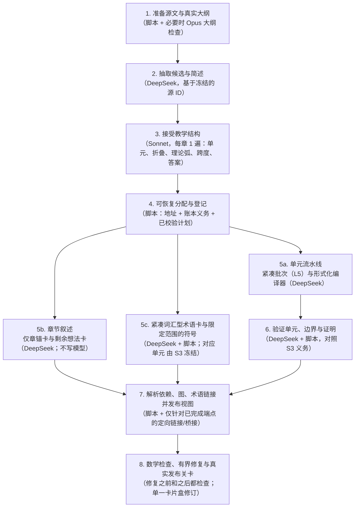

# 数学摘读重新设计提案：以人的理解为中心、清晰的本体结构与真实可信的流水线执行

| 字段 | 值 |
|---|---|
| 状态 | 提案（只读分析与设计；未修改任何代码或线上卡片盒） |
| 日期 | 2026-11-22 |
| 仓库基线 | `0bb1b3a4`（`zt` 0.63.0、`zt-check` 0.22.0、`zt-digest` 0.55.0、`zt-math-digest` 5.12.12、`zt-digest-base` 5.12.9） |
| 线上卡片盒基线 | `thompson1914calculus` 及对照书目（`becker2025division`、`hart1995firms`、`goldsmithpinkham2020bartik`、`hoyland2015path`），读取于修订版 `123354`–`123580` |
| 暂存基线 | `D:\zt-digest\thompson1914calculus` |
| 线上复核 | 第 3 轮复核，卡片盒修订版 `123583`（Thompson 共 1,406 张卡片；术语层 143 行，124 个数学头卡 + 19 个概念头卡，84 张续卡，0 个 T 故障）。下文较早的计数以保留的审计为日期基准。 |
| 设计讨论 | 与 **Astra**（`gpt-6.2-astra`，effort `high`，standard tier；会话 `01a20267-721b-7b50-8d38-18d0ea32b49f`）进行的四轮审阅：第 1–2 轮与 Antigravity（本体结构、缺陷），第 3–4 轮与 Claude Opus 5.5（任务图、成本、注意力预算、效率平衡）；完整逐字记录见 [`docs/math-digest-redesign-discussion-log.md`](math-digest-redesign-discussion-log.md) |
| 相关文档 | `docs/math-cards-proposal.md`、`docs/math-cards-design.md`、`docs/math-cards-luhmann-comparison.md`、`docs/agents/workflow-principles.md`、`docs/agents/digest-job-map.md`、`docs/digest-cost-experience.md` |

---

## 执行摘要

**第一原则：** 人的注意力严格有限，人学习数学最好的方式是依靠**展示良好的材料**和**链接清晰的概念**。每一张卡片、每一幅图、每一个链接都必须证明自己值得占用工作记忆。

对 `zt-math-digest` 及其第一棵线上数学树 `thompson1914calculus`（*Calculus Made Easy*，Silvanus P. Thompson，1914 —— 一本约 200 页、21 章的微积分入门书）所做的端到端审计表明，**当前这棵树不适合人用来学习微积分**：

1. **预定的学习界面从头到尾都是坏的。** **158 个数学单元**（62 个定义、62 个命题、28 个定理、6 个推论）中的每一个仍然含有未写的占位 `**陈述**：待写。` 和标题 `……：待写`。全部 **96 个结果**都有**零个分卡**；全部 **30 张理论卡**都指向 `待写` 标题，且 **`unit -> unit` 前提链接为零**（`unit->unit links: 0`）。读者越是按照 ZET 的理论板和学习台去读，体验就越差。
2. **严重的五层冗余耗尽注意力。** 即使流水线缺陷明天就被修补，当前设计仍把一个初等概念拆散到**五个相互重叠的卡片层**：(a) 章/节 `idea` 笔记（503 张卡片），逐步重述每个证明的每一步；(b) 158 个数学单元头卡 + 123 个边界分卡；(c) 30 张碎片化的理论卡（包括标题为 `情形 2` 和 `另一道练习。` 的单卡理论）；(d) 37 个并行的无类型（`NO_FORM`）经济学式模型，含 327 个分卡；(e) **217 张臃肿的数学术语卡**（704,418 个字符 / 约 1.13 MiB UTF-8，80 个跨多卡的 `推导（续 2/2）` 推导，109 张带有 `（补：书中未写）`，内含时代错置的 $\varepsilon$-$\delta$ 证明和事实性数学错误）。此外，`/38`–`/48` 下有 96 张卡片存放互不相连的答案，另有 **21 张卡片在概述 Project Gutenberg 许可证**。
3. **根本原因既是基础设施层面的（P0），也是架构/教学层面的（P1–P2）。** `zt-math-digest` 是为账本之前的摘读而设计的，从未被干净地重新接入仅草稿的 `group-start`/`group-finish`、账本单元登记、`zt-term-cards` 或 `coverage`。同时，把 Bourbaki/Rudin 式的单元模板和形式推导式的术语模板强加给一本直观教科书的每一句话，会把概念切碎并破坏阅读流程。
4. **钱花错了地方。** 工作流付费把数学解释了好几遍，却让学习数学的指定位置空着。仅 37 个无类型模型的写作与审阅对话就花费 **35.00 CNY 等价**（由保留的 Thompson 会话重建，§5.3）。卡片审阅在 **500 个不同地址上做了 953 次选择**。在多次 Thompson 尝试中，驱动管理器花掉了 **46.94M 加权 Haiku token 中的 24.41M**（52%）。体裁可以解释为什么一本微积分书所需的可检索规则、例题和习题，多于一篇经济学论文所需的模型。体裁不能解释上述任何一项成本。

**为什么数学树与其他文献不一致。** 跨体裁可比的量度不是卡片数量，而是读者能否找到一个可信的答案并在那里停下。Hoyland 能承载 569 张想法卡（比 Thompson 多 66 张），因为每一层回答一个不同的历史问题。Becker 能承载 296 个模型分卡，因为读者在读完模型概览后只选一条推导。Thompson 在幂法则处就未通过这一检验：它的章节路径指向并行的无类型模型，它指定的定理是空的，它的习题漏掉了指向一个已经存在于树中的答案的链接。

**核心架构论点（与 Astra 达成一致）：**

> **章负责阅读路径；有类型的数学单元负责数学；术语头卡负责查找；一份已接受的源计划让脚本能够验证每一方都完成了自己的工作。**

**检查一致（所有者原则，2026-11-23，§3.7）：** 交给 DeepSeek 任务的标准就是最终标准。任务的自查、阶段的应用与账本收尾、最终审计使用同一套规则，写成一个函数、两个调用者。任务不会因为一条它看不到的规则而被退回。

本提案阐述：
- **第 1 部分：** 线上实证比较（`thompson1914calculus` 对照 ZET 中的经济学树和历史树）与具体的理解失败。
- **第 2 部分：** 9 个已核实的流水线/代码缺陷（缺陷 A–I）的完整取证式根因目录。
- **第 3 部分：** 从第一原则出发重新设计数学知识本体（每个学习任务只有一个权威归属、单元流水线唯一作者、紧凑的词汇型术语卡、L5 单卡单元、按主题组织的理论弧、主归属覆盖）。
- **第 4 部分：** 视觉教学法、链接纪律，以及 Thompson 幂法则一章的验收蓝图。
- **第 5 部分：** 重新设计的 8 阶段动态工作流，遵守 `docs/agents/workflow-principles.md`（"一种结构，无后备"、可恢复分配、真实且快速失败的发布关卡），包括**任务图差异**（§5.2）、**Thompson 成本账本与规划案例**（§5.3），以及决定哪些工作值得再发一条消息的**效率规则**（§5.4）。
- **第 6 部分：** 杠杆排序、分阶段交付计划（`P0` / `P1` / `P2`）及**每个读者成果的成本**、`thompson1914calculus` 的干净重建与切换协议，以及留给所有者的明确待决事项。

---

## 第 1 部分：实证审计与跨文献比较

### 1.1 ZET 各文献的定量比较

由线上 ZET `get_tree` 导出测得（卡片盒修订版 `123354`–`123580`）：

| 文献 | 类型 | 卡片总数（含根卡） | 顶层章锚卡 | 模型头卡 | 模型分卡 | `term` 卡片（含列表与续卡） | `idea` 卡片 | `finding` / `cited` |
|---|---|---:|---:|---:|---:|---:|---:|---:|
| **`thompson1914calculus`** | `mathematics` | **1,396** | **48** | **225** | **450** | **218**（143 行；137 个头卡；80 张续卡） | 503 | 0 / 0 |
| `becker2025division` | `economics` | 776 | 15 | 3 | 296 | 129（57 行） | 263 | 26 / 59 |
| `hart1995firms` | `economics` | 1,096 | 11 | 19 | 291 | 92（50 行） | 457（+4 张事件卡） | 9 / 224 |
| `goldsmithpinkham2020bartik` | `economics` | 533 | 11 | 3 | 165 | 128（105 行） | 155 | 35 / 47 |
| `hoyland2015path` | `history` | 978 | 11 | 0 | 0 | 228（227 行） | 569 | 0 / 181 |

*日期说明：* Thompson 一行是保留审计时的快照。在修订版 `123583`，Thompson 有 1,406 张卡片、143 个术语行（124 个数学头卡 + 19 个概念头卡）、84 张续卡和 0 个 T 故障；数学方面的失败没有变化。Hart 一行在第 3 轮中被更正（较早的草稿给出 507 个分卡和 254 张想法卡）。顶层章锚卡包括参考性附属结构（Becker `/14` 词汇表、`/15` 参考文献）。

*关于分母的说明：* `term` 计数包括术语表卡片和所有 `推导（续 2/2）` 续卡；顶层章锚卡包括章/节章锚卡以及术语表和引文列表等附属结构。单看原始卡片数并不等于阅读负担 —— 重要的是**每一深度层级是否回答一个不同的读者问题**。

### 1.2 `thompson1914calculus` 的解剖（1,396 张卡片）

| 类别 | 数量 | 状态与质量 |
|---|---:|---|
| **有类型数学单元（`definition`）** | 62 | **62/62 在模型卡上仍为 `待写`**；123 个边界 `例子`/`非例` 分卡被硬接在空的 `待写` 头卡上 |
| **有类型数学单元（`proposition`、`theorem`、`corollary`）** | 96 | **96/96 仍为 `待写`**；全部 96 个结果**拥有的分卡为 0**（`zeroParts = 96/96`）；0 个 `前提`、0 个 `证明思路`、0 个 `证明：…`、0 个 `假设作用` |
| **理论卡（`form=theory`）** | 30 | **30/30 引用 `待写` 单元标题**；全部 30 个线上 `math.order` 投影中 **`unit -> unit` 引用为 0**；包括单卡/小标题式理论（`情形 1`、`情形 2`、`例。`、`另一道练习。`） |
| **无类型模型（`form=null`）** | 37 | 用经济学分面构建的 **327 个分卡**（`推导`：111，`命题`：53，`设定`：41，`数值例子`：21，`假设`：19，`猜想`：2）—— 与 158 个数学单元重复 |
| **想法 / 文献笔记** | 503 | 包括 48 张扁平章锚卡、与 37 个模型重复的逐步散文，以及 `/38`–`/48` 下的 **96 张书末卡片**（70 张互不相连的答案卡、5 张书目卡、`/48` 下 **21 张 Project Gutenberg 许可证卡片**） |
| **术语卡（`type=term`）** | 218 | 1 张表（143 行）+ 137 个已发布头卡（**120 个数学、17 个概念**）+ **80 张续卡分卡**（`推导（续 2/2）`）；正文 704,418 个字符（约 1.13 MiB UTF-8，平均 3,246 个字符，最多 7,134 个字符）；**109/217 带有 `（补：书中未写）`**；状态 **degraded**（缺 6 行，6 个 T 故障） |
| **全书符号表（`1|a`）** | 1 | 67 个符号，大多指向 `待写` 单元和未经验证的章节字符串（一本 21 章的书中出现 `第 24 章`、`第 40 章`） |
| **链接图** | 4,526 个普通链接 | **`unit -> unit` 链接：0**；`zeroInbound`：301 张卡片（占树的 21.6%）；14 个出站跨书桥接链接（部分来自 `待写` 头卡），**0 个外部入站链接** |

### 1.3 为什么其他文献读起来顺畅，而 Thompson 失败

- **经济学（`becker2025division`、`hart1995firms`、`goldsmithpinkham2020bartik`）：** 深度有明确的目的。`becker2025division` 有 15 张顶层章锚卡，对应论文真实的节/附录，以及 **3 个内聚的模型**（`3|a` 形式模型，`2|g|f` 和 `6|g` 实证模型）。打开 `becker2025division/3|a`，它陈述经济学问题，读者只有在想看方程 (14) 如何由 (13) 精确推出时才需要深入到 `/3|a|a|5|a|a|1`。当一个实证结果同时出现在想法笔记（`/2|a|2`）和发现卡/实证卡（`/2|b`）中时，两次阅读带来不同的收获（叙事推理 vs. 结构化的测量、样本、结果、局限和图）。
- **历史（`hoyland2015path`）：** 每一层都给读者一个进入的理由和一个干净的停止位置。`hoyland2015path/2` 陈述第 1 章的论点并列出其各节；`/2|d` 打开一个聚焦的子问题（帝国补贴造就边疆国家）；`/2|f|a` 给出作者有限定的论断和第一手证词。有 11 张顶层章锚卡，对应真实的书籍大纲。
- **Thompson 案例研究 —— 第 4 章，幂法则（`thompson1914calculus/5`，子树中 29 张卡片，存在相互竞争的路径）：** 读者不一定会打开全部 29 张卡片；问题在于，从 `/5` 出发的已写路径通向无类型的 `/5|c`（它唯一的非术语目的地是 `/5|c` 和相邻各节），而指定的定理 `/5|a` 是空的。针对**仅仅一个公式**（$\frac{d}{dx}x^n = nx^{n-1}$），该子树提供了**四个相互竞争的目的地**：
  1. 章锚卡 `/5`（1,306 个字符）+ **10 张想法笔记**（`/5|d`..`/5|d|3|a|5`），叙述 $x^3, x^4, x^5, x^n, x^{-2}, x^{1/2}$ 以及习题 I。
  2. 正式定理 `/5|a`（`form=theorem`，`level=formal`）：**79 个字符 —— `**陈述**：待写。`**。
  3. 单卡理论卡 `/5|b`（`form=theory`）：标题为 `情形 2：...`，`**对象**：待写。`，一幅只有 1 个框、0 条边的 SVG，指向 `/5|a`。
  4. 并行的无类型模型 `/5|c`（`form=null`，**16 张卡片**：`设定`、6 个 `推导`、6 个 `命题`、2 个 `猜想`、1 个 `习题 I`），逐步重复那 10 张想法笔记。
  5. 与此同时，`/5|c|b` 处的习题 I 告诉读者 *"答案见第 252 页"* —— 而这十个答案其实就在这棵树的 `/38|a` 中！

### 1.4 在线上卡片中观察到的具体数学与教学缺陷

1. **编造的形式化引入了数学错误（`thompson1914calculus/1|b|g`，`常数`）：** 数学术语模板迫使它为"常数"一词写一个形式推导，于是该卡片声称给常数加上任意增量后其值不变 —— 把 *"改变 $x$ 不会改变常数函数 $f(x)=c$"* 与 *$c+h=c$* 混为一谈（只要 $h \ne 0$ 后者即为假）。
2. **时代错置的严格性（`thompson1914calculus/1|b|b`，`无限小`）：** 在 Thompson 1914 年轻松直观的"一点点"概念上，注入形式化的 $\varepsilon$-$\delta$ 实分析工具（`（补：书中未写）`，两张卡片共 3,939 + 3,204 = 7,143 个字符）。
3. **误导性的数值解释（`thompson1914calculus/5|d`）：** 标题写着 *"数值例子：$dx$ 从 1 缩到 0.1，$\frac{dy}{dx}$ 仍得 200."* 对 $y=x^2$ 在 $x=100$ 处，增量为 $200h+h^2$；二阶贡献为 $h^2$。除以非零的 $h$ 后，精确的有限差商为 $200 + h$，余项为 $h$：$h=1$ 时为 **201**，$h=0.1$ 时为 **200.1**，极限为 **200**。Thompson *只有在舍去二阶项之后*才得到 200。这一措辞会让初学者错过本章的核心要点。
4. **在互不相连的答案上做了错误的逆向推理（`thompson1914calculus/38|a`）：** 由于习题 I 的答案与题目是分开摘读的，答案卡的评注试图仅凭导数反推原题，忽略了任意常数 $+C$（例如 $x^{13}$ vs. $x^{13}+C$）。
5. **视觉直观被过度碎片化（`thompson1914calculus/12`）：** 陈述查找器把 Thompson 对曲线斜率的单一几何讨论变成了 **17 个独立单元**（`45° 斜率的导数`、`大于 45° 的斜率`、`平缓上升的斜率`、`水平线的导数`、`下降曲线的负导数`、`直线的常数斜率`、...）—— 这些概念应当归入一张统一的斜率比较表/图。
6. **建立在空端点上的低价值桥接（`thompson1914calculus/10|b`）：** 跨书桥接把 Thompson 的 `待写` 加速度单元连到一张关于衰退随持续时间加速的宏观经济学卡片。
7. **编辑来源信息被埋在样板文字中（`thompson1914calculus/48`，一个由 21 张卡片组成、编辑与法律内容混杂的分支）：** 大多数卡片在概述 Project Gutenberg 许可证，把 `/48|a`（其中含有真正的编辑来源信息：第 14 章中重绘的图和更正的数值表）埋在法律噪声之中。

### 1.5 体裁还是流水线？因果链

| 原因 | 种类 | 结果 |
|---|---|---|
| **体裁决定哪些问题值得检索。** 微积分读者问的是如何识别一条法则、它为什么成立、它在哪里失效、一个答案是否正确。历史读者问的是发生了什么、什么支持一个论断。经济学读者进入一个大模型并选择一条推导。 | 体裁（正当） | Becker 的 3 个模型头卡、Hoyland 的 0 个模型头卡和 Thompson 的许多单元头卡都是合理的。没有哪个体裁能为另一个体裁给出数值化的卡片标准。 |
| **写作者和编译器收到了关于本书单元的不同定义。** `group_start` 由各节构建提示；`group_finish` 按自己的回执限制编辑并登记模型义务；数学骨架经由另一条路径而来；模型阶段把发现的模型与可认领的账本单元取交集。 | 流水线（缺陷 A、B） | 158 个空的有类型头卡，以及 37 个拿走了编译器全部工作的无类型模型。这是最强的因果发现。 |
| **下游检查度量的是幸存下来的东西。** 证明审阅选择的是已经有证明分卡的单元；通用审计报告 0 个不充分的模型，而数学审计发现了 505 个故障。暂存的 `math/index.json` 已经含有 **125 条已解析的引用条目**。 | 流水线（缺陷 C、E） | 已发布的单元到单元链接为零并不是抽取失败：证据在上游存在，只是没有通路进入已接受、已链接的头卡。 |
| **批次边界和抽取候选变成了读者可见的结构。** 一个扁平标题改变了章的身份；查找器被告知连未编号的陈述也要列出；没有任何环节决定升格什么。 | 流水线（缺陷 F、I） | 一个斜率比较变成了 17 个单元；一个小标题变成了单卡理论卡。 |
| **术语模板奖励了错误的工作。** 保留的计划把 86 行归为数学、57 行归为概念；写作者升格把线上发布改成了 124 个数学头卡。术语报告显示 143/143 已提交。 | 流水线（缺陷 I） | 工作流满足了它的术语契约，同时把推导强加给了初等词语。 |
| **覆盖让叙事写作者对承载数学的段落负责**（`coverage.rs` C1 未覆盖块、C2 仅文件跨度），而当时并不存在已接受的单元写作者。 | 流水线（契约） | 覆盖并没有要求为幂法则写十张散文卡片。是提示、覆盖归属和缺失的单元写作者共同制造了这一激励。 |

---

## 第 2 部分：`zt-math-digest` 的取证式根因分析

`zt-math-digest` 最初是为账本之前的 digest（2026 年 10 月）编写的。在那个版本中，`groups/gNN.md` 直接交给 DeepSeek，`models` 扫描树中的每一张模型卡。其后的平台升级——运行账本与只写草稿的 `group-start`/`group-finish`、`zt-term-cards`，以及 `zt-math-skeleton` v4——使数学变体在结构上与基础版脱节。

| ID | 组件与已核实位置 | 根因 | 对 `thompson1914calculus` 的具体影响 |
|---|---|---|---|
| **Bug A** | `tools/zt-digest/src/ledger.rs:7987-8030, 8086, 9818-9820`（`group_start`、`group_finish`）；`tools/zt-digest/src/math.rs:285, 710-780` | `math::step_docs` 写出 `math-prefix.md`，`step_skeleton` 向 `groups/gNN.md` 追加 `## 本组的数学单元` 与 `## 本组的例与习题`。但是，`group_start` 用原始的 `sections/sNN.md` 构建 `prompt.md`（丢掉了追加的单元列表），并硬编码 `shared-prefix.md`（其中包含 `dsh-model-cards.zh.md`）。更严重的是，`group_finish:9818` 拒绝所属章锚卡与先前已接受输出之外的任何 `edit_card`，所以即使写手*看到了* `/5|a`，也无法编辑它。 | digest 写手从未看到、也从未填写 158 个单元骨架中的任何一个，反而按照 `dsh-model-cards.zh.md` 建立了 **37 个并行的无类型（`NO_FORM`）模型**。 |
| **Bug B** | `tools/zt-digest/src/ledger.rs:2725, 10049-10082`；`scripts/book-digest/model-steps.ps1:191` | `models/gNNN-mIIII@1` 账本单元**只**从 `group_finish` 回执登记。`math-skeleton` 在 `group_finish` 之外直接建立 158 张单元头卡，不登记任何模型构建单元。`model-steps.ps1` 把 `models-all` 与已认领的账本单元取交集。 | 在 `models-all.l1.json` 中，全部 158 个数学单元都是 `group: null`；**158 个数学单元中有 0 个**曾被 `models` 认领或编译（`model-architect-math.md` 从未处理过一个有类型的单元）；只运行了 37 个 `NO_FORM` 模型。 |
| **Bug C** | `tools/zt-digest/src/math.rs:1292, 1529`；`scripts/book-digest/workflow/modules/zt-math-proof.js:25`；`tools/zt-digest/src/audit.rs:767` | 下游数学阶段从现存的在线卡片推出工作队列，而不是从已接受的源计划推出：`math-proof` 只把*已经有*主线证明分卡的形式结果加入队列（`units: []` → `status: done`）；`math-boundary` 把例子硬接到 `待写` 定义上，并且因为结果没有 `(H1)` 标签而写出 0 个 `假设作用`；`audit.rs` 对 0 个分卡的 `待写` 骨架算出 `self_sufficient: true`。 | `math-proof` 在 0 个单元上静默成功；`math-boundary` 在 `待写` 定义上产生了 123 个近似孤立的分卡；`math-theory` 产生了 30 块 `待写` 板，边数为 0；`audit.md` 报告 `Not self-sufficient: 0 of 225`。 |
| **Bug D** | `scripts/book-digest/math-steps.ps1:88`；`tools/zt-digest/src/ledger.rs:3242`；`D:\zt-digest\thompson1914calculus\ledger.sqlite3` | **账本结算裂脑：**`math-steps.ps1` 直接执行 `index-apply`、`docs`、`skeleton`、`theory-apply` 和 `check`，不结算对应的账本单元。同时，`math-check` 在有 505 个故障时打印 `ok: true`，运行报告标记 `complete: false`，而本地阶段输出看起来全部正常。 | 在 `ledger.sqlite3` 中，尽管在线卡片已经存在，`math-index/book@1` 仍为 `ready`，`math-skeleton/book@1`、`theory/book@1`、`math-check/book@1` 仍为 `registered`；`run-report.md` 偏离了在线数据库的状态。 |
| **Bug E** | `tools/zt-digest/src/ledger.rs:11390`（`link_start`） | `link_start` 硬编码 `p.out.join("link-prefix.md")`，忽略 `profile.linkPrefix = "math-link-prefix.md"`。只补缺口的链接步骤检查回执所属卡片的一般连通性，不检查数学前提是否已被表达。 | 数学链接规则（`按定义`、`特例`、不越层伸入、不编辑理论卡）从未到达链接任务；全书**有 0 条 `unit -> unit` 链接**。 |
| **Bug F** | `tools/zt-digest/src/math/index.rs:73, 219-225` | 索引校验只检查引文是否存在、行号边界和单元重叠，不检查一条评注是否值得成为一个单元。在解析时，第一个匹配的别名胜出，未解析的引用经 `filter_map` 静默消失，所属方未解析的例子可能退回到前面任意一个单元，并且 `proof > 0` 盲目地设定 `level = formal`（与 `model-architect-math.md:5` 矛盾，该处规定一行的证明属于 `concept`）。 | 158 个过度碎片化的单元；16/173 个例子与 6/21 个习题没有解析出 `after` 所属方；`/5|a` 因 `s05.md:123` 处一句对二项式的援引而被标为 `formal`。 |
| **Bug G** | `tools/zt-digest/src/math.rs:335`；`scripts/book-digest/dsh-math-notation-instructions.zh.md:7` | `notation_table` 严格按符号字符串去重（与提示词中"跨章保留两种含义"的规则矛盾），并在"定义于"一列接受未经校验的文本。 | 在一本 21 章的书中，在线的 `/1|a` 指向 `"第 24 章"`，暂存的 `notation.md:60` 指向 `"第 40 章"`。 |
| **Bug H** | `scripts/book-digest/workflow/zt-math-digest.blueprint.json:89, 114, 301, 418`；`zt-digest-base.blueprint.json:1341`；`math-steps.ps1:99` | 模式 `math` 列出了 `math-skeleton` 和 `models`，而它们的 `when` 谓词排除了模式 `math`。`math-check` 在 `finalize` *之后*运行（因此 `finalize` 无法修复数学故障），并且以原始的 `args.citationKey` 而不是准备后的键作为关卡条件。重放时，`skeleton_units` 报告新 `created` 的数目（`0`），把重放与空分配混为一谈。 | 修复模式 `math` 无法重建缺失的数学单元；数学审计无法触发有界的 finalize 修复。 |
| **Bug I** | `src/math.rs:341, 810`；`tools/zt-digest/src/prepare.rs:296, 397`；`tools/zt-digest/src/term_cards.rs:157, 2072, 2248, 2715`；`tools/zt-digest/src/coverage.rs:6, 381, 397` | (1) `src/math.rs`：`theory_report`（`:810`）与 `theories_of`（`:341`）**都**把理论卡正文中指向单元头卡的*任何*链接当作理论成员关系——引用一个外部前提会意外地把它纳入理论。（这并不能解释 Thompson 的零条边；它在*加入好的链接之后*才会造成损害。）(2) `prepare.rs` 在每一个平铺的 H1 标题处更新 `chapter`，把 21 章变成 48 个组 / 47 个章字符串 / 30 个理论。(3) `term_cards.rs` 借助宽泛的公式/符号启发规则把 84 行归为数学行，**并且**允许不对称的写手升格（+36 行，不允许降格）→ 120 张数学术语卡。(4) `coverage.rs` 忽略标题、图、短块（<20 字符）和独立方程，同时让任何重叠都能解除覆盖义务。 | 如果加入外部链接，理论图就会损坏；30 个极度碎片化的理论；1.13 MiB 重复且易错的术语推导；在短习题/图上存在覆盖盲点，同时迫使 `digest` 重复单元中的代数推导。 |

---

## 第 3 部分：数学知识本体的第一性原理重设计

### 3.1 一个学习任务，一个权威去处

只有当两个去处都声称自己是权威解释，或者学习者必须访问三个地方才能完成一个任务时，重复才有害。数学文献树中的每一个制品都必须有**一个明确的读者问题和一个主归属**：

| 读者的问题 | 权威归属 | 应放在那里的内容 | 不得放在那里的内容 |
|---|---|---|---|
| *"作者为什么转向这个问题？这一章的脉络是什么？"* | **章锚卡与剩余叙事（`idea`）** | 引发动机的问题、发现的顺序、历史/编辑背景、有特色的类比/语气（例如 Swift 的诗句），以及一条精选的阅读路线，链接到本章的规范单元。 | 对已归某个单元所有的证明/计算逐步重新推导；`type: model` 卡片。 |
| *"这个概念/法则/方法是什么，何时适用，为什么成立？"* | **有类型的数学单元（带 `form` 的 `model`）** | 规范陈述或操作法则、声明的适用范围及有意义时的标签 `(C1)/(H1)`、来源处理方式（*推导 / 举例说明 / 断言 / 补写*）、决定性推理或证明、直觉，以及例题/对照对。 | 重复的并行无类型模型；未经核实的时代错置证明。 |
| *"这些结果如何跨章彼此构建？"* | **主题理论卡（`form=theory`）** | 一条连贯数学弧的总问题、≤7 个主要结果、关键对象、明确的 `**结构**` 成员列表，以及按前提排序的学习路线。 | 单章或小标题（`情形 2`、`例。`）；通过正文链接偶然纳入的外部前提。 |
| *"这个术语在本书中是什么意思，在哪里定义？"* | **紧凑的词汇型术语卡（`type=term`）** | 术语标识、避用词、书中措辞、简洁释义、已核实的来源定位，以及**一个可选的 `对应单元：[[addr]]` 链接**，指向规范单元（定义、定理或法则）。 | 多卡片的形式证明（`推导（续 2/2）`）、编造的 `（补：书中未写）` 定理，或与单元/符号表重复的符号表。 |
| *"这个符号在这个范围内是什么意思？"* | **有范围的符号行（`符号表`）** | 以 `(symbol, sense, scope)` 为键：符号、简洁含义、生效的章/弧范围，以及指向定义单元或首次使用卡片的已核实定位。 | 单个证明中的局部哑变量；未经校验的自由文本章号。 |
| *"我如何识别并执行这一步操作？"* | **例题（在所属单元之下）** | 输入、操作的选择、决定性变换、结果和合理性检查。同一操作的并行重复（例如 $x^3, x^4, x^5$）折叠成一张对比表；不同的操作或边界情形各有自己的卡片。 | 十张重复相同代数的独立想法卡。 |
| *"我能自己解出来并核对答案吗？"* | **习题 / 习题组（在所属单元或章之下）** | 原题及其小题 ID，作者的对应答案折叠在 `## 答案` 之下（在学习台中首次作答时隐藏），题目与答案各自保留来源定位。 | 未链接的答案章（`/38`–`/46`），或丢掉 $+C$ 的推断题目。 |

### 3.1a 读者注意力预算（对发布方能证明的设关卡，对只有读者能证明的做试点）

第一性原理在这里变得可测量。一次发布可以证明习题 I 有一个可到达、配对正确的答案。它不能通过计数卡片或字符来证明学习者理解了高阶小量。所以机械指标是硬关卡，读者指标是试点测量。

| 指标 | 标准 | 证据与用途 |
|---|---|---|
| **每个学习任务的规范去处** | **硬关卡。**每一个升格的陈述、定义、例题方法或习题组 ID 恰有一个已接受的终点。别名和引用可以有多个。任何路线都不得把未完成的终点宣传为答案。 | `/5` 推荐 `/5|c`，而指定的定理是 `/5|a`。统计有效链接数会让这个缺陷通过；应以同一个已接受 ID 测试渲染出的章路线和学习台查找。 |
| **章到陈述的距离** | **硬关卡。**每章指定的主要结果距其章锚卡不超过**两次**有意的导航点击（默认**一次**），只计带标签的阅读路线或可见的分节导航。 | Becker `/3` → `/3|a` 和 Hoyland `/2` → `/2|d` 都是一次带标签的移动。Thompson `/5` 有一条通往错误归属的短路线：终点身份和距离都重要。 |
| **习题到答案的距离** | **硬关卡。**对有来源答案的习题：零次额外搜索，从习题或小题出发一次有意的展开，按习题和小题 ID 匹配。明确记录 `no source answer`；绝不制造答案。 | `/5|c|b` → "page 252"，而 `/38|a` 存放答案。 |
| **理论弧成员关系** | 对明确的成员关系、存在的终点和有效的前提顺序设**硬关卡**。**试点** 4–10 个成员，初始可见 2–4 个主要结果，超过 12 个时检查。只有一个成员的弧不需要板。每条显示的边都需要证据；绝不强加最少边数。 | 三十块没有单元链接的板没有提供任何依赖路线。 |
| **单个任务的工作量** | **试点。**通常情况下，查找陈述打开 ≤ 2 张卡片（含章锚卡）；解释一个决定性推导通常 3 张。记录中位数、最坏情况和走错路。*走错路*指打开一个被呈现为相关的去处，却在未获得所承诺信息的情况下离开。失败的任务要报告，绝不从均值中剔除。 | 读完整个证明与找到其决定性步骤是不同的任务；预算适用于后者。 |
| **按角色的长度**（投影后的 Markdown 字符数） | **试点。**章概览 350–800（> 1,000 时检查）；词汇查找 60–250（> 400）；紧凑单元 250–800（> 1,000）；证明或例题步骤 250–900（> 1,200）；理论引言 200–500（> 700）。 | 顶层中位数 / P90：Thompson `/1–37` 736 / 1,039，Becker `/1–13` 643 / 821，Hoyland `/1–9` 626 / 1,152。各范围相互重叠，所以硬上限会损害有用的概览，同时仍会放行空的 79 字符定理。 |
| **每源页卡片数** | **仅试点。**Thompson 规划案例 350–450 张卡片 ≈ 每页 1.75–2.25 张，而在线为 7.03。以证明为主的样例：检查每个教学页在 2–5 张教学卡片之外的章。发布整树密度与仅教学密度，并附分母。 | 先冻结版本并统计教学页数（Thompson 的答案位于印刷页 252，所以"200 页"是近似值）。 |
| **人的理解** | **P1 的试点资格条件**（不推迟到 P2）。在匹配的切片上做 §6.3 的四个读者任务；制品中所有参考答案正确；暂定学习者目标正确率 ≥ 80%，在迁移或来源归属上无退步；发布计数和样本量。 | 目前尚无在线读者对比。 |

### 3.2 单元的唯一作者与两种执行形态（`L5`）

1. **从 `digest` 中彻底移除单元头卡的编写。**
   - 在数学 digest 中，叙事写手（`digest`）**绝不建立或编辑任何 `type: model` 卡片**。`group_finish` 在应用时对实际生效的操作硬性执行这一点：它拒绝编辑已有模型（即使省略了 `type`）、把想法卡改型为模型、建立模型分卡，或把叙事卡片归档到单元的证明链之内。
   - 取而代之，**阶段 4（分配与登记）**在叙事派发之前分配不可变的规范地址，并把每个单元的 ID、地址、一行摘要和所属源范围交给叙事写手。叙事写手干净地链接到这些地址（`引出` / `依赖` / 路线列表）；如果某个单元后来未通过审阅，该章的可读就绪状态就被扣留。
   - **明确处理的耦合：**
     - *单元 → 叙事：*章锚卡从阶段 4 起就存在；只有当某张剩余想法卡提供了必不可少的内容时，单元才链接到它（ZET 的反向链接已经提供了回到该章的路线）。
     - *`earlier-context` 与 `cards-book`：*`earlier-context` 包括已结算的较早卡片，以及标注清楚的未完成单元的已接受大纲。`cards-book` 可以审阅整条阅读路线，但把任何触及单元的修正交回单元所有者，而不是让通用的正文修正者改写数学内容。

2. **一条单元流水线内的两种执行形态（实现已批准的决定 `L5`）：**
   - 按**学习者需要做什么**来选择执行形态，而不是仅凭 `proof > 0`：
     - **紧凑单元（`level: concept`，或 1–3 句的短推论/定义）：**以批量 DeepSeek 单元任务写成（首次试点：**每个对话 4 个独立出回执的单元，每条用户消息 2 个**，在同一源上与"1 条消息含 4 个"和"4 条消息各含 1 个"作比较；一项失败绝不抹去已接受的同批项），并带一个返回证据的 `SELF-CHECK`。以**一张自足的模型卡**存在，内含结构化的加粗分节（`**动机**`、`**定义**`/`**陈述**`、`**直觉**`、`**例子**`、`**非例**`，适用时还有简短的 `**证明**`）——避免为每个琐碎定义生成 3–4 张单薄的存根卡片。不另设 Sonnet model-architect 轮次。
     - **实质单元（`level: formal`，或带多步推导或多个例题的复杂定义/方法）：**进入单对话模型编译器（`model-architect-math.md` + DeepSeek fill/derive/review/close/explain），由它从一份经校验的计划写出模型卡头卡**以及**其计划中的分卡。
   - **每个理论弧任务包一次 Sonnet 阅读（第 4 轮修订）：**把形式的架构规划并入**阶段 3（接受教学结构）**。DeepSeek 提取有来源支撑的候选项，并附证据**提出每一项处置**（升格或折叠、紧凑或实质、归属）。Sonnet **每次请求规划一条暂定的弧**，通常是 2–4 个短章或一个密集章：它看到整份清单，所以能发现看似合理但错误的折叠，并把设计精力花在有争议的折叠、跨章归属和实质单元计划上。试点任务包目标为候选简报加源摘录共 **24,000 个 Unicode 字符**，**拆分阈值 32,000**，在依赖边界处拆分，并跨包携带共享 ID；不可分割的证明保留其全部证据，并记录超大例外。Opus 只处理未解决的全书组织问题。大纲阶段冻结**章身份**，只*提议*任务包边界；理论成员关系在架构者看过依赖之后才冻结，所以分批的猜测绝不会变成面向读者的结构。阶段 4 把逻辑 ID 绑定到真实地址，并物化经校验的 `plan.json` 文件。
   - **为什么按弧而不按章：**按历史上每个 Sonnet 智能体的均值计算，21 个章任务包约需 **15.1M** 加权 Sonnet token，比 Thompson 所有尝试中 5 个 Sonnet 智能体的总和（3.59M）还多。章内的架构者也无法裁定跨章的折叠。约 7 个理论弧任务包是 Thompson 试点的规模；要报告任务包大小、请求数、缓存读取量和每次请求的已接受计划数，因为如果每个任务包大三倍，7 次请求并不能说明 token 用量。
   - **编译器的已接受计划入口：**数学单元经由其已校验的已接受计划进入编译器。这个入口省略简报生成和架构者调用（`zt-model-lib.js:159`），拒绝缺失或过期的计划，并把失败的 ID 返回给计划所有者。在 `plan.json` 旁边保留架构者调用就会形成第二条架构路线。经济学保留它自己的入口。

### 3.3 主归属源覆盖（结束被迫重复）

目前 `coverage.rs`（`C1`：未覆盖的段落；`C2`：缺失/无效的行范围）迫使 `digest` 覆盖一节中的每一个段落，同时忽略标题、图、`<20` 字符的块和独立的行间方程。

**提议规则：**
1. **带明确对象 ID 的冻结源清单：**阶段 1 不仅给段落分配稳定 ID，也给**行间方程、例题、习题、答案条目、图以及前后附文块**分配稳定 ID。
2. **每个源 ID 恰有一个主归属：**阶段 3 给每个源 ID 分配唯一的主去处（`unit:<id>`、`narrative:<chapter>`、`exercise:<id>`、`figure:<id>`、`provenance` 或 `boilerplate_skip`）。任何其他卡片都可以只读地引用该段落，但**只有主归属能解除覆盖义务**。
3. **干净地处理叙事/推导混合的段落：**
   - 如果一个类比**承担了数学工作**（例如 `s02.md:87` 中 Thompson 的百万富翁 → 秘书 → 男孩给出 $\frac{1}{100}$ 的 $\frac{1}{100}$），就把它分配给所属单元，并在简报中明确注明把这个故事保留为例题。
   - 如果一个段落提供**有特色的语气、历史典故或文学色彩**（例如 `s02.md:93` 中 Dean Swift 的跳蚤诗），就把它分配给一张叙事想法卡；单元可以链接到它，但不主张重复覆盖。
   - 在功能明显分离之处按已有的块边界拆分；绝不要求模型把半个句子分给两个写手。
4. **发布时分别统计问责数：**每一个冻结的源 ID 都必须达到一个已核实的处置（`narrative_covered`、`unit_covered`、`exercise_answer_matched`、`figure_placed_or_justified`、`editorial_provenance`、`excluded_boilerplate`），重复主归属为零，被静默丢弃的短对象为零。

### 3.4 紧凑词汇型术语卡契约（数学的方案 B）

在 `thompson1914calculus` 中，137 张术语头卡里有 120 张变成了庞大的数学推导卡片，因为 `term_cards.rs` 把宽泛的正向启发规则（84 个计划数学行）与**不对称的写手升格**结合在一起（+36 个升格行，包括 `二项式定理`、`乘积求导法则`、`商求导法则`；不允许降格；`term_cards.rs:2715`）。

**提议契约（方案 B——`literature_type = mathematics` 的统一词汇格式）：**
- `zt-math-digest` 新产生的每一张术语卡都使用**一种带版本的紧凑词汇格式**——数学写手不能选用旧版的多卡片推导模板，并且对数学书禁用写手向形式推导的升格。
- **字段：**标准术语元数据（`术语：`、可选的 `原文：`、`不用：`、`自动链接：`）、明确的格式标记、可选的 **`对应单元：[[addr]]`**（从已接受的阶段 3 计划冻结；命名为 `对应单元` 而不是 `定义单元`，以便 *乘积求导法则* 或 *二项式定理* 这类术语能干净地打开一个 `theorem`，而 *法新* 这类词汇没有目标）、`## 释义`（简洁解释；在最清楚时允许短公式；不为凑最小长度而填充）、`## 书中的说法`，以及已核实的 `来源：`。
- **检查器与使用方的更新：**
  - `zt-check` **T1–T2**：识别带版本的词汇格式、字段顺序、可选的 `对应单元` 普通链接，以及列表/头卡/标题的精确一致。
  - **T3–T5**：对词汇格式，校验紧凑结构，并**禁止** `## 数学定义` / 推导分节和续卡（`推导（续 2/2）`）。旧版经济学/科学的形式数学术语保持不变。
  - **T6**：保持启用（即使在短释义中也能捉住含糊的"显然"/跳步措辞）。
  - **T7–T10**：不变（`[[label@address]]` 仍以术语头卡为目标做词汇查找，使推理链接与词汇链接严格分开；应用服务按书、form 和已接受计划校验 `对应单元`）。
  - **`zt-term-sync`**：保留术语头卡和 `## 释义`（`等义术语` 插入保持幂等）。因为 `term_standard.rs:229` 只对排序后的拼写做哈希，任何保留拼写但改变地址或含义的重建都必须明确地重新校验对齐和跨书链接。

### 3.5 体裁适配、单元升格门槛与主题理论弧

1. **保留 6 个存储的 `MathForm` 值（`definition`、`axiom`、`theorem`、`proposition`、`lemma`、`corollary`），但不再把它们当作容纳每一个段落的穷尽分类桶。**
   - 只有当候选项具备以下条件时才把它升格为规范单元：**(a) 可在源中识别的陈述或操作法则，(b) 独立的读者问题，(c) 需要被单独检索的真实理由**（后续依赖、实质性的证明/推导、有后果的适用边界，或技巧的选择）。
   - 以证明为主的书（Rudin、Axler、Tao）中明确编号的环境始终保留其源身份。
   - 重复的计算（$x^3, x^4, x^5$）、对同一幅图的并行解读（第 10 章的 17 条斜率评注）和正文转述被**折叠**进所属单元（或一张对比表/图集），同时在覆盖清单中保持可追溯。
   - 对于没有独立陈述定理的计算方法，使用链接到其所应用单元的叙事/方法条目；只有当试点证明存在现有 form 无法表达的独特学习台行为时，才引入第 7 个存储的 `method` form。
   - **认识上的诚实：**明确区分**推导**、**举例说明**、**未经证明的断言**和**编辑补写**（`（补：书中未给）`）。绝不为满足形式模板而编造 $\varepsilon$-$\delta$ 证明；可选的现代评注必须清楚标注，并有教学上的理由。

2. **解耦章脊柱、写手批次和主题理论弧。**
   - `prepare` 必须解析出书的**真实章大纲**（对照目录和标题层级，保留真正的附录，把答案章导向习题匹配，把书单导向参考资料，把 `/48|a` 这样的编辑注导向出处，把 Gutenberg 许可文本导向 `boilerplate_skip`）。
   - 任务分批（`max_chars`）可以把长章拆成多个写手批次，而不建立新的顶层读者章锚卡。
   - **主题理论弧（`form=theory`）：**一张理论卡代表一条连贯的概念弧（在密集的研究生教材中为 1 章；在 Thompson 这样的入门教材中为 2–4 个紧密耦合的短章——Thompson 大约 **6–8 条理论弧**，例如 *Infinitesimals & Differentials [Ch 1–3]*、*Core Differentiation Rules [Ch 4–7]*、*Rates, Geometry & Extrema [Ch 8–12]*、*Algebraic Tricks & Inverse Functions [Ch 13]*、*Exponential, Logarithmic & Trigonometric Calculus [Ch 14–15]*、*Partial Differentiation [Ch 16]*、*Integration, Areas & Volumes [Ch 17–20]*、*Elementary Differential Equations [Ch 21]*）。绝不生成单例理论卡，也绝不为达到规模下限而填充弱依赖。

3. **重设计后 `thompson1914calculus` 的规模假设（供试点验证，不是硬配额）：**
   - 当前损坏的树：**1,396 张卡片**（48 张顶层章锚卡、225 张模型头卡、30 个理论、218 张臃肿的术语卡、96 张后附文卡片）。
   - 重设计估计：**约 350–450 张卡片**（约 21 张章锚卡、约 7 条理论弧、约 50–80 张升格的单元头卡、约 80–110 个实质证明/例题分卡、约 50–60 条叙事笔记、约 20–25 张折叠了对应答案的习题组卡片、约 90–137 张紧凑词汇型术语头卡，以及约 5 张根/索引/符号/参考卡片）。
   - 这些数字是**规划假设**，不是目标。已接受的有类型单元和单元边的基线为零，所以比率说法（"噪声减少 3 倍"、"链接增加 10 倍"）没有意义。发布已接受单元的绝对数、有理由的有类型边、未匹配的义务、查找距离和任务成功率（§3.1a）。当读者能在一张卡片上完成任务时，就把短单元保留在一张卡片上，并允许不设单独理论卡的分节路线。绝不强加最小弧规模。

### 3.6 核心 `src/math.rs` 与 GUI 更新（双向成员关系 + 分节感知的 `L5`）

两项有针对性的 Rust/GUI 升级释放 ZET 现有理论板和学习台的全部价值：

1. **明确的双向理论成员关系（`src/math.rs:341` 与 `src/math.rs:810`）：**
   - 修改 `theory_report`（正向成员关系）与 `theories_of`（反向成员关系）**二者**，使它们共用一个解析器，从 `**结构**` 读取明确的成员条目（最初由分配器写入，再按依赖重新排序）。
   - 理论卡正文中指向外部前提或引发动机的例子的正文链接，将不再把外部单元纳入本地理论。缺失或格式错误的 `**结构**` 分节作为明确的成员关系故障显示出来。
2. **`src/math.rs`（`:475, :649`）、`src/gui/layout.js`（`:677`）和 `src/gui/app.js`（`:5570, :6095`）中分节感知的紧凑单元（`L5`）：**
   - 保持卡片地址为唯一的 ZET 身份（不引入合成子地址），并给学习台站点增加一个可选的**分节选择器**，使紧凑的 `concept` 单元能在学习、复习和查找模式中干净地呈现其加粗分节（`**动机**`、`**定义**`/`**陈述**`、`**直觉**`、`**例子**`、`**非例**`、简短的 `**证明**`）。
   - 允许一张紧凑卡片只占一个**学习站点**（避免两句话的证明迫使点击四次），确保同一卡片的两个面板绝不相互泄露对方隐藏的分节（尤其是回忆之前的 `## 答案`），并校验分节内容非空（包括 TeX、加粗引文和 `chart` 围栏）。
   - 更新 `unit_report`，使 `no_example`、`no_nonexample` 和 `no_intuition` 接受专门的分卡**或**经校验的内联分节（在 M13 核心预算中绝不重复计算二者；允许有明确理由的计划省略，而不是编造的对照）。

### 3.7 检查一致：任务的标准就是最终标准（所有者原则，2026-11-23）

**原则。** 交给 DeepSeek 任务的标准，与最终评判它的标准完全相同。每个任务的产出要过三道检查：

1. 任务自己的**自查**，在回复之前运行；
2. 脚本的**应用（apply）与账本收尾（ledger finish）**：写入结果或退回结果，然后结算单元；
3. **最终审计**与发布关卡。

三道检查使用同一套规则。任务不会因为一条它看不到的规则而被退回、判为失败，或留下残留错误。

**机制。** 规则写成编译器里的一个函数，而不是提示词里的一段转述。

- 应用调用这个函数。
- 任务的自查命令（`zt-digest … -Step <x>-check -Job <id>`）调用同一个函数，逐条列出应用或收尾会提出的错误。
- 每个任务文件以这条命令结尾，任务反复运行它，直到输出 `faults: 0`。
- 账本收尾只检查自查也会报告的内容（判定是否齐全、链接是否保留、改写前后的记录），所以自查通过就意味着单元能结算。
- 提示词可以解释规则，但规则不由提示词定义。

**原因（证据）。** Rudin 全量试点（第 1–3 章，2026-11-23）恢复运行六次才得到 `complete:true`。几乎每个失败都是同一种形态：任务被一道比它收到的检查更严或不同的检查评判。

| 试点中的失败 | 退回它的最终检查 | 任务收到的说明 |
|---|---|---|
| 陈述改写因“删掉”全部 结构 链接被退回（1\|aa、1\|u） | 应用：改写正文替换整张模型卡 | 提示词里含糊的“整段正文” |
| 步骤改写因删掉链接被退回（15\|ab、15\|r） | 应用：保留原正文的每个链接 | 提示词中的一句话，没有检查 |
| 两个边界候选从未复核 | 账本收尾：每个补写候选都要复核 | 没有完整性检查 |
| 一份术语草稿只是一个对象（t025） | 就绪检查：要求 `{"terms":[…]}` 文档 | 任务没有跑完的自查 |
| 模型分卡中 13 个硬性文风错误（R4、R13） | 最终审计：R4、R13 阻断 | 写作者可以留下的 `zt-check` 错误（`"style": N`） |

**验收不变量。** 对每一类任务：它的应用、账本收尾和最终审计的每一种退回，都出现在它的自查输出里。没有自查对应项的退回类别，是该阶段的设计缺陷；修复方法是扩展共用函数，不是在提示词里加一句话。这个不变量按任务类型成立。

| 任务类型 | 自查（与最终检查同一个函数） | 状态 |
|---|---|---|
| 陈述查找 | `math -Step index-check`（合并时的数据包检查） | 已完成（zt-digest 0.57.0） |
| 边界复核 | `math -Step boundary-review-check`（每个补写候选都有判定，`wrong` 写明理由） | 已完成（0.64.0） |
| 证明复核与重做 | `math -Step proof-check`（`math::judge_fix`，加上账本对判定完整性的要求） | 已完成（0.64.5） |
| 模型与分卡写作 | 使用审计阻断策略的 `zt-check`，以及编译器在收尾前按 `style` 设卡 | 待做：写作者仍可带着审计会阻断的错误回复 |
| 边界写作 | 应用丢弃的条目（批次外的单元、缺标题） | 待做 |
| 理论卡写作 | `theory-apply` 的检查 | 待做 |

**与第一性原理的关系。** 这条原则不改变任何理解规则，也不降低质量标准。它只让阶段已有的每条规则，在任务还能满足它的时候就让任务看到。它也降低成本：自查发现的遗漏，只多花同一对话里的一条消息，而不是一个被退回的单元、一次恢复运行和一次手工修补。

---

## 第 4 部分：可视化教学、概念链接与验收蓝图

### 4.1 验收蓝图：Thompson 的幂法则章（`/5`）应有的样子

初学者打开第 4 章（*最简单的情形 / 幂法则*）时，不应面对分属 4 个相互竞争的层的 29 张零散卡片，而应经历一条清晰的学习弧，支持四个具体任务：

1. **看清被舍弃的是什么（数值直觉）：** 对 $y = x^2$ 在 $x = 100$ 处，展示一张简明、带标注的比较表（在 P2 中可另加一个可选的割线到切线 $h$ 滑块）：

   | 增量 $h$ | $y$ 的增量：$200h + h^2$ | 二阶部分 $h^2$ | 精确商 $200 + h$ | 相除后的残余 $h$ | 导数（极限） |
   |---:|---:|---:|---:|---:|---:|
   | $1$ | $201$ | $1$ | $201$ | $1$ | $200$ |
   | $0.1$ | $20.01$ | $0.01$ | $200.1$ | $0.1$ | $200$ |

   各量的命名必须准确（早先一稿把 $h$ 称为"被舍弃的高阶项"，这保留了原有教学错误的一部分）；这些数值是确定性的 P1 表格/图示固定样例。它立即纠正 `/5|d` 中误导性的文字，并使 `高阶小量可略去`（`rests-on` 第 2 章）的作用一目了然。
2. **一次性审视决定性的代数（规范定理单元）：** 一个权威的 `theorem` 单元给出立方展开（$y=x^3$）、$x^4$ 与 $x^5$ 的紧凑比较行、作为正整数情形关键所在的线性项二项式系数（$nx^{n-1}dx$），以及对 $n = -2$ 和 $n = \frac{1}{2}$ 的明确范围检验——保留 Thompson 诚实的说明：负数次幂和分数次幂在此处是以例子检验的，而非在完全一般性下证明。
3. **尝试习题 I 并揭示对应的答案：** 一张习题 I 卡片（由该单元链接）承载全部 10 道题，并把来自 `/38|a` 的对应答案折叠在 `## 答案` 之下（揭示前隐藏），同时为题目和答案分别保留源定位符。未匹配或相互冲突的答案保持明确标记；绝不通过去掉 $+C$ 来反推答案。
4. **沿已验证的概念链接前进：**
   - *书内前提：* 从幂法则推导步骤到第 2 章高阶小量单元、以及到第 3 章微分系数定义的明确 `依赖` 链接。
   - *跨书桥接（P2，仅限已完成的端点）：* 把 Thompson 的幂法则/链式法则单元连接到经济学中的具体运算用途——例如，`becker2025division/3|a|a|5|a|a|1` 利用内层导数 $\pi\nu$ 对仿射量 $H$ 的幂求导，以推出一阶条件。桥接必须指明确切的共同数学运算，并验证定义域/指数范围，而不是匹配"加速度"或"增长"之类的表面词语。

### 4.2 可视化呈现策略（P1 必需 vs. P2 选择性充实）

可视化必须澄清一个误解或一种结构关系——绝不用于装饰单张卡片。

| 层级 | 可视化交付物 | 规则与验证 |
|---|---|---|
| **P1（可读发布所必需）** | 1. **原书 `artifact:` 图**，绑定到解释它的确切单元、证明步骤或叙述卡片（保留印刷图号、图题和编辑重绘说明，如 `/48|a`）。 2. **一个端到端的静态/结构化可视化验收固定样例**（幂法则 $h=1, 0.1$ 精确值与舍弃部分的比较表/图）。 3. **真实的理论板导航**，严格由已验证的 `rests-on` 前提边驱动；当一条弧没有非平凡的 DAG 边时，渲染一条清晰的有序路线，而不是一堆互不相连的方框。 | 验证渲染后的中文、KaTeX、标签、浅色/深色主题、窄视口可读性，以及不剧透的答案揭示。把可视化说明、负责者和检查结果与单元一并存储，使修复/恢复时能够验证它们。 |
| **P2（选择性交互充实）** | **由架构者提名的 `图示` 可视化**（不是对每个头卡/设定整体套用 `zt-model-illustrate`）：Sonnet 提名一个可视化时，只能通过写明 *(i) 学习者的误解，(ii) 什么在变化，(iii) 什么保持不变，(iv) 学习者应观察到什么*。高价值的 Thompson 候选：割线到切线 $h$ 滑块；$(x+dx)^2$ 面积分解（$x^2 + 2x\,dx + (dx)^2$）；共用坐标轴的斜率符号 vs. 凹凸性/极值图集（第 10–12 章）；窄条黎曼面积滑块（第 19 章）。 | Claude 可视化编排角色设计交互式 HTML/SVG（`src/gui/chart-frame.js`）；DeepSeek 撰写以源文为依据的解释性文字；脚本执行数值/数据/放置检查。每个交互式可视化都必须有可读的静态初始状态和图题，且不得仅限于标记为 `core` 的卡片（一个辅助性例子也可能值得全书最好的图）。 |

### 4.3 类型化链接规范

- **`rests-on`**（`依赖`/`基于`/`按定义`）：在陈述或证明步骤中使用的数学前提。**只有 `rests-on` 驱动前提排序和理论板依赖边。** 伸入另一单元证明分卡的链接仍被阻止。
- **`specializes` / `relaxes`**（`特例` / `推广`）：概念层级（例如，$y=x^2$ 特化 $y=x^n$；$y=e^{ax}$ 推广 $y=e^x$）。
- **`contrasts`**（`对照`/`反例`）：起区分作用的边界对或反例。
- **`corresponds`**（`对应`/`等价`）：等价刻画、几何↔代数对应，或跨书运算桥接。
- **术语链接（`[[label@address]]`）**：严格用于词汇查阅，指向紧凑的术语头卡——绝不计为推理链接或模型成员关系。
- **排序与回执：** 只对有向前提（`rests-on`）边做拓扑排序；`contrasts` 和 `corresponds` 单独渲染。每个审阅回执都以其目的、源哈希和相关内容修订为键，并在最后一次变更之后复查受影响的义务（一个链接、图或修复都可能使原本忠实的回执过时）。

---

## 第 5 部分：重新设计的动态工作流架构

重新设计的 `zt-math-digest` 严格遵守 `docs/agents/workflow-principles.md`：**一种结构，无后备**；DeepSeek 承担抽取/撰写/验证劳动；Sonnet 承担单遍的章结构与形式化规划；Opus 承担书级大纲/组织判断；脚本承担确定性分配、校验、回执记录和发布关卡；Haiku 管理器运行 DSMP 池（每个管理器 ≤8 个任务，≤8 个管理器）。

**这八个阶段是数据与验收的边界，而不是八次派发。** 三条规则使其保持低成本：

1. **每个决定只由一个角色做一次。** 脚本冻结版本、源边界、标识符和精确匹配。DeepSeek 提出语义角色、处置方式和证据。Sonnet 依据一份共享的理论弧大纲决定升格、有争议的归属和跨章结构。每个被接受的决定只存储一次；无歧义的机械匹配绕过架构审阅。
2. **一个撰写队列。** 阶段 5a（紧凑单元和实质单元）与 5b（叙述）是**一个模块**：一次撰写启动、一个就绪队列、一次结束（`workflow-principles.md`，一个队列，无分道）。任务种类决定对话形态和写入权限；每个 Haiku 管理器至多 8 个任务，至多 8 个管理器。阶段 5c 的词汇表在 **`cards-book` 之后**运行，而不是与撰写者并行：仓库记录过，一个与摘要撰写者并行冻结的术语计划在符号和证据变化后变得过时（`workflow-principles.md`，过时的术语计划）。
3. **派发边界需要一个真实的裁决。** 需要另一个代理裁决的任务，才值得一对启动/结束；两个相继的脚本操作则不值得。准备并入抽取启动；分配在 Sonnet 返回已校验计划后并入撰写启动；发布、精确的图绑定、术语链接、数学检查和最终回读并入最后一次结束。

**驱动预算。** 四个被派发的模块（抽取、撰写、验证 + `cards-book`、词汇表）在干净路径上给出 **八个外层驱动步**，不计其他基础模块。已接受计划的单元编译器每次调用使用两个撰写驱动步，由所有就绪单元共享（认领并打包 → 在单元自己的对话中写头卡、推导和解释，若干条内容消息，其间没有驱动步 → 校验并提交 → 独立证明审阅 → 结算），独立验证使用自己的启动和结束：**到验证后验收共四个驱动步，每单元零驱动步**。一个有歧义的关系队列、或一次需要新派发的修复，各增加两个驱动步，并单独报告。目前，仅数学专属模块就占 **12 个名义驱动步**（索引/骨架/符号 4，边界 3，证明 2，理论 2，检查 1），此外还有基础层和编译器的逐步转换（fill、derive、review、close、explain、explain-apply；`zt-model-lib.js:223`）。**试点目标：在干净路径上，驱动管理器的 Haiku 加权 token ≤ 工作流全部 Haiku 加权 token 的 25%**（历史上 Thompson：52%），并对干净运行和重试分别报告驱动步绝对数量以及每个可读就绪章的驱动 token。Sonnet 和 Opus 不计入此分母，因此更昂贵的架构者无法让编排看起来高效。

### 5.1 逐阶段契约

| 阶段 | 角色 | 契约、输入与验收不变量 |
|---|---|---|
| **1. 准备源文与真实大纲** | 脚本（+ 仅当大纲有歧义时用 Opus） | 冻结版本、SHA-256、真实章 ID（区别于撰写者的批次切分）、节跨度，以及**冻结的源对象清单**（段落、行间公式、例题、习题、答案条目、图、编辑注释、套话）。每个跨度获得一个源角色（`exposition`、`example`、`exercise`、`answer`、`appendix`、`editorial_note`、`boilerplate`）。 |
| **2. 抽取候选与简述** | DeepSeek（查找任务）+ 脚本 | DeepSeek 读取带行号的有界源跨度，抽取候选陈述、运算规则、证明/例题步骤简述、习题/答案 ID、符号引入和提议的依赖。脚本校验引文和边界；**未解决或有歧义的引用以及例题归属保持明确的开放状态**（绝不被 `filter_map` 静默丢弃）。 |
| **3. 接受教学结构** | Sonnet（每个理论弧任务包 1 次请求；DeepSeek 已提出每项处置） | 按真实章/理论弧审阅候选。输出权威的 `teaching-plan.json`：(a) 升格的规范单元 vs. 折叠的观察/表格，(b) 紧凑（`L5`）vs. 实质（`formal`）形态 + 逻辑 ID 的形式化计划（包括 `explain` 设计），(c) 主题理论弧及明确的成员列表，(d) 每个冻结源 ID 的主归属分配，(e) 术语→`对应单元` 映射，(f) 习题↔答案配对，以及 (g) P1 图绑定与 P2 可视化提名。 |
| **4. 可恢复分配与登记** | 脚本 | 把逻辑 ID 绑定到真实的 ZET 地址（`chapter` 章锚卡、单元头卡、理论卡），生成已校验的 `plan.json` 文件（失败的计划带确切错误返回一次），并在 `ledger.sqlite3` 中登记全部单元构建、叙述、术语和验证义务。**可恢复协议：** 写入分配意图 → 执行已标识的卡片盒批次 → 持久化回执 → 登记/结算账本义务（在全新运行和恢复时都崩溃安全且幂等）。**取消回执发现作为数学单元产生来源的地位**（仅在经济学/普通变体中保留）。 |
| **5. 撰写单元、叙述、术语与符号** | DeepSeek（5a + 5b 一个撰写队列；词汇表模块在 `cards-book` 之后）+ 脚本应用 | **5a（单元）：** 紧凑单元以各自带回执的独立批次运行（每任务 4–8 个单元）；实质单元运行单对话模型编译器（`model-architect-math.md` 计划，撰写头卡 + 分卡）。**5b（叙述）：** 接收冻结的章大纲 + 已分配单元的地址/摘要；只撰写章锚卡和分配给它的叙述 `idea` 卡片（`group_finish` 硬性拒绝任何 `type: model` 的创建/编辑）。**5c（术语与符号）：** 撰写紧凑的词汇型术语卡（无推导格式，撰写者不得升格），以及带已校验定位符的限定范围 `(symbol, sense, scope)` 符号行。 |
| **6. 验证单元、边界与证明** | DeepSeek + 脚本 | 把回读的卡片与 `teaching-plan.json` 比对：非占位陈述、有意义处的范围/标签、主归属源 ID 覆盖、习题↔答案忠实度，以及由阶段 3 导出的证明义务（**已计划的证明写出 0 步是硬性未满足义务**，绝不是空队列成功）。边界与证明审阅**只**在已接受的头卡上运行；缺失的头卡阻塞其依赖者，而独立单元照常完成。 |
| **7. 解析依赖、图、链接与视图** | 脚本 + DeepSeek（定向链接/桥接） | 把阶段 2/3 提出的每个依赖解析为 `accepted`、`rejected(reason)` 或 `unresolved`——使用 `math-link-prefix.md` 写入已验证的 `rests-on` / `specializes` / `contrasts` / `corresponds` 链接（修复 Bug E）。把书中的 `artifact:` 图连同编辑来源附到其确切的归属者上。发布理论卡（明确的 `**结构**`、已验证的 DAG/路线），并在所有撰写者完成*之后*运行确定性的术语链接。桥接发现**只接纳已完成、已验证的端点**。 |
| **8. 数学检查、有界修复与发布关卡** | 脚本 + 有界 DeepSeek 修复 | 在 `finalize` **之前**运行 `math-check`（M1–M18 + 占位/义务检查），使有界修复确实能修复数学错误（修复 Bug H），然后在最后一次写入后再次运行，使最终审计、链接检查、术语状态和读者投影都绑定到**同一个卡片盒修订**。发布关卡比较已接受 ID、已构建 ID、已审阅义务和已发布 ID，并分开 `checks_executed`、`blocking_faults` 和 `ready_for_study`。空审阅队列**只**在阶段 3 的预期集合独立地为空时才通过。 |

表中每一条验收不变量都是一个函数，有两个调用者：该阶段的应用或收尾，以及为该阶段产出输入的 DeepSeek 任务的自查（§3.7）。任务自查无法报告的阶段契约是不完整的。

### 5.2 `docs/agents/digest-job-map.md` 的任务图增量

任务图各列，现行 → 提议。右侧的大小是**试点设置**：一行只有在一次带计量的真实书运行（§5.4）之后才变为 `current`。编译器的默认值与范围，以及冻结的蓝图参数，要一起改变（任务图记录过一次发布，其旧蓝图默认值覆盖了二进制程序）。两项与重新设计无关的任务图更正：理论使用字面的**每任务 4 张理论卡**（`math.rs:1466`），而不是 `-UnitsPerJob`；桥接**每个内容任务判断 12 个选定的源**（`bridge.rs:728`；`:300` 处的 `CHUNK = 40` 只限制卡片盒读取）。标为**删除**的行是最便宜的任务：设计已不再需要它们。

| 工作流/模块 | 任务 | 一个子代理负责 | 每个对话的消息数 | 模式 | 状态 | 大小设定位置 |
|---|---|---|---|---|---|---|
| 数学陈述查找器 | 陈述与习题 → 有源文依据的候选、提议的处置、简述、符号与术语证据 | 整组 ≤ 30,000 字符 → 一个真实章内的有界相邻源对象，上限相同 | 1 → 1 | 单消息 | 现行 → 提议重塑（保留 DeepSeek 抽取） | `math-steps.ps1:34` `-IndexChars`，`math.rs:194` `index_jobs`，`dsh-math-index-instructions.zh.md`；增加真实章边界 |
| 教学结构（Sonnet） | 编译器内的逐模型架构者 → 理论弧任务包：接受清单、解决有争议的折叠/归属、规划实质单元 | 编译器批次 → **一个临时理论弧**（目标 24,000 字符，32,000 时切分） | 每批一次设计请求 → 每个理论弧一次，+ 仅对无效计划做一次限定范围的更正 | 设计角色 | 提议替换 | `zt-model-lib.js:137,181`，`model-architect-math.md`；S3 处新的理论弧任务包规划器，S4 处的已接受计划输入 |
| 紧凑数学单元 | 新的 L5 撰写者 | **4 个紧凑单元**，各自独立的义务和回执 | **2**（每条 2 个相关单元），首次试点 | 多消息 | 提议新增（在单元模块内） | `math.rs` 单元规划旁的紧凑任务构建器；蓝图 `compactUnitsPerMessage=2`，`compactMessages=2` |
| 实质数学单元 | brief → architect → fill → derive → review → split → close → explain → 已接受计划入口：撰写头卡 + 分卡 | 1 个模型 → **1 个实质单元** | ~6–8+ → fill，已计划时 derive，按需 close/explain；独立审阅在其自己的行 | 续接 | 提议重塑（数学中去掉 brief、architect、split） | `zt-model-lib.js:137,159,197,226,251,266`，`model-steps.ps1`，蓝图 `independentReview` |
| 数学中的普通模型发现 | 登记并编译由叙述创建的模型 | 每个撰写者对话 1 个模型 → 0 | — | — | **在数学中删除**（经济学保留） | `ledger.rs:9818,10049`，`model-steps.ps1:191`；在实际变更和已接受计划 ID 上强制执行 |
| 摘要组，**数学**（从经济学行拆出） | 完整阅读笔记 → 仅章路线 + 剩余叙述 | ≤ 25,000 字符 / 3 个单元 → **一个真实章**，每条消息一个剩余源单元（无剩余 → 一个简短的章锚任务） | 1 → 每个非空剩余任务包一条 | 多消息 | 提议按体裁拆分该行；经济学不变 | `prepare.rs:397,680`，`ledger.rs` `message_parts`，数学蓝图分组 |
| 术语与符号发现 | 探索者 + 合并 + 全书符号任务 → 证据由查找器一次收集，身份与范围在计划接受时调和 | 探索者分块 + 符号任务 → 不再第二次通读全部源文 | 各 1 → 0 次重复读取 | 脚本投影 | 提议移除，**在词汇表召回率达标之后** | `terms.rs`，`math-steps.ps1` 符号，`math.rs:335`；查找器模式中的限定范围行 |
| 术语卡，数学 | 撰写 → 自检 → 审阅 → 修复 → 紧凑词汇型术语卡 | 2 个术语 → **12 个词汇型术语** | 1 → 4 条消息，每条 12 个（所有者设定的大小）；1 × 12 是卡片盒副本上的实验 | 多消息 | **在数学中删除重型模板**；提议紧凑撰写者，在 `cards-book` 之后 | `term_cards.rs:101,104,2715`，`termCardsPerJob`，`termCardsMathPerJob`；规划器和 `zt-check` 中的数学配置契约 |
| 数学边界 | 全面的对照/假设撰写 + 审阅 → 归属者撰写已计划的边界证据 | 4 个单元 → 在每个相关单元内部 | 分开的撰写/审阅 → 0 个独立任务 | 在单元 fill 内 | **删除独立撰写者** | `math-steps.ps1:31,120`，`math.rs:956`，`zt-math-boundary.js:19` |
| 数学证明 / 独立审阅 | 审阅已有分卡的单元 → 审阅已计划的证明、定义域、答案或补写义务 | ≤ 4 个单元 → **一个实质证明**或 ≤ **4 个简短相关义务**，附源文和草稿 | 每个审阅者 1 条，仅在出错时 +1 条给撰写者 | 单消息，然后续接 | 提议重塑；一个裁决同时解除同一修订的编译器义务和 S6 义务 | `math.rs:1292,1317`，`zt-model-lib.js:231`，蓝图 `independentReview`；以义务 + 内容哈希为键 |
| 数学理论 | 理论撰写者（每任务 4 个理论）→ 渲染已接受的理论弧、理由和已验证的边 | 4 个理论 → 0 个撰写任务 | 1 → 0 | 脚本 | **删除独立撰写者** | `math.rs:1466`，`zt-math-theory.js:19`；理由在 S3 接受，在 S7 渲染 |
| 链接，数学 | 通用缺口填补 → 由脚本解析已知依赖；只判断有歧义的依赖 | ≤ 3 组 / 30 个缺口 → **≤ 12 个候选关系**，附两个端点和证据 | 1 → 1，仅用于有歧义者 | 单消息 | 提议重塑 | `layer-steps.ps1:146,166`，`ledger.rs:11390`（使用 `math-link-prefix.md`） |
| 卡片审阅与修复 | 全书循环 + 链接检查循环 → 选定的忠实度/路线审阅，并复用回执 | 每任务 40 张卡片，每条消息 12 张（所有者设定的大小，保留） | 3–4 + 修复轮次 → 相同，仅用于未覆盖或已变化的义务 | 多消息，然后续接 | 提议改变**分母**（Thompson：500 个地址上 953 次选取） | `card.rs:48,2015,2044`，`cardFixRounds`；选取中包含审阅目的 + 输入哈希 |
| 图 | 扫描 ≤ 80 张卡片 → 脚本把确切的图 ID 绑定到已接受的归属者；判断例外 | 80 张卡片 → ≤ **8 个有歧义的图/归属决定** | 1 → 精确时 0，有例外时 1 | 脚本 / 单消息 | 提议重塑 | `figures.rs:588,596`；`figure_explain.rs` `IMAGES_PER_JOB=8` 不变 |
| 桥接 | 判断跨书用途 → 仅限指明共同运算的已完成、已验证端点 | 12 个源 → ≤ 12 个提名端点，附简短的目标摘录 | 1 → 1 | 单消息 | 提议收窄资格（P2） | `bridge.rs:728` 内容，`:46` 读取 |
| 数学检查与修复 | finalize 之后的只读报告 → 确定性的发布前检查、归属者更正、最终重读 | 全书脚本；更正限定于**一个归属任务的失败 ID** | 0 → 干净时 0，+1 次有界更正 | 脚本 / 续接 | 提议改变；不设常驻的数学修复池 | `zt-math-check.js:14`，`math.rs:1614,1764`，基础 finalize，`cardFixRounds` |
| 术语链接、可视化编排、组织 | 确定性链接；可选设计 | 术语链接在最终写入之后；P2：每个编排者一个被提名的可视化问题；Opus 仅用于未解决的大纲 | 0 / 每个已批准的可视化或未解决的大纲 1 | 脚本 / 设计角色 | 提议安置位置 | `term-steps.ps1 -Step link`，`zt-organize`，`src/gui/chart-frame.js` |

### 5.3 Thompson 成本账与规划情形

**Thompson 的完整账单未知；其中相当部分可以计量。** 运行报告只为 409 条记录中的 1 条带有用量（151,937 个输入 token）。`deepseek_usage` 按日期和提供方汇总，无法单独分离出 Thompson。保留下来的 Thompson 会话支持以下归属（CNY 等价，按成本研究固定的每百万 未命中缓存 / 命中缓存 / 输出 token 1.0 / 0.14 / 3.2 CNY 计）：

| Thompson 证据 | 计量值 | 解释 |
|---|---:|---|
| 37 个无类型模型撰写者对话 + 36 个推导审阅对话 | 1,400 次调用；未命中缓存 4.806M，命中缓存 144.004M，输出 3.136M；**35.00 CNY**（撰写 25.57，审阅 9.43） | 全部服务于并行的 `NO_FORM` 分支。每个已发布分卡约 0.107 CNY（327 个）。不含 Claude 和其他阶段。 |
| 卡片审阅 | `cards/report.json` 在 16 个任务中选取 500；`cards-link/report.json` 在 16 个任务中选取 453，全部落在前 500 之内 | **500 个不同地址上 953 次选取**（而不是"对 1,396 张卡片的审阅"）。 |
| 术语、查找器、图、桥接 | 计划：术语 75 个任务，查找器 9 个，图 6 个，桥接 60 个源 / 5 个任务 | 计划不能证明每个任务只运行了一次；阶段 CNY 缺失。 |
| Claude，五次 Thompson 尝试（含恢复） | 295 个 Haiku 代理，加权 46.94M；5 个 Sonnet 3.59M；1 个 Opus 0.125M。**189 个驱动管理器 24.41M**（每个约 129K） | 跨多次尝试的历史花费，不是干净路径成本。加权 = 输入 + 1.25 × 缓存写入 + 0.1 × 缓存读取 + 5 × 输出（`token-usage.mjs:22`）。 |

**两项费率更正。** 每张卡片 0.0021–0.0047 CNY 是**图附加**的费用，不是审阅的；忠实度审阅的成本是**合并计算每张卡片 0.0190**（两个样本中为 0.0113–0.0228）。0.35/0.42 vs 0.81/0.92 CNY 这些数字是在两个源章上的逐章比较；把它们乘以 Thompson 的 48 个组，用的是错误的分母。

**规划情形（DeepSeek CNY 等价；是假设，不是配额）：** 21 章，65 个单元（45 个紧凑，20 个实质），100 个实质分卡，110 个词汇型术语卡，150 次符合条件的审阅选取。

| 组成部分 | 当前 Thompson 或比较对象 | 提议 |
|---|---|---:|
| 章节叙述 | 503 张想法卡，价格缺失；旧章基准 × 21 = 17.01–19.32（仅作比较对象） | **8.40**（21 × 0.40；范围 7.35–8.82）；只写剩余部分需要单独计量 |
| 实质单元 | **35.00**，在错误分支上计量（每分卡约 0.107）；实证试点约 0.07，Hansen 0.078 | **10.00**（100 × 0.10，含独立审阅；7.00–10.70） |
| 紧凑单元 | 头卡保持为空；无价格 | **5.40**（45 × 0.12，未计量的预留额；3.60–9.00） |
| 词汇型术语卡 | 124 个数学头卡，1.13 MiB 输出；阶段成本未知 | **2.21**（110 × 0.0201，概念术语费率；一个估计） |
| 忠实度与路线审阅 | 953 次选取 × 0.019 = 18.08（10.75–21.75），一个工作量估值 | **2.85**（150 × 0.019） |
| 查找器、图绑定、基础工作、有界修复 | 费用缺失 | **2.25** 查找器 + **0.35** 图例外 + **5.00** 基础、符号、检查、修复 |
| **合计** | **未知**（把小计与替代指标相加是虚假的精确） | **中心值 36.46；规划区间 28–52**；Claude 另计 |

两个结论。第一，重新设计后整本书的成本，可能约等于旧运行仅在无类型模型分支上的花费：这是一个可检验的目标，而不是已证明的节约。第二，已知最大的浪费不是 `/48` 许可分支，而是一个资源充足却指向错误头卡的编译器，加上一个与内容工作不相上下的编排层。

**Sonnet 预算。** 报告 Sonnet 的请求数、任务包字符数、缓存读取，以及每次请求的已接受计划数。"每个理论弧一次"防止重复阅读；它本身并不能证明比历史上的 3.59M 有所节约。

### 5.4 哪些工作值得再多一条消息（效率规则）

- **把花费用在会改变学习者所见内容的源文判断上。** 保留 DeepSeek 对未命名规则、例题情形和习题的抽取。在一个理论弧任务包中把摘录、提议的折叠、有歧义的归属和实质证明简述交给 Sonnet。脚本匹配唯一的习题编号、绑定确切 ID、校验标签并渲染已接受的顺序；把这类条目发给 Sonnet 换不来任何判断。
- **仅消息任务。** 每个任务携带其分配的跨度、所需的相邻上下文、固定 ID 和验收规则，因此它从不浏览（在每个已计量的模块中，浏览都是成本所在）。自检返回条目 ID、定位符、数值或确切错误；"已检查"不是证据。独立验证保留给有后果的代数、范围、证明、补写材料和有歧义的答案匹配；对未变化的证明做第二次审阅需要一个不同的义务。
- **按工作的单位确定每个任务的大小，并在采用前计量。** 紧凑单元：每个对话 4 个，每条消息 2 个，在同一源文上与 1 × 4 和 4 × 1 对比，按正确性、源文处理、有用的例子、遗漏和成本（含管理器）评分。卡片审阅测试（40 张卡片放在一条消息中，12 个错误找到 1 个；每条消息 12 张时，找到 9 个）支持按消息控制工作量；它并不确定短定义的最佳大小。词汇表：所有者的 4 × 12 保持不变；在较短载荷上的 1 × 12 仅作为配对测试（受控测试中 4 × 12 多 18%；真实管理器下每个术语 0.0201 vs 0.0230）。
- **`current` 的资格。** 在复制的 Thompson 切片和以证明为主的固定样例上运行配对变体，相同模型、相同 effort、相同源文修订，并使用隔离的提供方时间窗口或依据会话 ID 重建。用 `session-report.mjs`（调用、浏览、错误、证据）、每会话 token 和 `deepseek_usage` 计量，用 `token-usage.mjs` 计量 Claude，并计量驱动步数、重试和墙钟时间。按冻结的清单评分：单元、归属跨度、答案对、图绑定、前提决定，以及 §3.1a 的读者任务。所有硬关卡通过，不丢失任何必需的源对象或预置的严重缺陷，并公布每个被接受成果的成本。有前景的切片获得一个试点行；一次成功的、带计量的真实书运行获得 `current`。

---

## 第 6 部分：分阶段交付计划、切换策略与待定决策

### 6.0 杠杆排序（两种度量分开计）

读者维度的排序是试点假设。

| 变更 | 节省排序 | 读者注意力排序 | 依据 |
|---|---:|---:|---|
| 已接受的单元承载数学内容；数学中不再做 `NO_FORM` 编译 | 1 | 1 | 在被取代的分支上实测 35.00 CNY（已扣除写出正确单元的成本）；读者得到一个确实存在的规范陈述 |
| 合并确定性驱动步；每个理论弧只规划一次实质单元 | 2 | 5 | 历史驱动步中有 24.41M 加权 Haiku token，只有一部分可收回；对读者的直接益处很小 |
| 按用途、来源和内容修订版本复用审阅回执 | 3 | 4 | 453 次重复选取，若全部符合条件则 ≤ 8.6 CNY；证据发生变化时仍须审阅 |
| 以紧凑的词汇型术语卡取代厚重的数学术语卡 | 4 | 3 | 现存 124 张数学头卡 + 84 张续卡；该阶段的 CNY 未知，因此节省排序是暂定的 |
| 折叠重复的代数推导、真实的章节路径、绑定到习题的答案 | 5 | 2 | 幂法则只读一次，习题 I 用一次揭示完成核对；节省无法与叙述工作和模型工作分开计算 |

**如果 P0 只能交付一项变更，就交付验收关卡。** 它会在改进任何一张卡片之前就正确地判定 Thompson 不合格。这是正确的第一个结果：之后每一个"单位成果成本"数字，都取决于先知道交付了什么。

### 6.1 P0 — 让完成状态真实（停止交付损坏的树）

**目标：** 消除静默发布 `待写`、所有权分裂（split-brain）和假绿审计，暂不重新设计教学法。

**关卡（第一项变更）：** 在 finalize 时，把冻结源计划中的每一个预期单元 ID，与最终卡片盒修订版本上一张已接受、非占位的头卡及其必需义务逐一核对。缺少回执、存在占位，或计划中的证明未履行，都会阻止整本书完成。（目前 `audit.md:46` 报告 0 个不充分模型，而 `math-audit.md` 报告 505 个故障。）

- **关键变更：**
  1. 把数学分配接到账本义务上（`math-steps.ps1` + `ledger.rs` 可恢复分配与结算；修复 Bug B 和 Bug D）。
  2. 从 `digest` 中移除单元头卡编辑，在数学 `group_finish` 中硬性禁止创建/编辑 `type: model` 卡片，并修复 `link_start` 使其使用 `math-link-prefix.md`（修复 Bug A 和 Bug E）。
  3. 从已接受的源计划派生 `math-boundary` 和 `math-proof` 队列，而不是从残存的分卡派生；遇到未满足的证明义务和撰写出的 `待写` 占位时明确报错失败（修复 Bug C）。
  4. 修复 `zt-math-digest.blueprint.json` 中 mode `math` 的谓词，把 `math-check` 移到 `finalize` 之前（并加上修复后的复查），以准备好的引用键为键，并区分 `created: 0` 的重放与空分配（修复 Bug H）。
  5. 更新 `audit.rs`，使空模型/占位模型永远不被计为 `self_sufficient: true`，并让发布关卡读取 `disposition: faults` 和未完成的层。
- **P0 验证（在复制的卡片盒与暂存文件夹上）：**
  - 让 Thompson `/5`（幂法则）切片走真实的 `full` 和 `resume` 入口，包括在卡片盒写入与账本结算之间注入一次崩溃。
  - 断言：1 个带类型的定理，0 个无类型的 `NO_FORM` 头卡，重放后地址相同，源论证有一项生效的审阅义务；当定理陈述被故意留为 `待写` 时，出现一次**硬性的发布失败**。
  - 回归测试：确认经济学消化仍能正常创建并编译普通的 `NO_FORM` 模型。

### 6.2 P1 — 每个源片段只有一个权威的教学归属

**目标：** 消除 5 层冗余，修复章节/理论碎片化，统一术语查找与单元，匹配习题与答案，并使紧凑单元（`L5`）在 ZET 中成为一等对象。

- **关键变更：**
  1. 把真实的章节身份、撰写者分批与主题性理论弧分开（`prepare.rs`、阶段 3、`math.rs`）。把法律样板文字过滤到 `boilerplate_skip`，并把编者注（`/48|a`）保留为源/图的出处信息。
  2. 实现阶段 3（Sonnet 单遍教学结构 + 候选的升格/折叠 + 主归属源 ID 分配 + 习题↔答案匹配），并更新 `coverage.rs`，按主归属跟踪显式的源对象（段落、方程、习题、图、答案）。
  3. 在 `tools/zt-check/src/term.rs`、`tools/zt-check/src/core.rs`、`tools/zt-digest/src/term_cards.rs` 中实现方案 B 的紧凑词汇型术语卡格式（`对应单元：[[addr]]`）（在数学运行中禁用撰写者的数学升格），并验证 `zt-term-sync` 的幂等性。
  4. 修复 `notation_table`（`tools/zt-digest/src/math.rs:335`），使其以 `(symbol, sense, scope)` 为键并校验定位符（修复 Bug G）。
  5. **同时**修复 `src/math.rs:341`（`theories_of`）和 `src/math.rs:810`（`theory_report`），使其读取显式的 `**结构**` 成员关系；在 `src/math.rs`、`src/gui/layout.js` 和 `src/gui/app.js` 中加入按小节感知的紧凑 `L5` 支持（防剧透的揭示，短单元只用一个 Learn 站）。
  6. 交付 P1 的视觉要求：精确的图绑定 + 幂法则数值对比表/图的验收夹具 + 真实的理论板渲染。
- **P1 试点资格认定（卡片盒副本）：** P1 的资格由 §3.1a 的硬关卡**和** §6.3 的四项读者任务（从 P2 提前，使 P1 不会仅凭结构代理指标就被宣布成功）认定，另加 §5.4 的成本测量。
  - 测试**四个不同的夹具**：(1) Thompson 第 1–4 章（直观基础 + 幂法则 + 习题 I 及 `/38|a` 答案），(2) Thompson 第 10 章（17 个单元的斜率讨论被干净地折叠 + 图），(3) Thompson 第 17–19 章 + 编者注 `/48|a`（积分 + 答案配对 + 出处），以及 (4) 一个**小型的以证明为主导的 Rudin/Axler 风格夹具**，其中包含一个被后续定理引用的真正引理、一个在理论卡正文中提到的外部前提，以及一个在不同章节中以两种含义重复使用的符号（因为仅凭 Thompson 无法认定以证明为主导的教材）。

### 6.3 P2 — 有选择的视觉教学、跨书桥接与读者评估

**目标：** 在困难的概念跃迁处提升理解，并以人工阅读任务做实证验证。

- **关键变更：**
  1. 通过 Claude 视觉编排者角色（`src/gui/chart-frame.js`）+ 脚本数值核对，制作由架构者有选择地提名的 `图示` 交互视觉（割线滑块、$(x+dx)^2$ 面积正方形、斜率与凹凸性图集、黎曼条带滑块）。
  2. 仅针对已完成端点的跨书桥接遍，把数学单元连接到经济学模型中的具体操作步骤（例如 `becker2025division/3|a|a|5|a|a|1`）。
  3. **基于任务的理解评估**（在四项具体任务上比较当前树与重新设计的切片）：
     - *任务 1：* 解释为什么 $\frac{(100+h)^2 - 100^2}{h}$ 给出 201 和 200.1，而 Thompson 保留 200。
     - *任务 2：* 找出 Thompson 的幂法则论证在哪里是被证明的，在哪里是用例子核对的。
     - *任务 3：* 解答习题 I 中的一道题，并在不被剧透的情况下核对答案。
     - *任务 4：* 沿一条经过验证的前提链接进入后面的章节或经济学应用。
     - 测量正确性、走错路次数、打开的卡片数和迁移——同时记录每个已接受单元的 token 成本（`docs/digest-cost-experience.md`）。不要把原始阅读时间当作无条件的否决项：在一张清晰的图上多花一点时间并得出正确解释，是收益。
     - 这些任务先在 P1 试点上运行，作为其基线；P2 测试每个视觉或桥接相对于该基线的*边际*改进。

### 6.3a 每项读者成果的成本

两个书级比率取代每张卡片的成本。**每个已接受规范单元的 DeepSeek CNY 等价成本**，是用全部范围内的 DeepSeek 支出（含失败尝试和审阅）除以已接受单元数。**每个可读就绪章节的成本**使用同一分子，分母是在发布时路径、源义务、习题和检查全部通过的章节数。在旁边报告每项成果的 Haiku、Sonnet 和 Opus 加权 token，以及可归属时的提供方收费。分母以已接受的教学计划为准冻结，因此把一条法则拆成五条不能改善这一指标。

| 阶段 | Thompson 目标 |
|---|---|
| 当前 | 0 个已接受规范单元；每单元成本无定义；运行报告 `complete: false` |
| P0 | 分别记录试点支出和已接受义务。可见的每单元成本可能上升，因为 P0 终于为完成一个单元付费。 |
| P1 | 规划情形 28–52 CNY → **每个已接受单元 0.43–0.80，每个可读就绪章节 1.33–2.48**（中值 0.56 和 1.74），另加 Claude。 |
| P2 | 把每张图和每个桥接计入其所提名的读者任务；报告每增加一次正确解释或迁移的增量支出，并附成功次数。如果割线滑块花费更多，却相对 P1 的表格没有任何改进，那么表格证明了自己的位置，滑块则没有。 |

### 6.4 处理现有的 `thompson1914calculus` 与消化后的纪律

- **干净重建优于原地修补：** 由于故障横跨卡片所有权、章锚卡、术语卡格式、习题/答案配对和理论成员关系，原地修补 1,396 张损坏卡片会保留已损坏的路径。在修订版本 `123580` 上的实时卡片盒验证确认：1,396 张 Thompson 卡片中任何一张都**没有外部撰写的入链（0 条）**，有 14 条出站跨书链接（其中几条位于空头卡上），且 `thompson1914calculus` 是唯一的 `mathematics` 树。
- **经过演练的 4 步切换（在触碰 `D:\zt` 之前需要所有者的明确批准）：**
  1. 在卡片盒副本上认定 P0 资格（`/5` 切片）。
  2. 在卡片盒副本上认定 P1 资格（3 个 Thompson 多章切片 + 1 个以证明为主导的夹具）。
  3. 在隔离的卡片盒上生成完整的替换 `thompson1914calculus` 树，并运行 4 项任务的理解检查 + 硬不变量检查（0 个占位、0 个未满足义务、0 个重复归属、0 个损坏目标、0 个不匹配答案）。
  4. 在实时切换前的最后一刻：重新验证入链、锁、固定项和 14 条出站桥接；如果所有者有外部引用/Spreads/书签，生成旧地址到新地址的映射；通过 `VACUUM INTO` + `pragma integrity_check` 备份 `D:\zt\zt.sqlite3`；执行经过检查的发布，并保留回滚安全性。
- **章节回执，整书发布：** 针对一个修订版本及其必需依赖，按章节记录 `reader_ready`（另一章中缺失的前提会阻止所有其公布路径依赖于该前提的章节）。让独立的工作完成，并为 resume 保留已接受的回执。只有当每个必需章节和每个全书关卡在同一个最终修订版本上都通过时，才把文献发布为已完成；把未完成的运行报告为 *N 章中 k 章可读就绪*，并 resume 未满足或已失效的义务。已发布的书保持已完成状态。本提案初稿之后，实时的术语层发生了变化，因此切换快照须在任何经授权的切换之前即时刷新。
- **不设强制的消化后数学修复技能：** 与经济学不同（经济学是事后才演化出消化后的折叠/重构技能），`zt-math-digest` 应在其**第一次被接受的发布**中就交付干净的章节主干、规范单元、可用的学习台站点、已匹配的答案和经过验证的链接。之后任何数学技能都只应为可选的充实而存在（例如撰写另一种几何证明或跨书学习路径），绝不用于清理常规的消化损坏。

### 6.5 待所有者决定的事项

上述六项核心架构选择已经收敛。在实施之前，还有四项产品/策略选择待所有者决定：

0. **P1 试点是否值得它的 Claude 架构预算？** 一个已接受的数学归属、真实的覆盖和可到达的答案，已经是确立的需求。经济上的问题是：一个理论弧任务包（Thompson 约 ≈ 7 次 Sonnet 请求）能否比更便宜的、仅由 DeepSeek 处置且 Sonnet 只裁决争议的方案更可靠地交付这些需求。Thompson 保留下来的对话记录使这一权衡可以测量；本提案承诺的是读者成果，规模由成对试点来确定。相关事项：采用紧凑单元（4 个单元，每条消息 2 个）和 1 × 12 词汇表的形态，会改变所有者设定的任务大小，需要所有者在卡片盒副本测试之后决定。

1. **Thompson 的叙述语气：** Thompson 的幽默、轶事和过渡性文字（例如 Swift 的跳蚤、序言中的调侃）中，有多少应获得独立可寻址的 `idea` 卡片，又有多少应保持为章锚卡和单元例子中的概述？
2. **习题与例题的粒度：** 多部分的例题和习题集是否应默认每个习题集一张卡片（例如带 10 个小题 + 折叠答案的习题 I），并对平行的例子使用对比表；还是应让单个难题/例子获得各自的地址？
3. **实时切换时旧地址的连续性：** 尽管 ZET 目前指向 `thompson1914calculus` 的**外部撰写入链为零**，所有者是否有任何已保存的 Spreads、GUI 书签或外部笔记引用当前的 `thompson1914calculus/*` 地址，从而需要在切换时提供明确的旧地址到新地址映射？

---

## 附录：联合审阅记录（Antigravity 与 Astra）

本提案反映了 Antigravity 与 **Astra**（`gpt-6.2-astra`，effort `high`，standard tier；会话 `01a20267-721b-7b50-8d38-18d0ea32b49f`）之间两轮的技术审阅。上文引用的每一行代码和每一个实时卡片盒数字，都已直接对照仓库和卡片盒核实。Astra 审阅期间贡献的关键改进包括：
- 识别出账本结算的所有权分裂（`math-steps.ps1` 对 `ledger.sqlite3`）、硬编码的 `link-prefix.md`（`ledger.rs:11390`）、`notation_table` 的去重/定位符缺口（`math.rs:335`）、mode `math` 的谓词/finalize 顺序缺陷，以及 `coverage.rs` 在短对象/方程/图上的盲区。
- 发现 **120 张数学术语卡中有 36 张**来自不对称的撰写者升格（`term-cards/report.json`、`term_cards.rs:2715`），证明仅靠启发式调参会失败，并确立了方案 B（带 `对应单元` 的版本化紧凑词汇表格式）。
- 指出理论成员关系必须在 `theory_report`（`src/math.rs:810`）和 `theories_of`（`src/math.rs:341`）**两处**都修复，并规定了不使用合成 ZET 地址的、按小节感知的学习台揭示规则。
- 把跨 SQLite 存储的分配界定为**可恢复分配**（意图 → 已标识的操作 → 回执 → 义务），而不是假定跨存储的原子性；并把"在每项指标上都胜出"替换为硬不变量加 4 项具体的学习者理解任务。

**第 3–4 轮（Claude Opus 5.5 与 Astra，2026-11-22）** —— 应所有者要求，在注意力原则下把重新设计与任务图、成本和效率平衡联系起来：
- 在修订版本 `123583` 上做实时复查；更正了 Hart 的计数、带日期的快照、`/5` 路径描述、h 与 h² 夹具的措辞，以及理论成员关系和覆盖的归因；加入了体裁与流水线之间的因果链（§1.5）。
- 把第一原则转化为关卡和试点测量（§3.1a）。
- 带 DELETE 行的任务图增量（§5.2）；从保留的会话重建的 Thompson 成本账本（无类型模型分支上 35.00 CNY；500 个地址上 953 次审阅选取；驱动步占 Haiku token 的 52%）以及 28–52 CNY 的规划情形（§5.3）；效率规则以及通往 `current` 的资格认定路径（§5.4）。
- 第 4 轮收敛：Sonnet 按**理论弧任务包**规划（目标 24k / 32k 拆分），由 DeepSeek 提出每一项处置；已接受计划的编译器入口去掉 brief/architect/split；单元与叙述共用**一个撰写队列**，词汇型术语卡在 `cards-book` 之后；驱动步预算 ≤ Haiku token 的 25%，8 个外层驱动步；章节回执配合整书发布；验收关卡作为唯一的第一项 P0 变更（§§3.2、5.1、6.0、6.1、6.4）。
