# Design: Fix Unrendered LaTeX Math in ZT Literature Model Cards

Owner: Xingtong Chen

## 1. Problem Statement & Forensic Summary

An audit of all **11,383** Literature Model Cards in `D:\zt\zt.sqlite3` (62,432 cards total), **132** active `plan.json` files across the 23 recent `zt-econ-digest-swarm` books in `D:\zt-digest\`, and KaTeX 0.16 validation across every math span shows that unrendered LaTeX is concentrated in the **Model layer** (`5.52%` of recent swarm model cards vs. `0.00%` across `idea`, `term`, `finding`, `event`, and `cited` cards) and stems from **four distinct defects** across four layers:

```mermaid
flowchart LR
    P["Step 3c-2: #models-architect\n(model-architect*.md + worker-briefs.md)"] -->|"Bare LaTeX in plan.json\n(403/413 lines = 97.6%)"| C["zt-digest model\n(validate / fill / derive / split)"]
    C -->|"1. Copies bare LaTeX verbatim into\n# Title, **结构**, **主要结果**, **起点**, **各项**\n2. INLINE_TAG misses \\tag {n} (61 KaTeX errors)\n3. Interpolates raw $$...$$ inside bullet lines (50 cards)"| W["Step 3c-3..7: #models-writer\n(locked out of script sections)"]
    W -->|"zt-check R22 / T10 passes\n(no bare-LaTeX or inline-\\tag check)"| DB[("D:/zt/zt.sqlite3")]
    DB --> GUI["ZT GUI (src/gui.rs + src/gui/app.js)\n1. facet never typeset (42 cards)\n2. table | inside $...$ splits cell"]
```



| Defect | Observed Impact (Recent 23 Swarm Books) | Primary Cause |
|---|---|---|
| **D1. Bare LaTeX outside `$...$`** | **181 cards / 413 lines** (`6.52%` of `v2_swarm`, up to `54.5%` in `klette2004innovating`, `38.0%` in `bell2019tax`) | Architect prompts omit `$...$` rule on rendered fields; writer prompts forbid editing script sections; neither `validate` nor `zt-check` R22 flags bare TeX |
| **D2. `\tag {n}` inside inline `$...$`** | **34 cards / 62 KaTeX red parse errors** (`61` in `**思路**` chain header, `1` in `**步骤**`) | `INLINE_TAG` regex in [text.rs](file:///e:/zet/tools/zt-digest/src/model/text.rs#L32) lacks `\s*`, missing MinerU's `\tag {10}`; R22 doesn't reject `\tag` in inline `$...$` |
| **D3. Math in `model_facet` unrendered** | **42 cards** (`38` with `$...$`, `4` bare LaTeX) | [app.js](file:///e:/zet/src/gui/app.js#L429) & [app.js](file:///e:/zet/src/gui/app.js#L7530-L7532) typeset titles and `.zt-link-title`, but never typeset `facet` or `.zt-link-facet` |
| **D4. Inline `$$...$$` in bullets & `\|` in table math** | **50 cards** (`+797` older) with inline `$$...$$` in `**起点**`; **4 cards** archive-wide with unescaped `\|` in table `$...$` | [compiler.rs](file:///e:/zet/tools/zt-digest/src/model/compiler.rs#L2393) & [L3993](file:///e:/zet/tools/zt-digest/src/model/compiler.rs#L3993) emit raw `$$...$$` inside a bullet line; [gui.rs](file:///e:/zet/src/gui.rs#L2723-L2745) `escape_link_pipes` only protects `[[...]]`, not `$...$` |

---

## 2. Design Principles (Aligned with `e:\zet` Contracts)

1. **Final criteria = SELF-CHECK** ([workflow-principles.md](file:///e:/zet/docs/agents/workflow-principles.md#L13)): Every rule enforced at the write gate (`zt-check` R22) must be checked identically at `zt-digest model -Step validate` (on `plan.json` fields before cards are ever created) and at `#models-writer` `CHECK:` time.
2. **One structure, no fallback** ([workflow-principles.md](file:///e:/zet/docs/agents/workflow-principles.md#L35)): Fix the canonical compiler, checker, GUI, and prompt paths directly — no opt-in flags or alternate renderers.
3. **Zero false positives on legacy & human cards**: Tested across all 62,432 live cards in `D:\zt\zt.sqlite3`; `zt-check` R22's legacy ratchet keeps existing Cards editable while blocking newly introduced faults on write.
4. **Lockstep contract & wiki sync**: Because `zt` links `zt-check` as a path dependency, bumping `RULE_VERSION` (`"10"` → `"11"`) rebuilds and deploys `zt`, `zt-check`, and `zt-digest` together, updating affected `docs/wiki/*.md` pages in the same commit.

---

## 3. Component Design

### Layer A — `zt-digest` Model Compiler & Plan Validator

#### A1. Fix `INLINE_TAG` whitespace and display-to-inline conversion ([tools/zt-digest/src/model/text.rs](file:///e:/zet/tools/zt-digest/src/model/text.rs#L32-L139))
- **Change `INLINE_TAG`** from `r"\\tag\{([^}]*)\}"` to handle optional whitespace and one level of nested braces (matching `zt-check`'s `DISPLAY_TAG`):
  ```rust
  pattern!(INLINE_TAG, r"\\tag\s*\{((?:[^{}]|\{[^{}]*\})*)\}");
  ```
- **Harden `inline(formula)`**: Currently `inline()` only calls `clean_inline_math()` when `DISPLAY_WHOLE` (`^\$\$([\s\S]*)\$\$$`) matches the entire string. Also handle cases where `formula` is already single-`$...$` containing `\tag\s*{...}` (cleaning `\tag` inside it) or wraps display math with trailing punctuation.

#### A2. Stop injecting raw `$$...$$` inline inside `**起点**` bullet sentences ([tools/zt-digest/src/model/compiler.rs](file:///e:/zet/tools/zt-digest/src/model/compiler.rs#L2392-L2397), [L3993](file:///e:/zet/tools/zt-digest/src/model/compiler.rs#L3993))
- In both `skeleton()` (`compiler.rs:2393`) and `split()` (`compiler.rs:3993`), replace raw `s(&prev["to"])` / `{from}` inside `- 依赖上一步 [[addr]] 的结果：...。` with `text::inline(&s(&prev["to"]))` (and `text::inline(&from)` when `from` is a display `$$...$$`).
- Result: `- 依赖上一步 [[addr]] 的结果：$\phi_1 = \frac{\lambda_H}{\lambda_H + 2\lambda_L} \quad (10)$。` — valid single-line inline math, zero inline `$$...$$`, zero `\tag` in inline math, and consistent with `**思路**` chain headers.

#### A3. Catch bare LaTeX & inline `\tag` at `zt-digest model -Step validate` ([tools/zt-digest/src/model/compiler.rs](file:///e:/zet/tools/zt-digest/src/model/compiler.rs#L1786-L1915))
- Call the **exact same shared helper** from `zt_check::text` (`bare_latex_in_prose` and `inline_tag_in_math`) inside `test_plan()` on every `plan.json` field that `fill` renders verbatim into Cards:
  - Top-level: `plan.title`, `plan.estimand`
  - `plan.symbols` (columns `0` and `1`), `plan.variables` (columns `0`, `1`, `2`, `3`)
  - Per-part: `part.title`, `part.facet`, `part.use`, `part.scope`, `part.from`, `part.regressor`, `part.rests[][1]` (`why`), `part.change.text`, `part.terms.*` (`outcome`, `regressor`, `fe[]`, `controls[]`, `sample`, `estimator`, `se`)
- **Explicitly exclude** `part.equation` (which intentionally omits `$$` because `empirical.rs:416` wraps it in `$$ {} $$`) and `part.to` (which is already checked as math in `$$...$$`).
- Emit an actionable fault naming the exact field and offending token, e.g.:
  > `R1: title contains bare LaTeX '\lambda' outside $...$; wrap math expressions in $...$`
- **Why validate here:** Catches 97.6% of bare-LaTeX defects in **Step 3c-2 (`#models-architect`)** while the architect still owns `plan.json` and before `models-fill` locks those strings into read-only skeleton sections.

---

### Layer B — `zt-check` Shared Rule Core (R22 / T10)

Extend R22 (and its Term alias T10) in [tools/zt-check/src/text.rs](file:///e:/zet/tools/zt-check/src/text.rs#L430-L491) and [tools/zt-check/src/core.rs](file:///e:/zet/tools/zt-check/src/core.rs#L698-L725) — **no new rule ID needed**, keeping policy configuration (`gate.<ws>.R22`, default `block` in both workspaces) and legacy ratchet semantics unchanged.

#### B1. Char-level math/code stripper (`strip_math_and_code`)
Replace naive regex stripping with a small, deterministic single-pass scanner in `tools/zt-check/src/text.rs` that removes:
1. Fenced code blocks (`` ```...``` `` / `~~~...~~~`)
2. Inline code spans (`` `...` ``)
3. Display math (`$$...$$`, respecting `\$` escapes)
4. Inline math (`$...$`, **respecting `\$` escapes inside math**, so dominant-currency notation like `$P^{\$d}_{o,i,t}$` in `ozhan2026monetary` does NOT split early and trigger false positives!)
5. ZET Links `[[...]]` and Markdown link destinations `[label](dest)`

#### B2. Two new R22 / T10 subcases (checked on **both** `title` and `authored_body`)
1. **`inline_tag` (`inline_tag_in_math`)**:
   - Scans inline `$...$` spans (outside `$$...$$`, fenced code, and inline code) for `\tag\s*\{`.
   - Message: `inline formula uses \tag{...} (KaTeX allows \tag only in $$...$$ display blocks; move the equation to $$...$$ or write the number as plain text)`.
2. **`bare_latex` (`bare_latex_in_prose`)**:
   - Runs on the output of `strip_math_and_code(text)` and matches either:
     - **Unambiguous TeX math commands** (preceded by neither `\` nor ASCII alphanumeric/colon, so Windows paths like `C:\in` never match): Greek letters (`\alpha`..`\Omega`, `\varphi`, `\varepsilon`, `\vartheta`, `\varrho`, `\varsigma`, `\varpi`), operators/relations (`\frac`, `\dfrac`, `\tfrac`, `\sum`, `\int`, `\prod`, `\partial`, `\nabla`, `\infty`, `\in`, `\notin`, `\subset`, `\subseteq`, `\supset`, `\supseteq`, `\setminus`, `\cup`, `\cap`, `\to`, `\rightarrow`, `\leftarrow`, `\Rightarrow`, `\Leftarrow`, `\leftrightarrow`, `\Leftrightarrow`, `\mapsto`, `\iff`, `\le`, `\leq`, `\ge`, `\geq`, `\neq`, `\approx`, `\equiv`, `\sim`, `\simeq`, `\propto`, `\cdot`, `\cdots`, `\dots`, `\ldots`, `\times`, `\pm`, `\mp`, `\sqrt`), accents/fonts/delimiters (`\hat`, `\widehat`, `\bar`, `\overline`, `\tilde`, `\widetilde`, `\vec`, `\dot`, `\ddot`, `\underline`, `\mathcal`, `\mathbb`, `\mathbf`, `\mathrm`, `\boldsymbol`, `\operatorname`, `\left`, `\right`, `\begin`, `\end`, `\tag`, `\forall`, `\exists`, `\emptyset`, `\varnothing`, `\ell`, `\hbar`).
     - **Braced TeX sub/superscripts**: `(?<![A-Za-z0-9_])(?:[A-Za-z]{1,12}|\)|\]|\})(?:_|\^)\{[A-Za-z0-9,+\-\s\\\.=\(\)'′*]+\}` (catches `q_{ijt}`, `X_t^{4\setminus i}`, `Cluster_{i,c}`, `2^{17}`).
   - Message: `the text contains bare LaTeX outside $...$ (wrap math expressions in $...$ or $$...$$)`.
3. **Title coverage**: Also run `open_math(&title)` + `inline_tag_in_math(&title)` + `bare_latex_in_prose(&title)` on the Card title (currently `core.rs:707` only checks `authored_body`, which allowed 80 bare-LaTeX titles and 1 unclosed `$` title in `thompson1914calculus` to pass!).
4. **Empirical false-positive proof**: Running this exact predicate against all **62,432** cards in `D:\zt\zt.sqlite3` produced **0** hits in the human Workspace and **0** false positives across all non-model/model cards (every hit was a genuine unrendered TeX formula).
5. **Contract version**: Bump `RULE_VERSION` from `"10"` to `"11"` in [tools/zt-check/src/contract.rs](file:///e:/zet/tools/zt-check/src/contract.rs#L37) (and update matching contract tests).

---

### Layer C — GUI Renderer & Front End

#### C1. Typeset `facet` everywhere in the GUI & portable export ([src/gui/app.js](file:///e:/zet/src/gui/app.js))
- Add a tiny helper `facetNodes(text)` (or reuse `titleNodes(text)` directly, since it already short-circuits cleanly on `!text.includes('$')` and caches up to 4,000 parsed templates).
- Replace plain-text `text: facetLabel(...)` / `text: headLabel(...)` with `titleNodes(...)` at every visible facet slot:
  1. `typeStamp()` ([src/gui/app.js](file:///e:/zet/src/gui/app.js#L429)): render `part ? [type, ' · ', ...titleNodes(facet)] : ...`
  2. `wireMarkdown()` ([src/gui/app.js](file:///e:/zet/src/gui/app.js#L7530-L7532)): extend selector from `.zt-link-title` to `.zt-link-title, .zt-link-facet` — this fixes inline link chips in **both** the live GUI and portable exports!
  3. Model Board & Study Desk slots:
     - Divider tabs ([L5602](file:///e:/zet/src/gui/app.js#L5602))
     - `.mb-facet` ([L5771](file:///e:/zet/src/gui/app.js#L5771), [L5906](file:///e:/zet/src/gui/app.js#L5906))
     - `.mbn-tab`, `.mbk-facet`, `.mbk-tab` ([L6165](file:///e:/zet/src/gui/app.js#L6165), [L6365](file:///e:/zet/src/gui/app.js#L6365), [L6402](file:///e:/zet/src/gui/app.js#L6402), [L6613](file:///e:/zet/src/gui/app.js#L6613), [L6619](file:///e:/zet/src/gui/app.js#L6619))
     - `.sd-facet` ([L6866](file:///e:/zet/src/gui/app.js#L6866), [L7310](file:///e:/zet/src/gui/app.js#L7310), [L7388](file:///e:/zet/src/gui/app.js#L7388), [L7400](file:///e:/zet/src/gui/app.js#L7400))
- Keep HTML `title` tooltips as plain text (HTML attributes cannot hold KaTeX DOM nodes).

#### C2. Protect `|` inside `$...$` in Markdown table rows ([src/gui.rs](file:///e:/zet/src/gui.rs#L2700-L2745))
- Generalize `protect_table_links` / `escape_link_pipes` (rename internally to `protect_table_pipes` / `escape_table_pipes`) so on lines starting with `|` (outside fenced code), it tracks **three** inline spans on that line:
  1. `` `...` `` inline code (skip escaping)
  2. `[[...]]` Links (existing behavior: unescaped `|` → `\|`)
  3. `$...$` inline math (unescaped `|` → `\|`; note: verify `\|` norm case `$\|x\|$` in `pulldown-cmark` 0.13 — if GFM unescapes `\|` to `|`, rewrite `\|` inside table math to `\\|` so `pulldown-cmark` passes `\|` to KaTeX, and verify with unit tests for BOTH `$|\mathcal{N}|$` and `$\|x\|$`!)
- **Bonus hardening in `render_markdown`**: verify `akcigit2025transformative/15|a|a|a` L25 (`| $\phi$ | 活跃产品线测度（$\equiv |\mathcal{N}|$） | [[...]] |`) renders as a 3-column table with a single `<span class="math math-inline">\equiv |\mathcal{N}|</span>` and intact link chip.

---

### Layer D — Prompts & Swarm Skill Instructions

Keep prompt changes concise, explicit, and consistent with the deterministic validator (never relying on prompts alone):

1. **[e:\zet\scripts\book-digest\model-architect.md](file:///e:/zet/scripts/book-digest/model-architect.md)**:
   - Add one explicit rule under `## plan.json`: every math symbol, Greek letter, relation, or sub/superscript in **any rendered text field** (`title`, `facet`, `rests[][1]`, `use`, `from`, `scope`, `card`) MUST be wrapped in `$...$` (e.g. `$\pi\in(0,1)$`, not `\pi\in(0,1)`). Never put `\tag{...}` in inline `$...$`; `\tag{n}` belongs only inside `to` (`$$...$$`).
   - Fix bare-math examples on [L104](file:///e:/zet/scripts/book-digest/model-architect.md#L104) (`K-w` → `$K-w$`), [L129](file:///e:/zet/scripts/book-digest/model-architect.md#L129) (`L=6` → `$L=6$`), [L130](file:///e:/zet/scripts/book-digest/model-architect.md#L130) (`L 与 K-w` → `$L$ 与 $K-w$`).
2. **[e:\zet\scripts\book-digest\model-architect-empirical.md](file:///e:/zet/scripts/book-digest/model-architect-empirical.md)**:
   - Add the same rule for `title`, `facet`, `estimand`, `variables[][1..3]`, `rests[][1]`, `terms.*`, `change.text`, and `regressor` (`equation` remains bare TeX without `$$`, as documented on L63).
3. **[e:\zet\scripts\book-digest\dsh-fill-instructions.zh.md](file:///e:/zet/scripts/book-digest/dsh-fill-instructions.zh.md)**:
   - Under `## 正文格式` (L55), add one line: never write bare LaTeX commands outside `$...$`, and never put `\tag{...}` inside inline `$...$` (only inside display `$$...$$`).
4. **[C:\Users\chenx\.gemini\config\skills\zt-econ-digest-swarm\references\worker-briefs.md](file:///C:/Users/chenx/.gemini/config/skills/zt-econ-digest-swarm/references/worker-briefs.md)**:
   - Under `#models-architect` (L109–L115): add one bullet requiring `$...$` around all math in `title`, `facet`, `rests[][1]`, `use`, `from`, `scope`, `terms.*`, `change.text`, and `variables[][1]`, noting `validate` enforces it.

---

### Layer E — Deterministic Repair Pass for Existing Cards in `D:\zt` (Separate Step)

Per [workflow-principles.md](file:///e:/zet/docs/agents/workflow-principles.md#L50-L56): *"A gap that a deterministic pass can close is closed by that pass alone... Run on the live archive only when the user names it... back it up first with `VACUUM INTO` and an integrity check... A pass is done when a second plan changes nothing."*

Rather than rerunning 23 digests, existing affected cards in `D:\zt` split cleanly into two repair buckets:

1. **100% deterministic mechanical fixes** (a read-only `plan` → inspect diff → `apply` → idempotence verify script, calling `zt-digest call` / `edit_card`, skipping any `card_locked` tree):
   - **61 `**思路**` chain headers** with `\tag {n}` inside inline `$...$` → run `clean_inline_math()` (`\tag\s*\{([^}]*)\}` → `\quad ($1)`).
   - **1 `**步骤**` line** (`akcigit2023happened/5|a|a|1|a|a` L15: `$r_t=g_t+\rho \tag{2}$` → `$r_t=g_t+\rho$（式 (2)）`).
   - **50 `**起点**` lines** in recent `v2_swarm` (and optionally older books) with `- 依赖上一步 [[...]] 的结果：$$...$$。` → convert inline `$$...$$` via `text::inline()`.
   - **42 `model_facet` cards with `$...$`**: automatically fixed at render time by Layer C1 (no DB write needed for the 38 `$...$` facets; only the 4 bare-LaTeX facets need wrapping).
   - **4 table-pipe cards**: automatically fixed at render time by Layer C2 (no DB write needed!).
2. **Targeted wrap pass for the 181 bare-LaTeX model cards** (recent 23 swarm books; or 227 cards archive-wide):
   - Because wrapping prose-adjacent math in Chinese needs span boundaries (e.g. `固定类型 \pi\in(0,1) 与` → `固定类型 $\pi\in(0,1)$ 与`, `条件 c'(0)<\bar\pi/r` → `条件 $c'(0)<\bar\pi/r$`), generate a deterministic candidate diff for all 181 cards (starting from the 56 `plan.json` titles/strings so Card `# Title`, Model Card `**结构**`, `**主要结果**`, and `**本章结果**` stay 100% synchronized!), audit every single diff line, verify `0` R22/KaTeX faults on a **copied test box** first, and apply to live `D:\zt` only after explicit confirmation and a `VACUUM INTO` backup.

---

## 4. Exact File Touchlist & Verification Plan

### Code, Prompts & Wiki Files
| File | Change |
|---|---|
| [tools/zt-digest/src/model/text.rs](file:///e:/zet/tools/zt-digest/src/model/text.rs) | Fix `INLINE_TAG` (`\s*` + nested braces), harden `inline()`, add regression tests for `\tag {10}` |
| [tools/zt-digest/src/model/compiler.rs](file:///e:/zet/tools/zt-digest/src/model/compiler.rs) | Use `text::inline()` on `**起点**` lines (L2393, L3993); add bare-LaTeX & inline-`\tag` checks in `test_plan()` |
| [tools/zt-check/src/text.rs](file:///e:/zet/tools/zt-check/src/text.rs) | Add char-level `strip_math_and_code`, `inline_tag_in_math`, and `bare_latex_in_prose` |
| [tools/zt-check/src/core.rs](file:///e:/zet/tools/zt-check/src/core.rs) | Wire new R22/T10 subcases on both `title` and `authored_body` + unit tests |
| [tools/zt-check/src/contract.rs](file:///e:/zet/tools/zt-check/src/contract.rs) | Bump `RULE_VERSION` `"10"` → `"11"` |
| [src/gui.rs](file:///e:/zet/src/gui.rs) | Extend `protect_table_links` / `escape_link_pipes` to protect `\|` inside `$...$` in table rows + unit tests (`$\|\mathcal{N}\|$` & `$\|x\|$`) |
| [src/gui/app.js](file:///e:/zet/src/gui/app.js) | Typeset `facet` via `titleNodes()` in `typeStamp`, `wireMarkdown` (`.zt-link-facet`), Model Board, and Study Desk |
| [scripts/book-digest/model-architect.md](file:///e:/zet/scripts/book-digest/model-architect.md) | Add `$...$` rule for rendered fields; fix bare-math examples |
| [scripts/book-digest/model-architect-empirical.md](file:///e:/zet/scripts/book-digest/model-architect-empirical.md) | Add `$...$` rule for rendered empirical plan fields |
| [scripts/book-digest/dsh-fill-instructions.zh.md](file:///e:/zet/scripts/book-digest/dsh-fill-instructions.zh.md) | Add explicit no-bare-LaTeX & no-inline-`\tag` line |
| [worker-briefs.md](file:///C:/Users/chenx/.gemini/config/skills/zt-econ-digest-swarm/references/worker-briefs.md) | Add `$...$` checklist bullet to `#models-architect` |
| `docs/wiki/{gui,zt-check,zt-digest,digest-prompts}.md` | Update block docs in the same commit (`wiki.mjs check`) |

### Build, Test & Verification Sequence
1. **Unit & integration tests**:
   - `cd e:\zet\tools\zt-check && cargo test` (verify new R22/T10 tests, `RULE_VERSION` `"11"`, legacy ratchet, and `ozhan2026monetary` `\$` inside math)
   - `cd e:\zet\tools\zt-digest && cargo test` (verify `INLINE_TAG` `\tag {10}`, `**起点**` inline math, and `validate` rejecting bare LaTeX in `plan.json`)
   - `cd e:\zet && cargo test --all-targets` (verify `src/gui.rs` table-math pipe escaping and linked `zt-check` write-gate integration)
2. **Real-archive dry-run check** (read-only against `D:\zt` / copied box):
   - Run the new `zt-check` across a snapshot of `D:\zt` to confirm 0 unexpected false positives.
   - Verify rendered HTML & KaTeX 0.16 on `bell2019tax/5|a|a|c`, `klette2004innovating/3|a`, `chatterjee2012spinoffs/5|a|a|2|a|a`, and `akcigit2025transformative/15|a|a|a`.
3. **Wiki & binary deployment** (only when no digest run is active):
   - `node ~/.claude/skills/project-wiki/scripts/wiki.mjs check`
   - Rebuild & install `zt`, `zt-check`, and `zt-digest` together so `RULE_VERSION` stays aligned, then restart `zt` daemon so the updated GUI assets are live.
4. **Optional Layer E live repair** (only with explicit authorization):
   - Copy `D:\zt\zt.sqlite3` to a throwaway test box, run repair `plan` → `apply` → second-pass `plan` (`0` changes) → KaTeX + `zt-check` verification (`0` errors).
   - After user review, take `VACUUM INTO` backup of `D:\zt\zt.sqlite3` and apply to live `D:\zt`.

---

## 5. Pre-Implementation Audit Refinements (Astra 6.2 Review)

Before implementation, the design was audited against the working tree (including the Level 2 formal-model additions). The following concrete defects and inconsistencies were adopted into the implementation:

- **Layer A (`zt-digest`)**:
  - **Validate `part.to` and `part.equation`**: Check `part.to` with `bare_latex_in_prose` / `inline_tag_in_math` / `open_math` (so bare TeX like `\lambda=1` cannot slip past `has_math_expr()`, while readable Unicode like `P ≤ L` still passes); validate empirical `part.equation` by running `broken_display` on `$$ <equation> $$` (catching accidental double-wrapping while keeping `\tag{n}`).
  - **All three `**起点**` interpolations + writer instructions**: Apply `text::inline()` to `prev["to"]` (`compiler.rs:2429`), `part["from"]` (`compiler.rs:2432`), and split `from` (`compiler.rs:4029`), plus inline formula references in writer instructions (`2676`, `2687`, `2690`, `4173`, `4180`).
  - **Safe `inline()` & `clean_inline_math()`**: Support `\tag*` (`\quad $1` without extra parens) alongside `\tag` (`\quad ($1)`), strip nested `$` inside `\tag{9-30$^{\prime}$}` so KaTeX never sees `$` inside inline math, convert individual non-greedy `$$...$$` spans without swallowing trailing punctuation or prose (`$$x$$。`, `$$a$$ 和 $$b$$`), clean `\tag`/`\tag*` inside already-inline `$...$`, and preserve escaped `\&` (e.g. `\text{R\&D}`). Also update `inventory.rs` `TAG_CMD` for `\tag*?\s*{...}`.
  - **Expanded rendered plan-field coverage & `plan-status` parity**: Cover `plan.card`, `plan.divisions[].name`, `plan.family_tags[]`, `plan.terms[][]`, `symbols[][2]` (when literal), `part.why`, `part.source_label`, `part.justifications[].extra_assumptions` and textual `ref`, and both scalar and array forms of `part.terms.*`; call the same `plan_math_faults` helper from both `test_plan()` and `plan-status`.
- **Layer B (`zt-check`)**:
  - **No double-reporting on title; add `facet` coverage**: `core.rs:771` already runs `open_math(&title)` under `formula_rule`; add `inline_tag_in_math` and `bare_latex_in_prose` once per field on `authored_body`, `title`, and `facet` (plus `open_math(&facet)`).
  - **Unified scanner & Rust-safe matching**: Reuse `code_ranges` and fix `math_ranges_in` for backslash parity (`\$`, `\\$`) and code-boundary safety; also strip `\(...\)` and `\[...\]` (which `src/gui.rs` renders as math), `strip_term_links` (preserving visible labels), ordinary `[[...]]`, and Markdown link destinations `[label](dest)`. Check adjacent characters in Rust instead of lookbehind (`regex` crate does not support `(?<!...)`), supporting `x\in S`, `2^{17}`, and `X_t^{4\setminus i}` while excluding Windows paths like `C:\in` and escaped `\\alpha`. Detect both `\tag{...}` and `\tag*{...}` inside inline math.
  - **Ratchet-stable semantic keys**: Emit one diagnostic per occurrence with key `{field}:inline_tag:{snippet}` or `{field}:bare_latex:{token}` (not the whole body), so unrelated edits on legacy cards stay editable while newly added or repeated faults block.
  - **Release manifest sync**: Update `docs/term-cards-links-and-check-gate-release-manifest.json` `rule_version` `"10"` → `"11"` alongside `RULE_VERSION`.
- **Layer C (`src/gui.rs`, `src/gui/app.js`, `src/gui/app.css`)**:
  - **Table pipe encoding**: Preserve escaping of unescaped `|` inside inline code `` `...` `` (required by existing `` `[[0/1|a]]` `` regression test) while treating `$` inside code as literal; protect unescaped `|` inside `[[...]]` and closed `$...$`/`$$...$$` spans across both leading-`|` rows and outer-pipe-less GFM tables (detected via delimiter rows). Do **not** blindly rewrite `\|` → `\\|` in `gui.rs`, because `empirical::table_cell()` already stores `$|x|$` as `$\|x\|$` (doubling would corrupt absolute values into norms; norms in tables should use `\lVert...\rVert` or `\\|`).
  - **Complete facet typesetting & KaTeX CSS guard**: Typeset all visible facet labels (`typeStamp`, `.zt-link-facet`, `modelTabs`, `modelBoard`, `blockBoard` including pair/bridge/proof-extra labels, `pullOut`, Study Desk), upgrade `titleNodes()` to respect `\$` and `$$...$$`, split `headLabel()` only outside `$...$`, and add `.katex { text-transform: none; letter-spacing: normal; }` in `src/gui/app.css` so uppercase stamp/facet styles never turn `$x$` into `X`.
- **Layer D (Prompts)**: Phrase `\tag` rule in terms of display (`$$...$$`) vs inline (`$...$`) context (compatible with empirical `equation` and body display equations); place fill guidance under `## 正文格式` so `writer-guidance.tests.ps1`'s shared 5-bullet block stays intact.
- **Deliberately declined from audit (out of scope / over-defensive)**: Did not alter math-unit `is_setting_facet()` (`前提`) behavior, did not touch `tables.json` lookup keys, and did not introduce heuristic norm-vs-abs guessing in `gui.rs`.

