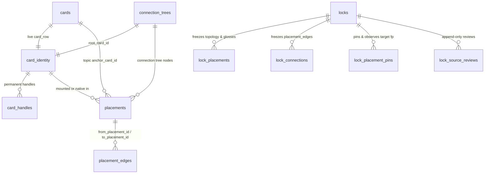

# Multi-Tree Coordinates, Connection Trees, and Dependency Comprehension in ZET

Status: Design Proposal — Revised Round 3 (2026-11-24)  
Co-authored through a three-round design review by Gemini and Astra (`gpt-6.2-astra`, high reasoning effort), grounded in checkout `06cb56c8` of `E:\zet`.  
Chinese version: [multi-tree-coordinates-proposal.zh.md](multi-tree-coordinates-proposal.zh.md) · Full discussion log: [multi-tree-coordinates-discussion-log.md](multi-tree-coordinates-discussion-log.md).

---

## 1. Executive Summary

### The Core Contract

> **One Card, one canonical Home, at most one coordinate per tree, and an identifiable author for every claimed relationship.**

Today, ZET gives every Card a single coordinate (`location` or `citation_key`) in either a **Topic tree** or a **Literature tree**. That design excels at source provenance and Luhmann-style lines of thought, but it forces every cross-tree relationship into one of four ill-fitting substitutes: flat inline `[[links]]`, flat grouped `Hub Cards`, domain-locked `Theory Cards`, or spatial `Spreads`. None of them lets a researcher freely gather Cards from across the archive, arrange them into a working hierarchy, and actively record and evolve relationships between them without duplicating Cards or mutating locked source trees.

This proposal updates ZET with three tightly integrated, mutually consistent capabilities built on a single underlying identity and placement engine:

1. **Connection trees (`~<n>` / 关联树):** A third, general-purpose tree role alongside `Literature` and `Topic`. A Connection tree is an active working space where a human or agent selects Cards from anywhere in the archive (including Literature roots, Math units, Historical events, Topic claims, or other Connection tree roots), arranges them into a Folgezettel spine and branches alongside native Cards (`~<n>#<k>`), and records **explicit tree-local connections (`placement_edges`)** between *any* two placements in the tree—without editing either Card or forcing one Card underneath the other.
2. **Non-disruptive Topic-side mounts (`<loc>+k`):** Topic trees keep their numbered home spine intact while allowing external evidence Cards (such as historical Events, Findings, or Literature roots) to be mounted beside any home Card without consuming a legacy `|a` home slot or rewriting any existing `[[link]]`.
3. **Cross-Book Dependency Lens:** A first-class computed dependency graph with two explicit scopes (*This Card* and *This Unit or Model*) backed by the Link index and exact carrier-sentence highlighting, paired with an anti-split-attention companion pane and one-time seeding into an editable Connection tree.

Everything preserves ZET's hard architectural guarantees: single-source-of-truth Card content, `human` vs. `agent` Workspace authority, Tree Lock integrity and pin semantics, zero silent link rebinding, and strict invariance of Model, Math, Term, Cited, and Hub structural reports.

---

## 2. Motivation & First Principles of Human Comprehension

### 2.1 The Guiding Use Cases & Active Working Needs

1. **Literature-group / Problem comparison:** Multiple Literature trees (`Grossman1986`, `Hart1995`, `Holmstrom1999`) each remain roots of their own source trees, while their roots simultaneously occupy coordinates inside a Connection tree dedicated to one research problem. The researcher can arrange them freely AND record direct connections such as `Holmstrom → Grossman` ("challenges") even when both Literature roots are Locked.
2. **Mathematical theorem ↔ definition comprehension:** A theorem in one math Literature tree relies on definitions, axioms, or lemmas (potentially across books). The reader needs to map working connections between `D1`, `D2`, `T`, and `U` cleanly in a Connection tree, inspect shared foundational load without duplicating definitions, and cross-check authored proof-step evidence through a side-by-side Dependency Lens.
3. **Cross-literature historical evidence threads:** Dated Events and empirical Findings belonging to one historical investigation are scattered across multiple history Literature trees. The researcher needs one working tree to gather and sequence the evidence, connect a Finding to multiple Events with distinct notes, branch conflicting accounts, and author new Event, Finding, or synthesis Cards directly inside the investigation while every source Card keeps its original coordinate at home.
4. **Low-friction discovery before certainty:** A researcher often starts with a title, six Cards, and no settled question, reading order, or formal claim yet. Selecting and arranging Cards is valuable on its own; drawing a tentative neutral connection is a separate act; naming/directing that relationship is a next step; publishing a contestable argument in a citable Card is another. Requiring finished prose or a rigid taxonomy up front destroys the moment of discovery.

### 2.2 Cognitive First Principles

A knowledge system improves human comprehension only when its representations match how human cognition actually works:

- **Working-memory economy & bounded branching (Cognitive Load Theory; Folgezettel):** A raw graph of `[[links]]` offers no primary coordinate system, no spine, and no recovery point; asking a reader to choose among ten outbound Links at every Card saturates working memory. A **Folgezettel tree skeleton** gives every Card in a working space one stable positional anchor (`Direct` progression + `Side` branches), while **focus-scoped tree connections** layer many-to-many relationships onto that skeleton without turning the map into a hairball.
- **Representation fit (Larkin & Simon, 1987):** Arranging related information into the structure that matches the reader's current task eliminates search cost and makes structure explicit. Trees optimize *spatial orientation, hierarchy, and resumable traversal*; connections/graphs optimize *many-to-many relationships and shared convergence*; Tables/Spreads optimize *simultaneous side-by-side comparison*.
- **Polyhierarchy without duplication (Single Source of Truth):** One atomic object (a book, a definition, a dated historical event) legitimately participates in multiple contexts: its **provenance context** (where the author wrote it) and any number of **working contexts** (a literature group, a math study map, a historical investigation). Copying Cards fractures edits and reverse links; **mounting by immutable identity** lets one Card hold coordinates in multiple trees while remaining one editable document.
- **Anti-split-attention reading (Chandler & Sweller):** Understanding how a theorem invokes a definition—or how two connected papers disagree—requires inspecting both endpoints *together*. A companion pane anchored to the current Card eliminates split attention without duplicating nodes in the tree.
- **Epistemic transparency (Position ≠ Tree-Local Assertion ≠ Card-Body Claim):** Placing `Card B` after `Card A` on a spine means *"positioned here in this tree."* Recording a **tree connection** `B → A` means *"this Connection tree's owner recorded this association/assertion between B and A."* Writing a **Card Link** `[[A]]` inside `B`'s body means *"Card B's author cited A in this specific passage."* Keeping all three records distinct—and labeling provenance in plain words at the point of use—ensures a reader always knows *who* made a claim and *where* it lives.

### 2.3 Clean Separation of ZET's Representations

| Reader / Researcher's Need | ZET Representation | Cognitive Payoff |
|---|---|---|
| Where did this come from in the author's work? | **Literature tree** | Preserves source order, BibTeX provenance, and specialized structures (Models, Math units, Terms, Cited lists). |
| How does my own standalone line of thought unfold? | **Topic tree** (+ side mounts) | Cumulative Luhmannian main box of standalone claims, optionally flanked by mounted evidence (`3/2+1`). |
| How do I gather Cards across trees, organize them, and work on their connections? | **Connection tree** (`~n`) | Free working tree with Folgezettel coordinates (`Direct`/`Side`), native Cards (`~n#k`), and explicit **tree connections** (`placement_edges`) between any two placements. |
| What does this claim or theorem logically depend on across the box? | **Authored Links & Dependency Lens** | Computed box-wide graph over authored `[[links]]` with shared convergence and exact invoking sentences/proof steps. |
| Where are the entry points into a subject? | **Hub Card & Register** | Flat, grouped directory of entrances and canonical concept terms. |
| How do these specific passages look side by side right now? | **Table & Spread** | Ephemeral or saved 2D spatial workspace for simultaneous inspection. |

---

## 3. Conceptual Ontology & Invariants

### 3.1 Proposed `CONTEXT.md` Vocabulary Additions

- **Connection tree (关联树):** An authored Folgezettel tree (`~<n>`) in which a person or agent selects Cards, arranges them, and records how particular Cards relate. It can contain Cards mounted from anywhere in the archive and native Cards written in the tree. Each Card occupies at most one coordinate in the tree. A connection recorded between two placements belongs to the Connection tree that holds it.
  - *Why "Connection tree / 关联树":* "Reading tree" framed the tree as passive consumption; "Working tree" collides with Git and omits what is being organized; "Relation tree / 关系树" sits too close to ZET's existing `Model relation` and `Relation kind`; "Graph/Network tree" obscures which structure owns coordinates. **Connection tree / 关联树** cleanly covers both tentative, unlabeled working associations and precisely stated directed relationships, across reading routes, literature clusters, hypothesis trees, math workspaces, and historical investigations.
- **Card identity (`card_id`):** An immutable UUID allocated once when a Card is created, independent of its mutable Location or Citation key. Every placement, handle, and durable reference resolves through `card_id`.
- **Home:** The single structural tree that owns a Card (`Literature`, `Topic`, or `Connection`). A Card's Home determines its owning Workspace, its write-gate context, and all structural computations that depend on filing ancestry.
- **Placement:** One identified occurrence (`placement_id`) of a Card inside a placement-backed tree, carrying its parent placement, edge kind (`root`, `direct`, `side`, or `attach`), sibling ordinal, and optional positional gloss.
- **Mount:** A Placement whose target Card has its Home in a *different* tree. Mounting places that single Card by identity; its home descendants stay in its home tree.
- **Topic-side mount:** An ordered leaf mount (`<loc>+k`) anchored to a Topic home Card by identity. It displays outside evidence beside the home Card without occupying a legacy `|a` Side successor slot.
- **Placement gloss:** An optional single-line positional note (at most 240 Unicode scalar values, plain text, no Markdown Links) attached to a non-root Placement, explaining why this Card sits at this structural spot.
- **Tree connection (`placement_edges`):** An explicit, authored association or assertion (`connection_id`) recorded by a Connection tree's owner between any two distinct placements in that tree (including adjacent placements and the root). It may be **neutral** (undirected quick-connect) or **directed**, with optional free **`relation_label`** (1–32 chars), optional canonical **`relation_kind`** (for local filtering), and optional plain-text **`note`** (≤ 400 chars, no Markdown Links). It follows the two `placement_id`s intact across coordinate reorders.
- **Missing mount:** A Placement whose mounted target Card has been deleted from its Home tree. Its `card_identity` record is retired (`retired`, retaining last canonical address, last title, and retirement revision), preserving the host tree's coordinate, gloss, descendants, **and incident tree connections** intact.
- **Dependency lens:** A read-only, revision-bound projection of authored Card-body reasoning Links (`rests-on` by default) in two scopes (*This Card* and *This Unit or Model*), displaying prerequisites, dependents, cycles, and exact invoking sentences across all trees.

### 3.2 Three Tree Roles, One Placement Architecture

| Tree Role | Zone / Prefix | Spine & Branching Rules | Structural Semantics |
|---|---|---|---|
| **Literature** | `<CitationKey>` | Closed source-bound tree (`Key/1`, `Key/1\|a`). Legacy positional addressing retained. | Owns Literature notes, Models, Math units, Terms, Cited lists, Events, Findings. Any Card (including the Literature root) can be mounted into any Connection tree or Topic-side mount. |
| **Topic** | `<n>/0` | Legacy numbered home spine (`3/1`, `3/2`, `3/2\|a`) **plus** non-disruptive Topic-side mounts (`3/2+1`, `3/2+2`, ...) anchored to home `card_id`. | Luhmann main box. Hub coverage (H1–H13), `zt-idea-grow`, and Topic title uniqueness count home Cards only; mounts beside `3/2` never shift `3/2\|a` or rewrite `[[3/2\|a]]`. |
| **Connection** | `~<n>` | Fully placement-backed Folgezettel tree (`~7/0`, `~7/1`, `~7/2\|a`) **plus** tree-local **`placement_edges`** between any two placements in the tree. | General working space for organizing and connecting Cards. Starts with just a title (optional framing body and optional shelf tag `purpose`—metadata only, never carrying special permissions or inference rules). Interleaves mounts and native Cards (`~7#k`). |

### 3.3 The Three Distinct Relationship Records

Separating **position**, **tree-local connection**, and **Card-body Link** resolves the deepest tension in multi-tree design:

| Record | Question It Answers | Effect of Moving a Card to Another Branch |
|---|---|---|
| **Placement & optional gloss** (`placements`) | *Where did I put this Card in `~7`, and why at this spot?* | The placement follows the move. If its structural predecessor changes, every affected nonempty positional gloss must be reviewed or cleared. |
| **Tree connection** (`placement_edges`) | *What association or assertion did `~7`'s editor record between these two Cards?* | **Follows the two `placement_id`s intact.** Coordinates may change arbitrarily without disturbing or invalidating the connection! |
| **Card Link** (`[[...]]` in Card body) | *What did this Card's author say about another Card in this specific passage?* | Governed by authored text and existing Link rules. The Connection tree can display and open the exact passage and its provenance. |

*Key refinement from Round 3:* Substantive relationship labels (`relation_kind` / `relation_label`) live exclusively on **`placement_edges`**, NOT on `placements`. If Hart sits after Grossman (`~7/1` → `~7/2`), the placement gloss says *"Compare control-right allocation here"* (positional), while a tree connection `Hart → Grossman` says `relaxes` / *"Extends Grossman to multi-asset authority"* (relational). If you later reorganize `~7` and move Hart to a different branch, the positional gloss is reviewed while your `Hart → Grossman` connection survives untouched!

**Visible provenance in plain words:** On the Map and Reader, every visible edge labels its origin explicitly—for example **"In this tree · ~7"** vs. **"In the Card · Book B, proof step 3"**. Clicking the former opens the tree-connection editor; clicking the latter opens the authored Card passage. Visual style distinguishes origin and edit authority, never an automatic ranking of truth (a local connection can be carefully researched; a Card Link can be speculative).

### 3.4 Core Structural Invariants

1. **Single Canonical Home:** Every live Card has exactly one Home tree and one owning Workspace (`human` or `agent`). Existing specialized structures always compute from their Home context, never from foreign mounts.
2. **At Most One Coordinate Per Card Per Tree (`UNIQUE(host_tree_key, card_id)`):** In every Connection tree (and across home + mounts of a Topic tree), a given `card_id` appears at most once. When one paper plays two distinct roles in two arguments, mount the paper once, write a native context/argument Card for each role, and connect both to the paper—so the reader sees *both* roles AND that they rely on the *same* work.
3. **Single-Card Mounts (No Subtree Explosion):** Mounting `Hart1995` (500 Cards) or `~7` (another Connection tree's root) adds **one** node with a portal indicator (`Book · 500 cards` / `Open home tree`). Selective drill-down (`Hart1995` at `~7/2` + `Hart1995/4|a` at `~7/2|a`) works automatically because they are distinct `card_id`s. Reciprocal root mounts (`~8` mounts `~7` and `~7` mounts `~8`) are well-defined because rendering, locking, seeding, and exporting never recursively expand portals.
4. **Retention of Standard Folgezettel Root Topology:** `~7/0` takes one Direct chain (`~7/1`, `~7/2`, `~7/3`), which `ZtLayout.outline` (`src/gui/layout.js:30`) already renders as **top-level peers** (`depth = 1`), with arbitrary Side branching (`~7/1|a`, `~7/1|b`) from `~7/1` onward. Top-level peers can represent competing schools, parallel clusters, or phases; numbering supplies traversal order, never implied causation. Avoiding root Side branches keeps indent/outdent (`src/place.rs:360`) and outline rules unified.
5. **Flexible, Uncoerced Connections:**
   - **Quick-connect creates a neutral (undirected), blank pair** (`direction = 'neutral'`, normalized endpoint order). Clicking A then B never silently asserts that A causes, precedes, or depends on B.
   - **Directed connections** preserve author-chosen `(from_placement_id, to_placement_id)` and render as full sentences (e.g., *"Theorem T depends on Definition D1"*—vital in math where prerequisite-first reading runs opposite to `depends-on`!).
   - **Free `relation_label` (1–32 Unicode scalar values, one line):** Preserves the author's exact spelling (e.g., `共同假设`, `时间先后`, `待验证`, `parallel case`, `mechanism`, matching ZET's Model facet precedent in `src/model.rs:33`) and suggests labels already used in this tree. **Never auto-translated** into a canonical `relation_kind` (`待验证` expresses editor uncertainty, not a predicate between two papers!).
   - **Optional canonical `relation_kind`:** Explicitly chosen from ZET's 8 ordinary kinds (`rests-on`, `illustrates`, `contrasts`, `relaxes`, `corresponds`, `objects`, `specializes`, `refers`; `term` stays reserved for `[[label@addr]]`). Selecting a directional canonical kind (such as `rests-on`, `relaxes`, `objects`, `specializes`, `illustrates`) requires `direction = 'directed'`. Used for local tree filtering only; never injects into global `links` or Model/Math reports.
   - **Multiple distinct assertions per pair allowed:** At most one completely blank quick-connect per unordered pair; arbitrarily many explicit labeled/annotated connections between the same pair (e.g., Paper A both *reuses* Paper B's definition AND *disputes* Paper B's empirical interpretation). Retries are deduplicated by `op_key`, never by a pair-wide uniqueness constraint.
   - **Plain-text notes only:** Placement gloss ≤ 240 Unicode scalar values (single line); connection `note` ≤ 400 Unicode scalar values (plain text). Neither parses `[[...]]` or creates Links. Joint multi-card arguments or sourced claims belong on native Cards.
6. **Native Card Types & Source-vs-Home Separation:**

| Card Type | Policy in Connection Trees (`~n`) |
|---|---|
| **`idea`, `event`, `finding`** | **Supported natively from Phase 2 (Day 1 of native authoring).** Investigations naturally generate new Events and empirical Findings. Keeps type-specific fields, source lines, and write-gate policy. **Crucial gate fix (`src/gate.rs:909`):** separate typed `TreeRole` and actual source context from Home tree string so a Finding created in `~15` cites its actual book/archive/check rather than treating `~15` as a book; a local `placement_edges` corroboration never satisfies a rule requiring an incoming authored Idea Link. |
| **Standalone Concept `model` head** | Allowed once permanent handles (`~n#k`) work end-to-end across create, edit, and `get_model` (qualified with linked parts, not empty models only). Unfinished frameworks can start as `idea` immediately. |
| **Multi-part `model`, Math units, `theory`** | **Mountable from Day 1.** Native structured authoring enabled only after adding an explicit **home-structure table** (`home_parent_card_id`, `home_sibling_order`, home-ancestry query) separate from working-map `placements`! Because `src/model.rs:278,1028,1470` walks filing ancestry and groups blocks by address prefix (which `~7#4` does not encode), separating **"Move on map"** (edits `placements`) from **"Refile model part"** (edits home structure with preview & gate) lets users freely rearrange their working map without silently breaking a proof when dragging a mounted paper between a head and a part. |
| **`hub`** | Mountable freely; substantive native claims in `~n` are valid Hub members and explicitly chosen Register destinations. Native `line`/`topic`/`field`/`register` Hubs remain in the home contexts that give their levels and coverage rules meaning. |
| **`term` & `cited`** | Mountable freely. Book-bound Term lists/heads/parts and Cited lists/cards stay in Literature homes. Original definitions can be `idea` Cards (or Math units once structured native authoring ships). |

7. **Promotion (`move_home`) Preserves Identity & Permanent Handle:** Same-Workspace `move_home` promotes an eligible non-root native Card (`~7#4`) into a Topic tree (`3/6`). Only that Card's Home changes: its Connection-tree placement, gloss, children, incident `placement_edges`, and `place:<uuid>` bookmarks all survive, and `[[~7#4]]` remains permanently resolvable even if `~7` is later deleted.

---

## 4. End-to-End Walkthrough of the Three Guiding Scenarios

### Scenario A: Literature Group / Problem Workspace (`~7`)

A researcher opens `~7` titled *"Boundary of the Firm & Incomplete Contracts"* (no forced question required upfront) and mounts `Grossman1986` (`~7/1`), `Hart1995` (`~7/2`), and `Holmstrom1999` (`~7/3`)—all Locked Literature roots:
- **Position & Glosses:** `~7/2` carries positional gloss *"Compare asset-control allocation here."* `~7/2|a` mounts Hart's core model `Hart1995/4|a` directly for quick access; `~7/2|b` holds native synthesis Card `~7#1`.
- **Tree Connections (`placement_edges`):**
  - `~7/2 → ~7/1` (`directed`, `relation_kind: relaxes`, `relation_label: "多资产推广"`, note: *"Extends GHM 1986 from two-firm vertical integration to multi-asset authority and financial contracting."*).
  - `~7/3 → ~7/1` (`directed`, `relation_kind: objects`, `relation_label: "激励系统质疑"`, note: *"Challenges residual-control focus with firm-as-incentive-system."*).
- **Working Freedom:** Later, the researcher drags `Hart1995` into a separate sub-branch under a new framing Card. The positional gloss prompts review, **both `Hart → Grossman` and `Holmstrom → Grossman` connections remain completely intact**, neither Locked book is modified, and opening `Hart1995`'s 500-card book and clicking **Back** restores the exact station in `~7`.

### Scenario B: Math Literature — Theorem ↔ Definitions Comprehension

**Situation:** Theorem `T` (`BookB/5|a`, `form: theorem`) invokes cross-book Definition `D1` (`BookA/2|a`, Compactness) in proof step `BookB/5|a|2`, and Definition `D2` (`BookB/1|a`, Continuous map) in its statement. Theorem `U` (`BookB/8|a`) also uses `D1`.

1. **In a Math Connection Tree (`~12`):**
   - Place `D1` (`~12/1`), `D2` (`~12/2`), `T` (`~12/3`), `U` (`~12/4`) **once each**.
   - Record tree connections `T → D1`, `T → D2`, `U → D1` (displayed as *"T depends on D1"*, cleanly distinct from prerequisite-first reading order `D1 → T`). Selecting `D1` immediately reveals both theorems converging on it.
   - Add native intuitive examples or exercise Cards on Side branches (`~12/1|a`, `~12/3|a`) and peek at `D1` in a companion pane while reading `U`.
2. **Cross-Book Dependency Lens (Authored Evidence Verification):**
   - Opening the Dependency Lens on `T` in scope **This Unit or Model** computes cross-book `rests-on` Links across `T`'s statement, `前提`, and `证明：…` steps—strictly excluding `kind = 'term'` vocabulary links unless toggled on, and surfacing any `reach_in` diagnostics.
   - The lens clearly distinguishes **which uses have an authored proof-step sentence** (`In the Card · BookB/5|a|2`), **which exist only as working connections in `~12`** (`In this tree · ~12`), and **which appear in both**. Only authored Card-body evidence enters the computed prerequisite closure.
   - Clicking `D1` opens `D1` in the **side-by-side companion pane** beside `T` with the exact invoking proof step highlighted. Clicking **Seed Connection tree** previews the cycle-checked topological order and creates an editable Connection tree with `D1` placed once.

### Scenario C: Cross-Literature History Investigation (`~15`) + Topic Attachment (`Topic 9`)

1. **History Connection Tree (`~15`):**
   - Mount scattered evidence from four history books: `BookA/2|a` (`~15/1`, Event: 1980 directive), `BookB/5|c` (`~15/2`, Event: 1982 contracting wave), `BookD/4|a` (`~15/2|a`, conflicting provincial report), `BookC/1|b` (`~15/3`, Finding: 1984 township output data).
   - Connect Finding `~15/3 → ~15/1` (*"Corroborates fiscal margin jump post-1980"*) AND `~15/3 → ~15/2` (*"Matches county-level contracting timing"*), plus `~15/2|a → ~15/2` (`contrasts`, *"Provincial archive disputes county figures"*).
   - Author a new primary-source Event Card `~15#1` or empirical Finding Card `~15#2` directly inside `~15` (citing its true archival source, never pretending `~15` is a book).
   - When the argument depends on A and B **jointly** (requiring source-independence analysis and causal inference), click **Develop an assertion** to create native synthesis Card `~15#3` citing `[[BookA/2|a]]`, `[[BookB/5|c]]`, and `[[BookD/4|a]]`.
2. **Topic-Side Mount (`Topic 9`):**
   - In Topic `9/0` ("Fiscal Decentralization"), mount `BookC/1|b` beside claim `9/2` at `9/2+1` without disturbing `9/2|a`, existing `[[9/2|a]]` Links, or Hub coverage.

---

## 5. Address, Coordinate, and Link Grammar

A strict visual invariant governs all new syntax: **`/` always means Folgezettel tree traversal; `#` always means an immutable Card handle.**

| Syntax | Category | Mutable? | Valid in `[[...]]`? | Semantics |
|---|---|---|---|---|
| `Hart1995`, `Hart1995/4\|a` | Legacy Literature address | On Citation-key rename / move | **Yes** | Canonical home address in a Literature tree (unchanged). |
| `3/0`, `3/2`, `3/2\|a` | Legacy Topic address | On Topic move / insert / compact | **Yes** | Canonical home address in a Topic tree (unchanged). |
| `~7` | Connection tree root handle | **Never** (immutable handle) | **Yes** (`[[~7]]`) | Canonical citation handle for the root Card of Connection tree 7. |
| `~7#4` | Connection-native Card handle | **Never** (immutable handle) | **Yes** (`[[~7#4]]`) | Permanent citation handle for native Card #4 issued by Connection tree 7. Survives reordering, promotion (`move_home`), and even deletion of `~7` (if promoted). |
| `~7/0`, `~7/1`, `~7/2\|a` | Connection tree coordinate | Yes (changes on reorder) | **No (refused)** | Current navigational slot in Connection tree 7. Accepted by `go`, Map, CLI, MCP placement ops. |
| `3/2+1`, `3/2+2` | Topic-side mount coordinate | Yes (changes on reorder / anchor rename) | **No (refused)** | Current navigational slot of the *k*-th mounted evidence Card beside home Card `3/2`. |
| `[label](place:<uuid>)` | Occurrence bookmark | **Never** (follows placement) | Markdown link (not `[[...]]`) | Durable bookmark to a specific placement in the current archive. Follows reorders; opens a Missing mount if target was deleted; reports retired if detached. Not a reasoning Link, Term use, or Lock pin. |

### Key Grammar & Resolution Rules

1. **Conflict-free `~` prefix:** Citation keys begin with an ASCII letter (`src/literature.rs`), Topic IDs with digits (`src/main.rs`). Leading `~` cleanly partitions the namespace.
2. **Mutable slots forbidden in `[[...]]`:** `[[~7/2]]` and `[[3/2+1]]` are refused in `LinkBody::parse` (with an actionable hint to cite the Card's canonical address or `place:<uuid>`). Reordering a Connection tree therefore **never triggers archive-wide Markdown Link rewrites**.
3. **Permanent handles across Promotion & Deletion:** Issued handles in `card_handles` (`~7`, `~7#4`) are never reused. After promoting `~7#4` to `3/6`, both `[[~7#4]]` and `[[3/6]]` resolve to the same `card_id`; Reverse links group by resolved `card_id` while preserving each source's authored spelling; moving `3/6` rewrites only literal `[[3/6]]` macros.
4. **Unified Resolver & Encoding:** Strict parse (`src/link.rs`), tolerant lifecycle classification, indexed validation (`src/link_index.rs`), `load_card`, and read-side joins all share one Card-address resolver. Term links (`[[label@addr]]`) keep their Regular-Location Term-head rule. GUI hash routes percent-encode `#` (`#/card/~7%234`); shell examples quote coordinates with `|` or leading `~`.

---

## 6. Data Model & SQLite Schema

### 6.1 Architectural Strategy

Existing `cards` rows retain their `row_id`, `location`, `citation_key`, `bibtex`, and legacy Topic/Literature storage behind a typed **home-tree reader**. Additive tables store immutable identity, permanent handles, Connection trees, unified placements, authoritative tree connections (`placement_edges`, strictly separate from the rebuildable `links` occurrence index), optional explicit home structure for native structured families, and versioned Lock records.



### 6.2 Logical Table Definitions

#### 1. `card_identity` (Immutable Card Identity & Retirement Registry)
```sql
CREATE TABLE card_identity (
    card_id         TEXT PRIMARY KEY,               -- UUIDv4/v7, allocated once at Card creation
    card_row        INTEGER UNIQUE REFERENCES cards(row_id), -- NULL once retired
    status          TEXT NOT NULL CHECK(status IN ('live', 'retired')),
    last_address    TEXT NOT NULL,                  -- canonical address when live or at retirement
    last_title      TEXT NOT NULL,                  -- title snapshot at edit or retirement
    retired_at_rev  INTEGER,                        -- archive revision when deleted, NULL while live
    CHECK(
        (status = 'live'    AND card_row IS NOT NULL AND retired_at_rev IS NULL)
        OR
        (status = 'retired' AND card_row IS NULL     AND retired_at_rev IS NOT NULL)
    )
);
```

#### 2. `card_handles` (Permanent Issuance Handles)
```sql
CREATE TABLE card_handles (
    handle          TEXT PRIMARY KEY,               -- e.g. '~7' or '~7#4'
    card_id         TEXT NOT NULL REFERENCES card_identity(card_id),
    origin_tree_id  TEXT NOT NULL,                  -- never reused even if Connection tree is deleted
    local_seq       INTEGER NOT NULL CHECK(local_seq >= 0), -- 0 for root, 1..N for native Cards
    UNIQUE(origin_tree_id, local_seq)
);
CREATE INDEX card_handles_by_card ON card_handles(card_id);
```
*Extension to `cards`:* Explicit three-way home role (`home_kind IN ('topic', 'literature', 'connection')`) with updated `CHECK` constraints so Connection-homed Cards store `~7` / `~7#4` in `location`. Every existing two-way `is_lit ? Literature : Topic` dispatch (`src/ops.rs`, `src/main.rs`, `src/gate.rs`, `src/hub.rs`) is replaced with an exhaustive three-way `TreeRole` enum before enabling writes.

#### 3. `connection_trees`
```sql
CREATE TABLE connection_trees (
    tree_id         TEXT PRIMARY KEY,               -- immutable UUID
    display_num     INTEGER NOT NULL UNIQUE CHECK(display_num >= 1), -- '~<display_num>', never reused
    workspace       TEXT NOT NULL CHECK(workspace IN ('human', 'agent')),
    root_card_id    TEXT NOT NULL UNIQUE REFERENCES card_identity(card_id),
    purpose         TEXT CHECK(purpose IS NULL OR length(purpose) BETWEEN 1 AND 32),
    next_local_seq  INTEGER NOT NULL DEFAULT 1 CHECK(next_local_seq >= 1),
    created_at      TEXT NOT NULL
);
```
*Independent Never-Reused Allocator:* `metadata.next_connection_id` is strictly independent of `next_topic_id` (which `zt del --all` resets at `src/main.rs:4576`). Deleting individual Connection trees never reuses `display_num`; even across `zt del --all` (which preserves ended Lock history and receipts), keeping `next_connection_id` monotonic ensures `~n` handles never collide with retained historical records.

#### 4. `placements` (Unified Placement Table for Connection Trees & Topic-Side Mounts)
```sql
CREATE TABLE placements (
    placement_id    TEXT PRIMARY KEY,               -- immutable UUID (used by place:<uuid>)
    host_kind       TEXT NOT NULL CHECK(host_kind IN ('connection', 'topic')),
    host_tree_key   TEXT NOT NULL,                  -- connection_trees.tree_id OR Topic tree id ('3')
    card_id         TEXT NOT NULL REFERENCES card_identity(card_id),
    parent_id       TEXT,                           -- placement_id in same Connection tree (NULL for root or topic attach)
    anchor_card_id  TEXT REFERENCES card_identity(card_id), -- Topic home card_id for host_kind='topic'
    edge            TEXT NOT NULL CHECK(edge IN ('root', 'direct', 'side', 'attach')),
    ordinal         INTEGER,                        -- mandatory 1..N for 'side'/'attach'; NULL for 'root'/'direct'
    gloss           TEXT CHECK(gloss IS NULL OR (length(gloss) BETWEEN 1 AND 240 AND instr(gloss, char(10)) = 0)),
    FOREIGN KEY (host_tree_key, parent_id) REFERENCES placements(host_tree_key, placement_id),
    UNIQUE (host_tree_key, placement_id),
    UNIQUE (host_tree_key, card_id),                -- at most one placement per Card per tree
    CHECK(
        (host_kind = 'connection' AND anchor_card_id IS NULL AND (
            (edge = 'root'   AND parent_id IS NULL     AND ordinal IS NULL)
         OR (edge = 'direct' AND parent_id IS NOT NULL AND ordinal IS NULL)
         OR (edge = 'side'   AND parent_id IS NOT NULL AND ordinal IS NOT NULL AND ordinal >= 1)
        ))
        OR
        (host_kind = 'topic' AND parent_id IS NULL AND anchor_card_id IS NOT NULL
         AND edge = 'attach' AND ordinal IS NOT NULL AND ordinal >= 1)
    )
);

CREATE UNIQUE INDEX placements_one_root   ON placements(host_tree_key) WHERE edge = 'root';
CREATE UNIQUE INDEX placements_one_direct ON placements(host_tree_key, parent_id) WHERE edge = 'direct';
CREATE UNIQUE INDEX placements_side_ord   ON placements(host_tree_key, parent_id, ordinal) WHERE edge = 'side';
CREATE UNIQUE INDEX placements_attach_ord ON placements(host_tree_key, anchor_card_id, ordinal) WHERE edge = 'attach';
CREATE INDEX placements_by_card           ON placements(card_id);
CREATE INDEX placements_by_parent         ON placements(host_tree_key, parent_id);
CREATE INDEX placements_by_anchor         ON placements(host_tree_key, anchor_card_id) WHERE host_kind = 'topic';
```
*(Schema precision note: `ordinal IS NOT NULL AND ordinal >= 1` is explicit because SQLite `CHECK(ordinal >= 1)` alone permits `NULL`.)*

#### 5. `placement_edges` (Authoritative Tree-Local Connections)
```sql
CREATE TABLE placement_edges (
    connection_id      TEXT PRIMARY KEY,            -- immutable UUID
    tree_id            TEXT NOT NULL REFERENCES connection_trees(tree_id),
    from_placement_id  TEXT NOT NULL,
    to_placement_id    TEXT NOT NULL,
    direction          TEXT NOT NULL CHECK(direction IN ('neutral', 'directed')),
    relation_label     TEXT CHECK(relation_label IS NULL OR (
                           length(relation_label) BETWEEN 1 AND 32 AND instr(relation_label, char(10)) = 0
                       )),
    relation_kind      TEXT CHECK(relation_kind IS NULL OR relation_kind IN (
                           'rests-on','illustrates','contrasts','relaxes',
                           'corresponds','objects','specializes','refers'
                       )),
    note               TEXT CHECK(note IS NULL OR length(note) BETWEEN 1 AND 400),
    created_by         TEXT NOT NULL CHECK(created_by IN ('owner', 'agent')),
    created_at_rev     INTEGER NOT NULL,
    updated_by         TEXT NOT NULL CHECK(updated_by IN ('owner', 'agent')),
    updated_at_rev     INTEGER NOT NULL,
    FOREIGN KEY (tree_id, from_placement_id) REFERENCES placements(host_tree_key, placement_id),
    FOREIGN KEY (tree_id, to_placement_id)   REFERENCES placements(host_tree_key, placement_id),
    CHECK(from_placement_id <> to_placement_id),
    -- Neutral pairs normalize endpoint order so (A,B) and (B,A) have one canonical representation:
    CHECK(direction = 'directed' OR from_placement_id < to_placement_id),
    -- Directional canonical kinds require an explicit direction:
    CHECK(
        relation_kind IS NULL
        OR relation_kind IN ('contrasts', 'corresponds', 'refers')
        OR direction = 'directed'
    )
);

-- At most one completely blank neutral quick-connect per unordered pair;
-- arbitrarily many explicit labeled/annotated assertions per pair are permitted:
CREATE UNIQUE INDEX placement_edges_blank_pair
    ON placement_edges(tree_id, from_placement_id, to_placement_id)
    WHERE direction = 'neutral' AND relation_label IS NULL AND relation_kind IS NULL AND note IS NULL;

CREATE INDEX placement_edges_by_from ON placement_edges(tree_id, from_placement_id);
CREATE INDEX placement_edges_by_to   ON placement_edges(tree_id, to_placement_id);
```

#### 6. Explicit Home-Structure Extension (Required Before Multi-Part Native Models)
When native multi-part Models or Math units are enabled inside Connection trees, a dedicated `home_structure(card_id PRIMARY KEY, home_tree_id, home_parent_card_id, home_edge, home_ordinal)` table stores filing ancestry independently of `placements`, so dragging Cards on the working map never alters model membership or block layout.

#### 7. Transactional Structural Invariants
- **Connected acyclic Connection tree:** Every placement in `tree_id` reaches the single `root` placement; no `side` child directly on `root`.
- **Native Home Presence:** A Connection-homed Card must have a placement in its owning Connection tree and share its Workspace.
- **Topic-Side Uniqueness:** A Topic tree cannot mount a Card whose Home is already in that same Topic tree.
- **Derived Coordinates:** Displayed coordinates (`~7/0`, `~7/2|a`, `3/2+1`) are computed deterministically from `(parent_id, edge, ordinal)` (and anchor Location for Topic mounts).

---

## 7. Workbench Operations, Lifecycle, Authority & Missing Mounts

### 7.1 Authority Model (`human` vs. `agent`)

Every operation distinguishes **Home authority** (who owns a Card's text) from **Host authority** (who owns a Connection tree's placements and `placement_edges`):
- An **agent** (`Access::Agent`) may mount `human` or `Locked` Cards into an unlocked `agent` Connection tree and draw `placement_edges` between them. This reads the target Cards and writes only the `agent` host—zero bytes of any human or Locked Card change.
- An **agent** may NEVER edit a `human` Card's body or a `human` Connection tree's placements/connections.
- Read APIs expose split capabilities: **`can_edit_card`** (Home Workspace + Home Lock) and **`can_edit_placement`** / **`can_edit_tree`** (Host Workspace + Host Lock).

### 7.2 Active Workbench Operations

| Working Action | Contract & Safeguards |
|---|---|
| **Gather & connect** | Create a Connection tree with just a title. Search, multi-mount Cards, drag/reorder, quick-connect neutral pairs, and add direction, free `relation_label`, canonical `relation_kind`, or `note` whenever ready. |
| **Inspect together** | Open any connected endpoint in the side-by-side companion pane while staying anchored on the current Card; or open any selected branch on the **Table** as a Spread (saving a Spread captures spatial layout only; it creates no new claims). |
| **Develop an assertion** | From any `placement_edges` record (or gloss), either: (a) open a draft authored `[[link]]` sentence inside a selected writable carrier Card, OR (b) create a native synthesis Card citing both endpoints (defaulting to a Side branch). Saving obeys normal Workspace, Lock, and write-gate rules. A synthesis Card citing A and B states its own argument—it never fabricates an `A → B` Link. Let the editor explicitly keep or remove the local connection. |
| **Extract a branch** | Defaults to **copy into a new Connection tree**: copies the selected placements and all `placement_edges` whose endpoints are both inside the selection with fresh IDs. Keeps the original tree and crossing connections untouched; previews boundary connections without silently pulling external endpoints in. A destructive split is a separate planned operation. |
| **Move placement** | Reorders/reparents by `placement_id` within the host tree. Previews new coordinates and every edge whose predecessor changed, requiring update or clear of affected nonempty **positional glosses**. **All incident `placement_edges` survive untouched**, and zero Markdown `[[...]]` Links are rewritten. |
| **Detach or replace (`unplace` / `rebind`)** | Detaching never deletes a mounted target Card; previews children, glosses, and incident `placement_edges` (refused on a native Card's sole Home—use delete or promote). Rebinding a Missing mount to a new Card checks uniqueness, forces review of incoming/child glosses AND **explicit per-connection disposition for every incident `placement_edges` record** (old assertions cannot silently transfer to a replacement Card!), and issues a new `placement_id`. |
| **Seed & promote** | One-time seeding from a Hub, Spread, Dependency Lens, or selected search hits with order preview (search rank and seed adjacency never auto-create `placement_edges`!). Same-Workspace `promote_card` (`move_home`) moves an eligible non-root native Card into a Topic tree while preserving its permanent `[[~7#4]]` handle, Connection-tree placement, and connections. |

### 7.3 Deleting Widely Mounted Cards: Missing Mounts (No Cross-Workspace Deadlock)

When an unlocked agent source Card `A` is mounted inside an unlocked `human` Connection tree `~1` (with human children and human `placement_edges` attached to it), deleting `A` (e.g., via `zt del --keep-root` to re-digest a book) must neither deadlock the agent nor let the agent mutate the human's Connection tree:

1. **Locked host tree:** Any active Lock holding a placement pin on `A` **hard-refuses** deletion (`card_locked`, reason `pinned-delete`) for both Owner and Agent.
2. **Unlocked host tree:** Deleting `A` retires `A`'s `card_identity` row (`status = 'retired'`, `card_row = NULL`, `last_address`, `last_title`, `retired_at_rev`) in the same transaction before deleting from `cards` (still enforcing existing human-body Link-rewrite checks during compaction).
   - **Zero rows in any foreign host tree are modified!**
   - The foreign placement keeps its `card_id`, `placement_id`, coordinate, gloss, descendants, **and all incident `placement_edges` intact**.
   - A new Card later created at the same legacy Location gets a new `card_id` and can NEVER hijack the retired station.
   - When the **Owner** deletes `A`, preview lists all affected placements and incident connections across all trees, defaulting to **Missing mount** with an optional explicit `detach` on unlocked trees the Owner controls.
3. **Repair:** The host owner later repairs the Missing mount by either **rebinding** (reviewing glosses and every incident connection, issuing a fresh `placement_id`) or **detaching** (with child and connection disposition).

---

## 8. Interaction with Existing ZET Subsystems

### 8.1 Tree Locks & Source Drift Observation (`src/tree_lock.rs`)

Locking a Connection tree `~7` (or a Topic tree with Topic-side mounts) records four cleanly separated facts, extending Tree Lock schema generation without touching legacy Lock generations or historical seals:

| Layer | Stored Record | Behavior |
|---|---|---|
| **1. Hard Structure & Connection Freeze** | `lock_members` (native Cards) + `lock_placements` (endpoints, edge, ordinal, gloss) + `lock_connections` (every `placement_edges` row: endpoints, direction, `relation_label`, `relation_kind`, `note`) | **Blocking (SQL triggers + gate):** Refuses edits to native Cards, topology, glosses, or tree connections while locked. |
| **2. Mounted Target Pins** | `lock_placement_pins` (each live mounted target's `card_id`, `row_id`, canonical address) | **Blocking:** Refuses deletion or address-changing rename of any live mounted target (`pinned-delete` / `pinned-move`). No transitive lock across `placement_edges` to unmounted neighbors. |
| **3. Source Fingerprint Observation** | `observed_authored_fp`, `fp_version`, `observed_at_rev` stored on `lock_placement_pins` | **Advisory (never blocks source edits):** Captures `card::authored_fingerprint` at Lock time. Verified against `src/card.rs:96-109` & `src/main.rs:2646`: covers title, body, raw BibTeX, `card_type`, `facet`, `emphasis`, `level_id` (`model_level` or `hub_level`), `math_form`, and `term_name`; excludes generated Reverse links, `literature_type` shelf labels, and external descendants of a mounted root. |
| **4. Append-Only Review** | `lock_source_reviews` (`lock_id`, `placement_id`, `card_id`, `reviewed_fp`, `reviewed_at_rev`, `reviewed_at`, note) | **Owner action (`Review source` / `Mark reviewed`):** Guarded by expected `reviewed_fp`. **Never modifies the Lock seal and never invokes ZET's reserved migration-only `reseal` event (`src/tree_lock.rs:6488`).** |

When an unlocked external source Card is edited later, the edit succeeds, Lock integrity stays `ok`, and the Reader displays **"Source differs from lock-time version"** with a **Mark reviewed** action. A Connection tree containing a Missing mount may still be locked: the preview lists the missing station explicitly and freezes it (with its connections) without creating a live target pin.

### 8.2 Model, Math, Term, Cited & Write Gate Invariance

- **Mounted foreign Cards:** Structural reports (`src/model.rs`, `src/math.rs`, `src/term.rs`, `src/cited.rs`) always evaluate mounted Cards strictly in their Home tree. Mounting any Model part, proof step, Term head, or Cited Card into a Connection tree or Topic-side mount—or drawing `placement_edges` to/from it—produces **byte-for-byte identical** structural reports before and after.
- **Native Events & Findings (`src/gate.rs:909`, `tools/zt-check/src/core.rs:2686`):** The write gate passes typed `TreeRole` and actual source context rather than inferring `book` solely from the tree prefix, so a Finding created in `~15` is validated against its real `来源：` line (known book vs. general source). Local `placement_edges` never substitute for required authored `[[links]]`.
- **Literature Write Scope (`src/scope.rs`):** Literature-scoped digest connections refuse all Connection-tree and Topic-side-mount writes and apply outbound-target rules to `~n` and `~n#k`. Permission to mount or connect a Card never grants permission to edit its body.

### 8.3 Links, Reverse Links, `zt reindex`, and the Cross-Book Dependency Lens

- **Strict store separation:** `placement_edges` is authoritative authored host data; `links` (`src/link_index.rs`) is a rebuildable occurrence index over Card bodies. Running `zt reindex` rebuilds `links` and generated `## Reverse links` / `## Term uses` from Card bodies alone—it **never** erases `placement_edges` and **never** injects mounts or tree connections into `## Reverse links`, `## Term uses`, or Model/Math reports.
- **Broken links vs. Missing mounts:** `zt lsbk`, MCP `list_broken_links`, and GUI health audits report Broken textual Links and Missing mounts as distinct typed categories.
- **Cross-Book Dependency Lens (`get_dependencies`):**
  - Queries `links(source, ord, target, kind)` for outgoing `rests-on` and incoming users (excluding `kind = 'term'` unless toggled), then re-parses each carrier Card's body at the same `archive_revision` via `ord` to extract the **exact invoking sentence and span**.
  - Two explicit scopes: **`card`** (direct authored relations on this Card) and **`unit` / `model`** (aggregated statement, premises, and proof/derivation steps with actual carrier Card per edge, `via` model context, and `reach_in` diagnostics).
  - When viewed from inside a Connection tree, can overlay and visually distinguish **authored Card-body evidence** vs. **tree-local connections in `~n`** vs. **present in both**, while keeping computed prerequisite closure strictly authored-only.

### 8.4 Hubs, Spreads, Workflows, Dump & Portable Export

- **Orthogonality & Workflows:** Hubs, Spreads, and Connection trees stay orthogonal—never two-way synced. `zt-idea-grow` and `zt-post-digest` keep their existing contracts and job sizing; mounts and tree connections earn zero credit toward grown Topic Cards, Hub coverage, or deduplication.
- **Dump (`zt dp`):** Versioned manifest capturing one body per live Card plus `card_identity` (including retired IDs referenced by placements, connections, or Lock evidence), `card_handles`, `connection_trees`, `placements`, `placement_edges`, and versioned Lock records from one consistent read transaction. Round-trip verified by rebuilding a scratch archive and checking `place:<uuid>`, `[[~7#4]]`, and `connection_id` resolution.
- **Portable Export (`zt export ~7`):** Exports one Connection tree in placement order with its included `placement_edges` and one rendered copy per included Card (mounted Literature/Connection roots contribute their root Card by default; book expansion is opt-in). Remaps internal `place:<uuid>` bookmarks to package-local IDs, excludes local paths / row IDs / Lock internals, and distinguishes offline states clearly: **in-package local assertion**, **in-package authored Link**, **Missing mount (deleted in archive)**, **outside this export**, and **broken in archive**.

---

## 9. Human Comprehension UX: GUI, Terminal Session, and MCP

### 9.1 Browser GUI (`src/gui.rs`, `src/gui/app.js`, `src/gui/layout.js`)

1. **Cabinet (Left Rail):** Three sections per Workspace: **Topic trees**, **Literature trees**, and **Connection trees** (filterable by title and optional `purpose`; shows counts like `12 mounted · 4 native · 9 connections`).
2. **Folgezettel Map (`ZtLayout.outline`) + Focus-Scoped Connections:**
   - Lays out placements linearly through the existing Focus Lens and sibling window (a 15-node Connection tree queries only those 15 placements even when mounting 5,000-card book roots).
   - **Anti-hairball default:** Shows `placement_edges` incident to the **focused/selected placement** (plus subtle count badges on other nodes and an expandable connection list for dense neighborhoods; full-tree overlay is an opt-in toggle).
   - Each visible edge labels provenance plainly (**`In this tree · ~7`** vs. **`In the Card · Book B, step 3`**) and renders directed relationships as readable sentences (*"Hart relaxes Grossman"*).
3. **Dual-Context Reader & Inspector:**
   - **Breadcrumb + Positional Gloss:** `Incomplete Contracts (~7) › ~7/2 · Hart1995` + incoming gloss.
   - **Home & Authority Bar:** `Home: Hart1995 · Literature · human` + lock/drift badge (`Source differs from lock-time version` + `Mark reviewed`) + split buttons (**Edit Card** vs. **Edit gloss / connections**).
   - **Connections Panel (for selected placement):** Lists incoming, outgoing, and neutral `placement_edges` in this tree (with quick-add, label suggestions from this tree, companion-pane peek, and **Develop an assertion**), alongside **Also in trees** switcher and **Open home tree** (with return stack).
4. **Dependency Lens & Anti-Split-Attention Companion Pane:** Anchors the current Card/Theorem while opening any connected endpoint or prerequisite side by side, highlighting exact carrier sentences/proof steps.
5. **Topic-Side Attachment Shelf:** Renders `3/2+1` compactly beside `3/2` on Topic Map and Reader, visually distinct from `3/2|a`.
6. **Unambiguous Copy Actions:** **Copy Card citation** (`[[Hart1995]]` or `[[~7#4]]`) vs. **Copy station bookmark** (`[…](place:<uuid>)`).

### 9.2 Terminal Session (`src/session.rs`)

- **Occurrence-Aware `Pointer`:** `Root | HomeCard { card_id } | Placement { tree_key, placement_id, card_id }`. Visible coordinates (`~7/2|a`, `3/2+1`) derive fresh from `placement_id`.
- **Navigation:** `go '~7/2'`, `go '3/2+1'`, `go '~7#4'`, `n`/`p`/`b` walk the active Connection tree; `home` jumps to Home pushing the current occurrence onto the return stack; `back` restores the exact occurrence; `places` lists all trees containing this Card; `conns` lists incoming/outgoing/neutral connections at the current placement. If the open placement is detached concurrently, the Session reports **placement removed** and offers to open the surviving Card's Home.
- **Explicit Mutation Verbs:** `place`, `unplace`, `connect`, `edit-conn`, `unconnect`, `edit-gloss`, `move-place`, `promote`. `del` remains strictly for owned Home deletion.

### 9.3 MCP Server (`src/mcp.rs`)

All existing tools stay backward-compatible. New typed tools separate `card_id`, `placement_id`, and `connection_id` at the schema level:

- **Reads:**
  - `list_connection_trees { workspace?, purpose? }`
  - `get_connection_tree { tree, limit?, cursor?, include_connections?: true }` — returns root, bounded placements (`placement_id`, `coord`, `card_id`, `home_address`, `home_workspace`, `host_workspace`, `status: live|missing`, `title`, `gloss`, `can_edit_card`, `can_edit_placement`), `connections` (`placement_edges`), and `archive_revision`.
  - `list_placements { at | card_id }` — all trees containing a Card, with coordinates and glosses.
  - `list_connections { tree, placement_id? }` — incoming, outgoing, and neutral connections in a Connection tree.
  - `get_dependencies { at, scope: "card"|"unit", depth?: 1..3, max_nodes?, include_terms?: false, overlay_tree? }` — cross-book authored dependency graph with exact carrier sentences, cycles, `reach_in`, and optional comparison overlay against a Connection tree.
- **Writes (destructive ops require `expected_revision`, two-step `plan_hash`, and optional `op_key` idempotency):**
  - `create_connection_tree { workspace?, title, body?, purpose? }`
  - `place_card { host, parent_coord | parent_placement_id | anchor_at, edge: "direct"|"side"|"attach", target_at | card_id, gloss?, before? }`
  - `create_connection_card { tree, parent_coord | parent_placement_id, edge: "direct"|"side", type?: "idea"|"event"|"finding", title, body, gloss?, before? }`
  - `edit_placement { placement_id, gloss? }`
  - `move_placement { placement_id, destination, gloss_updates?, expected_revision, confirm?, plan_hash? }`
  - `unplace { placement_id, children?: "detach"|"reattach", reattach_to?, gloss_updates?, expected_revision, confirm?, plan_hash? }`
  - `connect_placements { tree, from_placement_id, to_placement_id, direction?: "neutral"|"directed", relation_label?, relation_kind?, note? }`
  - `edit_connection { connection_id, direction?, relation_label?, relation_kind?, note?, reverse_endpoints? }`
  - `delete_connection { connection_id }`
  - `extract_branch { source_tree, root_placement_id, title, workspace?, purpose? }` (copy-by-default; destructive split separate)
  - `promote_card { card_id | at, destination_topic, target, duplicate_resolution?, expected_revision, confirm?, plan_hash? }`
  - `seed_connection_tree { from: "hub"|"spread"|"dependencies"|"search", source_params, workspace?, title, purpose?, preview? }`

---

## 10. Zero-Data-Loss Migration, Phased Rollout & Acceptance Criteria

### 10.1 Zero-Data-Loss Migration Discipline

1. **Pre-migration Baseline:** Take a `VACUUM INTO` backup + matching `artifacts/`. Capture schema/lock generation, `PRAGMA integrity_check`, `archive_id`, `archive_revision`, authored hashes of all Cards and BibTeX, `row_id`s, addresses, Lock seals/events/faults, and golden Model/Math/Term/Cited/Hub/Spread outputs across an archive containing an active Lock with pins, an ended Lock, an existing Broken link, and a human Card linking to an agent Card.
2. **Writer-Version Boundary:** Install `card_identity`, `card_handles`, `connection_trees`, `placements`, `placement_edges`, and versioned Lock tables behind a writer-version guard proven to block older `zt` executables (CLI, GUI, MCP) from mutating the upgraded SQLite file directly. Backfill one `card_identity` per extant Card while keeping every `row_id`, address, authored byte, Topic allocator, and legacy Lock seal untouched (no reseal).
3. **Equivalence & Recovery Proof:** Prove 100% identical outputs with zero Connection trees; then mount Cards of every specialized type, draw `placement_edges`, and prove home reports remain byte-for-byte identical. Test crash/abort rollback at every migration boundary.

### 10.2 Phased Implementation Roadmap

| Phase | Scope | Exit Gate |
|---|---|---|
| **Phase 1: Identity, Connection Trees, Mounts & Tree Connections** | `card_identity`, `card_handles` (citable root `~n` + unified resolver), `connection_trees`, `placements` (connection host), `placement_edges`, independent `next_connection_id`, exhaustive 3-way `TreeRole`, Missing mounts preserving connections, GUI Cabinet/Map/Focus-scoped connections/Return-stack, Session occurrence `Pointer`, MCP read/mount/move/unplace/connect, versioned `zt dp` & `zt export ~n`. | Zero-tree equivalence passes; continuous two-locked-books acceptance test passes; agent re-digest Missing-mount test preserves connections; `zt dp` round-trip verified. |
| **Phase 2: Native Authoring (`idea`/`event`/`finding`), Promotion & Connection Locks** | Native handles `~n#k`, `create_connection_card` (`idea`/`event`/`finding` with source-vs-home gate fix), `promote_card`, **Develop an assertion**, **Extract a branch**, `lock_placements` + `lock_connections` + `lock_placement_pins` (`observed_authored_fp`) + `lock_source_reviews` (`Mark reviewed`). | Promoted `[[~7#4]]` survives tree deletion with zero human-body rewrites; Connection Lock freezes placements & `placement_edges`, blocks mounted delete/rename, allows unlocked source edits, flags drift, and preserves legacy seals. |
| **Phase 3: Cross-Book Dependency Lens & Seeding** | `get_dependencies` (`card` & `unit` scopes, exact carrier re-parsing, Connection-tree overlay), GUI Dependency Lens + anti-split-attention Companion Pane, one-time seeding (`Dependency Lens` / `Hub` / `Spread` / `Search` → Connection tree). | Shared cross-book math definition test passes with exact proof-step highlighting, cycle surfacing, provenance distinction, and deduplicated seeding. |
| **Phase 4: Topic-Side Mounts (`<loc>+k`)** | Enable `host_kind = 'topic'` (`attach` edge), Topic Map/Reader evidence shelf, Topic Lock placement pins, anchor delete/move attachment preview. | Mounting/removing an Event at `3/2+1` leaves `3/2\|a`, all `[[...]]` Links, Hub coverage, and structural reports byte-for-byte identical. |
| **Phase 5 (Gated): Structured Native Models in Connection Trees** | Dedicated `home_structure` table (`home_parent_card_id`, `home_sibling_order`, home-ancestry query) separating `Move on map` from `Refile model part`, qualified across `model.rs`, `math.rs`, board layout, gate checks, and promotion. | Dragging a mounted paper between a native Model head and part on the working map leaves model membership and build order unchanged; explicit refile previews and gates cleanly. |

### 10.3 Acceptance Criteria

#### Primary Continuous End-to-End Test
In your own unlocked Connection tree `~7`, mount two **Locked** Literature roots (`Grossman1986` and `Hart1995`), record a directed connection (`Holmstrom` or `Hart` challenging/extending `Grossman`) with a free label and note, move one of the mounted Cards to a different branch, jump into its book to read three Cards deep, and click **Back**. You must observe:
1. The moved Card's positional gloss prompted review;
2. The recorded tree connection still connects the exact original two Cards;
3. Both Locked Literature trees and every global Model/Math/Dependency report are completely unchanged;
4. Clicking **Back** returns to the exact station so work continues seamlessly.

#### Four Core Invariance & Edge-Case Tests
1. **Topic Evidence Invariance:** Mount an external Event at `3/2+1` beside `3/2` when `3/2|a` is occupied, then detach it. Every legacy home address, authored body, Link index row, structural report, and Hub coverage result is byte-for-byte identical before and after.
2. **Promotion & Permanent Handle:** Cite `[[~7#4]]` from a human Card, promote `~7#4` to same-Workspace Topic `3/6`, and later delete Connection tree `~7`. The human Card's `[[~7#4]]` still opens the same Card with zero human-body rewrites; prior to deleting `~7`, Back from the promoted Card restores its station in `~7`.
3. **Shared Cross-Book Prerequisite & Provenance:** Theorems `T` and `U` both rely on Definition `D1` (one through a proof step in another book), while `~12` also adds a working connection `U → D2`. The Dependency Lens renders one `D1` with exact proof-step carriers, clearly separates authored Card evidence from `~12`'s working connection, keeps prerequisite closure strictly authored-only, and seeds `D1` once.
4. **Source Retirement, Connection Survival & Lock Drift:** Re-digesting an unlocked agent book retires deleted targets into **Missing mounts** inside an unlocked human Connection tree without modifying any human row, preserving glosses, coordinates, children, **and incident `placement_edges`**; rebinding to a new Card requires explicit review of each connection. Under a **Locked** Connection tree, deleting a mounted target is refused (`pinned-delete`), editing an unlocked external source succeeds, the Reader displays *"Source differs from lock-time version"*, and **Mark reviewed** appends a review record without altering the Lock seal.

---

## 11. Co-Design Convergence Log (Gemini ↔ Astra, Rounds 1–3)

| Topic | Evolution Across Rounds 1–3 | Final Converged Resolution |
|---|---|---|
| **Tree Name & Identity** | Round 1–2 used `Reading tree` (`阅读树`), framing the tree as an editorial sequence. In Round 3, user asked for a freer, general working tree for building relationships. | **Adopted `Connection tree` (`关联树`)**: accommodates both tentative unlabeled associations and precise directed assertions without colliding with `Link`, `Model relation`, `Relation kind`, or Git `working tree`. |
| **Tree-Local Connections (`placement_edges`)** | Round 1–2 put `relation_kind` on parent-child `placements` only. Round 3 separated position from relationship. | **Clean three-record separation**: `placements` holds coordinates + positional gloss only; **`placement_edges`** connects *any* two placements in the same Connection tree (including adjacent & root), survives reorders, supports neutral quick-connect + multiple labeled/directed assertions per pair, and stays strictly separate from `links`. |
| **Edge Labels & Friction** | Round 1–2 required a fixed `RelationKind` or reading gloss. | **Zero-friction start** (title only; neutral blank quick-connect); optional free 1–32 char `relation_label` (never auto-translated) + optional canonical `relation_kind` for local filter + optional 400-char plain-text `note`. |
| **Native Card Types** | Round 1–2 restricted native Cards to `idea` only. | **Open `idea`, `event`, and `finding` natively in Phase 2** (with source-vs-home fix in `gate.rs`); standalone concept `model` head once handle-qualified; multi-part structured Models gated on an explicit `home_structure` table separating `Move on map` from `Refile model part`. |
| **Tree Roles & Topic Mounts** | Round 1 had 3 isolated Zones; Round 2 unified placements to add Topic evidence mounts. | **Three named roles (`Literature`, `Topic`, `Connection`), one placement engine**: Topic trees gain non-disruptive `3/2+1` leaf mounts in Phase 4 without touching legacy `\|a` slots. |
| **Address Grammar** | Round 1 proposed `~7/c4` & `zt-place:<archive>/<id>`; Round 2 switched to `~7#4` & `place:<uuid>`. | **`~7` (root), `~7#4` (permanent handle surviving promotion), `~7/2\|a` & `3/2+1` (mutable navigation coordinates, forbidden in `[[...]]`), `[label](place:<uuid>)`**. |
| **Locks & Source Drift** | Round 2 proposed `observed_authored_fp` + `Review source` (preserving reserved `reseal`); Round 3 extended Lock coverage to `placement_edges`. | **Four-layer Lock**: freezes placements, glosses, native content, and `lock_connections`; pins mounted targets; records `observed_authored_fp` (exact `src/card.rs:96` coverage); append-only `Mark reviewed`. |
| **Deleting Widely Mounted Cards** | Round 1 refused while mounted; Round 2 adopted persistent `card_identity` retirement; Round 3 verified incident connections survive retirement. | **Missing mounts via `card_identity` retirement**: zero writes to unlocked human hosts, preserves children & `placement_edges`; rebinding requires per-connection review; Locked hosts hard-refuse via `pinned-delete`. |
| **SQLite Schema Precision** | Round 3 audit caught two subtle traps in Round 2 DDL (`CHECK(ordinal >= 1)` allowing `NULL`; `next_topic_id` reset on `zt del --all`). | Explicit **`ordinal IS NOT NULL AND ordinal >= 1`** + independent monotonic **`next_connection_id`** allocator. |
