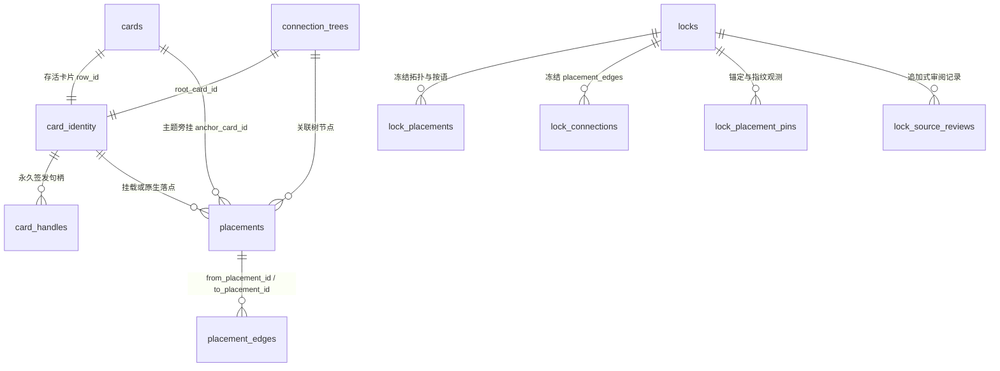

# ZET 多树坐标、关联树与依赖理解设计方案

状态：设计方案——第三轮修订（2026-11-24）  
由 Gemini 与 Astra（`gpt-6.2-astra`，高推理强度）通过三轮结构化设计评审共同起草，基于 `E:\zet` 仓库检出版本 `06cb56c8`。  
英文原版见：[multi-tree-coordinates-proposal.md](multi-tree-coordinates-proposal.md)；完整三轮讨论记录见：[multi-tree-coordinates-discussion-log.md](multi-tree-coordinates-discussion-log.md)。

---

## 1. 核心摘要

### 核心契约

> **一张卡片，一个规范主树（Home），每棵树至多一个坐标，每一条宣称的关系都有可追溯的作者。**

目前，ZET 为每张卡片仅分配一个坐标（`location` 或 `citation_key`），归属于某棵**主题树（Topic tree）**或**文献树（Literature tree）**。这种设计非常契合文献溯源与卢曼（Luhmann）式的思想延展，但在表达跨树组织关系时，却迫使研究者在四种并不完全贴合的替代方案之间妥协：行内扁平的 `[[链接]]`、扁平分组的**枢纽卡（Hub Card）**、局限于单一理论的**理论卡（Theory Card）**，以及二维自由摆放的**卡阵（Spread）**。它们都无法让研究者在不复制卡片、不改动已锁定源文献树的前提下，自由汇聚来自全库的卡片、编排工作层级，并在卡片之间主动建立与演化一般性的关联。

本方案基于一套统一的不可变身份（`card_id`）与落点（Placement）引擎，为 ZET 引入三项紧密协同、逻辑自洽的新能力：

1. **关联树（Connection tree，`~<n>`）：** 与**文献树**、**主题树**并列的第三种通用树角色。关联树是一个面向主动工作的空间：人或智能体可以从归档任意位置选取卡片（包括文献根节点、数学单元、历史事件卡、主题主张卡乃至其他关联树根节点），与原生卡片（`~<n>#<k>`）一起排布为 Folgezettel 主线与旁支，并可在树内**任意两个不同落点之间**记录显式的**树内关联（`placement_edges`）**——既不改动任何一张原卡，也不必强行把一张卡放进另一张卡的上下级之下。
2. **无干扰的主题旁挂（Topic-side mount，`<loc>+k`）：** 主题树保留其编号主线不变，同时允许以主卡 `card_id` 为锚点，在任意主题卡旁边挂载外部证据卡（如历史事件、实证发现或文献根节点），既不占用原有的 `|a` 旁支槽位，也不触发任何 `[[链接]]` 改写。
3. **跨书依赖透镜（Cross-Book Dependency Lens）：** 一套一等公民级的计算依赖图视图，提供**当前卡片（This Card）**与**当前单元或模型（This Unit or Model）**两种显式视角，依托链接索引并精确重解析原文载体句与证明步骤，配合防注意力分裂的并排伴读窗格，并支持一次性将依赖闭包播种（Seed）为可编辑的关联树。

整套设计完全保留 ZET 既有的硬性架构不变量：卡片内容的单一事实来源、`human` 与 `agent` 工作区权限隔离、树锁（Tree Lock）的完整性与锚定语义、杜绝静默链接重绑，以及模型、数学单元、术语卡、引文卡与枢纽卡结构报告的严格不变性。

---

## 2. 动机与人类理解的第一性原理

### 2.1 驱动场景与主动工作需求

1. **文献群 / 问题工作树：** 多棵文献树（如 `Grossman1986`、`Hart1995`、`Holmstrom1999`）各自仍是其源文献树的根（保留整本书的笔记与模型），同时这些文献根节点本身又在围绕同一研究问题建立的关联树中拥有坐标。研究者不仅可以自由排布它们，还可以在两棵文献树都已锁定的情况下，直接在关联树中记下 `Holmstrom → Grossman`（“质疑”）。
2. **数学文献——定理与定义之间的清晰理解：** 数学文献中的某条定理依赖多个定义、公理或引理（甚至跨不同教材/论文）。研究者可以在关联树中清晰标出 `D1`、`D2`、`T`、`U` 之间的工作关联，无需复制定义即可看出共享基础负载，并通过并排的跨书依赖透镜核对哪些用法有正文证明步骤支撑。
3. **跨文献历史线索考证：** 属于同一历史调查的事件卡（Event）与实证发现卡（Finding）散落在多本历史文献树中。研究者可以在一棵关联树中汇聚并排序证据，将一条发现卡分别关联到多条事件卡并写下各自佐证说明，以旁支保留冲突记载，并在调查过程中直接撰写新的事件卡、发现卡或综合主张卡，同时每条原始史料卡仍保留在原书文献树中的坐标。
4. **先汇聚与关联、后定型的低摩擦工作流：** 研究者常常只有一个标题、手头六张卡片，既还没定下明确问题、阅读顺序，也还没形成最终论断。选取与摆放卡片本身有价值；随手画一条尚无方向的“先连起来”是第二步；确定方向、命名标签与写备注是第三步；把可争辩的综合论断沉淀成可引用的卡片是第四步。如果工具要求在建立第一条联系前就写好完整论断或严格分类，就会错失思考萌发的时刻。

### 2.2 认知第一性原理

知识系统只有契合人类认知规律，才能真正提升理解力：

- **工作记忆上限与焦点展开（认知负荷理论；Folgezettel）：** 裸露的 `[[链接]]` 图谱没有主坐标系、没有主线、也没有回退锚点；每读一张卡都要在十条出链中做选择，会迅速耗尽工作记忆。**Folgezettel 树骨架**为工作空间中的每张卡片提供唯一稳定的位置锚点（`Direct` 推进 + `Side` 分叉），再通过**随焦点显现的树内关联**把多对多联系叠加其上，既表达丰富关系又不让地图沦为杂乱线团。
- **表征适配（Larkin & Simon, 1987）：** 将信息安排在与当前任务相匹配的结构中，可大幅降低搜寻成本、让关系直接显露。**树**擅长*空间定向、层级组织与可恢复遍历*；**关联/图**擅长*多对多联系与共享汇聚*；**展台/卡阵（Table/Spread）**擅长*多段文本同时并排比对*。
- **无复制的多重层级（单一事实来源）：** 同一原子对象（一本书、一条定义、一桩历史事件）天然同时隶属于多个语境：**溯源语境**（原作者在书中如何行文）与任意多个**工作语境**（文献比较群、数学学习图、历史考证树）。复制卡片会导致修改漂移与反向链接割裂；**按不可变身份挂载**让一张卡在多棵树中拥有坐标，却始终只有一份可编辑正文。
- **消除注意力分裂效应（Chandler & Sweller）：** 理解一条定理如何调用某条定义——或两篇彼此关联的论文何处分歧——需要把两端放在一起对照。以当前卡片为锚点的**并排伴读窗格**在不复制节点的前提下消除注意力分裂。
- **认识论透明性（位置 ≠ 树内判断 ≠ 卡片正文引用）：** 在主线上把 B 排在 A 之后仅表示*“在这棵树里放在这里”*；记录一条**树内关联** `B → A` 表示*“这棵关联树的作者记录了 B 与 A 之间的这一联系”*；在卡片 B 的正文里写 `[[A]]` 表示*“B 的作者在这句话/证明步里引用了 A”*。三类记录严格分开，并在界面使用处用直白文字标明出处，读者永远清楚**是谁在何处作出了这一判断**。

### 2.3 ZET 各类表征的清晰分工

| 读者 / 研究者的当前需求 | 对应的 ZET 表征 | 认知收益 |
|---|---|---|
| 这段内容出自原书哪一章？原书上下文是什么？ | **文献树（Literature tree）** | 忠实保留原书章节顺序、BibTeX 出处以及模型、数学单元、术语、引文等专项结构。 |
| 我自己的一条独立思考脉络如何推进？ | **主题树（Topic tree）**（+ 旁挂证据） | 卢曼式主卡片盒，承载独立主张，并可在主卡旁无干扰挂载外部证据（`3/2+1`）。 |
| 如何跨树汇聚卡片、自由组织并在它们之间建立与推进一般性关联？ | **关联树（Connection tree，`~n`）** | 自由工作树：具备 Folgezettel 坐标（`Direct`/`Side`）、原生卡片（`~n#k`）以及任意两落点之间的显式**树内关联（`placement_edges`）**。 |
| 这个主张或定理在全库正文中逻辑上依赖什么？ | **正文链接与跨书依赖透镜（Dependency Lens）** | 基于正文 `[[链接]]` 的全库推导依赖图，显现共享汇聚点与原文调用句/证明步骤。 |
| 这个领域的入口在哪里？ | **枢纽卡（Hub Card）与总索引（Register）** | 按子题或词条分组的扁平入口目录。 |
| 这几段文字摆在一起对照看有什么异同？ | **展台（Table）与卡阵（Spread）** | 临时或可保存的二维工作桌面，用于同时并排检视。 |

---

## 3. 概念本体与核心不变量

### 3.1 拟增补的 `CONTEXT.md` 术语

- **关联树（Connection tree）：** 由人或智能体选取卡片、安排 Folgezettel 坐标并记录卡片之间关联的一棵树（`~<n>`）。树中既可挂载归档任意位置的已有卡片，也可创建原生卡片。同一张卡在同一棵树中至多占有一个坐标。两个落点之间记录的关联归属于持有它的这棵关联树。
  - *为何定名为 Connection tree / 关联树：* “阅读树”偏重成品的被动阅读；“工作树”未说明工作对象且易与 Git 的 working tree 混淆；“关系树（Relation tree）”与 ZET 既有的“模型关系（Model relation）”“关系类型（Relation kind）”过于贴近；“图树/网络树”混淆了定位结构。**Connection tree / 关联树**（优于偏物理连接的“连接树”）既能承载刚萌芽、尚未命名的工作联想，也能承载方向与依据都清晰陈述的正式判断，涵盖文献群、假设树、数学工作图、历史考证与阅读路径。
- **卡片身份（Card identity，`card_id`）：** 建卡时一次性分配的不可变 UUID，独立于可变的 Location 或 Citation key。所有落点、永久句柄与持久书签均经由 `card_id` 解析。
- **主树（Home）：** 唯一拥有该卡片的归档树（`Literature`、`Topic` 或 `Connection`）。主树决定卡片所属 Workspace、写闸门上下文，以及一切依赖归档父子链的结构计算。
- **落点（Placement）：** 某张卡片在支持落点的树中的一次可标识出现（`placement_id`），记录其父落点、边类型（`root`、`direct`、`side` 或 `attach`）、同级序号与可选的位置性按语。
- **挂载（Mount）：** 目标卡片主树位于**另一棵树**的落点。挂载按身份仅安放该单张卡片；其在主树中的后代仍留在主树。
- **主题旁挂（Topic-side mount）：** 锚定于某张主题主卡 `card_id` 的有序叶子挂载（`<loc>+k`）。用于在主卡旁展示外部证据，绝不占用原有的 `|a` 旁支槽位。
- **落点按语（Placement gloss）：** 附着在非根落点上的可选单行位置说明（至多 240 个 Unicode 标量值，纯文本，不含 Markdown 链接），说明这张卡为何摆在这个结构位置上。
- **树内关联（Tree connection，`placement_edges`）：** 由关联树拥有者在**同一棵关联树中任意两个不同落点之间**（含相邻落点及树根）记录的显式联系或判断（`connection_id`）。可为**无向（neutral）快速关联**，也可为**有向（directed）关联**，带可选的自由 **`relation_label`**（1–32 字符）、可选的规范 **`relation_kind`**（仅用于本树筛选）及可选纯文本 **`note`**（≤ 400 字符，不含 Markdown 链接）。该记录按两端 `placement_id` 持久化，跨越坐标重排保持不变。
- **缺失挂载（Missing mount）：** 所挂载目标卡已在其主树中被删除的落点。对应的 `card_identity` 转为退休态（`retired`，保留最后规范地址、最后标题与退休版本号），宿主树的坐标、按语、后代及**与之相连的全部树内关联**完整保留。
- **依赖透镜（Dependency lens）：** 基于正文链接索引、绑定于同一归档版本的只读推导视图，分**当前卡片**与**当前单元或模型**两级作用域，跨全部树展示前提、使用者、环路与精确调用句。

### 3.2 三种树角色，一套统一落点架构

| 树角色 | 标识 / 前缀 | 主线、分叉与关联能力 | 结构语义 |
|---|---|---|---|
| **文献树（Literature）** | `<CitationKey>` | 封闭源文本树（`Key/1`、`Key/1\|a`）。沿用既有位置地址。 | 承载文献笔记、模型、数学单元、术语表、引文表、事件与发现。树中任意卡片（含文献根）均可挂载进关联树或主题旁挂。 |
| **主题树（Topic）** | `<n>/0` | 既有编号主线（`3/1`、`3/2`、`3/2\|a`）**外加**锚定于主卡 `card_id` 的无干扰主题旁挂（`3/2+1`、`3/2+2`…）。 | 卢曼式主卡片盒。枢纽覆盖（H1–H13）、`zt-idea-grow` 与主题标题唯一性仅统计主树卡片；在 `3/2` 旁挂证据绝不挤占 `3/2\|a`，也不改写 `[[3/2\|a]]`。 |
| **关联树（Connection）** | `~<n>` | 完全由落点驱动的 Folgezettel 树（`~7/0`、`~7/1`、`~7/2\|a`）**外加**树内任意两点之间的 **`placement_edges`**。 | 自由组织与关联卡片的通用工作空间。建树只需标题（说明正文与书架用途标签 `purpose` 均可选——仅作分类检索，不携带特殊权限或推导规则）。交错挂载卡与原生卡（`~7#k`）。 |

### 3.3 三类语义迥异的记录（位置、树内关联、正文链接）

将**位置**、**树内关联**与**卡片正文链接**清晰解耦，是本方案解决多树设计深层张力的关键：

| 记录 | 它回答的问题 | 卡片换分支移动时的表现 |
|---|---|---|
| **落点与可选按语**（`placements`） | *我把这张卡放在 `~7` 的哪里？为何放在这个位置？* | 落点随移动保留。若实际结构前驱发生变化，须复核或显式清空受影响的非空位置按语。 |
| **树内关联**（`placement_edges`） | *这棵树的作者认为这两张卡之间有什么联系或判断？* | **按两端 `placement_id` 完整保留。** 无论坐标如何改排，已记下的关联纹丝不动！ |
| **卡片正文链接**（正文中的 `[[...]]`） | *这张卡的作者在这句话/证明步里怎样引用了另一张卡？* | 遵循原文及既有链接规则。关联树界面可直接显示并打开原句核对。 |

*第三轮关键收敛：* 有实质含义的关系标签（`relation_label` / `relation_kind`）统一存放在 **`placement_edges`**，而不再放在 `placements` 上。例如 Hart 紧接 Grossman（`~7/1` → `~7/2`）时，落点按语写*“在此比较两文的控制权分配”*（位置性说明），树内关联 `Hart → Grossman` 写 `relaxes` / *“将 Grossman 推广至多资产权威”*（实质关系）。日后把 Hart 拖进另一条分支时，位置按语提示复核，而 `Hart → Grossman` 这条判断原样保留！

**使用处直白标明出处：** 地图与阅读器上每条可见连线都直接写清来源——例如 **“本树记录 · ~7”** 与 **“卡片正文 · 乙书，证明第 3 步”**。点击前者打开本树关联编辑，点击后者打开原文段落。视觉样式区分作者与修改权限，绝不暗示真值高低（一条树内判断可以经过严谨考证，一条正文链接也可能是初步猜想）。

### 3.4 核心结构不变量

1. **唯一规范主树（Single Canonical Home）：** 每张存活卡片有且仅有一个主树与唯一归属的 Workspace（`human` 或 `agent`）。一切既有专项结构报告均从主树上下文计算，绝不受外部挂载影响。
2. **每卡每树至多一个坐标（`UNIQUE(host_tree_key, card_id)`）：** 在每一棵关联树（以及一棵主题树的主卡与旁挂并集）中，同一 `card_id` 至多出现一次。当一篇论文在两条论证中承担不同作用时，论文在树中只放一次，两条论证各自建立原生卡片并分别连向该论文（可伴读窗格查看原文）——读者既能看到两种作用，又能一眼看出它们依赖同一份文献。
3. **单卡挂载（不自动展开后代）：** 挂载 `Hart1995`（500 张卡）或 `~7`（另一棵关联树的根），宿主树只增加**一个**节点并显示传送门（`文献 · 500 张卡` / `打开主树`）。选择性细挂载（`~7/2` 挂 `Hart1995`，`~7/2|a` 挂 `Hart1995/4|a`）天然成立。互挂对方树根（`~8` 挂 `~7` 且 `~7` 挂 `~8`）亦完全良定义，因渲染、加锁、播种与导出均不递归展开传送门。
4. **沿用标准 Folgezettel 树根拓扑：** `~7/0` 保持单一直接链（`~7/1`、`~7/2`、`~7/3`），`ZtLayout.outline`（`src/gui/layout.js:30`）已将它们渲染为**平级顶层条目（`depth = 1`）**，从 `~7/1` 起任意分叉（`~7/1|a`、`~7/1|b`）。顶层平级项可自由代表竞争学派、并行专题或研究阶段；编号仅表达遍历次序，不暗含因果。树根不另开侧支，保证大纲、缩进与提级（`src/place.rs:360`）只有一套统一语法。
5. **零压迫、高自由度的树内关联规则：**
   - **快速关联默认为无向空白对**（`direction = 'neutral'`，端点按序归一化）。依次点选 A 和 B 绝不暗中宣称 A 导致、先于或依赖 B。
   - **有向关联**保留作者选定的 `(from_placement_id, to_placement_id)` 并以完整句子呈现（如*“定理 T 依赖定义 D1”*——在数学中尤为关键，因为先读定义再读定理的阅读方向恰好相反）。
   - **自由标签 `relation_label`（1–32 个 Unicode 标量值，单行）：** 原样保留作者用词（如 `共同假设`、`时间先后`、`待验证`、`parallel case`、`mechanism`，类比 `src/model.rs:33` 的模型分面 `facet`），自动提示本树已用标签，**绝不自动翻译**成规范 `relation_kind`（例如 `待验证` 表达的是编者不确定性，而非两篇论文之间的逻辑谓词）。
   - **可选规范分类 `relation_kind`：** 从 ZET 既有的 8 种普通关系名中显式选取（`term` 继续专属于 `[[标签@地址]]`）。选用有向规范类型（如 `rests-on`、`relaxes`、`objects`、`specializes`、`illustrates`）时须指定 `direction = 'directed'`。仅参与本树筛选，绝不写入全局 `links` 或模型/数学报告。
   - **同一对卡片允许记录多条显式判断：** 每一对无序落点至多一条完全空白的快速关联；写清含义后，同一对卡片可以并存多条判断（例如论文 A 既沿用了 B 的定义，又质疑了 B 的实证解释）。重复请求靠 `op_key` 幂等去重，绝不用“每对至多一条”的约束吞掉第二条判断。
   - **纯文本注释边界：** 落点按语上限 240 字符（单行）；关联 `note` 上限 400 字符（纯文本）。两者均不解析 `[[...]]`、不生成正文链接。需要联合多份证据或可被他人反驳的完整论证，应写成原生卡片。
6. **关联树内可原生创建的卡片类型与“来源 vs. 归属”分离：**

| 卡片类型 | 关联树（`~n`）原生创建策略 |
|---|---|
| **`idea`、`event`、`finding`** | **随原生写卡第一版（阶段 2）全部开放。** 调查研究天然产出新事件与实证发现；保留各自字段、来源行与写闸门规则。**关键闸门修正（`src/gate.rs:909`）：** 将类型化 `TreeRole` 与真实来源上下文同主树名分离，避免在 `~15` 中新建的发现卡把 `~15` 误当成书目；一条树内“印证”连线也不能冒充规则要求的正文入链。 |
| **独立概念型 `model` 头卡** | 待永久句柄（`~n#k`）打通创建、编辑、`get_model` 完整链路后开放（验收须覆盖通过正文链接纳入部件的情形，不能只测空模型）。尚在酝酿的框架可先写成 `idea` 卡。 |
| **多部件 `model`、数学单元、`theory`** | **第一阶段即可挂载。** 原生结构化创建需在引入独立于工作地图 `placements` 的**主树结构表（`home_parent_card_id`、`home_sibling_order`、主树祖先查询）**后开放！因 `src/model.rs:278,1028,1470` 沿归档父链查找头卡并按地址前缀分块（而 `~7#4` 不编码路径），将**“在地图上移动”**（改 `placements`）与**“调整模型部件归属”**（改主树结构并预览过闸门）分离后，在工作地图上把一篇挂载论文拖进模型头与部件之间绝不会静默破坏证明结构。 |
| **`hub`** | 可自由挂载；实质性原生主张卡可成为枢纽成员与显式选定的总索引目标。`line` / `topic` / `field` / `register` 枢纽的原生创建留在赋予其层级与覆盖语义的主树中。 |
| **`term` 与 `cited`** | 可自由挂载。依附单本书的术语表/术语卡/续卡与参考文献表/引文卡留在文献树主树中。作者自拟概念可写为 `idea` 卡（或结构化支持就绪后写为数学单元）。 |

7. **提升（`move_home`）保持身份、落点、关联与永久句柄有效：** 同工作区内的 `move_home` 可将符合条件的非根原生卡（`~7#4`）主树迁入某主题树（`3/6`）。仅改变主树：其在关联树中的落点、按语、子卡、相连的 `placement_edges` 与 `place:<uuid>` 书签完整保留，且 `[[~7#4]]` 即使在 `~7` 日后被删除后依然永久解析到同一张卡。

---

## 4. 三个核心场景的端到端推演

### 场景 A：文献群 / 问题工作树（`~7`）

研究者新建标题为*“企业边界与不完全契约”*的关联树 `~7`（不必预设问题），挂载三棵已锁定的文献根 `Grossman1986`（`~7/1`）、`Hart1995`（`~7/2`）、`Holmstrom1999`（`~7/3`）：
- **位置与按语：** `~7/2` 写位置按语*“在此对照剩余控制权分配”*；`~7/2|a` 挂载 Hart 核心模型 `Hart1995/4|a` 方便直达；`~7/2|b` 写原生综合卡 `~7#1`。
- **树内关联（`placement_edges`）：**
  - `~7/2 → ~7/1`（`directed`，`relation_kind: relaxes`，`relation_label: "多资产推广"`，note：*“将 GHM 1986 从两企业纵向一体化推广至多资产权威与融资契约。”*）。
  - `~7/3 → ~7/1`（`directed`，`relation_kind: objects`，`relation_label: "激励系统质疑"`，note：*“以激励系统视角质疑仅靠资产所有权解释企业边界。”*）。
- **自由调整：** 日后研究者把 `Hart1995` 拖到新建框架卡下的旁支。系统提示复核位置按语，而 **`Hart → Grossman` 与 `Holmstrom → Grossman` 两条判断完整跟随原卡**；两棵已锁定文献树零修改；进入 `Hart1995` 500 张卡的文献树深读三张卡后点**返回**，精准回到 `~7` 的原站位继续工作。

### 场景 B：数学文献——定理与定义之间的清晰理解

**背景：** 定理 `T`（`BookB/5|a`，`form: theorem`）在其证明步 `BookB/5|a|2` 调用跨书定义 `D1`（`BookA/2|a`，紧致性），在陈述中调用 `D2`（`BookB/1|a`，连续映射）；同书定理 `U`（`BookB/8|a`）亦调用 `D1`。

1. **在数学关联树（`~12`）中工作：**
   - 将 `D1`（`~12/1`）、`D2`（`~12/2`）、`T`（`~12/3`）、`U`（`~12/4`）**各放一次**。
   - 记录树内关联 `T → D1`、`T → D2`、`U → D1`（界面显示为*“定理 T 依赖定义 D1”*，与先读定义再读定理的阅读方向一目了然地区分开）。选中 `D1` 立刻显现两条定理汇聚于此。
   - 在旁支（`~12/1|a`、`~12/3|a`）自由撰写直觉例子或习题卡，读 `U` 时在伴读窗格随时对照 `D1`。
2. **跨书依赖透镜（核对原文证明依据）：**
   - 在 `T` 上以**“当前单元或模型”**作用域打开依赖透镜，跨全部文献树聚合 `T` 陈述、`前提` 与 `证明：…` 中的 `rests-on` 链接（默认排除 `kind = 'term'` 词汇链接，保留既有 `reach_in` 诊断）。
   - 透镜清晰对照显示：**哪些用法有正文证明步骤支持**（`卡片正文 · BookB/5|a|2`）、**哪些目前仅存在于 `~12` 工作关联中**（`本树记录 · ~12`）、**哪些两端皆有**；计算前提闭包时严格只采用正文证据。
   - 点击 `D1` 在**并排伴读窗格**展开定义并高亮调用证明步；点击**播种为关联树**预览带环检测的拓扑顺序并生成去重的独立关联树。

### 场景 C：跨文献历史考证（`~15`）+ 主题旁挂（主题 `9`）

1. **历史关联树（`~15`）：**
   - 挂载分散在四本历史书中的证据：`BookA/2|a`（`~15/1`，事件：1980 财政指令）、`BookB/5|c`（`~15/2`，事件：1982 县级承包潮）、`BookD/4|a`（`~15/2|a`，冲突省级档案）、`BookC/1|b`（`~15/3`，发现：1984 乡镇产值）。
   - 记录 `~15/3 → ~15/1`（*“佐证 1980 后财政边际跃升”*）与 `~15/3 → ~15/2`（*“与县级承包时间吻合”*），以及 `~15/2|a → ~15/2`（`contrasts`，*“省级档案质疑县级口径”*）。
   - 直接在 `~15` 中新建档案事件卡 `~15#1` 或实证核查发现卡 `~15#2`（如实注明档案/检验来源，不冒充 `~15` 为书目）。
   - 当核心论点依赖 A、B **共同成立**（需辨析底层史料是否独立及因果机制）时，点击**展开为论证**生成原生综合卡 `~15#3`，以正文链接引证 `[[BookA/2|a]]`、`[[BookB/5|c]]` 与 `[[BookD/4|a]]`。
2. **主题旁挂（主题 `9`）：**
   - 在主题 `9/0`（“财政分权”）主张卡 `9/2` 旁挂接 `BookC/1|b` 为 `9/2+1`，不挤占 `9/2|a`、零改写 `[[9/2|a]]`、不影响枢纽覆盖。

---

## 5. 地址、坐标与链接语法

新语法严格遵守一条一目了然的视觉不变量：**`/` 永远代表 Folgezettel 树遍历坐标，`#` 永远代表不可变卡片签发句柄。**

| 写法 | 类别 | 是否可变？ | 可否写入 `[[...]]`？ | 语义 |
|---|---|---|---|---|
| `Hart1995`、`Hart1995/4\|a` | 既有文献地址 | 仅随 Citation key 改名/移动变化 | **可以** | 文献树内的规范主树地址（保持不变）。 |
| `3/0`、`3/2`、`3/2\|a` | 既有主题地址 | 随主题内移动/插入/压缩变化 | **可以** | 主题树内的规范主树地址（保持不变）。 |
| `~7` | 关联树根句柄 | **永不变**（不可变句柄） | **可以**（`[[~7]]`） | 关联树 7 根卡片的唯一规范引用句柄。 |
| `~7#4` | 关联树原生卡句柄 | **永不变**（不可变句柄） | **可以**（`[[~7#4]]`） | 关联树 7 签发的第 4 号原生卡永久引用句柄。历经重排、提升（`move_home`），乃至原关联树 `~7` 被删除（若已提升）后依然有效。 |
| `~7/0`、`~7/1`、`~7/2\|a` | 关联树坐标 | **可变**（随重排变化） | **禁止（写入拒绝）** | 关联树 7 的当前导航槽位。用于 `go`、地图、CLI 及 MCP 落点操作。 |
| `3/2+1`、`3/2+2` | 主题旁挂坐标 | **可变**（随重排或主卡改址变化） | **禁止（写入拒绝）** | 主题主卡 `3/2` 旁第 *k* 个外部挂载证据的当前导航槽位。 |
| `[文字](place:<uuid>)` | 落点书签 | **永不变**（跟随该次落点） | Markdown 链接（非 `[[...]]`） | 指向当前归档内某次具体落点的持久书签。重排自动跟随；目标卡删除后打开缺失挂载站位；卸下后提示失效。不产生推理边、术语使用或树锁锚定。 |

### 关键解析与兼容规则

1. **零冲突 `~` 前缀：** Citation key 必以 ASCII 字母开头（`src/literature.rs`），主题 ID 为纯数字（`src/main.rs`），前导 `~` 彻底隔离命名空间。
2. **禁止在 `[[...]]` 中写可变槽位：** `[[~7/2]]` 与 `[[3/2+1]]` 在 `LinkBody::parse` 中直接拒绝（提示改用卡片规范地址或 `place:<uuid>`），保证**重排关联树永不触发全库 Markdown 链接改写**。
3. **跨提升与删树的永久句柄：** `card_handles` 中签发的 `~7`、`~7#4` 永不复用。提升 `~7#4` 到 `3/6` 后，`[[~7#4]]` 与 `[[3/6]]` 均解析到同一 `card_id`；反向链接按 `card_id` 归并并保留各源卡原始写法；日后移动 `3/6` 仅改写字面量 `[[3/6]]`。
4. **统一解析器与编码：** 严格解析（`src/link.rs`）、容错渲染分类、链接索引校验（`src/link_index.rs`）、`load_card` 与读端联表共享同一卡片地址解析器。术语链接（`[[标签@地址]]`）维持既有 Regular-Location 术语头规则。GUI 哈希路由对 `#` 做百分号编码（`#/card/~7%234`）；命令行文档对含 `|` 或前导 `~` 的坐标加引号。

---

## 6. 数据模型与 SQLite 表结构

### 6.1 总体存储策略

既有 `cards` 表保留其 `row_id`、`location`、`citation_key`、`bibtex` 及主题/文献存储，封装在类型化的**主树读取器**之后。增量新增表承载不可变身份、永久签发句柄、关联树、统一落点表、权威的树内关联表（`placement_edges`，与可重建的正文索引 `links` 严格分离）、面向原生结构化模型的可选主树结构表，以及版本化树锁证据。



### 6.2 逻辑表定义

#### 1. `card_identity`（不可变卡片身份与退休登记表）
```sql
CREATE TABLE card_identity (
    card_id         TEXT PRIMARY KEY,               -- UUIDv4/v7，建卡时一次性分配
    card_row        INTEGER UNIQUE REFERENCES cards(row_id), -- 退休后置为 NULL
    status          TEXT NOT NULL CHECK(status IN ('live', 'retired')),
    last_address    TEXT NOT NULL,                  -- 存活时为当前规范地址，退休时为删除前规范地址
    last_title      TEXT NOT NULL,                  -- 标题快照（编辑或退休时同步）
    retired_at_rev  INTEGER,                        -- 删除时的 archive_revision，存活时为 NULL
    CHECK(
        (status = 'live'    AND card_row IS NOT NULL AND retired_at_rev IS NULL)
        OR
        (status = 'retired' AND card_row IS NULL     AND retired_at_rev IS NOT NULL)
    )
);
```

#### 2. `card_handles`（永久签发句柄表）
```sql
CREATE TABLE card_handles (
    handle          TEXT PRIMARY KEY,               -- 如 '~7' 或 '~7#4'
    card_id         TEXT NOT NULL REFERENCES card_identity(card_id),
    origin_tree_id  TEXT NOT NULL,                  -- 即使原关联树被删也永不复用
    local_seq       INTEGER NOT NULL CHECK(local_seq >= 0), -- 0 为根，1..N 为原生卡
    UNIQUE(origin_tree_id, local_seq)
);
CREATE INDEX card_handles_by_card ON card_handles(card_id);
```
*对 `cards` 表的显式扩展：* 增加显式三元主树角色标记（`home_kind IN ('topic', 'literature', 'connection')`）及更新后的 `CHECK` 约束，使关联树原生卡在 `location` 中存放 `~7` / `~7#4`；启用写路径前将全库所有二元 `is_lit ? Literature : Topic` 分发（`src/ops.rs`、`src/main.rs`、`src/gate.rs`、`src/hub.rs`）全部替换为穷举的三元 `TreeRole` 枚举。

#### 3. `connection_trees`（关联树元信息表）
```sql
CREATE TABLE connection_trees (
    tree_id         TEXT PRIMARY KEY,               -- 不可变 UUID
    display_num     INTEGER NOT NULL UNIQUE CHECK(display_num >= 1), -- '~<display_num>'，永不复用
    workspace       TEXT NOT NULL CHECK(workspace IN ('human', 'agent')),
    root_card_id    TEXT NOT NULL UNIQUE REFERENCES card_identity(card_id),
    purpose         TEXT CHECK(purpose IS NULL OR length(purpose) BETWEEN 1 AND 32),
    next_local_seq  INTEGER NOT NULL DEFAULT 1 CHECK(next_local_seq >= 1),
    created_at      TEXT NOT NULL
);
```
*独立永不复用的编号分配器：* `metadata.next_connection_id` 严格独立于 `next_topic_id`（`zt del --all` 在 `src/main.rs:4576` 会重置后者）。删除单棵关联树永不复用 `display_num`；即便执行 `zt del --all`（其保留已结束的树锁历史与回执），保持 `next_connection_id` 单调递增可杜绝新 `~n` 句柄与历史证据冲突。

#### 4. `placements`（关联树与主题旁挂统一落点表）
```sql
CREATE TABLE placements (
    placement_id    TEXT PRIMARY KEY,               -- 不可变 UUID（供 place:<uuid> 使用）
    host_kind       TEXT NOT NULL CHECK(host_kind IN ('connection', 'topic')),
    host_tree_key   TEXT NOT NULL,                  -- connection_trees.tree_id 或 主题树 ID（如 '3'）
    card_id         TEXT NOT NULL REFERENCES card_identity(card_id),
    parent_id       TEXT,                           -- 同关联树内的父 placement_id（根或主题旁挂为 NULL）
    anchor_card_id  TEXT REFERENCES card_identity(card_id), -- host_kind='topic' 时的主题主卡 card_id
    edge            TEXT NOT NULL CHECK(edge IN ('root', 'direct', 'side', 'attach')),
    ordinal         INTEGER,                        -- 'side'/'attach' 必填且 >= 1；'root'/'direct' 为 NULL
    gloss           TEXT CHECK(gloss IS NULL OR (length(gloss) BETWEEN 1 AND 240 AND instr(gloss, char(10)) = 0)),
    FOREIGN KEY (host_tree_key, parent_id) REFERENCES placements(host_tree_key, placement_id),
    UNIQUE (host_tree_key, placement_id),
    UNIQUE (host_tree_key, card_id),                -- 每张卡在每棵树中至多出现一次
    CHECK(
        (host_kind = 'connection' AND anchor_card_id IS NULL AND (
            (edge = 'root'   AND parent_id IS NULL     AND ordinal IS NULL)
         OR (edge = 'direct' AND parent_id IS NOT NULL AND ordinal IS NULL)
         OR (edge = 'side'   AND parent_id IS NOT NULL AND ordinal IS NOT NULL AND ordinal >= 1)
        ))
        OR
        (host_kind = 'topic' AND parent_id IS NULL AND anchor_card_id IS NOT NULL
         AND edge = 'attach' AND ordinal IS NOT NULL AND ordinal >= 1)
    )
);

CREATE UNIQUE INDEX placements_one_root   ON placements(host_tree_key) WHERE edge = 'root';
CREATE UNIQUE INDEX placements_one_direct ON placements(host_tree_key, parent_id) WHERE edge = 'direct';
CREATE UNIQUE INDEX placements_side_ord   ON placements(host_tree_key, parent_id, ordinal) WHERE edge = 'side';
CREATE UNIQUE INDEX placements_attach_ord ON placements(host_tree_key, anchor_card_id, ordinal) WHERE edge = 'attach';
CREATE INDEX placements_by_card           ON placements(card_id);
CREATE INDEX placements_by_parent         ON placements(host_tree_key, parent_id);
CREATE INDEX placements_by_anchor         ON placements(host_tree_key, anchor_card_id) WHERE host_kind = 'topic';
```
*（约束精度说明：必须显式写 `ordinal IS NOT NULL AND ordinal >= 1`，因为 SQLite 中单独的 `CHECK(ordinal >= 1)` 会放行 `NULL`。）*

#### 5. `placement_edges`（权威的树内关联表）
```sql
CREATE TABLE placement_edges (
    connection_id      TEXT PRIMARY KEY,            -- 不可变 UUID
    tree_id            TEXT NOT NULL REFERENCES connection_trees(tree_id),
    from_placement_id  TEXT NOT NULL,
    to_placement_id    TEXT NOT NULL,
    direction          TEXT NOT NULL CHECK(direction IN ('neutral', 'directed')),
    relation_label     TEXT CHECK(relation_label IS NULL OR (
                           length(relation_label) BETWEEN 1 AND 32 AND instr(relation_label, char(10)) = 0
                       )),
    relation_kind      TEXT CHECK(relation_kind IS NULL OR relation_kind IN (
                           'rests-on','illustrates','contrasts','relaxes',
                           'corresponds','objects','specializes','refers'
                       )),
    note               TEXT CHECK(note IS NULL OR length(note) BETWEEN 1 AND 400),
    created_by         TEXT NOT NULL CHECK(created_by IN ('owner', 'agent')),
    created_at_rev     INTEGER NOT NULL,
    updated_by         TEXT NOT NULL CHECK(updated_by IN ('owner', 'agent')),
    updated_at_rev     INTEGER NOT NULL,
    FOREIGN KEY (tree_id, from_placement_id) REFERENCES placements(host_tree_key, placement_id),
    FOREIGN KEY (tree_id, to_placement_id)   REFERENCES placements(host_tree_key, placement_id),
    CHECK(from_placement_id <> to_placement_id),
    -- 无向关联对两端做规范排序，使 (A,B) 与 (B,A) 只有唯一表达：
    CHECK(direction = 'directed' OR from_placement_id < to_placement_id),
    -- 有向的规范关系分类必须明确指定方向：
    CHECK(
        relation_kind IS NULL
        OR relation_kind IN ('contrasts', 'corresponds', 'refers')
        OR direction = 'directed'
    )
);

-- 每对无序落点至多保留一条完全空白的快速关联；
-- 写明方向、标签、分类或备注后，允许同一对卡片并存多条独立判断：
CREATE UNIQUE INDEX placement_edges_blank_pair
    ON placement_edges(tree_id, from_placement_id, to_placement_id)
    WHERE direction = 'neutral' AND relation_label IS NULL AND relation_kind IS NULL AND note IS NULL;

CREATE INDEX placement_edges_by_from ON placement_edges(tree_id, from_placement_id);
CREATE INDEX placement_edges_by_to   ON placement_edges(tree_id, to_placement_id);
```

#### 6. 显式主树结构扩展（开放原生多部件模型的前置条件）
在关联树内开放原生多部件模型或数学单元前，增设专用的 `home_structure(card_id PRIMARY KEY, home_tree_id, home_parent_card_id, home_edge, home_ordinal)` 表，独立于工作地图 `placements` 存储归档父子链，确保工作地图上的拖拽绝不会静默改变模型成员或证明分块。

#### 7. 事务级结构不变量
- **连通无环的关联树：** 每个落点均可回溯至唯一的 `root` 落点；树根 `~7/0` 禁止直接挂 `side` 旁支。
- **原生主树在场：** 主树为关联树 `T` 的原生卡必须在 `T` 中存在落点，且与 `T` 同属一个 Workspace。
- **主题主卡与旁挂联合唯一：** 主题树不得旁挂主树本就在该主题树中的卡片。
- **坐标纯派生：** 展示坐标（`~7/0`、`~7/2|a`、`3/2+1`）由 `(parent_id, edge, ordinal)`（及主题锚点当前 Location）确定性派生。

---

## 7. 工作操作、生命周期、权限与缺失挂载

### 7.1 双重权限模型（主树权限 vs. 宿主权限）

所有操作严格区分**主树权限（决定谁能改卡片正文）**与**宿主权限（决定谁能改这棵关联树的落点与 `placement_edges`）**：
- **智能体（`Access::Agent`）**可在未锁定的 `agent` 关联树中挂载 `human` 或已锁定卡片并在其间绘制 `placement_edges`。这只读取目标卡、仅写入 `agent` 宿主——不改动目标卡任何字节。
- 智能体**绝不可**编辑 `human` 卡片正文或 `human` 关联树的落点与关联。
- 读接口暴露拆分后的权限字段：**`can_edit_card`**（主树工作区 + 主树锁）与 **`can_edit_placement` / `can_edit_tree`**（宿主工作区 + 宿主锁）。

### 7.2 主动工作操作清单

| 工作操作 | 契约与保护机制 |
|---|---|
| **收集与关联** | 仅需标题即可建关联树。搜索、多选挂载、拖拽重排、先快速关联（无向空白对）再随时补充方向、自由 `relation_label`、规范 `relation_kind` 或 `note`。 |
| **并排对照** | 侧栏伴读窗格并排查看连线另一端；或将选中分支摊到 **Table** 展台对照（保存 Spread 仅记录摆放，不制造新判断）。 |
| **展开为论证** | 从任一 `placement_edges`（或按语）出发，既可在有写权的载体卡中起草带 `[[链接]]` 的句子，也可新建原生综合卡（默认旁支）同时引用两端。保存遵循常规工作区、树锁与写闸门规则。综合卡同时引用 A、B 表达的是综合卡自身论点，绝不伪造 `A → B` 的正文链接；原树内关联保留或移除由作者显式决定。 |
| **抽出分支** | 默认**复制为新关联树**：复制所选落点及两端都在所选范围内的 `placement_edges` 并分配新 ID。原树及跨边界关联完整保留；预览列出跨边界连线，绝不静默把外部端点拉进新树。破坏性拆分作为独立计划操作另行确认。 |
| **移动落点** | 按 `placement_id` 在宿主树内重排或换父。预览新坐标及所有前驱变化的边，要求复核或清空受影响的非空**位置按语**。**所有相连的 `placement_edges` 完好保留**，零全库 `[[...]]` 改写。 |
| **卸下或替换（`unplace` / `rebind`）** | 卸下绝不删除被挂载的目标卡；预览子落点、按语及相连的 `placement_edges`（禁止直接卸下原生卡的唯一主树——须走删除或提升）。对缺失挂载执行换绑时，校验唯一性、要求审查入边与子按语，并**逐条决定每一条相连 `placement_edges` 的去留**（绝不能把针对旧论文的质疑静默继承给新论文！），同时签发新的 `placement_id`。 |
| **播种与提升** | 支持由枢纽、Spread、依赖透镜或所选搜索结果一次性播种为关联树并预览顺序（搜索排名与相邻顺序绝不自动生成 `placement_edges`！）。同工作区 `promote_card`（`move_home`）将非根原生卡主树迁入主题树，同时保持永久句柄 `[[~7#4]]`、关联树落点与树内关联全部有效。 |

### 7.3 删除被广泛挂载的卡片：缺失挂载机制（破解跨工作区死锁）

当未锁定的 `agent` 源卡 `A` 被挂载进未锁定的 `human` 关联树 `~1`（且其下挂有人类子卡与人类记录的 `placement_edges`）时，删除 `A`（例如 `zt del --keep-root` 重跑文献 digest）既不能卡死智能体，也不能让智能体篡改人类的关联树：

1. **已锁定宿主树：** 只要有任何活跃树锁持有对 `A` 的落点锚定，Owner 与 Agent 删除 `A` 一律**硬拒绝**（`card_locked`，原因 `pinned-delete`）。
2. **未锁定宿主树：** 删除 `A` 在同一事务中将 `A` 的 `card_identity` 置为退休态（`status = 'retired'`、`card_row = NULL`、快照保存 `last_address`、`last_title`、`retired_at_rev`），再删除 `cards` 行（仍完整执行既有压缩阶段的人写正文改写拦截）。
   - **对任何外部宿主表执行零写入！**
   - 外部宿主中的落点完整保留其 `card_id`、`placement_id`、坐标、按语、后代及**所有相连的 `placement_edges`**。
   - 日后在旧地址新建的卡片拥有全新 `card_id`，绝不会静默顶替退休站位。
   - **Owner** 删除 `A` 时，预览列出所有受影响的挂载与关联，默认转为**缺失挂载**，并允许对 Owner 有权的未锁树显式选择同步 `detach`。
3. **修复：** 宿主拥有者日后可按普通宿主编辑执行**换绑**（逐项审查按语与每一条关联，签发新 `placement_id`）或**卸下**（明确子落点与关联去向）。

---

## 8. 与现有 ZET 子系统的协同

### 8.1 树锁与源文本漂移观测（`src/tree_lock.rs`）

锁定关联树 `~7`（或含主题旁挂的主题树）通过四层记录平滑升级树锁模式代次，不触碰历史锁与旧印章：

| 层级 | 存储记录 | 行为语义 |
|---|---|---|
| **1. 结构与关联硬冻结** | `lock_members`（原生卡）+ `lock_placements`（端点、边、序号、按语）+ `lock_connections`（所有 `placement_edges` 的端点、方向、`relation_label`、`relation_kind`、`note`） | **阻塞写操作（SQL 触发器 + 应用闸门）：** 锁定期间拒绝修改原生卡、拓扑、按语与树内关联。 |
| **2. 挂载目标锚定** | `lock_placement_pins`（每个存活挂载目标的 `card_id`、`row_id`、规范地址） | **阻塞写操作：** 拒绝删除或改址存活挂载目标（`pinned-delete` / `pinned-move`）。树内关联绝不沿边传递冻结未挂载的邻卡。 |
| **3. 源指纹观测** | 随 `lock_placement_pins` 记录 `observed_authored_fp`、`fp_version`、`observed_at_rev` | **提示性（绝不阻塞源卡编辑）：** 核对 `src/card.rs:96-109` 与 `src/main.rs:2646` 确认：`authored_fingerprint` 覆盖标题、正文、原始 BibTeX、`card_type`、`facet`、`emphasis`、`level_id`（`model_level` 或 `hub_level`）、`math_form`、`term_name`，明确排除自动生成的反向链接区、`literature_type` 书架标签及挂载根卡的外部后代。 |
| **4. 追加式审阅记录** | `lock_source_reviews`（`lock_id`、`placement_id`、`card_id`、`reviewed_fp`、`reviewed_at_rev`、`reviewed_at`、备注） | **Owner 动作（`Review source` / `Mark reviewed`）：** 带预期 `reviewed_fp` 乐观锁保护。**绝不修改原锁印章，也绝不复用 ZET 专为可信迁移保留的 `reseal` 事件（`src/tree_lock.rs:6488`）。** |

当未锁定的外部源卡日后发生合法编辑时，编辑正常成功、锁完整性保持 `ok`，阅读器显示**“源卡内容与加锁时版本不同（Source differs from lock-time version）”**并提供**“标为已核阅（Mark reviewed）”**。包含缺失挂载的关联树仍可加锁：预览显式列出缺失站位并将其连同原有关联一并冻结，不生成存活目标锚定。

### 8.2 模型、数学单元、术语卡、引文卡与写闸门不变性

- **挂载外部卡片：** 所有结构报告（`src/model.rs`、`src/math.rs`、`src/term.rs`、`src/cited.rs`）始终严格基于主树计算。将任意模型部件、证明步、术语头或引文卡挂载进关联树或主题旁挂、或在树内连线，前后报告必须**逐字节完全一致**。
- **原生事件与发现卡（`src/gate.rs:909`、`tools/zt-check/src/core.rs:2686`）：** 写闸门传入类型化的 `TreeRole` 与实际来源上下文，不再仅从树名字符串推断 `book`，从而确保 `~15` 中新建的发现卡按真实 `来源：` 行（已知文献 vs. 一般来源）校验；树内 `placement_edges` 绝不冒充正文入链。
- **文献写作用域（`src/scope.rs`）：** 处于 Literature 作用域的 digest 连接拒绝所有关联树与主题旁挂写入，并将出链目标限制应用于 `~n` 与 `~n#k`。挂载或连线权限绝不放大为编辑源卡正文的权限。

### 8.3 链接、反向链接、`zt reindex` 与跨书依赖透镜

- **存储严格分离：** `placement_edges` 是权威的宿主树编辑数据；`links`（`src/link_index.rs`）是可由正文重建的链接索引。执行 `zt reindex` 仅由正文重建 `links`、`## Reverse links` 与 `## Term uses`——**绝不**抹除 `placement_edges`，也**绝不**把挂载或树内关联注入反向链接、术语使用或模型报告。
- **断链与缺失挂载分列：** `zt lsbk`、MCP `list_broken_links` 与 GUI 健康检查分别以独立类型报告正文断链与缺失挂载。
- **跨书依赖透镜（`get_dependencies`）：**
  - 查询 `links(source, ord, target, kind)` 检索出向 `rests-on` 与入向使用者（默认排除 `kind = 'term'`），并在同一 `archive_revision` 下按 `ord` 精确重解析载体卡正文，提取**完整原句与位置跨度**。
  - 双作用域：**`card`**（该单卡直接正文关系）与 **`unit` / `model`**（聚合陈述、前提与证明/推导步，逐边标出实际载体卡、共享部件 `via` 上下文与 `reach_in` 诊断）。
  - 在关联树内打开时，可叠加对照展示**卡片正文依据**、**仅本树记录的关联**与**两端皆有**，同时保持前提闭包计算严格仅采纳正文依据。

### 8.4 枢纽、卡阵、既有工作流、全量备份与便携导出

- **正交与工作流稳定：** 枢纽、卡阵与关联树保持正交，绝不做双向同步。`zt-idea-grow` 与 `zt-post-digest` 维持既有契约与任务粒度；挂载与树内关联不计入已生长主题卡、枢纽覆盖或同述去重。
- **全量备份（`zt dp`）：** 版本化清单在同一一致性读事务中保存全部存活卡正文、`card_identity`（含被引用的退休身份）、`card_handles`、`connection_trees`、`placements`、`placement_edges` 与版本化树锁记录，通过在空白归档重建核验 `place:<uuid>`、`[[~7#4]]` 与 `connection_id` 往返一致。
- **便携导出（`zt export ~7`）：** 按落点顺序导出单棵关联树及其包含的 `placement_edges` 与渲染卡片副本（挂载的文献/关联树根默认仅含根卡本身；整本展开为显式选项）。重映射包内 `place:<uuid>`、维持隐私排除规则，并在离线页面清晰区分五态：**包内树内判断**、**包内正文链接**、**缺失挂载（原库已删）**、**未随包导出（outside this export）**、**原库正文断链**。

---

## 9. 人类理解交互设计：GUI、终端 Session 与 MCP

### 9.1 浏览器 GUI（`src/gui.rs`、`src/gui/app.js`、`src/gui/layout.js`）

1. **左侧柜（Cabinet）：** 每个工作区下分三栏：**主题树**、**文献树**、**关联树**（支持按标题与可选 `purpose` 筛选，显示 `12 挂载 · 4 原生 · 9 关联` 等计数）。
2. **Folgezettel 地图（复用 `ZtLayout.outline`）+ 随焦点显现的关联：**
   - 通过既有焦点透镜与同级折叠窗口线性布局落点（15 节点关联树仅查询 15 个落点，即使挂载了 5,000 张卡的文献根）。
   - **防线团默认策略：** 默认仅高亮显示与**当前焦点落点**相连的 `placement_edges`（其余节点以轻计数角标和可展开关联清单呈现，全树连线叠加为手动开关）。
   - 每条连线直白标明出处（**`本树记录 · ~7`** vs. **`卡片正文 · 乙书，第 3 步`**），有向关联显示为完整语义句（*“Hart 放宽 Grossman”*）。
3. **双语境阅读器与关联检视器：**
   - **面包屑 + 位置按语：** `不完全契约 (~7) › ~7/2 · Hart1995` + 入边位置按语。
   - **主树与权限栏：** `主树：Hart1995 · 文献树 · human` + 锁/漂移徽章（`源卡内容与加锁时版本不同` + `标为已核阅`）+ 分离的**编辑卡片正文**与**编辑按语/关联**按钮。
   - **关联面板（针对选中落点）：** 列出本树内的入向、出向与无向 `placement_edges`（支持快速新建、本树标签联想、伴读窗格速览与**展开为论证**），并列**亦见于以下树**切换器与**打开主树**（带返回栈）。
4. **依赖透镜与防注意力分裂伴读窗格：** 锚定当前卡片/定理，在并排窗格展开任一关联端点或前置定义，高亮精确调用句/证明步。
5. **主题旁挂挂架：** 在主题地图与阅读器上将 `3/2+1` 紧凑呈现于 `3/2` 旁，视觉上与 `3/2|a` 严格区分。
6. **无歧义复制：** **复制卡片引用**（`[[Hart1995]]` 或 `[[~7#4]]`）与 **复制站位书签**（`[…](place:<uuid>)`）。

### 9.2 终端 Session（`src/session.rs`）

- **感知落点的 `Pointer`：** `Root | HomeCard { card_id } | Placement { tree_key, placement_id, card_id }`，展示坐标由 `placement_id` 实时派生。
- **导航命令：** `go '~7/2'`、`go '3/2+1'`、`go '~7#4'`；处于 `Placement` 时 `n`/`p`/`b` 沿当前关联树移动；`home` 跳往主树并压栈；`back` 恢复精确落点；`places` 列出所有树；`conns` 列出当前落点的入向、出向与无向关联。若落点在会话期间被并发卸下，Session 明确提示**“该落点已被移除”**并提供进入主树选项。
- **显式写命令：** `place`、`unplace`、`connect`、`edit-conn`、`unconnect`、`edit-gloss`、`move-place`、`promote`；`del` 严格保留给拥有卡片的主树删除。

### 9.3 MCP 服务器（`src/mcp.rs`）

既有工具保持向后兼容，新增在 Schema 层严格区分 `card_id`、`placement_id` 与 `connection_id` 的有界工具：

- **只读工具：**
  - `list_connection_trees { workspace?, purpose? }`
  - `get_connection_tree { tree, limit?, cursor?, include_connections?: true }` — 返回根节点、分页落点（含 `placement_id`、`coord`、`card_id`、`home_address`、`home_workspace`、`host_workspace`、`status: live|missing`、`title`、`gloss`、`can_edit_card`、`can_edit_placement`）、`connections`（`placement_edges`）与 `archive_revision`。
  - `list_placements { at | card_id }` — 列出某卡出现的所有树、坐标与按语。
  - `list_connections { tree, placement_id? }` — 列出关联树中的入向、出向与无向关联。
  - `get_dependencies { at, scope: "card"|"unit", depth?: 1..3, max_nodes?, include_terms?: false, overlay_tree? }` — 跨书正文依赖图，含精确调用句、环路、`reach_in` 及与指定关联树的对照叠加。
- **写入工具（破坏性操作强制携带 `expected_revision`、两步 `plan_hash` 确认与可选 `op_key` 幂等键）：**
  - `create_connection_tree { workspace?, title, body?, purpose? }`
  - `place_card { host, parent_coord | parent_placement_id | anchor_at, edge: "direct"|"side"|"attach", target_at | card_id, gloss?, before? }`
  - `create_connection_card { tree, parent_coord | parent_placement_id, edge: "direct"|"side", type?: "idea"|"event"|"finding", title, body, gloss?, before? }`
  - `edit_placement { placement_id, gloss? }`
  - `move_placement { placement_id, destination, gloss_updates?, expected_revision, confirm?, plan_hash? }`
  - `unplace { placement_id, children?: "detach"|"reattach", reattach_to?, gloss_updates?, expected_revision, confirm?, plan_hash? }`
  - `connect_placements { tree, from_placement_id, to_placement_id, direction?: "neutral"|"directed", relation_label?, relation_kind?, note? }`
  - `edit_connection { connection_id, direction?, relation_label?, relation_kind?, note?, reverse_endpoints? }`
  - `delete_connection { connection_id }`
  - `extract_branch { source_tree, root_placement_id, title, workspace?, purpose? }`（默认复制；破坏性拆分另行计划）
  - `promote_card { card_id | at, destination_topic, target, duplicate_resolution?, expected_revision, confirm?, plan_hash? }`
  - `seed_connection_tree { from: "hub"|"spread"|"dependencies"|"search", source_params, workspace?, title, purpose?, preview? }`

---

## 10. 零数据丢失迁移、分阶段交付与验收标准

### 10.1 零数据丢失迁移规程

1. **迁移前基线采集：** 执行 `VACUUM INTO` 备份并保留匹配 `artifacts/`。记录模式/锁代次、`PRAGMA integrity_check`、`archive_id`、`archive_revision`、全库正文与 BibTeX 哈希、`row_id`、地址、锁印章/事件/故障，以及全部派生报告的黄金基线（测试库须覆盖活跃树锁与外部锚定、历史已解锁记录、既有断链与人写卡指向 agent 卡）。
2. **写版本护栏：** 在写版本边界之后安装 `card_identity`、`card_handles`、`connection_trees`、`placements`、`placement_edges` 及版本化树锁表，实测验证旧版 `zt`（CLI/GUI/MCP）无法直接打开并修改升级后的 SQLite 归档。回填 `card_identity` 时原样保留全部 `row_id`、地址、正文字节、主题分配器与旧锁印章（绝不重封旧锁）。
3. **等价性与崩溃恢复验证：** 证明零关联树时全部输出 100% 一致；随后挂载各类专项卡片并绘制 `placement_edges`，证明主树报告逐字节不变；在每个迁移边界演练崩溃回滚。

### 10.2 分阶段实施路线图

| 阶段 | 交付范围 | 出口门禁 |
|---|---|---|
| **阶段 1：身份、关联树、挂载与树内关联** | `card_identity`、`card_handles`（可引用树根 `~n` + 统一解析器）、`connection_trees`、`placements`（关联树宿主）、`placement_edges`、独立 `next_connection_id`、穷举三元 `TreeRole`、保留关联的缺失挂载、GUI 左侧柜/地图/焦点关联/返回栈、Session 落点 `Pointer`、MCP 读/挂载/移动/卸下/关联、版本化 `zt dp` 与 `zt export ~n`。 | 零关联树等价性通过；两棵已锁定文献根的连续工作验收通过；agent 重跑缺失挂载完整保留关联；`zt dp` 往返重建验证通过。 |
| **阶段 2：原生写卡（`idea`/`event`/`finding`）、提升与关联树锁** | 原生句柄 `~n#k`、`create_connection_card`（`idea`/`event`/`finding` 及来源-归属闸门修正）、`promote_card`、**展开为论证**、**抽出分支**、`lock_placements` + `lock_connections` + `lock_placement_pins`（`observed_authored_fp`）+ `lock_source_reviews`（`标为已核阅`）。 | 提升后的 `[[~7#4]]` 跨越删树仍有效且零改写人写卡；关联树锁同时冻结落点与 `placement_edges`、阻塞挂载删除/改址、放行未锁源卡编辑、提示漂移且不改旧锁印章。 |
| **阶段 3：跨书依赖透镜与单向播种** | `get_dependencies`（`card` / `unit` 双作用域、精确载体句重解析、关联树对照叠加）、GUI 依赖透镜与防注意力分裂伴读窗格、四大单向播种（依赖透镜 / 枢纽 / 卡阵 / 搜索结果 → 关联树）。 | 跨书共享数学定义用例通过，精确高亮调用证明步、显式区分正文依据与本树工作关联、环路与截断清晰可见、播种去重。 |
| **阶段 4：主题旁挂（`<loc>+k`）** | 开放 `host_kind = 'topic'`（`attach` 边）、主题树地图与阅读器证据挂架、主题锁落点锚定、主卡移动/删除旁挂预览。 | 在 `3/2` 旁挂载并卸下事件卡前后，`3/2\|a`、全部 `[[...]]`、枢纽覆盖与结构报告逐字节一致。 |
| **阶段 5（独立门禁）：关联树内原生结构化模型** | 专用 `home_structure` 表（`home_parent_card_id`、`home_sibling_order`、主树祖先查询），分离**地图移动**与**调整模型部件归属**，全量通过 `model.rs`、`math.rs`、模型板、写闸门与提升验证。 | 在工作地图上将挂载论文拖入原生模型头与部件之间，模型成员与构建顺序丝毫不变；显式调整归属走预览与写闸门。 |

### 10.3 验收标准

#### 主线连续工作验收
在自己的未锁定关联树 `~7` 中，挂载两张**已锁定**的文献根（`Grossman1986` 与 `Hart1995`），记录一条带自由标签与备注的有向关联（质疑或推广），将其中一张移至另一分支，进入其原书文献树深读三张卡，再点击**返回**。读者必须明确看到：
1. 被移动卡片的位置按语提示复核；
2. 已记下的树内关联依然指向原来的两张卡片；
3. 两棵已锁定文献树及全库模型/数学/依赖报告均未发生任何变化；
4. 点击**返回**精确回到原站位，工作无缝衔接。

#### 四项核心架构不变量与边界测试
1. **主题旁挂不变性：** 在 `3/2|a` 已占用时，向 `3/2+1` 挂载外部事件卡并随后卸下。所有旧主树地址、正文、链接索引行、结构报告与枢纽覆盖结果逐字节完全一致。
2. **提升与永久句柄：** 从 `human` 卡引用 `[[~7#4]]`，将 `~7#4` 提升至同工作区主题 `3/6`，随后删除关联树 `~7`。`human` 卡正文零改写且 `[[~7#4]]` 仍正确打开该卡；删树前从已提升卡按返回可回到 `~7` 原站位。
3. **跨书共享前提与出处区分：** 定理 `T` 与 `U` 均依赖定义 `D1`（其一经由跨书证明步），同时 `~12` 中另记了一条工作关联 `U → D2`。依赖透镜渲染唯一节点 `D1` 与精确证明步载体，清晰区分正文依据与 `~12` 树内关联，前提闭包严格仅用正文依据，播种时 `D1` 仅出现一次。
4. **源卡退休、关联存活与锁漂移：** 重跑未锁定 `agent` 文献树时，已删目标在未锁定 `human` 关联树中转为**缺失挂载**，零修改人类表行，完整保留按语、坐标、子卡及**相连的 `placement_edges`**；换绑新卡须逐条审查原有关联。在**已锁定**关联树下，删除挂载目标被拒（`pinned-delete`），编辑未锁定外部源卡成功，阅读器显示*“源卡内容与加锁时版本不同”*，点击**标为已核阅**追加审阅记录而不改动锁印章。

---

## 11. 协同设计收敛记录（Gemini ↔ Astra，第一至三轮）

| 议题 | 三轮演进脉络 | 最终收敛决议 |
|---|---|---|
| **树名与定位** | 第 1–2 轮称“阅读树（Reading tree）”，偏重成品阅读顺序；第 3 轮依用户要求解放为自由建立并工作于一般卡片关系的树。 | **定名 `Connection tree / 关联树`**：同时容纳无方向初步联想与有方向严谨判断，且不与 `Link`、`模型关系`、`关系类型` 或 Git `working tree` 冲突。 |
| **树内关联（`placement_edges`）** | 第 1–2 轮将 `relation_kind` 绑定在父子落点边上；第 3 轮彻底解耦“位置”与“关联”。 | **三类记录分立**：`placements` 仅存坐标与位置按语；**`placement_edges`** 允许连接同树任意两落点（含相邻点与树根），跨越重排不变，支持无向空白快速关联与同对多条判断，独立于 `links` 存储。 |
| **标签与低摩擦工作** | 第 1–2 轮要求受控关系词或按语。 | **零门槛开建**（仅需标题；快速关联默认无向空白）；可选 1–32 字符自由 `relation_label`（永不自动翻译）+ 可选规范 `relation_kind` 供树内筛选 + 可选 400 字符纯文本 `note`。 |
| **原生卡片类型** | 第 1–2 轮仅允许原生 `idea` 卡。 | **阶段 2 即开放原生 `idea`、`event`、`finding`**（修正 `gate.rs` 来源与归属分离）；独立概念型 `model` 头卡随永久句柄验收开放；多部件结构化模型以独立 `home_structure` 表解耦地图移动与模型归属。 |
| **树角色与主题旁挂** | 第 1 轮为三个孤立分区；第 2 轮统一落点引擎并引入主题旁挂。 | **三角色（文献 / 主题 / 关联）共享一套落点引擎**：主题树于阶段 4 获得不挤占 `\|a` 的 `3/2+1` 叶子证据旁挂。 |
| **地址与书签语法** | 第 1 轮提 `~7/c4` 与带归档 ID 的书签；第 2 轮改为 `~7#4` 与局部 `place:<uuid>`。 | **`~7`（根）、`~7#4`（跨提升永久句柄）、`~7/2\|a` 与 `3/2+1`（可变导航坐标，禁入 `[[...]]`）、`[文字](place:<uuid>)`**。 |
| **树锁与源漂移** | 第 2 轮确立 `observed_authored_fp` + `标为已核阅`（保留专用 `reseal`）；第 3 轮将 `placement_edges` 纳入锁证据。 | **四层树锁**：冻结落点、按语、原生正文与 `lock_connections`；锚定挂载目标；记录 `observed_authored_fp`（经核验 `src/card.rs:96`）；追加式 `标为已核阅`。 |
| **删除广泛挂载卡片** | 第 1 轮默认拒绝；第 2 轮改用 `card_identity` 退休转缺失挂载；第 3 轮确认关联一并保留。 | **缺失挂载**：对未锁人类宿主零写入，保留子卡与 `placement_edges`；换绑须逐条审查关联；已锁宿主仍 `pinned-delete` 硬拒绝。 |
| **SQLite 模式精度** | 第 3 轮审查发现第 2 轮 DDL 两处隐患（`CHECK(ordinal >= 1)` 放行 `NULL`；`zt del --all` 重置 `next_topic_id`）。 | 显式写出 **`ordinal IS NOT NULL AND ordinal >= 1`**，并为 `~n` 设立独立单调递增的 **`next_connection_id`**。 |

---

## 12. 实现状态（2026-11-24，zt 0.65.0）

已在分支 `multi-tree-coordinates` 上实现，并经 Astra（`gpt-6.2-astra`）两轮审查；模块文档见 `docs/wiki/coordinates.md`。

| 阶段 | 状态 | 测试 |
|---|---|---|
| 1 — 身份、关联树、挂载、树内关联 | 完成：`card_identity`（由 SQL 触发器维护，删除时退役而不删除）、`card_handles`、`connection_trees`、`placements`、`placement_edges`、`retired_placements`；写入者栅栏；`~n`/`~n#k`/坐标语法；缺失挂载；MCP 读写；会话的站点指针；GUI 柜子、地图、聚焦关联、站点阅读器、返回站点；`zt dp` 的 `coordinates.json`；`zt export ~n`（便携版本 3，可离线阅读） | `tests/connection_trees.rs`、`tests/coordinate_storage.rs`、`tests/connection_session.rs`、`tests/connection_portability.rs`、`src/gui.rs` 单元测试 |
| 2 — 原生 `idea`/`event`/`finding`、晋升、关联树锁 | 完成：`create_connection_card`、`promote_card`（树删除后句柄仍可解析）、展开论断、抽取分支、冻结站点与关联、挂载目标钉住（`pinned-delete`、`pinned-move`）、锁定时的来源指纹与只追加的所有者复核；坐标证据故障并入锁完整性检查 | `tests/connection_locks.rs`、`tests/coordinate_review_fixes.rs` |
| 3 — 依赖透镜与播种 | 完成：`get_dependencies`（卡片与单元两种范围、精确载体句子与宏的字节范围、依赖者、环、越界引用、先修优先顺序、关联树叠加），可从中心卡、摊开、透镜或选择播种 | `tests/connection_dependencies.rs` |
| 4 — 主题旁挂 | 完成：`<loc>+k` 挂载按身份跟随锚点，主题锁冻结它们，阅读器侧架与地图标记 | `tests/topic_attachments.rs` |
| 5 — 结构化原生模型 | **暂缓**：关联树中原生 `model`（包括独立概念模型头）、数学单元、`theory`、`hub`、`term`、`cited` 在创建和每次改类型时都以 `native_structure_required` 拒绝；已有的此类卡片可以自由挂载与关联。设计审查认为，可靠的 `home_structure` 需要模型、数学、写入闸门、透镜与模型板共用一个归档接口；用合成地址做适配会混淆身份。 |  |

设计审查中商定的有意偏离（相对 §6.2）：不加 `home_kind` 列（归属角色由存储地址决定，语法本身已按数字、字母、`~` 划分），因此无需重建 `cards`；写入者栅栏守护所有表，而不是版本列；`card_handles.card_id` 唯一（每张原生卡一个句柄）；`retired_placements` 保留已移除的站点 ID，书签可以报告"已移除"；删除原生卡时，它在本树的归属站点成为缺失挂载（在该处解除或重新绑定）；`list_trees` 只在 `zone: "connection"` 时列出关联树。

审查轮次。Astra 的每一项发现都已修复，并有回归测试（`tests/coordinate_review_fixes.rs`、`tests/coordinate_third_review.rs`）。第三轮关闭的问题：文献范围的连接在每个写入者的计划内按真实映射检查链接改写；Session 与 GUI 的注释复核没有确认词就绝不写入；以句柄书写的链接在摘要中保留关系类型，在便携导出中路由到当前地址；保留根删除的预览不再误报缺失挂载；共用部件的使用者按模型成员规则过滤（引入不算成员）；叠加视图只有在本地 rests-on 与作者 rests-on 相符时才标为 `both`；原生 Finding 的书由 `来源` 行决定；GUI 丢弃迟到的导航应答；主题导出在快照的修订号上读取旁挂；`zt status` 报告不连续的主题旁挂序号。第四轮关闭了余下的边界情形：范围检查位于唯一的改键入口（`apply_location_mapping_tx` 与删除的重指向），因此在被引用的旁支前插入也会被拒绝；计划与重新计划之间档案变化时，注释复核重新开始；图表中以句柄书写的链接打开卡片的当前地址；删除原生卡片时只说明一次其主站点；闸门通过 zt-check 自己的标签解析器（`zt_check::core::labelled_lines`）读取 `来源`；站点书签丢弃迟到的应答；GUI 导出与 `zt status` 读取一致的状态。

接受的限制：坐标封印的第一种排序从未发布，因此没有需要旧排序的封印；树锁代数保持 "2"（写入围栏与身份触发器已阻止旧写入者）；Session 的卡片历史保存地址；`zt stats` 把关联树根计为普通卡片；站点阅读器显示一棵树的前 5000 个站点。
