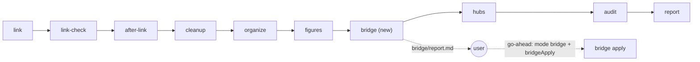

# The ZET Card Box after Luhmann: Design

Status: design authority (2026-10-16). It carries out the user's decisions of 2026-10-16 on `slip-box-luhmann-comparison.md`. C1 and C2 now have source implementation and installed workflows; real Workflow and accepted live-apply qualification remain open for the user's Claude Code test. See [the delivery receipt](slip-box-luhmann-delivery-status.md). The text follows ASD-STE100 as the other design documents do.

Implementation specification: [slip-box-luhmann-implementation-design.md](slip-box-luhmann-implementation-design.md). It preserves these decisions and resolves the concrete file formats, workflow integration, guarded edits, stale reports, retries, and verification. Its implementation contracts take precedence over the corresponding C1/C2 mechanics below.

## Source Authority

- `slip-box-luhmann-comparison.md` holds the analysis, the 25 practices (P1 to P25), the two gaps (G1, G2), and the decisions. This design does not change a decision.
- `math-cards-luhmann-comparison.md` holds the math practices L1 to L7 and their decisions of 2026-10-15. This design takes L6 into G2. It does not change L1, L2, L5, or L7.
- `CONTEXT.md` defines the terms. This design adds the terms in "New terms".
- `zt-digest-framework.md` and the global skill `workflow-framework-protocol` govern every change to an installed digest workflow.
- `skills/zettelkasten/references/luhmann-and-practice.md` and `hub-cards-design.md` hold the evidence on Luhmann's practice. This design reads no new external source.

## Goal

The ZET card box serves two writers. Agents write the agent Workspace, a whole book per digest run. The user writes the human Workspace. Luhmann's box served one writer over 40 years. So ZET cannot copy Luhmann everywhere. It must keep each practice that still gives value. Where a practice does not fit an agent writer, ZET replaces it with a rule that a machine can check.

This design has three parts:

1. **Principles.** Twelve rules (Z1 to Z12) that follow from the 25 decisions. Every later change to the card box must keep them.
2. **The feature map.** Each practice P1 to P25 gets five fields. They give the decision, the ZET feature, the rules for a writer, the check that finds a fault, and the change.
3. **Two changes.** C1 replaces the stale skill texts on insertion (G1). C2 adds a bridge stage between books to every digest (G2, with L6).

## Decisions carried out

| Practice | Decision (2026-10-15 or 2026-10-16) | Principle | Change |
| --- | --- | --- | --- |
| P1 Numbers that never change | Reject | Z5 | none |
| P2 No order by subject | Accept | Z1 | none |
| P3 Internal branching | Accept | Z1 | none |
| P4 Insertion between two slips | Accept | Z5 | C1 |
| P5 A slip never moves | Reject | Z5 | none |
| P6 A link to one word | Reject | Z12 | rule in C1 |
| P7 Half-sheet atomicity | Accept | Z3 | none (L5 stays planned) |
| P8 One kind of slip | Reject | Z10 | none |
| P9 Own words, few excerpts | Reject in the agent Workspace | Z11 | none |
| P10 The writer's own style | Reject | Z10 | none |
| P11 A separate bibliographic box | Accept | Z4 | none |
| P12 Literature notes apart from permanent notes | Accept | Z4 | none (L1, L2 stay planned) |
| P13 References solve multiple storage | Accept | Z1 | none |
| P14 Every reference carries its reason | Accept | Z2 | C2 uses it |
| P15 Back references by hand | Reject | Z5 | none |
| P16 Surprise from distant Links | Accept | Z8 | C2 |
| P17 Unconnected slips are lost | Accept | Z6 | C2 adds a count |
| P18 The register | Accept the form, reject the place | Z7 | none |
| P19 Collective reference cards | Accept | Z7 | none |
| P20 Outline cards | Accept | Z7 | none |
| P21 No hub of hubs | Reject | Z7 | none |
| P22 Conversation with the box | Accept | Z9 | none |
| P23 Writing is not copying | Accept | Z9 | none |
| P24 One writer, slow growth | Reject | Z10 | none |
| P25 Process before filing | Reject for digests, accept for hand filing | Z10 | none |

The user also answered Q1 to Q4 as recommended:

- **Q1.** The Accept and Reject list stays as written.
- **Q2.** Every digest runs a bridge stage as a report. Links go in only after the user's go-ahead.
- **Q3.** A digest keeps filing the whole book. The audit finds weak Cards.
- **Q4.** A Link names a whole Card. When a Link needs one part of a Card, the writer splits the Card.

## Principles

Each principle names the practices it comes from. A principle is a rule for the design of ZET and for every writer, agent or human.

### Z1. The Links are the structure. The place is history.

From P2, P3, and P13. A Card is filed beside the Card it first talks to. The address records that history. It does not record a subject, a rank, or a membership. Every other context of the Card gets a Link. ZT computes structure (model membership, hub members, build order) from Links and types, never from the address alone.

- No subject hierarchy decides where a Card goes. A Topic title names a subject, but no Topic sits above another.
- A Card has one home. A second home is a Link, never a copy.
- A part of a model belongs to every Model Card that links it, wherever it is filed.

### Z2. Every Link states its kind and its reason.

From P14. The word right before a Link gives its Relation kind. The sentence around the Link gives its reason. A Link without both is a fault, because a reader years later cannot tell why two Cards meet.

- The kind words are the ones in `CONTEXT.md` (**Relation kind**). A writer uses the kind the relation really has.
- `zt-check` rules L1 to L3 check the kind word, the reason, and repeats.

### Z3. One idea per Card, whole enough to stand alone.

From P7. A Card holds one idea, one event, one result, one model entry, or one part of a model. It is short, but it is not a fragment. A reader who arrives by a Link understands it without its neighbours.

- An Idea Card holds about 50 to 250 words. A Model Card holds up to about 600 words. A Model part holds at most 12 sentences and 400 characters of prose.
- Split a Card that holds two ideas. Do not split a Card into titles with no body.

### Z4. The source stays apart from the idea.

From P11 and P12. A Literature Card records the work: its BibTeX data and a page index. Its Literature tree holds the notes bound to the work. An idea that holds without the source goes into a Topic tree and cites the source with a Link.

### Z5. An address can change. A reference never breaks.

From P1, P4, P5, and P15. ZT renumbers Cards on an insert, a move, and the deletion of a Side successor. ZT rewrites every Link in the same change and generates the Reverse links. So no reference inside the archive goes stale. Luhmann needed fixed numbers because he had no machine to rewrite references.

- A writer refers to a Card inside a Card only by `[[address]]`.
- An address in a report is valid at the time of the report.
- A stable label for use outside ZET is a separate feature (L7 for math units).

### Z6. A Card that no way reaches is lost. ZT reports it.

From P17. A Card that no Link, no hub, and no Topic body reaches is a black hole. Luhmann found such slips only by chance. ZET reports them so that a writer can connect them.

### Z7. The ways in are few, labelled, and as deep as the size needs.

From P18 to P21. A way in names a few strong starting Cards, each with what it adds. It does not list everything. New levels come only when the box grows.

- A Topic body and a register term name one to three entries.
- A `topic` hub lists at most about 25 members.
- The four hub levels (`line`, `topic`, `field`, `register`) are the full depth. ZET adds `field` above Luhmann's depth because ZET Topic numbers group nothing.

### Z8. Surprise is a stage, not luck.

From P16. Luhmann's box surprised him because he linked distant regions by hand, over decades. An agent that digests a book in one run does not meet earlier books by chance. So each digest looks for Links to earlier books on purpose, and a report shows what it found (C2).

### Z9. Ask the box before you write. Write fresh from a set of Cards.

From P22 and P23. A writer searches the box and reads the neighbours before filing a Card. A text grows from a set of Cards laid side by side and from a structure Card. It is written fresh, not pasted from Cards.

### Z10. Agents write in fixed forms that a machine checks.

From P8, P10, P24, and P25. Agents write fast and at scale, and no single writer reads every Card. So each Card type has a template, the Card language has rules, size rules replace a writer's feeling, and checks report every fault. A digest covers the whole book. Its checks, not a writer's selection, keep the quality.

### Z11. Two Workspaces: the agents' paraphrase and the user's own words.

From P9. The agent Workspace holds the source's ideas, paraphrased by agents for the comprehension of agents. The human Workspace holds the user's own thought in the user's own words. No agent and no digest writes into the human Workspace. Agent Cards may link human Cards.

### Z12. A Link names a whole Card.

From P6. ZET has no Link to one word or one sentence inside a Card. When a Link needs one part of a Card, the writer splits the Card so that the part becomes a Card. Inside a math unit, the labels (H1, C2) name one hypothesis or clause, and a Link sentence may cite the label.

## The feature map

Each practice below has five fields:

- **Decision**: the user's decision.
- **Feature**: what ZET has for the decision, with the place in the repository.
- **Writer's rule**: what an agent or the user does.
- **Check**: what reports a fault.
- **Change**: what this design changes.

### Address and filing

#### P1. Fixed numbers that never change

- **Decision**: Reject (2026-10-15).
- **Feature**: a Location (`3/2|c|4`, `Smith2024/1|a`) is a unique address that ZT can renumber. Topic numbers come from one archive-wide sequence and are never reused (`CONTEXT.md` **Location**, **Topic**). Every renumbering operation rewrites every Link (`src/ops.rs`, `src/place.rs`).
- **Writer's rule**: refer to Cards only by `[[address]]` inside a Card. Treat an address in a report as valid at the time of the report.
- **Check**: `list_broken_links` lists Links whose target no longer exists.
- **Change**: none. L7 stays the stable label for math units.

#### P2. No order by subject

- **Decision**: Accept (2026-10-15).
- **Feature**: the placement rules of the zettelkasten skill (*Placement*). The next step of a line is a Direct successor. Everything else that grows from one Card is a Side successor. A new line with no neighbour is a new Topic. Model membership comes from Links (`src/model.rs`, header comment). Topic numbers are flat.
- **Writer's rule**: file a Card beside the Card it talks to. Open a new Topic only after the search finds no neighbour. A digest names a new Topic after its concept and checks the Topic gate first (`-TopicGate`).
- **Check**: the Topic gate refuses a title that an agent Topic has or nearly has.
- **Change**: none.

#### P3. Internal branching

- **Decision**: Accept (2026-10-16).
- **Feature**: one Direct successor per Card (a number segment) and any number of Side successors (letter segments). The Folgezettel map draws steps downward and each branch as a new column.
- **Writer's rule**: give the Direct slot only to the true next step. A side branch grows Direct successors of its own.
- **Check**: ZT assigns every address. A writer cannot make an invalid one.
- **Change**: none.

#### P4. Insertion between two slips

- **Decision**: Accept (2026-10-16), with G1 approved.
- **Feature**: `insert_card` with `before` puts a new Card in the place of an existing Regular Card. That Card and its subtree move down one place, and the old Card becomes the new Card's Direct successor. `move_card` with `before` or `alone` reorders a line. ZT shows every renamed address first and rewrites every Link (`CONTEXT.md` **Insert**).
- **Writer's rule**: use an insert for a step that belongs inside a line. Use a Side successor for an example, an objection, a qualification, or a tangent.
- **Check**: the two-step flow shows the renamed addresses before the change.
- **Change**: C1. Two skill texts still say that ZET cannot insert.

#### P5. A slip never moves

- **Decision**: Reject (2026-10-16).
- **Feature**: `move_card` carries a Regular Card with its subtree to the next free Direct or Side slot of another agent Card. A move can cross agent Topic trees or stay inside one Literature tree. A Literature tree Card never leaves its tree.
- **Writer's rule**: move a misplaced Card or branch. Do not delete and recreate it, because a move keeps its Links and Reverse links. Show the plan to the user before a large move.
- **Check**: the two-step flow. ZT refuses a move across Workspaces or out of a Literature tree.
- **Change**: none.

#### P6. A link to one word in a slip

- **Decision**: Reject (2026-10-16). Q4: split a Card when a Link needs one part of it.
- **Feature**: a Link names a whole Card (`[[address]]`). Math units label their hypotheses and clauses (H1, C2), and a sentence can name the label.
- **Writer's rule**: when a Link needs one part of a Card, split the Card (zettelkasten skill, *Maintenance*), then link the new Card.
- **Check**: none. ZT cannot see that a Link means one part of a Card.
- **Change**: C1 adds the split rule to the skill's *Links* section.

### The unit and its text

#### P7. Half-sheet atomicity

- **Decision**: Accept (2026-10-15).
- **Feature**: the size rules of the zettelkasten skill (*Composing one Card*) and of the Formal model (`CONTEXT.md` **Formal model**). A Model part holds at most 12 sentences and 400 characters of prose. A Derivation part holds at most six steps.
- **Writer's rule**: one idea per Card. Split a Card that grew a second idea. Do not split a short unit into thin Cards (L5 for math units).
- **Check**: `zt-check` I-rules (size, claim title). The model compiler's reviewer splits a dense derivation.
- **Change**: none. L5 stays kept and not built.

#### P8. One kind of slip, free form

- **Decision**: Reject (2026-10-16).
- **Feature**: five Card types (`idea`, `event`, `finding`, `model`, `hub`), each with a template. Model parts have facets. Math units have a fixed facet set. Hub Cards have a body form.
- **Writer's rule**: choose the type that matches what the Card holds. Follow the template of the type.
- **Check**: `zt-check` E1 to E5, F1 to F4, the model build report (`get_model`), and the hub report (`get_hub`).
- **Change**: none.

#### P9. Own words, few excerpts

- **Decision**: Reject in the agent Workspace (2026-10-15).
- **Feature**: two Workspaces with Access rules. The MCP server writes only the agent Workspace and refuses any change to the body of a human Card (`CONTEXT.md` **Access**).
- **Writer's rule**: an agent paraphrases the source in the Card language and marks each supplement (`（补：书中未给）`). The user writes in the human Workspace in the user's own words.
- **Check**: Access refuses agent writes to human Cards.
- **Change**: none.

#### P10. The writer's own style

- **Decision**: Reject (2026-10-16).
- **Feature**: the Card language (`CONTEXT.md` **Card language**): ASD-STE100, adapted for Chinese. Each model and each book has a term table.
- **Writer's rule**: the twelve rules of the zettelkasten skill (*Card language*).
- **Check**: `zt-check` R2 to R17, and R6 against the book's term table.
- **Change**: none. C2 applies the same rules to each bridge sentence.

### Literature

#### P11. A separate bibliographic box

- **Decision**: Accept (2026-10-16).
- **Feature**: the Literature Card holds the BibTeX entry and a page index. Its Citation key is its address. Its Literature tree holds anchors, notes bound to the work, Model Cards, and the book's structure Card. A Document link opens the book's PDF or Markdown through the Scholar Archive bridge.
- **Writer's rule**: a Literature Card holds no opinion. Each Card that uses a work ends with a source line (`来源：[[Key]] §2.2`).
- **Check**: the audit's `no_source` list.
- **Change**: none.

#### P12. Literature notes apart from permanent notes

- **Decision**: Accept (2026-10-15).
- **Feature**: the book digest files Idea Cards that hold without the book in Topic trees, and notes bound to the book under its anchors. The audit counts each book's Cards by category and Zone.
- **Writer's rule**: put an idea you would defend without the source in a Topic tree.
- **Check**: the audit's `cards` and `topics` counts.
- **Change**: none. L1 and L2 stay kept and not built for the math digest.

### Links

#### P13. References solve multiple storage

- **Decision**: Accept (2026-10-16).
- **Feature**: one home per Card. A Model Card takes in a shared part by a Link. A building block is filed once and taken in by every model that uses it. A Hub Card lists a Card without owning it. A Spread lays out Cards without moving them.
- **Writer's rule**: never copy a Card into a second place. Link it.
- **Check**: the audit's near-duplicate title rule (I6) and the Topic gate.
- **Change**: none.

#### P14. Every reference carries its reason

- **Decision**: Accept (2026-10-16).
- **Feature**: the Relation kinds, computed from the word before each Link (`CONTEXT.md` **Relation kind**). The Model board and the Table draw each kind with its own stroke.
- **Writer's rule**: write the kind word right before the Link, inside a sentence that gives the reason.
- **Check**: `zt-check` L1 (a kind word), L2 (a reason of at least 8 characters), L3 (advisory: a repeat). The audit's `unkinded` list.
- **Change**: none. C2 requires a kind word and a reason for every bridge.

#### P15. Back references by hand

- **Decision**: Reject (2026-10-16).
- **Feature**: ZT generates the Reverse links section of every Card below `<!-- zt:reverse-links -->`. Regenerating it is not a change to a human Card.
- **Writer's rule**: write each Link once, on the Card whose argument uses it.
- **Check**: none needed. The section cannot go stale.
- **Change**: none. C2 relies on it: a bridge written on a new Card shows on the earlier Card with no edit to that Card.

#### P16. Surprise from distant Links

- **Decision**: Accept (2026-10-15 for math as L6, 2026-10-16 for every digest as G2).
- **Feature today**: the zettelkasten skill asks for one distant Link at each filing. Topic hubs have a `邻近` group. The digest link pass offers each Card the five most similar Cards of the archive outside its own group (`prepare-link-pass.ps1`). But its prompt asks for Links between the parts of one book.
- **Writer's rule**: look for one distant Link each time you file a Card.
- **Check today**: none counts Links between books.
- **Change**: C2, the bridge stage, and an audit count of bridges.

#### P17. Unconnected slips are lost

- **Decision**: Accept (2026-10-16).
- **Feature**: the audit lists orphans (no inbound Link). `get_hub` and `list_hubs` list unreached Cards and missing hubs. `list_broken_links` lists broken Links.
- **Writer's rule**: every Card has at least one Link besides its parent.
- **Check**: the reports above.
- **Change**: C2 adds the count of Links between books, so a book with no bridge shows as an island.

### Ways in

#### P18. The keyword register

- **Decision**: Accept the form, reject the place (2026-10-16).
- **Feature**: the Register, the one `register` Hub Card, the first Card of the Topic `索引`. Each item is one key term with Links to one to three field or topic hubs. A Topic body names one to three entry Cards. The hub compiler rebuilds the register when its range changes.
- **Writer's rule**: name few entries per term. Use the words a search for the term uses.
- **Check**: `get_hub` on the register.
- **Change**: none.

#### P19. Collective reference cards

- **Decision**: Accept (2026-10-16).
- **Feature**: the `topic` hub, a Side successor of `<n>/1`. It lists at most about 25 members, each with what it adds, and a `邻近` group for other trees. A tree with `topicHubMin` (7) Cards needs one.
- **Writer's rule**: the hub stage writes the topic hubs. Write one by hand only for a subject the stage does not cover.
- **Check**: `get_hub` faults and `list_hubs`.
- **Change**: none. Bridges from C2 give the hub planner more distant members for `邻近`.

#### P20. Outline cards

- **Decision**: Accept (2026-10-16).
- **Feature**: the `line` hub opens one line of thought (needed at `lineHubMin`, 12 Cards, or 2 Model Cards in a branch). The structure Card orders the argument of one book.
- **Writer's rule**: a hub points. A structure Card argues.
- **Check**: `get_hub`.
- **Change**: none.

#### P21. No hub of hubs

- **Decision**: Reject (2026-10-16).
- **Feature**: the `field` hub lists the topic hubs of several Topics that share one subject. The register lists the field hubs. The hub graph is a directed graph without cycles. A hub lists only lower hubs.
- **Writer's rule**: keep the depth at four levels.
- **Check**: the `upward` fault of `get_hub`.
- **Change**: none.

### Work with the box

#### P22. Conversation with the box

- **Decision**: Accept (2026-10-16).
- **Feature**: the first filing step of the zettelkasten skill (*Converse first*: `search_cards` and the neighbours). A digest writer gets a snapshot of all Topic Cards of both Workspaces and can call `search_cards`. The Event Card prompt searches for an existing Event Card before it writes one.
- **Writer's rule**: search before you file. Edit an agent Card that already says the idea.
- **Check**: the audit's near-duplicate title rule (I6).
- **Change**: none. C2 makes the conversation with earlier books a stage of its own.

#### P23. Writing is not copying

- **Decision**: Accept (2026-10-16).
- **Feature**: the Table lays Cards from any tree side by side. A Spread keeps a laid-out set and can be filed as a Card. A structure Card holds the reading order of an argument.
- **Writer's rule**: build a structure Card before a long text. Write the text fresh.
- **Check**: none.
- **Change**: none.

#### P24. One writer, slow growth

- **Decision**: Reject (2026-10-15).
- **Feature**: digest workflows with fixed roles: Haiku managers relay, DeepSeek writes, Sonnet plans models, Opus organizes, scripts build. Size rules decide when a hub is due.
- **Writer's rule**: the digest protocol (`zt-digest-protocol`).
- **Check**: `zt-check`, the build reports, the hub reports, the audit.
- **Change**: none.

#### P25. Process each source before filing

- **Decision**: Reject for digests, accept for hand filing (2026-10-16). Q3: a digest keeps filing the whole book.
- **Feature**: the zettelkasten skill's *Collector's fallacy* rule for hand filing. A digest writes 6 to 12 Cards for each section group.
- **Writer's rule**: by hand, file only the ideas you processed into claims. A source with no idea gets a Literature Card only. A digest covers the whole book.
- **Check**: the audit finds weak Cards: Card layer faults, orphans, Cards with no kinded Link.
- **Change**: none.

## C1. Insertion in the skill texts (G1)

### Problem

`insert_card` is built (P4). Two texts still say that ZET cannot insert a Card into a line:

- `skills/zettelkasten/SKILL.md`, section *ZET addresses*, the item **No insertion**.
- `skills/zettelkasten/references/luhmann-and-practice.md`, section *Mapping to ZET*, the item on Direct successors.

The same skill's model section tells agents to use `insert_card`. So the skill contradicts itself. Every DeepSeek digest run loads the `zettelkasten` skill (`DSH_SKILLS` in `zt-book-digest.js`), so the fault reaches every digest writer. An agent that follows the stale item files a step that belongs inside a line as a Side successor. `docs/wiki/agent-skills.md` already records the fault.

### Feature C1.1: the new item in `SKILL.md`

Replace the item **No insertion** with this item:

> - **Insertion renumbers.** Luhmann filed 57/12a *between* 57/12 and 57/13, and no number changed. ZET puts a Card into a line with `insert_card` and `before`. The new Card takes the place of `3/3`. The old `3/3` becomes `3/4`, the new Card's Direct successor. ZT rewrites every Link. Use an insert for a step that belongs inside the line. Use a Side successor (`3/2|a`) for an example, an objection, a qualification, or a tangent: it stands beside `3/2` in its own column.

The item **Addresses can shift** stays. Add "an insert" to its list of changes that renumber Cards.

### Feature C1.2: the new mapping in `luhmann-and-practice.md`

Replace the second item of *Mapping to ZET* with:

> - **Continue a sequence (57/12 → 57/13) → Direct successor**, one per Card. Luhmann filed 57/12a *between* 57/12 and 57/13 without a change of number. ZET inserts with `insert_card`, renumbers the line, and rewrites every Link.

### Feature C1.3: the split rule for part-of-Card Links (P6, Q4)

Add one item to the *Links* section of `SKILL.md`:

> - A Link names a whole Card. When your sentence needs one part of a Card, split that Card first (*Maintenance*), then link the new Card. Inside a math unit, name the label (`依赖 [[book/4|d]] 的 (H2)`).

### Feature C1.4: the pointer to the decisions

Add one line at the end of the introduction of `luhmann-and-practice.md`:

> Which of Luhmann's practices ZET accepts or rejects, and why: `docs/slip-box-luhmann-comparison.md` (decisions) and `docs/slip-box-luhmann-design.md` (principles Z1 to Z12).

### Rollout

1. Change the two files in the repository.
2. Run `scripts/install-agent-integrations.ps1`. It copies `skills/zettelkasten` to `~/.claude/skills` and `~/.codex/skills`, and DeepSeek Harness reads the Codex copy through its link.
3. Delete the stale-text item about insertion from `docs/wiki/agent-skills.md` and add a change history line, in the same commit (project-wiki rule).

### Acceptance

- No text in `skills/` says that ZET cannot insert a Card into a line.
- `node ~/.claude/skills/project-wiki/scripts/wiki.mjs check` reports no stale block for the skills.
- The installed copies match the repository copies.

## C2. The bridge stage (G2, with L6)

### Problem

Each digest adds a book. The link pass ties the parts of that book together. Its candidate list can hold a Card of another book. But its prompt asks for Links between the parts of the book, and no report counts Links to other books. The hub stage reaches other trees, but a hub only points. It does not state that two Cards share a mechanism. So a new book can stay an island beside the books before it, and nobody can see that it is one.

L6 (math) asks for the same pass between a math book and the economics books. C2 builds one stage for every digest, and the math profile of that stage is L6.

### New terms

Add these terms to `CONTEXT.md`:

- **Bridge**: a Link from a Card of one book to a Card of another book or to a human Card. It has a kind word and a reason. A Card of a book is a Card of its Literature tree, or a Topic-tree Card that the audit gives to that book. The audit gives a Topic-tree Card to the book whose Literature tree it links most. _Avoid_: cross-link, external link.
- **Bridge proposal**: one Bridge that the bridge stage proposes and no Card holds yet. It has an id (`b001`, `b002`, …), a source Card, a target Card, a kind word, a sentence, and a one-line reason for the user. _Avoid_: suggestion, candidate (a candidate is a Card offered to the judge).
- **Bridge report**: the read-only list of the Bridge proposals of one book, for the user's go-ahead. _Avoid_: bridge log.

### Principles of the stage

1. **Report first, Links after the go-ahead** (Q2). The stage changes no Card in mode `full`. Only the mode `bridge` with an explicit `bridgeApply` writes.
2. **The new book carries the Link.** A bridge goes on the new book's Card. The earlier Card shows it in its Reverse links, so its body stays as built (P15, and the rule of `digest-no-model-reruns`).
3. **Every bridge states its kind and reason** (Z2). The same checks apply as in the link pass.
4. **A bridge never breaks a model.** No bridge adds a rests-on Link that makes a closure fault.
5. **Zero is a valid answer.** The judge proposes a bridge only when the relation is real. The stage never fills a quota.
6. **Few and strong.** At most two bridges per source Card.
7. **Scripts build, DeepSeek judges, Haiku relays** (the role split of the digest base).

### Place in the workflow

The stage runs after Figures and before Hubs. Organize can move Cards, so the stage runs after it and reads final addresses. The hub stage then sees the bridges that the user accepted on a later hub run.



| Mode | What the stage does |
| --- | --- |
| `full` | plan, judge, precheck, report. No Card change. Skipped when `bridge` is false. |
| `bridge` without `bridgeApply` | plan, judge, precheck, report on an existing digest (needs `citationKey` and `out`). |
| `bridge` with `bridgeApply` | apply the accepted proposals of the last report, then report again. No new judge run. |
| any other mode | does not run. |

### Arguments

| Arg | Type | Default | Meaning |
| --- | --- | --- | --- |
| `bridge` | boolean | true | false skips the stage in mode `full` |
| `bridgeMax` | number | 60 | the most source Cards of the book (capped at 120) |
| `bridgeCandidates` | number | 5 | candidates per source Card from relatedness (capped at 8) |
| `bridgeBooks` | string | all | only these Citation keys as targets, comma-separated (a pilot) |
| `bridgeApply` | `"all"` or a list of ids | none | the proposals the user accepted for the new book's Cards |
| `bridgeApplyEarlier` | `"all"` or a list of ids | none | the accepted proposals that write into an earlier book's Card (see "Direction") |

Each arg carries data or picks a declared condition, as the workflow framework requires. None changes the stage graph.

### Feature C2.1: the script `bridge-compiler.ps1`

A compiler cycle in the form of `event-compiler.ps1`. The script plans. DeepSeek writes one JSON file per job and checks it. The script reports and later applies. `-Staging` is the digest's staging folder. `-Work` (default `<Staging>\bridge`) holds the job files, `out\<job>.json`, `proposals.json`, `report.md`, and `state.json`. Every step prints compact JSON last.

| Step | Reads | Writes | Changes Cards |
| --- | --- | --- | --- |
| `plan` | `list_trees`, `get_tree` of every tree, the book's Card bodies, the book's term table | `jobs\<job>.md`, one per 12 source Cards, each with its `SELF-CHECK:` line | no |
| `precheck` | `out\<Job>.json` | one line per fault, then `faults: N` | no |
| `report` | every `out\<job>.json`, `state.json` | `proposals.json`, `report.md` | no |
| `apply` | `proposals.json`, the ids in `-Accept` and `-AcceptEarlier` | `state.json` | yes, with `-Apply` only |

### Feature C2.2: the book's Cards and the other books' Cards

The audit already gives each Topic-tree Card to a book (`digest-audit.ps1`). It picks the book whose Literature tree the Card links most. A Link to the Literature Card or an anchor counts 10. A Link to another Card of that tree counts 1. The bridge stage needs the same rule. Move it from `digest-audit.ps1` into a dot-sourced `book-of.ps1`, and let both scripts use it. Then the audit and the bridge stage always agree on which book owns a Card.

- **The new book's Cards**: its Literature tree and the Topic-tree Cards given to it.
- **Other books' Cards**: the Cards of every other agent Literature tree and the Topic-tree Cards given to those books.
- **Open Cards**: agent Topic-tree Cards given to no book, and every human Card. A human Card can be a target. It is never changed.

### Feature C2.3: source Cards

`plan` picks at most `bridgeMax` source Cards of the new book, in this order of priority:

1. Model Cards (no facet), formal before concept.
2. Idea Cards in Topic trees, most inbound Links first.
3. Finding Cards.
4. Event Cards.

It leaves out the Literature Card, anchors, Hub Cards, the structure Card, the term and notation tables, and Model parts. A bridge to a model goes on its Model Card, so a model's parts stay as built.

**The math profile (L6).** For a math book, `plan` picks the units in this order:

1. The main results and objects of each Theory Card (its `主要结果` and `对象` lists).
2. The Definition units.
3. The other units with a load of 2 or more.

It leaves out proof parts and Derivation parts.

### Feature C2.4: candidate targets

For each source Card, `plan` lists at most `bridgeCandidates` + 2 candidates:

1. **Relatedness**: the most similar Cards by `relatedness.ps1` (the TF-IDF over Chinese character bigrams that the link pass uses), computed over all Cards of both Workspaces. Only other books' Cards and open Cards qualify. The top `bridgeCandidates` go in.
2. **Term match**: each term of the new book's term table, and each Model Card's model name, found in the title of an other book's Card. At most two of these go in, after the relatedness candidates.

`plan` leaves out: Topic roots, Literature Cards, anchors, Hub Cards, Cards that the source already links, and Cards that already link the source. With `bridgeBooks`, it keeps only targets of those books and open Cards.

**The math profile (L6).** The term match also searches every agent Card for the name of each main result and each defined term (`中值定理`, `连续`). An economics Card names a theorem, but it shares few other words with the unit.

A source Card with no candidate gets no job line.

### Feature C2.5: the judge job

One DeepSeek Harness run per job, with the prompt `dsh-bridge-instructions.zh.md` and the skills `zettelkasten` and `asd-ste100-zh`. For each source Card, the job file holds its address, type, title, and body. For each candidate, it holds the address, the type mark (`[模型]`, `[事件]`, `[发现]`), the book, and the title. The judge reads candidate bodies with `get_card` through the helper. The helper runs with an empty allow-list, so the judge cannot change a Card.

The judge follows these steps, in at most seven commands:

1. **Read** the candidate bodies in one command.
2. **Decide**, for each source Card, zero, one, or two bridges. A bridge is real only when the two Cards share a mechanism, a concept, a result, or an event. It is also real when one Card illustrates, relaxes, contrasts with, or objects to the other. Similar words alone are not a bridge.
3. **Write** `out\<job>.json` in one command.
4. **Self-check**: run the job's `SELF-CHECK` line (the `precheck` step). Fix every fault and run it again, at most three times.
5. **Reply** with one JSON line: the job id, the number of bridges, and the faults left.

The questions that the prompt asks, after the link pass prompt:

- **Same mechanism**: does the same mechanism appear in another field (residual control in firms and in bankruptcy)?
- **Same concept**: do two books define one concept, perhaps in different ways?
- **Evidence**: does a Finding or Event Card of one book support or contradict an idea of the other?
- **Tension**: does one book's claim limit, relax, or object to the other's?
- **Use** (math profile): does an economics model rest on this theorem or definition?

### Feature C2.6: the answer format

```json
{
  "job": "j03",
  "bridges": [
    {
      "from": "130/2|f",
      "to": "hart1995firms/7|a",
      "kind": "对应",
      "place": "new",
      "sentence": "对应 [[hart1995firms/7|a]]：两处都在契约不完全时重新配置控制权。这里的对象是债权人。",
      "why": "同一机制：控制权在契约不完全时转移。"
    }
  ],
  "none": [
    { "from": "130/3", "why": "候选只共用词语，没有共同的机制。" }
  ]
}
```

- `from` is a source Card of the job. `to` is one of its candidates, or a Card the judge found with `search_cards` that passes the same rules.
- `kind` is one kind word from the table in C2.7.
- `place` is `new` (the sentence goes on `from`) or `earlier` (it goes on `to`, see "Direction").
- `sentence` holds exactly one Link, to `to` when `place` is `new` and to `from` when `place` is `earlier`, with `kind` right before it. It follows the Card language.
- `why` is one line for the user's report. It goes into no Card.
- Every source Card of the job appears once, in `bridges` or in `none`.

### Feature C2.7: kind rules

| Source Card | Allowed kind words | Not allowed |
| --- | --- | --- |
| Idea, Event, or Finding Card | `对应`, `类比`, `对照`, `区别`, `例示`, `印证`, `案例`, `放宽`, `推广`, `反驳`, `批评`, `依赖`, `基于`, `特例` | a plain Link (no kind word), `引出` |
| Model Card | `对应`, `类比`, `对照`, `区别`, `例示`, `放宽`, `推广`, `反驳`, `批评` | `依赖`, `基于`, and every other rests-on word, except to the Model Card of a math unit |
| Model Card, to the Model Card of a math unit | the above, plus `依赖`, `基于` | — |

A rests-on Link from a Card of a model to a Card outside the model is a `closure` fault. A rests-on Link to the Model Card of a unit is a Cited premise and is not a fault (`CONTEXT.md` **Cited premise**). So the second and third rows keep every model self-sufficient. `特例` needs that every object of the source is an object of the target. The judge uses it only for two definitions of one concept.

### Feature C2.8: direction

A bridge goes on the new book's Card (`place: new`). The Card of the earlier book shows it in its Reverse links, and its body does not change.

One case needs the other direction. An earlier economics Card uses a theorem of a new math book. The relation is "the economics Card rests on the theorem". The Link must stand on the economics Card. The kind word reads from the Card that carries it, and the unit's load counts only the Cards that cite it. Such a proposal has `place: earlier`.

- `place: earlier` is allowed only with the kinds `依赖` or `基于`, and only to the Model Card of a math unit.
- The earlier Card must be an Idea Card or a Model Card of the agent Workspace. Never a Model part, never a human Card.
- The report lists these proposals in a section of their own. They need the separate go-ahead `bridgeApplyEarlier`, because they change a finished Card of another book.

### Feature C2.9: the precheck

`precheck` reads `out\<Job>.json` and reports one line per fault, then `faults: N`. It checks:

1. Each source Card of the job appears once.
2. `to` exists, is not a Card of the new book, and is not a Topic root, Literature Card, anchor, or Hub Card.
3. `kind` and `place` follow C2.7 and C2.8.
4. The sentence holds exactly one Link, to the right Card, with `kind` right before it.
5. No source Card has more than two bridges. No bridge repeats an existing Link.
6. `zt-check` on each sentence as a draft, with the rules of the link pass self-check: `L1,L2,R2,R3,R4,R5,R7,R9`, and R6 against the new book's term table.

### Feature C2.10: the report

`report` merges the jobs into `proposals.json` (every proposal with its id) and `report.md`:

```markdown
# 跨书桥接报告：<book title>（<citation key>）

源卡 58 张，有候选 51 张。提议 34 条，其中 3 条写入旧书卡片。没有桥接的源卡 17 张。

## 按目标书

| 目标书 | 提议 | 对应 | 对照 | 例示 | 放宽 | 反驳 | 依赖 |
| --- | --- | --- | --- | --- | --- | --- | --- |
| hart1995firms | 12 | 7 | 2 | 1 | 2 | 0 | 0 |

## 写入新书卡片的提议

| id | 源卡 | 关系 | 目标卡（书） | 句子 | 理由 |
| --- | --- | --- | --- | --- | --- |
| b001 | `130/2|f` 破产重新配置控制权 | 对应 | `hart1995firms/7|a` 剩余控制权（hart1995firms） | 对应 [[…]]：…… | 同一机制…… |

## 写入旧书卡片的提议（需要单独同意）

| id | 旧书卡 | 关系 | 新书单元 | 句子 | 理由 |

## 没有桥接的源卡

| 源卡 | 理由 |
```

The report shows each Card by address and title, so the user can open it. The workflow's result carries `bridge: { sources, proposals, earlier, none, report }` and the path of `report.md`. In mode `full` the run then goes on to Hubs and Audit. The proposals wait for the user.

### Feature C2.11: the go-ahead and the apply step

1. The user reads `report.md` and answers: "all", a list of ids, or none, for each of the two sections.
2. The session runs the workflow in mode `bridge` with `bridgeApply` and, when the user agreed, `bridgeApplyEarlier`. It passes the user's ids exactly as the user gave them.
3. `apply` takes each accepted proposal in turn:
   - It reads the source and target Cards again. When either title changed since the report, it skips the proposal and lists it as `stale`. When a move changed an address, it finds the Card by title in the same tree. When it finds no match, it skips the proposal.
   - It appends the sentence to the Card that carries it, through the helper's `append_card`, as one paragraph that starts `跨书关联：`. Two bridges on one Card share the paragraph. The link pass appends its `关联：` paragraph the same way.
   - It carries `base` (the Card's text as read), so a Card that changed in between is refused, not overwritten.
   - The helper's allow-list holds only the Cards that the accepted proposals name as carriers.
4. `apply` runs `zt-check` (`L1,L2`) on every changed Card and prints the faults.
5. `state.json` records every applied id. A second apply skips them.
6. `report` writes `report.md` again, with the state of each proposal: `applied`, `skipped`, `stale`, or `open`.

The apply step changes no model structure, runs no model compiler, and edits no Model part. It does not rerun the hub stage. The user can run mode `hubs` later, and the hub stage rewrites only trees that changed.

### Feature C2.12: the audit count

The audit gets a new list per book, `bridges`:

- **out**: Links from the book's Cards to other books' Cards and to human Cards, by target book.
- **in**: Links from other books' Cards to the book's Cards, by source book.
- **islands**: a book with no Link out and no Link in. `audit.md` names it in its summary.

The count reads Links only. It changes no Card. It uses `book-of.ps1` (C2.2).

### Feature C2.13: roles, models, and limits

| Role | Model | Job |
| --- | --- | --- |
| manager | Haiku, effort low | relays `bridge-compiler.ps1` steps, drives the judge runs, deletes the conversations |
| judge | DeepSeek V4.1 Flash, effort high | reads, decides, writes `out\<job>.json`, runs the self-check |
| scripts | PowerShell 7.5 | plan, precheck, report, apply, audit |

- The DeepSeek Subagent Managed Protocol applies. A Haiku manager drives at most 8 DeepSeek runs. At most 8 managers run at once. The manager deletes each conversation after it collects the result, and deletes the stage's DeepSeek workspace at the end.
- Cost: one judge run per 12 source Cards. A book with 60 source Cards takes 5 runs and one manager.
- No Sonnet and no Opus call.

### Feature C2.14: failure policy

- The stage is optional. A failure in `plan` or in every judge run ends the stage with `status: failed`, and the run continues to Hubs and Audit.
- A judge run whose answer still has faults after three self-checks keeps its faulty proposals out of `proposals.json` and lists them in `report.md` under "refused".
- `apply` never writes a proposal with a precheck fault.

### Feature C2.15: the module and the workflows

- **Module** `zt-bridge` v1 in `scripts/book-digest/workflow/modules/`, in the form of `zt-event-layer`. It calls `Z.drive` for plan (with the judge runs), report, and apply. The last call has `cleanup: true`.
- **Base blueprint** `zt-digest-base` 2.0.0 → 2.1.0: the stage `bridge` between `figures` and `hubs`, the mode `bridge`, the args of "Arguments", and the profile const `bridgeProfile` (`book` or `math`). Update the `preflight` lines P2, P3, P5, P6, P8, and P9.
- **Variants**: `zt-econ-digest` 3.0.0 → 3.1.0 with `bridgeProfile: "book"`. `zt-math-digest` 2.1.0 → 2.2.0 with `bridgeProfile: "math"`. Add the mode `bridge` to each `sim.json`.
- **Hand-written** `zt-book-digest.js`: one `runBridge()` function in the form of `runAudit()`, called between Figures and Hubs, with the same args and the mode `bridge`. It calls the same script and prompt, so the two paths cannot drift apart.
- **Install** each variant with the assembler and check it with `verify`, as `zt-digest-framework.md` ("Changing a digest") says. The installed scripts stay frozen.

### Feature C2.16: tests

| Test | What it shows |
| --- | --- |
| `tests/bridge-compiler.tests.ps1` (a scratch archive with two small books and one human Card) | `plan` finds a candidate in the other book and none in the same book. The term match finds a Card by a model name. A Card already linked is not a candidate. |
| the same | `precheck` refuses each of these: a rests-on bridge from a Model Card to an Idea Card. A sentence with two Links. A third bridge on one source. A bridge to an anchor. `place: earlier` to a human Card. |
| the same | `apply` without `-Apply` changes nothing. With `-Apply` it writes only accepted ids, refuses a Card whose text changed (`base`), skips a stale title, and skips applied ids on a second run. |
| the same | after apply, the earlier Card's Reverse links show the bridge, and its body is unchanged. |
| `tests/digest-audit.tests.ps1` (new) | `bridges` counts Links out and in by book, and names an island. `book-of.ps1` gives the same owner as before the move. |
| `tests/framework-harness.mjs` | both variants hold the stage `bridge` between `figures` and `hubs`. Mode `full` runs it without apply. Mode `bridge` with `bridgeApply` runs apply only. `bridge: false` skips it. The structure stays frozen. |
| `workflow-harness.mjs` | `zt-book-digest.js` runs `runBridge()` in the same place and modes. |

### Feature C2.17: acceptance

- A pilot digest of one chapter, after a database backup, writes `report.md` and changes no Card in mode `full`.
- Every proposal in the report passes the precheck.
- After the user's go-ahead, `apply` writes only the accepted proposals. `zt-check` reports no L1 or L2 fault on the changed Cards.
- `get_model` reports no new `closure` fault on any model.
- The audit names the books that stay islands.

## Documents to update

Each change updates its block doc in the same commit (project-wiki rule).

| Change | Documents |
| --- | --- |
| C1 | `skills/zettelkasten/SKILL.md`, `skills/zettelkasten/references/luhmann-and-practice.md`, `docs/wiki/agent-skills.md` |
| C2 | `CONTEXT.md`: Bridge, Bridge proposal, Bridge report. `docs/zt-digest-framework.md`: stage table and modes. `docs/zt-digest-workflow.md`: stage table and args. `docs/wiki/digest-workflows.md`. `docs/wiki/digest-scripts.md`: `bridge-compiler.ps1`, `book-of.ps1`, the audit list. `docs/wiki/digest-prompts.md`: `dsh-bridge-instructions.zh.md`. `skills/zt-digest-protocol/SKILL.md`: the stage order and the bridge rules. |
| L6 | `math-cards-luhmann-comparison.md`: L6 is carried out by C2 with the math profile |

## Implementation order

| Step | Work | Changes Cards? |
| --- | --- | --- |
| 1 | C1: the skill texts, the install, the wiki line | No |
| 2 | C2: `book-of.ps1`, moved out of `digest-audit.ps1`, with the audit tests unchanged | No |
| 3 | C2: the audit list `bridges` | No |
| 4 | C2: `bridge-compiler.ps1` and its tests, `dsh-bridge-instructions.zh.md` | Only in a scratch archive |
| 5 | C2: the module `zt-bridge`, the blueprints, `runBridge()` in `zt-book-digest.js`, the harness checks, the install | No |
| 6 | C2: a pilot in mode `bridge` on one digested book, report only | No |
| 7 | C2: apply on the pilot after the user's go-ahead | Only the accepted proposals |

Steps 1 and 2 to 5 are independent. Each step waits for the user to ask for it.

## Risks and limits

- **False bridges.** Similar words produce weak candidates. The judge must answer `none` when only the words match. The report shows each `why`, and the user decides.
- **Load on old Cards.** A popular earlier Card can collect many Reverse links. That is the purpose of a bridge, not a fault. The topic hubs keep the ways in short.
- **Stale reports.** A report waits for the user, and Cards can move in between. The apply step checks titles and `base` before it writes.
- **Two digest paths.** `zt-book-digest.js` is hand-written. The shared script and prompt keep it in line with the framework workflows. The harness checks both.
- **Scale.** Relatedness over all Cards grows with the archive. The link pass already computes it over every Card, so the cost is of the same size.

## What this design does not do

- It writes no Card into the human Workspace (Z11).
- It gives no Card a fixed number (P1). L7 stays the math label.
- It adds no Link to one word inside a Card (P6).
- It makes no digest select sections (P25).
- It does not build L1, L2, L5, or L7. They stay planned in `math-cards-luhmann-comparison.md`.
- It does not change the hub levels or the hub policy.

## References

- `slip-box-luhmann-comparison.md` (the practices and the decisions).
- `math-cards-luhmann-comparison.md` (L1 to L7).
- `hub-cards-design.md`, `table-and-spreads-design.md`, `open-models-design.md`, `self-sufficient-models-proposal.md`.
- `zt-digest-framework.md`, `zt-digest-workflow.md`, `digest-card-layers-proposal.md`.
- `skills/zettelkasten/SKILL.md` and `skills/zettelkasten/references/luhmann-and-practice.md`.
- Luhmann, N. (1981). Kommunikation mit Zettelkästen. Ein Erfahrungsbericht. Trans. M. Kuehn, "Communicating with Slip Boxes".
- Schmidt, J. F. K. (2018). Niklas Luhmann's card index: The fabrication of serendipity. *Sociologica*, 12(1).
