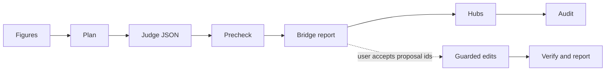

# The ZET Card Box after Luhmann: Implementation Design

Status: implementation specification, 2026-10-16. The features described here are not implemented by this document.

This document specifies the smallest implementation of C1 and C2 in [the design](slip-box-luhmann-design.md). It preserves the decisions in [the slip-box comparison](slip-box-luhmann-comparison.md), including Q1 to Q4. C2 also delivers L6 in [the math comparison](math-cards-luhmann-comparison.md). L1, L2, L5, and L7 remain separate work.

Code review baseline: commit `51ba12d`. The review used the local source and developer wiki. It did not reassess the historical claims about Luhmann.

## 1. The implementation in one page

Keep the Rust Card system and its SQLite schema unchanged. A Bridge is an ordinary Link with a reason. A Bridge proposal is a file in a digest's staging folder. It is not a new Card type, database object, or graph.

Add four production files:

| File | Responsibility |
| --- | --- |
| `scripts/book-digest/book-of.ps1` | Share the audit's Card classification and inferred book attribution. |
| `scripts/book-digest/bridge-compiler.ps1` | Plan bounded jobs, check answers, produce a report, and apply explicitly accepted proposals. |
| `scripts/book-digest/dsh-bridge-instructions.zh.md` | Ask the judge to explain real relations between the supplied Cards. |
| `scripts/book-digest/workflow/modules/zt-bridge.js` | Adapt the compiler cycle to the existing workflow machinery. |

Reuse these components:

| Existing component | Use |
| --- | --- |
| `relatedness.ps1` | Rank candidates with the existing TF-IDF implementation. |
| `zt-calls.ps1` | Make MCP reads and call `zt-check`. |
| `skills/zt/scripts/zt-mcp.ps1` | Send the final `edit_card` calls with agent Access and a carrier allow-list. |
| `edit_card` with `base` | Refuse an edit when the carrier's stored text changed after the last read. |
| `zt-digest-lib.js` | Run managers, judge jobs, and cleanup. |
| The base blueprint and existing book workflow | Declare the new stage and mode. |
| `digest-audit.ps1` | Count existing Bridges, independently of proposal files. |

Correct the two stale zettelkasten texts. Add small integration changes to the existing workflows, audit, protocol, tests, and wiki.

The normal digest prepares a report after Figures and before Hubs. It adds no Bridge. A later `bridge` run applies only the proposals the user accepted from that exact report.



All stages use one implementation. The math profile changes selection rules and judge questions. It does not introduce a second compiler.

## 2. Requirements and boundaries

### 2.1 Required behavior

| Requirement | Concrete behavior | Acceptance evidence |
| --- | --- | --- |
| G1 / C1: accurate insertion guidance | Explain `insert_card before`, renumbering, and the difference between an inserted step and a Side successor. | No contradictory insertion guidance in the affected skill sections. |
| P6 / Q4: whole-Card Links | Explain splitting the author's writable Card when a Link needs only part of it. | The skill states the rule and preserves the human Workspace boundary. |
| G2 / C2: every digest searches between books | Run one shared Bridge stage in full book, economics, and math digests. | Workflow harnesses exercise all three paths. |
| Q2: report first | Full mode never invokes Bridge apply. | A command trace contains no Bridge `edit_card`. |
| Explicit acceptance | Bind accepted ids to one immutable report. | Wrong report, unknown ids, and ids in the wrong section produce no writes. |
| Earlier Cards stay as built by default | Put an accepted Link on the new book's Card. | The earlier Card's body is unchanged. Its generated Reverse links can change. |
| L6: correct mathematical direction | Permit a separately accepted earlier agent Card to cite a unit in the new math book. | The Link points from the user of the theorem to its statement. |
| Z11: human Cards are read-only | A human Card can be a target. It cannot carry a proposal. | Tests refuse every human carrier. |
| No model reconstruction | Change only a carrier's body. Exclude pairs that enroll new Model parts. | Model members and build faults do not gain unintended changes. |
| Few real Bridges | At most two proposals per selected source. Zero is valid. | The report distinguishes no relation, no candidate, omitted sources, and failed jobs. |
| Visible isolation | Count semantic Links already in the archive. | The audit distinguishes an island from incomplete reads. |

“Full mode adds no Bridge” applies to this stage. A full digest still writes its ordinary Cards, models, figures, and hubs.

### 2.2 Features outside this change

Do not add stable Card identifiers, a new relation store, embeddings, a vector service, an approval service, a GUI, or a new MCP tool. Do not change filing rules or hub levels. Do not create another Topic layer for math books. Do not implement the other accepted math practices as part of L6.

The Bridge stage does not split Cards, move Cards, rebuild models, or select which sections a digest covers. A weak or oversized existing Card is a separate maintenance task.

### 2.3 Scope of this document

This task delivers documentation. Installation, workflow deployment, judge runs, archive backups, and Card edits belong to the future implementation and pilot. No acceptance to edit Cards follows from approval of this design alone.

## 3. Findings from the source review

These corrections make the conceptual design implementable. They preserve the accepted features.

| Finding | Evidence at the review baseline | Implementation decision |
| --- | --- | --- |
| `append_card` does not preserve `base`. | The helper rebuilds its arguments with only `at` and `body`. | Send `edit_card` directly. Leave `append_card` unchanged in this feature. |
| The core already supplies a guarded edit. | `src/mcp.rs` accepts `base`. `src/ops.rs::edit` compares it under the edit lock. | Reuse that operation. No Rust change is necessary. |
| A title does not identify a Card. | Locations can change on insert, move, or deletion. Titles need not be unique. | Never find a moved Card by title for apply. Refuse stale endpoints and prepare a fresh report. |
| A head-to-part Link changes membership. | `src/model.rs::parts_of` takes in parts named by a Model Card. | Refuse a proposal whose carrier is a Model Card and whose target is a Model part, regardless of kind. |
| A theorem citation is already supported. | `src/model.rs` treats a unit head as a Cited premise. `src/math.rs` derives load from incoming rests-on Links. | Cite a unit head. Never cite its proof part as a substitute. |
| The proposed output cannot say “once in bridges” and allow two Bridges. | C2.6 permits up to two Bridges per source. | Give each source one result containing a zero-to-two-element `bridges` array. |
| Dynamic target discovery weakens a bounded plan. | C2.6 permits targets outside the planned candidates. | Version 1 accepts only supplied candidates. A new plan can offer different candidates. |
| Book attribution is an inference. | The audit uses weighted outbound Links, with a tie rule. | Share that algorithm. Do not describe it as permanent Card ownership. |
| Finding Cards need an explicit category. | The audit's local `Get-Category` handles event, model, and hub, but not `finding`. | Add the missing `finding` branch when extracting the shared function. Test this intentional correction separately. |
| Offline checker filtering differs from Card mode. | `tools/zt-check/src/check.rs::run_cli` does not apply `--rules` to `--json` output. | Filter offline fault codes in the compiler. Do not assume `-Rules` filters JSON drafts. |
| The model category skips Link-layer rules. | `zt-check` applies its layer checks according to `category`. | Check a Bridge sentence as a small synthetic `idea` draft, even for a Model Card carrier. |
| Full-mode addresses can change after the report. | Hubs runs after Bridge and can create Cards. Other maintenance can also renumber them. | The report is a snapshot. Apply revalidates it. It does not guess new addresses. |
| The first implementation widened the C2.5 kind words for a Model Card carrier. | Section 9.2 let a Model Card take every non-dependency word, so `印证` and `案例` passed. C2.7 of the design does not allow them for a Model Card. | Narrowed back on 2026-10-16: a Model Card carrier takes no evidence word (`印证`, `案例`). The precheck refuses it (BR4). |
| Proposal ids differ from the design. | The design writes `b1`, `b2`, …. The compiler and the workflows accept only `b` with three digits. | Proposal ids are `b001`, `b002`, …. A selection uses these ids. |

Two statements in the conceptual principles also need precise limits:

1. Locations contribute to model structure. Filing supplies a model's range and build order. Links can add shared parts. Z1 must not imply that Locations have no structural effect.
2. Renumbering rewrites internal Links, subject to Access. Deletion can intentionally leave Broken links unless redirected with `into`. Z5 must not promise that every deletion preserves every reference.

The existing orphan count means “no inbound Link.” It does not prove that a reader cannot reach a Card by filing navigation. Bridge counts are another diagnostic, not a proof of reachability or intellectual quality.

## 4. C1: exact skill changes

Change the repository copies first. Update installed copies only during implementation rollout.

### 4.1 The address explanation

In `skills/zettelkasten/SKILL.md`, replace **No insertion** with:

> **Insertion renumbers.** Use `insert_card` with `before` to add a step inside an existing line. The new Card takes `3/3`. The old `3/3` becomes `3/4`, the new Card's Direct successor. ZT shows the renamed addresses first and rewrites their Links. Use a Side successor for an example, objection, qualification, or tangent beside a step.

Keep the paragraph about shifting addresses. Include insertion among the operations that can shift them.

In `skills/zettelkasten/references/luhmann-and-practice.md`, replace the stale Direct successor mapping with:

> **Continue a sequence → Direct successor**, one per Card. ZET can also insert a missing step with `insert_card before`. This renumbers the line and rewrites its Links.

Add relative links to the comparison, conceptual design, and this implementation specification. Do not restate the full decision table in the skill.

### 4.2 Placement must agree with insertion

Correct the affected Placement and Maintenance sentences as well. Replacing only the **No insertion** item leaves the current mid-line Side successor advice in force.

| Situation | Rule |
| --- | --- |
| The next step belongs at the end of a line. | Use its free Direct successor. |
| The step belongs before an existing Regular Card. | Use `insert_card before` and its confirmation flow. |
| The thought is an example, objection, qualification, or tangent. | Use a Side successor. |
| An existing Card is in the wrong place. | Use the existing move operation and its plan. |
| Splitting a writable Card introduces a step inside an occupied line. | Insert the new Card at that point. Do not classify it as a tangent only because the Direct slot is occupied. |

These are authoring instructions. They introduce no new operation.

### 4.3 The whole-Card Link rule

Add this item under Links:

> A Link names a whole Card. If your sentence needs only one part of your writable Card, split that Card first and link the resulting Card. For a human Card, respect read-only Access and report the needed split to the user. A math Link sentence can name a hypothesis or clause label, such as `(H2)`.

The Bridge judge does not perform these splits. It returns no proposal when the supplied Cards do not support a sufficiently precise relation.

### 4.4 C1 verification

Read the changed address, Placement, Links, and Maintenance sections together. Search the repository skill texts for the old claims. Check that their examples agree with the existing `insert_card` contract.

Run the integration installer during rollout. Compare hashes of both affected files in the repository and installed skill folders. Start a new client conversation for the installed-skill check. Existing conversations can retain earlier skill text.

## 5. C2: one compiler with four steps

The command interface is:

```powershell
pwsh -NoProfile -File scripts\book-digest\bridge-compiler.ps1 `
  -Step <plan|precheck|report|apply> `
  -Staging <folder> -CitationKey <key> `
  [-Work <folder>] [-Profile <book|math>] `
  [-MaxSources 60] [-Candidates 5] [-Books <comma-separated-keys>] `
  [-Job <id>] [-ReportId <id>] `
  [-Accept <all-or-comma-separated-ids>] `
  [-AcceptEarlier <all-or-comma-separated-ids>] [-Apply]
```

`-Work` defaults to `<Staging>\bridge`. `-CitationKey` is explicit. If `manifest.json` exists in Staging, its key must agree. A standalone Bridge run needs an existing agent Literature tree, but not the original section-group files.

Use `#Requires -Version 7.5`. Encode files as UTF-8 without BOM. Load `zt-calls.ps1` so child output uses UTF-8.

| Step | Reads | Writes locally | Archive writes |
| --- | --- | --- | --- |
| `plan` | Current tree summaries, selected Card bodies, term tables, math reports when needed | Plan, rendered jobs, prompt copy, empty allow-list | None |
| `precheck` | Frozen plan and one job answer | Optional checker drafts in `tmp/` | None |
| `report` | Plan, job answers on first publication, apply state | Frozen proposals on first publication, rendered report | None |
| `apply` without `-Apply` | Published proposals and live selected endpoints | Validation summary only | None |
| `apply -Apply` | Published proposals, explicit selections, live endpoints, state | Apply state and rendered report | Guarded body edits on accepted agent carriers |

### 5.1 Workflow arguments

Retain the conceptual design's arguments and add one report identifier:

| Argument | Type and default | Rule |
| --- | --- | --- |
| `bridge` | boolean, `true` | Controls the stage in `full`. It does not override an explicit `mode: "bridge"`. |
| `bridgeMax` | integer, `60` | Accept 1–120. Reject fractions and out-of-range values. |
| `bridgeCandidates` | integer, `5` | Accept 1–8. Up to two additional term candidates can follow. |
| `bridgeBooks` | string, absent | Absent means every other agent book. Otherwise check each exact Citation key. Open and human targets remain eligible. |
| `bridgeReport` | string, absent | Required for apply. Must equal the published `report_id`. |
| `bridgeApply` | `"all"` or array of ids, absent | Selects proposals carried by the new book's Cards. |
| `bridgeApplyEarlier` | `"all"` or array of ids, absent | Separately selects proposals carried by earlier agent Cards. |

Only a nonempty selection activates apply. An empty array selects nothing. `false`, `true`, mixed arrays, duplicate ids, and unknown ids are invalid selection values. `"all"` expands only within its own report section.

Require `out` and `citationKey` in Bridge mode. Reject apply arguments in other modes. Reject `bridgeReport` without a nonempty selection. An earlier-only selection is valid. It does not require a new-book selection.

The new `bridgeReport` argument prevents `b001` or `"all"` from silently referring to a different report after a rerun.

### 5.2 Mode behavior

| Mode and input | Stage behavior |
| --- | --- |
| `full`, Bridge enabled | Plan, judge, precheck, report. Never apply. Continue to Hubs and Audit. |
| `full`, `bridge: false` | Return `skipped`. |
| `bridge`, no nonempty selection | Prepare or resume the report in this output folder. |
| `bridge`, selection and matching report id | Check and apply the existing report. No planning, judge run, or source probe. |
| Other modes | No Bridge stage. |

Once a report is published, its plan and proposals are immutable. A Bridge run against that output folder renders or applies the same report. To get a fresh plan, use a fresh `out` folder. Retain the previous report for review.

This rule avoids a reset API, report history database, and mutable “latest proposal” semantics.

### 5.3 Script results

Every step prints compact JSON last, including operational failures. A plan result supplies the existing workflow driver's job contract:

```json
{
  "ok": true,
  "step": "plan",
  "status": "done",
  "plan_id": "p-<sha256>",
  "selected": 12,
  "no_candidates": 1,
  "jobs": [
    {
      "id": "br-001",
      "files": ["<work>/dsh-bridge-instructions.zh.md", "<work>/jobs/br-001.md"],
      "prompt": "按任务文件完成桥接判断，运行 SELF-CHECK，只回复一行 JSON。"
    }
  ]
}
```

The plan file's job records hold source assignments. The result's job records hold `id`, `files`, and `prompt` for `Z.drive`. Return only unfinished jobs. A published report returns `jobs: []` and its report id.

Precheck returns `ok`, `step`, `job`, `faults`, and `status`. Report and apply return `ok`, `step`, `status`, `citation_key`, `plan_id`, `report_id`, `counts`, `outcomes`, and `report`. Include an `errors` array on failure. The report path is absolute.

`ok` is true only for `done` or a deliberate `skipped` result. Partial work remains `ok: false`, `status: partial`, even when some proposals or edits succeeded. The stage adapter must inspect status and preserve those partial results.

Structural input failures prevent writes and exit 1. Operational failures exit 2. A partial report or apply exits 0 with its explicit partial status so the adapter can collect the result. Precheck validation faults exit 1. Do not use the process exit code alone as evidence of complete success.

## 6. Shared Card classification and book attribution

### 6.1 A small pure helper

Move `Get-LinkBook`, `Test-SourceTarget`, `Get-Category`, and the weighted attribution loop out of `digest-audit.ps1`. Put them in `book-of.ps1` as pure functions. They must not call MCP, start a process, or write files.

Use explicit arguments instead of the audit's script-scope `$allBooks` and `$anchorCount`. A suitable public entry point is:

```powershell
$index = Get-BookIndex -Trees $agentTrees -Cards $agentSummaries
# $index.BookOf: address -> Citation key, when attributed
# $index.Category: address -> existing audit category
# $index.Books: exact agent Citation keys
```

Use the same functions from the audit and Bridge compiler. Do not make the compiler run the whole audit to get attribution.

### 6.2 Attribution rules

1. A Card in an agent Literature tree belongs to that book for reporting.
2. For an agent Topic-tree Card, count its distinct valid outbound targets into agent Literature trees.
3. A target that is a Literature Card or an anchor contributes 10 votes to that book.
4. Another target in that Literature tree contributes one vote.
5. The largest vote total wins. Make the tie rule explicit and deterministic by Citation key.
6. A Card with no vote is unattributed. Do not infer a book from the containing Topic's title.
7. Human Cards form their own target bucket. Do not assign them to agent books.

Preserve the existing attribution output on the regression fixture. Test the tie rule explicitly. Use case-sensitive, ordinal address and Citation key lookups. PowerShell's default hashtables and `-eq` comparisons are not sufficient for case-significant Citation keys.

Keep the audit's existing category behavior, except for the explicit `finding` correction. Detect roots before types. Detect Model parts by nonempty `facet`. Retain the older structure-Card heuristic and pass its anchor counts explicitly.

Bridge eligibility also excludes Book notation tables whose titles start with `符号表` or case-insensitive `notation`, matching `src/math.rs`. This need not introduce a new audit category.

### 6.3 Attribution is a reporting approximation

The vote rule is not provenance or model membership. A Card can use several books. New Links can change its inferred book. The report must show inferred attribution and the plan's date.

For this stage and its audit, a Bridge connects different inferred books, or connects an attributed book with a human or unattributed agent Card. This makes the conceptual design's open-Card target rule explicit in the Bridge definition.

Freeze the attribution map used by a report. On apply, reject a selected endpoint whose current inferred book differs. A later audit recomputes attribution from current Links. It does not reuse the report's frozen map.

Do not add persistent ownership fields to prevent this drift. That would be a separate provenance feature. Source citations normally dominate one or two Bridge Links, but the implementation must not assume they always do.

## 7. Planning and candidate selection

### 7.1 Read the archive once for selection

Read `list_trees` and `get_tree` for both Workspaces. Keep one summary map keyed by address. Use the agent subset for book attribution and both subsets for candidate retrieval.

If a tree read fails, stop planning. Do not silently convert an unread book into an empty book. A plan over an incomplete snapshot cannot claim an exhaustive search.

The MCP reads are separate snapshots. They are not a transaction across the archive. After loading full selected bodies, compare their metadata with their summaries. Refuse a detected mismatch. Apply still revalidates every selected endpoint.

### 7.2 Source Cards: book profile

Take eligible agent Cards attributed to `citationKey`, in these priority groups:

1. Model Cards with no facet, formal before concept, then unclassified.
2. Idea Cards in Topic trees, with larger inbound counts first.
3. Finding Cards.
4. Event Cards.

Within a remaining tie, use an ordinal address order. An address order is sufficient for repeatability here. It does not claim to be filing order.

Exclude roots, anchors, Hub Cards, structure Cards, term tables, notation tables, Model parts, and Theory Cards. A Theory Card's outgoing unit Links have membership meaning. It must not become a Bridge carrier.

Apply `MaxSources` after ordering. Record the total eligible count, the selected count, and the omitted count. A limit of 60 does not mean every Card of a book was searched.

### 7.3 Source Cards: math profile

Select unit heads only: Model Cards without a facet whose `form` is `definition`, `axiom`, `theorem`, `proposition`, `lemma`, or `corollary`.

Priority:

1. Units named as a Theory Card's main results or objects.
2. Other Definition units.
3. Other units with `math.load >= 2`.

Use the existing `get_model` math report to identify these sets. Deduplicate a unit listed in several theories. Use ordinal address order within a priority group. Exclude proof parts and Derivation parts. A book with no qualifying unit produces an empty, successful report with an explicit reason.

Do not require the deferred L7 stable-label feature. Show current address, title, and form.

### 7.4 Eligible candidate targets

A candidate must be a substantive Regular Card outside the new book. It can be:

- A Card attributed to another agent book.
- An unattributed agent Card.
- A human Card.

Exclude the same non-substantive categories as above. A Model part can be a candidate for an Idea, Event, or Finding source, subject to the relation rules below. It cannot be a target carried by a Model Card.

Also exclude the source itself, an endpoint already linked in either direction, and a book outside an explicit `bridgeBooks` filter. Apply the book filter before ranking. Do not reject an open or human Card merely because it has no agent book.

Do not treat an ordinary existing reverse-direction Link as permission to add a second Link. The existing pair is already connected.

### 7.5 Reuse relatedness and add literal term matches

Build one `New-Relatedness` model over the summary documents. For each Card, use its title twice and its excerpt once. Use the existing 80-term vector convention of the link preparation. Do not add an embedding or another scorer.

For each source:

1. Use `Find-Related` to get up to `Candidates` eligible targets.
2. Collect the book's preferred terms from its term table and the selected model or unit titles.
3. Find literal occurrences of these terms in eligible target titles.
4. Add at most two term matches not already selected, ordered by matching-term count, then ordinal address.
5. Deduplicate and retain the retrieval reason for each target.

Match Latin terms case-insensitively for retrieval. This does not change address comparison. Read the preferred-term column of the existing term table. Do not introduce a model-name field or a synonym-generation model.

The math profile uses the same title matching for named main results and defined terms. It can find an economics Card that names a theorem even when the rest of its vocabulary differs.

This is bounded retrieval. It can miss a relation expressed only deep in a Card body. The report must state the selected-source limit and retrieval method.

### 7.6 Read full endpoints and make jobs

After selecting candidates, read full bodies for selected sources, their distinct candidate targets, and required term tables. Limit parallel reads to the existing script convention. Check that every requested endpoint returned successfully.

Write the endpoint bodies into `plan.json`. Give each job up to 12 sources. A source without a candidate creates no judge work, but remains in the report as `no_candidates`.

At the default limits, a source has at most seven candidates. At the maximum, it has at most ten. At most 120 sources and 240 proposals can enter one plan.

Jobs show source bodies and candidate titles. The judge reads candidate bodies from the frozen plan with a supplied PowerShell command. It need not read changing live bodies or load the whole archive. The plan also makes unplanned `search_cards` targets unnecessary.

## 8. Files and schemas

The example values below illustrate shape. Identifiers and addresses are examples.

### 8.1 Staging layout

```text
<out>/bridge/
  plan.json                         immutable plan and endpoint snapshot
  dsh-bridge-instructions.zh.md      rendered prompt copy
  read-only.allow.txt               empty helper allow-list
  jobs/br-001.md                    one job per at most 12 sources
  out/br-001.json                   judge answer
  proposals.json                   immutable published review content
  report.md                        proposals plus current apply status
  state.json                       small apply journal, created on apply
  apply.lock                       exclusive file handle while applying
  tmp/                             offline checker drafts
```

`plan.json`, `proposals.json`, and `state.json` have different jobs. The plan is judge input. Proposals are the reviewed decision. State records progress after approval. Do not merge them into one mutable approval file.

Write JSON through a temporary sibling file followed by replacement. A crash must leave either the previous complete file or the next complete file. Use an exclusive handle on `apply.lock` to prevent two apply processes for the same report. Do not hold the ZT service's edit lock across a workflow.

Treat ids as data. A job id follows `br-[0-9]{3}`. An accepted proposal id follows `b[0-9]{3}`. Resolve files only from checked ids, not paths supplied by a judge.

### 8.2 Endpoint record

Each source or candidate has this record in `plan.cards`:

```json
{
  "address": "130/2|f",
  "workspace": "agent",
  "tree": "130",
  "book": "newbook2026",
  "kind": "regular",
  "category": "model",
  "type": "model",
  "facet": null,
  "emphasis": null,
  "level": "formal",
  "form": null,
  "title": "破产重新配置控制权",
  "body": "卡片正文。",
  "fingerprint": "sha256:..."
}
```

The fingerprint covers workspace, tree, kind, type, facet, emphasis, level, form, title, and body. Serialize those fields in that exact order as a JSON array, then hash its UTF-8 bytes with SHA-256. Normalize CRLF and CR to LF in title and body. Preserve all other characters and whitespace.

Exclude generated Reverse links, derived inbound counts, and the raw `text` field. An incoming Link must not make a semantically unchanged target stale.

Keep the inferred `book` separately and compare it explicitly. No fingerprint or title is a permanent Card identifier.

### 8.3 Plan record

```json
{
  "schema": 1,
  "plan_id": "p-<sha256>",
  "created_at": "2026-10-16T12:00:00Z",
  "citation_key": "newbook2026",
  "profile": "book",
  "options": { "max_sources": 60, "candidates": 5, "books": [] },
  "counts": { "eligible": 74, "selected": 60, "omitted": 14 },
  "cards": {},
  "book_of": {},
  "sources": [
    {
      "address": "130/2|f",
      "candidates": [
        { "address": "hart1995firms/7|a", "via": ["relatedness", "term"] }
      ]
    }
  ],
  "jobs": [ { "id": "br-001", "sources": ["130/2|f"] } ],
  "no_candidates": []
}
```

Include the selected term-table records and relevant model baseline reports alongside `cards`. Store enough baseline data to compare model members and build faults after apply.

Compute `plan_id` from canonical review input, excluding timestamps and local paths. Sort object keys ordinally and preserve declared array order. Reject duplicate JSON keys. One local serialization function in the compiler is sufficient.

If a plan exists, `plan` checks the requested key, profile, and options against it and returns its unfinished jobs. It does not replace the snapshot with a new archive read. Incompatible inputs require a fresh output folder.

### 8.4 Judge answer: one result per source

```json
{
  "schema": 1,
  "plan_id": "p-<sha256>",
  "job": "br-001",
  "sources": [
    {
      "source": "130/2|f",
      "bridges": [
        {
          "carrier": "130/2|f",
          "target": "hart1995firms/7|a",
          "word": "对应",
          "sentence": "对应 [[hart1995firms/7|a]]：两处都由控制权决定事后议价。",
          "why": "两张卡片讨论同一控制权机制。"
        }
      ],
      "none": ""
    },
    {
      "source": "130/3",
      "bridges": [],
      "none": "候选只有共同词语，没有共同机制。"
    }
  ]
}
```

Each job source appears exactly once in `sources`. A nonempty `bridges` array requires an empty `none`. An empty array requires a nonempty, single-line `none` reason. A source has at most two Bridges.

`carrier` means the Card whose body receives the sentence. `target` means the address inside the Link. This avoids overloading “from,” “to,” and “earlier.”

For a normal proposal, carrier equals source and target is a supplied candidate. For an earlier proposal, carrier is a supplied earlier candidate and target equals the new source unit. Derive the report section from these fields. Do not trust a judge-supplied `place` value.

The judge supplies no proposal id and no canonical Relation kind. The compiler derives the kind from `word` and assigns ids when publishing.

### 8.5 Published proposals

`proposals.json` contains schema, plan id, Citation key, immutable endpoint snapshots, valid proposals, no-relation results, omitted counts, and failed or refused results. Copy the endpoint data needed for apply so published proposals do not depend on mutable job output.

Sort valid proposals by source, carrier, target, word, then sentence, using ordinal comparison. Assign `b001`, `b002`, and so on. Set `report_id` to `r-` followed by the SHA-256 of the canonical immutable payload without its own id or timestamps.

Every proposal records:

| Field | Meaning |
| --- | --- |
| `id` | Local id, such as `b001`, scoped to `report_id`. |
| `source` | The selected new-book Card that prompted the search. |
| `carrier`, `target` | The actual directed Link endpoints. |
| `section` | Derived `new` or `earlier`. |
| `word`, `kind` | Checked surface word and computed canonical kind. |
| `sentence`, `why` | Exact proposed body text and review explanation. |
| `carrier_fingerprint`, `target_fingerprint` | Reviewed endpoint snapshots. |

`report` publishes this file once. Later report calls only render it with `state.json`. They never silently replace its sentences, ids, endpoint snapshots, or failed-job list. Late judge outputs require a new report in a new output folder.

### 8.6 Apply state

State records `schema`, `report_id`, per-proposal outcomes, and a small ordered list of attempted carrier edits. Each attempt stores selected ids, the expected carrier fingerprint, the intended body and fingerprint, and its outcome.

Write the attempt before sending its edit. Mark it verified only after rereading the result. This closes the crash window between a successful Card edit and a missing local completion record. The lock file's existence is not the lock. The exclusive open handle supplies the lock and the operating system releases it when the process exits.

This is a local retry journal. It is not an archive transaction log or a second source of Card truth.

## 9. Relation and direction rules

### 9.1 Allowed words

Use the existing Relation kinds. Version 1 accepts these explicit words:

| Word | Canonical kind | Meaning the judge must establish |
| --- | --- | --- |
| `对应`, `类比` | `corresponds` | A shared concept, mechanism, or structure. |
| `对照`, `区别` | `contrasts` | A stated difference under a comparable question. |
| `例示`, `印证`, `案例` | `illustrates` | The carrier supplies an example or evidence for the target. |
| `放宽`, `推广` | `relaxes` | The carrier relaxes or extends the target's assumptions or scope. |
| `反驳`, `批评` | `objects` | The carrier objects to the target's claim or assumption. |
| `依赖`, `基于` | `rests-on` | The carrier uses the target as a premise. |
| `特例` | `specializes` | Every object of the carrier definition is an object of the target definition. |

The surface direction matters. An Idea Card does not “illustrate” a Finding Card merely because the Finding supports the idea. A new idea can instead rest on earlier evidence. If no allowed new-carrier sentence states the true relation, return no proposal.

Do not invent a `supports` kind or use `引出`. Do not force a symmetrical relation to avoid the correct dependency direction.

### 9.2 Carrier constraints

| Carrier | Allowed relation targets |
| --- | --- |
| Idea, Event, or Finding Card | Eligible candidates with the words above, subject to the specialization and part restrictions. |
| Model Card without facet or `theory` form | Non-dependency relations to eligible Cards that are not Model parts. A rests-on relation may target a math unit head only. |
| Model part, Theory Card, root, anchor, hub, table, structure Card | Never a carrier. |
| Human Card of any type | Never a carrier. |

For all carriers, forbid rests-on to a Model part. Cite a mathematical statement or another whole Card. A non-dependency Link to a part is allowed only from an Idea, Event, or Finding Card.

Permit `特例` only when both endpoints are Definition unit heads and the carrier is the narrower definition. A Model Card carrier can use it in that case. This rule is explicit rather than implied by the generic Model Card word list.

### 9.3 Earlier-carrier exception

An earlier proposal must satisfy all of these conditions:

1. The selected new source is a math unit head.
2. The carrier is an agent Idea Card or Model Card, with no facet and no `theory` form.
3. The carrier is attributed to another agent book. An unattributed or human candidate does not qualify for this exception.
4. The target is the new source unit head.
5. The word is `依赖` or `基于`.
6. The user selects the id through `bridgeApplyEarlier` from the identified report.

Example: an earlier economics model uses the intermediate value theorem in the new math book. The economics Model Card carries the Link to the theorem. This direction lets `math.used_by` and load reflect the citation.

No other earlier-body changes are part of version 1. A reversed illustration or critique can remain an explanation in the report without an executable proposal.

### 9.4 Model preservation

These restrictions preserve model membership and avoid introducing a new `closure` or `reach_in` fault through an accepted Bridge. They also avoid expanding Theory Card membership.

Recheck live type, facet, form, and model context at apply time. A Card retyped after review is stale. Do not rerun a model compiler to make a Bridge acceptable.

## 10. Judge job and precheck

### 10.1 Judge instructions

Use one prompt for both profiles. The job declares the profile and the exact output file. Load `zettelkasten` and `asd-ste100-zh` through the existing skill mechanism.

The judge must:

1. Read each source and the candidate bodies from the frozen plan.
2. Ask whether the Cards share a mechanism, concept, result, or event, or have a precise contrast, example, extension, objection, or premise relation.
3. Check actor, timing, scope, assumptions, and direction. Shared vocabulary alone is insufficient.
4. Return zero, one, or two proposals per source.
5. Write only its assigned `out/br-NNN.json`.
6. Run its exact `SELF-CHECK` command and correct faults at most three times.
7. Return one compact summary line with job id, proposal count, and remaining faults.

The judge makes no MCP writes. It does not create Cards, correct old prose, run compilers, search outside the supplied candidates, or infer user acceptance. If it uses the helper for an incidental read, it must use the empty allow-list.

Use frozen local candidate bodies rather than one live `get_card` read per candidate. The compiler owns those snapshots. The model does not compute or attest to hashes.

### 10.2 Exact answer validation

Use one local `Test-BridgeAnswer` function from precheck, initial report publication, and apply validation. Do not maintain three slightly different validators.

| Code | Condition |
| --- | --- |
| BR1 | Schema, plan id, job id, field types, and exact source coverage are valid. |
| BR2 | Each pair consists of this source and one of its supplied candidates in an allowed direction. |
| BR3 | Both endpoint snapshots exist and satisfy category, Workspace, book, and filter rules. |
| BR4 | Carrier, target, word, and profile satisfy the relation matrix. |
| BR5 | The sentence contains exactly one Link to `target`, with `word` immediately before it. |
| BR6 | There are at most two proposals per source and no duplicate directed pair. |
| BR7 | The plan contains no existing Link in either direction for that pair. |
| BR8 | The sentence and `why` are nonempty. Each is one physical line. The sentence contains no generated marker, heading, code fence, or chart. |
| BR9 | The sentence passes the selected offline Card-language and Link checks. |

A job-envelope fault such as a missing source refuses that whole job. A proposal-local fault refuses that proposal and records the fault. A source whose proposals all failed is `refused`, not `none`.

Precheck prints one fault per line, `faults: N`, and a compact JSON object last. This is deliberate: existing workflow drivers parse the last JSON line. Human self-check instructions can look for `faults: 0` without assuming it is the last line.

Use exit code 0 for a clean check, 1 for validation faults, and 2 for an operational failure. Report publication checks the files again instead of trusting the judge's reply.

### 10.3 Offline language checks

Build a synthetic draft for each proposed sentence:

```json
{
  "address": "draft:b001",
  "title": "跨书关联",
  "body": "对应 [[hart1995firms/7|a]]：两处都由控制权决定事后议价。",
  "category": "idea",
  "parent": "",
  "links": ["hart1995firms/7|a"],
  "kinds": ["hart1995firms/7|a"]
}
```

The Bridge validator establishes the word-to-kind mapping independently before constructing `kinds`. Do not accept a judge's claim that its sentence is kinded.

Run `Invoke-ZtCheck -Json` on drafts. Keep fault codes `L1,L2,R2,R3,R4,R5,R7,R9`. Filter returned codes inside the compiler because JSON mode ignores the CLI rule filter at this baseline.

For R6, include the carrier's applicable term table as an extra entry and use it as `Setting`. Prefer a Model Card's setting term table, then its book's table. An earlier carrier uses the earlier book's terms. If no table exists, record `term_check: unavailable`. Do not call that a passed terminology check.

Run R6 separately when necessary so a term-table entry's unrelated faults do not reject a sentence. Do not enable I-rules on the synthetic short draft. It is an appended relation sentence, not a standalone Idea Card.

These checks establish structure and language. The judge and the user assess whether the relation is true.

## 11. The Bridge report

Publish `report.md` even when there are zero proposals. Its opening shows the key, plan id, report id, generation time, profile, limits, and read coverage.

Include these counts:

- Eligible, selected, and omitted sources.
- Sources with candidates and sources with no candidate.
- Sources with valid proposals, valid `none` results, refused answers, and missing or failed jobs.
- Valid new-carrier and earlier-carrier proposal counts.
- Current apply outcomes, when state exists.

Reconcile source counts. Every selected source has exactly one outcome class. A failed job must never inflate the no-relation count.

The body has these tables:

1. Proposals grouped by target book, with human and unattributed buckets.
2. **New-book carriers:** id, source, carrier, relation, target, exact sentence, and reason.
3. **Earlier-book carriers requiring separate acceptance:** the same fields, with the actual direction visible.
4. Sources with no relation or no candidate and their reasons.
5. Omitted sources and the reason for the selection cap.
6. Refused or failed work and its faults.
7. Apply outcomes and unfinished verification.

Show address and title for both endpoints. Escape table pipes in addresses and body text. The JSON file retains exact strings. The rendered Markdown must not split an address containing `|` into extra columns.

The report states: acceptance applies to the exact published sentences. Editing a sentence or endpoint requires a fresh report. A report with partial judge failure is usable for its valid proposals, but must carry `status: partial`.

## 12. Applying accepted proposals

### 12.1 Acceptance validation before writes

Read `proposals.json` and recompute its report id. Check `bridgeReport` or `-ReportId` against it. Reject malformed files, schema mismatch, unknown ids, ids in the wrong section, or selections from another report before any Card edit.

An id in `Accept` cannot select an earlier-carrier proposal. An id in `AcceptEarlier` cannot select a new-carrier proposal. No flag means no acceptance. Absence of a user reply is not acceptance.

The calling session translates the user's answer into these arguments. The compiler cannot prove that a human spoke. It requires explicit acceptance inputs and records them in state. It never derives acceptance from a prompt, judge result, or timer.

### 12.2 Revalidate endpoints without relocation guesses

For all selected proposals, reread endpoints and current tree summaries before starting writes. First recover pending journal attempts as described in 12.5. For an endpoint already changed by this same report, compare with its reconstructed journal state. For every other endpoint, compare with the published snapshot. Compare:

- Workspace, tree, kind, type, facet, emphasis, level, and form.
- Title and body fingerprints.
- Current inferred book and current eligibility.
- Existing Links in both directions.
- Model context needed by the carrier and target restrictions.

Mark a changed or missing endpoint `stale`. Do not search by title, follow an unverified address replacement, or silently substitute a semantically similar Card.

Generated Reverse links do not affect semantic fingerprints. Retyping, changed prose, changed filing tree, or a different Card now occupying the address does.

An identical replacement at the same address cannot be distinguished without stable identity. Version 1 does not claim to detect it.

### 12.3 Group edits by carrier

Check all selections first. Then group valid proposals by carrier and process carriers in ordinal address order. Each group makes at most one edit in that apply invocation.

Append one paragraph per selected proposal, ordered by proposal id:

```markdown
跨书关联：对应 [[hart1995firms/7|a]]：两处都由控制权决定事后议价。
```

Use one formatter. Keep the original title and body text before these trailing paragraphs. Do not replace an existing `关联：` paragraph, source line, model structure list, or generated Reverse links section.

Several earlier-carrier proposals can refer to one earlier Card. Deduplicate identical carrier-target pairs across the whole report, not just within a job. If different jobs propose conflicting sentences for that pair, refuse the conflict for manual review rather than choosing silently.

### 12.4 Make the existing guarded edit

Immediately before each carrier edit, reread that carrier. Ensure it still matches the expected semantic state, including any earlier verified edits from this report. Then send:

```json
{
  "tool": "edit_card",
  "arguments": {
    "at": "130/2|f",
    "body": "<current body plus accepted Bridge paragraphs>",
    "base": "<exact raw text from the immediately preceding get_card>"
  }
}
```

Use the helper's file/stdin parameter set with an allow-file listing only this invocation's accepted carriers. All carriers must be agent Cards. Do not send type, facet, level, or form changes.

`base` must be the exact `get_card.text`, including generated text. The semantic fingerprint serves review validation. Raw `base` serves the atomic conflict check. They are not interchangeable.

Do not use `append_card`. Correcting that helper would broaden this change and is unnecessary for this implementation.

On a `base` conflict, stop that carrier, retain the other completed carriers, and report `conflict`. Do not omit `base` or retry against unreviewed prose.

### 12.5 Retries and interrupted writes

Before sending the edit, atomically save its expected and intended carrier states in the apply journal. After the edit, reread the carrier and save its verified outcome.

On retry, distinguish three cases:

| Current carrier | Action |
| --- | --- |
| Matches the journal's intended state | Recover the completed edit and check it. Do not append it again. |
| Matches the journal's expected state | The edit did not persist. Revalidate targets, then retry the same intended edit with a fresh raw `base`. |
| Matches neither | Mark stale or conflict. Make no retry write. |

A later invocation can accept additional ids from the same report. Reconstruct the expected carrier body from the original snapshot and the journal's verified paragraphs. Do not treat an unrelated edit as an allowed extension.

A live Link already present without a matching verified journal is `already_linked`, not evidence that this run applied the proposed explanation. Preserve its existing sentence. Do not add another one.

### 12.6 Verification after writes

For each changed carrier:

1. Reread its body and metadata. Compare with the intended state.
2. Check its generated relation kind through the core report or tree summary. It must match the mapped word.
3. Check that the target's Reverse links include the carrier.
4. Check the appended sentences with the same language validator.
5. Check the changed Card for L1 and L2. Report pre-existing faults separately from new faults.

For affected models, compare model members and the sets of `closure`, `reach_in`, `forward`, `unanchored`, and `beyond_level` faults with the saved baseline. Do not require an unrelated pre-existing fault to disappear. Require no new fault attributable to this edit.

An earlier-carrier theorem citation may intentionally increase the target unit's load or used-by list. It must not enroll a proof part or expand a theory's units.

If an edit persisted but verification failed, record `written_unverified`. Report the actual changed Cards. Do not report a read-only failure or automatically erase user-approved text from a changed Card.

### 12.7 Concurrency limit

The existing `base` check protects the carrier's stored text under the service edit lock. It does not atomically lock both endpoints or compare the target's metadata in the same transaction.

Version 1 therefore runs apply while filing is quiet: no concurrent insertion, move, deletion, Citation key rename, or retype. The workflow must not run Organize concurrently with Bridge apply. Existing prose edits to a carrier cause a conflict instead of an overwrite.

Separate reports can still try to change one carrier. Its raw `base` check arbitrates the writes, so one can stop with a conflict. The per-report lock only prevents duplicate applies of that same report.

Do not claim a transaction across all accepted proposals. Edits are atomic per carrier and can partially complete. Stronger target-race guarantees would require a separate core contract change.

## 13. Audit counts

The audit reads archive Links, never `proposals.json`. Proposed Links do not count as existing Bridges.

Use the shared book index and read summaries from both Workspaces. Keep all existing audit fields. Add one `bridges` object per agent book:

```json
{
  "out": { "books": { "hart1995firms": 4 }, "human": 1, "unattributed": 0 },
  "in": { "books": { "otherbook": 2 }, "human": 0, "unattributed": 0 },
  "island": false,
  "complete": true
}
```

Count distinct directed Card pairs. Repeating a Link twice in one Card contributes one pair. Reciprocal Links contribute one outgoing pair in each direction.

Include substantive Regular Cards, including Model parts, in existing-Link counts. Exclude roots, anchors, Hub Cards, structure Cards, term tables, and notation tables at either endpoint. Require a valid target and a kind other than `refers`. Source citations and index lists must not make a book appear connected.

For a book's outgoing count, attribute the carrier to that book and bucket the target as another agent book, human, or unattributed agent Card. For incoming count, reverse that grouping. An unattributed agent carrier can count as incoming to a book. Human-to-human Links do not concern an agent book.

`island` is true only when every external in/out count is zero and reads are complete. It means no counted semantic external pair exists under this attribution rule. It does not mean there is no filing path or that the book contains no useful idea.

If any required tree read fails, use `complete: false` and `island: null`. Do not publish a zero as evidence of isolation. A Citation-key-filtered audit must still examine the other books and human summaries to count incoming pairs.

Add these counts to `audit.md` and its compact final summary. Distinguish an archive with no other eligible books from a completed search that rejected all candidates.

## 14. Workflow integration

### 14.1 Shared framework stage

Add `zt-bridge` v1 to the module library. It calls the compiler through existing script drivers. Use `Z.drive` only where jobs need judge management. Apply can use the existing script-only driver and must not probe DeepSeek.

The declared full graph becomes:

```text
... -> link -> link-check -> after-link -> cleanup -> organize
    -> figures -> bridge -> hubs -> audit -> after-audit -> report
```

Set the `bridge` dependency after Figures and the Hubs dependency after Bridge. Add the mode `bridge` to the base.

The source stage has an explicit condition: skip the DeepSeek probe when Bridge mode is applying a published report. Keep the normal source probe when Bridge mode needs judges. Do not make network availability a condition for applying reviewed local proposals.

Pass `profile.bridgeProfile` as `book` or `math`. Economics uses `book`. The handwritten book workflow also uses `book`.

### 14.2 Module control flow

```text
if apply arguments are present:
    validate mode, report id, and selections
    run apply with explicit acceptance and -Apply
    render report
    return apply summary

run plan or load its frozen plan
run unfinished judge jobs, with the fixed repair budget
publish report from checked results
clean up judge conversations and stage workspace
return report summary
```

No automatic apply follows `plan`. Do not copy the event layer's unconditional `apply -Apply` call.

Use a `finally` cleanup path for the stage's judge conversations and DeepSeek workspace. Retain the staging folder, plan, output JSON, report, and retry journal. A validation-only apply needs no judge cleanup.

### 14.3 Roles and resource bounds

Reuse the current role split and source resolver. Managers relay commands. Judges write relation prose and JSON. Scripts select, check, and edit.

- Haiku manager, effort low.
- The resolved DeepSeek V4.1 Flash source, effort at least high, following current digest policy.
- At most eight judge runs per manager and eight managers in the shared DSMP pool.
- Twelve sources per job and at most ten jobs for the 120-source cap.
- No new Sonnet or Opus role in this stage.

These are the repository's current workflow conventions, not a new claim about model availability. Resolve the configured source when a future report run starts.

### 14.4 The handwritten book workflow

Add one `runBridge()` adapter in `.claude/workflows/zt-book-digest.js`, beside its other stage functions. Its report path calls the same compiler and prompt. Its apply path calls the same explicit compiler apply.

Handle Bridge mode before the ordinary digest, link, and Organize flows. Handle Bridge apply before its DeepSeek probe. In full mode, call `runBridge()` after `runFigures()` and before `runHubs()`.

Do not refactor the whole legacy workflow in this feature. The two adapters share implementation contracts through the compiler, not duplicated retrieval or apply logic.

### 14.5 Results, versions, and frozen installation

Add `bridge` to `zt-digest-report` parameters and result. Bridge mode returns its own summary. Full mode includes it alongside figures, hubs, and audit.

The summary contains status, key, plan id, report id, source counts, new/earlier proposal counts, fault counts, apply outcomes, and report path. It must distinguish `skipped`, `done`, `partial`, and `failed`.

Planned version changes, if implementation starts from this baseline:

| Component | Change |
| --- | --- |
| Base blueprint | `2.0.0` to `2.1.0` |
| Economics variant | `3.0.0` to `3.1.0` |
| Math variant | `2.1.0` to `2.2.0` |
| New module | `zt-bridge` v1 |
| Existing shared modules changed | Increment their module versions, including report output behavior. |

Update the touched preflight declarations, especially arguments, jobs, stage graph, modules, checks, failure policy, and simulation. Update each variant's base reference. Do not patch generated installed scripts by hand.

Build and install with the existing assembler, then run `verify` for both framework variants. The handwritten workflow remains handwritten. The frozen artifacts under `.claude/workflow-framework/` are outputs of the install, not a second editable source.

## 15. Failure and recovery policy

| Failure | Result |
| --- | --- |
| Required archive read fails during planning | Stage `failed`. No judge work and no Bridge writes. Full digest continues to Hubs and Audit. |
| No eligible source or no candidate | Stage `done` with explicit zero counts. |
| Some jobs fail or remain invalid | Stage `partial`. Publish valid proposals and list failed sources. |
| Every judge job fails | Stage `failed`, with a diagnostic report. Do not label the book “no relation found.” |
| Invalid report id or selection | Apply fails before any edit. |
| A selected endpoint is stale | Skip that proposal and report `stale`. Other checked carriers can proceed. |
| Carrier changes between read and edit | `conflict`. Preserve the concurrent change. |
| Process exits after a write | Recover from the journal and reread the actual Card. |
| Verification fails after a persisted write | `written_unverified`, with the changed carrier named. |
| Second apply of the same verified ids | No new edit. Return their existing verified outcomes. |

Do not silently retry a stale report with new content. Produce a fresh report and ask for acceptance of its actual proposals through the normal calling session.

Full-mode Bridge failure is nonfatal to the digest. It must remain visible in the final result. The workflow must not translate it into `done` because later stages succeeded.

## 16. Tests with concrete outcomes

All mutating tests use a scratch archive and isolated `ZT_CONFIG_DIR`, following the existing compiler tests. Set `ZT_GUI_PORT=0`. Never create fixtures in the user's active archive.

Use hand-written judge output fixtures. CI does not need a paid model call to check selection, validation, approval, and apply contracts.

### 16.1 Shared attribution tests

Add `scripts/book-digest/tests/book-of.tests.ps1`:

| Fixture | Required outcome |
| --- | --- |
| Two books and a Topic Card linking their roots | The 10-vote rule and tie rule are explicit. |
| A root citation plus ordinary cross-book Links | Weighted attribution matches the earlier audit fixture. |
| A Finding Card | Category is `finding`, not `idea` or `anchor`. |
| Model head, part, old structure Card, term table | Existing categories remain correct. |
| A human Card and a human Literature tree | They do not become agent-owned book Cards. |
| Case-distinct valid addresses and reordered input | Exact lookups remain distinct and output is deterministic. |

### 16.2 Bridge compiler tests

Add `scripts/book-digest/tests/bridge-compiler.tests.ps1`. Use at least two agent books, one unattributed agent Card, human targets, one ordinary model with parts, and a math unit.

| Area | Test and required outcome |
| --- | --- |
| Planning | Candidate lists exclude own-book Cards, roots, anchors, hubs, tables, and existing pairs. |
| Bounds | Ordering, 60/120 source limits, candidate limits, term extras, and job size are enforced. |
| Coverage | Selected, omitted, no-candidate, no-relation, refused, and failed counts reconcile. |
| Retrieval | A literal theorem-name match finds an economics Card missed by the top similarity candidates. |
| Schema | A source occurs once even with two Bridges. A third Bridge or missing source fails. |
| Candidate control | An unplanned target or another job's source is refused. |
| Direction | An earlier economics carrier points to the new theorem. The reverse dependency is not substituted. |
| Model boundary | A model-to-part `对应` Link is refused because it changes membership. |
| Model boundary | A model-to-Idea rests-on Link and every rests-on-to-part Link are refused. |
| Specialization | Only Definition-to-Definition narrowing accepts `特例`. |
| Human Access | A human target is allowed. Any human carrier is refused. |
| Sentence | Wrong target, two Links, no kind word, short reason, or code/chart content fails. |
| Checker input | Link rules run for synthetic Model Card sentences. JSON rule filtering keeps only the intended codes. |
| Terminology | Earlier carriers use earlier terms. Missing term tables appear as unavailable. |
| Report identity | Changed sentence, wrong report id, unknown id, or wrong acceptance section makes zero writes. |
| Read-only behavior | Plan, precheck, report, and apply without `-Apply` make zero archive writes. |
| Normal apply | Only accepted carriers change. Earlier and human target bodies remain unchanged. Reverse links update. |
| Duplicate pairs | Identical pairs across jobs deduplicate. Conflicting text for one pair is refused. |
| Freshness | A changed title, body, type, facet, form, tree, or inferred book makes the endpoint stale. |
| Renumbering | Move or insert after the report causes stale detection. No title-based relocation occurs. |
| Reverse-link churn | Changed generated Reverse links alone do not invalidate semantic review. A fresh raw base is still sent. |
| Race | Use the existing racing-helper pattern to change the carrier between read and edit. CAS refuses the overwrite. |
| Recovery | Simulate a successful edit followed by process interruption before completion state. Retry checks it without duplication. |
| Partial progress | The first carrier succeeds and the second conflicts. Retry does not append the first again. |
| Incremental selection | Apply one id, then another from the same report. The second invocation recognizes the first reviewed paragraph. |
| State concurrency | A second process cannot acquire the same report's apply lock. |
| Verification | Members and new build-fault sets remain unchanged. A theorem citation updates used-by as expected. |

### 16.3 Audit tests

Add `scripts/book-digest/tests/digest-audit.tests.ps1` or extend an equivalent dedicated fixture if one exists when implementation starts:

- Repeating a Link counts once per directed pair.
- A cross-book relation increments outgoing and incoming buckets.
- A human target and a human incoming Link use the human buckets.
- A source citation, hub listing, or `refers` Link does not connect books.
- A proposed but unapplied Bridge counts zero.
- A book with no external semantic pair is an island only after complete reads.
- A failed human or other-book read produces unknown isolation, not a false zero.
- Existing unrelated audit fields retain their earlier values, except the documented Finding classification correction.

### 16.4 Workflow harnesses

Extend `framework-harness.mjs` and `workflow-harness.mjs`:

1. Full mode places Bridge between Figures and Hubs in every maintained path.
2. Full mode contains no Bridge `apply -Apply` command.
3. Bridge report mode runs only its required source selection, compiler cycle, and report.
4. Bridge apply mode requires the report id and selections, skips the source probe and judge, and does not run Organize, models, or Hubs.
5. `bridge: false` skips full-mode Bridge only.
6. Earlier-only acceptance works. Wrong-mode apply arguments fail before work.
7. A partial or failed Bridge remains visible while later full-mode stages continue.
8. Cleanup runs on success and failure without deleting review files.
9. The frozen graph, profile, role limits, and installed-equals-built checks remain valid.

Extend the existing version-requirement test to include the new PowerShell files. Do not run the obsolete math generator against the framework-installed math script.

### 16.5 Verification commands

From PowerShell in the repository:

```powershell
pwsh -NoProfile -File scripts\book-digest\tests\book-of.tests.ps1
pwsh -NoProfile -File scripts\book-digest\tests\bridge-compiler.tests.ps1
pwsh -NoProfile -File scripts\book-digest\tests\digest-audit.tests.ps1
pwsh -NoProfile -File scripts\book-digest\tests\requires-version.tests.ps1
node scripts\book-digest\tests\workflow-harness.mjs
node scripts\book-digest\tests\framework-harness.mjs
node "$HOME\.claude\skills\project-wiki\scripts\wiki.mjs" check
```

Run existing compiler or helper suites only when the extraction or integration touches their contracts. No Rust change means this feature does not require inventing new Rust unit tests. If implementation changes the core after all, revise the design and run the corresponding Rust suites.

## 17. Implementation sequence and file ownership

Use this order so each step leaves a concrete, testable result:

| Step | Work | Gate before the next step |
| --- | --- | --- |
| 1 | Correct C1 in the repository skill and reference. | Read all related skill sections and check insertion consistency. |
| 2 | Extract pure book classification and attribution. Add the Finding correction as an explicit change. | Shared fixture passes. Existing attribution behavior is preserved. |
| 3 | Add read-only planning, bounded candidates, answer validation, and immutable report publication. | Compiler tests show zero archive writes and correct failure coverage. |
| 4 | Add explicit acceptance, guarded apply, journal recovery, and verification. | Scratch tests pass for Access, stale reports, conflicts, and partial progress. |
| 5 | Add semantic Bridge counts to the audit. | Count fixtures and incomplete-read cases pass. |
| 6 | Integrate one framework module, base conditions, both profiles, and the handwritten adapter. | Both workflow harnesses pass, including no automatic apply. |
| 7 | Update docs, install skill copies, assemble workflows, and run their `verify` command. | Wiki and install verification pass. |
| 8 | Run a report-only pilot on an already digested book. | Review actual proposals and limits. No Bridge edit occurred. |
| 9 | After the user accepts actual proposal ids, apply that pilot report. | Only accepted carriers change and verification completes. |

The code and its functional-block doc belong in the same commit. The minimum documentation map is:

| Change | Documents to update during implementation |
| --- | --- |
| C1 | `docs/wiki/agent-skills.md`, plus the skill/reference files themselves. |
| Shared helper, compiler, audit | `docs/wiki/digest-scripts.md`. |
| Prompt | `docs/wiki/digest-prompts.md`. |
| Module, base, adapters, modes, result | `docs/wiki/digest-workflows.md`, `docs/zt-digest-framework.md`, `docs/zt-book-digest-workflow.md`, and the math workflow guide where its modes are listed. |
| Shared operational protocol | `skills/zt-digest-protocol/SKILL.md` and `skills/zt-digest-protocol/references/scripts.md`. |
| Terms | `CONTEXT.md`: Bridge, Bridge proposal, Bridge report, and carrier if used as a public term. |
| Completion status | This specification, the conceptual design, and L6 in `math-cards-luhmann-comparison.md`. Mark built only after verification. |

Keep the wiki's present-tense implementation descriptions accurate. Do not describe this proposal as built merely because this document exists.

## 18. Rollout and user examples

### 18.1 Install after tests

This feature changes no Rust binary or schema. It requires no `zt down`, `cargo install`, or schema migration. Keep running digest workflows on their existing frozen version until they finish.

During implementation rollout:

1. Run the affected tests and wiki check.
2. Run `scripts/install-agent-integrations.ps1` to publish skill corrections and protocol updates.
3. Compare the repository and installed skill hashes. Use a new client conversation to check loaded guidance.
4. Assemble and install each framework variant using the existing procedure in `zt-digest-framework.md`.
5. Run assembler `verify` for each installed variant.
6. Retain the previous frozen workflow version for recovery.

Do not reinstall or restart the ZT service solely for these script and skill changes.

### 18.2 A report-only pilot

Use an existing book and a fresh folder:

```javascript
Workflow({
  scriptPath: "E:\\zet\\.claude\\workflows\\zt-econ-digest.js",
  args: {
    mode: "bridge",
    citationKey: "newbook2026",
    out: "E:\\zet-staging\\newbook2026-bridge-pilot",
    bridgeMax: 12,
    bridgeCandidates: 5,
    bridgeBooks: "hart1995firms"
  }
})
```

The key and path are examples. The pilot creates a report, not Bridge Links. Record logical Card bodies before and after to establish that no Bridge-stage body edit occurred. A service can update operational metadata, so database-file hash equality is not the test for a read-only report.

### 18.3 Apply the reviewed report

After the user accepts actual proposals, use the returned report id:

```javascript
Workflow({
  scriptPath: "E:\\zet\\.claude\\workflows\\zt-econ-digest.js",
  args: {
    mode: "bridge",
    citationKey: "newbook2026",
    out: "E:\\zet-staging\\newbook2026-bridge-pilot",
    bridgeReport: "r-<actual-sha256-from-report>",
    bridgeApply: ["b001", "b004"]
  }
})
```

For separately accepted earlier carriers, add `bridgeApplyEarlier: ["b009"]` or use it alone. The example is not approval of those ids.

Take an archive backup through the existing supported backup procedure before the first mutating pilot. Keep filing quiet during apply. A restore affects more than these paragraphs, so it is a user recovery decision, not an automatic retry step.

The apply result names every changed carrier and every stale, conflicting, already-linked, or unverified proposal. The report retains unapplied proposals for later selection from the same immutable report.

### 18.4 Hubs and later maintenance

Apply does not rerun Hubs or Organize. Accepted Bridge Links appear in Reverse links immediately through the normal Card edit path. The user can run the existing Hubs mode later if entry points need revision.

For a stale report, start a report-only Bridge run with a fresh output folder. Do not salvage old acceptance by matching titles or rewriting the old proposal addresses.

## 19. Completion criteria

Implementation is complete only when:

- The stale insertion rule and its conflicting Placement advice are corrected in repository and installed skills.
- All three maintained digest paths run the shared report-first Bridge stage.
- The math profile uses the same compiler and supports the separately accepted earlier-to-unit citation.
- The report exposes selection limits, missing work, exact directed sentences, and a stable review id.
- Apply writes only accepted agent carriers, uses the existing atomic `base` check, and recovers interrupted edits without duplicate paragraphs.
- Model membership and newly introduced build faults satisfy the stated limits.
- The audit counts actual semantic external pairs and reports unknown isolation on incomplete reads.
- The named tests, workflow installation verification, and wiki checks pass.
- A report-only pilot and a separately accepted mutating pilot produce the specified evidence.

Passing source tests does not mean a live pilot ran. Publishing this implementation design does not mean any of these runtime completion criteria were met.

## 20. Why this remains the simplest structure

The archive already stores text, Links, Reverse links, model membership, and mathematical citations. Reusing those contracts avoids a second graph and migration.

The digest already supplies a compiler cycle, relatedness scorer, checker, manager pool, and frozen workflow installation. One added stage can use them for every book type.

The three local JSON files separate frozen input, frozen review content, and retry progress. They are needed because review and execution occur at different times. They do not require a database or service.

The design deliberately stops at stale-address rejection, bounded retrieval, and per-carrier edits. Stable identity, automatic relocation, exhaustive semantic discovery, and a transaction over an entire report would each require a larger structure. None is necessary to deliver the accepted report-first Bridge feature.

## Sources checked

Design and decisions:

- [Slip-box design](slip-box-luhmann-design.md).
- [Slip-box comparison](slip-box-luhmann-comparison.md).
- [Math comparison](math-cards-luhmann-comparison.md).
- [Domain language](../CONTEXT.md).
- [Digest framework](zt-digest-framework.md) and [book workflow](zt-book-digest-workflow.md).

Implementation evidence:

- `src/mcp.rs`, `src/ops.rs`, `src/model.rs`, `src/math.rs`.
- `skills/zt/scripts/zt-mcp.ps1` and `skills/zettelkasten/SKILL.md`.
- `scripts/book-digest/digest-audit.ps1`, `relatedness.ps1`, `prepare-link-pass.ps1`, `zt-calls.ps1`, `book-terms.ps1`, and `event-compiler.ps1`.
- `tools/zt-check/src/check.rs`.
- `scripts/book-digest/workflow/zt-digest-base.blueprint.json`, its economics and math variants, `modules/zt-event-layer.js`, `modules/zt-audit.js`, `modules/zt-digest-lib.js`, and `modules/zt-digest-report.js`.
- `.claude/workflows/zt-book-digest.js`.
- Existing compiler tests, `racing-zt-mcp.ps1`, `workflow-harness.mjs`, and `framework-harness.mjs`.
- The developer wiki blocks for digest scripts, workflows, prompts, agent skills, and `zt-check`.
