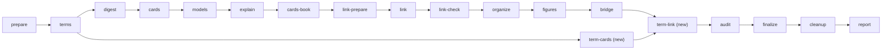

# Term Cards and Term Links: Proposal

Status (2026-10-24): proposal only. Nothing in this document is built. It names the code, the stages and the rules that a build would change, so that each part can become one issue.

## Summary

Every digested book has one Book term table today: the Card `术语表：《…》的 N 个术语`, a Side successor of the book's first anchor (for example `acemoglu2007equilibrium/1|a`). It is an ordinary Idea Card. Its body is one Markdown table with four columns (`术语`, `不用`, `意思`, `首次定义`). Each term has one row and a meaning of at most 30 characters. Rule R6 of `zt-check` reads the table and refuses the words in the `不用` column. Nothing else in the box knows about the terms: no Card explains a term at length, and no Card text points at the explanation of a term it uses.

This proposal adds three things:

1. **A new Card type `term`** with two roles:
   - the **Term list Card**: the existing Book term table, kept exactly as it is today (same title, same body, same place), only retyped from `idea` to `term`;
   - the **Term Card**: one Card per term, an immediate Side successor of the Term list Card. It holds the name of the term and its explanation. When the term has a mathematical definition or a derivation, the Term Card states it in full: every hypothesis, every symbol, every step with its reason, the limit cases, and a checked numerical example.
2. **A new Link form, the Term link**, written `[[替代弹性@acemoglu2007equilibrium/1|a|ah]]`. It links a word in any Card body directly to the Term Card of that term. The GUI and the terminal Session show **only the term's name** in its place, without the address chip that an ordinary Link shows, so the sentence still reads as a sentence.
3. **Two new digest stages:**
   - `term-cards`: Haiku managers run DeepSeek V4.1 Flash subagents under the DeepSeek Subagent Managed Protocol (DSMP). DeepSeek writes the Term Cards as JSON drafts. A script checks them and creates the Cards.
   - `term-link`: a deterministic `zt-digest` command, with no model in it. After every other Card writer of the digest has finished, it replaces the occurrences of each term in the book's Cards with Term links. It never changes a word of the text: removing the Term links from the result gives back the original body byte for byte.

## Contents

- [1. Current state](#1-current-state)
- [2. Goals and non-goals](#2-goals-and-non-goals)
- [3. Decisions](#3-decisions)
- [4. The Card type `term`](#4-the-card-type-term)
- [5. The Term Card](#5-the-term-card)
- [6. The Term link](#6-the-term-link)
- [7. Layout: how a Term link looks](#7-layout-how-a-term-link-looks)
- [8. The `term-cards` stage (DeepSeek under Haiku managers)](#8-the-term-cards-stage-deepseek-under-haiku-managers)
- [9. The `term-link` stage (no model)](#9-the-term-link-stage-no-model)
- [10. Checks: zt-check rules](#10-checks-zt-check-rules)
- [11. Changes per block](#11-changes-per-block)
- [12. Existing books (backfill)](#12-existing-books-backfill)
- [13. Rollout, pilot and versions](#13-rollout-pilot-and-versions)
- [14. Tests](#14-tests)
- [15. Risks](#15-risks)
- [16. Open questions for the user](#16-open-questions-for-the-user)
- [Appendix A. DeepSeek instruction file (draft)](#appendix-a-deepseek-instruction-file-draft)
- [Appendix B. DeepSeek review instruction file (draft)](#appendix-b-deepseek-review-instruction-file-draft)
- [Appendix C. Draft JSON schema of one Term Card](#appendix-c-draft-json-schema-of-one-term-card)
- [Appendix D. Worked example of the term-link pass](#appendix-d-worked-example-of-the-term-link-pass)

---

## 1. Current state

### 1.1 The Book term table

| Fact | Where |
|---|---|
| Glossary entry **Book term table** | `CONTEXT.md` |
| The tool that writes it: `zt-digest terms -Step plan\|apply` | `tools/zt-digest/src/terms.rs` (port of `scripts/book-digest/book-terms.ps1`) |
| The DeepSeek prompt that chooses the terms | `scripts/book-digest/dsh-terms-instructions.zh.md` |
| The stage that runs it: `terms`, module `zt-book-terms` v4, ledger unit `terms/book@1` | `scripts/book-digest/workflow/modules/zt-book-terms.js` |
| Where it stands in the run | Stage `terms`, after `prepare` (econ) or `math-skeleton` (math), **before** the first digest group writes a Card |
| Its Card | Created with `create_successor {at: "<key>/1", kind: "side"}` (`term_call` in `terms.rs`), so normally `<key>/1\|a` |
| Its title | `术语表：《<book>》的 N 个术语` (`term_title`) |
| Its body | `本卡是《…》的术语表。…` + the line `术语表` + the table `\| 术语 \| 不用 \| 意思 \| 首次定义 \|` + `来源：[[<key>]]` (`table`) |
| Its type | `idea` |
| Who reads it | `zt-check` R6 (`term_table` in `tools/zt-check/src/check.rs`); `zt-idea-grow` (the concept review of each book's term table against the Topics); `digest-audit` |
| Limit | at most `-MaxTerms` (60) terms; a `meaning` of at most 30 characters |

A real example is `acemoglu2007equilibrium/1|a`, `术语表：《Equilibrium bias of technology》的 60 个术语`, with rows such as:

```
| 替代弹性 | 替代弹性系数 | 两种要素相互替代的难易程度 | §3 |
| 海塞矩阵 | 黑塞矩阵、Hessian 矩阵 | F 的二阶偏导数矩阵 | §4 |
```

The 30-character meaning tells a reader what a term is about. It does not explain it. For `替代弹性` the reader learns nothing about the formula $\sigma=-d\ln(Z/L)/d\ln(w_Z/w_L)$, why a CES function has a constant σ, or why the book's results turn on whether σ is above or below 1.

Model setting Cards also carry a small model term table (`| 术语 | 不用 |`) and a symbol table (`| 符号 | 含义 | 首次出现 |`); see `acemoglu2007equilibrium/2|a|a`. These tables stay as they are.

### 1.2 Links today

| Fact | Where |
|---|---|
| A Link is `[[target]]` in a Card body; the target is a Location or a Citation key | `src/link.rs` (`LinkBody`, `LinkLifecycle`) |
| Strict parse refuses a target that is neither a valid Location nor a valid Citation key | `LinkBody::parse` |
| Locations use only `[A-Za-z0-9_-]`, `/`, `\|`, lowercase side labels and positive numbers; Citation keys match `^[A-Za-z][A-Za-z0-9_-]{0,127}$` | `is_valid_regular_location` in `src/main.rs`, `validate_citation_key` in `src/literature.rs` |
| The GUI renders a Link as a chip: an address badge plus the target's title | `link_events` in `src/gui.rs`; `.zt-link`, `.zt-link-addr`, `.zt-link-title` in `src/gui/app.css` |
| The terminal Session prints the raw macro, coloured and clickable | `write_tui_link_line` in `src/session.rs` |
| Reverse links are generated after `<!-- zt:reverse-links -->` | `card::reverse_section`, `LinkLifecycle::reverse_sections` |
| `zt-check` drops a Link from the prose it measures | `plain()` in `tools/zt-check/src/check.rs` (`LINK.replace_all(&text, "")`) |
| The digest's Literature write scope reads Link targets to refuse a Link to a Topic-tree Card | `tools/zt-check/src/mcp/scope.rs` (`LINK`) |

Because strict parsing refuses any target with `@` in it, **no stored Card body can contain `[[…@…]]` today** outside code and chart fences. A new form that uses `@` therefore cannot collide with an existing Link.

### 1.3 Where the user's request comes from

The user asked for:

- a new Card type for terminology, with a Term list Card that stays what it is now, and a Term Card per term that is a successor of the list;
- in each Term Card, the name and the explanation of the term, and, for a mathematical term, the definition and derivation explained in as much detail as possible;
- a new Link type, the term link, that points directly to the Term Card, and that shows only the term's name, because the address of the term would make the text messy;
- a non-agent step in the digest that replaces the terms with term links after all Cards are written;
- Haiku managers that manage DeepSeek subagents under the `deepseek-subagent-managed-protocol` to write the Term Cards.

---

## 2. Goals and non-goals

### Goals

- G1. Each term of a digested book has one Term Card that explains it fully, written in the book's notation.
- G2. Every Card of the book that uses a term points at that Term Card from the word itself, without breaking the sentence.
- G3. A reader in the GUI sees the term as a quiet, readable word; one click (or a hover) gives the explanation.
- G4. The replacement is deterministic, repeatable and text-preserving. It can run again at any time and gives the same result.
- G5. The Term list Card keeps its title, body and place. R6 and `zt-idea-grow` keep reading it without change.
- G6. The DeepSeek work follows the DSMP limits and the digest's existing roles: Haiku relays and manages, DeepSeek writes, scripts build and check.

### Non-goals

- N1. No change to the model term tables or symbol tables inside Model Cards.
- N2. No cross-book Term links in this proposal. A Term link from one book's Card goes only to that book's own Term Card. (Section 16, Q6, asks about a later cross-book step.)
- N3. No Topic-tree Term Cards. Digests write only Literature trees (`docs/literature-only-digest-design.md`). `zt-idea-grow` may later use Term Cards as targets of the concept register (Section 11.10).
- N4. No rewriting of words. The term-link pass never replaces an avoid word (`不用`) with the term. R6 stays the only tool that asks for such a rewrite.
- N5. No change to the Book notation table (`符号表…`) of the math digest. A later proposal may give it the same treatment.

---

## 3. Decisions

I made these decisions in this proposal. Each one is open for the user to change; Section 16 lists the ones that most need the user's choice.

| No. | Question | Decision | Reason |
|---|---|---|---|
| D1 | A new Card type or an Idea Card template? | **A new Card type `term`**, as the user asked. | A type lets the GUI, search, the checker and the term-link pass find Term Cards without reading titles. It follows the precedent of `finding` (D9 of `docs/digest-card-layers-proposal.md`). |
| D2 | How are the list and the per-term Cards told apart? | **One type, two roles, computed from one new stored field `term`**: a `term` Card with an empty `term` field is a Term list Card; a `term` Card with a name in `term` is a Term Card. A Term part (a continuation) is a `term` Card with a name that is filed as a Direct successor of a Term Card. | This mirrors Model Cards (one type, the facet tells the Model Card from a Model part), and ZT's rule that structure is computed from Locations and fields, not from separate metadata. |
| D3 | Where do Term Cards stand? | **Immediate Side successors of the Term list Card, in table row order**: `<key>/1\|a\|a`, `<key>/1\|a\|b`, …, `<key>/1\|a\|z`, `<key>/1\|a\|aa`, … | The user asked that each term be a successor of the list. Side successors make every Term Card a direct child of the list. A Direct-successor chain (`\|1`, `\|2`, …) would make term 40 a child of term 39, which says something false. Side labels have no upper limit (`aa`, `ab`, …). |
| D4 | Does the Term list Card change? | **Only its type**: `idea` → `term`. Title, body, address and Links stay byte-identical. | The user asked to keep it as it is. R6 (`term_table`) and the `zt-idea-grow` term review parse its table; they keep working. |
| D5 | Term link syntax | **`[[<term>@<address>]]`**, for example `[[替代弹性@acemoglu2007equilibrium/1\|a\|ah]]`. | The raw text stays readable for every agent and every Markdown view; the address makes the Link direct (no lookup by name) and lets the existing rewrite-on-move logic keep it current. `@` never appears in a Location or Citation key, so the form is unambiguous. Alternatives in Section 6.2. |
| D6 | Is a Term link a Link? | **Yes, of a new Relation kind `term`.** It is checked, rewritten on move, listed in a separate generated `## Term uses` section of the Term Card, reported when broken, and pins a Lock across trees like any Link. It is **not** a reasoned Link: L1–L3, the I-rules' "Links out/in" counts, Model relations and the model board ignore it. | The Link machinery already does what a Term link needs. A Term link carries no claim, so the rules about reasons and relation words do not apply to it. |
| D7 | What does the reader see? | **Only the term's name**, set in the prose font, with a quiet dotted underline in a term colour; no address badge, no title chip. Hover shows the 30-character meaning and the address; a click opens the Term Card. | The user asked for this. Term links are many; the attention-first rule of the GUI wants them to recede behind the Card's real Links. |
| D8 | Which occurrences become Term links? | **The first eligible occurrence of each term in each Card body** (default). A run argument `termLinkOccurrences: "all"` links every occurrence. | One link per term per Card is enough to reach the definition. Linking every occurrence makes dense model Cards hard to read. This is Q1 in Section 16. |
| D9 | Who replaces the terms? | **A `zt-digest term-link` command; no model.** The workflow runs it through the existing `zt-relay` agent, which only executes one bounded command and returns its last line. | The user asked for a non-agent process; the project rule is "no LLM agent per item for deterministic work; one command around file paths". |
| D10 | When does `term-link` run? | **After the last Card writer (`bridge`), before `audit`**, and again inside `finalize` on the Cards that its correction cycle changed, before the final audit. | It must see every Card's final text. The correction cycle may rewrite a body and drop a Term link; the second run restores it. |
| D11 | When does `term-cards` run? | **After `terms`, in parallel with `digest`.** Its Cards are created by one serial `apply` step when all drafts are checked. | A Term Card needs the term list and the source sections, not the digest's Cards. Running beside the digest costs no wall time. The Card's uses in the book appear automatically in its `## Term uses` section once `term-link` runs. |
| D12 | Who writes and who checks? | **DeepSeek writes JSON drafts; `zt-digest term-cards` checks them and creates the Cards; a second DeepSeek conversation reviews every mathematical Term Card; one fix round goes back to the writer's own conversation.** | The compiler pattern of the other layers: write, check, review, fix, apply. A wrong derivation is the most costly error, so math Cards get a review. |
| D13 | How many terms per DeepSeek job? | **1 term per job for a mathematical term, 4 per job for a concept term** (run arguments `termCardsMathPerJob`, `termCardsPerJob`). | A full derivation needs the whole context of one conversation. Concept terms are short and share their sections. A 60-term book with 15 mathematical terms gives 15 + 12 = 27 jobs, so 4 Haiku managers. |
| D14 | How large may a Term Card be? | **Larger than an Idea Card:** at most 1600 characters of prose (formulas and tables not counted) and at most 12 derivation steps. A longer derivation continues in **Term parts** (Direct successors of the Term Card, title `推导（续 k/n）：…`). | The user asked for explanations "as elaborated and as detailed as you can". The Idea Card size would cut a derivation in half. The Term part keeps one Card readable on one screen, as a Derivation chain does for models. |
| D15 | Which DeepSeek model? | **DeepSeek V4.1 Flash from the official source, effort high** (`dshSource: "official"`). | The project rule for every DeepSeek run. |

---

## 4. The Card type `term`

### 4.1 Glossary entries (to add to `CONTEXT.md`)

**Term Card type**:
The Card type `term`: a Card that belongs to the terminology of one text. A `term` Card has one of three roles, computed from its `term` field and its Location: Term list Card, Term Card, or Term part. Only Regular Cards can be `term` Cards.
_Avoid_: Glossary card, definition card, vocabulary card

**Term list Card**:
A Regular Card of type `term` with no term name: the Book term table of one digested book (`术语表：《…》的 N 个术语`). Its body keeps the table that R6 reads. Its immediate Side successors are its Term Cards, in table row order.
_Avoid_: Glossary, term index

**Term Card**:
A Regular Card of type `term` with a term name, filed as an immediate Side successor of a Term list Card. It states one term: its name, its original wording, the words not to use, a plain explanation, the book's own definition, and, for a mathematical term, the formal definition with its hypotheses, a symbol table, a derivation with a reason for every step, the limit cases and a checked example. Cards that use the term link it with Term links.
_Avoid_: Definition card, entry

**Term part**:
A Regular Card of type `term` with the same term name as a Term Card, filed as a Direct successor of it (or of another of its parts). It continues the Term Card when the derivation does not fit one Card. Its title starts with `推导（续 k/n）：`.
_Avoid_: Sub-term, term chain

**Term name**:
The stored `term` field of a Term Card or Term part: the exact spelling of the term in its Term list Card row. At most 40 characters, one line, without `[`, `]`, `@`, `|` or a backtick.
_Avoid_: Term id, keyword

**Term link**:
A Link written `[[<term name>@<address>]]` that points from a word in a Card body to the Term Card of that term. Its label is the term name as it stands in the sentence. Its Relation kind is `term`. A reader sees only the label.
_Avoid_: Glossary link, auto-link, keyword link

**Term use**:
A Card that holds a Term link to a Term Card. The Term Card's generated `## Term uses` section lists them.
_Avoid_: Backlink (that is a Reverse link), occurrence

### 4.2 Storage

| Change | Detail |
|---|---|
| `CardType::Term` | New variant in `src/card_type.rs`, stored and typed name `term`. `CardType::parse` accepts `term`; the error text becomes `expected idea, event, finding, model, hub, or term`. |
| Tree-root rule | `ensure_allowed` refuses `term` on a Tree root, as it does for every non-idea type. |
| New column | `ALTER TABLE cards ADD COLUMN term_name TEXT` in the schema upgrade list of `src/main.rs` (beside `model_facet`, `model_level`, `math_form`). `NULL` or empty means no name. |
| Field rules | `term_name` is accepted only on a `term` Card. A change of type away from `term` clears it (the same rule that clears a facet). |
| Validation | A term name is trimmed, non-empty, at most 40 characters, one line, and holds no `[`, `]`, `@`, `\|` or backtick. `terms.rs` already refuses `\|`, backtick and newline in a term (`BAD_TERM`); `@` and the brackets are new. |
| Dump and load | `zt dump` writes and reads the new field, as it does the facet. |

### 4.3 Roles (computed, never stored)

```text
role(card) =
  if card.type != term                         → none
  if card.term_name is empty                   → list
  if parent(card) is a Term list Card
     and card is a Side successor of it        → card
  if parent(card) is a Term Card or Term part
     with the same term_name
     and card is a Direct successor of it      → part
  otherwise                                    → (fault: term_unfiled)
```

A Term Card for the acemoglu2007 book would stand like this:

```text
acemoglu2007equilibrium                         Literature Card
└─ /1        (first anchor)
   ├─ /1|a   术语表：《Equilibrium bias of technology》的 60 个术语     Term list Card
   │   ├─ /1|a|a    均衡偏向                                        Term Card (row 1)
   │   ├─ /1|a|b    技术偏向                                        Term Card (row 2)
   │   ├─ …
   │   ├─ /1|a|p    生产函数                                        Term Card (row 16)
   │   ├─ /1|a|q    净生产函数                                      Term Card (row 17)
   │   ├─ …
   │   ├─ /1|a|ag   替代效应                                        Term Card (row 33)
   │   ├─ /1|a|ah   替代弹性                                        Term Card (row 34)
   │   │   └─ /1|a|ah|1   推导（续 2/2）：极限情形与例子             Term part
   │   ├─ …
   │   └─ /1|a|bh   内生技术                                        Term Card (row 60)
   └─ /1|b   (the book's other Side successors, as today)
```

(Side labels count `a`=1 … `z`=26, `aa`=27 …, so row 34 is `ah` and row 60 is `bh`; see `number_to_side_label` in `src/main.rs`. The tree is locked today; the example only shows the shape.)

### 4.4 Term structure and its faults (computed, like model faults)

A new module `src/term.rs` computes, for one Term list Card, the **term structure**: the rows of its table (parsed with the same row rules as `zt-check`'s `term_table`), its Term Cards and Term parts, the Term uses of each Term Card, and these faults:

| Fault | Meaning |
|---|---|
| `term_unfiled` | A `term` Card with a name that is neither a Side successor of a Term list Card nor a Direct successor of a Term Card with the same name. |
| `term_duplicate` | Two Term Cards under one list with the same name. |
| `term_row_without_card` | A table row with no Term Card under the list (coverage). |
| `term_card_without_row` | A Term Card whose name is in no row of its list. |
| `term_part_name` | A Term part whose name differs from its Term Card's. |
| `term_label_mismatch` | A Term link whose label differs from its target's term name. |
| `term_link_target` | A Term link whose target is not a Term Card (a list, a part, or another type). The write path refuses this; the fault reports old data. |

These are reported, never refused, except `term_link_target` on a write (Section 6.4). The MCP tool `get_terms` (Section 11.4) returns the structure.

---

## 5. The Term Card

### 5.1 Title

The title is **the term name exactly**: `替代弹性`. It is not a claim, so the Idea Card title rule (I1) does not apply to Term Cards. The original wording goes into the body, not the title, so that an exact title search and the Term name agree.

### 5.2 Body template

The `zt-digest term-cards -Step apply` command renders the body from the checked JSON draft (Appendix C). DeepSeek never writes the Markdown layout; it writes the content. The order of the sections is fixed. A section with no content is left out; `术语`, `释义`, `首次定义` and `来源` are required.

```markdown
术语：<term>
原文：<original wording in the source language, if the book gives one>
不用：<avoid words from the list row, joined with 、; "—" when none>
类别：概念 | 数学概念
首次定义：<§ number>

## 释义

<3–8 sentences in Card language: what the term names, what it is for, how
the book uses it. A reader who knows no mathematics understands this part.>

## 书中的说法

<The book's own definition, paraphrased in 1–4 sentences, with its section.
A quotation of at most one sentence may stand in 「」.>

## 数学定义

前提：
- (H1) <hypothesis>
- (H2) <hypothesis>

$$<the definition as a display formula> \tag{T1}$$

<1–3 sentences that read the formula aloud: what each side means.>

符号表

| 符号 | 含义 | 类型与取值 |
| --- | --- | --- |
| … | … | … |

## 等价形式

<Other forms of the definition that the book or the standard literature uses,
each with a one-line reason why it is equal to (T1).>

## 推导：<what is derived>

1. <step>。依据：<rule>。
   $$…$$
2. …

结果：<what the derivation shows>.

## 极限与特例

- <limit or special case>: <what happens, with the formula>.

## 例子

<A numerical example with small numbers. Every number is computed in the text.>

## 直觉

<2–5 sentences of intuition.>

## 区别

- 与 <neighbouring term>：<the difference in one or two sentences>.

## 常见误读

- <a reading that is wrong, and why>.

## 在本书中的作用

<1–4 sentences: which results of the book depend on this term.>

来源：[[<key>]] <§ number>
```

Notes on the template:

- The head block uses labelled lines (`术语：`, `原文：` …), as Finding Cards use `测量：`, `数据：` … . The checker finds them by their label.
- The long sections use `##` headings, as the register uses `## 词条`. `zt-check`'s `prose_lines` already skips heading lines.
- `## 数学定义`, `## 等价形式`, `## 推导`, `## 极限与特例` are required for `类别：数学概念` and refused for `类别：概念` (a concept term has no formal part; a stray formula is still allowed in `释义`).
- More than one `## 推导：…` section is allowed when a term carries more than one derived result (for example a definition and a comparative static).
- The words of other terms in the body become Term links in the later `term-link` pass, so Term Cards link each other through `## 区别` and `## 释义` without any work by DeepSeek.

### 5.3 What "as elaborated and as detailed as possible" means for a mathematical term

The user asked for the most detailed explanation that is possible. The instruction file (Appendix A) and the checks turn that into concrete demands that a reviewer can verify:

1. **Every hypothesis is labelled** (H1, H2, …) and states its domain: which space each object lives in, which functions are differentiable and how often, which parameters are positive.
2. **Every symbol that appears in a formula is in the symbol table** with its meaning and its type (scalar, vector, function, set, parameter) and its range. The symbols are the book's symbols; a new auxiliary symbol (for example $\rho=(\sigma-1)/\sigma$) is marked `辅助`.
3. **The definition is a display formula with a tag** (`\tag{T1}`), followed by a sentence that reads it aloud.
4. **The derivation skips no algebra.** Each step does one transformation, shows the expression after it, and names its rule after `依据：` (链式法则, 取对数, 一阶条件, 隐函数定理, 代入 (T1), 同理, …). "易知", "显然" and "不难看出" are refused (the existing hedge rule R9 plus a new term rule).
5. **The result line** (`结果：`) states exactly what the last step shows, and it must match the claim in the section heading.
6. **Limit and special cases** are worked out when they exist (for a CES function: σ→1, σ→0, σ→∞), each with its formula.
7. **The numerical example is computed in the text**, every number traceable, so a reader can redo it with a pocket calculator.
8. **Equivalent forms** carry a reason for the equality, not just the formula.
9. **Common misreadings** name a wrong reading that a student is likely to make and why it is wrong.
10. **The book's own notation wins.** When the book and a textbook use different symbols, the Term Card uses the book's and names the textbook's in `等价形式`.
11. **The writer checks its own derivation.** It may verify a step numerically with a short script in its own workspace (the DeepSeek Harness can run PowerShell and Python); it must not cite a check it did not run.
12. **A second DeepSeek conversation reviews** every mathematical Term Card step by step (Appendix B) before the Card is created.

### 5.4 Example: a mathematical Term Card

This is an illustration of the target quality, written for this proposal from the standard CES algebra; the section numbers are placeholders. The real Card is written by DeepSeek from the book's own text and notation.

```markdown
# 替代弹性

术语：替代弹性
原文：elasticity of substitution
不用：替代弹性系数
类别：数学概念
首次定义：§3

## 释义

替代弹性度量两种要素相互替代的难易程度。
相对要素价格变动 1%，两种要素的相对用量反向变动 σ%。
σ 大时，企业容易用一种要素代替另一种要素。
σ 小时，两种要素必须按接近固定的比例投入。
本书用 σ 判断技术偏向的方向，σ 大于 1 与小于 1 时结论相反。

## 书中的说法

§3 把替代弹性写成 CES 生产函数的参数 σ。
σ>1 时，Z 增强型技术相对偏向 Z。

## 数学定义

前提：
- (H1) 生产函数 $Y=F(Z,L)$ 二阶连续可微，对每种要素严格递增。
- (H2) 要素市场是竞争的，要素价格等于边际产品：$w_Z=F_Z$，$w_L=F_L$。

$$\sigma\equiv-\frac{d\ln(Z/L)}{d\ln(w_Z/w_L)} \tag{T1}$$

分子是要素相对用量的对数变化。
分母是相对要素价格的对数变化。
负号使 σ 为正，因为相对价格上升时相对用量下降。

符号表

| 符号 | 含义 | 类型与取值 |
| --- | --- | --- |
| $Z, L$ | 两种要素的投入量 | 正实数 |
| $w_Z, w_L$ | 两种要素的价格 | 正实数 |
| $F_Z, F_L$ | $F$ 对 $Z$、$L$ 的偏导数，即边际产品 | 函数 |
| $\sigma$ | 替代弹性 | 正实数 |
| $\gamma$ | CES 函数中 $Z$ 的份额参数 | $0<\gamma<1$ |
| $\rho$ | 辅助参数，$\rho=(\sigma-1)/\sigma$ | 辅助，$\rho<1$ |

## 等价形式

由 H2，$w_Z/w_L=F_Z/F_L$，所以 (T1) 也写成 $\sigma=-d\ln(Z/L)/d\ln(F_Z/F_L)$。
$F_Z/F_L$ 是等产量线的边际技术替代率，所以 σ 也度量等产量线的弯曲程度。

## 推导：CES 函数的替代弹性处处等于参数 σ

1. 起点是 CES 生产函数。依据：§3 的设定。
   $$Y=\left[\gamma Z^{\rho}+(1-\gamma)L^{\rho}\right]^{1/\rho},\qquad \rho=\frac{\sigma-1}{\sigma}$$
2. 对 $Z$ 求偏导。依据：链式法则。
   $$F_Z=\frac1\rho\left[\gamma Z^{\rho}+(1-\gamma)L^{\rho}\right]^{\frac1\rho-1}\cdot\gamma\rho Z^{\rho-1}$$
3. 约去 $\rho$，把方括号写成 $Y$。依据：步骤 1 给出方括号等于 $Y^{\rho}$。
   $$F_Z=\gamma Z^{\rho-1}\left(Y^{\rho}\right)^{\frac{1-\rho}{\rho}}=\gamma Z^{\rho-1}Y^{1-\rho}$$
4. 对 $L$ 求偏导。依据：同步骤 2–3。
   $$F_L=(1-\gamma)L^{\rho-1}Y^{1-\rho}$$
5. 两式相除，$Y^{1-\rho}$ 消去。依据：H2。
   $$\frac{w_Z}{w_L}=\frac{\gamma}{1-\gamma}\left(\frac{Z}{L}\right)^{\rho-1}$$
6. 用 $\rho-1=-1/\sigma$ 改写指数。依据：步骤 1 中 $\rho$ 的定义。
   $$\frac{w_Z}{w_L}=\frac{\gamma}{1-\gamma}\left(\frac{Z}{L}\right)^{-1/\sigma}$$
7. 两边取对数。依据：对数的乘积与乘方规则。
   $$\ln\frac{w_Z}{w_L}=\ln\frac{\gamma}{1-\gamma}-\frac1\sigma\ln\frac{Z}{L}$$
8. 解出 $\ln(Z/L)$。依据：移项。
   $$\ln\frac{Z}{L}=\sigma\ln\frac{\gamma}{1-\gamma}-\sigma\ln\frac{w_Z}{w_L}$$
9. 对 $\ln(w_Z/w_L)$ 求导，再代入 (T1)。依据：(T1)。
   $$\frac{d\ln(Z/L)}{d\ln(w_Z/w_L)}=-\sigma\quad\Longrightarrow\quad-\frac{d\ln(Z/L)}{d\ln(w_Z/w_L)}=\sigma$$

结果：CES 函数的替代弹性处处等于参数 σ，与要素比例 $Z/L$ 无关。

## 极限与特例

- σ→1：ρ→0，CES 函数趋于柯布-道格拉斯函数 $Y=Z^{\gamma}L^{1-\gamma}$，要素收入份额不随 $Z/L$ 变化。
- σ→0：ρ→−∞，CES 函数趋于固定比例函数 $Y=\min(Z,L)$，两种要素不能替代。
- σ→∞：ρ→1，CES 函数变成 $Y=\gamma Z+(1-\gamma)L$，两种要素完全替代。

## 例子

取 $\gamma=1/2$，$\sigma=2$。
由步骤 6，$w_Z/w_L=(Z/L)^{-1/2}$。
$Z/L$ 从 1 升到 4 时，$w_Z/w_L$ 从 1 降到 $4^{-1/2}=1/2$。
$\ln(Z/L)$ 变化 $\ln 4\approx1.386$，$\ln(w_Z/w_L)$ 变化 $\ln(1/2)\approx-0.693$。
两者之比是 $-2$，代入 (T1) 得 $\sigma=2$。

## 直觉

σ 大时，要素变多只使它的相对价格下降一点，因为企业很容易多用它。
σ 小时，要素变多使它的相对价格下降很多，因为另一种要素跟不上。

## 区别

- 与 替代效应：替代效应是相对供给增加压低相对价格的效应，替代弹性度量这个效应的大小。相对用量上升 1%，相对价格下降 1/σ%。
- 与 要素增强型技术：替代弹性是生产函数的性质，要素增强型技术是技术进入生产函数的方式。

## 常见误读

- 替代弹性不是两个边际产品之比，而是要素比例对这个比值的弹性，再取负号。
- σ>1 不等于"两种要素是替代品"的日常说法，它只说相对用量对相对价格的反应大于一比一。

## 在本书中的作用

本书第 3 节用 σ 区分两种情形。
σ>1 时，Z 增强型技术相对偏向 Z；σ<1 时方向相反。

来源：[[acemoglu2007equilibrium]] §3
```

The Card above holds 9 derivation steps, so it fits one Card (D14). After the `term-link` pass, `替代效应`, `要素增强型技术`, `生产函数`, `边际产品` and `要素价格` in its body become Term links to their own Term Cards.

### 5.5 Example: a concept Term Card

```markdown
# 剩余控制权

术语：剩余控制权
原文：residual rights of control
不用：剩余控制、残余控制权
类别：概念
首次定义：§2.1

## 释义

剩余控制权是契约没有写明时决定资产用法的权利。
契约不能写明所有情形，所以总有一部分用法要事后决定。
谁拥有资产，谁就拥有这部分权利。
本书用它定义所有权：所有权就是剩余控制权的归属。

## 书中的说法

§2.1 区分两类权利：契约写明的特定权利，和契约没有写明的剩余权利。

## 区别

- 与 剩余收益权：剩余收益权是分得事后收益的权利，剩余控制权是决定资产用法的权利。

## 在本书中的作用

本书的一体化理论建立在剩余控制权的分配上。
分配不同，双方事前投资的激励不同。

来源：[[<key>]] §2.1
```

---

## 6. The Term link

### 6.1 Grammar

```text
term-link  := "[[" label "@" target "]]"
label      := 1–40 characters; no "[", "]", "@", "|", "`", newline
target     := a valid Regular Location (a Term Card is always a Regular Card)
```

- The scanner (`scan_occurrences` in `src/link.rs`) is unchanged up to the target text. A target that holds `@` is split at its **first** `@`: the left part is the label, the right part is the address.
- Strict parse (`LinkBody::parse`) refuses a Term link whose label breaks the label rule (``invalid term link label `<l>` ``) or whose address is not a valid Location (``invalid term link target `<t>` ``).
- Tolerant parse (`LinkBody::for_rendering`) keeps both, as it does today.
- `LinkOccurrence` gains `label: Option<&str>` and `label_range: Option<Range<usize>>`. `target` and `target_range` keep naming the address only, so every existing caller that rewrites targets (`rewrite_targets`, the move and delete mappings, `ensure_link_rewrites_allowed`) works without change and keeps the label.
- Code spans, fences, display math and chart fences stay outside the scan, as today.

### 6.2 Why this syntax (alternatives)

| Form | Raw text a model reads | Resolves directly | Reuses Link machinery | Verdict |
|---|---|---|---|---|
| `[[替代弹性@K/1\|a\|ah]]` | "由[[替代弹性@K/1\|a\|ah]]决定" — the word is there | yes, by address | yes | **chosen** |
| `[[K/1\|a\|ah]]`, rendered as the title when the target is a Term Card | "由[[K/1\|a\|ah]]决定" — the word is gone | yes | yes | rejected: every DeepSeek reader of the book (link pass, Bridge, `zt-idea-grow`, finalize) loses the word; and an ordinary cited Link to a Term Card ("依赖 [[K/1\|a\|ah]] 的定义") could no longer show its address |
| `[[term:K/1\|a\|ah]]` | "由[[term:K/1\|a\|ah]]决定" | yes | yes | rejected: same loss of the word |
| `[[替代弹性]]`, resolved by name | readable | no: needs a lookup, ambiguous across books and for homonyms such as `学习（个体行为）` / `学习（产业生产率）` | no: names are not addresses | rejected: the user asked for a direct link |
| `[替代弹性](zt-term:K/1\|a\|ah)` | readable | yes | no: a Markdown link is not a ZT Link, so no rewrite on move, no Reverse link, no Lock pin | rejected |

### 6.3 Semantics

| Aspect | Rule |
|---|---|
| Relation kind | A new kind `term`, assigned by the syntax, not by a word before it. A Term link never takes the kind of a Link before it in the same sentence, and a Link after it never takes `term` from it. |
| Reverse links | The Term Card's generated section gains a second heading. `card::reverse_section` takes two lists: ordinary Reverse links under `## Reverse links`, Term uses under `## Term uses` (one item per using Card, `- [[source]] Title`). Both stay after the marker, so `parse_card_text` ignores them as it ignores the generated section today. |
| Broken | A Term link whose address names no Card is a Broken link; `lsbk`, `list_broken_links` and the GUI report it with its label. |
| Move and delete | When the Term Card moves (or a Side compaction renames it), `rewrite_targets` rewrites the address and keeps the label. |
| Rename of a term | Changing a Term Card's `term_name` does not rewrite labels; the next `term-link` run strips and relinks (Section 9.3), and until then `term_label_mismatch` reports the old labels. |
| Lock | A Term link is an authored macro, so it pins a target in another tree like any Link. A Term link inside the same tree (the normal case) pins nothing. A Locked tree refuses the `term-link` edits like any edit. |
| Workspaces | A Term link may cross Workspaces like any Link; a human Card may link an agent Term Card. The digest writes Term links only in its own agent Literature tree. |
| Model board | Ignored. Only `rests-on` places a part on the board; `term` never does. Term links are not Model relations and do not make a Model neighbour. |
| Graph views | The Constellation and the map draw no edge for a Term link by default; a toggle shows them. Otherwise every Card would hang from the Term Cards. |
| Entry search | A Term Card's name is a strong way in. `search_cards mode: entry` may rank an exact Term name in the register tier (optional, phase 6). |
| Lock pins, `list_links` | `list_links` reports a Term link with `kind: "term"` and its `label`. |

### 6.4 Write validation

`LinkLifecycle::validate_edit` (and the edit paths of the Session, the GUI and MCP) add one rule: a **new** Term link must name an existing **Term Card** (role `card`, not a list, part or other type). Error: ``term link target `<a>` is not a Term Card``. A Term link that was already in the old body passes, as old Broken targets pass today. To check the role, `CardSnapshot` gains `card_type` and `term_name`.

---

## 7. Layout: how a Term link looks

### 7.1 GUI

`link_events` in `src/gui.rs` renders a Term link as one element without the address badge:

```html
<a class="zt-term" href="#/card/acemoglu2007equilibrium%2F1%7Ca%7Cah"
   data-target="acemoglu2007equilibrium/1|a|ah" data-term="替代弹性"
   title="替代弹性 · 两种要素相互替代的难易程度 · acemoglu2007equilibrium/1|a|ah">替代弹性</a>
```

A broken one:

```html
<span class="zt-term broken" title="Broken term link · acemoglu2007equilibrium/1|a|ah">替代弹性</span>
```

The hover text uses the term's 30-character meaning from its list row (the `Snapshot` gains a map from Term Card address to meaning) and the address, so the address is still one hover away but never in the text.

Proposed CSS in `src/gui/app.css`, beside `.zt-link`:

```css
/* A Term link: the term itself, in the prose font, quieter than a Link to a Card. */
.zt-term {
  color: inherit; font: inherit; text-decoration: underline dotted;
  text-decoration-color: color-mix(in srgb, var(--term) 70%, transparent);
  text-decoration-thickness: 1.5px; text-underline-offset: 3px;
  border-radius: 3px; transition: background .15s, color .15s;
}
.zt-term:hover { color: var(--term); background: var(--term-soft); }
.zt-term.broken { color: var(--broken); text-decoration: line-through; cursor: default; }
.zt-term.cross.agent { text-decoration-color: var(--agent); }
.zt-term.cross.human { text-decoration-color: var(--human); }
```

`--term` and `--term-soft` are new tokens next to `--link`, with light and dark values. The click handler in `src/gui/app.js` that today treats `a.zt-link` (`go(anchor.dataset.target)`, cross-Workspace class) also treats `a.zt-term`.

Side by side, a sentence with one ordinary Link and two Term links reads:

```text
依赖 ┃2|a|a│设定：企业连续统、静态…┃ 的设定，企业的产出由 生产函数 给出，要素价格 等于边际产品。
     └── ordinary Link: badge + title chip ──┘                ┄┄┄┄┄┄┄┄            ┄┄┄┄┄┄┄┄
                                                              Term links: the word, dotted
```

The ordinary Link stays the loud element (it carries a claim); the Term links recede (they carry a definition one click away). This follows the attention-first rule of the GUI.

### 7.2 The Term Card itself in the GUI

The Term Card keeps the real-card look of the GUI: the term name is the Card's heading; the `原文` line is set small under it; the head block (`不用`, `类别`, `首次定义`) is a quiet line of labels; the `##` sections render as usual. The `## Term uses` section is collapsed to its count (`被 23 张卡片使用`) with the list one click away, because it can be long.

The Term list Card renders as today. The GUI's successor navigation already lists its Side successors, so a reader reaches every Term Card from it.

### 7.3 Editor

In the GUI writing desk, typing `[[` opens completion today. Completion also offers Term Cards by name: choosing `替代弹性` inserts `[[替代弹性@acemoglu2007equilibrium/1|a|ah]]`. The editor shows raw text, as it does for every Link.

### 7.4 Terminal Session

`write_tui_link_line` in `src/session.rs` prints a Term link as its label only, underlined in a term colour (for example `Color::DarkCyan`), and records a `LinkSpan` with the address so that a click or the link-follow key opens the Term Card. The column advance uses the label's width, not the macro's. A broken Term link prints its label in the Broken style. The Session's edit view shows raw text.

### 7.5 MCP and Markdown

- `get_card`, `get_cards` and `get_tree` return the raw body, so an agent that edits a body keeps the macros. `outbound` lists a Term link with `kind: "term"` and its `label`.
- A new optional read argument `term_links: "label"` on `get_card`, `get_cards` and `get_tree` returns bodies with every Term link replaced by its label. Digest stages that only read Cards into a DeepSeek prompt (the group snapshot, the link pass, the Bridge, `zt-idea-grow`) use it; it saves tokens and shows DeepSeek plain prose.
- `zt dump` and every Markdown export write the raw macro.

---

## 8. The `term-cards` stage (DeepSeek under Haiku managers)

### 8.1 Place in the stage graph



The econ variant's `events` and `findings` stages and the math variant's stages keep their slots; `term-link` waits for all of them (Section 9.1).

| Stage | Title | Module | After | Runs when | On failure |
|---|---|---|---|---|---|
| `term-cards` | Terms | `zt-term-cards` (new) | `terms` | mode `full` and `args.termCards != false`; mode `term-cards`; mode `resume` | continue (a missing Term Card is a coverage fault, not a reason to halt the digest) |
| `term-link` | Terms | `zt-term-link` (new) | `bridge`, `term-cards` | mode `full` and `args.termLink != false`; modes `term-cards`, `term-link`; mode `resume` | continue (the audit reports what is missing) |

New modes:

- `term-cards`: `args → source → prepare → term-cards → term-link → audit → report`; for a digest that has a term list but no Term Cards.
- `term-link`: `args → prepare → term-link → audit → report`; runs only the deterministic pass again.

### 8.2 Ledger units

| Unit | Created by | Waits on | Completed by |
|---|---|---|---|
| `termcards/tNNN@1` | `term-cards -Step plan` (one per DeepSeek job) | `terms/book@1` | the chain's `finish-batch` after the draft passed the check (and the review for a math job) |
| `termcards/book@1` | `term-cards -Step plan` | every `termcards/tNNN@1` | `term-cards -Step apply` (creates the Cards) |
| `termlink/book@1` | prepare (when the layer is on) | `termcards/book@1` and every writer layer of the run (`digest`, `cards`, `models`, `explain`, `events`, `findings`, `math-*`, `link`, `organize`, `figures`, `bridge`) | `term-link -Step apply` |
| `termlink/final@1` | `finalize` (only when its correction cycle changed a Card) | the correction cycle | `term-link -Step apply -Cards <changed>` inside finalize |

A failed `termcards/tNNN@1` is recorded against its unit with its fault code (`check_failed`, `review_failed`, `timeout`); the other units go on. `term-cards -Step apply` creates the Cards whose drafts passed and reports the rest as `term_row_without_card`.

### 8.3 The new tool: `zt-digest term-cards`

```text
zt-digest term-cards -Step plan|jobs|check|review-plan|fix-plan|apply|report -Staging <folder>
                     [-PerJob 4] [-MathPerJob 1] [-MaxStepsPerCard 12] [-MaxProse 1600]
                     [-Jobs <ids>] [-Token <t>] [-Apply]
```

The job and its output live in `<Staging>\term-cards\`. Every step prints compact JSON as its last line, like every digest tool.

| Step | What it does | Last line |
|---|---|---|
| `plan` | Reads the Term list Card (by role, not by address) and `terms\out\terms.json`; classifies each term as `math` or `concept`; groups terms into jobs; writes one job file per job and the shared instruction file; registers the ledger units. | `{"terms","math","concept","jobs":[{"id","terms","files","prompt"}]}` |
| `jobs` | For the claimed job units (`-Jobs`), prints the DeepSeek jobs the chain's manager starts (the `jobs: true` step of `drive()`): the shared instruction file first, then the job file, so DeepSeek caches the prefix. | `{"jobs":[{"id","files","prompt"}]}` |
| `check` | Reads `out\<job>.json`, validates every draft against the schema (Appendix C) and the T-rules that need no archive (Section 10), writes `check\<job>.md` with the faults per draft. | `{"ok","drafts","faults","refused":[{"job","term","codes"}]}` |
| `review-plan` | For every math draft that passed the check, writes a review job (Appendix B), each in a fresh conversation. | `{"jobs":[…]}` |
| `fix-plan` | For every draft with check faults or review faults, writes one fix prompt (the faults, one line each) that goes back to the writer's own conversation; a draft without faults gets no job. | `{"jobs":[…]}` |
| `apply` | Retypes the Term list Card to `term` if it is still `idea` (body untouched); renders each passed draft to a body (Section 5.2); creates the Term Cards as Side successors of the list **in table row order** and the Term parts as Direct successors, in one `apply_batch` through archive receipts; completes `termcards/book@1`. | `{"ok","created","parts","retyped","missing":[terms],"card_range":["<first>","<last>"]}` |
| `report` | Writes `term-cards\report.json`: per term the job, status, fault codes, the Card address. | `{"terms","written","refused","parts"}` |

**Classification (`math` or `concept`).** A term is `math` when any of these holds: a definition sentence of the term in `terms\job.md` holds `$`; the term is in the term table or the symbol table of a Model setting Card or a math unit of the book (when such Cards exist at plan time); the book's notation table (math digest) names it; or the term's meaning holds a symbol. Otherwise it is `concept`. DeepSeek may still answer `类别：数学概念` for a `concept` job if it finds a formal definition; the check then demands the math sections.

**Job file content (per job).** The term rows (term, avoid, meaning, first section); the definition sentences of each term with `sections/<file>:<line>` (already found by `terms -Step plan`); the list of every section file where the term occurs (with counts), so DeepSeek reads only the relevant lines; for a math job, the book's notation table and the symbol tables of the book's setting Cards if they exist; the other terms of the book (name and meaning) so that `## 区别` can name neighbours by their exact name; the output path `out\<job>.json`.

**Why the Cards are created in one serial step.** Side labels are allocated as the next free label (`next_side_successor`). Parallel creation would order the Term Cards by finish time. One `apply` step after all jobs gives the table's row order, one archive revision, and no half-built list.

### 8.4 The module: `zt-term-cards`

The module follows `zt-explain` (`Z.layer` + `Z.chain`, steps with `jobs: true` driven by `drive()`):

```js
// ==== module zt-term-cards v1 ====
defineModule({
  id: 'zt-term-cards', version: '1', requires: ['zt-digest-lib'],
  summary: 'ZT digest: one Term Card per row of the Term list: DeepSeek drafts, script check, DeepSeek review of math drafts, one fix round, one serial apply.',
  params: { key: {...}, args: {...}, mode: {...}, model: {...} },
  run: async (ctx, p) => {
    const Z = zdMake(ctx, p)
    const work = `${Z.OUT}\\term-cards`
    const tc = (s, more = '') => `${Z.tool('term-cards')} -Step ${s} -Staging "${Z.OUT}"${more}`
    // 1. plan once (registers termcards/tNNN@1 and termcards/book@1)
    // 2. the layer: each chain claims up to 8 job units and runs, in one Haiku manager:
    //      write (jobs) → check → review (jobs, math only, optional) → fix (jobs, same conversation, optional)
    //      → check → finish-batch
    const layer = await Z.layer('termcards', {
      layer: 'termcards', take: 8, rounds: Z.MAX_ATTEMPTS, phase: 'Terms', hold: true,
      work: async (units) => Z.chain(`term cards ${units.map(u => u.id).join(', ')}`, {
        dsh: work, unit: units[0].id, token: units[0].token,
        skills: ['asd-ste100-zh'], effort: Z.DSH_EFFORT, phase: 'Terms', writes: `${work}\\out`,
        steps: [
          { name: 'write', command: tc('jobs', ` -Jobs ${ids(units)}`), jobs: true },
          { name: 'check 1', command: tc('check', ` -Jobs ${ids(units)}`) },
          { name: 'review', command: tc('review-plan', ` -Jobs ${ids(units)}`), jobs: true, optional: true },
          { name: 'fix', command: tc('fix-plan', ` -Jobs ${ids(units)}`), jobs: true, optional: true, sameConversation: true },
          { name: 'check 2', command: tc('check', ` -Jobs ${ids(units)} -Final`) },
          { name: 'finish', command: Z.finishBatchCommand(units), always: true },
        ],
        cleanup: true, keep: true,
      }),
    })
    // 3. one serial apply (no DeepSeek), run by the relay
    const applied = await Z.runScript('term cards apply', tc('apply', ' -Apply'), 'Terms')
    return { status: applied.ok ? 'done' : 'failed', layer, applied, report: Z.jsonOf(applied) }
  },
})
// ==== end module zt-term-cards ====
```

(Sketch only: step names, `ids()` and `sameConversation` stand for the existing `drive()` options that `zt-explain` uses for "one refused part back to its own conversation once".)

### 8.5 How the DSMP applies

The digest scripts do not call `dsDispatch`; their managers share the run's one pool (`dsmpSlot`), `dsmpLog` and `dsCleanupWorkspaces`, which carry the DSMP v1.1 rules. `zt-term-cards` uses the same `drive()` path, so:

| DSMP rule | How `term-cards` keeps it |
|---|---|
| Managers are Haiku, effort low; they never edit files | `drive()` starts the job managers as Haiku agents; the managers only start, poll, answer, collect and delete DeepSeek conversations. DeepSeek writes `out\<job>.json`; the script writes Cards. |
| At most 8 conversations per manager | A chain claims at most 8 job units (`take: 8`); its manager runs at most 8 conversations at once. A review or fix round runs in the same manager, at most 8 at once. |
| Managers = ceil(tasks / 8), at most 8; at most 64 conversations in the whole script | The layer starts at most 8 chains; the shared pool caps the whole run at 64 conversations, so `term-cards` and the digest lanes running beside it share the cap. A 60-term book with 15 math terms has 27 jobs, so 4 managers. |
| Collect, then delete; never archive | Each job manager writes the final answer to `<out>\answers\<session>.txt` and records the session (`ledger resource -RegisterId …`); the run-level `cleanup` stage deletes exactly the recorded ids and never archives. |
| Remove the workspace | The DeepSeek workspace is `<Staging>\term-cards`, a folder made for the run (`ownWorkspaces`); `cleanup` removes it after its tasks are done. |
| One retry | A failed or unparseable job gets one more attempt; the fix round is not a retry, it is the one review answer sent back to the same conversation. |
| Collect promptly; 240-minute budget | Unchanged from `drive()` (poll every open session with `wait_seconds: 0`, block on one for at most 90 s; cancel after 240 minutes of the conversation's own run time). |
| Plain cleanup wording | The cleanup steps are written as plain steps, without citing the user or the protocol (the 2026-10-15 lesson). |
| Model | DeepSeek V4.1 Flash, official source (`dshSource: "official"`), effort high for writer, reviewer and fix. |

Each job's answer is one line: `{"terms":<n>,"math":<m>,"steps":<derivation steps>,"file":"out/<job>.json"}`, matched by the job's `expect` pattern, so the manager can tell a good answer from a bad one.

### 8.6 Cost estimate

For a 60-term book with 15 math terms (27 writer jobs, 15 review jobs, about 8 fix answers):

- DeepSeek: the shared instruction file (about 3,000 tokens) is a cached prefix for every job. A writer job reads its job file and 1–4 short source passages (about 4,000–10,000 tokens) and writes 1,500–5,000 tokens. A review job reads one draft and its passages and writes a short fault list. All of it is Flash pricing.
- Claude: 4 Haiku managers for the writers (the review and fix rounds run in the same managers), and 2 relay calls (`plan`, `apply`). No Sonnet and no Opus.

These are estimates from the size of the existing jobs; the pilot (Section 13) measures them.

---

## 9. The `term-link` stage (no model)

### 9.1 When it runs

`term-link` runs after the last Card writer of the run, `bridge`, and after `term-cards`. In the econ variant it also waits for `events` and `findings`; in the math variant for `math-theory` (the last math writer before `organize`). The ledger unit `termlink/book@1` encodes these waits, so a resumed run cannot start it early.

`finalize` runs it once more, only on the Cards that its correction cycle changed (`termlink/final@1`), and only then runs its final read-only audit. So the audit and `math-check` see the final text with its Term links.

### 9.2 The new tool: `zt-digest term-link`

```text
zt-digest term-link -Step plan|apply -Staging <folder> [-CitationKey <key>]
                    [-Occurrences first|all] [-Cards <addresses>] [-Token <t>] [-Apply]
```

| Step | What it does | Last line |
|---|---|---|
| `plan` | Reads the book's Literature tree with bodies (`get_tree bodies=true`), the Term list, its Term Cards and the list rows; builds the matcher; computes the new body of every Card in scope; writes `term-link\plan.json` (per Card: the body fingerprint it read, the edits with byte ranges, the skipped occurrences with a reason) and `term-link\preview.md` (a readable before/after per changed line). Writes nothing to the archive. | `{"cards_scanned","cards_changed","links_added","links_kept","links_removed","skipped":{"ambiguous","blocked","in_math","in_table","own_card","avoid_word","repeat"}}` |
| `apply` | Re-reads each Card in the plan; if its body fingerprint changed since `plan`, plans that Card again; checks the text-preserving guarantee (9.4); writes every changed body in `apply_batch` `edit_card` items through archive receipts; completes the ledger unit. A `card_locked` refusal stops the step with exit 2 and is not retried. | `{"ok","cards_changed","links","refused":[…],"publication"}` |

The workflow module `zt-term-link` runs `plan` and `apply` as two relay commands (`Z.runScript`), then `zt-digest finalize -Step stage -Layer term-link -Report <out>\term-link\report.json` to publish the stage's revision, as `zt-figures` does. The relay agent (`zt-relay`) only runs the command and returns its last line; no model reads or writes Card text.

### 9.3 The algorithm

**Inputs.** The Term list rows (term, avoid words), the Term Cards (name → address), the Cards in scope (default: every agent Card of the book's Literature tree; with `-Cards`, only those).

**Step 0. Scope.** Leave out: the Literature Card (tree root); the Term list Card; navigation Cards (the structure Card, the Literature Card index); the Book notation table; Cards of another Workspace (a human Card is read-only for the digest).

**Step 1. Strip (normalise).** In each body, replace every Term link whose address is a Term Card of this book by its label. Call the result *P*. This makes the pass idempotent and repairs old, moved or mangled Term links.

**Step 2. Protected spans.** In *P*, mark as protected (never linked):

- fenced code blocks and inline code;
- inline math `$…$`, display math `$$…$$` and `\(…\)`;
- every Link macro `[[…]]` (ordinary Links keep their text);
- Markdown links and Document links `[…](…)`, artifact images ``;
- raw HTML blocks and chart fences;
- heading lines (`#`, `##`, …);
- every table row (the model term tables, symbol tables and every other table), because their cells are labels, not prose;
- the source line (`来源：…`) and, in a Term Card, its head block (`术语：`, `原文：`, `不用：`, `类别：`, `首次定义：`);
- in a Term Card or Term part, the Card's own term (a Card never links itself).

**Step 3. Matcher.** Build one leftmost-longest matcher (Aho–Corasick) over three word sets:

| Set | Members | Effect of a match |
|---|---|---|
| Link words | each linkable term name | candidate Term link |
| Blockers | every avoid word of every term; every term name that is not linkable | consumes the text, links nothing |
| (implicit) | longer matches win | `净生产函数` is matched before `生产函数`; `弱相对均衡偏向` before `相对均衡偏向` before `均衡偏向` |

Because blockers and link words compete in the same leftmost-longest scan, a term inside a longer avoid word or a longer term is never linked: `替代弹性` inside `替代弹性系数` (an avoid word) stays plain text, and `要素价格` inside `相对要素价格` links `相对要素价格`.

**Linkable terms.** A term is not linkable (it becomes a blocker) when:

- its name has a qualifier in brackets (`学习（个体行为）`) and the text does not write the full form; only the exact full form links;
- two rows of the list share its bare form (homonyms);
- its name is one Han character, or a Latin name of fewer than 3 letters (except an all-capital acronym such as `GDP`);
- the list row or the Term Card's draft marks it `link: false` (a term too general to link, chosen by DeepSeek in the draft with a reason; Appendix C);
- it has no Term Card.

**Latin terms** match case-sensitively and need an ASCII word boundary on both sides (`GDP` does not match inside `GDPR`). **Han terms** match by characters; the blockers above handle the most common false matches.

**Step 4. Occurrence policy.** With `first` (default), link the first unprotected, unblocked occurrence of each term in each Card body and leave later occurrences plain. With `all`, link every such occurrence.

**Step 5. Emit.** Replace each chosen occurrence `w` by `[[w@<address of w's Term Card>]]`. The label is the text as it stands, which equals the term name by construction.

**Step 6. Write or not.** If the new body equals the current body byte for byte, nothing is written for that Card.

### 9.4 Guarantees

1. **Text-preserving.** For every Card, strip(new body) = strip(current body) = *P*. `apply` checks this before each write and refuses the Card (`term_link_changed_text`) if it fails. A Term link pass can therefore never change a word, a formula or a Link.
2. **Idempotent.** A second run on unchanged Cards writes nothing.
3. **Deterministic.** The same tree, list and options give the same plan, byte for byte (Cards in natural address order, terms in row order, ties broken by position).
4. **Bounded.** The pass reads one tree and writes at most one edit per Card, in one batch. On a 300-Card book it is one `get_tree` and one `apply_batch`.
5. **Safe under Locks and Access.** It writes only agent Cards of the book's tree; a Locked tree refuses with `card_locked`, which stops the step.

### 9.5 Interplay with R6

R6 makes the book's Cards use one spelling per term. That is what makes a deterministic replacement possible: the pass needs no synonyms. R6 is not fixed by default, so a body may still hold an avoid word. The pass never links it and never rewrites it (N4); the report counts these occurrences under `avoid_word`, with the Card and line, so the user can see where the text still departs from the term table.

### 9.6 What DeepSeek writers must know

The card writers (`dsh-card-instructions.zh.md`, the fill, explain, model and correction prompts) gain one sentence each: "正文里可能有 `[[术语@地址]]` 形式的术语链接。改写正文时保留它们原样，或者只写术语本身；不要自己添加术语链接。" Because the pass strips and relinks, a writer that drops a Term link or writes the bare term causes no fault; a writer that mangles one causes a Broken link, which the next pass repairs (Step 1 strips only valid Term-link macros, so a mangled one is reported by the check and fixed by the correction cycle).

---

## 10. Checks: zt-check rules

### 10.1 Changes to existing rules

| Rule or helper | Change |
|---|---|
| `plain()` in `tools/zt-check/src/check.rs` | Replace a Term link by its **label** before removing ordinary Links (`TERM_LINK.replace_all(text, "$label")`, then `LINK.replace_all(text, "")`). Without this, a sentence would lose its term and R2 (length), R4 (passive), R6, R7 and R9 would read a different sentence than the reader sees. |
| R6 | Reads the label as text, so a Term link to the right term is never an R6 fault. |
| L1–L3 (Relation kind, reason, no repeat) | Skip Term links. |
| I-rules (Links out and in) | A Term link does not count as a Link out of or into an Idea Card. |
| Literature scope (`tools/zt-check/src/mcp/scope.rs`) | The `LINK` pattern captures `label@address`; the scope must take the part after the first `@` as the target, so a Term link to a Topic-tree Card is still refused under the Literature scope. |
| Card size (Idea Cards, Model parts) | Counts a Term link as its label. |

### 10.2 New term rules (T)

| Rule | Checks | Where |
|---|---|---|
| T1 | A Term Card has the head lines `术语：`, `类别：`, `首次定义：` and the sections `## 释义` and `来源：` in the template order; no unknown `##` section. | draft check, Card check |
| T2 | The Term name equals the title, the `术语：` line, and one row of its list. | Card check |
| T3 | `类别：数学概念` has `## 数学定义` with at least one display formula, a `前提：` list with labelled hypotheses, a `符号表`, and at least one `## 推导：…` section; `类别：概念` has no `## 推导`. | draft check |
| T4 | Every symbol in the formulas of `## 数学定义` and `## 推导` is in the `符号表` (a LaTeX identifier scan; Greek letters, single Latin letters with sub- and superscripts, `\mathcal`, `\bar`, `\hat`, `\tilde` forms; standard operators ignored). Reported as a warning, because the scan is approximate. | draft check |
| T5 | Each derivation step is numbered, has `依据：`, and has a formula or an explicit sentence result; at most `-MaxStepsPerCard` steps per Card; the section ends with `结果：`. | draft check |
| T6 | No "易知", "显然", "不难看出", "容易证明" or "同理可得" without the step it skips. ("同理" alone with a named earlier step is allowed.) | draft check |
| T7 | Every Term link names a Term Card (not a list, a part or another type), and its label equals the Term name. | Card check |
| T8 | Every row of a Term list has one Term Card; every Term Card has one row (coverage). | book check |
| T9 | Prose of a Term Card or Term part is at most `-MaxProse` characters; formulas and tables do not count. | draft check |
| T10 | The `$` signs of a draft are balanced (R22 applies to Term Cards as to every Card). | draft check |

The Card language rules R1–R9 apply to the prose of a Term Card as to every Card (one statement per sentence, no semicolons, active voice, no hedges). The sentence length limit of R2 applies; the Card size limit of Idea Cards does not (T9 replaces it).

### 10.3 Audit

`zt-digest audit` (the `digest-audit` port) adds a `terms` section: rows, Term Cards, Term parts, math and concept counts, T faults by code, Term links by Card type, Cards with no Term link, `avoid_word` occurrences left plain, and the ten most linked terms.

---

## 11. Changes per block

The wiki rule applies: each change updates its block doc in the same commit.

### 11.1 Cards, Workspaces and Links (`docs/wiki/cards-and-links.md`)

- `src/card_type.rs`: `CardType::Term`, `parse`, `id`, the error text, `ensure_allowed`, tests.
- `src/link.rs`: label parsing in `scan_occurrences`; `LinkOccurrence.label`; strict and tolerant parse; `rewrite_targets` keeps labels; `reverse_sections` returns the two lists; `broken_links` carries the label; tests (Section 14).
- `src/card.rs`: `reverse_section` with a `## Term uses` part.
- New `src/term.rs`: term structure and faults (Section 4.4).

### 11.2 Service, CLI and storage (`docs/wiki/service-and-cli.md`)

- Schema upgrade: `term_name` column; `zt dump` round trip.
- `zt lsbk` prints a Broken Term link with its label.
- `zt` CLI create and edit commands accept `--type term` and `--term <name>`.

### 11.3 Card operations (`docs/wiki/card-operations.md`)

- `src/ops.rs`: the type-change struct gains `term_name: Option<Option<String>>`; resolving a type other than `term` clears it (as it clears a facet).
- Write validation of new Term links (Section 6.4).

### 11.4 MCP server (`docs/wiki/mcp-server.md`)

- `create_successor`, `insert_card`, `edit_card`, `apply_batch` items: `type: "term"`, `term: "<name>"`.
- `get_card`: `term`, `term_role` (`list` | `card` | `part`), `term_list` (its list's address), `term_uses` (count).
- `search_cards`: `type: "term"`.
- New `get_terms {at}`: for a Term list Card (or any Card under it), the rows, Term Cards, Term parts, uses per Term Card and faults.
- `get_card` / `get_cards` / `get_tree`: optional `term_links: "label"` (Section 7.5).
- `list_links`: `kind: "term"`, `label`.
- The server instructions text names Term Cards and Term links in one paragraph, as it names Model Cards.

### 11.5 GUI (`docs/wiki/gui.md`)

- `src/gui.rs` `link_events`: the `zt-term` element; the `Snapshot` map from Term Card to meaning.
- `src/gui/app.css`: `.zt-term` and the `--term` tokens (light and dark).
- `src/gui/app.js`: click and cross-Workspace handling for `a.zt-term`; the collapsed `## Term uses`; the Term Card head block; editor completion of Term Cards; graph views skip Term links unless toggled.
- `src/gui/chart-frame.js`: unchanged (text inside a chart is not a Link).

### 11.6 Terminal Session (`docs/wiki/session.md`)

- `write_tui_link_line`: label-only rendering and `LinkSpan` of a Term link.

### 11.7 zt-check (`docs/wiki/zt-check.md`)

- `plain()`, L1–L3, I-rules, the scope target, T1–T10, the term-structure parse shared with `term_table`.

### 11.8 zt-digest (`docs/wiki/zt-digest.md`)

- New tools `term-cards` and `term-link` (Rust, in `tools/zt-digest/src/term_cards.rs` and `term_link.rs`), listed in `ZD_TOOLS`; both are digest steps, so they run under the Literature scope.
- `terms -Step apply` creates the list Card with `type: "term"` from the start (new books).
- Ledger: the layers `termcards` and `termlink`, their units and their waits.
- `audit`: the `terms` section.
- `finalize`: the scoped `term-link` run after the correction cycle.

### 11.9 Digest workflows, scripts and prompts (`docs/wiki/digest-workflows.md`, `digest-scripts.md`, `digest-prompts.md`)

- Modules `zt-term-cards` v1 and `zt-term-link` v1; base blueprint: the two stages, the two modes, the args `termCards`, `termLink`, `termCardsPerJob`, `termCardsMathPerJob`, `termLinkOccurrences`; `zt-finalize` (scoped re-run); `zt-digest-report` (`term_cards` and `term_link` entries in the result); `zt-dsh-cleanup` (the new workspace).
- Prompts: `scripts/book-digest/dsh-term-card-instructions.zh.md` (Appendix A), `dsh-term-review-instructions.zh.md` (Appendix B); one sentence added to every Card-writing prompt (Section 9.6).
- Variants: econ and math compose the base; no variant-specific change except the math classification input (the Book notation table).

### 11.10 Idea-grow workflow (`docs/wiki/idea-grow-workflow.md`)

No change is needed for the first build: `zt-idea-grow` reads the Term list Card's table as before. A later change may let the concept register point a `词条` row at a Term Card, which is exactly "a Card that carries the term's substance (a definition)". That is Q6.

### 11.11 Agent skills (`docs/wiki/agent-skills.md`)

- `skills/zt/SKILL.md` and `skills/zettelkasten/SKILL.md`: Term Cards, Term links, and the rule that an agent writes Term links only through the pass (or by hand with the exact syntax).
- `skills/zt-digest-protocol`: the two stages, their roles and their checks.

### 11.12 `CONTEXT.md` and `README.md`

The glossary entries of Section 4.1; the Book term table entry points at the Term list Card; the Card type entry lists `term`; the Relation kind entry lists `term`.

---

## 12. Existing books (backfill)

The books digested so far each have a Book term table and no Term Cards. Some of their trees are locked (for example `acemoglu2007equilibrium`, lock 7, and `acemoglu2010labor`, lock 8).

The mode `term-cards` adds Term Cards and Term links to one finished book without touching anything else:

1. The owner unlocks the tree in the GUI (an agent cannot and must not).
2. The run needs the book's sections. If the staging folder of the digest still exists, the mode reuses `<Staging>\sections\` and `terms\job.md`; otherwise `prepare` rebuilds the sections from the Scholar Archive Markdown in a read-only "sections only" step that creates no Card and no group.
3. `term-cards`: plan, DeepSeek drafts, check, review, fix, apply. The list Card is retyped; its body stays byte-identical.
4. `term-link`: plan, then apply on every Card of the tree.
5. `audit` (read-only) and `report`.
6. The owner reviews the result and locks the tree again.

This mode never reruns a digest stage, never restarts a model manager, and writes only Term Cards and Term-link edits. Section 16, Q5, asks whether and in which order to backfill.

---

## 13. Rollout, pilot and versions

### 13.1 Phases (one issue each)

| Phase | Content | Depends on |
|---|---|---|
| P1 | Card type `term`, `term_name` column, ops, MCP fields, `CONTEXT.md` | — |
| P2 | Term link syntax in `src/link.rs`, `## Term uses`, write validation, `list_links`, `lsbk` | P1 |
| P3 | Rendering: GUI `zt-term`, CSS tokens, Session, editor completion, graph toggle | P2 |
| P4 | `zt-check`: `plain()`, L/I exemptions, scope target, T1–T10, audit section | P2 |
| P5 | `zt-digest term-link` (plan, apply, guarantees) | P2, P4 |
| P6 | `zt-digest term-cards` (plan, check, review-plan, fix-plan, apply, report), prompts | P1, P4 |
| P7 | Workflow modules, base blueprint stages and modes, finalize and report changes, reinstall econ and math | P5, P6 |
| P8 | Pilot on a copy of the box (13.2) | P7 |
| P9 | Optional: entry-search tier for Term names; `term_links: "label"` reads in the digest's read paths; `zt-idea-grow` register targets | P8 |

### 13.2 Pilot

- On a **copy of the box**, never on the live SQLite.
- Book: `grossman2002integration` (the pilot book of the card layers), in mode `term-cards` on its existing tree.
- Gates:
  1. Every row has a Term Card or a reported fault; the list Card body is byte-identical before and after.
  2. Every math Term Card passes T3–T6 and its review; the user reads three math Cards and two concept Cards and judges the depth.
  3. `term-link` passes the text-preserving check on every Card, and a second run writes nothing.
  4. The user reads ten Cards in the GUI and judges the Term-link layout and the `first` policy.
  5. The audit shows no new R- or L-fault caused by Term links.
  6. DeepSeek and Claude token use is measured against Section 8.6.

### 13.3 Versions

| Part | Now | After |
|---|---|---|
| `zt` (Cargo.toml) | 0.26.2 | 0.27.0 (new Card type, new Link form, schema upgrade) |
| `zt-check` | 0.1.0 | 0.2.0 (T-rules, `plain()` change) |
| `zt-digest` | 0.13.7 | 0.14.0 (two new tools, ledger layers) |
| base blueprint | 5.4.1 | 5.6.0 (5.5.0 is taken in the registry history) |
| econ blueprint | 6.4.1 | 6.6.0 (6.5.0 is taken) |
| math blueprint | 5.4.1 | 5.6.0 (5.5.0 is taken) |

All binaries must ship together: an older `zt`, `zt-check` or `zt-digest` refuses `[[…@…]]` as an invalid Link target. On Windows the running `zt.exe` is renamed before `cargo install`, as the deploy note says.

---

## 14. Tests

| Area | Tests |
|---|---|
| `src/card_type.rs` | `term` parses and round-trips; refused on a Tree root; the error text lists six types. |
| `src/link.rs` | exact ranges of label and target; strict errors for a bad label and a bad address; first-`@` split; tolerant parse; `rewrite_targets` keeps the label; Reverse links split into `## Reverse links` and `## Term uses`; a Broken Term link carries its label; Term links inside code, math and fences are ignored; the Relation kind does not leak to the next Link. |
| `src/term.rs` | roles from Locations; every fault of Section 4.4. |
| Schema | upgrade adds `term_name`; dump and load keep it; an old archive opens. |
| Ops and MCP | create, retype and edit a `term` Card; the name is cleared when the type changes; a new Term link to a non-Term Card is refused; an old one passes; `get_terms`; `term_links: "label"`. |
| GUI | `link_events` renders `zt-term` without the address badge; the broken form; the title text; cross-Workspace class. |
| Session | label width and `LinkSpan` target. |
| `zt-check` | `plain()` keeps the label; R6 does not fire on a Term link; L1–L3 ignore it; the scope refuses a Term link to a Topic-tree Card; T1–T10 on fixtures, including the CES example of Section 5.4 as a passing fixture and broken variants of it. |
| `term-link` | leftmost-longest (`净生产函数` vs `生产函数`, `弱相对均衡偏向` vs `均衡偏向`); blockers (`替代弹性系数`); homonyms (`学习（个体行为）`); Latin word boundaries (`GDP` vs `GDPR`); every protected span; `first` and `all`; own-Card exclusion; **property test: strip(link(body)) = body for random bodies built from fixture Cards**; idempotence (a second plan is empty); a changed fingerprint triggers a re-plan; `card_locked` stops with exit 2. |
| `term-cards` | classification; job grouping (1 math, 4 concept); schema validation of drafts; rendering of every section; row-order Side labels; Term parts for a long derivation; the list body is byte-identical after the retype. |
| Workflow | `framework-harness.mjs`: stage order, waits, modes `term-cards` and `term-link`, DSMP counts (managers, cap 64, every conversation deleted, workspace removed) with the stand-in runtime. |
| PowerShell suite | `scripts/book-digest/tests/run-all.ps1` gains the term fixtures where a stage test needs them. |

---

## 15. Risks

| Risk | Effect | Mitigation |
|---|---|---|
| False matches in Chinese text (a term inside a longer word that is not a term) | A wrong Term link | Leftmost-longest with blockers; minimum length; homonym and qualifier rules; `link: false`; `preview.md` before the first apply; per-term counts in the report so an over-linked term stands out. |
| Visual clutter in dense model Cards | Harder reading | `first` policy; the quiet `zt-term` style; Term links absent from graphs by default. |
| A long `## Term uses` list on common terms | A heavy Term Card | A separate section, collapsed to its count in the GUI. |
| An agent edit breaks a Term-link macro | A Broken link or a stray `@` | Strip-and-relink on every pass; the text-preserving check; the finalize re-run; write validation refuses a new Term link to a wrong target. |
| Mixed binaries | Old `zt` refuses the new syntax | Ship all three binaries and both reinstalled workflows together; the version table in 13.3. |
| A wrong derivation in a math Term Card | A reader learns something false | Writer self-check, T3–T6, a separate DeepSeek review step by step, one fix round, and the pilot gate read by the user. |
| Term Cards larger than the slip-box's usual Card | Against "one idea per Card" | A Term Card is one concept; a long derivation goes to Term parts, as a Derivation chain does for models. |
| Locked trees | The pass cannot write | `card_locked` stops the step at once; backfill waits for the owner to unlock. |
| R6 not fixed by default | Avoid words stay unlinked | Reported as `avoid_word`; no silent rewrite. |

---

## 16. Open questions for the user

| No. | Question | My recommendation |
|---|---|---|
| Q1 | Link the first occurrence of each term per Card, or every occurrence? | First per Card (D8); `all` stays available as an argument. |
| Q2 | Title of a Term Card: the bare term (`替代弹性`), or term plus original (`替代弹性（elasticity of substitution）`)? | The bare term; the original goes into `原文：`. |
| Q3 | Should the Term list Card's table later link its own rows to the Term Cards? | No for now: the table must stay byte-identical for R6 and `zt-idea-grow`; the GUI already shows the Term Cards as successors. |
| Q4 | Run `term-cards` beside the digest (D11), or after the models, so that Term Cards can follow the Model Cards' notation exactly? | Beside the digest: both follow the book's notation, and the Term uses list shows the models afterwards. |
| Q5 | Backfill the existing books? If yes, which first? | Yes, one book at a time after the pilot, starting with `grossman2002integration`, then the books with the most mathematics. |
| Q6 | Later: let `zt-idea-grow` point register terms at Term Cards, and let the Bridge relate the same term across books (`对应`)? | Yes, as a separate proposal after the pilot. |
| Q7 | Should the math digest's Book notation table (`符号表…`) get the same structure (one Card per symbol, symbol links)? | Not now (N5); decide after the pilot. |

---

## Appendix A. DeepSeek instruction file (draft)

File: `scripts/book-digest/dsh-term-card-instructions.zh.md`. The tool fills `{{KEY}}`, `{{STAGING}}`, `{{MAX_STEPS}}`, `{{MAX_PROSE}}`.

````markdown
# 术语卡任务说明

你为一本书（文献卡 `[[{{KEY}}]]`）的术语写术语卡的内容。每个术语一张卡。读者是刚入门的研究者：他要从这张卡真正学会这个术语，包括它的数学。你只写一个 JSON 文件，不调用 zt，不写卡片的 Markdown 排版。

本说明之后附上任务文件：本次的术语（术语、不用的词、一句话意思、首次定义的小节）、每个术语的定义句（带小节文件和行号）、术语出现的小节文件、本书的其他术语、数学任务还附上本书的符号表。本书的小节原文在 `{{STAGING}}\sections\`。先读定义句所在的几行，再按需读术语出现的段落。不要通读全书。

## 每个术语写什么

- `explanation`：3–8 句。说清术语指什么、用来做什么、本书怎么用它。不懂数学的读者也能读懂这一部分。
- `book_definition`：本书自己的定义，用 1–4 句转述，写明小节。可以引用原文最多一句，放在「」里。
- `category`：`concept`（概念）或 `math`（数学概念）。术语有公式定义、或本书用公式推导它的性质时，写 `math`。
- `link`：通常写 `true`。只有术语是极常用的词、在正文里链接它没有帮助时，写 `false`，并在 `link_reason` 里说明。

## 数学概念：尽可能详细

`category` 为 `math` 时，下面每一项都要写全：

1. `hypotheses`：每个前提一条，编号 H1、H2……。写明每个对象在哪个集合里、函数可微几次、哪些参数为正。
2. `definition`：定义写成一个展示公式，加标签 `\tag{T1}`；再用 1–3 句把公式读出来。
3. `symbols`：公式里出现的每个符号都列出：符号、含义、类型与取值。用本书的符号。你新引入的辅助符号标 `"auxiliary": true`。
4. `equivalent_forms`：本书或标准文献里的等价写法，每个写一句理由，说明它为什么等于 (T1)。
5. `derivations`：每个推导一节，写明推导什么（`claim`）。每一步只做一个变换，写出变换后的式子，并写明依据（链式法则、取对数、一阶条件、隐函数定理、代入 (T1)、同步骤 k……）。不跳过代数。不写"易知""显然""不难看出"。最后写 `result`，它必须正好是 `claim`。一节最多 {{MAX_STEPS}} 步；更长的推导拆成几节。
6. `limits`：有极限情形或特例时逐一写出，每个带公式。
7. `example`：一个数值例子，用小的数，每个数都在文中算出来，读者能用计算器重算。
8. `intuition`：2–5 句直觉。
9. `misreadings`：学生容易犯的误读，以及为什么错。

写完推导后，自己逐步核对。可以在工作目录里用一个短脚本数值验证某一步；没有运行过的验证不要声称运行过。

## 所有术语都写

- `distinctions`：与本书其他相近术语的区别，每条写对方术语的**原名**（照任务文件里的写法）和 1–2 句区别。
- `role_in_book`：1–4 句，本书哪些结论依赖这个术语。
- `first_defined`：首次定义的小节号。

## 卡片语言

全部文字遵守 `asd-ste100-zh` 技能：一句只说一件事，不用分号，主动语态，不用模糊词和夸奖词。术语一律用任务文件里的写法，不用"不用"栏里的词。公式用 LaTeX，行内 `$…$`，展示 `$$…$$`。正文里不要写 `[[…]]` 链接：链接由脚本加。

## 你的输出

把结果写入任务文件指定的 JSON 文件（UTF-8），格式见任务文件末尾的样例。写完后只回复一行 JSON：
`{"terms":术语数,"math":数学概念数,"steps":推导总步数,"file":"out/<任务号>.json"}`
````

## Appendix B. DeepSeek review instruction file (draft)

File: `scripts/book-digest/dsh-term-review-instructions.zh.md`.

````markdown
# 术语卡审查说明

你审查一张数学术语卡的草稿（JSON）。你不改草稿，只找错误。

逐项检查：

1. 每个前提是否写明了对象所在的集合和需要的光滑性；推导用到的前提是否都列出了。
2. 定义公式 (T1) 是否与本书一致：读任务文件给出的原文行。
3. 符号表是否覆盖了公式中的每个符号；符号是否与本书一致。
4. 推导的每一步：从上一步的式子出发，按写明的依据，是否真的得到写出的式子。逐步代数核对。指出第一处错误的步骤号。
5. `result` 是否正好是 `claim`。
6. 极限情形与数值例子：重算每个数。
7. 有没有跳步、"易知"一类的话、或没有依据的步骤。

只回复一行 JSON：
`{"ok":true}`，或 `{"ok":false,"faults":[{"where":"derivations[0].steps[4]","what":"…","fix":"…"}]}`。
每条 `what` 与 `fix` 各一句。
````

## Appendix C. Draft JSON schema of one Term Card

```json
{
  "terms": [
    {
      "term": "替代弹性",
      "original": "elasticity of substitution",
      "category": "math",
      "link": true,
      "link_reason": "",
      "first_defined": "§3",
      "explanation": ["替代弹性度量两种要素相互替代的难易程度。", "…"],
      "book_definition": { "text": ["§3 把替代弹性写成 CES 生产函数的参数 σ。"], "section": "§3", "quote": "" },
      "hypotheses": [
        { "id": "H1", "text": "生产函数 $Y=F(Z,L)$ 二阶连续可微，对每种要素严格递增。" },
        { "id": "H2", "text": "要素市场是竞争的，$w_Z=F_Z$，$w_L=F_L$。" }
      ],
      "definition": {
        "formula": "\\sigma\\equiv-\\frac{d\\ln(Z/L)}{d\\ln(w_Z/w_L)} \\tag{T1}",
        "reading": ["分子是要素相对用量的对数变化。", "…"]
      },
      "symbols": [
        { "symbol": "$\\sigma$", "meaning": "替代弹性", "type": "正实数", "auxiliary": false },
        { "symbol": "$\\rho$", "meaning": "辅助参数 $\\rho=(\\sigma-1)/\\sigma$", "type": "$\\rho<1$", "auxiliary": true }
      ],
      "equivalent_forms": [
        { "formula": "\\sigma=-\\frac{d\\ln(Z/L)}{d\\ln(F_Z/F_L)}", "reason": "由 H2，$w_Z/w_L=F_Z/F_L$。" }
      ],
      "derivations": [
        {
          "claim": "CES 函数的替代弹性处处等于参数 σ",
          "steps": [
            { "text": "起点是 CES 生产函数。", "basis": "§3 的设定", "formula": "Y=\\left[\\gamma Z^{\\rho}+(1-\\gamma)L^{\\rho}\\right]^{1/\\rho}" },
            { "text": "对 $Z$ 求偏导。", "basis": "链式法则", "formula": "…" }
          ],
          "result": "CES 函数的替代弹性处处等于参数 σ，与要素比例无关。"
        }
      ],
      "limits": [ { "case": "σ→1", "text": "…", "formula": "Y=Z^{\\gamma}L^{1-\\gamma}" } ],
      "example": ["取 $\\gamma=1/2$，$\\sigma=2$。", "…"],
      "intuition": ["σ 大时，…"],
      "distinctions": [ { "term": "替代效应", "text": "…" } ],
      "misreadings": ["替代弹性不是两个边际产品之比，…"],
      "role_in_book": ["本书第 3 节用 σ 区分两种情形。"]
    }
  ]
}
```

Rules the `check` step applies to a draft: `term` equals one row of the job; `category` is `concept` or `math`; the arrays of sentences are non-empty where required (T1, T3); `distinctions[].term` names a term of the book exactly; every formula's `$` signs balance (T10); steps have `basis` (T5); the rendered prose stays under `-MaxProse`, or the tool splits the later `derivations` into Term parts (D14).

## Appendix D. Worked example of the term-link pass

The setting Card `acemoglu2007equilibrium/2|a|a` (shown as it is today, first lines only):

```markdown
经济是静态的。
经济只有一种最终产品，价格等于 1。
要素为 $Z$ 与 $L=(L_1,\dots,L_N)$，共 $N+1$ 种。
要素无弹性地供给，总量为 $\bar Z$ 与 $\bar L$。
企业集合 $\mathcal F$ 是连续统，测度为 1。
企业 $i$ 的产出由二阶连续可微的生产函数 (1) 给出。

$$Y^i=G(Z^i,L^i,\theta^i) \tag{1}$$

$\theta^i\in\Theta\subset R^K$ 度量技术。
技术 $\theta$ 的成本 $C(\theta)$ 以最终产品计，二阶连续可微。
技术由每家企业分别决定。
要素价格 $(w_Z,w_L)$ 对企业给定。

符号表

| 符号 | 含义 | 首次出现 |
| … | … | … |
| $F$ | 净生产函数 $G-C$ | 本卡 |

术语表

| 术语 | 不用 |
| --- | --- |
| 净生产函数 | 毛产出减技术成本的函数、净产出函数 |
| 均衡技术 | 竞争均衡中企业选择的技术、均衡中的技术 |
```

With the 60-row list of that book (row 16 `生产函数` → `|p`, row 41 `要素价格` → `|ao`, row 50 `最终产品` → `|ax`), the pass with `first` gives:

```markdown
经济是静态的。
经济只有一种[[最终产品@acemoglu2007equilibrium/1|a|ax]]，价格等于 1。
要素为 $Z$ 与 $L=(L_1,\dots,L_N)$，共 $N+1$ 种。
要素无弹性地供给，总量为 $\bar Z$ 与 $\bar L$。
企业集合 $\mathcal F$ 是连续统，测度为 1。
企业 $i$ 的产出由二阶连续可微的[[生产函数@acemoglu2007equilibrium/1|a|p]] (1) 给出。

$$Y^i=G(Z^i,L^i,\theta^i) \tag{1}$$

$\theta^i\in\Theta\subset R^K$ 度量技术。
技术 $\theta$ 的成本 $C(\theta)$ 以最终产品计，二阶连续可微。
技术由每家企业分别决定。
[[要素价格@acemoglu2007equilibrium/1|a|ao]] $(w_Z,w_L)$ 对企业给定。

（the 符号表 and 术语表 tables are unchanged: table rows are protected）
```

What happened, occurrence by occurrence:

| Text | Decision | Reason |
|---|---|---|
| `最终产品` (line 2) | linked | first occurrence |
| `最终产品` (line 9) | plain | `first` policy: already linked in this Card |
| `生产函数` (line 6) | linked | longest match at that position; `净生产函数` does not start there |
| `要素价格` (line 11) | linked | first occurrence |
| `净生产函数`, `技术创造成本`, `均衡技术` in the tables | plain | table rows are protected |
| `$\Theta$`, `$C(\theta)$` | untouched | inline math is protected |

Removing the three Term links gives back the original body byte for byte (guarantee 9.4.1). In the GUI the three words read as ordinary words with a dotted underline; hovering `生产函数` shows `生产函数 · 把要素与技术映射为产出的 G · acemoglu2007equilibrium/1|a|p`. The Term Card `acemoglu2007equilibrium/1|a|p` gains `- [[acemoglu2007equilibrium/2|a|a]] 设定：企业连续统、静态、技术与要素并列选择` under its `## Term uses`.
