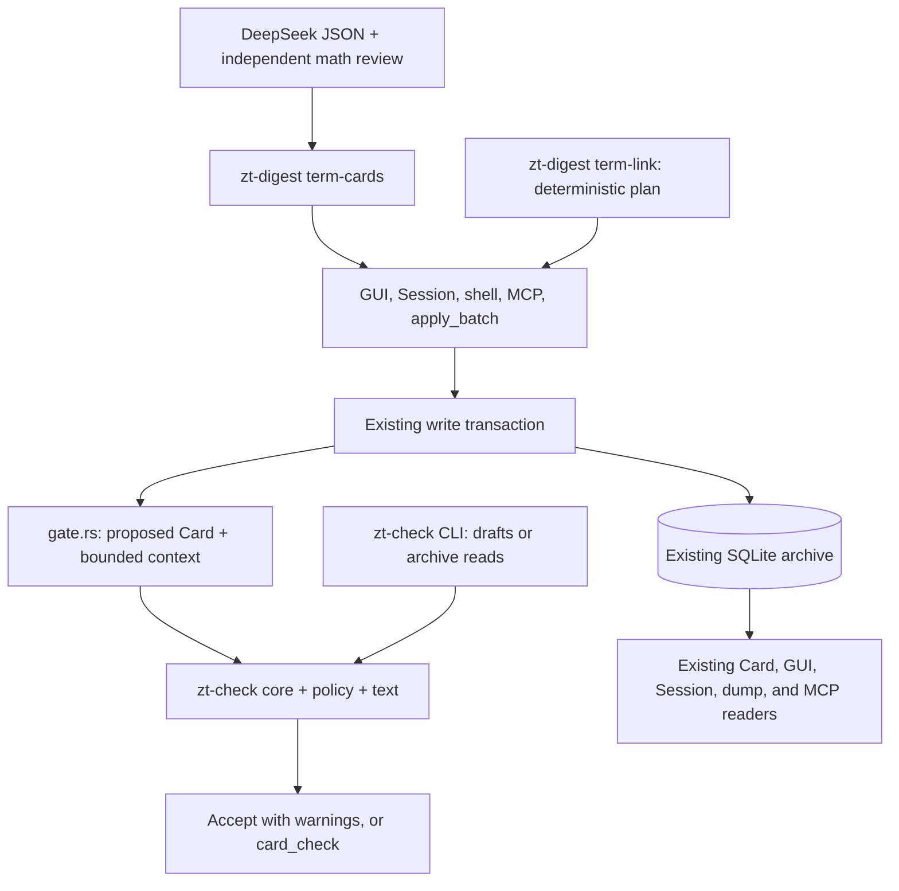
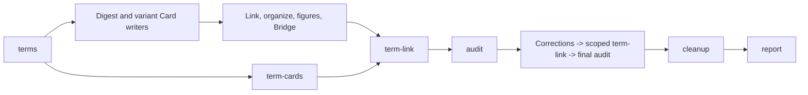

# Term Cards, Term Links, and the shared Card check: implementation design

Status: implementation design, 2026-10-24. This document proposes changes; it does not report an implementation, a deployment, or a change to the archive.

Inputs: [Term Cards and Term Links proposal](term-cards-and-term-links-proposal.md) and [zt-check gate proposal](zt-check-gate-proposal.md). The implementation baseline inspected for this design is commit `bab6bd7`. The proposals remain the feature specification; this document resolves how to build the features together.

Navigation: [Architecture](#1-the-design-in-one-page) · [Design decisions](#3-decisions-and-deliberate-refinements) · [Shared checker](#5-shared-checker-library) · [Policy and ratchet](#6-rule-policy-and-the-legacy-ratchet) · [Term storage](#9-term-storage-and-computed-structure) · [Term-card compiler](#12-the-term-card-compiler) · [Deterministic linking](#13-the-deterministic-term-link-command) · [Workflows](#14-workflow-integration) · [Verification](#18-verification-plan) · [Feature coverage](#20-feature-coverage-and-scope-boundaries).

## 1. The design in one page

Keep the three existing executables, the existing archive, and the existing digest ledger. Turn the existing `zt-check` crate into a pure checking library with an optional command-line adapter. Link that library into `zt`. Teach the existing Link machinery the Term-link syntax. Add one term-name column to Cards, one derived term-structure module, and two digest commands.

A Term list, a Term Card, and a Term part all have type `term`. Their role comes from their term name and Location. They are Cards in the current archive, with the current Access, Lock, move, revision, receipt, and dump behavior. Their explanation is authored Markdown, rather than a second definition store.

The service checks a proposed Card against the same rule implementation that `zt-check` uses. The service owns the final decision because it has current transaction context. The standalone tool predicts that decision when it has matching rules, policy, limits, metadata, and context. An incomplete offline check must say that it is incomplete.

The new digest work consists of:

1. `zt-digest term-cards`: plan source-bound jobs, accept DeepSeek JSON, check and review it, render Cards, then publish in table order through existing receipts.
2. `zt-digest term-link`: compute byte-range substitutions in one book, show a plan, then apply guarded edits. No model chooses or writes a substitution.

Do not create a terminology database, a gate process, a plugin framework, a new queue, a term-ownership table, or an independent Link parser for the digest.

### 1.1 Minimal new structure

| Addition | Responsibility | Why it is necessary |
|---|---|---|
| `tools/zt-check/src/core.rs` | The existing rules, structured diagnostics, and Card checks without I/O | The service must use the actual checker without spawning itself |
| `tools/zt-check/src/text.rs` | Shared envelope and lexical Link parsing, visible-text projection, and term-table parsing | Labels, scopes, rendering, and checks must agree on the text and target of a Term link |
| `tools/zt-check/src/policy.rs` | Rule catalog, defaults, overrides, severity, and legacy-fault comparison | The gate and self-check must make the same decision |
| `src/gate.rs` | Load bounded transaction context and call the pure checker | Storage reads and write results belong in `zt` |
| `src/term.rs` | Compute list/head/part roles and the term structure from Cards | Readers and write validation need one definition of a Term Card |
| `tools/zt-digest/src/term_cards.rs` | The Term-card compiler | Generated explanations need checking, review, publication, and recovery |
| `tools/zt-digest/src/term_link.rs` | The deterministic link pass | Linking needs a reusable plan/apply operation |
| Two workflow modules | Wire these commands into the existing compiler and relay paths | The two new stages have different execution contracts |
| Two prompt files | Writer instructions and independent mathematical review | Content creation and review need separate tasks |

`core.rs`, `text.rs`, and `policy.rs` are files inside the existing checker crate, not new crates. Preserve `check.rs` as the CLI/input compatibility adapter. Do not split the rule implementation into one module per rule family merely to mirror the proposal diagram. Extract a further module only when a concrete responsibility becomes hard to navigate.

Production storage changes are one nullable `cards.term_name` column and the widened Card-type constraint. Use existing `metadata` rows for archive policy and existing `links.kind` for `term` occurrences. No new persistent table is required.

### 1.2 Data flow



## 2. What the current code actually provides

The following are source observations at the baseline, rather than assumptions taken from either proposal.

| Current seam | Verified behavior | Consequence for this design |
|---|---|---|
| `tools/zt-check/src/lib.rs` and its Cargo manifest | The crate already exports `check`, `graph`, and `mcp`; process code is not feature-separated | Separate the existing crate; do not introduce another checker crate |
| `tools/zt-check/src/check.rs` | Input loading, MCP calls, rules, text helpers, printed diagnostics, and policy-like filtering share one file | Extract pure computation before putting it in the service |
| `src/main.rs::validate_card_text` | Parses the envelope, checks a repeated leading title, and calls `link_index::validate` | Retain this compatibility entry point, but pass proposed Card metadata and delegate checking |
| `src/ops.rs::edit_tx` | Resolves type/facet/level/form changes separately; a metadata-only edit need not validate text | Checking only `validate_card_text` would miss retypes and metadata-only changes |
| `src/place.rs` and shell paths | Some writers call the existing validator directly | Audit all authoring paths, including direct callers, rather than adding a gate only to MCP |
| `src/main.rs::cards_table` | SQLite restricts `card_type` with a CHECK listing five types | `ALTER TABLE ... ADD COLUMN` alone cannot add type `term` |
| `src/main.rs::ensure_finding_cards` | Existing type expansion backs up and rebuilds `cards` while preserving row ids | Follow this pattern, accounting for the newer Lock triggers and tables |
| `src/card.rs` | Parsing normalizes body line endings and outer blank lines; Reverse text is generated | The byte-preservation contract applies to the body returned by the Card parser, not arbitrary original file bytes |
| `src/link.rs` | One scanner supplies occurrence and target byte ranges; it currently excludes fenced and inline code | Reuse the scanner; do not assume it already excludes every math or HTML span |
| `src/link_index.rs` | The derived occurrence table has `source, ord, target, kind`; normal writes refresh affected sources/targets | Store `kind='term'` there and keep authored macros authoritative |
| `src/model.rs::read_links` | Relation kinds are inferred from prose, with inheritance between adjacent Links | Syntax-assigned `term` must not become an inherited reason for an ordinary Link |
| `src/batch.rs` | Real batches accept 1–64 items and at most 1 MiB of authored input | A 300-Card book cannot be one real batch |
| `src/batch.rs` | Preview sequences already exist, with up to 1,024 items and 8 MiB | Extend the existing simulation to aggregate Card-check refusals |
| `tools/zt-digest/src/calls.rs` | Identified calls already partition real writes by item/byte limits and recover through receipts | Use this path rather than a new bulk-write endpoint |
| `src/card.rs` and `src/tree_lock.rs` | Authored fingerprints, SQL checks, member seals, and frozen field lists predate `term_name` | Adding a field must also update these integrity contracts |
| `tools/zt-digest/src/calls.rs::authored_fingerprint` | Digest request guards use their own canonical JSON projection | Update that projection and the service receipt projection together; do not substitute the Lock hash |
| `src/main.rs::Config` | Existing configuration is a small set of declared process settings | Archive-specific gate overrides need explicit persistence, not an assumption that arbitrary config keys already work |
| Digest modules and base blueprint | Existing compilers use `Z.layer`, `Z.chain`, relay commands, claims, receipts, and frozen workflow builds | Add two modules to that machinery; do not build another orchestrator |

The governing domain remains [CONTEXT.md](../CONTEXT.md), with the block map in the [developer wiki](wiki/README.md). The current wiki statement that body conventions are taught rather than validated is a baseline decision that this change intentionally replaces for configured gate rules.

## 3. Decisions and deliberate refinements

These are recommended design defaults. They make the design implementable without requiring answers to the proposals' open questions before writing this document. They are not permission to backfill or deploy.

| Decision | Chosen contract |
|---|---|
| Card type | Add `term`, as requested; do not simulate it with title conventions on Idea Cards |
| Role storage | Store only `term_name`; compute list/head/part roles |
| Placement | Immediate Side successors of the list for term heads; Direct successors for continuation parts |
| Term title | The exact term name on a head; continuation titles use `推导（续 k/n）：…` |
| List preservation | Retype only; preserve parsed title, authored body, row identity, address, and authored Links |
| Link syntax | `[[label@address]]` with a direct Regular Location target |
| Link frequency | `first` per term per body; support `all` explicitly |
| Link scope | One agent Literature tree for the digest pass |
| Checker process | In-process library inside `zt` |
| Self-check service path | Reuse `apply_batch preview`; do not add `check_cards` in the first release |
| Checker context | A concrete read-only value supplied to pure rules, rather than a storage-calling trait hierarchy |
| Policy | The proposal's human/agent defaults, with archive-specific overrides and a staged enforcement rollout |
| Term generation | DeepSeek V4.1 Flash, official source, high effort; Haiku management through the existing DSMP path |
| Mathematical review | Every math term is reviewed in a separate conversation; a changed draft invalidates its previous review |
| Backfill | One selected book at a time after the copy-based pilot; never automatically unlock a tree |
| Optional later work | Entry-search ranking for exact term names and idea-grow/register integration remain explicit follow-ups |

### 3.1 Corrections to promises that the current structure cannot keep

**Bounded publication instead of one unbounded transaction.** Both new commands use existing receipt-backed chunks. A chunk is atomic; an entire large book is recoverable but not atomic. Reports distinguish planned, committed, pending, and refused items. This preserves the current batch contract.

**Every ready row, identified by content, never by position.** The proposal permits successful drafts to publish while others fail, and also demands table-row placement order. S33 / #182 replaced the first rule (the longest contiguous ready prefix) because it held back every ready row behind one refused draft: a live confirmation run committed 2 of 55 rows and left 41 ready rows unpublished, so Term-link linked almost nothing. Publish every ready row instead, and read the publication back by identity instead of by position, so no placeholder, address reservation or blind overwrite is needed. A row that becomes ready later is filed in its table place with one identified Side placement that moves the rows after it one label on inside the same archive transaction — the only change to already-published Cards, and it writes no Card content. Section 12 specifies recovery.

**Conditional prediction instead of unconditional offline acceptance.** An offline check without the archive's policy or required context cannot guarantee acceptance. It returns an incomplete result; the service preview is the authoritative preflight.

**Stable faults instead of printed-line identity.** Use structured, unclipped diagnostic identity and multiplicity for the legacy ratchet. Printed lines remain the human-readable interface.

**One shared lexical implementation.** Move reusable text/Link scanning into the existing checker crate's pure text module. `src/link.rs` remains the service-facing Link facade and lifecycle implementation, including address-grammar and storage checks. This avoids a dependency cycle and avoids three inconsistent regex implementations.

**A persisted auto-link choice.** `link:false` must survive loss of the staging directory. Store it as an authored head line on the Term Card, rather than adding another column or relying on the draft file forever.

**Self-checks precede enforcement.** Ship the compatible CLI, preview support, writer instructions, and `card_check` recovery before turning new agent blocking defaults on. The proposal's rollout list placed some of these after enforcement; that ordering would strand existing writers.

## 4. Invariants

These invariants define successful implementation.

1. A Card's authored Markdown is the source of truth for its explanation and Link occurrences.
2. A field or table computed from Cards is a projection, never an independent authority.
3. Every authoring route checks the final proposed text and metadata inside the write transaction.
4. Checking uses the proposed Workspace, type, facet, level, form, and term name, not the row's previous type.
5. An agent can change only agent Cards. Gate policy cannot grant Access or unlock anything.
6. A Lock refusal stops the affected operation without retries through another route.
7. Existing envelope, field, Link, Access, and Lock invariants remain mandatory.
8. A Term link reaches a term head directly; it does not resolve a name through a registry.
9. A Term use contributes no reasoning edge, Model membership, or Idea inbound/outbound credit.
10. Removing recognized Term-link markup preserves exactly the visible authored body bytes.
11. A rerun with unchanged inputs makes no authored edits or new Card allocations.
12. Preview changes no persisted Card, receipt, revision, allocation, or Lock history.
13. A refusal rolls back the actual atomic operation, including receipts and allocations.
14. Unknown context, a stale contract, or an interrupted check cannot be reported as a pass.
15. Mathematical format checks and model review are evidence of review, not proof of mathematical truth.
16. A run with missing terms or unresolved refusals remains visibly incomplete even when the audit and report run successfully.

## 5. Shared checker library

### 5.1 Cargo boundary

Keep `tools/zt-check` independently buildable, with its current package and its own workspace.

Recommended feature shape:

```toml
[features]
default = ["cli"]
cli = ["dep:windows-sys", "dep:libc"]

[[bin]]
name = "zt-check"
path = "src/main.rs"
required-features = ["cli"]
```

The platform dependencies remain target-specific and become optional where they belong to child-process containment. Adjust the exact feature lists to the code extracted; the important build checks are that the core-only build has no `mcp` module, filesystem reader, process launcher, or process-platform dependency.

The root crate adds:

```toml
zt-check = { path = "tools/zt-check", default-features = false }
```

`zt-digest` keeps depending on the same crate with `cli` enabled. There is no need for an otherwise empty `core` feature: the library's pure core is always available.

The library shape becomes:

```text
zt-check/
  src/lib.rs       exports VERSION, core, text, policy
                   exports check, graph, mcp only with feature cli
  src/core.rs      pure rule evaluation and structured diagnostics
  src/text.rs      pure envelope, macro, prose and table operations
  src/policy.rs    rule catalog, policy, ratchet, decision formatting
  src/check.rs     existing run_lines / run_cli, readers and flags
  src/graph.rs     whole-archive audit rules; cli feature
  src/mcp.rs       live client, scope and process containment; cli feature
  src/main.rs      existing executable adapter
```

Move code, retaining fixtures and behavior, before changing rule policy. `check::run_lines(args, Some(&mut zt))` stays available to existing digest callers. Keep compatibility re-exports such as `check::term_table` while callers migrate to `text::term_table`.

### 5.2 Concrete inputs, not an extensibility framework

Use the existing JSON Card entry shape where it already serves the rules. Introduce only the small typed boundary needed to distinguish checking a proposed write from auditing stored Cards.

Conceptually:

```rust
pub struct CheckInput {
    pub card: CardEntry,
    pub before: Option<CardEntry>,
    pub context: CheckContext,
    pub policy: Policy,
    pub purpose: CheckPurpose,
}
pub enum CheckPurpose { Write, Audit }
pub struct CheckReport {
    pub complete: bool,
    pub diagnostics: Vec<Diagnostic>,
    pub blockers: usize,
}
```

`CardEntry` includes the parsed envelope, address/kind/Workspace, type fields, and term-role facts. `before` is absent on a new Card. The actual Rust types should reuse the checker's existing entry representation; do not duplicate every field into several DTO families.

`CheckContext` is an immutable value containing the small set of facts needed for the selected rules:

- Parent and relevant ancestors, with the old and proposed versions where required.
- Referenced target identities and types.
- Book/root identity and applicable Book term table.
- Formal model setting/level/facet/shared membership facts for the checked Card.
- Term list row and head/part ownership where applicable.
- The availability/completeness of each context family.

The service materializes this value using its transaction connection. The CLI materializes the same value from bundled entries or existing MCP reads. The core itself makes no I/O calls. A value seam is simpler than a trait whose methods hide database or MCP work.

Distinguish `absent` from `unavailable`. For example, an Idea Card may legitimately have unknown source evidence and receive I7 advice. A failed attempt to read its source context is an incomplete check, not the same semantic finding.

### 5.3 Bounded context loading

For a write, load the proposed Card, required ancestry/setting, applicable term list, and distinct referenced targets. Reuse those facts within one batch transaction. Do not build `Snapshot::read` for the whole archive for every Card.

Limits must be explicit and shared in the check contract. Start with existing batch and authored-input bounds. Bound context by the affected book/model and distinct requested targets; if a pathological model exceeds the supported check budget, return an incomplete/context-budget error rather than silently truncating or running an archive-wide scan.

Graph rules remain an explicit audit path. Large context is not permission to quietly run I6 against every title at write time.

### 5.4 One diagnostic representation

A diagnostic needs at least:

```json
{
  "address": "K/14",
  "rule": "E2",
  "fault": "missing_labels",
  "key": "labels:参与者,来源",
  "message": "missing labels: 参与者、来源",
  "severity": "block",
  "legacy": false,
  "scope": "local"
}
```

Keep rule ids and current message wording unless a rule's semantics changes. Format the familiar line at the boundary:

```text
K/14 E2 missing labels: 参与者、来源
K/14 R20 (advisory) ...
faults: 1
```

Formatting collapses whitespace and clips as today. Identity does not. A fault's `key` is a rule-specific semantic key built from the full offending fragment or missing requirement, rather than a source line number or the clipped display string.

Preserve the current rule traversal order in the first extraction. Gate and CLI reports use the same ordering. Aggregate batch reports order by item, then the core's rule order, then occurrence.

## 6. Rule policy and the legacy ratchet

### 6.1 Policy ownership

The checker owns the rule catalog and default policy. The service owns the selected archive's effective overrides.

Use `metadata` keys such as `gate.agent.R2` and `gate.human.E2`. Extend `zt config set` for the declared `gate.<workspace>.<rule>` keys, routing the change to the selected archive under its normal writer lock. Do not put per-archive overrides in a process-global feature file or introduce a second config database.

Provide `zt config` output that names effective overrides and their archive. Missing override means the default, and an explicit reset removes the metadata row.

Validate rule ids, Workspace names, and values. Reject typos, unsupported rules, and attempts to override hard invariants. A graph-only rule cannot be configured to block a single write; refuse that override with a clear explanation.

A policy change receives a new policy hash and advances the revision used by check-contract readers. It does not rewrite Cards or persist old-fault baselines. Load the effective policy once per operation/transaction so an entire atomic batch uses one policy.

### 6.2 Defaults at full enforcement

| Rule family | Human | Agent | Evaluation |
|---|---|---|---|
| Envelope, valid fields, address/Link grammar, target validation, Access, Locks | mandatory | mandatory | Existing service invariants; not disableable |
| E1, E2, F1, F2, F3, R18, R19, R22 | block | block | Local/bounded-context format |
| R13–R17 on formal models | advise | block | Bounded model context; concept models retain their exemption |
| R2–R5, R7, R9, R12, I2–I4, I7, L1, L2 | advise | block | Only where the existing rule applies |
| I1, R20, R21, I7 unknown-source | advise | advise | Advisory subcases remain advisory |
| R6 | off | advise | Preserve the existing meaning-sensitive remediation decision |
| T1, T2, T3, T5, T6, T9, T10 | block | block | Term-format requirements, with role-specific applicability |
| T4 | advise | advise | Approximate LaTeX symbol coverage |
| T7 wrong/nonexistent target on a newly introduced Term link | mandatory | mandatory | Existing-style Link write invariant |
| T7 label mismatch, retained invalid target | advise | advise | Report legacy/stale uses without rewriting prose |
| T8 and computed term-structure faults | audit advice | audit advice | Coverage/structure can be incomplete while a tree is being built |
| I5, I6, E4, E5, F4, L3 and other graph facts | audit advice | audit advice | Not a write gate |

T10 is a term-facing label for the same open-formula predicate as R22; do not count the identical fault twice. Likewise, repeated-title/envelope diagnostics have one owner rather than separate R19 and envelope copies.

The policy applies to rules that exist mechanically. It does not turn human-language instructions such as “one idea” or “the result follows” into invented machine proofs. Rule applicability must use actual Card type and role, not a title guess.

A `term` list is navigation, so it does not inherit Idea size/title/link-count rules. Term heads and parts use T9 in place of Idea/Card-part size rules, but retain applicable sentence-language checks. L/I accounting ignores Term uses; ordinary reasoned Links keep their ordinary semantics.

### 6.3 Ratchet algorithm

New Cards have no legacy allowance. All configured blocking diagnostics can block them.

For an existing Card:

1. Check the old authored version using its old metadata and the same current rule version/policy snapshot.
2. Check the final proposed version using proposed metadata and transaction context.
3. For comparable rules, build a multiset keyed by `(rule, fault, key)` from the old report.
4. Consume one old occurrence for each matching new occurrence.
5. A matched diagnostic becomes `legacy:true` advice. An unmatched diagnostic keeps its configured severity.
6. Refuse only if an unmatched blocking diagnostic remains.

Do not compare clipped lines or merely sets. Adding a second copy of an already faulty sentence is a new occurrence. Moving an unchanged faulty paragraph to another line is not.

A size fault's key includes its measured value and limit, so making an oversized Card larger is not grandfathered as the same fault. A missing-label fault includes the missing-label set. A fragment fault includes the unclipped offending fragment.

On a type/role/level change, compare only rules whose applicability and meaning remain the same. A Card retyped from Idea to Event must satisfy newly applicable E-format rules. Do not run Event rules on the old Idea body and then call those newly relevant faults legacy. Use an explicit applicability signature, including model concept/formal transitions and term list/head/part transitions.

The ratchet covers new quality rules, not hard storage invariants. It cannot legalize malformed Link syntax, invalid type fields, an unauthorized write, or a Lock violation. Retaining a previously broken target follows the existing Link grandfathering behavior, separately.

Keep the existing repeated-leading-title allowance tied to `authored_changed` while moving the envelope implementation. An unchanged old body does not become newly illegal merely because a metadata edit now reaches the gate. A malformed envelope with multiple Reverse markers retains its existing refusal behavior.

Pure address changes and generated Reverse-section refreshes do not run prose rules. A real authored-text or relevant metadata change does. BibTeX title edits check the resulting Literature title/envelope; Citation-key remapping alone follows the existing structural path.

### 6.4 No persistent baseline table

Compute old and new diagnostics during the operation. This automatically applies a new checker version to both sides and needs no migration of saved fault records.

Policy activation therefore preserves editability of existing Cards but does not retroactively clean them. The audit reports legacy debt. A rule-version change can change which fault is recognized; tests must cover those semantic changes explicitly.

## 7. The service gate and all callers

### 7.1 One write-check function

Retain `validate_card_text` as a narrow wrapper where useful, but make `gate::check_proposed` the shared decision function.

Its input is a resolved candidate, not just `(address, text)`. The candidate contains final text, type fields, Workspace, Card kind, and any prior Card. Build the candidate before modifying the row. For creates, calculate the prospective address without committing an allocation.

Recommended flow:

```text
edit lock / transaction
  -> resolve candidate and previous version
  -> enforce Access and Lock rules
  -> validate mandatory fields and Link facts
  -> gather bounded context
  -> shared core rules + policy + ratchet
  -> if blocked: typed refusal and rollback
  -> otherwise write candidate, refresh derived Links/Reverse text
  -> persist receipts/revision, commit
  -> return warnings with the ordinary result
```

Where the existing transaction temporarily materializes an item for structural validation, keep that work inside a rollback-capable transaction/savepoint. It must not consume a persistent id, receipt, or revision on refusal.

Check retypes, facet/level/form/term-name changes, text edits, new successor/insert Cards, and root creates. A root's applicable rules differ from a Regular Card's; bibliography-generated titles do not receive Idea-claim rules.

Do not rerun prose checking solely because a move rewrites an address in a Link. The shared visible-text projection makes Term-address remapping especially independent of the sentence.

### 7.2 Caller coverage checklist

| Caller | Required integration |
|---|---|
| `ops::create_topic/create_literature/create_successor` | Check final new Card before commit |
| `ops::edit_tx` | Check one combined candidate for text plus metadata changes |
| `ops::insert_card` and `place::apply_insert_plan` | Check inserted Card in the simulated placement |
| Direct shell writers in `main.rs` | Reach the shared gate with correct owner-selected Workspace |
| Session create/edit/type commands | Reach the same gate and print/display returned warnings |
| GUI create/edit/metadata handlers | Return structured warnings and retain editor text after a refusal |
| MCP create/insert/edit | Preserve existing answer fields and add check information |
| `apply_batch` | Use the same per-item path inside its transaction |
| Dump import/load, if it is an authoring route | Validate new authored input; any trusted legacy restore path must be explicitly identified and cannot become a general gate bypass |

Read the actual call graph during implementation. This table is an acceptance checklist, not a claim that the baseline already funnels all these paths through one function.

### 7.3 Warnings and refusals

Extend the normal operation result with a small check report. Do not use global/thread-local warning buffers. Warning ownership follows the operation result, including nested batch results.

A successful JSON reply keeps its existing fields and adds, when relevant:

```json
{
  "address": "K/14",
  "warnings": [
    {"rule":"R20","fault":"local_reference","message":"...","legacy":false}
  ],
  "check": {
    "complete": true,
    "rule_version": "RULE_VERSION",
    "policy_hash": "POLICY_SHA256"
  }
}
```

A blocking refusal uses the existing typed-error transport pattern:

```json
{
  "error": "card_check",
  "address": "K/14",
  "blocking": 2,
  "faults": ["K/14 E2 missing labels: 参与者、来源", "K/14 R3 ..."],
  "diagnostics": [],
  "zt_check_version": "RULE_VERSION",
  "policy_hash": "POLICY_SHA256"
}
```

`diagnostics` contains the structured faults; the empty array above is only an abbreviated example. The human message starts `card_check: 2 blocking faults` and includes the same lines the CLI formats.

A batch refusal additionally identifies the zero-based item index, tool, and operation key. Preserve the existing textual `batch item N (tool)` convention without forcing clients to parse it for identity.

GUI warnings are a compact group beside the existing save result. They do not open a separate approval flow. A refusal keeps the draft open and displays actionable fault lines. The Session keeps its edit buffer and shows faults. Shell output preserves its normal machine-readable result stream; warnings go to the established diagnostic stream or structured result.

### 7.4 Batch transaction semantics and preview

A real batch checks items in order. Later items see earlier successful candidate effects in the transaction, so a Term link may target a Term Card created earlier in the same batch. Forward references remain unsupported.

One blocking fault rolls back the entire real batch. Earlier committed chunks of a multi-batch digest remain committed.

Extend the existing preview/savepoint implementation to treat `card_check` like a typed per-item refusal it can collect. Independent later items are still simulated. Items depending on an unbound reference from a refused item are marked blocked, not evaluated with made-up target data.

Preview returns diagnostics, warnings, candidate Cards, and a complete/checked/refused/blocked summary. Everything rolls back. A report containing blocked dependent items cannot claim that every proposed Card was checked. For a real batch the service may return the first blocking item; exhaustive fault collection belongs to preview.

Do not raise the real batch cap. The existing larger preview sequence can inspect a planned series, but it is not a promise that every future chunk will still pass after concurrent writes.

## 8. Self-check contracts, policy parity, and versions

### 8.1 Preserve existing modes

Retain `--json`, `--model`, `--addresses`, and `--cards`. Retain `run_lines` for `zt-digest`. Add:

- `--workspace human|agent`, default `agent` for drafts.
- `--draft <file>` for exact proposed writes, including their type fields and optional prior state/context.
- A structured-output option for check status and contract information, while retaining ordinary fault lines.

Live checks use each stored Card's actual Workspace; a command-line flag cannot reclassify it. Reject a conflicting live override rather than pretending a human Card belongs to the agent Workspace.

At the coordinated release, `faults: N` counts blocking diagnostics after policy/ratchet in every mode. Advisory lines carry `(advisory)`. Migrate all callers that currently count every line or use their own advisory list. The rule extraction phase preserves old behavior until this coordinated switch.

Recommended CLI process exit contract:

| Code | Meaning |
|---|---|
| 0 | Complete evaluation with no blocking faults |
| 1 | Complete evaluation with blocking faults |
| 2 | Invalid invocation, missing required context, stale/incompatible check contract, or infrastructure failure |

For the digest commands, keep their existing operational conventions; a `card_locked` result stops the command with exit 2 as proposed. Typed JSON/text carries the actual reason, so it cannot be mistaken for a content fault.

### 8.2 Draft format

A draft bundle carries the exact candidate plus optional context:

```json
{
  "workspace": "agent",
  "rule_version": "RULE_VERSION",
  "policy_hash": "POLICY_SHA256",
  "cards": [
    {
      "address": "K/14",
      "type": "term",
      "term": "替代弹性",
      "text": "# 替代弹性\n\n术语：替代弹性\n...",
      "before": null
    }
  ],
  "context": {
    "cards": [],
    "complete_for": ["envelope", "local"]
  }
}
```

Do not invent a complete target address for an offline successor whose allocation is not known. A provisional name can identify the draft in fault lines, but placement-dependent checks remain incomplete until a real preview resolves it.

A bundle without archive policy explicitly uses built-in defaults and says so. It can demonstrate local conformance; it cannot promise acceptance against unknown overrides. A live CLI may fetch the required context and effective policy through its existing MCP connection.

### 8.3 Publish the actual check contract

Use a stable rule version, independent of unrelated executable version bumps. Include rule semantics, visible-text semantics, limits, and diagnostic schema in the versioning discipline.

Expose `zt_check_version` in MCP initialization as requested. Because a stdio proxy and the daemon can be different builds, the authoritative check metadata must also come from the running service's read/write replies.

Extend the existing verified `get_cards` view, including the empty-address metadata read used by the digest, with a `check_contract` object containing:

- Rule version and diagnostic schema version.
- Effective policy and policy hash.
- Limits and applicability version.
- Archive identity/revision.
- Relevant syntax capabilities, including `term_links` and `term_cards`.

No extra `check_cards` tool or policy endpoint is needed. Existing write replies and previews carry the version/hash that actually decided the operation.

A live CLI with a rule-version mismatch prints the mismatch and does not return a successful acceptance prediction. Merely warning and then exiting 0 would contradict the proposal's guarantee. Recheck or preview if context/policy changed; a self-check never reserves a future write.

## 9. Term storage and computed structure

### 9.1 One new authored field

Add `CardType::Term` and `cards.term_name TEXT NULL`.

Normalize a supplied term name by trimming its outer whitespace. An absent/null field denotes a list. Empty after trimming normalizes to null. A nonempty name is at most 40 Unicode scalar characters, one line, and contains no `[`, `]`, `@`, `|`, or backtick. Use the same limit for Term-link labels. Existing prose measurement continues using the checker's UTF-16-compatible semantics; do not accidentally apply it as a different label grammar.

`term_name` is valid only on a Regular Card of type `term`. A type change away clears it. An explicit non-null `term` on another type is an invalid-field error; do not silently accept a typo in a create request.

Use the existing partial-field convention:

- Field omitted: preserve the term name on an edit.
- `term:null`: clear it, producing a candidate list role.
- `term:"..."`: set it.

Creation and type-change validation must check the entire resulting combination. Existing model/hub/math fields cannot survive on a Term Card.

### 9.2 Role computation

```text
not type term                                  -> no term role
type term + no name                            -> list
type term + name + immediate Side child of list -> head (wire name: card)
type term + same name + Direct child of
  a head or valid part                         -> part
anything else                                  -> unfiled
```

A role is not a stored discriminator. Compute the ancestor chain with cycle/depth protection appropriate to Location parsing. A head is valid independently of whether every other row has a Card.

Preserve the faults named by the proposal:

| Fault | Report |
|---|---|
| `term_unfiled` | Named Term Card has no valid list/head/part placement |
| `term_duplicate` | More than one head for a term under one list |
| `term_row_without_card` | A row has no corresponding head |
| `term_card_without_row` | A head names no row |
| `term_part_name` | A continuation's name differs from its preceding head/part |
| `term_label_mismatch` | An authored label differs from its target's name |
| `term_link_target` | A target is missing or is not a head |

Coverage and placement faults are reported, rather than universally blocking hand editing. Newly introduced Term-link targets must be valid heads. T2 also prevents creating a head with a title/name/row mismatch when the row context is available.

If a book has multiple plausible Term lists, do not select the first by address. `get_terms {at}` can name a particular list or an unambiguous descendant; the compiler refuses an ambiguous book-level selection.

### 9.3 Table parsing and exact identity

Move the existing public four-column `term_table` implementation into the shared text module. Preserve its current compatibility behavior for R6, including how `不用` is split and legacy duplicate rows are treated.

For publication, also inspect raw parsed rows before compatibility deduplication. Duplicate exact or case-equivalent names must be reported as ambiguous and resolved before automatic head allocation. A case-insensitive compatibility reader must not quietly erase a row that needs its own Card.

The term name stored on the head is exactly the selected table-row spelling. No Unicode normalization, case folding, transliteration, synonym rewrite, or qualifier removal occurs during linking.

### 9.4 Persist category and auto-link choice in the body

Keep `category` in the authored `类别：` line, not another column. Add one optional recognized head line:

```text
自动链接：否
自动链接理由：这是过于一般的词。
```

Absence means `true`. A `link:false` draft must carry a reason and renders these lines. This is the only template extension needed to preserve that choice across exports and staging loss. Protect these lines during relinking, and validate them with T1.

The list's four-column table remains unchanged. Do not put a fifth column, links, hidden comments, or auto-link metadata into its body.

### 9.5 Migration, fingerprints, and Locks

The migration must:

1. Make a consistent SQLite backup using the existing migration procedure.
2. Rebuild the Card table with `term` in its CHECK and `term_name` in the column set.
3. Copy every existing row id, identity, text, Workspace, and type field unchanged; initialize the new field to null.
4. Recreate the current indexes and Card-related Lock triggers inside the migration transaction.
5. Preserve Lock members, pins, events, receipts, and existing revision semantics.
6. Verify row counts, identities, active Lock integrity, and dump/read compatibility before enabling new writes.

Update the shared Card load/select/insert paths, field snapshots, dump manifest, check inputs, and receipt projections. Search for every explicit Card column list; there are many, including Lock inspection code.

The rebuilt table should also enforce `term_name IS NULL OR card_type='term'`, with the Regular-Card restriction retained in the shared field validator. The database guard complements rather than replaces the single name parser.

`term_name` is authored identity. Include it in fingerprints and frozen-field checks. Preserve legacy fingerprints for Cards without a term name by extending the existing framing only for a nonempty term name with an explicit domain tag, for example appending `term_name\0<value>\0` after the old framed bytes. Specify and fixture-test the exact bytes before implementation. This avoids invalidating every existing active Lock merely because a null field was introduced.

Update the SQL fingerprint wrapper and all its callers consistently. Keep an eight-argument compatibility overload if old retained SQL paths require it, and add a term-aware path; do not silently reinterpret the old arity. Add `NEW.term_name IS NOT OLD.term_name` to the Locked-member update guard. Pins keep their existing address/row promise; a pinned but unlocked target's term name can still change, producing label-mismatch advice.

The service's canonical receipt projection and `zt-digest`'s canonical request guard must both include nonempty term names using the same field convention. Their hash is a different contract from the Lock fingerprint; preserve both.

Do not rewrite historical Lock events or reseal trees automatically. A migration with unchanged old Cards must retain their old valid fingerprints.

The Lock protection generation must change because its canonical protected-field trigger changes. At this baseline, `tree_lock_schema_version` is `1` and unsupported generations are refused before Card migrations. Define generation `2` for the term-aware protection contract. The new binary explicitly supports a validated `1 -> 2` upgrade: compare the old canonical protection and member evidence first, then atomically install the widened Card schema and generation-2 protection without changing old identities. Do not call the old generation “tampered” merely because its trigger lacks the new field, and do not silently repair a genuinely altered generation-1 trigger.

This existing generation check also supplies a concrete compatibility floor: test that the baseline binary refuses generation 2 before modifying the archive. Do not rely only on a new metadata key that an old binary never reads. Arbitrary much older releases are unsupported; the coordinated deployment must prevent their use.

## 10. Term-link syntax and ordinary Link machinery

### 10.1 Lexical representation

The shared scanner exposes:

```text
macro_range  -> the whole [[...]]
target_range -> only the address
label_range  -> only the label, present for a Term link
target       -> address text
label        -> optional label text
form         -> ordinary or term, derived from syntax
```

All offsets are UTF-8 byte offsets into the original input. Keep the existing target-only rewrite behavior. A move changes only `target_range` and leaves the label, punctuation, and surrounding bytes intact.

For a Term link, split at the first `@`. A second `@` violates the label/target grammar. A target must be a Regular Location, and the service checks that the row is a term head. Ordinary Links retain the existing Location/Citation-key grammar.

The shared lexical parser owns macro shape, label limits, code-span/fence exclusions, and tolerant rendering. The root's `src/link.rs` wrapper owns the existing address grammar and lifecycle checks. It should re-export/reuse occurrences rather than copy their scanner.

Preserve ordinary Link behavior during extraction. Add explicit tests for Term-like examples inside inline/display math: they are literal, not Term uses. The deterministic relinker has a broader protected-span set than ordinary Link validation. Do not accidentally change every old Link's interpretation by adding its protected-span list to all Link scanning.

### 10.2 Classification and relation kinds

A Term occurrence produces `kind:"term"`, regardless of a preceding relation word. Do not add `term` to the vocabulary inferred from prose.

In `model::read_links`:

- A Term link receives `term` directly.
- It never sets the previous ordinary Link's inherited kind.
- If a preceding ordinary Link in the same sentence is still the relevant prior ordinary Link, keep that ordinary state.
- A subsequent ordinary Link cannot inherit `term`.

Filter `term` from Model membership/relations/neighbors and Idea/Event/Finding reasoning counts. Do this at the named graph consumers; do not hide Term occurrences from general Link/Lock consumers.

### 10.3 Index, Reverse links, and broken uses

Retain the existing `links` table. A Term occurrence gets its target address and `kind='term'`. The label remains in the authoritative macro; detailed outputs can obtain it by matching the indexed source and occurrence ordinal against that body's shared parse. Do not add a label table or a redundant label column.

Update indexed Reverse-section generation and the full lifecycle oracle together. Both must split inbound sources into:

```markdown
<!-- zt:reverse-links -->
## Reverse links

- [[ordinary-source]] Title

## Term uses

- [[using-source]] Title
```

Emit only nonempty sections, preserving ordinary formatting for Cards with no Term uses. Deduplicate by source within each section. If one source has both an ordinary Link and a Term use to the same target, it appears once in each section. Never parse generated tail macros as authored occurrences.

Missing targets are broken, with the term label included in `lsbk` and MCP diagnostics. A target retyped or moved out of a valid head role is a semantic Term-target fault even if an ordinary Link could still reach that row.

An existing invalid Term link may be retained under the specified legacy rule, but a new one is refused. Identify legacy invalid uses by form/target/label with multiplicity; changing an invalid target is not retention. Label mismatches are advice because correcting the label could change prose.

Move/delete/rename plans, Access rewrite checks, Lock pins, and broken-Link handling see all Term occurrences. A move whose rewrite would touch a human Card is refused to an agent exactly as for an ordinary Link.

### 10.4 Projection of visible prose

Implement one shared function that replaces valid Term-link macros with their labels, leaving ordinary macros available for the caller's existing treatment.

- Language/size checking projects Term labels first, then removes ordinary Link markup as it already does.
- R6 reads the visible term, not the address.
- The Literature scope checks actual targets, never a `label@target` concatenation.
- Optional read mode `term_links:"label"` projects body/text for read-only prompt consumption.
- Raw reads and exports keep the authored macros.

Projected reads should carry `term_links:"label"` or an equivalent projection marker in the response. Never use projected text as an edit base or fingerprint input. A digest stage that will submit an edit must fetch/retain the raw form and existing guard.

This projection also needs review in statement-comparison consumers: adding Term markup should not falsely create a different prose claim. Keep their existing formula/value/negation preservation rules, and add only the syntax-aware label projection with regression fixtures.

## 11. Term content and rule contracts

### 11.1 Head template

Render from the proposal's draft JSON. DeepSeek supplies content; the compiler owns section spelling and order.

Common sections and lines:

```text
# <exact term>
术语：
原文：                 optional when no source wording exists
不用：                 list-row spelling, or —
类别：                 概念 / 数学概念
首次定义：
自动链接：否           only when disabled
自动链接理由：         required when disabled

## 释义
## 书中的说法
... mathematical sections when required ...
## 区别
## 常见误读            when applicable
## 在本书中的作用
来源：[[book-key]] <source locator>
```

For a mathematical head, retain hypotheses, tagged definition, symbol table with domains, equivalent forms with reasons, numbered derivations, results, limits/special cases, computed example, intuition, distinctions, misreadings, and role in the book.

The compiler must not invent missing scientific content to fill a required section. A writer must explicitly say when a limit does not apply, or when it supplies a derivation omitted by the book. Preserve the digest's `（补：书中略去）` / `（补：书中未写）` source-fidelity convention.

### 11.2 Continuation parts without a second content model

Use the same draft schema as the proposal. Partition the rendered derivation/content blocks when needed; do not ask DeepSeek to write a separate kind of database object.

A head carries the common identity, plain explanation, book definition, hypotheses, formal definition, and symbol table. Later whole derivation steps/results, limits, examples, and related sections may continue in Direct-successor parts. Add an ordinary continuation Link and an explicit reference to the head for inherited notation.

A part carries the same stored term name, a continuation title, category/source context, and its actual continuation sections. It does not have to repeat the head's title or every full section. T1/T2/T3 are role-aware:

- Exact title = term is required on heads, not continuation titles.
- A math head must establish its mathematical definition; a part can inherit it through its valid chain.
- T5/T6/T9/T10 apply to the material actually held on each part.
- The complete term chain must have the required mathematical content.

Use a deterministic greedy partition at whole-step/block boundaries, with at most 12 derivation steps and 1,600 prose units per Card by the shared measurement. Formula/table text is excluded as specified. A single unsplittable block that exceeds a limit is refused for a writer fix; never truncate it or silently raise the limit.

If the head's mandatory material alone is too large, return a clear split/rewrite fault. The writer can reorganize its derivations while retaining all mathematical content. Do not hide an unbounded Card behind the phrase “as detailed as possible.”

### 11.3 T-rule implementation

| Rule | Mechanical contract | Where |
|---|---|---|
| T1 | Known ordered labels/sections, required common fields, correct role-specific template | Draft rendering and service/local check |
| T2 | Head title/name/`术语：`/row spelling agree; part title uses continuation format and retains the same term | Bounded-context check |
| T3 | Math head/chain has hypotheses, displayed definition, symbol table and derivation; concept terms do not carry formal derivation sections | Local plus chain audit |
| T4 | Approximate formula identifiers are covered by the head/chain symbol table | Advice |
| T5 | Numbered steps, a basis per step, a formula or explicit result, step bound, final result line | Local |
| T6 | No unexpanded “obvious”/skipped-step phrases; a named previous-step reference is allowed | Local heuristic plus reviewer |
| T7 | Syntax, target role and label consistency | Mandatory new-target validation plus advice/audit |
| T8 | Exactly one head per table row, no extra heads | Book audit |
| T9 | Per-Card prose limit, excluding math and tables | Local |
| T10 | Balanced math delimiters through the same predicate as R22 | Local |

T3/T5 cannot establish that all hypotheses are sufficient or that a result equals a mathematical claim. The independent reviewer must inspect those meanings. T4 remains a warning because a LaTeX identifier scan is approximate.

Apply the same T rules to stored manually edited Cards and JSON-rendered drafts wherever inputs are available. A draft passing format checks is not exempt from a later service check.

## 12. The term-card compiler

### 12.1 Existing compiler shape

Expose the steps from the proposal:

```text
zt-digest term-cards -Step plan|jobs|check|review-plan|fix-plan|apply|report
                     -Staging <folder>
                     [-PerJob 4] [-MathPerJob 1]
                     [-MaxStepsPerCard 12] [-MaxProse 1600]
                     [-Jobs <ids>] [-Token <claim>] [-Apply]
```

Use the existing argument parser, canonical JSON utilities, ledger, source manifests, operation prefixes, identified calls, and compact final-line convention. No PowerShell reimplementation of the compiler.

Keep a small fixed set of files under `<Staging>/term-cards/`:

| Artifact | Purpose |
|---|---|
| `plan.json` | Frozen rows, list/source fingerprints, jobs, limits, and compiler/rule version |
| `jobs/` | Per-job source-bound inputs |
| `out/` | Writer JSON, one stable output per writer job |
| `check/` and `review/` | Diagnostics and hash-bound review answers |
| `state.json` | Derived local progress and references to durable archive receipts |
| `report.json` and `report.md` | Row coverage, created addresses, refused/pending rows, review evidence |

The existing run ledger remains the scheduler. `state.json` is the compiler's recoverable artifact, not a second queue. Archive receipts are authoritative for committed writes.

### 12.2 Plan inputs and grouping

Read the list by an explicit/unambiguous role, with a legacy table adapter for a pre-term book. Preserve its title/body fingerprints. Read source sections and the existing term-planning artifact when available.

For each row gather the exact name, avoid words, short meaning, first-definition locator, source file/line snippets, matching source sections, relevant notation, and neighboring terms.

Classify as math when the definition/snippet, applicable notation table, or known setting gives formal notation. A dollar sign is a useful candidate signal, not an infallible definition classifier. Record why it was classified. DeepSeek may promote a concept draft to math; promotion triggers the complete math checks and independent review before publication.

Group math terms one per job and concept terms four per job by default. Keep job ids stable by frozen row numbers. A grouped concept job that contains a promoted math draft can still finish, but its promoted term is not ready until its separate review passes.

### 12.3 Writer, check, review, and one fix

Use the existing `Z.layer`/`Z.chain` and job `continue`/`fallback` fields. Do not implement the proposal sketch's `sameConversation` as a new orchestration option.

The chain is:

```text
write JSON
  -> schema + rendered draft check
  -> independent review for each math term
  -> one fix prompt to the original writer when needed
  -> schema + rendered draft check again
  -> independent review of any changed math draft
  -> publish readiness result
```

A review names the term, source fingerprint, and exact draft/rendered-content hash. A previous `{"ok":true}` cannot approve a changed derivation. After the single fix, a fresh review may approve or refuse; a second refusal is final for that run. There is no unbounded review/fix loop.

A concept term needs schema/format checks but no mathematical reviewer. A changed schema or compiler renderer invalidates the corresponding readiness proof.

Do not ask a reviewer merely to endorse a formula. Its job includes all the proposal's depth requirements: domains/smoothness, definition fidelity, notation coverage, each transformation and basis, final claim, limits, numerical recomputation, skipped steps, and supplementation labels.

### 12.4 DSMP management contract

Retain the existing managed path:

- Haiku managers, low effort, manage jobs and relay commands; they do not write Card prose or edit JSON on behalf of a writer.
- DeepSeek V4.1 Flash from the official source, high effort, writes/reviews/fixes content.
- At most eight conversations under one manager, and at most eight managers alive across the whole run.
- Writers, reviewers, and continuations share the global pool with the digest branch.
- Stable job ids and registered conversation/resource ids support cleanup and recovery.
- Collect answers promptly; retain a writer only through its permitted review/fix opportunity, then delete it. Review conversations are deleted after their answer is durably collected. Do not archive conversations.
- Remove the DeepSeek workspace registration once its work and required continuations are finished. Preserve the local staging/report files needed for audit; removing the workspace is not deletion of those files.
- Use the existing bounded retry/runtime budget. A provider failure gets the permitted single retry; a semantic content fix is a separate, finite step.
- The writer receives the applicable Chinese language skill through the existing job skills field, rather than copied skill text.

Before parallelizing the two branches, verify the implementation holds global slots across a manager's actual lifetime, including review/fix continuations. Do not infer the total cap merely from `take:8` or the number of term jobs.

Count retained writer conversations as live, even while idle. A manager cannot retain eight writers and then open eight reviewers. A simple schedule keeps the existing block of up to eight writer jobs but processes it in waves of at most four live writers, with at most four reviewer conversations alongside them. Review promoted terms from a grouped concept job sequentially within those slots. Complete the bounded fix/review opportunity and delete that wave before admitting the remaining writers. This needs no second pool, preserves the block/manager assignment, and avoids a global deadlock in which all 64 slots hold writers waiting for a reviewer slot.

### 12.5 Publication, order, and recovery

For a new book, `terms -Step apply` creates the list as type `term` with no name. For a legacy book, the first publication includes a metadata-only retype; its authored body/title remain identical. The retype is its own identified `…/apply/list` call, sent only when this run publishes something, before the heads it makes legal.

Publish **every ready row**, in table order, as a Side child of the list with its complete continuation chain. A row that is not ready is left unpublished and holds back no row after it. For each row publish its head and complete continuation chain together when that chain fits a batch. Pack several small complete chains into a batch up to 64 operations and 1 MiB. A chain too large for one existing batch is refused for a bounded split/content fix; do not create a new large-batch API for it.

A row published later goes to its table position. When a ready row stands before rows that are already published, its head is filed in the place of the next published row through `create_successor -Kind side -Before`, one identified `…/apply/<row>` item per placement: that row and every later Side child of the list move one label on inside the same archive transaction, so the list keeps its table order. The placements are sent highest table position first, so the next one names the head the previous one filed. Rows after the last published row are appended in table order.

Allocate Side children through `create_successor` (or its in-place placement) and parts through Direct successors, using existing earlier-item references. Do not calculate an address and write it directly to SQLite.

Read the publication by **identity, never by position**. A Side child of the list is the committed row whose Term Card carries exactly the plan's rendered head — title and body — and whose Direct chain carries exactly the rendered parts. Its addresses are reused and nothing is written again. If a Side child matches no planned row, if two Side children carry one row's term, or if a row's head exists in the tree but not as an immediate Side child of the list, stop with a conflict rather than inserting/moving/deleting a Card to regain row order. The optional backfill plan must surface this condition before writing.

Example: rows 1–6 are ready, row 7 failed, rows 8–20 are ready. Publish 1–6 and 8–20. A repaired row 7 lets the next run file its head before row 8's head, and rows 8–20 move one label on. A failed row is never represented by a fake definition. (S33 / #182: the earlier rule published only the ready contiguous prefix, which left 41 of staging7's 55 rows unpublished behind row 3.)

Use stable operation keys tied to run/unit/plan revision/step/row. On a transport interruption, query/replay the same request and receipts before replanning. Reuse verified returned addresses. Do not allocate a second head because the previous reply was lost: the next run reads the publication by identity and writes nothing for a head the archive already holds.

After every write the archive's publication is read once more and judged by the same identity rule. The report carries the archive's current addresses — a placement moved the rows after it — and a row this run wrote whose content the archive does not hold is a typed `output_diverged` stop, never a silent success.

A source/list/draft change creates a new plan revision. Reconcile already published receipt-owned Cards and report any conflict; never edit a historical accepted head merely because a new draft differs.

A book unit is `done` only when all its required rows and parts are verified. Every committed row is useful work, but a refused or unready row keeps the book unit failed/blocked according to the existing ledger's states and its specific refusal, and the stop line names each such row. Do not mark a missing row done to release downstream dependencies.

### 12.6 Compiler result

Report, per row:

- Source row number and exact term.
- Math/concept classification and whether promoted.
- Writer job, draft hash, check result, review hash/result, and fix disposition.
- Ready but not yet published, committed, refused, or conflicted status.
- Head/part addresses and receipt keys.
- Why publication stopped and which later ready drafts remain staged.

For an incomplete stage the workflow continues to its read-only audit/report, but the feature is degraded. The ordinary dependency on a successful term-card book unit is not satisfied.

## 13. The deterministic term-link command

### 13.1 Interface and scope

```text
zt-digest term-link -Step plan|apply -Staging <folder>
                    [-CitationKey <key>]
                    [-Occurrences first|all]
                    [-Cards <addresses>] [-Token <claim>] [-Apply]
```

The default scope is the selected agent Literature tree. `-Cards` must be an exact subset of that tree. Reject other Workspaces, another book, Topic Cards, or ambiguous list selection.

Exclude the Literature root, the Term list, the book's structure/index/navigation Cards, and the Book notation table. Identify these through existing manifest/role information; do not skip any arbitrary Card merely because its title contains a common word.

Include term heads and parts, with their own term protected. Their use of other terms can link normally.

### 13.2 Frozen plan

Read the tree once where practical, including raw bodies, metadata, list rows, current heads, and rule/policy information.

`term-link/plan.json` records:

- Archive identity, book key, compiler/syntax version, and occurrence policy.
- List, term-head mapping, and auto-link-choice fingerprints.
- Input Card authored fingerprints and exact raw parsed body hashes.
- Chosen substitutions and relevant skip reasons at UTF-8 byte offsets.
- Output bodies or sufficient exact data to reproduce them.
- Counts, unresolved target/label faults, and a stable plan content hash.

`preview.md` shows changed prose lines and totals. Reports can include timestamps, but the canonical transformation plan excludes clocks/run randomness so equal frozen inputs/options produce equal content. Sort Cards in natural address order and terms in row order.

### 13.3 Normalization and preservation

Define `strip_term_links(B)` lexically, not by resolving targets: replace every syntactically valid Term-link macro outside protected literal syntax by its label.

For a book pass:

1. Retain foreign-book Term links as protected authored macros and report them. This proposal creates no cross-book uses.
2. Normalize same-book recognized Term macros to labels even if their old target is now missing or retyped. A stale target is precisely when address-resolution-based stripping would fail.
3. Refuse malformed Term-like markup for correction rather than guessing its intended label or deleting bytes.
4. Match and emit new same-book Term macros.
5. Verify `strip_term_links(new_body) == strip_term_links(old_body)` byte for byte.

This verification never strips ordinary Links. It does not normalize whitespace, punctuation, escapes, Unicode, math, or line endings. Use the parsed body returned by the archive as the baseline; do not claim preservation of pre-parser file formatting.

Title, metadata, and the Term list body are outside the pass and remain unchanged. Generated Reverse/Term-use sections may change because they are derived.

### 13.4 Protected spans

Calculate source ranges without Markdown reserialization. Protect:

| Span | Why |
|---|---|
| Fenced and inline code | Literal examples must remain literal |
| Inline/display math, including supported dollar and backslash forms | Terms inside formulas are not prose matches |
| Ordinary Links and retained foreign Term links | Their macro bytes and targets must not change |
| Markdown links/images, including reference-style forms | Do not change labels, destinations, or artifact/document syntax |
| Raw HTML blocks/inline tags and chart fences | Never rewrite markup or executable chart content |
| Heading lines and table rows | Navigation/labels and tables remain exact |
| Source lines | Preserve citation/locator text |
| Term head metadata lines | Preserve identity, category, avoid words, and auto-link policy |
| The current term name anywhere in its own head/parts | No self-reference or redundant continuation use |
| Generated Reverse text | It is not part of the authored body |

Use the shared scanner and existing Markdown offset facilities where appropriate. A syntax-aware offset walk can identify ranges; it must not render then parse the result back into source. If markup is incomplete and safe boundaries cannot be established, protect the uncertain tail or refuse the Card with a specific diagnostic. Never interpret an unclosed math/code span as permission to relink its contents.

Only match within an individual eligible text range. Do not match across emphasis delimiters, escapes, an HTML tag, or any protected boundary. Conservative skipped matches are preferable to changing syntax.

### 13.5 Simple matching is enough

There are at most 60 table terms by default. Start with a sorted literal candidate scan over link words and blockers. At each earliest match position choose the longest UTF-8-valid word, with stable row-order tie breaking. A blocker wins an exact tie with a link word.

This has a small fixed vocabulary and is easier to inspect than adding Aho–Corasick solely for this pass. Preserve leftmost-longest semantics. Switch algorithms only if the targeted benchmark shows a real need; an optimized matcher must pass the same fixtures.

Link words are exact term names with one valid head and auto-link enabled. Blockers include:

- Every avoid word.
- Every term name without a usable head or with auto-link disabled.
- Nonlinkable short names.
- Ambiguous unqualified forms of qualified homonyms.

For `学习（个体行为）` and `学习（产业生产率）`, the exact full forms can link, while the bare `学习` is a blocker. Do not mark the full qualified terms unusable merely because their bare form is ambiguous.

Use the proposal's conservative short-name default: do not link a one-Han-character term or a Latin name shorter than three letters. The stated acronym exception has no effect for `GDP` because it already has three letters; do not invent an exception for one-letter symbols.

Latin matches are case-sensitive and require ASCII word boundaries at both ends, treating letters, digits, and underscore as word characters. Han matches are literal, with the combined longest-match/blocker vocabulary reducing common substring mistakes. This is not semantic word segmentation; reports retain ambiguous/blocked cases for review.

Examples:

| Text / vocabulary | Result |
|---|---|
| `净生产函数` and `生产函数` are terms | Link the longer full match |
| `替代弹性系数` is an avoid word | Consume it as a blocker; leave it unchanged |
| `相对要素价格` is nonlinkable but `要素价格` is linkable | Leave the longer full occurrence unchanged |
| `GDP` inside `GDPR` or `GDP_2024` | No match |
| A literal term split by Markdown emphasis | Skip; do not cross markup |

With `first`, take the first eligible occurrence of each exact term per body. With `all`, take all eligible occurrences. Protected/blocked occurrences do not consume the first-occurrence allowance.

### 13.6 Apply and concurrent changes

Apply revalidates archive identity, book/list/head mapping, policy contract, and each Card's authored guard. Recheck the preservation equation before sending each edit.

If the mapping/options/source list changed, invalidate the whole plan and build a new preview. If only one body changed before apply, explicitly replan that Card into a new plan revision and publish its updated preview/diff in the report. Do not silently edit from stale offsets.

Use `base_fingerprint` on every edit. A change after re-reading but before commit is a stale-base refusal, not a request to overwrite. Stop the affected chunk, retain committed receipts, and require bounded replanning. Never spin until another writer stops.

Pack unchanged-plan edits through existing identified-call chunks. A 300-Card book can require at least five calls even when every body fits the byte budget; more calls are possible for large bodies. There is at most one final edit per changed Card in a plan.

No-op Cards produce no edit. If the plan has no edits, write no receipt and advance no archive revision. Report no-op completion through the ledger's normal evidence path.

A `card_locked` response stops immediately with the typed tree/Lock facts and exit 2. A `card_check` response returns the fault lines for correction; relinking does not change visible prose to make the checker pass. With projection parity, retained style faults should remain legacy advice.

### 13.7 Reports and guarantees

The report includes counts of scanned/changed Cards, added/retained/removed links, committed/pending chunks, missing heads, avoid words with Card/line, own-term skips, math/table/code skips, ambiguous bare forms, repeated occurrences, and foreign/malformed uses.

The guarantees are:

- Deterministic transformation for equal frozen inputs.
- Exact visible-body preservation by a checked equation.
- Idempotence on an unchanged valid tree.
- Bounded operations and recovery through receipts.
- Access and Lock enforcement through the existing service.
- No synonym correction, prose rewrite, term rename, or mathematical edit.

The matcher can miss a relationship or skip a potential use. It does not prove linguistic disambiguation. Count “Cards with no Term link” as an observation, not automatically a defect.

## 14. Workflow integration

### 14.1 Stage graph

Add base stages `term-cards` after `terms` and `term-link` after all Card writers and the term-card branch. Econ/math variants inherit the stages and retain their own writer order.



The `term-cards` branch uses frozen source sections and the shared term list. Concurrent model/digest writers do not own its Cards. New model notation is not an unstable live input: use the book's frozen notation/source; if a later cross-check finds a notation conflict, report it for a finite correction.

The runtime can parallelize these branches through existing dependency edges. Do not add another worker pool. Verify that a slow term branch does not hold slots while waiting for writers it has no dependency on.

### 14.2 Ledger units and truthful completion

| Unit | Dependency / proof |
|---|---|
| `termcards/tNNN@1` | Term list prepared; job schema, shared check, required reviews/fix disposition verified |
| `termcards/book@1` | Every required row ready and its expected head/parts committed and read back |
| `termlink/book@1` | Successful term-card publication and every enabled Card-writer unit complete; plan applied/verified or proven no-op |
| `termlink/final@R` | A finalization correction round R changed Cards; those Cards relinked and verified |

Use a generation/round identity for finalization rather than one reusable final unit that could suppress a later correction. This is an instance of the existing ledger plan-revision convention, not a new scheduling system.

A failed term job can leave a published prefix and ready later drafts. The successful book dependency is still absent, so `term-link` is skipped/blocked with that reason in the normal full run. Audit/report must still run and show coverage debt. Do not mark failed job units done to force the pass.

An explicit `term-link` mode may operate on the currently valid subset for diagnosis or backfill, reporting missing-head blockers. It does not mark the incomplete `termcards/book` done.

If a layer is disabled by args, omit its ledger dependency rather than wait forever for an unregistered unit. Validate contradictory args early: requesting Term linking with no usable list/heads yields a clear skipped/incomplete result, not a successful zero-term book.

### 14.3 Modes

| Mode | Work |
|---|---|
| `full` | Existing preparation and writers, term-card branch, term-link, audits/finalization |
| `term-cards` | Validate existing book, source/sections preparation only, Term cards, Term links, audit, report |
| `term-link` | Validate existing book and staging/manifest, deterministic pass, audit, report |
| `resume` | Reconcile frozen plan, receipts, and registered units; resume only unfinished work |

Backfill preparation must create no new root, anchor, group, model, or narrative Card. Add a narrow sections-only branch to the existing prepare command if no such branch exists. It is not a second prepare pipeline.

`term-link` mode needs no provider/source probe. `term-cards` needs source passages and the official provider path. Neither mode reruns ordinary digest/model stages.

Declare the proposal's args in the base schema: `termCards`, `termLink`, `termCardsPerJob`, `termCardsMathPerJob`, `termLinkOccurrences`. Validate ranges/enums before dispatch. Limits can initially remain versioned tool defaults rather than adding more workflow knobs.

### 14.4 Finalization and audits

The first Term-link pass runs after `bridge` and every enabled variant writer. For each finalization correction round, collect the actual changed Card addresses from its write results, then relink those Cards before the final read-only audit and math checks.

If a correction changes a Term list, head name, or auto-link policy, its effect is book-wide: invalidate the mapping and run the whole-book Term-link plan. A changed-body-only correction can use `-Cards`.

Do not add Term-link passes to every writer. The final write boundary is where deterministic linking belongs.

Extend `audit` with the proposal's `terms` section: rows/heads/parts, math/concept, T faults, uses by Card type, no-use observations, remaining avoid words, and the ten most-used terms. Add generation/publication coverage and gate-contract metadata.

Keep audit exit/completion distinct from book quality: “audit ran” does not mean “all terms passed.” Final reports contain `term_cards` and `term_link` with complete/degraded/skipped/refused status and counts.

### 14.5 Writer compatibility

Add concise guidance to every relevant digest/card/fill/model/explain/correction prompt:

- Preserve existing Term macros, or write the visible term plainly.
- Do not manufacture target addresses or synonyms.
- Run the exact SELF-CHECK before submit.
- Treat `card_check` as content to fix through the current finite fix cycle.
- Treat `card_locked` as a planning stop, never a content retry.

Deterministic compilers preflight through the shared core and, when placement/context is needed, service preview. Direct-writing workflows must also handle gate refusals. Ad-hoc agents remain protected by the gate even if they skip the optional tool.

## 15. MCP, GUI, terminal, and exports

### 15.1 MCP changes

Preserve existing fields and add:

| Surface | Change |
|---|---|
| Create/insert/edit and batch items | `type:"term"` and nullable `term` |
| `get_card/get_cards/get_tree` | Term name/role/list/count facts where applicable; raw default; optional `term_links:"label"` |
| `get_terms {at}` | Computed rows, heads, parts, uses, coverage, and faults for one list/descendant |
| `search_cards` | Accept `type:"term"` |
| `list_links` and outbound projections | `kind:"term"` and label |
| Broken-Link reads | Preserve target/source and include label/semantic target fault |
| Initialization and verified view | Rule/capability information and archive check contract |
| Write/preview replies | Structured warnings and `card_check` refusal data |

`get_terms` uses one consistent archive read and carries archive revision. Return deterministic natural order, plus source row order for terms. Keep the normal read-size limits visible; do not truncate rows silently.

`get_tree` and `list_trees` counts/search chips must recognize the sixth Card type. Update tool enums, help text, server instructions, and client category classification. A typed term list is still compatible with readers of its unchanged four-column body.

General owner-created Term Cards may be placed in a Topic tree under existing domain rules if the owner chooses. The digest itself creates none there and links none there. Literature scope is an additional client restriction, not a new global Access rule.

### 15.2 GUI reading and editing

The open Card's prose is the focus. Term links have the same font and size as that prose, with a quiet dotted underline. An ordinary reasoned Link keeps its address/title chip.

A Term link:

- Displays only its authored label.
- Uses the existing Card navigation route and encoded target.
- Offers the list-row short meaning and target address on hover/focus.
- Has a visible keyboard focus state and works without hover.
- Uses existing cross-Workspace color semantics.
- Shows a broken style and accessible explanation when unusable.

Escape labels, meanings, targets, and attribute values in `link_events`; URL-encode the route separately. A term label is data, never HTML.

On the Term Card, use the existing Card reader and Markdown sections. Render the head metadata quietly, and collapse the generated Term-use list to its count with a normal disclosure control. Do not introduce a second reading page or a new board.

Extend the existing writing desk's type picker and term-name field. Raw editing continues to show macros. Completion offers the head by term name and inserts the exact macro; disambiguate candidates using their book/address. Completion of an ordinary citation to a Term Card must still be possible, because a reasoned Link to its definition is different from a Term use.

Graph views default to excluding `kind:term`, with one explicit visibility toggle. Apply it to the Table/Constellation/map graph consumers without hiding the Card nodes or their ordinary relations. The Model board never treats Term uses as Model relations, even when the display toggle is on.

### 15.3 Terminal Session

Render a Term link as its label, with a restrained term color/underline. Record the existing `LinkSpan` target so mouse and keyboard following work. Calculate display columns using rendered label width, including wide Han characters and combining characters, not macro byte length.

Keep edit mode raw. Broken targets remain visible as labels with the broken style. Test wrapping, hit ranges, link-follow selection, and text copying; hidden target text must not make selection offsets drift.

### 15.4 Dump/export and old clients

Dump all authored macros unchanged. Add a nullable/omitted term-name map in the existing manifest convention, alongside its type map. Export/import both heads and parts.

A coordinated version/capability floor prevents old binaries from writing a new archive or digesting new macro syntax. Older clients must fail visibly, not silently parse `label@address` as an ordinary Citation key or drop `term_name` on a save.

Do not claim that turning policy to `advise` makes the schema backward-compatible. It only changes quality enforcement. A full binary downgrade after Term data exists requires a reviewed conversion or backup restore, outside ordinary rollback.

## 16. Existing books and backfill

Backfill is a separately selected operation, not an automatic migration.

1. Select one book and inspect its list, existing descendants, source availability, Workspace, and Lock facts.
2. If locked, stop and name the tree/Lock. The owner can unlock it through the existing GUI; the workflow cannot.
3. Prepare or reuse source sections only. Bind the source/list fingerprints.
4. Generate/check/review drafts and publish the ready ordered prefix.
5. When all required terms are verified, plan/apply Term links.
6. Run the read-only audit and report.
7. The owner reviews the result and can lock the tree again.

The allowed writes are the existing list's type/name metadata as required, new term heads/parts, and Term-link body edits in the selected book. Do not rerun model managers, reorganize the tree, alter notation/model tables, fix avoid words, or change prose.

Before applying, show conflicting pre-existing children, duplicate rows, missing source passages, and any incomplete generation. Do not use a fresh digest run as a workaround for a backfill conflict.

## 17. Delivery sequence

Each phase should be reviewable independently. These are implementation phases, not GitHub issues created by this design task.

| Phase | Deliverable | Exit condition |
|---|---|---|
| 1 | Pure checker extraction and feature boundary | Existing checker/digest fixtures unchanged; root can link core without process code |
| 2 | Shared text parser and structured diagnostics | Old envelope/Link fixtures pass; no duplicate diagnostics; ratchet tests pass |
| 3 | Gate adapter, policy persistence, CLI drafts, version checks, preview aggregation | Every writer route covered on scratch archives; new quality rules initially advise |
| 4 | Term type/field migration and computed roles | Old archive/Lock/dump identities preserved; term read/write APIs pass |
| 5 | Term syntax, index/lifecycle projections, GUI/Session display | Move/Access/Lock/reverse behavior matches full oracle; label-only display verified |
| 6 | T rules and both digest commands | Draft/review/order/receipt and byte-preservation/idempotence fixtures pass |
| 7 | Base/modules/prompts/finalize/report integration | Both variants assembled and harnessed; refusal recovery and shared DSMP pool verified |
| 8 | Copy-based pilot and advisory observation | Content depth/layout accepted; performance and legacy-fault report reviewed |
| 9 | Coordinated release and enforcement | Compatible binaries/workflows installed together; type then agent-style policy enabled in controlled steps |
| 10 | Optional selected backfills | Each book has its own report and completeness/Lock disposition |

Do not switch blocking rules on while old writers still expect “write first, fix later.” Keep existing hard validations active throughout advisory rollout.

The gate proposal suggests a week of advisory observation. Treat that as an operational observation window after deployment, not a timer that automatically enables enforcement. Promotion depends on measured refusals, compatibility, and owner deployment decisions.

Use the proposal's version numbers only as candidate release numbers. Check current package versions and frozen workflow history when implementing; do not reuse numbers already present. Rule version, executable version, schema compatibility, and workflow build version are related but distinct contracts.

## 18. Verification plan

This task writes a design only. The checks below are implementation acceptance work, not results claimed by this document.

### 18.1 Core/build parity

- Build/test `zt-check` with defaults, and build/check it with `--no-default-features --lib`.
- Verify core-only dependency output has no MCP/process-platform code.
- Run the same old fixture set through the extracted CLI and the gate adapter.
- Add envelope fixtures with the same existing messages and parsing behavior.
- Compare ordered structured diagnostics and formatted lines, not only counts.
- Confirm `zt-digest` still calls `run_lines` with its existing shared MCP client.

### 18.2 Gate correctness

| Case | Required evidence |
|---|---|
| New Event/Finding body missing required labels | Refused; no Card/id/receipt/revision change |
| Advisory style fault in human Workspace | Stored with returned warning |
| Same fault retained in a legacy Card | Stored with legacy advice |
| Same faulty paragraph copied a second time | Additional occurrence blocks |
| Two different long messages sharing a clipped prefix | Distinct faults; neither hides the other |
| Idea retyped to Event with malformed body | Newly applicable Event format blocks |
| Concept model promoted to formal | Newly applicable formal checks run |
| Metadata-only edit/retype | Proposed metadata checked even with identical body |
| Move/rename/generated Reverse refresh | No spurious prose rejection; existing structural safeguards remain |
| Policy override | One archive/Workspace/rule changes, other rules and Access remain intact |
| Missing context/version mismatch | Incomplete/stale result, never successful acceptance |
| Mixed batch | One blocker rolls back the whole real batch |
| Preview with independent/dependent later items | Collect independent faults, mark dependencies blocked, persist nothing |

Add a parameterized route matrix across GUI, MCP, shell, Session, insert, and batch paths. Test both Workspaces with each client's real Access.

### 18.3 Term storage and Link lifecycle

- Migrate old archives with active Locks, pinned targets, receipts, and non-Idea types.
- Preserve every old row id, authored text, old fingerprint, active seal, and historical event.
- Change only `term_name` on a Locked head and prove refusal.
- Round-trip names/types/parts through dump and load.
- Parse UTF-8 label/target byte ranges, strict errors, tolerant rendering, and literal code/math examples.
- Rewrite only the target on moves/compaction/key rename; refuse an agent rewrite into a human body.
- Compare indexed outputs with full lifecycle outputs for ordinary Reverse links and Term uses.
- Verify deduplication when a source has repeated Term uses, or both use and reasoned Link.
- Prove Term links affect Lock pins but never Model membership/neighbors or reasoning counts.
- Prove a malformed or wrong-role new target is refused, while the defined legacy retention is reported.

### 18.4 Compiler and matcher

- Source-bound plan generation, classification, promotion, 1/4 job grouping, and stable ids.
- Every required JSON field, exact table-row spelling, auto-link persistence, and deterministic rendering.
- Mathematical reviewer independent from writer; changed draft invalidates review; one fix bound.
- Continuation packing at whole steps, T-rule applicability on heads/parts, and unsplittable overflow.
- Prefix publication with an earlier failed row; later ready rows stay staged.
- Lost-reply replay, chunk interruption, receipt recovery, stale list/source conflict, and no duplicates.
- Leftmost-longest/blocker/homonym/Latin-boundary fixtures.
- All protected spans, CRLF-normalized parsed baselines, Unicode, escapes, reference links, HTML, and incomplete markup.
- Property test: stripping old/new recognized Term macros gives byte-identical bodies for generated fixture text.
- Idempotence: a second plan has zero edits and advances no revision.
- Changed mapping/body guards, explicit plan revision, and immediate Lock stop.

### 18.5 Workflows and display

- Existing `framework-harness.mjs` verifies stage order, disabled-layer dependencies, resume, dedicated modes, and finalization round identities.
- Simulate successful and failed term branches; audit/report still run, but incomplete work never becomes done.
- Simulate global manager/conversation caps while digest and term jobs overlap.
- Verify every recorded session is collected/deleted and every workspace registration cleaned, including failures.
- Confirm term-only modes never rerun digest/model writers or provider probes in deterministic-only mode.
- Inspect GUI light/dark, hover/focus, broken/cross-Workspace links, completion, ordinary Link distinction, and collapsed uses.
- Inspect Session width/wrap/hit testing and raw editing with Han and combining characters.

### 18.6 Performance and pilot

Target less than 5 ms of additional gate work per typical Card, measured separately from lock waiting, file I/O, and provider time. This is a target, not a measured result.

Benchmark a legal 64-item real batch and a 200-item preview sequence or four legal real batches. Do not benchmark an invalid 200-item real batch as the proposal suggests. Report median and tail latency, context query count, indexed-source refresh count, and archive size.

For the relinker, measure planning and apply on a 300-Card fixture and record actual batch count. The small literal matcher is retained unless these measurements show it is inadequate.

Pilot on a consistent copy of the box, with `grossman2002integration` if still suitable at implementation time:

1. Preserve the Term list's authored title/body exactly.
2. Account for every row as verified head/parts or a named unresolved fault.
3. Have the owner inspect three mathematical terms and two concept terms for actual explanatory depth.
4. Verify preservation for every changed body and zero writes on a second pass.
5. Have the owner inspect ten GUI Cards and judge first-occurrence linking and layout.
6. Compare language/Link diagnostics before/after; Term markup alone must add no prose faults.
7. Measure provider usage and runtime; use actual logs rather than unverified cost estimates.

A stand-in workflow runtime proves orchestration behavior only. It does not prove live provider cleanup, mathematical quality, or installed-binary qualification.

## 19. Deployment and recovery

Do not deploy during an active digest. Follow the repository's Windows service/executable procedure and current state checks, including closing Sessions as required. This design performs none of those operations.

Release `zt`, `zt-check`, `zt-digest`, both rebuilt digest variants, and installed agent guidance as one compatible set. Preserve old frozen workflow builds and report artifacts.

Back up the archive consistently before schema migration. Validate the copy, run migration and postflight checks, then verify running-service rule/capability metadata and a scratch preview. A copied binary's version is not proof of the running daemon's version.

Policy rollback can return new quality checks to advice, keeping existing mandatory checks. It needs no Card rewrite. Syntax/schema rollback is different: an old executable may not understand Term Cards or macros.

For an interrupted compiler/pass:

- Read the frozen plan and committed receipts.
- Verify effects and identity before retrying.
- Resume the same accepted operation keys; never apply compensating deletion blindly.
- Report already committed chunks and pending work.
- Stop on Locks/Access or semantic conflicts.
- Restore a backup only through a separately authorized, reviewed recovery operation that accounts for subsequent writes.

Do not automatically strip all Term links, retype Cards back to Idea, delete heads, or restore an old archive to make a downgrade convenient.

## 20. Feature coverage and scope boundaries

### 20.1 Term proposal coverage

| Source requirement | Design coverage |
|---|---|
| G1 / D1–D4: new type, unchanged list, one term per row, parts and order | Sections 9, 11, 12 |
| G2–G4 / D5–D10: direct label link, deterministic text-preserving pass, first/all, final pass | Sections 10, 13, 14 |
| G5: R6 and idea-grow keep reading the list | Sections 9.3, 10.4, 14; list body unchanged |
| G6 / D11–D15: parallel branch, DSMP, writer/reviewer/fix, limits/model | Sections 11, 12, 14 |
| Proposal 4.4: computed structure and all seven named faults | Section 9.2 |
| Proposal 5 and appendices A–C: content schema, deep math, examples, review | Sections 11 and 12; reuse the source schema rather than redefine its content fields |
| Proposal 6: grammar, rewrite, Reverse/use sections, broken targets, Locks | Section 10 |
| Proposal 7: GUI, editor, Session, raw/projected reads | Sections 10.4 and 15 |
| Proposal 8: steps/jobs/ledger/failure behavior | Sections 12 and 14, with explicit prefix-publication refinement |
| Proposal 9 and appendix D: matching, protected spans, preservation | Section 13 |
| Proposal 10: T1–T10, old rule changes, audit counts | Sections 6, 10.4, 11.3, 14.4 |
| Proposal 11: CLI/MCP/GUI/Session/digest/skills/docs surfaces | Sections 7, 14, 15, 21 |
| Proposal 12–15: backfill, versions, pilot, tests, risks | Sections 16–19 and 22 |
| Q1–Q4 | First occurrence; exact term title; no row links; source-based parallel generation |
| Q5 | Supported but separately selected after pilot; no live backfill in this task |
| Q6 / P9 optional | Exact-name entry ranking and register/cross-book integration remain later work |
| Q7 / N5 | No per-symbol Cards or symbol links |
| N1–N4 | Model/notation tables, Topic-side digest scope, and no synonym rewrites preserved |

The optional label-only read projection is included because it is a small use of the shared text function. Exact-name entry ranking needs its own relevance/pilot decision; it is not silently included in the register tier.

### 20.2 Gate proposal coverage

| Source requirement | Design coverage |
|---|---|
| One checker, two products, no service-to-itself process | Sections 1, 5 |
| Envelope unification and context boundary | Sections 5, 7 |
| Local/context/graph split | Sections 5.3 and 6.2 |
| Workspace policy and archive overrides | Section 6 |
| Legacy ratchet, retypes and all write routes | Sections 6.3 and 7 |
| Typed refusal and warnings | Sections 5.4 and 7.3 |
| Atomic real batch and exhaustive preview | Section 7.4 |
| `--workspace`, `--draft`, blocking-only counts | Section 8 |
| Initialization version and stale tool behavior | Section 8.3 |
| Literature scope and box pin stay client-side | Sections 10.4 and 14 |
| Digest SELF-CHECK and content-fix routing | Section 14.5 |
| Phased enforcement and service redeploy implications | Sections 17 and 19 |
| Parity, policy, preview, version, latency, legacy tests | Section 18 |
| Owner questions | Proposed defaults in sections 3 and 6; existing preview only, no extra check tool |

### 20.3 Deferred work

No cross-book deterministic term linking, symbol-card system, Topic-side Term generation by the digest, automatic avoid-word rewrite, automatic mathematical theorem proving, automatic historical cleanup, new register authority, or background reconciliation service.

The existing owner workflows may link a term across Workspaces, but that does not expand what a digest is permitted to write.

## 21. Files and wiki updates for implementation

Read each block doc before editing its code, and update the owning doc in the same commit. This design-only task changes none of those code blocks.

| Block | Files/seams to change | Wiki |
|---|---|---|
| Checker | `tools/zt-check/Cargo.toml`, `lib.rs`, `check.rs`, new `core.rs/text.rs/policy.rs`, `mcp/scope.rs`, fixtures | [zt-check](wiki/zt-check.md) |
| Cards/Links | `src/card.rs`, `card_type.rs`, `link.rs`, shared scanner facade, new `term.rs` | [Cards and Links](wiki/cards-and-links.md) |
| Service/storage | Root Cargo dependency, `main.rs` schema/config/direct writers, `dump.rs`, `link_index.rs`, `tree_lock.rs`, new `gate.rs` | [Service and CLI](wiki/service-and-cli.md) |
| Operations | `ops.rs` candidate/type changes/results, `place.rs` inserts and snapshots | [Card operations](wiki/card-operations.md) |
| Models | `model.rs` relation parsing and Term-use filters | [Models and math](wiki/models-and-math.md) |
| MCP | `mcp.rs` arguments, tools, metadata, replies, instructions | [MCP server](wiki/mcp-server.md) |
| GUI | `gui.rs` rendering/API, `gui/app.js` editor/graphs/disclosures, `app.css` | [GUI](wiki/gui.md) |
| Session | `session.rs` and command/edit result handling | [Session](wiki/session.md) |
| Digest | New compilers, `terms.rs`, `calls.rs` fingerprints, `audit/finalize`, ledger verification, command dispatch | [zt-digest](wiki/zt-digest.md) |
| Workflow | New modules, base schema/stages, shared finite refusal routing, variant frozen builds | [Digest workflows](wiki/digest-workflows.md) |
| Tests/wrappers | New fixtures/harness cases and existing test runner integration | [Digest scripts](wiki/digest-scripts.md) |
| Prompts | Two new instructions and concise writer compatibility guidance | [Digest prompts](wiki/digest-prompts.md) |
| Skills | `skills/zt`, `skills/zettelkasten`, `skills/zt-digest-protocol` and installation | [Agent skills](wiki/agent-skills.md) |
| Domain/user docs | `CONTEXT.md`, `README.md`, digest command/workflow docs | Existing repository convention |

Assign new files to exactly one wiki block during implementation. `gate.rs` belongs to service/storage; the pure rules belong to the checker. The Link index and Lock machinery retain their existing ownership; update their actual owning block paths rather than creating duplicate coverage.

## 22. Risks and decision evidence

| Risk | Concrete response |
|---|---|
| Gate activates before writer compatibility | Deliver draft checks, previews, and finite `card_check` handling before enforcing |
| Expensive per-Card whole-box reads | Materialize bounded context; keep graph rules audit-only; measure query counts |
| Old faults become an edit lockout | Structured multiset ratchet with role-aware applicability |
| New faults hidden behind old clipped text | Compare unclipped semantic diagnostic keys |
| Wrong or shallow mathematical explanation | Source-bound drafts, complete template, separate review, one fix, human pilot; no proof claims |
| Auto-link choice lost after staging cleanup | Persist it as an authored metadata line |
| Partial generation destroys row order | Publish only a ready contiguous prefix |
| Interruption creates duplicate heads | Stable operation keys, receipt recovery, explicit readback |
| Target deletion makes old links impossible to normalize | Lexical same-book stripping independent of target existence |
| Relinker corrupts Markdown or prose | Source offsets, conservative protected spans, preservation equation, stale guards |
| Labels disappear from style checks | Shared visible-text projection before existing prose rules |
| Dense Term edges overwhelm reasoning views | Default graph filtering and strict Model/Idea-count exclusions |
| Schema change invalidates active Locks | Preserve null-field old hashes; update frozen fields, SQL wrappers, triggers, and fixtures together |
| Policy/version drift creates a false pass | Service-provided check contract, mismatch/incomplete exit status, final transactional decision |
| Old executable drops new fields | Coordinated capability floor; refuse incompatible writes |
| Partial run presented as finished | Separate command execution, publication coverage, ledger completion, and audit findings |

The resulting structure is small: one existing checker crate becomes reusable, one existing Link lifecycle gains a second syntax form, one existing Card table gains one authored field, and two digest compilers use the existing scheduler and receipts. Detail lives in explicit contracts, rather than additional services or storage layers.

