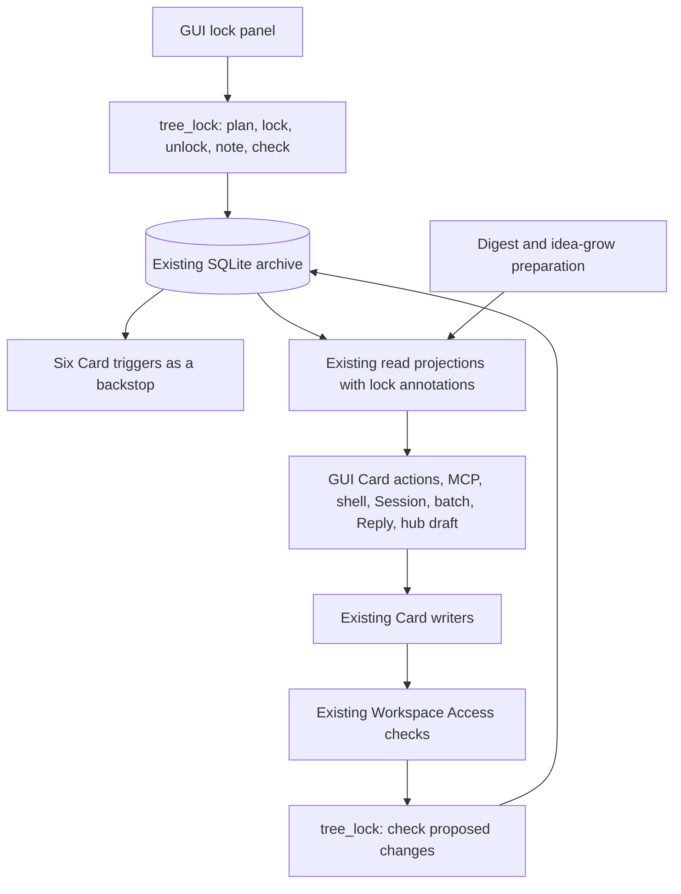

# Tree Lock Implementation Design

Status: implementation design, 2026-10-21. Not implemented. Target release: zt 0.22.0.

This document turns [Tree Lock Proposal](tree-lock-proposal.md) into an implementation plan. The
owner's decisions D1–D7 remain fixed. It also specifies the joined delete command. The design uses
the current repository at `bc4574e` as its source baseline, together with the idea-grow work already
present in the working directory. That work is still uncommitted and must be checked again when its
integration is implemented.

## 1. The simplest structure

Add **one Rust module, `src/tree_lock.rs`**, to the existing binary. Keep the four small tables in
the proposal, in the existing `zt.sqlite3`. Put the checks in the transaction-level functions that
already write Cards. Extend the existing readers and clients. Extend the existing `DeletePlan`
instead of building a second deletion system.



The application check and the SQL triggers serve different needs. The check returns a useful,
structured refusal before a prompt or a write. The triggers stop a forgotten write path. They use
the same stored facts and the same fingerprint function. They are not separate permission systems.

| Existing structure | Small addition |
| --- | --- |
| `Access::Owner` / `Access::Agent` | Keep Workspace policy. Both must pass the tree check. |
| `zt.edit.lock` and caller-owned SQLite transactions | Serialize lock changes with Card changes. Add no second writer mutex. |
| `card::authored_fingerprint` | Reuse its exact authored identity for member snapshots and SQL checks. |
| `links` occurrence index | Select outgoing Links when setting a Lock. Do not build another Link graph. |
| `metadata.archive_revision` | Advance for lock state, note, or recorded integrity changes too. |
| `Snapshot`, scoped reads, GUI polling | Attach lock state from the same database view. |
| `DeletePlan` | Add keep-root and all-archive selections. Apply every selection through one transaction function. |
| GUI dialogs and token checking | Add the lock panel and its two-step actions. |
| Workflow preparation and frozen installs | Check intended destinations and publish new Workflow versions. |

### 1.1 Why retain four tables

Each table retains a different fact required by the features:

1. `locks`: the current or historical Lock, its note, root, time, and seal.
2. `lock_members`: the exact Card identities and authored fingerprints promised by an active Lock.
3. `lock_pins`: the existing external targets whose addresses must survive that Lock.
4. `lock_events`: the owner's history and persistent integrity-fault evidence.

A boolean on the Tree root cannot detect changed or missing members. Deriving pins only from the
current Link index would make a damaged or rebuilt derived index determine protection. JSON blobs
would make indexed writer checks and SQL triggers harder. A general permission framework, separate
lock service, background watcher, new database, and per-Card lock controls add no required behavior.

The new code needs ordinary structs and free functions. It does not need a repository trait, policy
registry, event bus, dependency engine, or generic command framework.

### 1.2 Implementation clarifications to the proposal

These choices resolve details in the proposal's sketches; they do not reopen D1–D7.

| Detail | Chosen implementation | Reason |
| --- | --- | --- |
| Insert and move-in trigger lookup | Compare the destination Tree root directly with active `locks.root_address`, using `zt_tree_root(address)` | Does not depend on a parent already having reached its final address during a multirow move. |
| Confirmation freshness | Return a stateless `plan_hash`; require it with the confirmation word | Prevents confirming a different Lock or a changed member/pin plan. No stored pending-plan table. |
| Note confirmation | Use the same plan/confirm exchange, with `confirm: "note"` | The proposal's Authority section requires confirmation for changing a note, although its route sketch omits that field. |
| Integrity scan | Compare exact member and pin facts and trigger definitions, not only stored member hashes | Detects an extra Card, changed Workspace, missing pin, or trigger replaced under the same name. |
| Integrity recording | A pure scan returns faults; a caller under the edit lock records each new fault once | Reads do not recursively write or spam the history. |
| Batch preview failures | Continue after a lock refusal through independent items; label dependent items as blocked | Satisfies useful aggregate reporting without inventing addresses for refused creations. |
| Broken Links present at lock time | Show them before confirmation; they remain outside the baseline pin promise | Matches the proposal's explicit rule that these Links have no pin row. See §4.3. |
| Emptying an already empty locked tree | Refuse before the prompt | A Lock forbids the requested tree operation even when its delete set is empty. |

## 2. Scope and feature coverage

| Proposal feature | Implementation contract | Sections |
| --- | --- | --- |
| D1: whole tree, Tree root only | Resolve a real Topic or Literature Card; snapshot root and every member | 4–6 |
| D2: no additions | Check final tree on insertion and every mapping destination, including a main-line append | 5, 7 |
| D3: external targets stay addressable | Snapshot cross-tree Links; reject target deletion, movement, rename, and `into` re-pointing | 4, 7 |
| D4: GUI authority | GUI routes only; normal GUI token; no MCP, shell, or Session lock control | 6, 10 |
| D5: owner also bound | Storage check has no Owner exemption | 7 |
| D6: delete consolidation and protection | Four `zt del` forms; no active-Lock override; one-release `zt clear` notice | 12 |
| D7: both Workspaces | Owner may lock either; existing agent Workspace restriction remains | 4, 7 |
| Read and reference locked Cards | Preserve search, model, hub, register, Spread, and question behavior; annotate reads | 9 |
| Generated Reverse links may change | Fingerprint excludes generated content; derived index/reverse refresh remains allowed | 4, 5 |
| All write paths | Guard low-level writes and operation plans, including batch, Reply, and hub draft | 7–8 |
| Integrity and history | Startup/full checks, persistent fault events, broken seal, `--check-locks` | 13 |
| Dump | Add versioned `locks.json` under the existing dump transaction/view | 14 |
| GUI appearance and controls | Band, seal, disabled write controls, pin explanations, history panel | 10 |
| Session and shell visibility | Marks, refusal hints, status counts; no lock command | 11 |
| Agent guidance | Structured errors and skill/server text, without lock-route instructions | 8, 15 |
| Workflow integration | Destination prechecks, locked sources allowed, new frozen versions | 15 |
| Migration and reseal | Additive tables now; explicit future reseal procedure | 14 |

This work adds no restore command, partial-tree Lock, timed expiry, agent lock authority, password,
automatic unlock, force-delete option, or automatic locking when a digest finishes. The owner still
reviews the result and locks the tree in the GUI.

## 3. Current code and the integration points

Read the relevant [wiki blocks](wiki/README.md) before implementation. Current-source facts below
come from the named files; the proposed interfaces later in this document are new design.

| Source | Current behavior | Consequence for this change |
| --- | --- | --- |
| `src/main.rs`: `open_db`, `initialize_database` | `open_db` opens SQLite directly. Bootstrap also opens a connection directly and runs ordered schema upgrades. | Register SQL functions on both paths, before a Card write can invoke a trigger. |
| `src/main.rs`: `ensure_open_model_parts`, `ensure_hub_cards`, `ensure_finding_cards` | Rebuilds copy explicit Card columns, including `row_id`, then drop and rename the table. | Keep row identities; install triggers after the final rebuild and detect unexpected trigger loss. |
| `src/card.rs`: `authored_fingerprint` | Hashes parsed title/body, BibTeX and type fields, excluding Reverse links. | Share this algorithm. Do not use the separately defined batch receipt fingerprint as the seal. |
| `src/workspace.rs` | Agent Access refuses human writes and human authored Link rewrites; Owner bypasses that Workspace rewrite restriction. | Tree checks must be independent of the Owner shortcut. |
| `src/main.rs`, `src/place.rs` | Shell/Session can bypass `ops.rs`. Insert has direct SQL. Moves temporarily set Locations to `__moving__<old>`. | Guard storage functions, not just public `ops` wrappers. Check a complete final mapping before temporary renames start. |
| `src/ops.rs` | GUI/MCP share transaction-level create/edit functions and destructive plans. | Add friendly checks before confirmation and repeat in the transaction writers. |
| `src/model.rs`, `src/hub.rs`, `src/math.rs` | Metadata setters execute Card UPDATEs directly. | Put the authored-edit check in each setter, including clearing fields. |
| `src/batch.rs` | Identified writes use caller-owned transactions, receipts and rollback previews. The loop currently returns on its first error. | Preserve real-apply atomicity; add bounded aggregate lock reporting only to preview. |
| `src/link_index.rs` | Maintains authored Link occurrences and generated Reverse links; owns archive revision helpers. | Reuse its transaction boundary. A generated refresh must pass on locked members. |
| `src/read.rs`, `src/ops.rs` | MCP has scoped and lean text readers as well as full Snapshots. | Update both projections. A Snapshot-only addition would miss `get_cards(view: "text")`. |
| `src/gui.rs`: `Snapshots`; `Snapshot::fingerprint` | SQLite `data_version` invalidates the cached Snapshot; the GUI's displayed fingerprint currently hashes Card data. | Lock-only changes must also change the fingerprint seen by the browser. |
| `src/reply.rs` | Reply writes a human Card through `create_successor_tx` and updates the agent target's Reverse links. | A locked target is allowed; a locked human destination is refused. |
| `src/main.rs`: `DeletePlan`, `apply_delete_plan` | A delete may re-point inbound Links, delete Cards, compact Side successors and update Spreads in one transaction. | Check every effect, not only the named Card. Keep this path for tree-emptying. |
| `src/main.rs`: `cmd_clear` | Deletes all Cards, rebuilds Links and resets `next_topic_id`; leaves other archive metadata and files. | Fold the behavior into `zt del --all`, adding the Lock refusal and common delete application. |
| `src/dump.rs` | Writes named payload entries and checks compression output. | Add an explicit `locks.json` entry; merely writing a file into staging would not include it in every archive format. |
| `src/session.rs` | Session registration has its own existing `zt.sessions.lock`. | Reuse it to serialize the no-open-Session check for `--all`; see §12.4. |
| `tools/zt-digest/src/grow.rs`, `scripts/idea-grow/` | Idea-grow planning reads source books and destination trees; implementation is present as working changes. | Add lock state to destination selection after that work settles. Reading a locked book remains valid. |

The Card-operations wiki contains older pitfall descriptions followed by later entries that make
edits atomic. Follow the current transaction writers, rather than rebuilding an already fixed edit
path from an older description.

## 4. Domain rules and exact invariants

### 4.1 Lock identity and tree membership

A Lock belongs to one actual Tree root. A Topic root's address is `3/0`; its tree id is `3`. A
Literature root's address and tree id are both `Smith2024`. Keep these values distinct in code and
output: `lock.tree` in the proposed public annotation is the **root address**, whereas the existing
Card `tree` field continues to be the tree id.

Use the existing `is_tree_root`, `tree_id`, `tree_root_address`, and `is_tree_member` rules. Do not
use an unescaped SQL `LIKE '<key>/%'` or compare raw prefixes such as `3` and `30`. Citation-key case
remains significant for address resolution. Workspace and Zone rules do not change.

At lock time, the set includes the root even if the tree has no Regular Card. Reject a Regular Card
as an anchor. Reject a nonexistent root, an already locked root, and inconsistent membership such
as a member whose Workspace differs from its root.

While active, a Lock promises:

1. Every snapshotted row still exists, at its exact address, with the same Workspace and Card kind.
2. Every member has its snapshotted authored fingerprint.
3. The current set of rows in the tree equals the snapshotted set. There are no extra members.
4. Every snapshotted external target exists at its exact address and row identity.
5. Every Card write and Lock change is serialized through the existing edit lock.
6. No client changes the Lock except the owner through the GUI route.

An integrity fault does not unlock the tree. Checks continue to protect its root address, retained
member row identities, and retained pin targets until the owner explicitly unlocks it.

### 4.2 Authored identity and generated state

The seal is defined by the existing `card::authored_fingerprint`, not a new text-normalization rule.
Its fields are parsed title, parsed body, BibTeX, Card type, Model facet, emphasis, effective Model
or Hub level, and Math form. The existing Card parser normalizes its envelope and line endings.
Therefore the promise is authored identity under that existing function, not byte-for-byte identity
of the entire stored Markdown document.

The address, Workspace, row identity, and `is_topic`/`is_lit` flags are checked separately. They are
not all part of the authored fingerprint.

Reverse links, Link-index rows, GUI view state, Spreads and external artifact/cache state are not
authored Card changes. Updating them is permitted. The Lock does not freeze a source PDF in Scholar
Archive, a source document's availability, or an external target's meaning.

Explicit edit, retype, move, create-inside and delete requests against a locked tree return a Lock
refusal, including requests that would happen to be no-ops. A pure receipt replay is different: it
reports an earlier result and performs no Card write (§8.2).

### 4.3 Pinned targets and broken Links

At lock time, parse the locked members' authored Links and resolve them using the existing Link
index. Each distinct `(locked source row, existing target row)` in another tree becomes one pin.
Repeated macros produce one pin; different source Cards retain separate rows so errors can explain
which locked Card needs the target. Cross-Workspace Links qualify.

A pin preserves the target's address and existence. It permits edits to the target's body, title,
BibTeX without a Citation-key rename, type, and model/hub/math fields if the ordinary Access and
structure rules permit those edits. A target can also belong to a Locked tree, in which case its
own Lock supplies the stronger restrictions.

Several Locks can pin the same target. Unlocking one releases only its pins. The target remains
protected while any other active Lock pins it. Pins do not propagate: if locked A links unlocked B,
and B links C, only B is pinned by A. No transitive dependency graph is needed.

Existing Broken links are warnings, not a reason to refuse locking. Retain their source and target
addresses in the lock event and confirmation plan. They create no pin. If one of these addresses
becomes live later, the baseline does not silently gain a new pin; unlocking and locking again
captures the now-resolving Link. The GUI must explain this exception next to the warning. The
promise concerns targets that resolved when the owner accepted the Lock.

Only actual authored Links qualify. A quoted `[[address]]` inside a code fence, generated Reverse
text, an artifact, a Document link, or `data-zt` chart navigation does not independently create a
pin. Use existing Link parsing; do not add a regex with different rules.

### 4.4 Seal

For members sorted by address using a deterministic, locale-independent string order, hash UTF-8
bytes of:

```text
<address>\t<authored_fingerprint>\n
```

Hash all lines with the existing SHA-256 dependency and retain the full lowercase hexadecimal
digest. Display its first 12 characters. Keep the same ordering and framing in lock creation,
integrity checks, dumps and future reseals. The display prefix is a visual identifier, not a
replacement for full-digest comparisons.

Changing a note or generated Reverse links leaves the seal unchanged. Unlocking and relocking
creates a new Lock id and history entry even when the resulting seal is the same.

## 5. SQLite representation and SQL backstop

### 5.1 Tables

Use the proposal's columns, with one active-root index suited to the destination lookup. Do not add
columns to `cards`. In particular, do not store a second mutable `locked` boolean on each Card.

```sql
CREATE TABLE locks (
    lock_id           INTEGER PRIMARY KEY,
    root_row          INTEGER NOT NULL,
    root_address      TEXT NOT NULL,
    tree              TEXT NOT NULL,
    workspace         TEXT NOT NULL CHECK(workspace IN ('human','agent')),
    note              TEXT CHECK(note IS NULL OR length(note) <= 500),
    locked_at         TEXT NOT NULL,
    range_fingerprint TEXT NOT NULL,
    member_count      INTEGER NOT NULL CHECK(member_count >= 1),
    unlocked_at       TEXT
);
CREATE UNIQUE INDEX locks_active_tree
    ON locks(root_address) WHERE unlocked_at IS NULL;

CREATE TABLE lock_members (
    lock_id     INTEGER NOT NULL REFERENCES locks(lock_id),
    row_id      INTEGER NOT NULL,
    address     TEXT NOT NULL,
    authored_fp TEXT NOT NULL,
    PRIMARY KEY(lock_id, row_id)
);
CREATE INDEX lock_members_by_row ON lock_members(row_id);

CREATE TABLE lock_pins (
    lock_id        INTEGER NOT NULL REFERENCES locks(lock_id),
    source_row     INTEGER NOT NULL,
    target_row     INTEGER NOT NULL,
    target_address TEXT NOT NULL,
    PRIMARY KEY(lock_id, source_row, target_row)
);
CREATE INDEX lock_pins_by_target ON lock_pins(target_row);

CREATE TABLE lock_events (
    event_id INTEGER PRIMARY KEY,
    lock_id  INTEGER NOT NULL REFERENCES locks(lock_id),
    action   TEXT NOT NULL
        CHECK(action IN ('lock','unlock','note','reseal','integrity-fault')),
    at       TEXT NOT NULL,
    detail   TEXT NOT NULL
);
CREATE INDEX lock_events_by_lock ON lock_events(lock_id, event_id);
```

Make creation idempotent in the migration function. The SQL above specifies the resulting schema;
the initializer must also validate an existing lock-schema generation rather than trusting
`IF NOT EXISTS` to prove compatibility. Store `metadata.tree_lock_schema_version = '1'` only after
all tables, indexes, and triggers are installed successfully. An unsupported version refuses writes
without attempting a repair.

There are deliberately no foreign keys to `cards`: Card-table rebuilds must not cascade-delete the
Lock's evidence. Foreign keys between lock tables can be enforced on application connections.
`locks` rows and events are never removed by an ordinary Card delete or `--all`.

Every active lookup joins `locks` with `unlocked_at IS NULL`. The unlock transaction removes member
and pin rows, but the active predicate makes the meaning explicit and prevents stale historical
rows from accidentally protecting reused Card row numbers.

Validate notes in Rust as at most 500 Unicode scalar values, reject embedded NUL, and map an empty
note to `NULL`. Preserve accepted note text. Use UTC RFC 3339 timestamps, as in existing receipt SQL;
order history by `event_id` so equal timestamps have a stable order.

### 5.2 Event contents and retention

`detail` is deterministic JSON built with the existing JSON library. It is an audit record, not a
second mutable state machine.

| Event | Required detail |
| --- | --- |
| `lock` | Root address, Workspace, note, full seal, member count, member address/row/fingerprint list, pin source/target/address list, preexisting Broken-link warnings |
| `unlock` | Root, prior seal, prior note, member/pin counts, and the released Lock id |
| `note` | Root, previous note, new note; no duplicated member snapshot |
| `reseal` | Migration identifier, old/new seal and changed-member baseline details |
| `integrity-fault` | Stable fault identifiers and actual/expected facts required to explain them |

The initial `lock` event retains the snapshot because unlocking deletes the live member/pin rows.
History and dumps must remain understandable after the unlocked tree is renamed or deleted. Use
the event's captured addresses instead of joining historical row ids to today's Cards.

Write the authoritative event in the same SQLite transaction as the change. After commit, mirror
one concise line to `zt.log`. A filesystem log failure cannot undo the committed Lock; report the
logging problem separately. The GUI reads SQLite history.

### 5.3 SQL functions

Add the `functions` feature to the existing `rusqlite` dependency; no new runtime dependency is
needed. Register these deterministic functions on every connection that can touch protected Cards:

```text
zt_authored_fp(text, bibtex, card_type, model_facet,
              model_emphasis, model_level, hub_level, math_form)
zt_tree_root(address)
```

Factor the existing authored-fingerprint byte framing into a pure helper used by both
`card::authored_fingerprint` and `zt_authored_fp`. Preserve its output. The SQL wrapper must not query
SQLite or call a loader recursively. Validate raw metadata values instead of using a decoder's
fallback for an invalid enum. Parsing or hashing failure aborts the statement.

`zt_tree_root` uses the existing address rules and returns `3/0` for every member of Topic 3 and
`Smith2024` for every member of that Literature tree. It returns SQL NULL for the existing internal
`__moving__...` placeholders, which are never valid final Card addresses. Other address validation
remains the responsibility of the writers. Registering functions does not install schema or run a
migration; keep connection opening free of writer-lock recursion.

Audit direct `Connection::open` uses, including bootstrap and tests. Read-only backup connections
need no Card writes, but any test or migration that executes a protected UPDATE needs the functions.
An external SQLite connection without the fingerprint function cannot update a locked Card's text,
including its Reverse links. That is an intentional backstop limitation, not an alternate client.

### 5.4 Six triggers

Retain the six trigger names from the proposal. Use the direct active-root lookup for insertion and
move-in instead of the proposal's parent lookup. Include Card row identity and kind in member
protection. Representative predicates below define the implementation; use the same active-Lock
predicate in all six.

```sql
CREATE TRIGGER lock_no_delete BEFORE DELETE ON cards
WHEN EXISTS (
    SELECT 1 FROM lock_members m JOIN locks l USING(lock_id)
    WHERE m.row_id = OLD.row_id AND l.unlocked_at IS NULL
)
BEGIN SELECT RAISE(ABORT, 'zt: card is in a locked tree'); END;

CREATE TRIGGER lock_no_change BEFORE UPDATE ON cards
WHEN EXISTS (
    SELECT 1 FROM lock_members m JOIN locks l USING(lock_id)
    WHERE m.row_id = OLD.row_id AND l.unlocked_at IS NULL AND (
           NEW.row_id       IS NOT OLD.row_id
        OR NEW.location     IS NOT OLD.location
        OR NEW.citation_key IS NOT OLD.citation_key
        OR NEW.workspace    IS NOT OLD.workspace
        OR NEW.is_topic     IS NOT OLD.is_topic
        OR NEW.is_lit       IS NOT OLD.is_lit
        OR zt_authored_fp(NEW.text, NEW.bibtex, NEW.card_type, NEW.model_facet,
                         NEW.model_emphasis, NEW.model_level, NEW.hub_level,
                         NEW.math_form) IS NOT m.authored_fp
    )
)
BEGIN SELECT RAISE(ABORT, 'zt: card is in a locked tree'); END;

CREATE TRIGGER lock_no_insert BEFORE INSERT ON cards
WHEN EXISTS (
    SELECT 1 FROM locks l WHERE l.unlocked_at IS NULL
      AND l.root_address = zt_tree_root(COALESCE(NEW.location, NEW.citation_key))
)
BEGIN SELECT RAISE(ABORT, 'zt: locked tree takes no new cards'); END;

CREATE TRIGGER lock_no_move_in BEFORE UPDATE OF location, citation_key ON cards
WHEN (NEW.location IS NOT OLD.location OR NEW.citation_key IS NOT OLD.citation_key)
 AND EXISTS (
    SELECT 1 FROM locks l WHERE l.unlocked_at IS NULL
      AND l.root_address = zt_tree_root(COALESCE(NEW.location, NEW.citation_key))
 )
BEGIN SELECT RAISE(ABORT, 'zt: locked tree takes no new cards'); END;

CREATE TRIGGER lock_pin_no_delete BEFORE DELETE ON cards
WHEN EXISTS (
    SELECT 1 FROM lock_pins p JOIN locks l USING(lock_id)
    WHERE p.target_row = OLD.row_id AND l.unlocked_at IS NULL
)
BEGIN SELECT RAISE(ABORT, 'zt: card is a pinned target of a locked tree'); END;

CREATE TRIGGER lock_pin_no_move BEFORE UPDATE ON cards
WHEN (NEW.location IS NOT OLD.location OR NEW.citation_key IS NOT OLD.citation_key
      OR NEW.row_id IS NOT OLD.row_id OR NEW.workspace IS NOT OLD.workspace
      OR NEW.is_topic IS NOT OLD.is_topic OR NEW.is_lit IS NOT OLD.is_lit)
 AND EXISTS (
    SELECT 1 FROM lock_pins p JOIN locks l USING(lock_id)
    WHERE p.target_row = OLD.row_id AND l.unlocked_at IS NULL
 )
BEGIN SELECT RAISE(ABORT, 'zt: card is a pinned target of a locked tree'); END;
```

`lock_no_change` compares the candidate authored fingerprint to the sealed baseline. A Reverse-link
refresh passes when the authored fields match. Every actual address change of a locked member or
pin fails, including the first temporary rename in a mapping.

A move of an unlocked subtree into a locked tree fails on a final destination row even if its
parent is still temporarily detached. The application gate detects the whole forbidden mapping
before any row is detached. A trigger abort still rolls back the operation transaction; SQLite
`RAISE(ABORT)` by itself only aborts a statement, so callers must propagate the error and abandon the
transaction.

Do not add triggers on `links`, `metadata.gui_spreads`, or ordinary reads. Do not introduce a public
trigger-disable switch. Tests must distinguish an expected application refusal from a raw trigger
abort. A normal client reaching one of these trigger messages exposes a missing application check.

## 6. The `tree_lock` module and owner actions

### 6.1 Small internal interface

Names below are proposed crate-private interfaces. `&Connection` permits use with an existing
`Transaction`; these functions never acquire another edit lock or commit their caller's work.

| Interface | Responsibility |
| --- | --- |
| `register_sql_functions(conn)` | Register pure SQL wrappers only. |
| `ensure_schema_tx(conn)` | Install/validate version-1 tables and indexes. |
| `ensure_triggers_tx(conn)` | Install the six canonical triggers at a known migration boundary. |
| `plan(conn, root, note) -> LockPlan` | Resolve root, members, pins, warnings, seal, and plan hash from one view. |
| `lock_tx(conn, plan) -> Lock` | Insert Lock, members, pins, event, and one revision advance. |
| `unlock_tx(conn, lock_id)` | End exactly that active Lock, remove its live snapshots, append event, advance revision. |
| `note_tx(conn, lock_id, note)` | Change note and append event/revision only when note changes. |
| `ensure_unlocked_tx(conn, change)` | Return a typed `Refusal` for forbidden Card effects. |
| `read_view(conn, rows) -> LockView` | Bulk annotations for selected Cards, or every Card in a full Snapshot. |
| `check(conn) -> Integrity` | Pure integrity comparison; no repair or reseal. |
| `record_faults_tx(conn, integrity)` | Persist newly observed faults under the edit lock. |
| `export(conn) -> Value` | Versioned dump representation from the caller's read view. |

Use a small `Change` enum that borrows existing operation data:

```rust
enum Change<'a> {
    Edit(i64),
    CreateAt(&'a str),
    Delete(&'a DeletePlan),
    Mapping(&'a BTreeMap<String, String>),
    LinkRewrites(&'a BTreeMap<String, String>),
}
```

`CreateAt` checks the final address, rather than an arbitrary ancestor supplied by a caller.
`Delete` has access to the requested scope as well as the rows, so an empty keep-root operation can
still be refused. A mapping checks source members, pin targets and destination trees. Link rewrite
checking uses the existing Link parser/index to find authored changes in locked sources.

There is no separate policy object per transport. `Refusal` implements `Error`, `Display`, and a
JSON conversion, following the existing typed batch conflict/read-limit pattern.

### 6.2 Lock plan and confirmation

The unconfirmed GUI request acquires the ordinary edit lock with existing GUI patience, opens a
database transaction, and computes a plan. It then closes that transaction and releases the edit
lock before the owner reads the dialog. Do not hold a writer mutex while the dialog is open.

The plan includes:

- Archive identity and revision, root row/address, Zone, Workspace, and requested note.
- Root and Regular Card counts, full seal, and full member facts used to compute it.
- Every distinct Pinned target with the locked source Cards that pin it; target count is distinct
  targets, not the number of source/target pairs.
- Every existing Broken link with source and target addresses, plus the exception in §4.3.
- `confirm: "lock"` and `plan_hash`.

Use canonical JSON and the existing SHA-256 dependency for `plan_hash`. Bind it to the action,
archive identity/revision, root identity, note, member baseline, pins and warnings. The confirmed
request supplies the word, hash, root, and note. Under the edit lock and a new transaction, compute
the plan again and compare the hash. A mismatch returns `plan_changed` with a fresh plan and no
write. The GUI keeps the note and asks the owner to review again. Changing the note in the dialog
requires a refreshed plan before confirmation.

This is one deterministic check; it needs no pending-plan storage, expiry job or secret token. The
normal API token remains required. A plan hash does not confer owner identity.

### 6.3 Lock commit

After a confirmed, matching plan:

1. Verify the root is still a Tree root and has no active Lock.
2. Verify indexed Links for the selected members against their authored bodies. Refuse a mismatch
   as an index-integrity error; do not silently take incomplete pins or run a global repair.
3. Insert `locks`, including the root row and baseline seal.
4. Insert every `lock_members` and `lock_pins` row.
5. Append the full initial `lock` event.
6. Advance `archive_revision` once and commit.
7. Mirror the log line and return the committed Lock.

No Card text or generated Link data is written by setting a Lock. A crash before commit leaves no
partial Lock. A lost response after commit can be resolved by reading the active Lock; another
unconfirmed lock request reports `already_locked` with its id and seal. It never creates a second
active Lock.

### 6.4 Unlock and note

Unlock planning names the active `lock_id`, tree, note, seal, member count and pin count. Its
confirmation hash binds that id and the current revision, so an old dialog cannot unlock a later
Lock on the same tree. On confirmation, end the active Lock, delete only that Lock's live member
and pin rows, append `unlock`, and advance the revision in one transaction. Historical `locks` and
events remain.

Unlock remains available on a faulted Lock. Resolve it from its retained Lock record even if the
root is missing. The GUI's lock list can therefore release an orphaned Lock after the owner has
reviewed the fault; it does not require opening a missing Card.

Note changes identify the active Lock in the same way. A changed note adds a `note` event and
revision, with no seal or member change. An identical note returns success without another event
or revision. An absent or ended Lock returns `not_locked`; it does not edit historical notes.

## 7. One application gate on every write

### 7.1 Ordering and transaction ownership

The common write sequence is:

```text
parse arguments
acquire existing edit lock
open transaction / re-read current state
check Workspace Access and normal domain rules
check the complete tree-lock effects
perform existing Card and metadata writes
update derived Links / Reverse links / Spreads as required
advance archive revision once for the operation
commit
```

Friendly plan checks run before a confirmation prompt, editor, or destructive confirmation reply.
The transaction-level checks run again before SQL. A precheck does not authorize a later write if
the owner has since locked a destination. The same edit lock orders the two actions: a writer
either commits before the Lock captures it, or sees the new Lock and refuses.

Retain Workspace refusals for agent attempts to write human Cards. For an otherwise allowed
operation, return the Lock refusal. Do not skip tree checks when `access == Owner`.

If a low-level function accepts a previously loaded `Card`, query its current lock/root facts in
the transaction. Do not trust a lock annotation retained by a browser, Session or workflow.

### 7.2 Write coverage map

| Path | Required checks before its first Card SQL |
| --- | --- |
| `main::insert_card_tx`; transaction-level successor creation | `CreateAt(final_address)`; prevents main-line append and Side successor creation. |
| Topic/Literature creation, including `ops::create_literature_tx` | Final root-address check. A genuinely new tree is allowed; an active orphaned Lock is not bypassed by recreating its address. |
| `main::update_card_text`; `ops::edit_tx` | `Edit(row)` before text or metadata steps and before a no-op shortcut. |
| `batch::owned_paragraph` | `Edit(row)` before splicing authored bytes, or recording a new ownership/adoption mutation on that Card. |
| `model::set`, `model::set_level`, `hub::set_level`, `math::set_form` | `Edit(row)` in each transaction-level setter, including changes implied by retyping. |
| Literature body editing and `update_literature_metadata` | `Edit(root)` for authored changes; complete mapping/pin/rewrite checks before a Citation-key UPDATE. |
| `place::apply_insert_plan` | Check existing mapping and the new final address before direct INSERT and temporary moves. |
| `main::apply_location_mapping_tx` | `Mapping(final_mapping)` and locked-source Link-rewrite checks before the first `__moving__` update. |
| `main::apply_delete_plan` | Requested scope, complete delete set, `into` rewrite mapping and actual Side compaction, before any UPDATE/DELETE. |
| `reply::write_tx` | The ordinary insertion guard on the human destination. The locked agent source is read and linked. |
| GUI hub-draft Save / file-Spread-as-Card, through existing create/edit routes | Edit guard for `how: "edit"`; final insertion guard for successor placement. `hub::draft` and `hub::precheck` remain read-only. |
| Reverse-link refresh / Link-index rebuild | No authored edit request; fingerprint-preserving generated UPDATEs may pass the trigger. |
| `zt del --all` | Explicit active-Lock check even on a damaged archive or an empty Card table. |

Use the same checker for the shell and Session plan display. Do not write equivalent, independent
SQL in each command handler. During implementation, search every `INSERT INTO cards`, `UPDATE
cards` and `DELETE FROM cards` and classify it as one of these paths, a generated refresh, a
migration, or an isolated fixture.

### 7.3 Mapping, insertion and Side compaction

Check the full existing old-to-new mapping, not only the Card the user selected. A move before a
Card may rename a later Direct chain and its Side branches. A delete can compact siblings. An
insertion can shift the Card which a locked source pins even when the inserted Card itself is in
an unlocked tree.

For each effective mapping entry where old and new differ:

1. Refuse a source row which is a locked member.
2. Refuse a source row which is a Pinned target.
3. Refuse a destination inside an active Locked tree.
4. Check whether rewriting a macro in any locked source would change that source's authored body.

Use the final map, not the temporary placeholder names, for structured error addresses. Preserve
the existing order of `into` re-pointing followed by Side compaction. Check both effects before
either starts. Do not silently omit forbidden compaction, change a destination, or create a new
tree to make a rejected request succeed.

### 7.4 Deletion and external references

A delete of a pinned Card is refused even when the locked Link's source is absent from the delete
set, and even with `into`. If the source is also selected, its own membership refusal still blocks
the operation. There is no deletion order that releases a Lock implicitly.

A target whose root is pinned but whose Regular Cards are not pinned may be emptied with
keep-root. Conversely, one pinned Regular Card is enough to refuse emptying that tree. Use the
actual delete set. Do not freeze a target's whole tree merely because one Card is pinned.

## 8. Errors, receipts and batch previews

### 8.1 Structured refusal

Retain the proposal's object and reason vocabulary:

```json
{
  "error": "card_locked",
  "message": "Card `5/4` is linked by Card `3/2` of locked tree `3/0`",
  "tree": "3/0",
  "cards": ["5/4"],
  "reason": "pinned-delete",
  "hint": "Write a new Card in another tree and link the locked Card."
}
```

Reasons are `edit`, `delete`, `move`, `create-inside`, `move-inside`, `pinned-move`, and
`pinned-delete`. The canonical `tree` is the blocking Lock's root address. For pin errors also add
`sources` with the locked source addresses; an optional `locks` array can explain multiple blocking
Locks. Sort roots and addresses deterministically and deduplicate them.

Keep the existing MCP JSON-RPC/tool error envelope and `isError` behavior. Add the typed
`tree_lock::Refusal` mapping beside `read::Limit` and `batch::Conflict`; never recover structured
data by parsing `Display` text. GUI errors retain the same fields. Shell/Session render `message`
and append `unlock the tree in the GUI first` where an owner action is needed.

`plan_changed`, `already_locked`, `not_locked`, invalid arguments and integrity faults remain
distinct outcomes. An `integrity_fault` is not permission to refresh the baseline automatically.

### 8.2 Real batch application and replay

`apply_batch` keeps its current item count, authored-byte bounds, local-reference rules, operation
keys and transaction boundary. A new refused item rolls back all previously unseen writes and
receipts in that batch, including Topic allocation and derived updates. Previously committed
receipts remain unchanged.

An identical existing receipt may replay after the owner locks its result: replay performs no new
Card mutation. Do not re-execute the old mutation to produce its response. Preserve existing key
conflict and preview freshness checks. A new operation key requesting an edit of that locked Card
is refused even if its proposed text equals the current text.

Card annotations in fresh read/preview projections come from today's lock state. Do not rewrite a
stored historical receipt merely to add a current lock flag.

### 8.3 Preview aggregation

Extend the existing preview loop rather than adding a second planner. Only preview uses
per-item SQLite savepoints and an item status list:

1. Validate the request shape and whole-request bounds before simulation, as today.
2. Resolve earlier successful references and begin a savepoint for the item.
3. Run the normal receipt and writer path with the normal Lock check.
4. On success, release the savepoint into the outer temporary transaction. Publish the item's
   reference binding and changed-source facts only after success.
5. On `card_locked`, roll back that savepoint, record the refusal with item index, operation key and
   client reference, and continue to the next independent item.
6. If an item needs a reference produced by a refused or blocked item, record
   `blocked_by_refusal`. Do not fabricate an address or claim the dependent write was validated.
7. Preserve ordinary non-Lock validation errors and their current failure contract. Do not turn
   preview into a general error-recovery engine.
8. Roll back the outer transaction before serializing any response, including an oversized or
   unsuccessful response.

An unsuccessful preview has `preview: true`, `applied: false`, `complete: false`, the unchanged base
`archive_revision`, ordered lock refusals, and blocked-item identities. Successfully simulated
items may be identified as such, but they are not committed receipts or a successful whole-plan
projection. Report every independently resolvable locked item reached by the preview. Explicitly
report any items that could not be checked; never claim that a dependency-blocked plan was fully
scanned.

The existing `preview_items` sequence uses the same logic across simulated chunk boundaries.
Keep its 1,024-item/8-MiB bound, real chunk rules, and encoded-response limit. A real batch remains
fail-fast and atomic; aggregation does not authorize partial application.

## 9. Read projections and refresh behavior

### 9.1 Annotations

Return these additive fields on full Card objects and Card summaries:

```json
{
  "lock": { "lock_id": 7, "tree": "3/0", "since": "2026-10-21T09:12:00Z" },
  "pinned_by": []
}
```

An unlocked Card has `lock: null`. An unpinned Card has `pinned_by: []`. A target linked by several
members of one Locked tree lists that root once. A Card can have both a Lock and nonempty
`pinned_by`. Keep existing Card `tree` and `root` fields unchanged.

Tree rows from `list_trees` and GUI `trees()` add `locked: true|false`. The existing `writable`
field must become truthful for its client: `access.can_write(workspace) && lock == null`. A pin
alone does not make a Card uneditable; clients disable movement/deletion separately.

### 9.2 One projection helper, no stored duplication

Keep `Card` as the stored Card model. Add a small request/Snapshot `LockView`, with maps from row
identity to active Lock information and pinning roots. Bulk-load it from the same connection and
read transaction used to load the Cards. One `decorate_card` helper attaches the fields.

Full Snapshots load all relevant lock facts once. Scoped MCP reads load annotations for their
selected/context rows using the member-row and target-row indexes. Do not reparse every locked
tree, recalculate seals, or issue a separate query for every rendered Card.

Wire this into full `Snapshot::summary` and the lean `read::text_facts` path. The constructor for a
database-backed Snapshot must receive its Lock view explicitly; reserve an empty view for isolated
pure fixtures. This avoids accidentally representing a real archive's lock state as empty.

Cover `get_card`, both `get_cards` views, `get_tree` with and without bodies, search rows, GUI
summary/detail/navigation, and exported title rows used in destination planning. Model/hub results
that embed Card summaries use that same helper. Bare address strings do not need to become full
Card objects. `ask_box` and entry search retain their selection/ranking rules; any Card annotations
they return are descriptive only.

### 9.3 Revision and GUI invalidation

A successful lock, unlock, changed note, reseal or newly recorded fault advances the existing
archive revision once. It does not rebuild `links`. Member/pin insertion alone is not an authored
source change.

Have the Snapshot retain the read view's archive revision, and include that revision in its
existing GUI fingerprint. SQLite `data_version` already invalidates the server's cached Snapshot
when another connection commits; the changed fingerprint makes the browser notice a Lock change
even when every Card's text is identical. Read Cards, annotations and revision in one SQLite read
transaction. Do not add another polling loop or a persistent lock-state cache.

This revision is a concurrency marker, not an authored fingerprint. Reply and other authored-base
checks continue to use their current authored identity. A new incoming Link can update a locked
Card's Reverse section and archive revision without changing its seal.

## 10. GUI and HTTP contract

### 10.1 Routes

All routes use the existing GUI token check and existing request-size handling. Only the GUI
handler calls lock-control functions; do not add these actions to the general MCP writer dispatch.

| Route | First request | Confirmed request / result |
| --- | --- | --- |
| `GET /api/locks` | No body | Active Locks, historical Lock/event groups and current integrity result. Include ended Locks so history survives unlock. |
| `POST /api/lock` | `{root, note?}` | `{root, note?, confirm:"lock", plan_hash}` → committed id, root, counts and seal |
| `POST /api/unlock` | `{tree, lock_id}` | Same plus `confirm:"unlock", plan_hash` → id, root and `unlocked_at` |
| `POST /api/lock/note` | `{tree, lock_id, note}` | Same plus `confirm:"note", plan_hash` → id, root and note |

Unconfirmed POSTs return `applied: false`, the expected confirmation word, plan hash, structured
plan facts and human-readable `lines`. A confirmed request without its hash is invalid. A stale
hash returns the renewed plan and preserves the form contents. The server recomputes all facts;
counts, fingerprints or member arrays submitted by a browser are never authoritative.

For `GET /api/locks`, group events by Lock id and root identity, not only the current root address.
Order Locks by creation/id and events by event id. Present long lists in a scrollable panel. Return
complete lists for this local API rather than silently cutting off pins or history. If a future
measured size problem needs paging, add explicit paging then; do not introduce a cursor system in
this release.

### 10.2 Owner flow and appearance

Reuse the cabinet's tree menu and existing dialog treatment. A small band across the tree stack
and a seal mark on the root communicate the proposal's physical-card metaphor. The state also has
text, so it does not depend on color or a decorative icon.

1. **Lock tree** opens the plan dialog: tree/title/Workspace, member count, seal, pin count, note,
   expandable complete target/source list, and Broken-link warnings.
2. The confirm button is enabled only for a current plan. Updating the note renews the plan.
3. After success, the cabinet and all open copies of its Cards show locked state through the normal
   refresh. Display the 12-character seal; make the full digest available in the panel.
4. **Unlock tree** shows the exact Lock and what its release permits. Confirmation removes the
   band while retaining history.
5. **Edit lock note** changes the note through its own confirmation. It does not reseal the tree.

For a locked Card, edit, type/level/form, BibTeX, move, delete, insert and successor controls remain
visible but disabled. Keyboard handlers and alternate context-menu actions must honor the same
state. The explanation names the Locked tree and directs the owner to its unlock action.

For an unlocked Pinned target, editing stays available. Movement and deletion controls explain
which Locked trees pin it and which source Cards hold the Links. Creating a successor may still be
allowed; the server checks whether its actual mapping would move some other pinned Card.

A locked Card remains selectable, readable, linkable, addable to the Table, and usable as the
target of a Reply. Reply destination controls exclude locked human Topics or explain a refusal
without discarding the draft. An unavailable destination is not permission to unlock or silently
change the owner's chosen placement.

### 10.3 Drafts, faults and races

An editor opened before a tree is locked may hold unsaved text. Keep that draft visible. A refused
Save displays the structured Lock error and offers navigation to the tree's lock panel; it does not
discard the draft or automatically retry after an unlock.

The lock panel shows history and integrity faults. A fault uses a broken seal on the tree and one
concise page-level line. Keep **Unlock tree** reachable from the lock list when the root itself is
missing. Faults do not disable reading, hide Cards, or silently update the displayed seal to match
damaged content.

The normal token protects these routes exactly as it protects other GUI changes. The proposal
accepts that a deliberate local process could obtain it. Do not claim strict authentication of a
human or resistance to direct SQLite tampering.

## 11. Session and shell behavior

The Session view's title row appends `[locked]` and/or `[pinned]`. Line mode and the TUI render the
same facts. Marks describe the held Card; navigating outside the tree removes the locked mark.
There is no `lock`/`unlock` Session or shell command.

Precheck a locked destination before launching an external editor or opening a Session edit mode.
Metadata commands `ty`, `lv`, `mf`, Literature metadata editing, `mv`, `ins`, `n`, `b`, and `del`
still rely on the transaction guard for correctness. A Session's already-open editor can outlive a
read view, so the write-time check remains mandatory.

`zt status` adds:

```text
locks: 3 trees, 412 cards, 57 pinned targets; integrity ok
```

Counts are active Locks, member snapshot rows, and distinct pinned target rows. They are not pin
pair counts and do not include ended Locks. On a fault, print the faulted roots and a concise
diagnostic instead of `integrity ok`. Database/read errors are reported as unavailable/error,
never converted to a healthy zero-Lock result.

`zt status --check-locks` performs the full scan described in §13, prints its details, and exits 1
on a current or latched active-Lock fault. Ordinary status may run that same scan; do not add a
persisted check-result table just to optimize a rarely invoked shell command. When the archive is
not configured, preserve today's down/unset output. A scan does not start a lock operation.

## 12. One delete command

### 12.1 Syntax, validation and compatibility

```text
zt del --at <card>                  # Card and its subtree
zt del --at <root>                  # whole tree
zt del --at <root> --keep-root      # Regular Cards only
zt del --all                       # whole archive, reset Topic allocation
```

Parse into one small command enum, such as `At { address, keep_root } | All`. Reject duplicate
selectors/flags and unknown arguments. Exactly one of `--at` and `--all` is required. `--keep-root`
requires `--at` and an actual Tree root. Check syntax and target kind before any prompt; resolving
target kind still requires the service/database.

Use the proposal's usage and Regular-Card error text. The four confirmation words remain:

| Selection | Required input |
| --- | --- |
| Regular Card subtree | `delete` |
| Whole tree | Root address |
| Keep root | Root address |
| Whole archive | `delete all` |

Read exactly one stdin line and remove only its line terminator. A mismatched word or EOF cancels
with no SQLite change. The command remains usable through a pipe. A cancellation is not a Lock
refusal: lock checks happen before the prompt.

In 0.22.0, `zt clear` prints ``zt clear is now `zt del --all` `` and exits 1 without requiring the
service, prompting, or deleting anything. Remove it from help immediately. In the next release,
remove the notice handler too, leaving an unknown command. Update shell documentation and tests
around the new command; do not keep a working destructive alias.

### 12.2 Extend the existing `DeletePlan`

Add a small scope field to the current plan:

```rust
enum DeleteScope {
    Subtree,
    Tree,
    KeepRoot { root: String },
    All,
}
```

Keep `delete_set`, `confirmation`, `inbound`, `into` and `side_compaction`. Add only the scope/root
information required for validation, display and the Topic-number reset. The all-archive plan has
every Card address, no staying inbound sources, no compaction, no `into`, and confirmation
`delete all`. The keep-root plan has every member except the root, no compaction, and confirmation
equal to the root address.

Use one internal transaction apply function for all scopes. An existing wrapper may open and
commit the transaction; clients with a caller-owned transaction use the internal function. This
is a narrow extraction of `apply_delete_plan`, not a move of all storage code out of `main.rs`.

Before application, check scope restrictions, locked members, pin targets, re-pointing and actual
compaction. The `All` scope checks active Locks directly, not only intersection with existing
Cards. That protects an orphaned or damaged Locked tree as well.

### 12.3 Keep-root application

The verification plan identifies the root, Workspace, number of Regular Cards to remove, `root
kept`, and Links from staying Cards that will break. Print the first 20 breaking-Link pairs and an
exact remaining count, as the proposal specifies. Keep the complete inbound set internally for
checks and Link regeneration.

After confirmation, one transaction:

1. Revalidate the scope and lock effects.
2. Delete only the selected Regular Cards.
3. Call `spread::follow` with the deleted set, so deleted positions disappear and root positions
   remain.
4. Rebuild the derived Link index and refresh generated Reverse links.
5. Advance the revision once when archive state changed and commit.

The root keeps its authored identity, address, Workspace, BibTeX and kind. Its generated Reverse
links may change because deleted Cards no longer link it. Outgoing root Links to deleted Regular
Cards become Broken links and belong in the verification. Links from other Cards to the root
remain valid.

Do not change `next_topic_id` or `applied_ops`. No per-tree next-Card counter is needed: the existing
successor rule yields `3/1` or `Smith2024/1` after the Regular Cards are gone.

Success output:

```text
deleted: 214; root kept: grossman2002integration
```

For an already empty unlocked tree, still show the plan and require the root confirmation. Return
`deleted: 0; root kept: <root>` without a revision or derived rebuild. An empty locked tree is
refused before that prompt.

This operation is allowed while a Session is open. Retain `recover_missing_pointer`: a Pointer to
a deleted Card falls back to an existing ancestor, eventually the retained root. Add Session
syntax `del keep-root` only on a Tree root; ordinary `del` keeps its existing behavior. `del
keep-root` on a Regular Card gives the root-kind error. No `--all` Session form is added.

### 12.4 All-archive application

Keep today's `clear` effects on Cards and allocation, under the new command:

- Delete all `cards` and derived `links` rows.
- Set `metadata.next_topic_id` to `0`.
- Keep config, dump files, artifacts, other metadata and existing `applied_ops` receipts.
- Keep ended Locks and their history. An active Lock always refuses the operation.

For `All`, preserve today's `clear` handling of saved Spreads: their saved metadata remains. Tree
and subtree deletes, including keep-root, continue to use `spread::follow`. This difference is
intentional compatibility with the proposal's “same effect as today's clear”; do not silently
broaden the feature into Spread cleanup or artifact garbage collection.

The no-open-Session rule must hold through the write, not just before the prompt. Use the existing
Session-registration lock (`zt.sessions.lock`): acquire the edit lock, then the Session-registration
guard; prune/check active Session pids while holding that guard, and keep it through confirmation
and commit. A newly starting Session waits for registration until the deletion ends. Inspect the
existing registration/count helpers and extract a crate-private guarded check rather than calling
`session_count` recursively while already holding its lock.

Use this lock order consistently: **edit lock, then Session-registration lock**. Session
registration takes only its registration lock and releases it before running commands. Do not
introduce any path that holds the registration lock while waiting for the edit lock. The command
can hold these guards while awaiting stdin, as today's clear already holds the edit lock; EOF or
cancellation releases both.

The all-archive plan checks active Locks before printing the confirmation prompt and again in the
transaction. On refusal, list locked root addresses and their count, with the GUI unlock hint.
There is no `--force` option. A failed SQL/derived update rolls back Cards, Links and allocation
together.

Print:

```text
deleted: 1872 cards; next topic id reset to 0
```

If the Card table is already empty but allocation was nonzero, resetting allocation is still a
state change and advances the revision once. If both were already empty/zero, the confirmed
operation succeeds without a revision. Failed/cancelled operations advance nothing.

### 12.5 Public scope

Add keep-root to shell and Session only in this release. Existing GUI and MCP `delete_card` keep
their current arguments and confirmations, while using the updated Lock-aware plan. They do not
gain `keep_root` or delete-all tools yet. The shared plan structure makes a later explicitly
requested interface addition possible without another deletion algorithm.

Old receipts deliberately survive tree emptying and delete-all. A digest rerun must use a fresh
run/operation prefix; replaying old keys is not a way to recreate deleted Cards. Keep this in the
rerun instructions rather than changing the existing receipt protocol in this feature.

## 13. Integrity, fault recording and recovery

### 13.1 Full comparison

`check(conn)` runs in one consistent read view and returns per-Lock faults plus schema faults.
For every active Lock it verifies:

1. Root row exists at the saved root address, has the saved Workspace, and is a Tree root of the
   saved tree.
2. Stored member count equals the number of snapshot rows.
3. Every snapshot row resolves to the saved row/address and correct Workspace/kind.
4. Each current authored fingerprint matches its stored baseline.
5. The current exact tree membership equals the snapshot, including detection of extra Cards.
6. Recomputed range fingerprint equals `range_fingerprint`.
7. Every pin source is a member, every pin target still exists at its saved row/address, and the
   target is outside the locked tree.
8. The set of resolvable external authored Links, excluding the captured originally broken
   addresses, agrees with the stored pin set. Cross-check the relevant Link-index rows too.
9. All six triggers exist with the canonical definitions for the supported lock-schema version,
   and required tables/indexes are intact.

Do not use only inner joins: a missing member or target must produce a fault. Compare raw identity
and metadata values when needed so a decoder fallback cannot hide a changed Workspace/type.
Historical ended Locks need not match today's Cards and are not scanned as active promises.

Fault identifiers include Lock id, fault kind and affected row/address. Repeated scans of the same
fault do not create another event. A newly observed fault adds evidence; successful comparison
later does not erase a previously recorded active-Lock fault. “Healthy” requires both no current
fault and no latched fault for that active Lock.

### 13.2 Where checks run

- Service startup, before accepting writes.
- `zt status --check-locks`, and the status path when it reports a current integrity result.
- Opening/refetching the GUI lock panel.
- Before a migration that can affect Cards, row identity or protection triggers.

Routine Card reads and ordinary GUI heartbeat polls do not hash every locked member. This is a
local integrity check at known points, not continuous tamper monitoring.

A caller that needs to record faults takes the existing edit lock, scans/rechecks in its own
transaction, appends only new fault events, advances the revision once if necessary, and commits.
Keep pure `check` separate from recording so it can also be used in read-only verification and
tests. A `--check-locks` invocation that cannot persist its evidence must report that recording
failed; it cannot report a healthy state merely because no event was written.

### 13.3 Missing triggers and repair order

On the first installation, with no existing lock schema, create tables/triggers normally. On a
later startup, inspect the existing trigger catalog **before** `ensure_triggers_tx` recreates
anything. Otherwise an accidentally missing trigger would be repaired and its evidence lost
before the scan sees it.

For a supported schema whose protection trigger is missing or altered, record the fault and
reinstall the canonical trigger in the guarded startup transaction. Retain the fault latch and
show the broken seal. Do not accept writes until the required trigger backstop is present. If
reinstallation fails, refuse writable startup. A content/member/pin fault with a working backstop
leaves reading and GUI unlock available; the application gate still refuses protected changes.

If tables or baseline evidence are missing/corrupt, do not fabricate empty snapshots or new seals.
Report the unsupported/damaged state and require restoration or a specifically designed repair.
No generic “repair locks” tool is part of this release.

### 13.4 Recovery

The owner can restore a consistent database backup, or review the fault and unlock/relock through
the GUI. Relocking makes a new promise about the content then present. It does not prove that the
old content survived or restore deleted Cards. The old fault events remain in history.

Never reseal in response to an ordinary failed integrity check. Reseal is reserved for an explicit
trusted schema/text-representation migration (§14.2). Deliberate direct database modification or
dropped trigger/schema protections remains outside the policy guarantee chosen in D4.

## 14. Migration, dump and compatibility

### 14.1 First installation

The feature adds tables/indexes/triggers; it does not rebuild `cards` or change its accepted column
generations. Run prior Card/Markdown/Link migrations to completion, with SQL functions registered,
then install the new lock schema under the edit lock. No old archive begins with an active Lock.

Use one consistent SQLite backup before first schema installation, following the repository's
existing migration backup pattern. Do not copy a live WAL database file with ordinary file copy.
Install the version marker only in the successful transaction. A failed installation leaves the
prior archive usable and retryable, with its backup retained.

Subsequent startup validates the existing schema and protection catalog before performing repairs
or migrations. Register functions on migration connections before executing any statement which
can activate a trigger. Avoid calling a migration helper that acquires the edit lock from inside
another held edit-lock scope; pass its existing connection/transaction to the narrow helper.

### 14.2 Future Card rebuilds and reseals

A Card-table rebuild must preserve every `row_id` and all lock tables/events. Keep lock-table
references off `cards`, copy Card rows explicitly as current rebuilds already do, recreate the six
triggers after the final rename, and verify all active Locks before writable startup. No active
Lock can be treated as an excuse to omit protection on a newly rebuilt table.

For a future migration which intentionally changes authored representation:

1. Name the migration and why the existing fingerprint changes in that migration's design.
2. Take a consistent backup and the existing edit lock; work in one migration transaction.
3. Verify old baselines before applying the transformation. Refuse a preexisting integrity fault.
4. Compute the new authored fingerprints. Update the member baseline immediately before its
   matching Card transformation within that same trusted transaction, or use the Card-rebuild
   boundary if that migration already rebuilds the table. No public guard-bypass flag is exposed.
5. Preserve addresses, row ids and Link/pin meaning. A migration that needs to change those needs
   a separate design; an authored reseal alone does not authorize it.
6. Recompute each affected range seal, append `reseal` with old/new evidence, restore/verify the
   protection triggers, and advance revision once before commit.

There is no reseal migration in this release. Ordinary edits cannot call this path.

An older zt binary is not a supported writer after upgrading. In particular, its connection may
lack the SQL fingerprint function. Stop old Sessions/MCP clients during deployment, install the
new binary, restart the service, and start new clients. Keep the backup for a full rollback rather
than recommending an older executable against an upgraded active-Lock archive.

### 14.3 Dump

Extend the existing dump input with an explicit lock-export value read while the dump holds the
edit lock, from the same SQLite view as its Cards and `next_topic_id`. The dump module remains a
serializer/compressor; it does not open another connection to discover Locks later.

Add `locks.json` to staging **and** the explicit compressed-entry list, immediately after
`archive.json`. Keep existing `mapping.json`, `archive.json`, Card text, BibTeX, artifact and
compression behavior unchanged. Include `locks.json` even when there are no Locks, with empty
arrays and `schema_version: 1`.

The file contains:

- Export schema version, archive identity, and captured revision.
- All active and ended `locks` records.
- Active member snapshots with addresses, row identities and authored fingerprints.
- Active pins with captured source/target addresses and row identities.
- All events in event-id order, including the initial snapshots of ended Locks.
- Integrity facts available from a scan of the same captured state.

Addresses and Lock ids are the portable interpretation. Row ids retain audit identity inside that
captured database; a future restore must resolve them explicitly rather than assuming they are
new database row ids. Order objects/lists deterministically. An integrity fault is exported as
evidence and does not prevent taking a diagnostic dump. Failure to serialize/read the required
lock data fails the dump through its existing cleanup path.

The dump contains enough to inspect lock history, but this feature does not implement restoration
or promise that a future restore imports Locks automatically.

## 15. Agents, compilers and Workflows

### 15.1 Agent-facing contract

Add the proposed instruction to the MCP server: a Card with `lock` set may be read and linked;
continue the thought in another tree. Update `skills/zt/SKILL.md` and
`skills/zettelkasten/SKILL.md` with the same rule and the instruction that only the owner changes
Locks. Do not include GUI route names or token-acquisition instructions in agent-facing material.

A `card_locked` error is a planning/destination error, not a transient provider failure. Do not
retry it repeatedly, request a different Access, call the GUI routes, change the database directly,
or substitute another client's write path.

### 15.2 Preparation distinguishes sources from destinations

| Run behavior | Locked source | Locked destination |
| --- | --- | --- |
| Read-only audit, model report, checker, export | Read normally | No write to precheck |
| Digest `cards`, `models`, math, events, findings, figures or other rewriting mode | Read normally | Stop before allocating jobs or writing Cards |
| Full digest into an existing Literature tree | Read normally | Stop before the first skeleton/metadata write |
| Idea-grow from a finished book | Read the locked Literature tree normally | File only into unlocked agent Topic trees |
| Hub/register run | Include locked Cards as readable/linkable members | Edit/create hubs only at unlocked destinations; reject a move/delete of a pin |
| Organize/merge/compaction | Read normally | Preview full structural effects; keep blocked Cards in place or return a revised plan |

For book modes that write the Literature tree, preparation returns:

```text
the Literature tree <key> is locked by the owner
```

A precheck must use the intended mode's actual destinations. Do not reject idea-grow merely
because its book source is locked, and do not reject all agent writing merely because some agent
tree is locked. Destination planners can still read locked Topics as related context, but must
exclude them from `at`/successor choices. If a caller explicitly supplied a locked destination,
report the conflict rather than silently substituting a tree.

Keep pin checks scoped to operations which change address/existence. A pinned, unlocked Hub Card
can be edited if ordinary rules permit; pinning does not make every compiler update illegal.

### 15.3 Races and frozen installs

Preparation reduces wasted work; the storage gate remains authoritative. If a tree becomes locked
during a run, stop the affected write stage and preserve staged drafts, errors and previously
committed receipts. An atomic batch refuses as a whole; earlier committed batches are not undone.
Do not describe the entire Workflow as rolled back or completed successfully.

Update the current shared preparation/client helpers used by `zt-digest` and relevant PowerShell
entry points. Keep error JSON intact through helper layers so the Workflow can recognize
`card_locked` without matching English strings. Preserve existing job/ledger ownership and retry
contracts. Do not add another workflow state store for Locks.

Book, math, idea-grow and hub Workflow installs are frozen. Change their source modules/blueprints,
then assemble, simulate, verify and publish new versions through the existing installer protocol.
Do not patch an installed frozen script in place or claim that an old running version picked up
the new preparation check. The server gate protects old clients, but early stopping belongs to the
new client versions.

After skill/server integration changes, use `scripts/install-agent-integrations.ps1` as required
by the repository. Tests use isolated archives and fake jobs; implementing this feature does not
require running a real book digest against the owner's archive.

## 16. Cost and operating limits

Let M be the number of active locked members, P the number of distinct source/target pin pairs,
and E the number of stored events. Storage is O(M + P + E). The initial event also retains each
baseline snapshot for history. There is no copy of complete Card bodies.

Lock creation hashes the selected tree and verifies its outgoing authored Links once. Ordinary
member edits/deletes and pin checks use indexed row lookups. A create checks one active root.
Mapping checks are proportional to the existing mapping and affected authored sources, not an
extra global permission scan. Existing structural Link regeneration may still scan the archive;
this feature does not redesign it.

A full integrity scan hashes active members and verifies their pins/catalog. It is deliberately
more expensive than an ordinary read and does not run on each heartbeat. Read annotations are
bulk-loaded into the existing view; no background lock worker is needed.

The guarantee is local and policy based. It covers writes through supported zt paths and detects
specified drift at check points. It does not authenticate a deliberate local process as human,
continuously watch the database, freeze external documents, or prove historical integrity after
an attacker rewrites both content and baseline evidence.

## 17. Implementation slices and dependency order

Use the proposal's six slices. Each is one independently verifiable issue when tracker work is
separately requested. This document does not create GitHub issues.

| Slice | Deliverable | Dependencies | Completion evidence |
| --- | --- | --- | --- |
| 1. Storage and gate | Four tables, SQL wrappers/triggers, typed refusal, snapshots/pins, lock operations, integrity scan, every low-level write guard | None | Isolated fixture Locks block both Owner and Agent paths; generated refresh succeeds; failures leave no partial state |
| 2. GUI | Plan/confirm routes, note/history, band/seal, pin and fault UI, draft retention | 1 | Real API confirmation/race tests and browser checks for every disabled action/draft case |
| 3. Session, status and dump | Marks, status/check command, versioned `locks.json` | 1 | Session/CLI fixtures and extraction of every supported test dump format |
| 4. Joined delete command | Unified plan application, keep-root/all, argument rules, Session form, clear notice | 1 | All deletion forms, confirmations, pins, no-Session race and rollback tests |
| 5. MCP and agent integrations | All read projections, structured errors, batch preview aggregation, skills | 1 | Public MCP single/bulk/text/batch/preview/replay tests; integration install verification |
| 6. Workflows | Source/destination prechecks and newly frozen versions | 5 and relevant settled idea-grow code | Simulated modes, mid-run Lock refusal, blocked destination selection, frozen-install verification |

Lock-aware read projection support used by GUI/Session may be built as internal work in slice 1;
public MCP tool coverage and agent instructions remain slice 5. This keeps slices 2–5 independently
buildable after the shared storage foundation.

Do not expose GUI lock control until the storage gate and trigger suite pass. No real user tree is
locked automatically as part of release qualification.

## 18. Verification plan

### 18.1 Core acceptance matrix

Run core cases for both Topic and Literature trees, and for Owner and Agent where existing
Workspace policy permits the requested write. Include Locks in both Workspaces.

| ID | Scenario | Required result |
| --- | --- | --- |
| T01 | Lock root-only and populated trees; attempt to lock a Regular Card | Root included; exact membership; Regular anchor refused |
| T02 | Edit title/body/BibTeX, owned paragraph, type/facet/emphasis/level/Hub level/form | Structured refusal before write; all authored fingerprints unchanged |
| T03 | Create direct/side/insert successor, including append at last main-line Card | Refused; no Card, allocation, receipt or Link-index residue |
| T04 | Move/insert/compact a member; move an unlocked subtree into the tree | Refused from complete final plan; no temporary Locations persist |
| T05 | Edit a pinned target without renaming it | Allowed when ordinary rules allow; locked source seal unchanged |
| T06 | Move/delete/rename pinned target, ancestor subtree or entire target tree; delete with `into` | Refused with source and Locked-tree explanation |
| T07 | Two Locks pin one target; release one, then the other | First release retains protection; second releases it |
| T08 | Add/remove incoming Link; Reply to locked agent Card; change generated Reverse links | Allowed at unlocked source/destination; locked authored fingerprints and seal unchanged |
| T09 | Reply/hub draft/Spread filing attempts to write inside Locked tree | Refused atomically; no fallback Topic or partial draft Card remains |
| T10 | Raw registered-connection SQL bypasses friendly gate for each prohibited effect | Trigger refuses; full enclosing transaction rolled back |
| T11 | External connection lacks SQL wrapper and updates locked text | Statement fails; no authored or generated text change |
| T12 | Move a subtree with parent temporarily detached; append after main line; malformed prefix/case fixtures | Destination-root check catches locked tree without confusing other trees |
| T13 | Lock/unlock/note confirmation sees changed revision, root identity or Lock id | `plan_changed`; no stale action committed |
| T14 | Historical receipt replays after Lock; new key edits same Card | Replay performs no Card write; new edit refused |
| T15 | Batch has earlier valid writes then locked item | Entire unseen batch/receipts/allocation/index/revision rolled back |
| T16 | Preview includes several independent locked writes and a dependency on a refused create | All resolvable refusals reported; dependent item marked blocked; outer rollback proven |
| T17 | `get_card`, both bulk views, tree/search/export/model/hub/GUI projections | Consistent `lock`, `pinned_by`, `locked` and client `writable` in one revision |
| T18 | Only lock/note/fault metadata changes | Existing browser heartbeat observes new revision/fingerprint without a Card edit |
| T19 | Preexisting Broken link; target later appears | Warning retained; baseline pin exception explicit; relock captures target |
| T20 | Tamper with member text/address/Workspace/kind, remove member, add member, alter pin or trigger | Exact fault detected; broken seal latched; repeated scan adds no duplicate event |
| T21 | Trigger lost before startup or through an authorized table rebuild | Unexpected loss recorded before repair; rebuild preserves row ids and reinstalls canonical triggers |
| T22 | Lock/unlock/note/installation fails before commit; committed response lost | No partial records; read resolves uncertain outcome; unique active root retained |
| T23 | Unlock faulted/orphaned Lock; relock after review | Owner can release retained record; old fault history remains; new Lock id created |
| T24 | Dump with active/ended/faulted/no Locks | Required `locks.json` included and ordered; snapshots/history preserved; no source mutation |

Use a fixture helper that calls the same `lock_tx` under an edit lock and transaction. Keep it
inside tests; do not ship a hidden CLI lock command. Tampering tests may deliberately remove a
trigger on their own temporary database to exercise detection. They must never touch the user's
configured archive.

### 18.2 Delete acceptance matrix

| ID | Scenario | Required result |
| --- | --- | --- |
| D01 | Both/no selectors, duplicate flags, unknown flags, keep-root with `--all` or a Regular Card | Refused before prompt; no side effect |
| D02 | Each of the four selections; wrong word, EOF and exact confirmation | Correct word per scope; cancel changes no state |
| D03 | Empty Topic/Literature tree with keep-root | Root fingerprint/BibTeX and inbound Links retained; next successor is `/1`; global Topic allocation unchanged |
| D04 | Root body links deleted child; external Card links root and child | Root Link stays valid from outside; child Links reported as breaking; generated sections/index exact |
| D05 | Keep-root with active Session and Pointer on a deleted child | Allowed; Pointer recovers to surviving root/ancestor |
| D06 | All-archive with existing Session or Session attempting to register during confirmation | Existing Session refuses deletion; new registration cannot interleave the protected check/commit |
| D07 | Locked populated/empty tree; pinned root only; pinned Regular child | Locked requests refused even empty; root-only pin permits keep-root; child pin refuses it |
| D08 | All-archive with active Lock whose root/member is damaged or missing | Refused based on active Lock records before prompt |
| D09 | Failure during delete, Link rebuild or allocation reset | Cards, Links, Spreads and allocation roll back together |
| D10 | Topic number after subtree/tree/keep-root, then after all-archive | Allocation advances as before except explicit all-archive reset to `0/0` |
| D11 | Keep-root vs all-archive metadata/files | Keep-root drops deleted Spread positions; all retains old clear metadata behavior; receipts/artifacts/dumps/config survive |
| D12 | Legacy `zt clear`, shell/Session help, GUI/MCP schemas | 0.22 notice and exit 1; only supported forms advertised; no new remote delete-all authority |

### 18.3 Test placement and commands

Add focused unit tests in `src/tree_lock.rs` for fingerprint equivalence, seal ordering, gate
predicates, exact-set integrity, event deduplication and confirmation hashing. Use existing test
infrastructure for public paths:

- `tests/cli_service.rs`: CLI, GUI API, migrations, delete-all registration exclusion and dump
  extraction/cleanup.
- `tests/workspaces_mcp.rs` and the existing batch/preview suites: Access composition, typed
  refusals, aggregate previews, replay and complete rollback.
- `tests/self_sufficient_models.rs` / placement fixtures: insertion, mapping, pin and compaction
  effects, including temporary rename ordering.
- Session unit/PTY tests: `[locked]`/`[pinned]`, refusal before edit, `del keep-root` and Pointer
  recovery.
- Existing GUI JavaScript tests: action disabling, stale plan/draft retention and refresh.
- Existing digest/grow harnesses: mode-specific destinations, no job dispatch for a known locked
  write target, locked source reading and mid-run refusal.

Run focused tests during implementation, then the repository's release checks once the slices are
integrated:

```powershell
cargo test --all-targets
cargo test --manifest-path tools/zt-check/Cargo.toml
cargo test --manifest-path tools/zt-digest/Cargo.toml
pwsh -NoProfile -File scripts/book-digest/tests/run-all.ps1
```

Use the existing JavaScript and Workflow assemble/verify commands named in each affected wiki
block. Keep service fixtures isolated with their scratch `ZT_CONFIG_DIR`, archive and GUI port.
For refusals and rollback, compare actual Card/Link/metadata/receipt/lock-table state before and
after, not only the returned message. For allowed incoming Links, compare every locked member's
authored fingerprint and seal while permitting the expected generated Reverse section change.

The commands above are implementation acceptance requirements. They have not been run to claim
delivery of this design-only feature.

## 19. Documentation and release checklist

Update documentation with the corresponding code slice, in the same commit as required by
`AGENTS.md`:

| Block/document | Required update |
| --- | --- |
| `CONTEXT.md` | Add Lock, Locked tree, Pinned target, Emptied tree using the proposal's definitions; explain baseline Broken-link exception where appropriate |
| `docs/wiki/service-and-cli.md` | Schema/version/trigger setup, connection functions, status, dump, delete commands, migration rules |
| `docs/wiki/card-operations.md` | Guard, typed refusal, delete scopes, complete mapping checks, batch previews/replay |
| `docs/wiki/cards-and-links.md` | Authored identity, Access composition, pins and generated Reverse-link allowance |
| `docs/wiki/gui.md` | Lock/note/unlock routes, plan hash, controls, history, integrity and draft preservation |
| `docs/wiki/session.md` | Marks, keep-root, prechecks, registration exclusion and refusal hints |
| `docs/wiki/mcp-server.md` | Read fields, writable meaning, error serialization and preview limitations |
| `docs/wiki/agent-skills.md` | Owner-only policy and updated integrations |
| `docs/wiki/digest-workflows.md`, `digest-scripts.md`, `zt-digest.md`, `idea-grow-workflow.md` | Preparation/destination rules and the specific newly published versions |
| `docs/dump-and-clear-design.md`, README/help surfaces | `zt del --all`, keep-root, clear compatibility window and `locks.json` |

Assign the new `src/tree_lock.rs` to the existing Service, CLI and storage wiki block, which owns
the database and migrations. Describe operation integration in Card operations and cross-link the
blocks. Do not create an extra wiki block solely because there is a new file. Run the project-wiki
check after code/doc integration; do not stamp unrelated stale blocks merely to make the check
green.

For deployment, follow the existing zt restart/install procedure and retain the consistent
pre-upgrade backup. Verify version 0.22.0, service health, Link integrity and Lock integrity with
isolated qualification first. Restart agent clients and install the updated skill integrations.
The owner then chooses any real tree to lock through the GUI. This design document itself changes
no archive, Workflow install, production binary, existing proposal or current wiki behavior.
