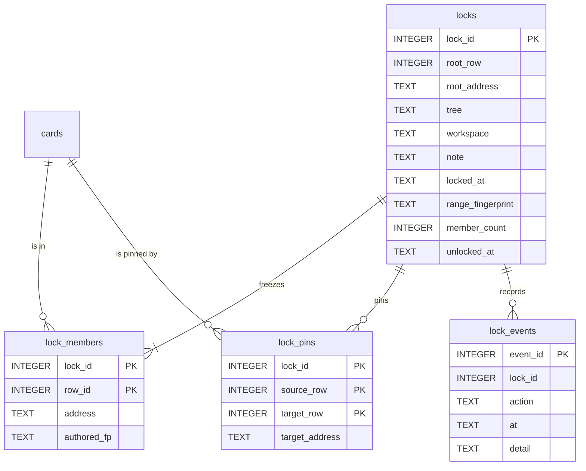

# Tree Lock Proposal

Status: proposal, decisions D1–D7 made by the owner on 2026-10-21 (see *Decisions*); the delete
commands joined on the same day. Not built. The text follows ASD-STE100 (Simplified Technical English), as the
other design documents do. Target release: zt 0.22.0.

## Source authority

- `CONTEXT.md` defines Card, Tree root, Topic tree, Literature tree, Workspace, Access, Location,
  Link, Reverse link, and Broken link. This proposal adds new terms (see *Glossary entries*).
- `docs/wiki/cards-and-links.md` and `src/workspace.rs` hold `Access` (`Owner`, `Agent`),
  `ensure_writable`, and `ensure_link_rewrites_allowed`.
- `docs/wiki/card-operations.md` holds the shared write path (`src/ops.rs`, `src/batch.rs`,
  `src/place.rs`) and the `Outcome` two-step protocol.
- `docs/wiki/service-and-cli.md` holds the `cards` and `metadata` tables, the migrations, the shell
  write commands, `zt del`, `zt clear`, and `zt dp`. `docs/dump-and-clear-design.md` holds the rules
  of `zt clear`, which this proposal folds into `zt del`.
- `docs/wiki/gui.md` holds the GUI routes and the GUI token.
- `src/card.rs` `authored_fingerprint` (S18, #99) defines the authored identity of a Card: title,
  body, BibTeX, and the type fields, without the generated Reverse links.

## The request

> A tree can be locked. When a tree is locked, the Cards in it cannot be changed. Cards outside the
> locked tree can reference the locked Cards, but they cannot change them or change the lock. Only
> the client (the human owner, through the GUI) has lock authority, not the AI agent.

And, with the lock: `zt clear` and `zt del` become one command, `zt del`, that covers every delete:
one Card, one tree, one tree emptied with its root kept, and the whole archive.

## The problem

Today ZT has one protection: Workspace Access. The agent cannot change the human Workspace. Three
needs are not met:

1. **The owner cannot protect agent work that is good.** After a clean digest (for example
   `grossman2002integration`), a later digest, a `models` or `cards` mode rerun, `zt-idea-grow`, or a
   hub run can rewrite, move, or delete those agent Cards. Nothing tells the agent "this tree is
   finished".
2. **The owner cannot protect their own finished trees from themselves.** An `mv`, `ins`, `del`, or
   `e` in the Session can change a tree that the owner considers complete.
3. **The agent's limit is a Workspace limit, not a content limit.** An agent may write any agent
   Card. The owner has no way to say "this agent tree is now read-only too".

A Lock is a content limit that the owner sets on one whole tree. Every client obeys it, the owner
too. Only the owner, in the GUI, sets or removes it.

## Principles

1. **Frozen, not hidden.** A locked Card stays fully readable and linkable. Search, `get_card`,
   Spreads, hubs, and `ask_box` treat it the same as before.
2. **Referencing is free.** A Card outside the locked tree may link a locked Card. The locked Card's
   Reverse link section then changes. That section is generated text, not authored text, so it is
   not a change (the rule that Access already uses for human Cards).
3. **The whole tree is frozen.** Every Card of the tree keeps its `authored_fingerprint`, its
   address, and its existence. The tree gets no new Cards.
4. **The tree stays whole.** A Link in the locked tree does not become a Broken link and is not
   rewritten because of a change outside the tree.
5. **One gate, every path.** The check is in the storage layer, under every client: the shell
   commands, the Session, the GUI, the MCP server, `apply_batch`, the Reply route, and the hub-draft
   route. The owner is bound in the same way as the agent.
6. **The lock control is a GUI control.** Only the GUI and its HTTP API can set or remove a Lock. The
   MCP server, the Session, and the shell commands have no lock control, and the agent instructions
   do not name the lock routes. This is a policy limit, not a security limit (see *Authority*).

## The Lock

### A Lock is on one whole tree

The owner locks one Tree root: a Topic (`3/0`) or a Literature Card (`Smith2024`). The **Locked tree**
is that root and every Card of its tree. A Regular Card cannot be a lock anchor (D1). There is at
most one Lock on a tree, so Locks never overlap.

A Lock may be set in either Workspace (D7). The main use is an agent tree that the owner has
reviewed. A Lock on a human tree protects it from the owner's own mistakes and from changes that
would rewrite its Links.

### What a Lock refuses in the locked tree

| Change | Result | Example error |
| --- | --- | --- |
| Edit the title or body (`e`, `zt e`, GUI edit, `edit_card`, owned paragraph edits) | refused | ``card `3/2` is in locked tree `3/0`; locked Cards can be linked but not changed`` |
| Change type, facet, emphasis, level, hub level, Math form (`ty`, `lv`, `mf`) | refused | same |
| Edit BibTeX or rename the Citation key | refused | same |
| Delete any Card of the tree, or the whole tree | refused | ``delete would remove Cards of locked tree `3/0` `` |
| Move, insert, or Side compaction that renames a Card of the tree | refused | ``this change would move Card `3/2|a` of locked tree `3/0` `` |
| Move a Card from another tree into the locked tree | refused | ``locked tree `3/0` takes no new Cards`` |
| Create a Card in the tree (`n`, `b`, `ins`, `create_successor`, `insert_card`), also a new Direct successor at the end of the main line (D2) | refused | ``locked tree `3/0` takes no new Cards; file the new Card in another tree and link it`` |
| A hub draft filed with `how: "edit"` on a locked hub, or `how: "side"` under a locked Card | refused | as edit or create |
| `zt del --all`, or `zt del --at <root>` with or without `--keep-root`, on the locked tree | refused | see *Delete* |

### Pinned targets

A Link in a locked Card names a Card in another tree: a **Pinned target**. Principle 4 says that
Link must not break and must not be rewritten (D3):

| Change to a Pinned target | Result |
| --- | --- |
| Edit its text or type | allowed. The Link still resolves. |
| Move it or rename it (this would rewrite the Link in the locked Card) | refused: ``this change would rewrite a Link in Card `3/2` of locked tree `3/0` `` |
| Delete it, alone, with its subtree, or with its tree (this would make a Broken link in the locked Card) | refused: ``Card `5/4` is linked by Card `3/2` of locked tree `3/0` `` |
| Delete it with `into` (this would re-point the Link in the locked Card) | refused, as a rename |

This is the rule that `ensure_link_rewrites_allowed` applies to human Cards today, applied to locked
Cards for every client. The lock plan lists all Pinned targets before the owner confirms.

### What a Lock allows

- Every read, by every client.
- Links from any Card to a locked Card, and Links that a Reply writes to it.
- The regeneration of a locked Card's Reverse link section, and the derived `links` index rows.
- Spreads, hub members, register entries, and `ask_box` paths that name locked Cards.
- Every write to a Card in another tree that is not a rename or delete of a Pinned target.

### The owner is also bound

The Lock binds `Access::Owner` too (D5). To change a locked Card, the owner unlocks the tree in the
GUI first. The Lock is then a promise that the owner can trust: "nothing in this tree changed since
I locked it".

## Authority

| Client | Lock state (read) | Lock, unlock, change the note |
| --- | --- | --- |
| GUI page | yes | yes, with a confirmation step |
| GUI HTTP API (`/api/lock*`, token required) | yes | yes, the routes behind the GUI page |
| Session | yes (the view marks a locked Card) | no |
| Shell commands (`zt status`) | yes | no |
| MCP server (`zt mcp`) | yes (fields on the read tools) | no tool exists |
| `zt-digest`, Workflow scripts | yes (through MCP) | no |

The owner chose a policy limit, not a secret (D4). The agent gets no lock tool, no lock command, and
no description of the lock routes. The `zt` skill and the MCP server instructions say that only the
owner changes Locks. The GUI token is in the page that `GET /` serves, so a local process that wants
to call `/api/lock` can do so. The proposal accepts this: the Lock prevents mistakes and stops the
agent's normal write paths. It does not stop a process that goes around ZT on purpose. A small
integrity check (below) makes such a change visible.

## Data design

### Overview



All new tables are additive. The `cards` table does not change, so no cards rebuild runs and the
list of accepted `cards` column generations stays the same.

### `locks`

```sql
CREATE TABLE IF NOT EXISTS locks (
  lock_id           INTEGER PRIMARY KEY,
  root_row          INTEGER NOT NULL,              -- cards.row_id of the Tree root
  root_address      TEXT    NOT NULL,              -- Topic Location (3/0) or Citation key at lock time
  tree              TEXT    NOT NULL,              -- tree id: the Topic number or the Citation key
  workspace         TEXT    NOT NULL CHECK (workspace IN ('human','agent')),
  note              TEXT    CHECK (note IS NULL OR length(note) <= 500),   -- the owner's reason
  locked_at         TEXT    NOT NULL,              -- UTC RFC 3339
  range_fingerprint TEXT    NOT NULL,              -- SHA-256 hex, see below
  member_count      INTEGER NOT NULL CHECK (member_count >= 1),
  unlocked_at       TEXT                           -- NULL while the Lock is active
);
CREATE UNIQUE INDEX IF NOT EXISTS locks_active_tree
  ON locks(root_row) WHERE unlocked_at IS NULL;    -- at most one active Lock per tree
```

An unlocked Lock keeps its row as history. Its `lock_members` and `lock_pins` rows are deleted, so
the gate and the triggers stop at once.

`range_fingerprint` = SHA-256 of the lines `<address>\t<authored_fp>\n` of all members, sorted by
address. The GUI shows its first 12 characters as the seal of the tree.

### `lock_members`

```sql
CREATE TABLE IF NOT EXISTS lock_members (
  lock_id     INTEGER NOT NULL REFERENCES locks(lock_id),
  row_id      INTEGER NOT NULL,                    -- cards.row_id (kept through cards rebuilds)
  address     TEXT    NOT NULL,                    -- for messages; a member cannot move
  authored_fp TEXT    NOT NULL,                    -- card::authored_fingerprint at lock time
  PRIMARY KEY (lock_id, row_id)
);
CREATE INDEX IF NOT EXISTS lock_members_by_row ON lock_members(row_id);
```

The members are every Card of the tree, written once when the Lock is set. The set is exact for the
life of the Lock, because no member moves, no member is deleted, and the tree takes no new Card. A
stored set makes the gate one indexed lookup and lets SQL triggers use it.

### `lock_pins`

```sql
CREATE TABLE IF NOT EXISTS lock_pins (
  lock_id        INTEGER NOT NULL REFERENCES locks(lock_id),
  source_row     INTEGER NOT NULL,                 -- the locked Card that holds the Link
  target_row     INTEGER NOT NULL,                 -- the Pinned target, in another tree
  target_address TEXT    NOT NULL,
  PRIMARY KEY (lock_id, source_row, target_row)
);
CREATE INDEX IF NOT EXISTS lock_pins_by_target ON lock_pins(target_row);
```

Filled from the `links` index when the Lock is set: every Link from a member to an existing Card in
another tree. A Broken link in the tree at lock time is listed in the lock plan as a warning and has
no pin row.

### `lock_events`

```sql
CREATE TABLE IF NOT EXISTS lock_events (
  event_id INTEGER PRIMARY KEY,
  lock_id  INTEGER NOT NULL,
  action   TEXT NOT NULL CHECK (action IN ('lock','unlock','note','reseal','integrity-fault')),
  at       TEXT NOT NULL,                          -- UTC RFC 3339
  detail   TEXT NOT NULL                           -- canonical JSON: root, members, fingerprint, note
);
```

A plain history. The GUI shows it on the tree's lock panel. Each event also writes one `zt.log`
line (`lock set tree=3/0 members=27 fp=…`).

### Triggers (a backstop for the code gate)

On every connection, zt registers two SQL functions with `rusqlite`
(`Connection::create_scalar_function`): `zt_authored_fp(text, bibtex, card_type, model_facet,
model_emphasis, model_level, hub_level, math_form)`, which gives the same value as
`card::authored_fingerprint`, and `zt_parent(location)`, which gives the same value as
`parent_location`.

```sql
CREATE TRIGGER IF NOT EXISTS lock_no_delete BEFORE DELETE ON cards
WHEN EXISTS (SELECT 1 FROM lock_members WHERE row_id = OLD.row_id)
BEGIN SELECT RAISE(ABORT, 'zt: card is in a locked tree'); END;

CREATE TRIGGER IF NOT EXISTS lock_no_change BEFORE UPDATE ON cards
WHEN EXISTS (SELECT 1 FROM lock_members m WHERE m.row_id = OLD.row_id AND (
       NEW.location     IS NOT OLD.location
    OR NEW.citation_key IS NOT OLD.citation_key
    OR NEW.workspace    IS NOT OLD.workspace
    OR zt_authored_fp(NEW.text, NEW.bibtex, NEW.card_type, NEW.model_facet, NEW.model_emphasis,
                      NEW.model_level, NEW.hub_level, NEW.math_form) <> m.authored_fp))
BEGIN SELECT RAISE(ABORT, 'zt: card is in a locked tree'); END;

CREATE TRIGGER IF NOT EXISTS lock_no_insert BEFORE INSERT ON cards
WHEN NEW.location IS NOT NULL AND EXISTS (
  SELECT 1 FROM lock_members m JOIN cards c ON c.row_id = m.row_id
  WHERE c.location = zt_parent(NEW.location) OR c.citation_key = zt_parent(NEW.location))
BEGIN SELECT RAISE(ABORT, 'zt: locked tree takes no new cards'); END;

CREATE TRIGGER IF NOT EXISTS lock_no_move_in BEFORE UPDATE OF location ON cards
WHEN NEW.location IS NOT OLD.location
  AND NOT EXISTS (SELECT 1 FROM lock_members WHERE row_id = OLD.row_id)
  AND EXISTS (
    SELECT 1 FROM lock_members m JOIN cards c ON c.row_id = m.row_id
    WHERE c.location = zt_parent(NEW.location) OR c.citation_key = zt_parent(NEW.location))
BEGIN SELECT RAISE(ABORT, 'zt: locked tree takes no new cards'); END;

CREATE TRIGGER IF NOT EXISTS lock_pin_no_delete BEFORE DELETE ON cards
WHEN EXISTS (SELECT 1 FROM lock_pins WHERE target_row = OLD.row_id)
BEGIN SELECT RAISE(ABORT, 'zt: card is a pinned target of a locked tree'); END;

CREATE TRIGGER IF NOT EXISTS lock_pin_no_move BEFORE UPDATE OF location, citation_key ON cards
WHEN EXISTS (SELECT 1 FROM lock_pins WHERE target_row = OLD.row_id)
  AND (NEW.location IS NOT OLD.location OR NEW.citation_key IS NOT OLD.citation_key)
BEGIN SELECT RAISE(ABORT, 'zt: card is a pinned target of a locked tree'); END;
```

- Every new Card of a tree has a parent in the same tree, so `lock_no_insert` covers the whole tree,
  also the end of the main line. `lock_no_move_in` does the same for a Card that a move brings in.
  In a subtree move, the top moved Card gets a member as its new parent, so the trigger fires on
  that row in any update order.
- A Reverse link regeneration changes `text` but not the authored fingerprint, so it passes.
- The code gate (below) runs first and gives the full `card_locked` error. A trigger error means that a write
  path has no gate. Tests treat it as a bug.
- A cards rebuild drops the triggers with the old table. `initialize_database` creates them again
  after the last `ensure_*` step (`ensure_lock_triggers`, always run, idempotent).
- A future migration that changes the authored text of Cards (as the pre-Markdown conversion did)
  must reseal: in the same transaction it updates `authored_fp` of each changed member, recomputes
  `range_fingerprint`, and writes one `reseal` event. Each such migration names this step in its
  design.

### Integrity check

`tree_lock::check(conn)` compares each member's current authored fingerprint with `authored_fp`,
checks that each member and each pin target still exists at its address, and checks that the six
triggers exist. The daemon runs it at start and the GUI shows the result. A fault writes one
`integrity-fault` event, shows a broken seal on the tree, and stays until the owner unlocks and locks
the tree again, or restores it. `zt status` prints the result.

### Fields added to reads

Every read that returns a Card (`get_card`, `get_cards`, `get_tree`, `search_cards` rows, the GUI
`summary`) gains:

```json
"lock": null
```

or, for a Card of a locked tree:

```json
"lock": { "lock_id": 7, "tree": "3/0", "since": "2026-10-21T09:12:00Z" }
```

A Pinned target gains `"pinned_by": ["3/0"]` (the locked trees that link it). `list_trees` and the
GUI `trees()` rows gain `"locked": true | false`. `zt status` prints
`locks: 3 trees, 412 cards, 57 pinned targets; integrity ok`.

### The structured refusal

MCP tools and `apply_batch` give a refusal that an agent can act on without parsing English:

```json
{
  "error": "card_locked",
  "message": "card `3/2` is in locked tree `3/0`; locked Cards can be linked but not changed",
  "tree": "3/0",
  "cards": ["3/2"],
  "reason": "edit | delete | move | create-inside | move-inside | pinned-move | pinned-delete",
  "hint": "Write a new Card in another tree and link the locked Card."
}
```

`apply_batch` keeps its present rule: one refused item rolls back the whole batch. `preview: true`
reports every locked item, so a planner can drop them before the real write.

## Interfaces

### Code: one gate (`src/tree_lock.rs`)

The module is named `tree_lock`, not `lock`, because `zt.edit.lock` and
`acquire_edit_lock_within` already use "lock" for the writer mutex.

| Function | Use |
| --- | --- |
| `register_sql_functions(conn)` | called in `open_db`, so every connection has `zt_authored_fp` and `zt_parent` |
| `ensure_unlocked_tx(conn, change: &Change) -> Result<()>` | the gate. `Change` is one of `Edit(row)`, `Delete(rows)`, `Mapping(&BTreeMap<old,new>)`, `CreateUnder(parent)`, `LinkRewrites(&BTreeMap)`. It checks members and pins and gives the `card_locked` error. |
| `plan(conn, root) -> LockPlan` | the member count, the Pinned targets, the Broken links in the tree, and a refusal if the tree is already locked or `root` is not a Tree root |
| `lock_tx(conn, root, note) -> Lock` | writes `locks`, `lock_members`, `lock_pins`, and a `lock` event |
| `unlock_tx(conn, lock_id)` | sets `unlocked_at`, deletes members and pins, writes an `unlock` event |
| `check(conn) -> Integrity` | the integrity check |

The gate is called in the transaction-level writers that every client already shares:
`insert_card_tx`, `update_card_text` and the type setters (`model::set`, `model::set_level`,
`hub::set_level`, `math::set_form`), `apply_delete_plan`, `apply_location_mapping_tx` (moves,
inserts, Side compaction, Citation-key renames), the `into` re-pointing, and every form of `zt del`.
`ops.rs` and `place.rs` also check at plan time, so a two-step plan (`Outcome::Confirm`) already
says "locked" before the owner types the confirmation word.

### GUI and its API

Routes (token required). Each change is two-step, as the other destructive GUI changes are:

| Route | Body | Answer |
| --- | --- | --- |
| `GET /api/locks` | — | the active Locks, their events, and the integrity state |
| `POST /api/lock` | `{root, note?}` | `{confirm: "lock", lines}`: the plan (members, Pinned targets, Broken links) |
| `POST /api/lock` | `{root, note?, confirm: "lock"}` | `{lock_id, tree, members, pins, fingerprint}` |
| `POST /api/unlock` | `{tree}` / `{tree, confirm: "unlock"}` | plan / `{tree, unlocked_at}` |
| `POST /api/lock/note` | `{tree, note}` | `{tree, note}` |

The page:

- The tree's menu in the cabinet has **Lock tree** (or **Unlock tree**). The dialog shows the plan,
  the note field, and the confirm button.
- A locked tree in the cabinet, and its Cards on the desk, look like a physical stack held by a
  band, with a small seal mark on the Tree root that shows the fingerprint (see the GUI real-card
  aesthetic). The edit, move, delete, insert, and successor controls stay visible but are disabled,
  and their tooltip names the Lock. A Pinned target shows a small pin on its Links.
- An integrity fault shows a broken seal on the tree and one line at the top of the page.

### Session

No lock command. The Card view marks a Card of a locked tree with `[locked]` in its title row and a
Pinned target with `[pinned]`. Every write command on a locked Card gives the gate's error, with the
hint `unlock the tree in the GUI first`.

### Shell

- `zt status` adds the `locks:` line. `zt status --check-locks` runs `tree_lock::check` and exits 1
  on a fault.
- No shell command locks or unlocks.
- `zt dp` writes `locks.json` into the dump (the Locks, their members' addresses and fingerprints,
  the pins, and the events). A restore is not in this proposal.
- `zt clear` is folded into `zt del`: see the next section.

### MCP server

No lock tool. The read tools carry the `lock` and `pinned_by` fields. Every write tool gives the
`card_locked` refusal. The server instructions get one sentence: "A Card with `lock` set is in a tree
the owner locked: read and link it, never try to change it, and file new Cards in another tree."

### Agent instructions and workflows

- `skills/zt/SKILL.md` and `skills/zettelkasten/SKILL.md`: locked Cards are linkable sources. To
  continue a locked idea, write a Card in another tree that links it with a kind word. Only the owner
  changes Locks; never call the GUI lock routes.
- `zt-digest` and the Workflows (`zt-econ-digest`, `zt-math-digest`, `zt-idea-grow`, hub runs) read
  the lock state in their prepare step. A mode that would rewrite a locked tree (for example `models`
  or `cards` on a locked Literature tree) stops before the first write with
  `the Literature tree <key> is locked by the owner`. `zt-idea-grow` files its Cards only in unlocked
  trees. A `card_locked` refusal during a run is a plan bug, not a retry.

## Delete: one command for every delete

### Today

Two shell commands remove Cards, and they overlap:

| Command | Removes | Confirmation | Refuses while |
| --- | --- | --- | --- |
| `zt del --at <target>` | a Regular Card and its subtree; on a Tree root, the whole tree | `delete`, or the root's own address | the edit lock is held |
| `zt clear` | every Card of the archive, both Workspaces; resets `next_topic_id` to 0 | `clear` | a Session is open, or the edit lock is held |

The user must know two names for one kind of change, and neither command can empty a tree but keep
its root. This proposal joins them into one command, `zt del`, and adds that missing case.

### The new `zt del`

```text
zt del --at <target>                 delete a Regular Card and its subtree (today's behaviour)
zt del --at <root>                   delete a whole tree, root included (today's behaviour)
zt del --at <root> --keep-root       empty a tree: delete its Regular Cards, keep the Tree root (new)
zt del --all                         delete every Card of the archive and reset Topic numbers (was zt clear)
```

| Form | Confirmation word | Extra rules |
| --- | --- | --- |
| `--at <card>` | `delete` | Side compaction as today |
| `--at <root>` | the root's address (`3/0`, `Smith2024`) | — |
| `--at <root> --keep-root` | the root's address | `<target>` must be a Tree root |
| `--all` | `delete all` | refused while a Session is open (as `zt clear` today) |

Argument rules, checked before any prompt:

- Exactly one of `--at` and `--all`. Both, or neither:
  ``usage: zt del --at <target> [--keep-root] | zt del --all``.
- `--keep-root` only with `--at` on a Tree root:
  ``--keep-root takes a Tree root (a Topic like 3/0 or a Citation key); `3/2` is a Regular Card``.
- `zt clear` is removed. For one release it prints ``zt clear is now `zt del --all` `` and exits 1,
  without a change; after that it is an unknown command. `zt help` lists only `zt del`.

### Emptying a tree (`--keep-root`)

Delete every Regular Card of the tree. Keep the Tree root: its address, title, body, BibTeX, type,
and the Links to it. The next new Card of the tree is again `3/1` or `<key>/1`. Use: a digest rerun
into the same Literature tree, or a fresh start of a Topic that other Cards link.

1. Needs the service up and takes the edit lock, as every `zt del` does. Allowed while a Session is
   open: the Session moves a Pointer whose Card is gone to its nearest existing ancestor
   (`recover_missing_pointer`), as it does after any delete.
2. Prints the delete verification lines (`delete_verification_lines`): the tree, its Workspace, the
   number of Cards that go, `root kept`, and each Link from another Card that will break (the first
   20, then a count).
3. One transaction: delete the Cards, let Spreads drop them (`spread::follow`), rebuild the `links`
   index and regenerate Reverse links, advance the archive revision. `next_topic_id` does not change.
   `applied_ops` receipts stay, as for every delete.
4. Output: `deleted: 214; root kept: grossman2002integration`.

In code this is one more `DeletePlan` shape (the delete set is the tree without its root), so the
GUI and the MCP `delete_card` tool can take a `keep_root` argument later with no new path. This
proposal adds it to the shell and the Session only.

### `--all`

Today's `zt clear`, with the same effect: one transaction deletes every row of `cards` and `links`
and sets `next_topic_id` to 0. Topic numbers are reused only after `--all`. Output:
`deleted: 1872 cards; next topic id reset to 0`. Shell only.

### The Session

The Session `del` command gets the same form for a Tree root: `del keep-root` on a Tree root empties
the tree, after the same lines and with the root's address as the confirmation. `--all` is not a
Session command, because it refuses while a Session is open.

### Locks and `zt del`

Every form goes through the lock gate (D6):

| Form | Refused when |
| --- | --- |
| `--at <card>` | the Card is in a locked tree, or its subtree holds a Pinned target |
| `--at <root>`, `--at <root> --keep-root` | the tree is locked, or a Card that would go is a Pinned target |
| `--all` | any tree is locked: ``cannot delete all: 3 trees are locked (3/0, 41/0, grossman2002integration); unlock them in the GUI first`` |

The check runs before the prompt, so the owner does not type the confirmation word for nothing.

## Worked example

1. The digest of `grossman2002integration` passes its last check. The owner opens the tree in the
   GUI and chooses **Lock tree**.
2. The plan says: 1 Literature Card and 214 Regular Cards; 38 Pinned targets in 11 agent Topics;
   0 Broken links. The owner writes the note "clean run 2026-10-21, reviewed" and confirms.
3. A week later `zt-idea-grow` runs. It reads every locked Card as a source and writes new agent
   Topic Cards that link them. Their Reverse links appear on the locked Cards.
4. The hub run wants to move agent Topic Card `122/4`, which locked Card
   `grossman2002integration/37` links. Its preview gets `card_locked` with reason `pinned-move`, and
   it keeps `122/4` in place.
5. The owner wants to fix a typo in `grossman2002integration/12`. The GUI shows the Card as locked.
   The owner unlocks the tree, edits, and locks it again. The events show `lock`, `unlock`, `lock`.
6. Later the owner wants to rerun the digest from the start. They unlock the tree in the GUI and run
   `zt del --at grossman2002integration --keep-root`. The Literature Card and its BibTeX stay; the
   214 Regular Cards
   go. The digest writes the tree again from `grossman2002integration/1`.

## Decisions

| # | Question | Decision (2026-10-21) |
| --- | --- | --- |
| D1 | What can be locked? | Only a Tree root. A Lock always covers the whole tree. |
| D2 | May new Cards be added to a locked tree? | No. A locked tree takes no new Card, also not at the end of its main line. |
| D3 | Pinned targets | They cannot move and cannot be deleted while the Lock is active. |
| D4 | What proves the owner? | No secret. The lock control is exposed only in the GUI and its HTTP API, never to the agent (no MCP tool, no shell or Session command). A policy limit, not a strict one. |
| D5 | Is the owner bound by the Lock? | Yes. Unlock in the GUI first. |
| D6 | Clearing with active Locks | Refused. `zt clear` and `zt del` become one command, `zt del`, which can also empty one tree and keep its root (`--keep-root`). |
| D7 | Lock a human tree? | Yes, in both Workspaces. |

## Build slices

Each slice is one GitHub issue, test first, with its wiki block doc updated in the same commit.

1. **Storage and gate.** The four tables, `register_sql_functions`, the triggers,
   `ensure_lock_triggers`, `tree_lock::ensure_unlocked_tx` in every transaction-level writer, `plan`,
   `lock_tx`, `unlock_tx`, `check`. Locks set by a test helper. Tests: every row of *What a Lock
   refuses* and *Pinned targets*, for `Owner` and `Agent`; a Reverse link regeneration on a member
   passes; a Side compaction that renames a member is refused; a move into the locked tree is
   refused; a cards rebuild keeps the triggers; a raw UPDATE without the SQL function fails; an
   integrity fault is found. Wiki: `service-and-cli.md`, `card-operations.md`, `cards-and-links.md`.
2. **GUI.** The routes, the two-step lock dialog, disabled controls, band and seal, pins, integrity
   line, event list. Wiki: `gui.md`.
3. **Session and shell.** `[locked]` and `[pinned]` marks and the unlock hint; `zt status`,
   `--check-locks`, `locks.json` in `zt dp`. Wiki: `session.md`, `service-and-cli.md`.
4. **One delete command.** `zt del --at <root> --keep-root`, `zt del --all` (today's `zt clear`),
   the argument rules, the one-release `zt clear` notice, Session `del keep-root`, and the lock
   refusals before the prompt. Tests: every form and its confirmation word; `--keep-root` on a
   Regular Card refused; root kept and next Card `/1`; Spreads follow; Topic numbers kept except
   after `--all`; `--all` refused while a Session is open; cancel changes nothing; locked tree and
   Pinned target refused. The existing `zt clear` tests move to `zt del --all`. Wiki:
   `service-and-cli.md`, `session.md`; update `docs/dump-and-clear-design.md`.
5. **MCP and agents.** `lock` and `pinned_by` fields, the `card_locked` refusal in single tools,
   batch, and preview, the server instruction sentence, the skill text. Wiki: `mcp-server.md`,
   `agent-skills.md`.
6. **Workflows.** Lock state in the prepare steps of the digest, idea-grow, and hub Workflows; stop
   early on a locked target. Installed Workflows are frozen, so this ships as new versions.
   Wiki: `digest-workflows.md`, `idea-grow-workflow.md`.

Slices 2–5 depend on slice 1 and not on each other.

## Glossary entries

To add to `CONTEXT.md` when slice 1 is built:

**Lock**:
The owner's freeze of one whole tree: until the owner unlocks it in the GUI, no client (the owner
included) may change, move, delete, or add Cards in the tree, and every client may still read and
link them. Only the GUI sets or removes a Lock; the agent has no lock control.
_Avoid_: Freeze, seal, read-only tree, edit lock (the edit lock is the writer mutex `zt.edit.lock`)

**Locked tree**:
A Topic tree or Literature tree that has an active Lock. Its members are fixed when the Lock is set.

**Pinned target**:
A Card in another tree that a Card of a Locked tree links. It may change its text, but it cannot move
or be deleted while the Lock is active, so the locked Link stays whole.

**Emptied tree**:
A tree after `zt del --at <root> --keep-root`: its Tree root stays with its address, text, and the
Links to it, and it has no Regular Card. Its next Card is again `<root>/1`.
_Avoid_: Cleared tree, reset tree
