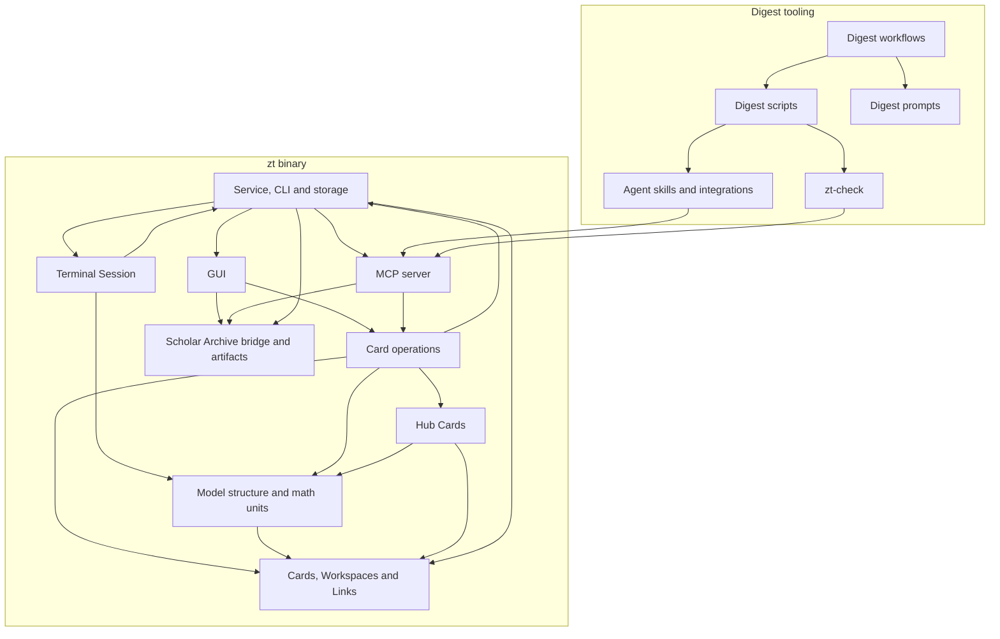

# ZT wiki

## Overview

ZT is a local note system of addressable Markdown Cards for one person and one AI agent (`README.md`, `CONTEXT.md`). Cards live in Topic trees and Literature trees in two Workspaces (`human` and `agent`) of one SQLite archive. The person reads and writes them in a terminal Session (`zt`) or in the browser GUI that runs inside the service. Coding agents read both Workspaces and write the agent Workspace through the `zt mcp` server. Around the Rust binary, the repository holds the book-digest tooling: Workflow scripts, PowerShell compilers, DeepSeek prompts, and the `zt-check` quality checker. Together they turn a Chinese-translated book from the Scholar Archive into agent Cards.

| Part | Language and tools | Where |
|---|---|---|
| `zt` and `zt-boot` binaries | Rust 2024 edition, Cargo; SQLite (`rusqlite`, bundled), `tiny_http`, `crossterm`, `pulldown-cmark` (`Cargo.toml`) | `src/`, `tests/` |
| GUI front end | Plain JavaScript, CSS and HTML embedded in the binary; vendored KaTeX | `src/gui/` |
| `zt-check`, `zt-digest` | Separate Rust crates (zt-digest takes zt-check as a library) | `tools/zt-check/`, `tools/zt-digest/` |
| Digest tooling | PowerShell 7.5 scripts, Node ESM Workflow scripts and harnesses, Chinese prompt files | `scripts/book-digest/`, `.claude/workflows/`, `.claude/workflow-framework/` |
| Agent skills | Markdown skills, installed by a PowerShell script | `skills/`, `scripts/install-agent-integrations.ps1` |

Build, install, test, and run:

```bash
cargo install --path . --locked
cargo test --all-targets
cd tools/zt-check && cargo test
cd tools/zt-digest && cargo test
pwsh -NoProfile -File scripts/book-digest/tests/run-all.ps1
zt config set archive_root "<data-directory>"
zt up
zt
```

Each block doc's **Testing** section names its own suites.

## Block map

| Block | Responsibility | Main paths |
|---|---|---|
| [Cards, Workspaces and Links](cards-and-links.md) | The stored Markdown Card format, Card types, Literature Cards and BibTeX, Workspaces, and Links with Reverse links and Broken links | `src/card.rs`, `src/card_type.rs`, `src/literature.rs`, `src/workspace.rs`, `src/link.rs` |
| [Service, CLI and storage](service-and-cli.md) | `zt` commands, config, the daemon's life, autostart and shutdown, the SQLite schema and its migrations, Location rules, dump and the one delete command | `src/main.rs`, `src/shutdown.rs`, `src/autostart.rs`, `src/bin/`, `src/dump.rs` |
| [Card operations](card-operations.md) | The create, edit, retype, delete, move, and insert operations shared by the GUI and the MCP server, gated by Workspace access and two-step for destructive changes | `src/ops.rs`, `src/place.rs` |
| [Terminal Session](session.md) | The interactive terminal Session: Pointer, views, commands, the editor, mouse selection and clipboard | `src/session.rs`, `src/session/` |
| [Model structure and math units](models-and-math.md) | Model Cards and Model parts, levels, build order, model faults, mathematical units and Theory Cards | `src/model.rs`, `src/math.rs` |
| [Hub Cards](hub-cards.md) | Hub Cards: levels, groups and members, the hub checks, the concept register's shared entry projection, the entry-first search ranking that the MCP server and the GUI share, and the bounded question that proposes a Spread | `src/hub.rs`, `src/entry.rs` |
| [MCP server](mcp-server.md) | `zt mcp`: the JSON-RPC stdio server and its tools, with writes only to the agent Workspace | `src/mcp.rs` |
| [GUI](gui.md) | The loopback HTTP server inside the daemon and the browser front end: cabinet, map, Table and Spreads, Constellation, writing desk, charts, source documents | `src/gui.rs`, `src/gui/`, `src/spread.rs` |
| [Scholar Archive bridge and artifacts](scholar-bridge.md) | The signed, read-only connection to the Scholar Archive and the content-addressed artifact store for Card images | `src/scholar.rs`, `src/artifact.rs` |
| [zt-check](zt-check.md) | The standalone Card quality checker (rules R, I, E, F, L) used by every digest stage, and the process-free rule core the zt service links | `tools/zt-check/` |
| [zt-digest](zt-digest.md) | The digest tools as one Rust binary: the zt helper (`call`) and the ported compilers, with zt-check in-process | `tools/zt-digest/`, `skills/zt/scripts/zt-mcp.ps1` |
| [Agent skills and integrations](agent-skills.md) | The `zt`, `zettelkasten`, and `zt-digest-protocol` skills, the `zt-mcp.ps1` helper, and the installer for Claude Code, Codex, and DeepSeek Harness | `skills/`, `scripts/install-agent-integrations.ps1` |
| [Digest workflows](digest-workflows.md) | The book, econ, and math digest Workflows: stages, modes, modules, blueprints, and the frozen install | `scripts/book-digest/workflow/`, `.claude/workflows/`, `.claude/workflow-framework/` |
| [Digest scripts](digest-scripts.md) | The PowerShell stage scripts and compilers (card, model, event, finding, math, hub, organize, figures, audit) and their tests | `scripts/book-digest/*.ps1`, `scripts/book-digest/tests/` |
| [Digest prompts](digest-prompts.md) | The DeepSeek instruction files and the model-architect briefs that the digest stages send | `scripts/book-digest/*.md` |
| [Idea-grow workflow](idea-grow-workflow.md) | The zt-idea-grow Workflow: a finished Literature tree read section by section against the whole box; DeepSeek keeps the core, related, useful, interesting and intuitive ideas as standalone agent Topic-tree Cards filed beside the Cards they continue (Luhmann's main box) | `scripts/idea-grow/`, `.claude/workflows/zt-idea-grow.js`, `tools/zt-digest/src/grow.rs` |
| [Workflow module structure](workflow-module-structure.md) | The basic structure of every digest and idea-grow module: each feature block is a Haiku manager and DeepSeek subagents, deterministic chains are script steps run by DeepSeek drive jobs, no relay agent, few branches; Sonnet only for the designer roles | `scripts/book-digest/term-steps.ps1`, `docs/workflow-module-structure-proposal.md` |
| [Issue development workflow](issue-dev-workflow.md) | The zt-issue-dev Workflow: GitHub issues developed one at a time by DeepSeek agents through Haiku managers, with the main agent fulfilling their asks | `scripts/issue-dev/`, `.claude/workflows/zt-issue-dev.js` |

## Architecture



Control enters the binary at `run` in `src/main.rs` ([Service, CLI and storage](service-and-cli.md)). The bare command opens a [Terminal Session](session.md); the shell write commands (`t l n b e del mv ins`) run directly; `zt mcp` starts the [MCP server](mcp-server.md); `zt up` spawns the daemon, which keeps the service record and runs the [GUI](gui.md) server for its whole life. The GUI and the MCP server change Cards only through [Card operations](card-operations.md). These operations take the edit lock and write the archive through the crate-root storage helpers in `src/main.rs`. They also run the structure checks of [Model structure and math units](models-and-math.md) and [Hub Cards](hub-cards.md). Every write is validated by the Card format and Link rules of [Cards, Workspaces and Links](cards-and-links.md).

All data is stored under the archive root: `zt.sqlite3` holds every Card, and its `metadata` table holds Spreads. The `artifacts/` folder holds Card images, keyed by content. Logs and the service, session, and lock files sit beside them. Source books and figures stay in the Scholar Archive and come through the [bridge](scholar-bridge.md).

The digest tooling is a client of the binary. A [Digest workflow](digest-workflows.md) runs stages that send [prompts](digest-prompts.md) to DeepSeek and call [scripts](digest-scripts.md). The scripts call the `zt mcp` server through the `zt-mcp.ps1` helper of the [zt skill](agent-skills.md) and check every Card with [zt-check](zt-check.md), which also reads Cards through `zt mcp`. The zt binary itself links zt-check's process-free core (a path dependency with `default-features = false`), so the service and the tools share one rule implementation; a shared-rule change rebuilds and redeploys both.

## Cross-block flows

### An agent writes a Card

1. The agent sends `tools/call` for `create_successor` (or `edit_card`, `move_card`, ...) to `zt mcp` ([MCP server](mcp-server.md)), which first makes sure the service is up ([Service, CLI and storage](service-and-cli.md)).
2. The handler calls the matching function in `src/ops.rs` with agent access, which refuses a human-Workspace target ([Card operations](card-operations.md)).
3. The operation validates the Location or Citation key and the Card text, Links included ([Cards, Workspaces and Links](cards-and-links.md)), and checks model, math, or hub fields ([Model structure and math units](models-and-math.md), [Hub Cards](hub-cards.md)).
4. Under the edit lock it writes the row in `zt.sqlite3` and rewrites the Reverse links of every Card the change touches ([Service, CLI and storage](service-and-cli.md)).
5. The open GUI picks the change up on its next Snapshot ([GUI](gui.md)).

### A person works in the terminal Session

1. `zt` with no arguments requires the service and starts `session::run_session` ([Service, CLI and storage](service-and-cli.md)).
2. The Session registers in `zt.sessions`, shows ROOT, and parses each command against where the Pointer is ([Terminal Session](session.md)).
3. A write (`n`, `b`, `e`, `mv`, `ins`, `del`) opens the editor or a confirmation and then runs the same storage and placement code as the shell commands ([Card operations](card-operations.md), [Cards, Workspaces and Links](cards-and-links.md)).

### The GUI shows the slip-box

1. `zt up` spawns the daemon, which binds the GUI to loopback on port 4717 (or `ZT_GUI_PORT`) and records the URL and token ([Service, CLI and storage](service-and-cli.md), [GUI](gui.md)).
2. The page loads the cached Snapshot through the token-guarded `/api/` routes and lays out the cabinet, map, Table, and Constellation in `src/gui/app.js` and `src/gui/layout.js` ([GUI](gui.md)).
3. Model and hub views come from the reports in `src/model.rs`, `src/math.rs`, and `src/hub.rs` ([Model structure and math units](models-and-math.md), [Hub Cards](hub-cards.md)).
4. A source document or a figure link calls `/api/scholar/*`, which the bridge answers from the Scholar Archive ([Scholar Archive bridge and artifacts](scholar-bridge.md)).
5. Edits go back through `/api/edit`, `/api/create`, `/api/move`, ... to [Card operations](card-operations.md).

### A book becomes agent Cards

1. A person runs a digest Workflow (`zt-econ-digest` or `zt-math-digest`) with an args object ([Digest workflows](digest-workflows.md)).
2. The prepare stage reads the book through the Scholar Archive tools and writes job files; Haiku managers hand each section to DeepSeek runs with the matching instruction file ([Digest scripts](digest-scripts.md), [Digest prompts](digest-prompts.md)).
3. DeepSeek and the compilers write Cards through `zt-mcp.ps1` and `zt mcp` into the agent Workspace ([Agent skills and integrations](agent-skills.md), [MCP server](mcp-server.md)).
4. Each Card is checked with `zt-check`, and faults go back to a fix cycle ([zt-check](zt-check.md)).
5. Later stages build models, events, findings, links, figures, hubs, and the audit on the same path ([Digest workflows](digest-workflows.md)).

### Dump and delete

1. `zt dp` takes the edit lock, reads one captured SQLite view — every Card, `next_topic_id`, the archive identity/revision and the Lock export (`tree_lock::dump_export`) — and hands them to `src/dump.rs`, which writes one Markdown file per Card, the `archive.json` manifest, `locks.json` with the Lock history and integrity evidence, and the artifacts, and compresses the folder ([Service, CLI and storage](service-and-cli.md)).
2. `zt del --all` asks for `delete all` and empties every Card in one transaction, resetting the Topic allocation ([Service, CLI and storage](service-and-cli.md)).

## Glossary

The project glossary is [`CONTEXT.md`](../../CONTEXT.md): Card, Regular Card, Card type, Location, Direct and Side successor, Topic tree, Literature tree, Workspace, Link, Reverse link, Broken link, Model Card, Model part, Model facet, Hub Card, mathematical unit, and the rest. Every block doc uses its words.

## Maintaining this wiki

Each block doc names the `paths` it covers and the commit (`synced`) whose code it describes. A block is stale when a later commit changes its paths without changing its doc. To list stale blocks and files that belong to no block, run:

```bash
node ~/.claude/skills/project-wiki/scripts/wiki.mjs check
```

Change a block's doc in the same commit as its code. After you bring a doc up to date with earlier commits, run `wiki.mjs stamp <block>` to move its `synced` commit to HEAD.


