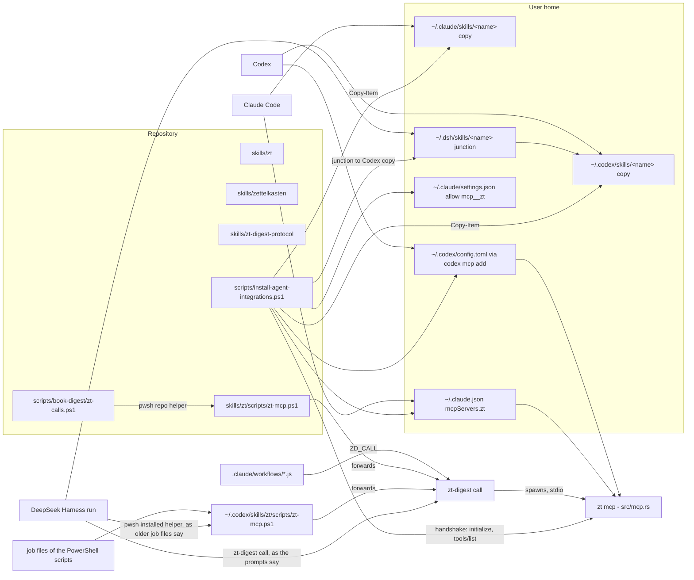

# Agent skills and integrations

## Purpose

This block holds what AI agents get to know about ZT, and the means to put it in front of them. It has three agent skills: `zt` teaches the slip-box's Workspaces, the `zt` MCP server's tools, and the Access rules. `zettelkasten` teaches how to compose, place, and link a Card the way Luhmann worked. `zt-digest-protocol` teaches the digest base, the shared part of every book-digest workflow. `zt-model-fold` teaches how to fold a model the digest split into several Model Cards into one (input: a citation key). `zt-model-settings` teaches how to gather every setting, assumption and symbol of one model into its setting part (input: the Model Card's address). `zt-model-restructure` teaches how to rebuild the inner structure of one model, given its Model Card's address, as an intuition spine (chapters, results, proofs) with one notation card and one card format per role, shaped for the GUI's model network (each chapter hangs under the chapter it builds on most; no forward or unanchored thread). It also holds the shell helper `zt-mcp.ps1`, which lets an agent with no MCP tools (DeepSeek Harness) call the same server, and the installer `scripts/install-agent-integrations.ps1`. The installer copies the skills into Claude Code, Codex, and DeepSeek Harness and registers `zt mcp` as an MCP server. The block exists because the server only enforces the rules (agent Access, Card rules, confirm plans). The conventions that make Cards good (one idea, claim titles, kinded Links, model structure) live in skill text, and every agent harness must load that text from one source.

**Owns:** the skill texts and their frontmatter (`skills/*/SKILL.md`, `skills/*/references/*.md`, `skills/*/agents/openai.yaml`); the helper path `skills/zt/scripts/zt-mcp.ps1`, now a forwarder to `zt-digest call` (the helper itself, with batching, `@@N` references, `-Allow`, `-Log`, `-SrcLog`, `-Moves`, `-Open`, `-TopicGate`, and `append_card`, is owned by [zt-digest](zt-digest.md), and the Literature scope it runs in by default by [zt-check](zt-check.md)); the global installation and registration done by `scripts/install-agent-integrations.ps1`.

**Does not own:** the MCP server, its tool schemas and its `INSTRUCTIONS` text ([MCP server](mcp-server.md), `src/mcp.rs`); the Card operations and confirm plans behind the tools ([Card operations](card-operations.md)); the Card checker that enforces the Card language ([zt-check](zt-check.md)); the digest scripts that call the helper, including `zt-calls.ps1` ([Digest scripts](digest-scripts.md)); the DeepSeek instruction files ([Digest prompts](digest-prompts.md)); the Workflow scripts and the framework that builds them ([Digest workflows](digest-workflows.md)); the service that `zt mcp` needs ([Service, CLI and storage](service-and-cli.md)).

## At a glance

| | |
|---|---|
| Entry points | A harness loads a skill when its `description` matches the task (Claude Code from `~/.claude/skills/<name>/SKILL.md`, Codex from `~/.codex/skills/<name>`, DeepSeek Harness from `~/.dsh/skills/<name>` or the `skills` field of `deepseek_run`). `pwsh -File scripts/install-agent-integrations.ps1 [-ZtPath <zt.exe>]` installs everything. `zt-digest call <calls.json or ->` calls the server from a shell; `pwsh -NoProfile -File <skill dir>/scripts/zt-mcp.ps1` with the same arguments forwards to it. |
| Key files | `skills/zt/SKILL.md` — the slip-box and the MCP tools: what to call, the Access rules, the helper, how to develop zt. |
| | `skills/zt/agents/openai.yaml` — display name and short description of the `zt` skill for Codex. |
| | `skills/zt/scripts/zt-mcp.ps1` — the helper path: forwards its arguments and stdin to `zt-digest call`, which runs a batch of tool calls on one `zt mcp` and prints one line per call. |
| | `skills/zettelkasten/SKILL.md` — how to compose, place, and link a Card: filing steps, Card language, Event, Finding, and Model Cards, model structure, charts, figures, addresses, placement, Links, hubs, maintenance. |
| | `skills/zettelkasten/agents/openai.yaml` — display name and short description of the `zettelkasten` skill for Codex. |
| | `skills/zettelkasten/references/luhmann-and-practice.md` — the research behind each zettelkasten rule, with sources, and the mapping of Luhmann's box to ZET. |
| | `skills/zt-digest-protocol/SKILL.md` — the protocol of the digest base only: roles, the compiler cycle, the base stages, slots, modes, and args, the profile contract a variant fills, the rules every run keeps, quality checks, operating rules, the Bridge contract. |
| | `skills/zt-digest-protocol/references/scripts.md` — a table of the base's tools, instruction files, workflow files, and tests. |
| | `skills/zt-model-fold/SKILL.md` — the fold skill (input: a citation key): survey the book's Model Cards, decide which form one model, fold every other head into the surviving one around zt's retype rule, verify; `scripts/` (`zt.mjs` helper, `model-survey.mjs`, `mask-links.mjs` with its test, `check-model.mjs`) run through `zt-digest call`. |
| | `skills/zt-model-settings/SKILL.md` — the settings skill (input: the Model Card's address): every setting, assumption and symbol of a model in the setting part, nothing else there, no setting in a chapter; `scripts/` (`zt.mjs` helper, `check-model.mjs`, `check-settings.mjs` with its test) run through `zt-digest call`; `check-settings.mjs` refuses a setting outside the setting part. |
| | `skills/zt-model-restructure/SKILL.md`, `references/card-formats.md` — the restructure skill (input: the Model Card's address; `check-model.mjs` refuses a part's address): the working-memory principle, the intuition spine and its build rules, settings as primitives, forward faults fixed by moving cards, the card formats, the parts section (`**分部**`), what the model board draws; `scripts/` (`zt.mjs` helper, `tree-mover.mjs`, `check-drafts.mjs`, `check-model.mjs`, `check-network.mjs` and `check-premises.mjs` with their tests) run through `zt-digest call`; `check-network.mjs` loads the GUI's own layout code from the running service's `/layout.js` (or `ZT_LAYOUT`). |
| | `scripts/install-agent-integrations.ps1` — copies and links the skills, registers the server in Claude Code and Codex, checks the handshake. |
| Depends on | [MCP server](mcp-server.md) (`zt mcp`, the tools the skills name and the helper calls); [Service, CLI and storage](service-and-cli.md) (`zt` on PATH, `zt up`, `zt version`); [zt-check](zt-check.md) (the checker the zettelkasten and digest-protocol skills send agents to); [zt-digest](zt-digest.md) (`zt-digest call`, which the helper path forwards to); external: PowerShell 7.5 (the installer calls `ConvertFrom-Json -DateKind`; `zt-mcp.ps1` declares 7.5 too), the `codex` CLI (optional), Claude Code's `~/.claude.json` and `~/.claude/settings.json`, DeepSeek Harness's `~/.dsh`. |
| Used by | [Digest scripts](digest-scripts.md) (`zt-calls.ps1`, `model-compiler.ps1`, `organize-apply.ps1`, `card-compiler.ps1`, `math-compiler.ps1`, and the job files of `prepare-book-digest.ps1`, `prepare-link-pass.ps1`, `event-compiler.ps1`, `finding-compiler.ps1` call the helper); [Digest prompts](digest-prompts.md) (`dsh-digest-base.zh.md`, `dsh-link-instructions.zh.md`, `dsh-fill-instructions.zh.md`, `dsh-event-instructions.zh.md` show `zt-digest call` commands); [Digest workflows](digest-workflows.md) (`ZD_CALL` in `zt-digest-lib.js`: Organize's zt calls and the manager approvals, which name `zt-digest call` and pwsh with `zt-mcp.ps1`; and the `zettelkasten` skill sent to digest and link runs); every Claude Code, Codex, and DeepSeek Harness conversation that touches the slip-box. |
| Tests | `scripts/book-digest/tests/zt-helper-gate.tests.ps1` (helper `-SrcLog`, `-TopicGate`, the Literature scope without `-Open`), `scripts/book-digest/tests/zt-calls.tests.ps1` (helper output under a GBK console), `scripts/book-digest/tests/card-compiler.tests.ps1` (uses `append_card`). The skills and the installer have no tests. |

## Concepts

- `Skill` — a folder with a `SKILL.md` whose YAML frontmatter has `name` and `description`; the harness reads the description to decide when to load the body. Here: `skills/zt`, `skills/zettelkasten`, `skills/zt-digest-protocol`.
- `Workspace` — the `human` or `agent` half of the archive (`CONTEXT.md`). The `zt` skill tells the agent that `human` is read-only and `agent` is its own.
- `Access` — which Workspaces a client may change (`CONTEXT.md`). The MCP server and therefore the helper act with agent Access (`const ACCESS: Access = Access::Agent` in `src/mcp.rs`). The `zt` shell commands act with human Access, so `skills/zt/SKILL.md` forbids writing with them.
- `MCP server` — `zt mcp`, JSON-RPC 2.0 over stdio (`CONTEXT.md`, `src/mcp.rs`). Registered under the name `zt`; Claude Code exposes its tools as `mcp__zt__*`.
- `Card language` — the plain-text rules for titles and bodies (ASD-STE100 adapted for Chinese; `CONTEXT.md`). `skills/zettelkasten/SKILL.md` states them as a 12-row table; `zt-check` checks most of them.
- `Card type` — `idea` (default), `event`, `finding`, `model`, `hub`. The `zt` skill names the tool arguments; the `zettelkasten` skill gives the body templates (Event Card, Finding Card with six labelled lines, Model Card).
- `Model part`, `Model facet`, `Emphasis`, `Relation kind`, `Elaboration level`, `Math form`, `Derivation part`, `Derivation chain`, `Building block`, `Self-sufficient model` — the model vocabulary of `CONTEXT.md`. `skills/zettelkasten/SKILL.md` (*Model structure*) teaches how to design them; `skills/zt/SKILL.md` names the arguments and the `get_model` report fields.
- `Hub Card`, `Hub level`, `Register`, `Structure Card` — entry points (`CONTEXT.md`); the zettelkasten skill (*Entry points, hubs, and structure Cards*) says when to write one by hand.
- `Insert` — putting a new Card in another Card's place (`CONTEXT.md`); `insert_card` in the `zt` skill, and the sibling form `create_successor` with `kind: side` and `before`, which files a new Card in a Side child's place and shifts that sibling and every later one one label on (S33, #182).
- `Literature scope` — the helper's default write scope (`docs/literature-only-digest-design.md`): without `-Open`, `zt-digest call` refuses `create_topic`, any write to a Topic-tree Card, a Hub Card, and authored text that links a Topic-tree Card, as every ZT digest does (they write only Literature trees). `-Open` is for hand work on Topic trees; `zt-idea-grow` writes its Topic trees in-process and needs no `-Open` (`skills/zt/SKILL.md`, `skills/zt/scripts/zt-mcp.ps1`).
- `Topic gate` — the lock the helper takes before `create_topic` (`-TopicGate`, effective only with `-Open`, since the Literature scope refuses `create_topic`), so parallel hand runs do not make the same Topic twice (`CONTEXT.md`, `skills/zt/scripts/zt-mcp.ps1`).
- `Call batch` — the helper's input: one JSON object `{"tool","arguments"}` or an array of them; `@@N` in a string argument is the address returned by call `N` (0-based) (`skills/zt/scripts/zt-mcp.ps1`).
- `Allow list` — the file passed with `-Allow`: one address per line; the run may change only those Cards and the Cards it creates (`skills/zt/scripts/zt-mcp.ps1`).
- `Compiler cycle` — survey, plan, DeepSeek writes, SELF-CHECK, apply, check, one fix round, report, cleanup: the basic block of every digest stage (`skills/zt-digest-protocol/SKILL.md`, section 2).
- `SELF-CHECK line` — the exact read-only check command in each job file; the DeepSeek writer runs it until `faults: 0` (`skills/zt-digest-protocol/SKILL.md`, section 5).

## Architecture

The block has four parts. The three skills are text only. The helper and the installer are PowerShell. The installer is the only bridge from the repository to the harnesses. Nothing reads `skills/` in place except the digest scripts' `zt-calls.ps1` and the tests, which call the repository copy of the helper.



### Skills

- `skills/zt/SKILL.md` is the tool manual. It restates, in agent-facing prose, what `src/mcp.rs` exposes: the tool names, their arguments, the report fields of `get_model`, `get_hub`, `list_hubs`, the confirm flow, the Scholar Archive tools, and the fallback through the helper.
- `skills/zettelkasten/SKILL.md` is the writing manual. It owns the conventions the server does not check: the body templates, placement rules, Link wording, model design, chart palette, entry points, maintenance. It sends the reader to `references/luhmann-and-practice.md` for the reasons, and to the `zt` skill for the mechanics.
- `skills/zt-digest-protocol/SKILL.md` is the operator's manual for the digest base (`zt-digest-base.blueprint.json`), not for a variant's layers. It names the roles, the compiler cycle, the base stages, the checks, and the operating rules; `references/scripts.md` lists the base's tools with the script each replaced (`zt-digest call`, `card`, `terms`, `skeleton`, `hub`, `bridge`, `prepare`, `snapshot-topics`, `prepare-link`, `organize-survey`, `organize-apply`, `figures`, `audit`; installed beside `zt.exe` by `scripts/install-zt-digest.ps1`; the workflows run them through `zdTool`) and names the variants' tools (`model`, `model-context`, `list-models`, `event`, `finding`, `math`) only to point to their docs. Since #93 S02 and S03 its quality-check section states the current rule set (R2 to R21 and the layer rules I, E, F, L, including I7), that R20, R21, I7's unknown-source line, and I6 are advice split from blocking faults, that the pilot's outcome target is under 30% of new Topic Idea Cards with an own-source `rests-on` dependency, and that a similar title never merges or deletes a Card. Since issue #184 it also states the Literature-note row (`applicability_version` 3, zt-check 0.15.0): the Idea-card sentence, claim-title, duplicate-title and own-source rules are off or advice for a note, R12 advises at 60 characters, I2 advises only below 80, and I3, R22, the Event/Finding formats and the Term rules keep their level.
- `skills/zt/agents/openai.yaml` and `skills/zettelkasten/agents/openai.yaml` hold an `interface` map with `display_name` and `short_description`, the names Codex shows for the skill. `skills/zt-digest-protocol` has no such file.

### The helper (`skills/zt/scripts/zt-mcp.ps1`)

The script forwards. It sets the console input and output to UTF-8, takes `zt-digest` from `ZT_DIGEST` or PATH (and fails with `zt-digest is not installed` when neither has it), pipes stdin through when its arguments contain `-`, runs `zt-digest call` with the same arguments, and exits with that exit code. `zt-digest call` (`tools/zt-digest/src/calls.rs`) is one process per run: it starts `zt mcp`, sends `initialize` (protocol `2025-06-18`) and `notifications/initialized`, then sends one `tools/call` per call, in order, and waits for the reply with the matching `id`. Between calls it resolves `@@N`, applies the allow list, strips `src`, takes the Topic gate, and writes the logs. Without `-Open` the process runs in the Literature scope, and a call the scope refuses ends the run. At the end it closes the server's stdin and waits for it. The script's help text names `[-Open]` in the synopsis and has a Scope paragraph: without `-Open` the helper refuses `create_topic`, Topic-tree and Hub writes and Topic Links; `-Open` is for hand work on Topic trees, and `zt-idea-grow` needs none. The script keeps the line `zt-calls: direct reads`. Its documented output line also states the typed-refusal line a Lock produces (`card_locked <compact JSON>` just before `resume:`), that the Lock's tree, Lock id, reason and hint survive as JSON, and that such an answer is a destination refusal: it is never retried as a provider fault, and the tree is unlocked by its owner in the GUI (#137).

### The installer (`scripts/install-agent-integrations.ps1`)

Four sections in this order: skills, Claude Code, Codex, check. Each config file is backed up (`Backup`), rewritten through a temp file that is parsed again before it replaces the original (`Write-JsonAtomically`), and members are added or replaced with `Set-Member`.

## Interfaces

### Skill frontmatter (when each skill triggers)

| Skill | `name` | Triggers on (from `description`) | Body sections |
|---|---|---|---|
| `skills/zt/SKILL.md` | `zt` | The user mentions zt, ZET, the slip-box, zettelkasten, Cards, Topic or Literature trees; asks to record, file, look up, or connect notes, ideas, or papers; or works on the zt project itself. | Use the MCP server; Read the Scholar Archive; Rules; When the server is unavailable; Developing zt itself |
| `skills/zettelkasten/SKILL.md` | `zettelkasten` | Writing, filing, splitting, placing, or linking a Card; taking notes on a paper or conversation into the slip-box; building an outline from Cards; reviewing a tree's structure. | Filing a thought: the steps; Composing one Card (with the Card language table); Event, Finding, and Model Cards (Model structure, HTML charts, The source's own figures); ZET addresses; Placement; Links; Entry points, hubs, and structure Cards; Collector's fallacy; Maintenance |
| `skills/zt-digest-protocol/SKILL.md` | `zt-digest-protocol` | Running or changing the digest base, debugging a base stage, building a new variant on it. Not a variant's own layers. | 1 Roles; 2 The basic block: the compiler cycle; 3 The base stages (with modes and args); 4 What a variant fills; 5 Rules every run keeps; 6 Quality checks; 7 Operating rules; 8 Cross-book Bridge contract |

The frontmatter holds only `name` and `description`. The descriptions of `zt` and `zettelkasten` are double-quoted YAML strings; the `zt-digest-protocol` description is a plain scalar, so it must not contain `: ` or a leading special character.

### What each skill teaches

**`zt`** (`skills/zt/SKILL.md`):

1. Read before writing: `list_workspaces`, `list_trees` (filter `workspace`, `zone`), `get_tree` or `get_card`, `search_cards` before creating, `list_links` with `cross_workspace_only`. `search_cards mode: "entry"` ranks ways in first, and a row whose `folded` is above zero stands for several Cards that state one confirmed statement: its `representative` is the canonical Card and its `members` name every Card behind the row, so an agent reads those instead of treating the row's title as a new claim. `ask_box` answers a whole question with an unsaved Spread proposal (matched terms, a held entry Card, up to nine explained Cards, threads, counts and bounds): its low-confidence `fallback` must be said as such, `sparse` is not to be filled, `truncated` means refine the question, and it writes nothing. A Spread the human kept can be filed from the GUI's Table as one agent Hub Card draft (S17, #118): the skill says the desk opens with the question, the Spread's Links and their reasons, the placement controls choose the hub level and its Card, and the precheck must pass before its Save, so the agent reads or finishes that draft over MCP like any other agent Card.
2. Writing tools and their arguments: `create_topic`, `create_literature` (one BibTeX entry with a `title`), `create_successor` (`at`, `title`, `body`, `kind` `direct` or `side`), `edit_card`, `edit_literature_metadata`, `insert_card` (`before`), `move_card` (`to` or `before`, `alone`), `delete_card` (`into`).
3. Card types (`type`), Model parts (`facet` up to 32 characters, `emphasis` `core` or `aside`), Relation kinds by the word before the Link, the elaboration `level` (`concept`/`formal`, also `1`/`2`), the Math `form`, and the `get_model` report: `models`, `relations`, `loose`, `neighbours`, `issues`, `build` (`setting`, `order` with `line` `main`/`side`/`off`/`shared`, `chains`, `closure`, `forward`, `unanchored`, `tolerated`, `beyond_level`, `self_sufficient`), and `math` for units and Theory Cards. Since S28 (#170) it also states the Term Card type: no `term` name makes the Term list (its four-column body), a name makes a Term Card (immediate Side successor of the list) or a Term part (same-named Direct successor), `get_terms` reads the computed rows/heads/parts/uses/coverage/faults, a named Term Card keeps the authored template the T rules check, `自动链接：否` plus its reason opts out, and a direct Term use `[[label@address]]` must name a Term head and reads as Relation kind `term` (no Model membership or reasoning credit, graph views hide it by default). It adds the projection rule (`term_links: "label"` on `get_card`/`get_cards`/`get_tree`; raw for edit, receipt hash and fingerprint) and the gate rules: accepted warnings are kept, a `card_check` refusal is content for the finite fix rounds, and a relation word or synonym is never changed only to silence a check.
4. Bodies: `` figures, TeX, ```` ```chart ```` fences with `--zt-*` palette variables and `data-zt` clicks; never write a Reverse links section.
5. The confirm flow: `delete_card`, `move_card`, `insert_card`, and Citation key renames return a plan; call again with the `confirm` text (`delete`, the tree root's address, `move`, `insert`).
6. The Scholar Archive tools: `scholar_archive_status`, `scholar_archive_read`, `scholar_archive_sql`, `scholar_archive_file` (its `link` is a Document link `[name](scholar:<file_id>)`), `scholar_archive_export`, `scholar_archive_artifact`.
7. Rules: never change the human Workspace by any route (not by shell commands, the GUI API, or SQLite); write only through the MCP server; cite Cards by address.
8. Fallbacks: if the service is down, `zt status` then `zt up`; if the harness has no `zt` tools, use the zt helper `zt-digest call` (one binary beside `zt`; `scripts/zt-mcp.ps1` forwards to it with the same arguments): `zt-digest call calls.json` for a UTF-8 JSON file of calls, `@'...'@ | zt-digest call -` for calls piped in, or `zt-digest call -Tool get_card -Json '{"at":"3/1"}'` for one call. `@@N`, the output lines, and the stop at the first error are as before. The helper runs in the Literature scope by default, as the ZT digests do (they write only Literature trees): it refuses `create_topic`, writes to Topic-tree and Hub Cards, and Links to Topic-tree Cards; the agent adds `-Open` when it writes a Topic tree by hand. The `zt` shell commands act with human Access, so never write with them.
9. Developing zt: `cargo test` from PowerShell (dump tests fail under Git Bash because of PATH), the deploy sequence (`zt down`, back up `zt.sqlite3` on a schema change, `cargo install --path . --locked`, `zt up`, `zt version`, `zt status`), the release set (install the checker and digest tools, install both frozen variants, reinstall the skills, then `scripts/verify-release.ps1`, which checks the binaries, frozen scripts, installed skills and the running service against `docs/term-cards-links-and-check-gate-release-manifest.json`), and re-running the installer after a skill or registration change.

**`zettelkasten`** (`skills/zettelkasten/SKILL.md`):

1. The seven filing steps: converse first (search both Workspaces), decide whether a Card is needed, compose, place, link (at least one Link besides the parent), update entry points, report.
2. One Card: one idea, a claim title (a Topic title names the subject), own words, standalone, about 50 to 250 words, the source line `来源：[[Key]] 第10页`, the tree's language, no generated parts.
3. The Card language table (rules 1 to 12: one statement per sentence; at most 40 characters per description sentence and 30 per derivation step; no `；`; active voice; a verb for an action; one term per meaning; at most two `的`; keep modality; no hedges or praise; lists for three or more items; a sentence for each display formula; a one-claim title of at most 40 characters). It says `zt-check` checks rules 2–7, 9, and 12.
4. Event Cards (title with date; what, when, where, who, source), Finding Cards (six labelled lines 测量, 数据, 方法, 结果, 局限, 来源; one result per Card; F1–F4 checked by `zt-check`), Model Cards (title with name and claim; level `concept` or `formal`; every discussing Card links it), and Term Cards (S28, #170: the book's Term list, Term Card and Term part roles; the exact name and authored template; a definition the composer's own argument needs is an Idea Card, not a Term Card; a Term use `[[label@address]]` is a vocabulary reference of Relation kind `term`, never a reasoning Link, written only for the literal word, never for a synonym or with a relation word added; preserve an existing macro byte for byte and respect `自动链接：否`).
5. Model structure: membership by filing or by the Model Card's Link, facets, kinded relations, shape, loose parts, emphasis, mathematical units and Theory Cards, self-sufficiency, build order (setting `…|a` with symbol and term tables, main line of Direct successors, examples as Side successors, Derivation parts and chains, building blocks), the Model Card's 问题, 概要, 结构 list, 关联, 来源.
6. HTML charts (palette variables, `viewBox` width up to about 440, `data-zt`), and the source's own figures (`list_work_artifacts`, `scholar_archive_artifact`, Document links with `#page=`).
7. ZET addresses (shape, roots, Direct and Side successors, Topic numbers never reused) and where ZET differs from Luhmann's box.
8. Placement (four rules in order), Literature Zone roles, Links with a reason (a table of relationships), entry points (Topic body, findable titles, Hub Card levels, Structure Card), the Collector's fallacy, and maintenance (split, merge, move, fix broken Links). A missing step goes in with `insert_card before` an occupied step, and a Link names a whole Card. Only agent Cards are split; the human Workspace stays read-only. The Hub Card rule names the GUI's filing of a kept Spread as one way such a draft begins (S17, #118). `references/luhmann-and-practice.md` compares this with Luhmann's own box (57/12a filed between 57/12 and 57/13).

**`zt-digest-protocol`** (`skills/zt-digest-protocol/SKILL.md`), the base only:

1. Roles: the `zt-digest` tools do every structural step and every zt write of a JSON answer; DeepSeek (V4.1 Flash, effort high) writes text; Haiku (role `relay`, the `zt-relay` agent type, for a one-command relay; role `manager` otherwise) runs commands and manages DeepSeek runs; Opus (role `organizer`) writes only `decisions.json`. The base declares `architect` (Sonnet) for the variants' model layers; no base stage uses it.
2. The compiler cycle, `drive()`, and the base's compilers (`zt-digest card`, `terms`, `skeleton`, `bridge`) with the Term stages as their own modules (`zt-term-cards`, `zt-term-link` with the shared `zt-term-link-lib`).
3. The base stage graph of mode `full` with its four empty slots (`after-prepare`, `after-digest`, `after-link`, `after-audit`): the book term table and the Term-card branch before the group writers, the per-group Card checks and the whole-book card cycle, the gap-only Link pass, Organize, Figures, the report-first Bridge, the deterministic Term-link pass after the Bridge, and the finite finalization with its read-only audit last; a table of every base stage with its module, steps, writes, and failure policy; the base modes (`full`, `resume`, `link`, `cards`, `figures`, `audit`, `bridge`, `term-cards`, `term-link`), the checkpoint `until: "digest"`, and the base's args including the Term settings (`termCards`, `termLink`, `termCardsPerJob`, `termCardsMathPerJob`, `termLinkOccurrences`).
4. What a variant fills: the profile fields the base stages read (`instructions`, `noEventCandidates`, `digestPrefix`, `linkPrefix`, `bridgeProfile`), the slot fills, its own modes and extra reports, and the steps to build and install one. It names no variant's layers.
5. Rules every run keeps: the DeepSeek Subagent Managed Protocol, the manager approval list (`zt-digest call`, `zt-check`, the job tool's `-Step precheck`, reads under `out`, the job's own JSON file), skills sent in the `skills` field, `state.json` per compiler, compact JSON last lines, the zt helper `zt-digest call` and its flags, source fidelity marks `（补：书中略去）`.
6. `zt-check` as the only checker, its command forms (including `--draft`, `--workspace` and `--report`), its output (`faults: N` counting blocking diagnostics, advice tagged `(advisory)`), its 0/1/2 exit contract, the Term rules T1–T10, the gate's advisory/enforce behavior with `card_check` as content and `card_locked` as a planning stop, and the SELF-CHECK command of each base task. The Link run's SELF-CHECK is `zt-digest link-finish … -CheckOnly`: the Link stage works only the receipt-owned semantic gap set (one `link-start` frozen scope per group), so its check covers the binding, the gap coverage and `L1,L2` instead of the old `zt-check --log` list. The Term SELF-CHECKs are the writer's `term-cards -Step check` and the reviewer's `-Step review-plan`; the Term-link pass proves preservation and idempotence.
7. Operating rules (back up with `VACUUM INTO`, run installed workflows by `scriptPath`, do not deploy zt during a run, build on D:, install `zt-digest` from `E:\zet`, the test commands, script traps) and the cross-book Bridge contract.

### Helper command line (`zt-digest call`, or `zt-mcp.ps1`)

`zt-digest call` takes the parameters below; `zt-mcp.ps1` passes its arguments and stdin through unchanged, so both forms work:

```powershell
zt-digest call <File|-> [-From N] [-Addresses a0,a1,...] [-Log <file>] [-Allow <file>] [-Moves <file>] [-SrcLog <file>] [-Open] [-TopicGate <file>] [-TopicSimilarity 0.8]
zt-digest call -Tool <name> [-Json '<arguments object>'] [-Open]
pwsh -NoProfile -File skills/zt/scripts/zt-mcp.ps1 <File|-> [-From N] [-Addresses a0,a1,...] [-Log <file>] [-Allow <file>] [-Moves <file>] [-SrcLog <file>] [-Open] [-TopicGate <file>] [-TopicSimilarity 0.8]
pwsh -NoProfile -File skills/zt/scripts/zt-mcp.ps1 -Tool <name> [-Json '<arguments object>']
```

| Parameter | Set | Default | Effect |
|---|---|---|---|
| `File` (position 0) | File | required | UTF-8 JSON file with one call or an array of calls; `-` reads the same JSON from stdin. |
| `-From` | File | `0` | Skip calls before `N`; used to resume after a failure. |
| `-Addresses` | File | `''` | Comma-separated addresses of the skipped calls, so `@@N` still resolves after `-From`. |
| `-Log` | File | `''` | Append the address of every Card a `create*` call makes, one per line. |
| `-Allow` | File | `''` | Allow-list file. Refuses `create_topic`, `move_card`, `insert_card`, `delete_card`, `create_literature`, `edit_literature_metadata`. `edit_card`, `append_card`, and `create_successor` must target a listed address or a Card created earlier in the run. Read tools pass. |
| `-Moves` | File | `''` | Append `{"i":N,"moved":{"old":"new",...}}` for each call whose result has a non-empty `moved` map. |
| `-SrcLog` | File | `''` | Append `<address><TAB><src>` for each created Card whose call carried `src`. |
| `-Open` | both | off | The open scope. Without it the run is in the Literature scope and refuses `create_topic`, any write whose `at`, `before`, `to` or `into` is a Topic-tree Card, a Hub Card (`type: hub`), and a `title`, `body` or `text` that links a Topic-tree Card (checked per item in `apply_batch`). Reads pass either way. |
| `-TopicGate` | File | `''` | Lock file for the Topic gate (see Behaviour); with `-Open` only, because the Literature scope refuses `create_topic`. |
| `-TopicSimilarity` | File | `0.8` | Bigram similarity at or above which a Topic title counts as the same. |
| `-Tool` | Inline | required | One tool name. |
| `-Json` | Inline | `'{}'` | That tool's arguments as a JSON object. |

The inline set has no `-Log`, `-Allow`, or other options; `-Open` is a switch the helper reads in both sets.

Call objects:

```json
[{"tool": "create_successor", "arguments": {"at": "Key", "title": "...", "body": "...", "src": "sections/s05.md:120-160"}},
 {"tool": "create_successor", "arguments": {"at": "@@0", "kind": "side", "title": "...", "body": "... [[@@0]] ..."}},
 {"tool": "append_card", "arguments": {"at": "3/2", "text": "对照 [[5/1]]：……"}}]
```

- `tool`: any tool `zt mcp` lists, or the helper-only `append_card` (`at`, `text`): the helper reads the Card with `get_card`, then calls `edit_card` with `body` = the old body (trailing space trimmed), a blank line, and the trimmed `text`.
- `arguments.src`: a create call's source lines; removed before the call reaches zt. The server's input schemas set `additionalProperties: false` (`src/mcp.rs`, `fn tool`), so a stray key would be refused.

Output, one line per call, on stdout:

| Line | When |
|---|---|
| `N ok <address>` | The result has an `address` and the tool name starts with `create`, `edit`, `append`, `move`, `insert`, or `delete`. |
| `N <compact json>` | Any other result (reads, and plans that still need `confirm`). |
| `N error <message>` | A JSON-RPC error, an `isError` result (its `error` field), an unresolved `@@N`, or an allow-list or Topic-gate refusal. Newlines in the message become spaces. |
| `resume: -From N -Addresses a0,a1,...` | After an error line; the exit code is 1. |

A call the Literature scope refuses prints no `N error` line and no resume line: the run ends with `zt-digest call: literature_only: <tool>: <reason>` on stderr and exit code 1, and the calls before it have already run.

### Installer

```powershell
pwsh -File scripts/install-agent-integrations.ps1 [-ZtPath <path to zt.exe>]
```

- `-ZtPath`: defaults to `(Get-Command zt).Source`. The script throws `zt is not installed; run cargo install --path . --locked ...` when it is missing, then resolves it to a full path and prints `zt binary: <path> (<zt version>)`.
- It needs PowerShell 7.5 (`#Requires -Version 7.5`).
- Errors: `<link> is a real directory, not a link; move it aside and re-run.` (a non-link `~/.dsh/skills/<name>`); `codex mcp add failed`; `zt mcp did not answer the handshake`.
- Warnings, not errors: `~/.dsh does not exist; skipped the DeepSeek Harness skills.`, `codex is not on PATH; skipped the Codex registration.`

## Behaviour

### Installing the integrations (`scripts/install-agent-integrations.ps1`)

1. Resolve `$repo` (the parent of `scripts/`), `$skillsSource = <repo>/skills`, and `$ZtPath`.
2. **Skills.** For each directory under `skills/` (today `zt`, `zettelkasten`, and `zt-digest-protocol`):
   1. For `~/.claude/skills` and `~/.codex/skills`: create the folder, delete `<folder>/<name>` recursively if it exists, and `Copy-Item -Recurse` the repository folder there.
   2. If `~/.dsh` exists: create `~/.dsh/skills`; if `~/.dsh/skills/<name>` exists and is not a link, throw; otherwise delete the old link and create a directory junction `~/.dsh/skills/<name>` → `~/.codex/skills/<name>`.
3. **Claude Code, user scope.** Back up `~/.claude.json` to `~/.claude.json.zt-backup` (if it exists), read it, and set `mcpServers.zt` to `{"type":"stdio","command":"<ZtPath>","args":["mcp"],"env":{}}`. If `projects` has an entry whose key equals the repository path with forward slashes (case-insensitive), add `zt` to its `enabledMcpjsonServers` and remove it from `disabledMcpjsonServers`. That approves the repository's own `.mcp.json`, which names the same server with `"command": "zt"`. Write the file atomically.
4. **Claude Code permissions.** Back up `~/.claude/settings.json`, add `mcp__zt` to `permissions.allow` (once), and write it atomically. `mcp__zt` allows every tool of the server without a prompt; the server itself limits writes to the agent Workspace.
5. **Codex.** If `codex` is on PATH: back up `~/.codex/config.toml`, run `codex mcp remove zt` (output discarded), then `codex mcp add zt -- <ZtPath> mcp`; throw on a non-zero exit.
6. **Handshake check.** Pipe three lines into `<ZtPath> mcp`: `initialize` (id 1, protocol `2025-06-18`), `notifications/initialized`, and `tools/list` (id 2). Parse every reply line; throw unless the reply with id 2 has tool names. Print `zt mcp answers with <count> tools: <names>`.
7. Print `Done. Start a new Claude Code or Codex conversation to use the server.`

DeepSeek Harness gets the skills only (through the junctions); it gets no MCP registration, so DeepSeek runs reach zt through the helper.

### Running a call batch (`zt-digest call`, through `zt-mcp.ps1`)

1. Before anything else, `zt-digest` puts the process in the Literature scope unless the arguments hold `-Open` (`literature_scope` in `tools/zt-digest/src/main.rs`). Parse the input: the file, stdin (`-`), or `-Tool`/`-Json`, as JSON (a BOM is ignored). Load the allow list if `-Allow` is set.
2. Find `zt` on PATH and start `zt mcp` with UTF-8 stdin and stdout.
3. Send `initialize` (id 0), wait for its reply, send `notifications/initialized`.
4. Fill the resolved-address list for the skipped calls from `-Addresses`.
5. For each call from `-From` on:
   1. `Resolve-Refs` replaces every `@@N` in every string, recursively through objects and arrays. A reference to a call with no address fails the call.
   2. With `-Allow`: refuse the structural tools; refuse `edit_card`, `append_card`, or `create_successor` whose `at` is not allowed.
   3. `append_card`: `get_card`, then rewrite the call as `edit_card` with the appended body.
   4. Remove `src` from the arguments and keep it for `-SrcLog`.
   5. With `-TopicGate` and `create_topic`: open the gate file exclusively (`FileShare.None`), retrying every 200 ms for up to 120 s. Call `list_trees` with `workspace: agent`. Compare the new title's key (spaces, punctuation, and symbols removed, lower-cased) with each agent Topic's key. Refuse if a key is equal or the Dice similarity of their character bigrams is at least `-TopicSimilarity`; the refusal reads ``topic exists: `<root>` <title>. File the Card under that Topic instead of creating one.``
   6. In the Literature scope, check the call first (`zt_check::mcp::scope::literature_refusal`); a refused call is never sent and ends the run with `literature_only: <tool>: <reason>` and exit 1. Otherwise send `tools/call` with the next id and wait for that reply. Release the gate.
   7. On an error, print the error and resume lines and exit 1.
   8. Record the result's `address` (or null). For a `create*` call with an address: add it to the allow list, append it to `-Log`, and append `address<TAB>src` to `-SrcLog`. Append a non-empty `moved` map to `-Moves`.
   9. Print the `ok` line or the compact JSON line.
6. Close the server's stdin and wait for it to exit.

### Rules the code keeps

- **One server per run.** Each helper run starts its own `zt mcp` child, so calls within a run share nothing but the archive. The server checks that the service is up on each call (`archive_root` in `src/mcp.rs`), so the service must be running (`zt up`).
- **Stop at the first error.** Calls after a failed call never run. The resume line lets a caller fix call `N` in the same input and continue; earlier addresses still resolve.
- **A plan is not an error.** `delete_card`, `move_card`, `insert_card`, and `edit_literature_metadata` without `confirm` return `{"applied": false, "confirm": ..., "plan": [...]}` (`plan_or_done` in `src/mcp.rs`); the helper prints it as `N <json>` and goes on. A batch that must change something carries the `confirm` text.
- **Created Cards join the allow list**, so a run under `-Allow` may grow and edit the Cards it made. An allow file that lists no Card makes a run read-only, because every create and edit then needs a listed `at`; `model-compiler.ps1` gives its brief jobs `read-only.allow.txt` for this.
- **Literature scope by default.** A helper run without `-Open` can write only Literature trees, the same scope as every digest step; a ZT digest's job files never pass `-Open`. Hand work on a Topic tree passes it explicitly.
- **The Topic gate serializes `create_topic` across processes** by the exclusive file lock, and holds it until the new Topic exists. Without `-TopicGate` the helper does not check titles; without `-Open` no `create_topic` gets that far.
- **Addresses move.** After `insert_card`, `move_card`, or a `delete_card` that shifts siblings, an address read before may name another Card. The helper does not rewrite later calls; callers use `-Moves` or read again.
- **The installer replaces only what it owns**: the `<name>` folders it copies, the junctions it made, `mcpServers.zt`, the `zt` entries in the two `*McpjsonServers` lists, `mcp__zt` in `permissions.allow`, and Codex's `zt` server. It refuses to delete a real directory under `~/.dsh/skills`.
- **Open conversations keep their old server.** A new MCP tool or a changed skill reaches only conversations started after the installer runs (`skills/zt/SKILL.md`, the installer's help text).

## Data and storage

The skills keep no data. The helper and the installer read and write these files.

### Installed copies and links

| Path | Kind | Written by |
|---|---|---|
| `~/.claude/skills/<name>/` | full copy of `skills/<name>/` | installer, replaced on each run |
| `~/.codex/skills/<name>/` | full copy of `skills/<name>/` | installer, replaced on each run |
| `~/.dsh/skills/<name>` | directory junction to `~/.codex/skills/<name>` | installer, if `~/.dsh` exists |

### Config entries

`~/.claude.json` after the installer:

```json
{
  "mcpServers": {
    "zt": { "type": "stdio", "command": "C:\\Users\\<you>\\.cargo\\bin\\zt.exe", "args": ["mcp"], "env": {} }
  },
  "projects": {
    "E:/zet": { "enabledMcpjsonServers": ["zt"], "disabledMcpjsonServers": [] }
  }
}
```

`~/.claude/settings.json`: `"permissions": { "allow": [..., "mcp__zt"] }`. `~/.codex/config.toml`: whatever `codex mcp add zt -- <ZtPath> mcp` writes. The repository's `.mcp.json` declares the same server for the project scope: `{"mcpServers":{"zt":{"type":"stdio","command":"zt","args":["mcp"]}}}`.

Backups: `<file>.zt-backup` next to `~/.claude.json`, `~/.claude/settings.json`, and `~/.codex/config.toml`. Temp files: `<file>.zt-tmp` (moved over the file after a parse check). The JSON is rewritten by `ConvertTo-Json -Depth 100`, so the installer reformats `~/.claude.json` and `~/.claude/settings.json`.

### Helper files

| File | Format | Example line |
|---|---|---|
| input (`File` or stdin) | UTF-8 JSON, one call object or an array | `[{"tool":"get_card","arguments":{"at":"3/1"}}]` |
| `-Allow` | one address per line, trimmed, blank lines ignored | `Smith2024/1\|a` |
| `-Log` | one created address per line | `3/2\|a` |
| `-SrcLog` | `address<TAB>src` per created Card | `3/2\|a<TAB>sections/s02.md:10-20` |
| `-Moves` | one compact JSON object per renumbering call | `{"i":2,"moved":{"3/2":"3/3","3/2\|a":"3/3\|a"}}` |
| `-TopicGate` | any file; used only as a lock, content unused | (empty) |

All appends use UTF-8 without a BOM.

### MCP wire format the helper uses

Requests are one compact JSON-RPC 2.0 line each:

```json
{"jsonrpc":"2.0","id":3,"method":"tools/call","params":{"name":"create_successor","arguments":{"at":"3/1","title":"...","body":"..."}}}
```

A reply's `result.content[0].text` holds pretty JSON; `result.structuredContent` holds the same object, from which the helper reads `address` and `moved`; `result.isError` marks a tool failure whose text is `{"error": "..."}` (`tool_result` in `src/mcp.rs`).

## Configuration

| Setting | Where | Default | Effect |
|---|---|---|---|
| `-ZtPath` | installer parameter | `zt` on PATH | The binary registered in Claude Code and Codex and used for the handshake. Re-run the installer after moving the binary. |
| `~/.dsh` exists | file system | — | Enables the DeepSeek Harness junctions. |
| `codex` on PATH | environment | — | Enables the Codex registration. |
| `zt` on PATH | environment | — | The helper starts `zt mcp` from it; the tests prepend a scratch `bin` to PATH to test another `zt.exe`. |
| `ZT_CONFIG_DIR` | environment, read by `zt` | the user's config | Points the `zt mcp` child (and `zt up`) at another archive; the helper tests use a scratch one. |
| `ZT_GUI_PORT` | environment, read by `zt` | — | The helper-gate test sets `0`, so its scratch service does not take the live GUI port. |
| `-Open` | helper switch | off (Literature scope) | Lets the run write Topic trees, Hub Cards and Topic Links. |
| `-TopicSimilarity` | helper parameter | `0.8` | Threshold of the Topic gate. |
| Skill trigger text | `description` in each `SKILL.md` | — | Decides when a harness loads the skill. |
| Codex display names | `skills/*/agents/openai.yaml` | — | `display_name` and `short_description` shown by Codex. |

## Usage

### Install or update the integrations

```powershell
cargo install --path . --locked     # zt must be installed first
pwsh -File scripts/install-agent-integrations.ps1
```

Re-run it after any change under `skills/`, after a change to the server's tools, or after moving `zt.exe`. Then start a new conversation. To verify a rollout, compare the skill hashes of the repository, Claude Code, Codex, and DeepSeek Harness copies, and check the guidance in a new conversation. A conversation that existed before can keep its old instructions.

### Call the server from a shell (DeepSeek Harness, or any harness without `zt` tools)

```powershell
# one read inline (the skill's form; pwsh -NoProfile -File ~/.codex/skills/zt/scripts/zt-mcp.ps1 with the same arguments forwards to it)
zt-digest call -Tool get_card -Json '{"at":"3/1"}'

# a chain of Literature writes from stdin, with logs (the digest prompts' form; the Literature scope)
@'
[{"tool":"create_successor","arguments":{"at":"Smith2024/7","kind":"side","title":"所有者决定空白处的用法","body":"正文。","src":"sections/s02.md:10-20"}},
 {"tool":"create_successor","arguments":{"at":"@@0","kind":"direct","title":"……","body":"依赖 [[@@0]]：……"}}]
'@ | zt-digest call - -Log owned.txt -SrcLog src.txt

# hand work on a Topic tree: -Open, and the Topic gate
@'
[{"tool":"create_topic","arguments":{"title":"剩余控制权","body":"本主题追问：谁决定契约没写的事。"}},
 {"tool":"create_successor","arguments":{"at":"@@0","title":"所有者决定空白处的用法","body":"正文。"}}]
'@ | zt-digest call - -Open -TopicGate gate.lock
```

Output of the second run:

```text
0 ok 7/0
1 ok 7/1
```

After `1 error <reason>` and `resume: -From 1 -Addresses 7/0`, fix call 1 in the same input and run again with `-From 1 -Addresses 7/0`. Without `-Open` the second run stops at call 0 with `zt-digest call: literature_only: create_topic: …` and writes nothing.

### Call it from a digest script

Digest scripts dot-source `scripts/book-digest/zt-calls.ps1` and call `Invoke-Zt`, which pipes the calls to the repository copy of the helper and returns each read result as an object (it ignores `ok` lines and throws on `error` lines). See [Digest scripts](digest-scripts.md).

```powershell
. (Join-Path $PSScriptRoot 'zt-calls.ps1')
$card = Invoke-Zt @(@{ tool = 'get_card'; arguments = @{ at = '3/1' } })
```

### Add a skill

1. Create `skills/<name>/SKILL.md` with frontmatter `name` and a `description` that says what it teaches and when to use it; quote the description if it contains `: `.
2. Optionally add `skills/<name>/agents/openai.yaml` with `interface.display_name` and `interface.short_description`, and `references/*.md` for long material the body links.
3. Run the installer; it installs every directory under `skills/` with no list to edit.

### Change a tool, then the skills

When `src/mcp.rs` gains or changes a tool or argument, change in the same commit: the tool's description and schema and `INSTRUCTIONS` in `src/mcp.rs`, the tool list in `skills/zt/SKILL.md`, the writing rules in `skills/zettelkasten/SKILL.md` if the convention changes, `CONTEXT.md`, and the READMEs. Commits `753bd7b` (Finding Cards), `82eac86` (Hub Cards), and `7a878da` (insert, build report) change all of these together. Then rebuild and deploy zt, and re-run the installer.

## Testing

No test runs the installer. `scripts/book-digest/tests/agent-lock-guidance.tests.ps1` (S17, #140) reads the two skill texts and a real `zt mcp` handshake's `instructions`, so the Lock policy they must state is checked instead of assumed. The helper is tested through scratch archives (each test sets `ZT_CONFIG_DIR`, runs its own `zt up`, and stops it); `zt` must be installed and on PATH. Run from PowerShell:

```powershell
pwsh -NoProfile -File scripts\book-digest\tests\zt-helper-gate.tests.ps1 [-Zt <zt.exe>]
pwsh -NoProfile -File scripts\book-digest\tests\zt-calls.tests.ps1
pwsh -NoProfile -File scripts\book-digest\tests\card-compiler.tests.ps1
pwsh -NoProfile -File scripts\book-digest\tests\agent-lock-guidance.tests.ps1 [-Zt <zt.exe>]
cargo test mcp::tests
node --test skills/zt-model-fold/scripts/mask-links.test.mjs skills/zt-model-restructure/scripts/check-network.test.mjs skills/zt-model-restructure/scripts/check-premises.test.mjs skills/zt-model-settings/scripts/check-settings.test.mjs
```

| Test | Covers |
|---|---|
| `scripts/book-digest/tests/agent-lock-guidance.tests.ps1` | The owner's Lock policy as the agents receive it: the `initialize` answer of a real `zt mcp` and both skill texts say a locked Card is readable and linkable, new thought belongs in another unlocked tree, only the owner changes Locks, and `card_locked` is never retried; none names a Lock route, a token or a second write path. |
| `scripts/book-digest/tests/zt-helper-gate.tests.ps1` | `src` never reaches zt and goes to `-SrcLog`; without `-Open` the helper refuses `create_topic`, a Card in a Topic tree and a Literature Card whose body links a Topic root (each with `literature_only` and a non-zero exit) and still writes a Literature tree; with `-Open` the Topic gate refuses the same title (with spaces and punctuation changed) and a near title, with a resume line; a different title passes; without `-TopicGate` nothing is checked; two helpers at once create one Topic. `-Zt` tests another binary. |
| `scripts/book-digest/tests/requires-version.tests.ps1` | Every script under `scripts/` and `skills/` that uses `-DateKind` or dot-sources `zt-calls.ps1` declares `#Requires -Version 7.5`. |
| `scripts/book-digest/tests/zt-calls.tests.ps1` | A batch of `create_topic`, `create_literature`, and `create_successor` with `@@` chaining through the helper (with `-Open`); `list-models.ps1` reads the helper's UTF-8 output under a GBK (936) console. |
| `scripts/book-digest/tests/card-compiler.tests.ps1` | The card compiler, whose orphan Links use `append_card`. |
| `skills/zt-model-restructure/scripts/check-network.test.mjs` | The network check with the repo's `src/gui/layout.js` (`ZT_LAYOUT`): each block's parent, a forward Link with its one move per Card, an unanchored chapter, a missing and a short 直觉 lead, chapters with no result as advice only, the tree lines, and a clean spine passing. `mask-links.test.mjs` covers masking Links to Model parts. `check-premises.test.mjs`: a card naming an equation a later card derives is a hit even when linked; pointer sections, the card's own proof, the notation card and prose that only uses an equation are not. |
| `cargo test mcp::tests` (`src/mcp.rs`) | The server side the helper relies on: the handshake and protocol fallback, error codes, unique tool names with object schemas, no new trees in the human Workspace. |

Gaps: no test covers `-Allow`, `-Moves`, `-From`/`-Addresses` resume, or `-Log`; nothing checks that the skill texts name only tools and arguments that `tool_definitions()` has; the installer is checked only by its own handshake step when run.

## Decisions and pitfalls

### Decisions

- **The server enforces, the skills teach.** The MCP server limits writes to the agent Workspace and keeps every Card rule (`src/mcp.rs` module comment; `docs/workspaces-and-mcp-design.md`). Body conventions are not validated by ZT: the skills teach them and `zt-check` checks them (`docs/event-and-model-cards-design.md`, `docs/finding-cards-design.md`). The hub rules live in `skills/zettelkasten/SKILL.md` (`docs/hub-cards-design.md`).
- **One source, copied out.** The repository is the only source of the skills; the installer copies them rather than linking, so a harness never sees a half-edited working tree. DeepSeek Harness links to the Codex copy, so one copy serves both.
- **A shell helper instead of a second server.** DeepSeek Harness has no `zt` tools, so the helper (`zt-digest call`, also reached through `zt-mcp.ps1`) speaks MCP to the same `zt mcp` with the same agent Access. The `zt` shell commands are never a fallback because they act with human Access (`skills/zt/SKILL.md`).
- **Ownership by allow list, not by trust.** Parallel digest runs get `-Allow` so a DeepSeek run can change only its own Cards; `-Log` records what each run made, and `-TopicGate` stops two hand runs with `-Open` making one Topic (`docs/digest-card-layers-proposal.md`, the Topic gate row).
- **The helper is Literature-only unless asked.** A digest builds only the book's Literature tree, and most helper runs are digest jobs, so the safe default is the Literature scope; a hand run that writes a Topic tree says so with `-Open` (`docs/literature-only-digest-design.md`). `zt-idea-grow` writes its Topic trees through its own open tools (`zt-digest grow`, `hub`, `register`) and needs no `-Open`.
- **Skills are sent, not pasted.** Digest managers pass `zettelkasten` and `asd-ste100-zh` in the `skills` field of `deepseek_run` and every `deepseek_prompt`; no prompt file carries skill text. Where an instruction file's limits differ from a skill, the instruction file wins, because `zt-check` checks those numbers (`docs/zt-digest-workflow.md`, *Skills for DeepSeek*).

### Keeping the skill text consistent

- `src/mcp.rs` holds three descriptions of the same behaviour: `INSTRUCTIONS` (sent on `initialize`), each tool's `description` and schema in `tool_definitions()`, and the skill `skills/zt/SKILL.md`. Change all three in one commit, together with `CONTEXT.md`, as the feature commits do. Nothing tests that they agree.
- `skills/zettelkasten/SKILL.md` states rules that `zt-check` checks (the Card language table, F1–F4). A new or changed check rule changes the skill text in the same commit; [zt-check](zt-check.md) owns the rule code.
- `skills/zt-digest-protocol/SKILL.md` and `references/scripts.md` restate the digest scripts, their steps, and the SELF-CHECK commands. A new script, step, or flag in `scripts/book-digest/` changes these tables. The skill text has not followed the Literature-only base 5.0.0 yet: it still shows the `concepts` and `hubs` stages, mode `hubs`, the hub and `registerPlan` args, the `concepts`/`hub`/`register`/`restate` compilers, and a report with `concepts`, `review` and `register` facts, none of which the base runs now (see [Digest workflows](digest-workflows.md)).
- `skills/zt/scripts/zt-mcp.ps1` exists twice at run time: the repository copy (used by `zt-calls.ps1` and the tests) and the installed copy at `~/.codex/skills/zt/scripts/zt-mcp.ps1` (`$installedHelper` in `prepare-book-digest.ps1`, `prepare-link-pass.ps1`, `event-compiler.ps1`, `finding-compiler.ps1`). Both copies only forward to `zt-digest call`, so the helper's behaviour changes when `scripts/install-zt-digest.ps1` installs a new `zt-digest.exe`, not when this installer runs. The skill texts, the DeepSeek prompts, and the workflows name `zt-digest call` directly; the job files of the PowerShell scripts still name the installed `zt-mcp.ps1`.
- After any of these changes, re-run the installer and start a new conversation.

### Pitfalls

- **The installer deletes the installed folders.** Each run removes `~/.claude/skills/<name>` and `~/.codex/skills/<name>` before copying, so local edits there are lost. It never removes a skill that was deleted from `skills/`.
- **One backup slot.** `Backup` overwrites `<file>.zt-backup` on every run, so a second run replaces the original with the first run's output.
- **The project approval needs an existing entry.** The `.mcp.json` approval is written only when `~/.claude.json` already has a `projects` key for this repository (the repository path with `/`); on a fresh machine open the project in Claude Code once and re-run.
- **All three skills are installed.** The loop takes every directory under `skills/`, but the installer's help text and `README.md` name only `zt` and `zettelkasten`, and `skills/zt/SKILL.md` asks for a re-run only after changes to `skills/zt/` and `skills/zettelkasten/`.
- **PowerShell version.** The installer calls `ConvertFrom-Json -DateKind String`, a parameter that PowerShell 7.5 added, so it declares `#Requires -Version 7.5`; `zt-mcp.ps1` keeps the same declaration although it now only forwards; an older pwsh refuses them at the start. `scripts/book-digest/tests/requires-version.tests.ps1` checks every script that needs 7.5.
- **`-Allow` refuses more than its help text says.** The code also refuses `create_literature` and `edit_literature_metadata`; the comment lists only `create_topic`, `move_card`, `insert_card`, and `delete_card`.
- **Hand Topic work needs `-Open`.** Without it a run that creates a Topic, writes a Topic-tree or Hub Card, or links a Topic-tree Card stops at that call with `literature_only` and exit 1, with no resume line; the calls before it are already written. Re-run the remaining calls with `-Open` (and `-From`/`-Addresses` for the earlier addresses).
- **`@@N` counts calls, not writes.** A read call takes an index too; `@@N` of a call whose result has no `address` throws `@@N has no address yet`.
- **Inline mode has no options.** `-Tool`/`-Json` is its own parameter set; use a file or stdin for `-Allow`, `-Log`, and the rest.
- **Write the batch as UTF-8.** The helper reads files as UTF-8 and sets the console to UTF-8; a caller under a GBK console must decode the output as UTF-8 (`zt-calls.ps1` sets `[Console]::OutputEncoding` for this; `zt-calls.tests.ps1` guards it).

## Change history
- `2026-10-29` — a third model skill, `zt-model-settings`, takes the settings out of `zt-model-restructure`: every setting, assumption and symbol in the setting part, none in a chapter (stage settings, equilibrium conditions, a chapter's technology definitions included), every derivation symbol in the notation card; `check-settings.mjs` (new, with a test) fails on any exception. The order is fold, settings, restructure; the restructure checks the setting part before and after. Becker: six settings moved out of four chapters (model-merge-proposal.md §9.7).
- `2026-10-29` — the model skill is split in two: `zt-model-fold` (Steps 1–2 of the old skill: survey, fold, verify; input a citation key; `model-survey.mjs` and `mask-links.mjs` moved there) and `zt-model-restructure` (input the Model Card's address; Step 1 reads the model, `check-model.mjs` refuses a part's address; the spine, the cards, the checks). Both carry their own `zt.mjs`; the release manifest lists both.
- `2026-10-28` — `zt-model-restructure`: settings are primitives and stay in the setting part; a setting with a forward Link has a reversed relation (the derivation uses the setting), which is turned the right way, never solved by moving the setting into a chapter; only a derivation filed too early moves. `check-network.mjs` gives that fix for a setting (test updated). Owner correction; Becker repaired accordingly (model-merge-proposal.md §9.6).
- `2026-10-28` — `zt-model-restructure` gains `scripts/check-premises.mjs` (Step 5): the dependencies the Links hide, a card naming an equation a later card derives; each hit is read, a use is fixed by moving. First run on Becker found two (the β̃ redundancy by (2) stated in the setting, a restored start formula (4) in the derivation of (3)), both fixed.
- `2026-10-28` — `zt-model-restructure`: a forward fault is a placement fault, fixed by moving cards (the dependent after its premise, or the premise first, with every card that rests on the moved one), never by deleting a Link or dropping its premise cue; a pointer (a chapter's list of its results, the notation-card line) is written as a pointer from the first draft, decided by meaning, not by the check (owner correction).
- `2026-10-28` — `zt-model-restructure` follows the model network (zt 0.44): the network's rules in Step 3 (a chapter hangs under the block it rests on most; a card rests only on its own block or earlier ones, so a setting that rests on a chapter's proof is that chapter's 本章设定; the 直觉 opening is the block's lead), the network check `scripts/check-network.mjs` in Step 5 (tree, `forward` with its move, `unanchored`, `parts`, `lead`, `advice`; test `check-network.test.mjs`), and the chapter-card rules for the lead and `依赖` in `references/card-formats.md`.
- `2026-10-28` — `zt-model-restructure` added (94dac75) and given the parts section (`**分部**`, #204); the release manifest lists it with the other installable skills.

- `2026-10-25` — S28 (#170): the release guidance. `skills/zt/SKILL.md` gains the `term` Card type, `get_terms`, the Term use `[[label@address]]` and its `term` Relation kind, the `term_links: "label"` projection with raw-as-edit-base, the gate's accepted-warnings/`card_check`/`card_locked` rules, and the release-set deploy sequence; `skills/zettelkasten/SKILL.md` gains "Term Cards and Term uses" (role by name and Location, the exact name and template, an Idea Card for a definition the argument needs, no synonym or relation word, respect `自动链接：否`); `skills/zt-digest-protocol/SKILL.md` and its `references/scripts.md` gain the Term-card branch, the deterministic Term-link pass, both backfill modes, the Term args, T1–T10, `--draft`/exit codes, the gate behavior and the Term SELF-CHECKs, and replace the removed base stages. `scripts/install-agent-integrations.ps1` names the three skills. `scripts/book-digest/tests/release-set.tests.ps1` asserts this guidance; `scripts/install-agent-integrations.ps1` was re-run so the installed copies carry it.
- `2026-10-23` — `zt-digest-protocol` operating rules: watch a run with `scripts/book-digest/watch-run.mjs` (only actionable lines reach the session; repairs go to their own session), and finish claimed units with one `zt-digest finish-batch` command (base 5.2.0; `docs/digest-claude-token-proposal.md` P1, P9, P10).
- `2026-10-22` — Literature-only digests (`docs/literature-only-digest-design.md`): the helper runs in the Literature scope by default. `skills/zt/SKILL.md` (When the server is unavailable) says the helper refuses `create_topic`, writes to Topic-tree and Hub Cards and Links to Topic-tree Cards, as the ZT digests do, and that hand Topic work adds `-Open`; `skills/zt/scripts/zt-mcp.ps1` names `[-Open]` in its synopsis and gains a Scope paragraph (`zt-idea-grow` needs no `-Open`). `zt-helper-gate.tests.ps1` proves the three refusals and the Literature write; it and `zt-calls.tests.ps1` pass `-Open` for their Topic batches. `skills/zt-digest-protocol/SKILL.md` is not yet updated.

- `2026-10-22` — #140 S17 (Tree Lock): both skills carry the owner's Lock rule. `skills/zt/SKILL.md` (Rules) and `skills/zettelkasten/SKILL.md` (Maintenance) say a Card whose read carries `lock` belongs to a locked tree, its Cards stay readable, selectable and linkable, the new thought goes into another unlocked tree, only the owner changes Locks, a Card lock never widens Access, and a `card_locked` refusal is a planning error that is never retried, never answered with a different Access and never worked around through the shell, the GUI API, the archive file or another client's path. No route name or token appears. The installer was run after the change: `~/.claude/skills/{zt,zettelkasten,zt-digest-protocol}`, `~/.codex/skills/*` and the `~/.dsh/skills/*` junctions carry the new text, and the freshly installed `zt mcp` answers the handshake with 29 tools. Open conversations keep the instructions they started with, so a new one is needed for the new metadata.

- `2026-10-22` — #137 (Tree Lock S14): the helper's `skills/zt/scripts/zt-mcp.ps1` documentation names the typed-refusal line (`card_locked <compact JSON>` before `resume:`), the Lock facts it keeps, and that a `card_locked` answer is a destination refusal rather than a provider fault. The skill texts themselves stay with S17 (#140).
- `2026-10-19` — #118 S17 (filing a kept Spread as a hub draft): `skills/zt/SKILL.md` tells an agent that a Spread the human kept from a question can be filed from the GUI's Table as one agent Hub Card draft — the desk opens with the question, the Spread's Links and their reasons, the placement controls choose the hub level and the Card it is filed under, and the precheck must pass before its Save — so the draft is read or finished over MCP like any other agent Card. `skills/zettelkasten/SKILL.md`'s Hub Card rule names the same filing as one way such a draft begins.

- `2026-10-19` - #111 S14 (restatement folding): `skills/zt/SKILL.md` tells an agent that a `search_cards mode: entry` row with `folded` above zero stands for several Cards stating one confirmed statement (an accepted `## 同述入口` entry, or two Idea Cards with an exact duplicate statement), to read `representative` and `members` instead of comparing the row's title with a statement it does not hold, and to count `total` (Cards) apart from `row_total` (rows).
- `2026-10-19` - #93 S13 (entry-first search): the block's code now carries the shared entry ranking used by MCP search and the GUI, with plain search and empty-query listings unchanged.
- `2026-10-17` — Teach `get_cards`, `get_tree` bodies, `export_titles`, explicit read limits, missing-address checks and revision consistency in the ZT skill.

- `2026-10-16` — `skills/zt-digest-protocol` is rebuilt as the protocol of the digest base only: the base stages, slots, modes, and args, the profile contract, the base tools and their SELF-CHECK lines. The variants' layers (models, events, findings, math) and the legacy notes are gone; `references/scripts.md` lists only the base's tools, prompts, and tests.
- `2026-10-16` — `skills/zt-digest-protocol` names the `zt-digest` tools for every stage and every SELF-CHECK command (hub, Bridge, event, finding, skeleton, card, model), with the script each replaced; `figures.ps1` is gone from `references/scripts.md`, and `book-of.ps1` and `relatedness.ps1` are marked as kept for old callers.
- `2026-10-16` — The skills name the helper `zt-digest call`. `skills/zt/SKILL.md` tells an agent with no `zt` tools to run `zt-digest call calls.json`, `@'...'@ | zt-digest call -`, or `zt-digest call -Tool … -Json …` (`scripts/zt-mcp.ps1` forwards). `skills/zt-digest-protocol/SKILL.md` gives the Scripts role to the `zt-digest` tools and the PowerShell scripts not ported yet, and names `zt-digest call` (or zt-mcp.ps1) in the approvals and as the zt helper; `references/scripts.md` lists the ported tools (`call`, `audit`, `card`, `model`, `model-context`, `list-models`).
- `2026-10-16` — `zt-mcp.ps1` forwards to `zt-digest call` ([zt-digest](zt-digest.md)): the helper runs in Rust with the same parameters and output lines; `ZT_DIGEST` names another build.
- `2026-10-16` — `zt-mcp.ps1` carries the line `zt-calls: direct reads`: `scripts/book-digest/zt-calls.ps1` sends batches of read calls straight to one long-lived `zt mcp` and must keep this helper's read output and stop-at-first-error rule. A replacement helper without the line (a test seam) gets every call.

- `2026-10-19` — #115: the `zt-digest-protocol` skill shows the integrated stage order (terms → concepts → digest … cards-book → review → link-prepare … organize → figures → bridge → hubs → audit → finalize) and names the two new compilers (`concepts`, `restate`) plus the register plan its `hubs` stage runs; `references/scripts.md` adds the `zt-digest concepts`, `zt-digest restate` and `zt-digest register` rows with their steps, `-Review`/`-Readings`/`-Merges` inputs, what each writes, and the report-first rule (`args.registerPlan` authorizes a register publication).

- `2026-10-19` — #110: the `zt-digest-protocol` skill names the gap-only Link stage: `prepare-link` computes the receipt-owned semantic gap set, `link-start` freezes it and writes the bound job, a gap-free group starts no provider run, and the Link SELF-CHECK is `zt-digest link-finish -CheckOnly` (binding, gap coverage, `L1,L2`).

- `2026-10-16` — Review fixes: `zt-digest-protocol` shows Bridge between Figures and Hubs in the stage diagram, adds Bridge counts and islands to the Audit row, and states that a Bridge report is published only when every judge job answered and that the cleanup always runs. `zettelkasten/references/luhmann-and-practice.md` cites repository paths instead of github.com URLs and adds Luhmann's 57/12a and `insert_card before`.
- `2026-10-16` — Implement report-first Bridge selection, guarded apply/recovery, math citation direction, semantic audits and workflow adapters; installed and live gates are recorded separately.
- `2026-10-16` — C1: insertion, Placement, and Maintenance agree with `insert_card before`; whole-Card Links and human read-only splitting are explicit. Rollout verifies installed hashes and freshly loaded client guidance.

- `2026-10-16` — `zt-mcp.ps1` declares `#Requires -Version 7.5` (it uses `ConvertFrom-Json -DateKind`).
- `2026-10-16` `753bd7b` — Finding Cards: `finding` type in the `zt` skill, the Finding Card template and F1–F4 in the `zettelkasten` skill, F rules in the digest protocol.
- `2026-10-16` `63d77d1` — Paths in the skills changed from `doc/` to `docs/` (one in `zt-digest-protocol/SKILL.md` was missed).
- `2026-10-15` `02499c0` — `zt-digest-protocol` skill and its script reference added; the `zettelkasten` skill names `zt-check` (not `card-style-check.ps1`) as the checker of the Card language.
- `2026-10-15` `298d4db` — Math forms, units, and Theory Cards in the `zt` and `zettelkasten` skills.
- `2026-10-15` `caf2cdc` — Helper gains `-SrcLog`, `src` stripping, and the Topic gate (`-TopicGate`, `-TopicSimilarity`).
- `2026-10-15` `6b36918` — Document links (`scholar:<file_id>`) and the book's own figures in the skills.
- `2026-10-14` `82eac86` — Hub Cards and hub levels in both skills.
- `2026-10-14` `67b80a9` — Helper gains `-Moves` (the `moved` map of each renumbering call) for the model compiler.
- `2026-10-13` `1bec685`, `7d636e4`, `b61f2c4` — Derivation chains, elaboration levels, and `delete_card` `into` in the skills; one UTF-8 helper call.
- `2026-10-13` `4f0414d`, `2026-10-11` `daea37b` — Deploy notes in the `zt` skill: GUI inside the service, `zt-boot` and autostart.
- `2026-10-12` `7a878da`, `d92f367` — Self-sufficient models, `insert_card`, `move_card` `before`/`alone`, build report, the Card language table (`7a878da`); open models whose parts join by Link and Links that state their kind; `-Allow` refuses `insert_card`, and `insert` results print as `ok` lines.
- `2026-10-11` `ea9a8f0`, `2b05ba6`, `eec0940` — Figures by `artifact:`, author-designed model structure, Model parts, TeX, and HTML charts in the skills.
- `2026-10-10` `fcc5226` — `zettelkasten` skill with its research reference; the shell helper `zt-mcp.ps1` (batches, `@@N`, resume with `-From`/`-Addresses`, `-Log`, `-Allow`, `append_card`); the installer installs every skill folder and adds DeepSeek Harness junctions.
- `2026-10-10` `4e990a0` — Scholar Archive tools in the `zt` skill.
- `2026-10-10` `f3eec44` — `zt` skill, its `agents/openai.yaml`, and the Claude Code and Codex installer.
- `2026-10-16` — Wiki doc created.

