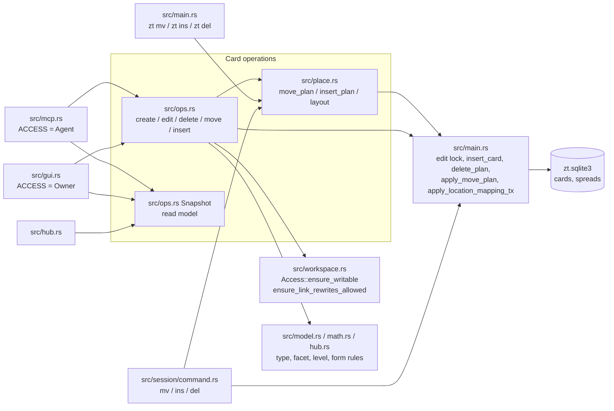
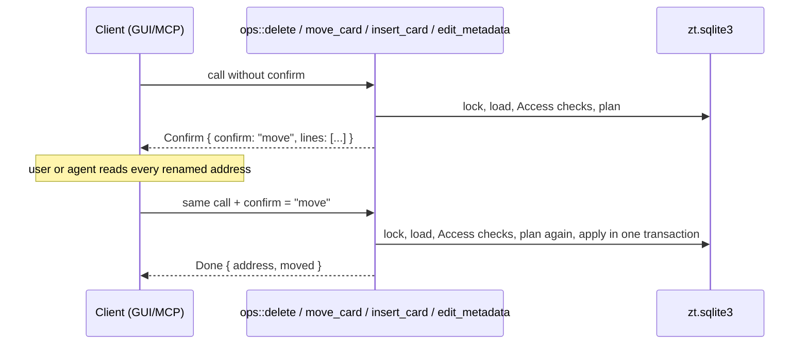

# Card operations

## Purpose

This block is the one write path that the GUI and the MCP server share. It also holds the renumbering planner that every client uses to put a Card between two Cards. `src/ops.rs` creates, edits, retypes, deletes, moves, and inserts Cards under an `Access`. Agent Access refuses any change to the human Workspace, and refuses any change that would rewrite a Link in a human Card body. The destructive operations work in two steps: a call without the expected confirmation word only returns the plan. `src/ops.rs` also holds `Snapshot`, the read model of the whole archive (every Card parsed once, with its Link graph) that the GUI, the MCP server, and the hub code read from. `src/place.rs` computes the Location mapping for an Insert (a new Card in the place of an existing Regular Card) and for a move with `before` and/or `alone`. The Session and the shell commands call it directly. The block exists so that the human's GUI, the agent's MCP tools, the Session, and `zt ins`/`zt mv` keep the same Location rules, confirmations, and Link rewrites. It also keeps the agent's write limit in one place.

**Owns:** the `Access` gate on each GUI/MCP change (`ensure_writable` plus `ensure_link_rewrites_allowed` on every mapping), the `Outcome` two-step protocol, `TypeChange` (how type, Model facet, emphasis, elaboration level, hub level, and Math form combine on an edit), the 20-second edit-lock patience for GUI/MCP writes, the insert and between-Cards move planners (`InsertPlan`, `Target`, `layout`), and the `Snapshot` read model with its search, summaries, and tree list.

**Does not own:** the SQLite schema, the edit lock file, delete plans, side compaction, plain moves to a free slot, `apply_location_mapping_tx`, and the shell commands, which live in `src/main.rs` ([Service, CLI and storage](service-and-cli.md)). It also does not own Card text parsing, the `Workspace`/`Access` types, and Link parsing and rewriting ([Cards, Workspaces and Links](cards-and-links.md)), the facet, level, and model structure rules ([Models and math](models-and-math.md)), hub levels ([Hub Cards](hub-cards.md)), HTTP routing and argument parsing ([GUI](gui.md), [MCP server](mcp-server.md)), or the Session commands `del`/`mv`/`ins`/`ty` ([Terminal Session](session.md)).

## At a glance

| | |
|---|---|
| Entry points | `ops::create_topic`, `ops::create_successor`, `ops::create_literature`, `ops::edit`, `ops::edit_metadata`, `ops::delete`, `ops::move_card`, `ops::insert_card`, `ops::parse_level_arg`, `Snapshot::read`; `place::move_plan`, `place::insert_plan`, `place::insert_verification_lines`, `place::apply_insert_plan` |
| Key files | `src/ops.rs`: the shared Card operations with Access and two-step confirmation, `TypeChange`, and the `Snapshot` read model (search, summaries, trees, model and hub views). `src/place.rs`: the plans that put a Card between Cards (insert before, move `before`, move `alone`) as one old-to-new Location mapping. |
| Depends on | [Service, CLI and storage](service-and-cli.md) (`open_db`, `load_card(s)`, `acquire_edit_lock_within`, `insert_card`, `create_topic`, `update_card_text`, `delete_plan`/`apply_delete_plan`, `side_compaction_mapping`, `crate::move_plan`/`apply_move_plan`, `apply_location_mapping_tx`, `regenerate_reverse_links_tx`, `count_rewritten_links`, `path_edges`), [Cards, Workspaces and Links](cards-and-links.md) (`Access`, `Workspace`, `tree_workspace`, `ensure_same_workspace`, `LinkBody`, `LinkLifecycle`, `parse_card_text`, `literature::parse_metadata`), [Models and math](models-and-math.md) (`model::ensure_allowed`, `model::set`, `model::set_level`, `model::structure`, `model::heads`, `model::read_links`, `math::set_form`), [Hub Cards](hub-cards.md) (`hub::set_level`, `hub::names_hub_level`), `spread::follow` ([GUI](gui.md)); crates `rusqlite`, `serde_json`, `anyhow`, `sha2` |
| Used by | [GUI](gui.md) (`src/gui.rs` handlers for `/api/create`, `/api/literature`, `/api/edit`, `/api/metadata`, `/api/delete`, `/api/move`, `/api/insert`, and every read through `Snapshot`), [MCP server](mcp-server.md) (`src/mcp.rs` write tools and read tools), [Hub Cards](hub-cards.md) (`src/hub.rs` reads a `Snapshot`), [Terminal Session](session.md) (`src/session/command.rs` `mv` and `ins` call `place::`), [Service, CLI and storage](service-and-cli.md) (`zt mv` and `zt ins` in `src/main.rs` call `place::`) |
| Tests | `#[cfg(test)]` modules in `src/ops.rs` and `src/place.rs`; `src/session/command.rs` (`ins_and_mv_before_put_a_card_between_two_cards`); `src/gui.rs` (`a_snapshot_is_kept_until_another_connection_changes_the_cards`); integration tests `tests/self_sufficient_models.rs`, `tests/workspaces_mcp.rs`, `tests/cli_service.rs`, `tests/card_types.rs`, `tests/term_editing.rs` (the Term summary/outbound facts and tree count an editor reads), `tests/model_structure.rs`, `tests/model_levels.rs`, `tests/hub_cards.rs`, `tests/math_units.rs` | S29 (#171): `an_excerpt_projects_a_term_use_to_its_label` proves a Term use previews as its label (the hidden address never reaches a map node excerpt or tooltip) while an ordinary Link keeps its address.

## Concepts

- `Access`: which Workspaces a client may change (`src/workspace.rs`). `Access::Owner` (the GUI, the Session, the shell) may change both Workspaces. `Access::Agent` (the MCP server) may change only the agent Workspace. `src/gui.rs` and `src/mcp.rs` each fix theirs in a `const ACCESS`.
- `Workspace`: `human` or `agent`. A Card shares the Workspace of its Tree root. `ops` reads it from the loaded `Card.workspace`, and `place` reads it with `workspace::tree_workspace`.
- `Outcome` (`src/ops.rs`): the result of a destructive change. `Confirm { confirm, lines }` means nothing changed: `lines` is the plan and `confirm` is the word to send back. `Done(Value)` is the applied result. `Outcome::into_value` gives `{ "confirm", "lines" }` or the result value.
- `Successor` (`src/ops.rs`): `Direct` (the next number, `3/1` -> `3/2`) or `Side` (the next free letter, `3/1` -> `3/1|a`) for `create_successor`.
- `TypeChange` (`src/ops.rs`): a partial change to a Card's Card type, Model facet, Emphasis, Elaboration level, Hub level, Math form, and Term name. Each field is `None` (leave alone), `Some(None)` (clear), or `Some(Some(x))` (set). The type field is a plain `Option<CardType>`; the Term field is the shared `src/term.rs` field protocol.
- `Part` (`src/model.rs`): the facet and optional emphasis that make a new Card a Model part. `create_successor` and `insert_card` take it.
- `Target` (`src/place.rs`, re-exported as `ops::Target`): where a moving Card goes. `To(loc)` is a free Location (the next Direct or Side successor slot of a Card). `Before(loc)` is the place of an existing Regular Card, which moves down.
- `InsertPlan` (`src/place.rs`): `location` (the new Card's address, the old address of `before`), `mapping` (old to new Locations of the Cards that move down), and `rewritten_links` (how many `[[...]]` macros the mapping rewrites).
- `MovePlan` (`src/main.rs`): `mapping` and `rewritten_links`. `place::move_plan` returns it for every kind of move.
- `DeletePlan` (`src/main.rs`): the delete set, the confirmation word, the inbound Links that would break, the optional `into` Card that takes them over, and the side compaction mapping. `DeletePlan::compaction` is the mapping the delete applies (empty when a breaking Link would land on a renamed Card). Its `scope` (`Subtree`, `Tree`, `KeepRoot { root, workspace }`) says what was selected; `kept_root()` exposes a retained root for the keep-root delete (S11, #134).
- Insert: putting a new Card in the place of a Regular Card. That Card and its subtree move down one place, and it becomes the new Card's Direct successor (CONTEXT.md, **Insert**).
- Subtree (in `place.rs`): a Card and every Location whose parent chain reaches it. `parent_location` of `3/3` is `3/2`, so the subtree of `3/2` holds its later Direct successors (`3/3`, `3/4`, ...) and every Side successor below them, not only its Side successors.
- `Snapshot` (`src/ops.rs`): every Card loaded once, with `by_address`, `parsed` (title, body, and Reverse links of each Card), `lifecycle` (the `LinkLifecycle` for Broken links and Term uses), `inbound` (address to the set of Cards that link it, Term uses included), and the split `reverse_inbound`/`term_inbound` that `/api/card` publishes as `reverse_links` and `term_uses`. A lazy lower-case copy (`folded`) serves search, and a lazy Term-meaning map (`term_meanings`) gives each current head its list row's short meaning (S13, #156).
- Broken link, Reverse link, Term use, Spread: these follow every mapping that this block applies. Reverse links and Term uses are regenerated after each write, and Spreads follow renames and lose deleted Cards (`spread::follow`). A Term occurrence is an authored macro like any Link, so `ensure_link_rewrites_allowed` and the Lock gate see it when a move, insert, delete or rename would rewrite it (S11, #153).

## Architecture

The block has two layers. `ops.rs` is the policy layer: it takes the edit lock, loads the Card, applies the Access gate, asks a planner for a mapping, checks that mapping against Access, and either returns a plan (`Outcome::Confirm`) or applies it. `place.rs` is a pure planner over a `BTreeSet` of Locations, with one small apply function for inserts. Most low-level storage helpers live in `src/main.rs`, which both layers call through `crate::`.



- `src/ops.rs`, operations: `create_topic`, `create_successor`, `create_literature`, and `edit` return the new or kept address. `edit_metadata`, `delete`, `move_card`, and `insert_card` return an `Outcome`. Each one opens its own connection (`crate::open_db`) and holds a `zt.edit.lock` guard (`crate::acquire_edit_lock_within(root, EDIT_PATIENCE)`) for the whole call.
- `src/ops.rs`, `Snapshot`: read-only. `Snapshot::read(root)` runs `crate::ensure_markdown_cards` (the schema upgrades), then `Snapshot::load(conn)`. The GUI keeps one `Arc<Snapshot>` until `PRAGMA data_version` moves (`src/gui.rs` `Snapshots`). The MCP server reads a new one for each read tool.
- `src/place.rs`: `move_plan` and `insert_plan` validate the request against the database, then compute the mapping with the pure helpers `subtree`, `shift`, `make_room`, `through`, `layout`, and `next_side_label`. `apply_insert_plan` writes in one transaction. A move plan is applied by `crate::apply_move_plan` in `src/main.rs`.

## Interfaces

### Receipt-owned paragraph edits and transaction previews

An identified `edit_card` may carry `owned_paragraph: {text, replaces_receipt?, adopt_legacy?}` together with its address and mandatory authored base. It cannot also replace the body, title or metadata. `src/batch.rs::owned_paragraph` records the exact inserted paragraph and address in the ordinary operation receipt. A new correction key names the original paragraph receipt. Exactly one standalone authored span must match; text inside fenced code, crossing a code range, embedded in a longer paragraph, absent or duplicated is not owned. An existing unclosed code context cannot absorb the proposed paragraph. Text is one nonblank paragraph without an added fence or generated marker.

A replacement splices the original stored byte range. Title framing, CRLF, formulas, image/Document references and other authored content survive. New Links and the complete corrected Card are validated in the same transaction. A present desired paragraph needs explicit `adopt_legacy: true`; exactly one verified span can then be receipted without a Card write or revision. Conflicts retain observed body and fingerprint. No ownership marker, fuzzy replacement, duplicate deletion or ownership table is introduced.

`apply_batch` also accepts `preview: true`. It runs the same real validators and local-reference/receipt logic under the edit lock, builds final Card projections through the same indexed text-fact reader as scoped persisted reads, plus proposed paragraph Link/kind facts from the uncommitted transaction, then explicitly rolls back. The reply identifies `preview: true`, `applied: false`, `complete` and the unchanged base `archive_revision`. Cards, receipts, Topic allocation, index updates and diagnostics do not persist. Final projections must still match the final receipt per address, so replaying a historical receipt after an independent edit is refused. A preview is temporary validation evidence, never a committed receipt. The MCP response limit is checked after rollback.

A preview simulates each item inside its own SQLite savepoint, so one Tree Lock or blocking Card-check refusal rolls back exactly that item and the independent items after it still run (batch.rs `simulate`, R190–R195; S05 #147). Such a preview answers `complete: false` with two ordered lists: `refusals`, one `{index, op_key, client_ref, refusal}` per refused item carrying the same typed `card_locked` or `card_check` object the single-Card writers answer (a Card-check entry keeps `faults`, `diagnostics`, `zt_check_version` and `policy_hash`), and `blocked`, one `{index, op_key, client_ref, reason: "blocked_by_refusal", blocked_by: [item identity]}` per item whose `@@` reference a refused or blocked item would have bound. `blocked_by` names the direct dependency, so a chain reports one entry per level. A blocked item invents no address and is never claimed as validated. `scan: {items, checked, refused, blocked}` states exactly what the preview checked, so a refused plan is never presented as fully scanned. `results`, `cards` and `paragraphs` describe only the items that really simulated or replayed, and are never a whole-plan projection or a committed receipt. Every other failure — a validation error, a `write_conflict`, an unbound reference or a `check_incomplete` — keeps its existing fail-fast contract and fails the whole request, and the outer transaction is rolled back before any reply, the oversized encoded reply included (R197, R198). Aggregation never authorizes a partial write: a real batch stays fail-fast and atomic, returning its first blocking item with `item {index, tool, op_key}` and rolling everything back.

For a complete thin-client plan, the exclusive `preview_items` input requires `preview: true` and accepts 1–1024 operations with at most 8 MiB of authored text. Numeric `client_ref` values equal their zero-based sequence positions. It simulates the existing 64-item/1-MiB write chunks: earlier-chunk references become concrete addresses before canonical request hashing, while each chunk has its own local bindings. Existing receipts recover their original addresses. Resolved inputs obey both the per-chunk and whole-preview byte bounds. This mode holds one bounded transaction, validates the complete plan, and rolls it all back; it does not increase real write limits. It aggregates Tree Lock and Card-check refusals exactly as `items` does, so a reference to a refused or blocked item in an earlier chunk becomes `blocked_by_refusal` evidence instead of an ordinary unresolved reference. A later item's Link to a Card an earlier successful candidate created in the same transaction resolves through the ordinary validators, and a forward reference still fails the request. Public MCP tests cover count- and byte-limited boundaries, partially committed plans, late failures, cross-chunk alias rejection and schema limits.


`src/batch.rs` applies bounded identified writes in one caller-owned transaction. The ordinary GUI wrappers and MCP paths share the transaction-level Topic, Literature, successor and edit writers in `ops.rs`/`main.rs`; batch application never invokes a public writer that would acquire another lock or commit independently. Ordinary MCP writes use `mcp::write_card_tx` for the same argument interpretation as identified writes. Destructive operations retain their separate confirmation path.

`apply_batch` provides the archive transaction and receipt boundary. Each unseen item stores its canonical request hash, exact allocated result and before/after authored fingerprints in `applied_ops`, atomically with its Card changes. Fingerprints include authored title/body and type/model/math/BibTeX metadata, excluding generated Reverse links. A matching receipt replays the original result; a changed payload or rebound local reference conflicts. No-op/replayed writes do not advance the Card revision. Keys have run/unit/positive-plan-revision/step/stable-item components; client references name earlier results only. A rolled-back batch leaves no receipt, so a corrected request applies fresh instead of replaying a broken prefix. `zt-digest call -OperationPrefix` drives this boundary in deterministic 64-item/1 MiB chunks and rereads its final outputs; the `terms` compiler retains its accepted plan and applies it through the same receipts. A public suite kills the MCP child after a committed chunk and recovers every original address in a new process (see [zt-digest](zt-digest.md)).

Identified `edit_card` items require exactly one `base_fingerprint` or `base_receipt`. The latter must name a retained receipt for the same address and supplies that receipt's final authored fingerprint. Comparison happens inside the transaction before the write, covers body/title and editable metadata, and excludes generated Reverse links. A stale base or a receipt missing from that Card returns `write_conflict` with observed body/fingerprint, rolling back the unseen batch. Raw `base` remains the single-operation protocol; it is refused in an identified batch. The ordinary single-edit path explicitly rejects the batch-only guard fields, so a caller cannot accidentally use an ignored guard. Receipt-owned paragraph edits and previews use the contract below.

`Snapshot::from_cards(cards)` factors the existing pure read calculations out of `Snapshot::load`. Full GUI/Session loading remains unchanged; `src/read.rs` supplies a complete selected request context for MCP projections. No cross-request cache or new invalidation mechanism is introduced.

`ops::edge(card)` is the shared root/direct/side classification for full summaries and lean indexed text reads; it uses the existing address grammar.

All items are `pub(crate)`. ZT is one binary crate, with no library API.

### Write operations (`src/ops.rs`)

| Function | Inputs | Output | Errors (message text) | Side effects |
|---|---|---|---|---|
| `create_topic(root, access, workspace, text) -> Result<String>` | archive root, Access, target Workspace, full Card text (`# Title` + body) | new Topic address `<n>/0` | `the human workspace is read-only for AI agents; only the agent workspace can be changed`; `link target ... does not exist`; `edit in progress` after 20 s | inserts the Topic, bumps `next_topic_id`, regenerates Reverse links |
| `create_successor(root, access, kind, at, card_type, part, text) -> Result<String>` | `Successor::Direct` or `Side`, parent address `at`, `CardType`, optional `Part`, text | new Location | `card ... does not exist`; Access refusal (from the parent's Workspace); `direct successor already exists: <loc>`; `side successors cannot start from a Topic Card` / `... a Literature Card`; `only Model Cards can have a Model facet`; `only Regular Cards can be Event, Finding, Model, or Hub Cards`; link-target errors | inserts the Card in the parent's Workspace with type, facet, and emphasis; regenerates Reverse links |
| `create_literature(root, access, workspace, bibtex, text) -> Result<String>` | one BibTeX entry, Card text whose title is ignored | the Citation key | BibTeX parse errors; `Literature Card <key> already exists` (case-insensitive); Access refusal | inserts a Literature Card. Its title is always the BibTeX `title`, and only the body of `text` is kept |
| `edit(root, access, at, text, change, base) -> Result<String>` | optional new full text, `TypeChange`, optional `base` (the stored text the caller read) | the Card's address (unchanged) | `card ... changed since it was opened; reload it and try again`; Access refusal; `only Regular Cards can be Event, Finding, Model, or Hub Cards`; `only Model Cards can have a Model facet`; `only Model parts can have an emphasis; give the Card a Model facet first`; `` `<a>` is the Model Card of N Model part(s) (...); change or move them first``; `LEVEL_NEEDS_MODEL_CARD`, `hub::LEVEL_NEEDS_HUB_CARD`, `math::FORM_NEEDS_MODEL_CARD`; link-target errors | updates text (a Literature Card keeps its BibTeX title), then type/facet/emphasis, then level, hub level, and form |
| `edit_metadata(root, access, at, bibtex, base, confirm) -> Result<Outcome>` | a Literature Card, new BibTeX, optional `base`, optional `confirm` | `Done({"address": <key>})`, or `Confirm{"move", lines}` when the Citation key changes | `only Literature Cards have BibTeX metadata`; `` Citation key `<k>` conflicts with an existing Literature Card`` (also for a change of case only); ``Location `<loc>` already uses Citation key `<k>` ``; Access and Link-rewrite refusals | rewrites BibTeX and title. On a rename it renames the whole Literature tree, rewrites Links, and Spreads follow |
| `delete(root, access, at, into, confirm) -> Result<Outcome>` | Card address, optional `into` (a Card that stays and takes over the inbound Links), optional `confirm` | `Done({"deleted": n, "moved": {old: new}, "address": <parent or null>})`, or `Confirm{"delete" or the root address, lines}` | `` `<into>` is deleted too; re-point the Links to a Card that stays``; Access refusal; ``this change would rewrite Links in human workspace Card `<a>`, which is read-only for AI agents`` (from re-pointing or side compaction) | deletes the Card and its subtree (a Tree root: its whole tree), re-points Links to `into`, compacts later Side successors, Spreads drop the Cards, regenerates Reverse links |
| `move_card(root, access, at, target, alone, confirm) -> Result<Outcome>` | Card address, `&Target`, `alone`, optional `confirm` | `Done({"address": <new>, "moved": {old: new}})`, or `Confirm{"move", lines}` | see [Move errors](#move-and-insert-errors); Access and Link-rewrite refusals | renames Locations, rewrites every Link, Spreads follow, regenerates Reverse links |
| `insert_card(root, access, before, card_type, part, text, confirm) -> Result<Outcome>` | address of the Regular Card `before`, type, optional `Part`, text whose Links use today's addresses, optional `confirm` | `Done({"address": <new card>, "moved": {old: new}})`, or `Confirm{"insert", lines}` | `cannot insert before a tree root; insert before its Direct successor instead`; facet/emphasis errors; link-target errors; Access and Link-rewrite refusals | moves `before` and its subtree down one place, writes the new Card at the freed place, regenerates Reverse links |

`ops::parse_level_arg(value: Option<&Value>) -> Result<(Option<Option<Level>>, Option<Option<HubLevel>>)>` reads one JSON `level` argument for both kinds of level. Absent gives `(None, None)`. `null`, `""`, or `none` clears both. `line`/`topic`/`field`/`register` set only the hub level. `concept`/`formal` (or a number that `model::parse_optional_level` accepts) set only the elaboration level. Any other JSON type fails with ``argument `level` must be concept, formal, line, topic, field, register, or empty``.

`ops::create_successor_with_term` and `ops::insert_card_with_term` are the S07 variants the GUI and MCP use; the older signatures remain for tests and delegate with no Term name. They validate the name against the final type before the Lock gate, check it with the same `gate::Candidate`, and write it in the same `INSERT` as the type.

`TypeChange` methods:
- `is_empty()`: no field is set. The GUI then requires `text`, and MCP `edit_card` then treats title/body as the change.
- `resolve(card) -> (CardType, Option<Facet>, Option<Emphasis>)`: the result after the change. Rules: a non-Model type clears the facet. A facet makes the Card a Model Card. `facet: Some(None)` clears the facet and keeps the type. Naming the type the Card already has keeps its facet. Naming a new type without a facet gives no facet. The emphasis is kept only while the Card stays a part, unless the change names one.
- `resolve_level`, `resolve_hub_level`, `resolve_form`: the level, hub level, or form after the change. Each one is kept only while the Card stays a Model Card without a facet (for a hub level: a Hub Card). Setting one on a Card that will not qualify fails before anything is written.
- `resolve_term(card) -> Result<Option<String>>` (S07, #149): the Term name after the change. Omitted keeps the stored name only while the Card stays a Term Card, so retyping away clears it; `Some(None)` clears; a string is trimmed and validated (`src/term.rs`) and must be empty or sit on a Term Card, otherwise the edit fails before any write. `ops::edit_tx` clears a removed name before a type change and sets a new one after it, so the table's `term_name IS NULL OR card_type = 'term'` check never sees half of the pair. The same name travels in the gate's `Candidate.term`.

### Snapshot (`src/ops.rs`)

| Method | Returns |
|---|---|
| `Snapshot::read(root)` / `Snapshot::load(conn)` | the read model, read in one SQLite read transaction: the Cards, their active Lock facts (`tree_lock::LockView`) and the archive revision. `read` first runs the schema upgrades in `ensure_markdown_cards`; `load` opens its own read transaction unless the caller already holds one |
| `from_cards(cards, lock, revision)` | the shared domain calculations over a complete request context. The Lock view and the revision are explicit arguments, so a database-backed read cannot silently show a real archive as lock-free (R207, S03-AC04). Only an isolated pure fixture passes `LockView::empty()` |
| `fingerprint()` | 24 hex characters, from the SHA-256 of the archive revision and then each Card's address, text, BibTeX, Workspace, type, facet, emphasis, level id, form, and Term name. Open GUI windows poll it to notice changes, including a Lock-only commit that changes no Card or a Term-name-only edit (S03-AC06, S07 #149) |
| `revision()`, `lock()`, `decorate(value, row_id)`, `locked(row_id)` | the revision the Snapshot was read at, its Lock view, the decorator that attaches `lock` and `pinned_by`, and whether an active Lock promises that row |
| `title(addr)`, `workspace(addr)`, `reference(addr)` | title, Workspace, and `{address, title, workspace, lock, pinned_by}` |
| `outbound(addr)` | each distinct Link target as `{address, title, workspace, broken}`; when the first authored occurrence is a Term use, it also carries `kind: "term"` and the authored `label`, so an editor can tell a word use from an ordinary citation of the same Term Card (S14, #161) |
| `summary(card)` | `{address, tree, workspace, title, kind, type, facet, emphasis, level, form, head, edge ("root"/"side"/"direct"), parent, excerpt, restatement (the derived navigation role of a `## 同述入口` entry), links (not broken), kinds (target -> Relation kind, plain refers left out), term_use_targets (targets reached with a Term use), inbound (count), lock, pinned_by}`, plus on a Term Card its exact `term` name, computed `term_role`, and `term_list` (S14, #161) |
| `trees()` | one row per Tree root: `{tree, root, workspace, kind (Zone), title, excerpt, count, events, findings, models, terms, locked}`. `events`, `findings`, and `models` count only Cards without a facet; `terms` counts every Term Card of the tree (S14, #161) |
| `model_head(card)` | the first Model Card a Model part belongs to (`model::heads`). `None` for a Card without a facet |
| `model(addr)` | `model::structure(...)`: the model view that `get_card`/`get_model` use |
| `sides(card)` | the direct child Side successors of a Regular Card, as references |
| `inbound_refs(addr)`, `nav(Option<addr>)` | references of the linking Cards, and a reference only if the address exists |
| `term_meaning(addr)` | the short `意思` a current Term head publishes in its list's table row, from the lazy `term_meanings` map, or `None` when it is no head or its list has no row (S13, #156). The GUI's quiet Term link offers it with the address |
| `term_facts(addr)` | for a Term Card, `{role: "list"\|"card"\|"part"\|"unfiled", list: {address, title}\|null}` from `term::place`; `None` for any other type, so `/api/card` adds `term_facts` only where it means something (S13, #156) |
| `find(query, workspace, card_type, limit)` | GUI ranked search: `{results, total, workspaces, types}` (see [Search](#ranked-search-snapshotfind)) |
| `search_in(query, workspace, card_type, form, limit)` | MCP `search_cards`: substring match over address, title, and body. An empty query lists all Cards of a type or form. With no query, type, or form it returns `[]`. `search(...)` is the `#[cfg(test)]` form without `form` |
| `broken(workspace)` | Broken links `{source, title, workspace, target, line}`, filtered by the source's Workspace |

Free functions: `kind(card)` (`"literature"`, `"topic"`, or `"regular"`), `zone(card)` (`"literature"` or `"topic"`, from the tree id), `excerpt(body)` (a Term use previews as its visible label, S29/#171) (the first prose line, at most 140 characters, without Markdown marks; it skips code fences, raw HTML lines, and `![...]` images), and `clip(text, n)` (cuts to `n` characters with `…`).

### Placement (`src/place.rs`)

| Function | Signature | Notes |
|---|---|---|
| `move_plan` | `(conn, at, &Target, alone) -> Result<MovePlan>` | `Target::To` without `alone` goes to `crate::move_plan` (`src/main.rs`) unchanged. Every other combination uses `layout` |
| `insert_plan` | `(conn, before) -> Result<InsertPlan>` | `before` must be a Regular Card |
| `insert_verification_lines` | `(&InsertPlan) -> Vec<String>` | `insert verification:`, `new card -> <loc>`, one `old -> new` line per moved Card, `moved cards: N`, `link macros rewritten: N` |
| `apply_insert_plan` | `(conn, &InsertPlan, CardType, Option<&Part>, text) -> Result<gate::Accepted>` | rewrites the Links in `text` through the mapping, checks the exact Card the placement will store, then in one transaction applies the mapping, inserts the Card, and regenerates Reverse links |

The plan lines of the other operations come from `src/main.rs`. `move_verification_lines` gives `move verification:`, the `old -> new` lines, `moved cards: N`, and `link macros rewritten: N`. `delete_verification_lines` gives `delete verification:`, `delete <loc>` for each Card, `successors: N`, then either `links that will break: N` with `source -> target` lines (and, when the compaction is dropped, `later side successors keep their locations, so no card takes over a broken link`), or `links re-pointed to <into>: N` with `source: [[target]] -> [[into]]` lines. A keep-root plan instead gives `root kept: <root> (<kind>, <workspace> workspace)`, `delete regular cards: N`, and up to 20 `source -> target` pairs followed by `... and N more` when more Links break; its success line is `deleted: N; root kept: <root>`. `citation_rename_lines` gives `citation key rename:`, the `old -> new` lines, `renamed cards: N`, and `link macros rewritten: N`.

### Move and insert errors

| Message | Cause |
|---|---|
| `Literature Card cannot be moved; edit metadata to change its Citation key` | `at` is a Literature Card |
| `Topic Cards cannot be moved` | `at` is a Topic |
| ``invalid move location `<loc>` `` | the destination is not a Regular Location (for example `0/02` or a Tree root) |
| ``Literature tree Cards cannot leave Literature tree `<t>` `` / ``Topic tree Cards cannot move into Literature tree `<t>` `` | the tree-kind boundary (`ensure_same_tree_kind_boundary`) |
| ``card `<before>` does not exist`` | `Target::Before` names no Card |
| ``Cards cannot move between workspaces: `<from>` is in the <a> workspace and `<to>` is in the <b> workspace`` | applies to every client, the owner too |
| `` `<at>` has Side successors: move them first, or move it with its subtree`` | `alone` on a Card with Side successors |
| `cannot move a card before one of its own successors` | `Before` names a Card inside the moving subtree |
| `cannot move a card into its own successors` | `To` names a slot whose parent is inside the moving subtree |
| `move target parent does not exist outside the moved subtree` | the `To` parent is missing |
| `side successor move target must be the next available label: <parent>\|<x>` | `To` names a letter that is not the next free one |
| `move target does not preserve direct successor rules` | `To` is a number that is not the parent's next Direct successor |
| `destination locations already exist: <loc>; use `before` to move into an occupied place` | `alone` + `To` names an occupied Direct slot (the plain move gives the same text without the hint) |
| `` `<at>` is already there; nothing moves`` | the mapping is empty (for example, `alone` before the Card's own Direct successor) |
| `the move would make an invalid location <loc>` / `the move would put two Cards at <loc>` | safety checks on the final mapping |
| `cannot insert before a tree root; insert before its Direct successor instead` | `insert_plan` on a Topic or Literature Card |

### Callers and their surfaces

| Client | Access | Create | Edit | Delete | Move | Insert |
|---|---|---|---|---|---|---|
| GUI (`src/gui.rs`) | Owner | `POST /api/create` (`kind` = `topic`/`direct`/`side`, `term` for a Term Card), `POST /api/literature` | `POST /api/edit` (`text`, `type`, `facet`, `emphasis`, `level`, `form`, `term`, `base`), `POST /api/metadata` | `POST /api/delete` (`at`, `into`, `confirm`) | `POST /api/move` (`at`, `to` xor `before`, `alone`, `confirm`) | `POST /api/insert` (`before`, `type`, `facet`, `emphasis`, `term`, `text`, `confirm`) |
| MCP (`src/mcp.rs`) | Agent | `create_topic`, `create_literature`, `create_successor` | `edit_card`, `edit_literature_metadata` | `delete_card` | `move_card` | `insert_card` |
| Session (`src/session/command.rs`) | none checked | (own commands) | `e`, `ty` | `del` (via `delete_plan`) and `del keep-root` (via `keep_root_delete_plan`); no `into` | `mv [alone] <loc>` / `mv [alone] before <loc>` via `place::move_plan` | `ins` via `place::insert_plan` |
| Shell (`src/main.rs`) | none checked | `zt t`, `zt l`, `zt n`, `zt b` | `zt e` | `zt del --at <loc>` / `zt del --at <tree-root> --keep-root` | `zt mv --at <loc> [--alone] <new>` / `--before <loc>` | `zt ins --at <loc>` |

The GUI returns `Outcome::into_value()` as it is: `{confirm, lines}` or the result. MCP wraps it with `plan_or_done`: `{applied: false, confirm, plan, next}` or the result plus `applied: true`. The Session and the shell do not use `ops` for writes. They take the edit lock without patience (`acquire_edit_lock`), print the same plan lines, and read the confirmation word from the user (`read_confirmation` in `src/main.rs`, `interaction.confirm` in the Session).

## Behaviour

### The Lock gate

A Lock is the owner's promise about one whole tree ([Service, CLI and storage](service-and-cli.md#tree-lock-storage-src_tree_lockrs)). Every `ops` change calls `tree_lock::ensure_unlocked` before it writes, with the effect it is about to apply:

| `Change` | Used by | Refused when |
|---|---|---|
| `Edit(row_id)` | `edit_tx` (and so every metadata setter), `edit_metadata`, `update_card_text`/`update_literature_text` | the row is a member of an active Locked tree |
| `CreateAt(final address)` | `create_topic_tx`, `create_successor_tx`, `create_literature_tx`, `insert_card` | the final address belongs to an active Locked tree (including an orphaned Lock whose root is gone) |
| `Mapping(final old→new)` | `move_card`, `insert_card`, every `apply_location_mapping_tx` caller (moves, side compaction, Citation-key rename) | a source row is a member or a pinned target, a destination is inside a Locked tree, or the mapping would rewrite a `[[target]]` in a Locked source |
| `Delete(plan)` | `delete` | the delete set names a member or a pinned target; its `into` re-pointing or Side compaction hits the same rules. A keep-root plan also refuses while its retained root is a promised member, so a Locked tree refuses emptying even when its delete set is empty; a pin on the retained root alone permits it (S11, #134) |
| `LinkRewrites(map)` | inside `Mapping` and `Delete` | a Locked source's authored body contains a `[[target]]` that the rewrite would change |

The order is fixed: take the edit lock, load the Card, run the Workspace `Access` checks, then the Lock gate, then plan, then the two-step confirmation, then apply the transaction-level writers, which repeat the same gate. A no-op edit request is still refused, because the request itself is the change the owner promised to forbid. Owner Access has no exemption; an opponent Agent Access check still refuses first.

A typed refusal is the structured `card_locked` object every writer shares (S09, #132: R182–R185). It carries `error: "card_locked"`, the human `message`, the canonical `tree` (the first blocking Locked tree's root address), the sorted, deduplicated affected `cards` (the member whose write the Lock stopped — `Change::Edit` reads the member's own row-to-address entry, never another member's — the destination inside the Locked tree, the pinned target, or every affected Card of a refused mapping), the exact `reason`, the actionable `hint`, an optional `sources` array holding the locked source Cards whose Links pin the target, and `locks` (`[{lock_id, tree}]`, sorted by Lock id) explaining every blocking Lock. The reasons are `edit`, `delete`, `move`, `create-inside`, `move-inside`, `pinned-move` and `pinned-delete`. `ops` returns it as an `anyhow` error wrapping `tree_lock::Refusal`, the GUI answers `409` with the same object under `refusal`, and the MCP server returns it as `structuredContent` with `isError: true`; no client recovers these facts by parsing text. A Lock plan whose derived Link index disagrees with an authored body refuses with the separate `index_integrity` object (`tree_lock::IndexRefusal`), never `card_locked`.

The reasons divide the allowed side from the refused one. A pinned target passes `Edit(row_id)`, so its body, title, BibTeX without a Citation-key rename, type and model/hub/math fields stay editable; only an effect that moves, renames or deletes it is `pinned-move` or `pinned-delete`. A target that also belongs to another Locked tree answers `edit` first, because that Lock is the stronger promise. An unlocked source may add or remove a Link naming a Locked member, because only the member's generated Reverse section changes; a `[[target]]` rewritten inside a Locked source is refused as `edit` even when its own address does not move, and every locked source the rewrite would touch is named. `Reply` reuses this gate with one addition: a locked human destination comes back as a kept refusal (`Outcome::Refused`, `reason: "locked_destination"`, with the structured `refusal`), and the reply transaction is rolled back rather than committed, so a fallback Topic created on the way does not remain (`src/reply.rs`).

Every writer path that does not pass through `ops` calls the gate itself: `main::insert_card_tx`, `insert_literature_card_tx`, `update_card_text`, `update_literature_text`, `update_literature_metadata`, `apply_delete_plan`, `apply_location_mapping_tx`, the four metadata setters (`model::set`, `model::set_level`, `hub::set_level`, `math::set_form`), `batch::owned_paragraph`, and `zt del --all` (which refuses while any Lock is active). The shell commands and the GUI check before an editor or a confirmation prompt opens. Reverse-link regeneration and the Link-index rebuild are generated-only writes and deliberately skip the gate; the SQL triggers allow them because the authored part of the text is unchanged.

### The write gate (S04, #146)

After the Lock gate and before any stored change, every create/edit/insert path builds a `gate::Candidate` and calls `gate::check_proposed` with the transaction's own connection: `ops::create_topic`, `create_literature`, `create_successor` (and their `_tx` forms), `edit_tx` (one combined candidate for the final text plus the final type/facet/emphasis/level/hub level/form), `insert_card` → `place::apply_insert_plan` (the Card as the simulated placement will store it, after Link rewriting), the direct shell helpers, the Session's `ty`/`lv`/`mf` setters (now routed through `ops::edit_tx`), the GUI handlers, the MCP tools, `apply_batch` items and the owned-paragraph writer, and the GUI Reply. Access and Locks still run first, and the mandatory envelope/Link invariants run before the shared rules; the checker core then reads the bounded context (parent chain and home Model Card, its setting Card and level, the book's term table, distinct targets) and applies the archive policy plus the legacy ratchet. An accepted change adds `warnings` and `check {complete, rule_version, policy_hash, stage}` to the operation result; a blocking fault is `gate::Refusal` (`card_check`) and the transaction is not committed. A pure move, a Citation-key remap, a generated Reverse refresh and an unchanged no-op save run no prose check. The archive's `gate.stage` decides whether a policy `block` really refuses (`enforce`) or is reported as advice (`advisory`, the rollout default); mandatory invariants refuse in both stages.

### Gated write (every `ops` change)

1. Take `zt.edit.lock` with `acquire_edit_lock_within(root, EDIT_PATIENCE, <operation>)`, where `<operation>` is the function's own name (`create_topic`, `create_successor`, `edit`, `apply_batch`, …). While the lock is held the call retries with a pause that doubles from 20 ms to at most 400 ms, for up to 20 s, then fails with `edit in progress`. Only contention is retried: a fault (access denied, a full disk, an unreadable lock file) returns at once ([Service, CLI and storage](service-and-cli.md)). A wait past five seconds writes one `edit wait:` line and its completion records both the queue wait and the lock-held duration; a wait whose last poll crosses the five seconds reports itself too, because the crossing is checked both after a refusal and when the lock finally arrives. A Session holds the lock while its editor is open.
2. Open a connection and load the Card (`crate::load_card`). For `create_topic`/`create_literature`, which have no Card yet, `access.ensure_writable(workspace)` runs before the lock.
3. `access.ensure_writable(card.workspace)`. For `create_successor` this is the parent's Workspace.
4. Plan the change. For any change that renames addresses, call `access.ensure_link_rewrites_allowed(conn, mapping)`. For Agent Access this refuses the change if any human Card outside the mapping holds a `[[target]]` or a Term `[[label@address]]` that the mapping would rewrite (only the target bytes count, so a label stays untouched). Owner Access always passes. Rewriting a human Card's generated Reverse links is not counted.
5. If the call is two-step and `confirm` is not the expected word, return `Outcome::Confirm` with the plan lines. Nothing is written. All the validation above has already run, so an agent learns about a refusal on the plan call.
6. Apply the plan. The write gate checks the final candidate and refuses before the stored change; ordinary creates/edits then update the changed source's occurrence index and affected Reverse links. Structural changes rebuild the index in their existing transaction. `edit` checks and commits authored text, type, facet, emphasis, model/hub level and Math form together; it advances one archive revision only when those values change. A no-op edit is not a new revision.

### Two-step confirmation



| Operation | Word |
|---|---|
| `delete` of a Regular Card | `delete` |
| `delete` of a Tree root (deletes the whole tree) | the root's own address, for example `3/0` or `Smith2024` |
| `move_card` | `move` |
| `insert_card` | `insert` |
| `edit_metadata` with a new Citation key | `move` (the same key needs no confirmation) |

The second call computes the plan again from the current Cards. The word does not bind the call to the plan that was shown (see [Decisions and pitfalls](#decisions-and-pitfalls)).

### Create a successor

1. `create_successor` locks, loads the parent, and checks Access on the parent's Workspace.
2. `Direct`: `crate::direct_successor(parent)` (`3/0` -> `3/1`, `Smith2024` -> `Smith2024/1`, `3/1|a` -> `3/1|a|1`, `3/2` -> `3/3`). It fails if that Location exists, so a Card has at most one Direct successor.
3. `Side`: `crate::ensure_side_parent` refuses Tree roots. `crate::next_side_successor` takes the highest existing letter plus one (`a`, ..., `z`, `aa`, ...).
4. `crate::insert_card` validates the Location, the Workspace of the tree, the type/facet/emphasis (`model::ensure_allowed`), the Links in the text (every new Link must name an existing Card), and then the shared write gate (`gate::check_proposed`) before inserting the Card and regenerating Reverse links in one transaction.
5. The GUI and MCP callers check `level`/`form` against the type themselves first. After the create they apply `level`, hub level, or `form` with a second `ops::edit` call, which takes the lock again and commits separately.

### Edit

1. `unchanged_card`: load the Card. If `base` is given and differs from the full stored text (the Reverse link section included), fail with `changed since it was opened`.
2. Check Access, resolve the target type, facet, emphasis, level, hub level, and form with `TypeChange`. A Model Card that still has parts cannot stop being a Model Card (`model::ensure_allowed`). Tree roots stay Idea Cards (`card_type::ensure_allowed`). These checks run before any write, so a refused type leaves the text unchanged too.
3. Write the text: `update_literature_text` for a Literature Card (the title is taken again from BibTeX) or `update_card_text`. Each one validates Links (a Link that was already broken may stay) and regenerates Reverse links in its own transaction.
4. If the type changed, `model::set` writes `card_type`, `model_facet`, and `model_emphasis`. It also clears `model_level`/`math_form` when the Card is no longer a Model Card without a facet, and `hub_level` when it is no longer a Hub Card.
5. Reload the Card, then write a changed level (`model::set_level`), hub level (`hub::set_level`), or form (`math::set_form`).

### Edit Literature metadata

1. Load the Card (with the `base` check). Refuse a Card that is not a Literature Card. Parse the BibTeX.
2. A new entry key must not equal the old key ignoring case, and must not collide case-insensitively with another Card (`citation_key_conflicts`). `citation_rename_mapping` maps `Old` -> `New` and every `Old/<suffix>` -> `New/<suffix>`. It fails if a Location already starts with `New/`.
3. Check the mapping against Access. Without `confirm == "move"`, return the `citation_rename_lines`.
4. `update_literature_metadata` writes the key, the BibTeX, and the title. It then applies the mapping (Locations, Links, Spreads) and regenerates Reverse links in one transaction.

### Delete

1. `crate::delete_plan`: a Tree root deletes every member of its tree and is confirmed with its address. A Regular Card deletes `descendant_locations` (its later Direct successors and all its branches) and is confirmed with `delete`. The plan lists the Links from staying Cards into the delete set.
2. `crate::keep_root_delete_plan` (S11, #134) is the third shape: every member of a Tree except its root, with no Side compaction. It needs an actual Tree root (`keep root takes a Tree root (a Topic like 3/0 or a Citation key); <a> is a Regular Card`), is confirmed with the root's address, and the plan's `scope` says `KeepRoot { root, workspace }` (`DeletePlan::kept_root`). Only the shell and the Session ask for it; the GUI and the MCP `delete_card` tool keep their arguments and use the other two shapes.
3. With `into`: `DeletePlan::into` requires a Card outside the delete set. `repoint_mapping` (each linked deleted Card -> `into`) is checked against Access.
4. A Regular Card: `side_compaction_mapping` renames the later Side successors of the same parent one letter down (`P|c` -> `P|b`, and their subtrees). `DeletePlan::compaction` drops the whole compaction when, without `into`, a Link that breaks targets an address a renamed Card would take (`[[P|b]]` while `P|c` exists): every Card keeps its Location and the plan adds `later side successors keep their locations, so no card takes over a broken link`. The applied mapping is checked against Access too.
5. Without the confirmation word, return `delete_verification_lines`. For a keep-root plan they name `root kept: <root> (<kind>, <workspace> workspace)`, `delete regular cards: N`, and the first 20 breaking pairs plus `... and N more`; the success line is `deleted: N; root kept: <root>`. The root keeps its row identity, address, kind, Workspace and authored identity (its generated Reverse section may change) and the next successor is `<tree>/1` or `<key>/1`.
6. `apply_delete_plan(conn, plan)` (one transaction): re-point the Links first (so a compaction that renames `into` carries the new Links along), delete the rows, drop them from Spreads, apply the compaction mapping, and regenerate Reverse links. A keep-root plan with nothing to delete writes nothing at all, so it advances no revision and rebuilds nothing; every other plan advances the revision once.
7. Return the count, the compaction mapping, the retained root of a keep-root plan (`root_kept`), and the parent address if it still exists (the GUI opens it).

### Move with successors to a free slot (`Target::To`, `alone = false`)

`place::move_plan` hands this case to `crate::move_plan` in `src/main.rs`. The rules: the Card is not a Tree root, the target is a valid Regular Location in the same tree kind and Workspace, and the target is not inside the moving subtree. The target is the parent's next Direct successor or its next free Side letter. Every Card in `descendant_locations` keeps its path from the moving Card (`path_edges`), and no mapped Location may already exist outside the moving set.

### Move between Cards (`place::layout`)

Used for `Target::Before` and for any `alone` move. After the same validation as above (Card kind, Location validity, tree-kind boundary, `before` exists, same Workspace), `layout(locations, at, target, alone)` computes one mapping over the set of all Locations in three steps:

1. **Detach.** `moving` is `{at}` when `alone` (refused if `at` has Side successors), or else `subtree(at)`. `rest` is everything else. If `alone` and `at` has a Direct successor in `rest`, `close = shift(rest, next, at)` moves that chain up one place to close the gap. `detached` is `rest` after `close`.
2. **Make room / find the place.** `length` is how many places the moving Cards take on the Direct successor line of `at`. For `Before(b)`: `b` must not be in `moving`. The place is `b` after `close`, and `room = make_room(detached, place, length)` moves the Card at the place and its subtree down by `length` places. For `To(t)`: the parent of `t` must exist outside `moving`. A letter must be the next free label of the parent among `rest`. A number must be the parent's next Direct successor and must be free after `close`. The place is computed from the parent after `close`, so `alone` may name a place after the Card in today's addresses.
3. **Place.** The moving Card takes the place (`alone`), or the moving subtree is shifted there, each Card keeping its path.

Every Location is then mapped through `placed`, else `close` then `room`. Only changed Locations are kept. The result is refused if a new Location is invalid or taken twice, and refused when it is empty.

Worked mappings (from the tests in `src/place.rs` and `tests/self_sufficient_models.rs`):

| Locations | Request | Mapping |
|---|---|---|
| `0/1`, `0/2`, `0/2\|a`, `0/3` | `0/3` alone before `0/1` | `0/1->0/2`, `0/2->0/3`, `0/2\|a->0/3\|a`, `0/3->0/1` |
| `3/1`, `3/2`, `3/3`, `3/4`, `3/4\|a` | `3/4` (with successors) before `3/2` | `3/2->3/3`, `3/3->3/4`, `3/4->3/2`, `3/4\|a->3/2\|a` |
| same | `3/2` alone before `3/4` | `3/2->3/3`, `3/3->3/2` |
| `3/1`, `3/2`, `3/1\|a`, `3/1\|a\|1`, `3/1\|a\|1\|a` | `3/1\|a` (chain of 2) before `3/2` | `3/1\|a->3/2`, `3/1\|a\|1->3/3`, `3/1\|a\|1\|a->3/3\|a`, `3/2->3/4` |
| `H/11\|b\|a\|1` ... `\|5`, `\|5\|a` | `\|4` alone to `\|2\|a` | `\|4->\|2\|a`, `\|5->\|4`, `\|5\|a->\|4\|a` |

### Insert before a Card

1. `ops::insert_card` locks, loads `before`, and checks Access on its Workspace.
2. `place::insert_plan` refuses a Tree root. `make_room(all, before, 1)` shifts `before`'s subtree so that `before` lands on its own Direct successor: `X/2` -> `X/3`, the old `X/3` -> `X/4`, `X/2|a` -> `X/3|a`. Before a Side successor: `P|a` -> `P|a|1`, the old `P|a|1` -> `P|a|2`, `P|a|b` -> `P|a|1|b`.
3. Check the mapping against Access, check the type/facet/emphasis, and validate the text's Links against today's Cards.
4. Without `confirm == "insert"`, return `insert_verification_lines`.
5. `apply_insert_plan`: check the type and text again, rewrite the Links in the new text through the mapping (a Link to `before` now reaches it at its new place), then in one transaction apply the mapping to Locations, Links, and Spreads, insert the row at `plan.location` with the tree's Workspace, and regenerate Reverse links.

### How Links are rewritten

`apply_location_mapping_tx` (`src/main.rs`) first renames every mapped Location to `__moving__<old>`, then to its new value, so swaps and chains never collide on the `UNIQUE` column. It then rewrites every Card's body with `LinkBody::rewrite_targets(mapping)`. Only `[[target]]` macros in prose whose target is a key of the mapping change (Links in code spans and fences are not Links). Last it calls `spread::follow`. `count_rewritten_links` uses the same rewrite to report `link macros rewritten`. Reverse link sections are rebuilt afterwards by `regenerate_reverse_links_tx`, never rewritten.

### Ranked search (`Snapshot::find`)

Every whitespace-separated term of the lower-cased query must occur in the address, the title, or the body. Score per term: title +300 if the title starts with it (else +200); address +800 if equal, +120 if it starts with it, else +40; body +20 plus 2 per occurrence (at most 5). Then +1000 for the whole title (with or without spaces), +40 for Tree roots and Hub Cards, and minus title length / 8. Ties keep `cards` order (address order). `workspaces` counts matches under the type filter, and `types` counts them under the Workspace filter. Each hit's `snippet` is a window of about 150 characters around the first body term (`context_snippet`), else the excerpt.

### The Lock facts of a read view (S03, #126)

A Card projection names the active Locks that govern it, from one bulk `tree_lock::LockView` per read:

- `lock` is `null` for an unlocked Card, or `{lock_id, tree, since}` where `tree` is the Locked tree's **root address** (R068: the Card's own `tree` field stays the tree id, and its `root` meaning is unchanged) and `since` is the Lock's UTC start.
- `pinned_by` is the sorted, deduplicated list of active Locked tree roots whose Cards link this one; an unpinned Card has `[]`. Several members of one Locked tree name that root once, and one Card can have both a `lock` and a nonempty `pinned_by`.
- `writable` on a Card object is the reading client's Workspace permission **and** no active Lock (`LockView::writable_for`). The MCP server reads with Agent Access, the GUI with Owner Access; a pin alone never clears `writable`, because movement and deletion are constrained by the writer gate instead.

`LockView::read(conn, rows)` loads the facts in two queries from the member-row (`lock_members_by_row`) and target-row (`lock_pins_by_target`) indexes: `None` for every Card of a full Snapshot, `Some(rows)` for a scoped read's selected and context rows. No read reparses a locked tree, recomputes a seal, or queries once per rendered Card, and the view is not a cache — it lives for one read. `tree_lock::decorate_card(value, row_id, view)` is the one helper that attaches the two fields.

The projections that carry them: `Snapshot::summary` (`/api/graph`, `/api/tree`, MCP `get_tree`), `Snapshot::reference` (the GUI's `parent`/`direct`/`sides`/`inbound` navigation rows), `Snapshot::find` and `Snapshot::search_in` (both search views), `read::text_value` and `read::text_facts` (MCP `get_card` and both `get_cards` views, plus an `apply_batch` preview's final Cards), `entry::row` (entry-first search rows), `read::titles` (`export_titles`, which destination plans read), `read::trees` and `Snapshot::trees` (`locked` only) and the GUI's `/api/card` detail. Model and hub reports name their Cards with bare references (`{address, title, …}`) and stay unchanged; `ask_box` and entry search keep their selection and ranking rules, so their annotations are descriptive only. Since S12 (#154) the two read functions take a `read::TermLinks` mode: a preview always passes `Raw`, so its final Cards keep the authored Term macros even though `get_card`/`get_cards` can project them on request ([MCP server](mcp-server.md)).

### Rules the code keeps

- One edit lock for every writer. GUI and MCP writes wait up to 20 s (a digest batch client declares 180 s for its child `zt mcp`, and `apply_batch` honours it). Session and shell writes fail at once with `edit in progress`. A two-step operation releases the lock between the plan call and the confirmed call.
- Every applied rename is one SQLite transaction: Locations, Link bodies, Spreads, and Reverse links commit together.
- Cards never change Workspace or leave a Literature tree, and Topic tree Cards never enter one, for every client.
- A Card's type, facet, emphasis, level, and form stay with its row through moves, inserts, side compaction, and Citation key renames (test `types_stay_with_cards_through_moves_side_compaction_and_citation_renames`).
- New Links must name existing Cards. An edit may keep a Link that was already broken.
- `Access::Agent` may delete an agent Card that a human Card links to. The human Card keeps a Broken link, and its body is not edited.

## Data and storage

This block keeps no store of its own. It reads and writes the `cards` table and, through `spread::follow`, the Spreads that `src/main.rs` and `src/spread.rs` own ([Service, CLI and storage](service-and-cli.md)).

- Columns written: `location`, `citation_key`, `is_topic`, `is_lit`, `bibtex`, `text`, `workspace`, `card_type`, `model_facet`, `model_emphasis`, `model_level`, `hub_level`, `math_form`. `apply_insert_plan` writes this row:

```sql
INSERT INTO cards(location, citation_key, is_topic, is_lit, bibtex, text, workspace, card_type, model_facet, model_emphasis)
VALUES('0/1', NULL, 0, 0, NULL, '# step\n\nfrom [[0/2]]\n\n<!-- zt:reverse-links -->\n...', 'agent', 'model', '推导', NULL);
```

- Transient Location names: `__moving__<old>` exists only inside an `apply_location_mapping_tx` transaction.
- Lock file: `<archive_root>/zt.edit.lock`, created with `create_new` and removed when the `EditLock` guard drops.
- Wire format of a plan (GUI `/api/move` without `confirm`):

```json
{ "confirm": "move", "lines": ["move verification:", "0/1 -> 0/2", "0/2 -> 0/3", "0/3 -> 0/1", "moved cards: 3", "link macros rewritten: 1"] }
```

- Wire format of a plan and a result in MCP (`plan_or_done` in `src/mcp.rs`):

```json
{ "applied": false, "confirm": "insert", "plan": ["insert verification:", "new card -> 0/1", "0/1 -> 0/2", "0/2 -> 0/3", "moved cards: 2", "link macros rewritten: 1"], "next": "nothing changed yet; call again with confirm = \"insert\" to apply" }
{ "address": "0/1", "moved": { "0/1": "0/2", "0/2": "0/3" }, "applied": true }
```

## Configuration

None of these settings is read from a flag, an environment variable, or a config file. These constants in code set the behaviour:

| Name | Where | Value | Effect |
|---|---|---|---|
| `EDIT_PATIENCE` | `src/ops.rs` | 20 s | how long a GUI/MCP write waits for `zt.edit.lock` before `edit in progress`; `apply_batch` uses the client's declared `ZT_EDIT_PATIENCE` instead (20 s ordinary, 180 s from a digest write step) |
| retry pause | `acquire_edit_lock_within` in `src/main.rs` | 20 ms, doubling to 400 ms | the poll interval while waiting |
| `ACCESS` | `src/gui.rs` / `src/mcp.rs` | `Access::Owner` / `Access::Agent` | which Workspaces each client may change |
| search limits | `src/gui.rs` (`find(..., 80)`), `src/mcp.rs` (`limit` argument) | 80 / caller's | how many hits a search returns |

## Usage

Call an operation from Rust (from the unit tests in `src/ops.rs`):

```rust
let owner = Access::Owner;
create_topic(root, owner, Workspace::Agent, "# Firms\n")?;               // "0/0"
create_successor(root, owner, Successor::Direct, "0/0", CardType::Model, None, "# GHM\n\nthe model\n")?; // "0/1"
create_successor(root, owner, Successor::Side, "0/1", CardType::Model,
    Some(Part { facet: Facet::parse("Setting")?, emphasis: None }), "# Setting\n\nof [[0/1]]\n")?; // "0/1|a"
edit(root, owner, "0/1|a", None, TypeChange { emphasis: Some(Some(Emphasis::Core)), ..TypeChange::default() }, None)?;
// Two-step: the first call returns Outcome::Confirm, the second applies.
match move_card(root, owner, "0/1|a", &Target::To("0/2".into()), false, None)? {
    Outcome::Confirm { confirm, lines } => { /* show lines, ask for `confirm` */ }
    Outcome::Done(value) => { /* value["address"], value["moved"] */ }
}
move_card(root, owner, "0/1|a", &Target::To("0/2".into()), false, Some("move"))?;
delete(root, owner, "0/1|b", Some("0/1|c"), Some("delete"))?;            // re-point Links to 0/1|c
```

Put a missing step between two parts through MCP (from `tests/self_sufficient_models.rs`):

```json
{ "name": "insert_card", "arguments": { "before": "0/1", "facet": "推导", "title": "step", "body": "from [[0/1]]" } }
{ "name": "insert_card", "arguments": { "before": "0/1", "facet": "推导", "title": "step", "body": "from [[0/1]]", "confirm": "insert" } }
{ "name": "move_card", "arguments": { "at": "0/3", "before": "0/1", "alone": true, "confirm": "move" } }
```

The same from the shell and the Session (each prints the plan and asks for the word on stdin):

```bash
zt ins --at 0/2                     # then type: insert, then write the Card in the editor
zt mv --at 0/4 --alone --before 0/1 # then type: move
zt mv --at 0/1|a 0/2|a              # plain move to a free slot
```

```text
ins
mv alone before 0/1
mv 0/2|a
```

To add a new operation:
1. Write it in `src/ops.rs` with the same shape: `acquire_edit_lock_within(root, EDIT_PATIENCE, <operation>)`, `load_card`, `access.ensure_writable`, then `access.ensure_link_rewrites_allowed` for every mapping it applies. Return `Outcome::Confirm` before any write if the operation renames or removes Cards.
2. Put any Location arithmetic in `src/place.rs` as a pure function over `BTreeSet<String>` and unit-test it there with `set(...)`/`pairs(...)`/`after(...)`.
3. Apply through `crate::apply_location_mapping_tx` and `crate::regenerate_reverse_links_tx` inside one transaction, so Links, Spreads, and Reverse links follow.
4. Add the HTTP route in `src/gui.rs` (`into_value()`) and the MCP tool schema and handler in `src/mcp.rs` (`plan_or_done`), and the Session or shell command if the human needs it.

To add a field to `TypeChange`: add the `Option<Option<T>>` field, include it in `is_empty`, add a `resolve_*` method that keeps the value only on the Cards that may hold it, write it in `edit` after the type change, add it to `Snapshot::fingerprint`, `summary`, `find`, and `search_in`, and make `model::set` clear its column when the Card stops qualifying.

## Testing

Unit tests run in the `zt` binary crate (`Cargo.toml` has no library target), so they are selected with `--bin zt` and a name filter. `CARGO_TARGET_DIR=D:/zt-target cargo test --bin zt -- ops:: place::` ran the 13 tests of this block in 0.6 s.

```bash
cargo test --bin zt -- ops:: place::
cargo test --bin zt -- session::command::tests::ins_and_mv_before_put_a_card_between_two_cards
cargo test --bin zt -- gui::render_tests::a_snapshot_is_kept_until_another_connection_changes_the_cards
cargo test --test self_sufficient_models
cargo test --test workspaces_mcp
cargo test --test cli_service
cargo test --test card_types --test model_structure --test model_levels --test hub_cards --test math_units
```

| Test | Covers |
|---|---|
| `src/place.rs` `making_room_moves_a_chain_and_its_branches_down_one_place` | `make_room` on a Direct chain and before a Side successor |
| `src/place.rs` `a_card_moves_alone_beside_the_step_it_illustrates` | `alone` + `To`, including a place named after the Card in today's addresses |
| `src/place.rs` `before_reorders_one_step_of_a_chain`, `a_chain_moved_before_a_card_is_spliced_in_whole` | `Before` with and without `alone`, the own-successor refusal, the empty mapping, a two-Card chain shifted by two |
| `src/place.rs` `alone_refuses_a_card_with_side_successors_and_to_keeps_the_slot_rules` | the Side-successor refusal, the next-letter rule, the occupied-slot hint |
| `src/ops.rs` `model_parts_are_filed_under_their_model_card_and_form_its_structure` | facets, emphasis, `TypeChange::resolve` rules, Model Card with parts refusal, `Snapshot::model`, fingerprint changes |
| `src/ops.rs` `successors_take_a_card_type_and_edits_change_it_within_access` | Card types on create/edit, Tree roots stay Idea Cards, Agent Access refused in the human Workspace |
| `src/ops.rs` `find_ranks_titles_first_needs_every_word_and_counts_by_filter`, `snapshots_report_types_and_search_lists_a_type_without_a_query` | `Snapshot::find`, `search`, `summary`, `trees`, `fingerprint` |
| `src/ops.rs` `types_stay_with_cards_through_moves_side_compaction_and_citation_renames`, `spreads_follow_their_cards_through_moves_deletes_and_citation_renames` | types and Spreads through delete, compaction, move, and rename |
| `src/ops.rs` `a_change_waits_for_another_short_write_to_finish` | `EDIT_PATIENCE` waiting |
| `src/session/command.rs` `ins_and_mv_before_put_a_card_between_two_cards` | Session `ins` and `mv alone before`, Link rewrite in the new Card, the usage error |
| `tests/self_sufficient_models.rs` `insert_and_move_between_refuse_what_they_cannot_do_and_reorder_one_step`, `the_gui_inserts_a_card_and_moves_one_between_two_cards`, `a_delete_names_the_links_it_breaks_and_into_re_points_them` | MCP and GUI insert/move/delete with plans, `into` re-pointing with compaction, Agent refusal through a human Link |
| `tests/workspaces_mcp.rs` `mcp_refuses_agent_changes_that_would_rewrite_links_in_human_cards`, `cards_never_move_between_workspaces_even_for_the_owner`, `mcp_reads_both_workspaces_but_changes_only_the_agent_workspace` | `ensure_link_rewrites_allowed` for move, compaction, and rename; the Workspace boundary; `base` refusal |
| `tests/tree_lock.rs` `every_public_writer_path_is_refused_before_it_writes` | every `ops` and shell path above: edit text/type/facet/emphasis/level/hub level/form, owned paragraph, create direct/side, insert, move and delete are refused before a write with their own `reason` (`edit`, `create-inside`, `move`, `delete`), blocking `tree` and `cards`, through MCP and the GUI routes, with the complete stored state — every Card row, receipt, Link row, the revision, the Topic allocation and the Lock baseline — unchanged |
| `tests/tree_lock.rs` `a_committed_receipt_replays_after_the_owner_locks_its_result` | T14/R188: an identical committed receipt replays its stored result verbatim after its Card is locked, a replayed preview projects today's Cards and commits nothing, a new operation key that asks for the same edit answers `edit`, a changed payload under a committed key keeps the key-conflict rule, and complete before/after archive state proves nothing was written |
| `tests/tree_lock.rs` `a_batch_with_a_locked_item_rolls_back_every_unseen_fact` | T15/S09-AC06: a batch whose earlier items are valid and whose last item is locked rolls back every unseen Card, receipt, Topic allocation, Link row and revision, keeps the receipt committed before it, and applies the same items once the tree is unlocked |
| `tests/tree_lock.rs` `a_preview_reports_every_independent_locked_item_and_blocks_its_dependents` | T16/S10-AC01–AC05: a preview of two locked trees' writes and a dependency on a refused creation reports all three refusals in plan order with their typed `card_locked` objects, marks the dependent item `blocked_by_refusal`, simulates the independent items on both sides, states `scan`, and rolls everything back (receipts, Topic allocation and trees included); the same plan applied for real is refused atomically |
| `tests/tree_lock.rs` `a_refused_create_blocks_every_dependent_level_and_invents_no_address` | S10-AC03: a dependent chain two levels deep is blocked per level with its direct dependency and no address, while an unresolved reference and a later ordinary validation failure each keep the existing whole-request failure with no Lock report and no write |
| `tests/tree_lock.rs` `a_sequence_preview_aggregates_across_count_and_byte_chunk_boundaries` | S10-AC06: aggregation inside `preview_items` across the real 64-item and 1-MiB simulated chunk boundaries — a refusal in one chunk blocks later dependents, a cross-chunk reference to a simulated item still resolves, and the whole sequence rolls back |
| `tests/tree_lock.rs` `a_refused_preview_replays_an_identical_committed_plan_and_keeps_its_bindings` | S10-AC07: a refused preview still replays four identical committed receipts (no new receipt stored), publishes their bindings to a later simulated write, and answers `complete: false` with the one refusal |
| `tests/tree_lock.rs` `an_oversized_refused_preview_is_rolled_back_before_the_mcp_reply_limit` | S10-AC05/R198: an unsuccessful preview whose encoded answer exceeds 8 MiB is rolled back before the server answers `read_limit`, leaving no receipt for the same plan's later real application |
| `tests/gate_writes.rs` `a_preview_collects_a_card_check_refusal_and_blocks_its_dependent` | S05-AC02–AC04/S05-AC06, R0177–R0180: a preview collects a blocking `card_check` as one ordered `refusals` entry with its faults, diagnostics, checker version and policy hash, marks its `@@` dependent `blocked_by_refusal` with no address, still simulates the independent item with its warnings and projected Card, states `scan`, matches the single-Card refusal's faults and diagnostics exactly (same gate path), and persists no Card, receipt, Topic allocation or revision |
| `tests/gate_writes.rs` `a_preview_sequence_collects_refusals_and_resolves_earlier_candidates_only` | S05-AC02–AC05, R0177–R0181: inside one `preview_items` sequence a Card-check refusal is collected, its direct and transitive dependents are blocked level by level, and the later independent item resolves a Link to a Topic the same transaction created; a forward `@@` reference keeps the whole-request failure and writes nothing |
| `tests/gate_writes.rs` `a_preview_collects_lock_and_card_check_refusals_together` | S05-AC03–AC04/R0179: one preview collects a Tree Lock refusal and a Card-check refusal independently, in plan order, blocks each refused item's own dependent, simulates the independent item, and rolls everything back with no Card, revision or Lock history written |
| `tests/gate_writes.rs` `a_real_batch_names_its_blocking_item_and_keeps_earlier_chunks` | S05-AC01, S05-AC06, S05-AC07, R0177–R0178: a committed chunk is replayed by its durable receipts (no new Card or revision), a later item resolves an earlier successful candidate in the same transaction, the next chunk's blocking item names its zero-based index/tool/operation key with the `batch item N (tool): ` message and rolls back every unseen Card, receipt, allocation and revision while the earlier chunk stays distinguishable and stored |
| `tests/tree_lock.rs` `a_lock_seals_the_shared_authored_fingerprint_not_the_receipt_fingerprint` | R052: a plan member fingerprint equals the Card-format `authored_fingerprint` a read answers and the stored `lock_members.authored_fp`, and differs from the batch receipt fingerprint |
| `tests/tree_lock.rs` `lock_outcomes_stay_distinct_from_a_card_locked_refusal` | S09-AC03: the human-Workspace denial answers before any Lock object, `already_locked`, `not_locked`, invalid arguments (`-32602`) and an integrity fault stay distinct outcomes, and a fault neither unlocks nor refreshes the baseline |
| `tests/tree_lock.rs` `an_owner_lock_freezes_a_topic_tree_for_every_writer` | Owner Access through the GUI route refused with `409` and a structured `refusal`; a pinned target keeps its body editable; an incoming Link is allowed and keeps the seal |
| `tests/tree_lock.rs` `a_pinned_target_stays_editable_without_renaming_it` | every allowed pinned-target edit (body, title, type, facet/emphasis, level, Math form, BibTeX without a Citation-key rename) and the refused Citation-key rename, with the Lock's member facts and seal unchanged |
| `tests/tree_lock.rs` `a_pin_is_cross_workspace_and_does_not_propagate` | a Link from the agent Workspace pinning a human Card; the pinning source named in the refusal; one Link beyond the promise staying free |
| `tests/tree_lock.rs` `a_target_in_another_locked_tree_obeys_its_own_lock` | the stronger `edit` refusal of a Card that is both a member and a pinned target, then the `pinned-delete` refusal alone after that Lock ends, with the pinning source named |
| `tests/tree_lock.rs` `a_draft_into_a_locked_destination_leaves_no_partial_card` | the kept `locked_destination` Reply refusal with no fallback Topic, the refused hub-draft filing route, and a Spread over locked Cards being allowed |
| `tests/tree_lock.rs` `a_refusal_names_the_card_it_refused_and_its_locked_tree` | every refusal names the refused Card's own address: a later member through MCP and `/api/edit`, an earlier member, and a Locked Literature root through `/api/metadata`, each with its Lock id and Locked tree |
| `tests/tree_lock.rs` `a_pinned_target_takes_new_successors_but_cannot_be_moved_into_place` | the structural pin rule: a direct and a side successor under a pinned target and a descendant of that successor are allowed, while an insertion before the target and a move of it answer `pinned-move` with every Locked source, and a refused insertion writes no Card |
| `tests/tree_lock.rs` `a_stale_unlock_dialog_cannot_release_a_later_lock` | T13's unlock half: an old dialog against the next Lock id, the ended Lock, a changed revision, a wrong tree and a missing hash all write nothing; the renewed plan releases exactly that Lock |
| `tests/tree_lock.rs` `a_lock_plan_recomputes_every_fact_the_browser_sends` | a plan and its confirmation carrying forged `member_count`, `regular_count`, `seal`, `members`, `pins` and `revision` commit the server's own counts and member snapshot |
| `tests/tree_lock.rs` `the_lock_has_gui_routes_only_and_no_mcp_control_tool` | R212: no MCP tool name carries a Lock action, and all four Lock routes answer `403` without the GUI token and change nothing |
| `src/tree_lock.rs` `the_seal_checks_address_workspace_and_kind_separately_and_refuses_no_ops` | the authored fingerprint ignoring address/row/Workspace/kind, the trigger refusing a kind change, a no-op `Edit` refusal, and the separate integrity fault once the trigger is removed |
| `src/tree_lock.rs` `the_lock_view_annotates_members_and_pinned_targets_from_one_bulk_read` | `LockView::read` for all rows and for selected rows, the `lock`/`pinned_by` shape, an empty view, and `writable_for` for Owner/Agent on a member, a pinned target and an unrelated Card |
| `src/tree_lock.rs` `a_target_pinned_by_two_trees_names_both_roots_once` | a target two Locked trees pin names both roots once, in one sorted order, even when two members of one tree link it |
| `tests/tree_lock.rs` `every_read_projection_names_the_same_lock_facts_at_one_revision` | `get_card`, both `get_cards` views, `get_tree` with and without bodies, `list_trees`, `search_cards` (plain and entry), `export_titles`, and the GUI's `/api/tree`, `/api/graph`, `/api/card` (detail and navigation) and `/api/overview` (`locked`, `revision`) against the stored `locks`/`lock_pins` rows; a note change writing no Card yet moving the overview fingerprint and advancing the revision once; unlock clearing every annotation |
| `tests/cli_service.rs` `delete_side_successor_compacts_later_sides_and_rewrites_links`, `move_subtree_validates_target_and_rewrites_links`, `citation_key_rename_requires_move_and_rewrites_links_from_every_card_kind`, `literature_tree_grows_links_compacts_moves_and_renames_inside_its_boundary` | the `src/main.rs` plans that `ops` reuses, through the shell |
| `tests/card_types.rs`, `tests/model_structure.rs`, `tests/model_levels.rs`, `tests/hub_cards.rs`, `tests/math_units.rs` | type, facet, level, hub level, and form through `create_successor` + `edit` from MCP and the GUI |

The integration tests start a real service from the built binary (`tests/support`). Gaps: no test covers a plan that changes between the plan call and the confirmed call. No test covers a failure of the second `ops::edit` after `create_successor`. `TypeChange::resolve` has no table-driven unit test of its own.

## Decisions and pitfalls

Decisions:
- **One shared write path for the GUI and MCP, with an `Access` argument** (`docs/workspaces-and-mcp-design.md`, "Access" and "Shared Operations"). The agent may read both Workspaces but change only its own. A rename that would edit a human Card's body is refused. Regenerating a Reverse link section is not an edit.
- **Destructive changes are two-step, with a typed word** (`docs/zt-note-system-design.md`: `delete`, the Topic address, `move`). An agent sees every renamed address before it confirms. Insert and between-Cards moves add `insert` and keep `move` (`docs/self-sufficient-models-proposal.md`, "Tree operations").
- **Renumber, and rewrite every Link** instead of keeping fixed numbers (`docs/self-sufficient-models-proposal.md`, "Address changes"). Luhmann's numbers never changed. ZET needs a missing step to join a chain of Direct successors where it belongs (the proposal's problem 3: before this block, that took three moves through a temporary place), and pays for it with a Link rewrite.
- **One mapping in three steps (detach, make room, place)**, computed over the set of Locations before any write (`src/place.rs` module doc). Plans can then be shown exactly and applied in one transaction.
- **`delete` with `into`** exists so that merging Model parts does not leave Broken links (commit `b61f2c4`, and the `delete_card` tool description in `src/mcp.rs`). Re-pointing runs before side compaction, so a renamed `into` keeps the Links.
- **GUI/MCP writes wait for the lock, Session/shell writes do not.** Agents make many short writes, so a short wait is better than a refusal. A Session holds the lock while its editor is open, so the refusal still comes after 20 s.

Pitfalls:
- **A breaking Link into a deleted Side successor stops the side compaction.** If `P|c` were renamed to `P|b` while a staying Card links `[[P|b]]`, that Link would silently resolve to the former `P|c`. So the delete keeps every Location and leaves a gap; `next_side_successor` takes the label after the highest, so the gap is never refilled and the Link stays broken. With `into`, the Links are re-pointed first and the compaction runs (tests `deleting_a_linked_side_successor_keeps_its_link_broken_instead_of_renaming_a_sibling_onto_it` in `tests/cli_service.rs`, `a_delete_names_the_links_it_breaks_and_into_re_points_them` in `tests/self_sufficient_models.rs`).
- **The confirmation word is not a plan id.** The confirmed call plans again. If another client changed the Cards in between, the applied mapping can differ from the lines that were shown.
- **"With its successors" means the whole later chain.** The subtree of `3/2` holds `3/3`, `3/4`, ..., because `parent_location("3/3") == "3/2"`. A move without `alone` takes the rest of the line, and `delete` of `3/2` deletes it too.
- **All addresses in a request are today's addresses**, including `before`, `to` with `alone`, and the Links in an inserted Card's text. `insert_card` text that links `[[0/1]]` (the Card being pushed down) ends up as `[[0/2]]`. A new Card cannot link its own future address.
- **`edit` is several commits.** The text, the type, and each level/form are written in separate statements. Validation runs before the first write, but a database error in a later step leaves the earlier ones applied. Likewise, GUI/MCP `create_successor` with `level`/`form` is a create followed by a separate `ops::edit`.
- **`base` compares the full stored text**, including the generated Reverse link section. An edit to another Card that links this one changes that section, so a `base` taken earlier fails.
- **`edit_metadata` refuses a change of case only** (`Smith2024` -> `smith2024`), because `eq_ignore_ascii_case` is checked before the conflict query.
- **`insert_card` sets no level, hub level, or form.** Set them with `edit_card` afterwards; the MCP tool description says so ([MCP server](mcp-server.md)).
- **The Session and the shell skip `Access`.** They call `src/main.rs` and `src/place.rs` directly, which is correct only because they always act as the owner. A new non-owner client must go through `ops`.
- **`Snapshot::read` runs the schema upgrades** (`ensure_markdown_cards`) and parses every Card, which takes "a few hundred milliseconds" (the `Snapshots` comment in `src/gui.rs`). Keep new per-request work over all Cards memoized per Snapshot, as `folded` is.
- **The Lock facts are read once per view, never per Card.** `LockView` is bulk-loaded from the two row indexes, not queried inside a projection; adding a per-Card lock query would undo S03-AC05. A scoped read passes its own rows, so its annotations cover exactly its selection and its context.
- In `src/place.rs`, the comment in `before_reorders_one_step_of_a_chain` says "Move 3/4 alone", but the call passes `alone = false`.
- `rustfmt --check --edition 2024 src/place.rs` already reports drift (the long `set(&[...])` lines in its tests). Format only what you change.

## Change history
- `2026-10-25` — S29 (#171): a map node excerpt projects a Term use to its visible label. `ops::excerpt` runs the body line through `zt_check::text::strip_term_links` before it removes the emphasis marks, so `[[均衡@K/10|a|a]]` previews as `均衡` instead of leaking `均衡@K/10|a|a`; an ordinary `[[0/1]]` keeps the address the excerpt always showed. Proven by `an_excerpt_projects_a_term_use_to_its_label`. No operation, move, insert or storage behaviour changed; zt 0.39.0.

- `2026-10-25` — S14 (#161): the read model carries what an editor needs to author the sixth type. `Snapshot::summary` adds a Term Card's exact `term` name, computed `term_role` and `term_list`, so `get_tree`, `/api/tree` and `/api/graph` name a head the writing desk can complete; `Snapshot::outbound` adds `kind: "term"` and the authored `label` when the first occurrence of a target is a Term use; `Snapshot::trees` adds `terms`. `read::trees` adds the same count, `read::links` reports a Term pair with its kind and label, and the lean `get_cards` `text` view answers the same computed Term facts as the full view. No write path, plan, confirmation, Access or Lock rule changed.
- `2026-10-25` — S16 (#158): `Snapshot::summary` publishes the reasoning split of a Card's Links. `links` keeps every authored target, `kinds` names only announced relations (a plain reference and a Term use are left out), and the new `term_use_targets` names the targets reached with a Term use; `Snapshot::from_cards` already keeps `reverse_inbound`/`term_inbound` apart. `Snapshot::model_head`/`model` pass the ordinary-Link inbound map, so a Term use gives no Model membership, relation or neighbour, and an `apply_batch` preview's `paragraphs[].kinds` names announced relations only, which is the same fact the checker reads. No write path, plan, confirmation, Access or Lock rule changed.
- `2026-10-25` — S13 (#156): the read model carries the Term facts the reader shows. `Snapshot::term_meaning(addr)` lazily builds one map from the current Term heads to the `意思` cell of each head's exact row in its list's table (`zt_check::text::term_table`, the same reader the checks use), so a quiet Term link offers its list-row meaning without another read; `Snapshot::term_facts(addr)` publishes the computed `term::place` role and owning list (titled) for `/api/card`'s `term_facts`, and `None` for a Card of another type. Both read from the Snapshot's own Cards; no write path, plan, confirmation, Access or Lock rule changed.
- `2026-10-25` — S12 (#154): the preview's final text facts pass `read::TermLinks::Raw`, so an `apply_batch` projection keeps the authored Term macros while MCP `get_card`/`get_cards` gain the optional label projection. No batch rule, receipt, bound, card shape or write path changed.
- `2026-10-25` — S11 (#153): a Term occurrence is an ordinary authored macro for every rename plan. `ensure_link_rewrites_allowed` and the Lock gate see `kind = 'term'` occurrences through the shared `rewrite_targets`, so an agent move that would rewrite a human Card's Term use is refused and the owner's succeeds with only the target bytes changed. `Snapshot` keeps `reverse_inbound`/`term_inbound` apart for the GUI's `reverse_links`/`term_uses`; the lifecycle it carries reports a Term use to a non-head target as Broken with its label.
- `2026-10-24` — S07 (#149): Term Cards. `TypeChange` gains the `term` field and `resolve_term`; a create/insert can carry the exact name through `ops::create_successor_with_term` / `ops::insert_card_with_term`. A retype away clears the name, an explicit name on another type fails before any write, and `ops::edit_tx` clears a removed name before a type change and sets a new one after it. The gate candidate carries the name, and `Snapshot::fingerprint` includes it so a name-only edit reaches an open GUI.
- `2026-10-24` — #147 S05: a checked preview and an atomic real batch. `src/batch.rs::simulate` collects a `gate::Refusal` (`card_check`) exactly as it already collected a Tree Lock refusal: the preview records `{index, op_key, client_ref, refusal}` with the typed object, marks that `client_ref` failed so a dependent `@@` reference becomes `blocked_by_refusal` evidence with no invented address, and keeps simulating the independent items around it; a real batch keeps its fail-fast first-blocking-item contract. `gate::Refusal`'s batch message keeps the established `batch item N (tool): ` convention. `preview_items` sequences aggregate the same way, so a later item can still resolve an earlier successful candidate while a forward reference fails the request. No receipt, projection, bound or write cap changed; the new `tests/gate_writes.rs` tests cover the preview collection, transitive blocking, mixed Lock/Card-check refusals, sequence visibility and real-chunk atomicity/replay.
- `2026-10-21` — Tree Lock S11 (#134): the third delete shape. `crate::keep_root_delete_plan` empties a Tree and keeps its root, reusing `delete_plan`'s delete set, inbound Links, confirmation and one-transaction application, with no Side compaction. `DeletePlan` gains only a `scope` (`Subtree`, `Tree`, `KeepRoot { root, workspace }`) and `kept_root()`, so the GUI and MCP delete paths keep their arguments and behaviour. The verification names the retained root and Workspace, the number of Regular Cards and the first 20 breaking pairs with an exact remainder; an already empty unlocked tree still confirms and answers `deleted: 0` without a revision; and the gate refuses a Locked tree before the prompt even when the delete set is empty, because the retained root is a promised member.
- `2026-10-21` — Tree Lock S09 (#132): one structured Lock refusal for every writer. `tree_lock::Refusal` is now the design's `card_locked` object — `error`, `message`, `tree` (the canonical blocking root), sorted/deduplicated `cards`, the exact `reason` (`edit`, `delete`, `move`, `create-inside`, `move-inside`, `pinned-move`, `pinned-delete`), the actionable `hint`, optional pin `sources` and the `locks` blocker list — and each check names every affected Card of its own category instead of only the first. `tree_lock::IndexRefusal` keeps the plan-time index mismatch a separate `index_integrity` outcome, and `Refusal`'s `Display` renders the message plus the owner hint for the shell and the Session. `batch::apply` already replays a committed receipt before any writer runs, so a replay after a Lock performs no Card write and answers the stored result verbatim; new tests prove the replay leaves the complete archive state unchanged, that every refused single-tool write leaves that same complete state unchanged too, a new key for the same edit is refused, and a batch refused at a locked item rolls back every unseen Card, receipt, Topic number, Link row and revision. The seal stays the shared `card::authored_fingerprint` (R052), never the batch receipt fingerprint.
- `2026-10-21` — Tree Lock S03 (#126): the read view. `Snapshot` carries the archive revision and the active Lock facts (`tree_lock::LockView`), read with the Cards in one SQLite read transaction; `from_cards` takes both explicitly, so a database-backed read cannot show a real archive as lock-free. `fingerprint` hashes the revision first, so a Lock-only commit moves it. `summary`, `reference`, both search views, both `get_cards` views, `entry` rows, `export_titles` rows and the GUI's card detail add `lock` (`null` or `{lock_id, tree, since}` with `tree` the Locked tree's root address) and `pinned_by` (sorted, deduplicated roots); `trees()` and `read::trees` add `locked`; a Card's `writable` is the reader's Workspace permission and no active Lock. Additive only: no Card `tree`/`root` meaning, selection or ranking changed.
- `2026-10-21` — Tree Lock S05 (#128) backend verification: a refusal now names the refused Card. `tree_lock::State` keeps each promised row's own address, so `Change::Edit` reports that member instead of the first member it could find for the Lock; the message, the GUI `409` `refusal` and the MCP `isError` payload all carry it. New public tests pin the owner-facing contract: the refusal's Card and Lock, an unlock dialog that cannot release a later Lock (its hash binds Lock id and revision), a plan that ignores browser-sent counts/seal/members, a pinned target that takes new successors while an insertion before it is refused, and the GUI-only Lock routes with no MCP control tool.
- `2026-10-21` — Tree Lock S02 (#125): the allowed side of the gate. A pinned target passes `Edit(row_id)` (body, title, BibTeX without a Citation-key rename, type, model/hub/math fields) and is refused only where an effect moves, renames or deletes it; a target that is also a locked member answers `locked` first; an unlocked source may add or remove a Link naming a Locked member while a rewritten macro inside a Locked source is refused. `reply::write_tx` turns a locked human destination into a kept `Outcome::Refused` (`reason: "locked_destination"`, with the structured `refusal`) and `reply::write` rolls the transaction back instead of committing, so no fallback Topic or partial reply Card remains. The pin plan deduplicates a repeated macro to one `(source row, target row)` row.
- `2026-10-21` — Tree Lock S01 (#124): every `ops` change and every transaction-level writer calls `tree_lock::ensure_unlocked` with a typed `Change` before it writes; `Refusal` reaches the GUI as a `409` and MCP as a structured `isError` result; the shell commands precheck before an editor or prompt.
- `2026-10-19` - #93 S13 (entry-first search): the block's code now carries the shared entry ranking used by MCP search and the GUI, with plain search and empty-query listings unchanged.
- `2026-10-18` — Reverify [issue #68](https://github.com/liudesheng9/zet/issues/68): the receipt boundary is driven by `zt-digest call -OperationPrefix` in deterministic chunks and by the retained `terms` accepted plan, with public process-failure recovery; a rolled-back batch keeps no receipt.

- `2026-10-17` — Share edge classification with lean text projections for scoped digest clients.

- `2026-10-19` — #107 S08: `Snapshot::summary` adds `restatement`, the derived navigation role of a `## 同述入口` restatement entry (§4.5, D086), so `export_titles` and `get_tree` summaries classify an entry as navigation without a body read. It is computed from the parsed authored body on every read and stored nowhere.\n- `2026-10-17` — Extract `Snapshot::from_cards` so targeted MCP readers and the full archive oracle share the same model, math, summary and Link calculations.

- `2026-10-17` — Make MCP/GUI edits atomic across text and metadata and maintain the derived Link index/revision. Public integration tests verify scoped ordinary updates and one revision per edit.

- `2026-10-16` — `ops::delete` checks `DeletePlan::compaction`: a delete keeps the later Side successors in place when a breaking Link would land on a renamed Card.
- `2026-10-16` `753bd7b` — Finding Cards: `trees()` counts `findings`. The type refusal names Finding Cards.
- `2026-10-15` `9918ba6` — Math form: `TypeChange.form`, `resolve_form`, `search_in` with a form filter, form in summaries, search, and fingerprint.
- `2026-10-15` `33ecec2` — `Snapshot` keeps a lazy lower-case copy (`folded`) so a Snapshot kept by the GUI folds case once.
- `2026-10-15` `1220aec` — `Snapshot::find`: ranked GUI search with per-Workspace and per-type counts and context snippets.
- `2026-10-14` `82eac86` — Hub Cards: `TypeChange.hub_level`, `resolve_hub_level`, `parse_level_arg` reads hub levels too.
- `2026-10-13` `b61f2c4` — `delete` takes `into`: Links into the deleted Cards are re-pointed, checked against Access.
- `2026-10-13` `7d636e4` — Elaboration level: `TypeChange.level`, `resolve_level`, `parse_level_arg`.
- `2026-10-12` `7a878da` — `src/place.rs` added: `insert_card` (`insert`), `move_card` with `Target::Before` and `alone`. GUI/MCP writes wait up to 20 s for the edit lock.
- `2026-10-12` `45552c6` — Spreads follow moves, deletes, and Citation key renames.
- `2026-10-12` `d92f367` — Open models: parts join by Link; `Snapshot` computes `inbound`, `model_head`, Relation kinds in `summary`.
- `2026-10-11` `ea9a8f0` — `excerpt` skips artifact images.
- `2026-10-10` to `2026-10-11` `09f7e46`, `eec0940`, `2b05ba6` — Event and Model Cards: `TypeChange` with type, facet, and emphasis, Model parts and `Snapshot::model`.
- `2026-10-10` `d52b4ae` — `src/ops.rs` created: shared GUI/MCP operations with `Access` and two-step `Outcome`, and `Snapshot`.
- `2026-10-16` — Wiki doc created.

