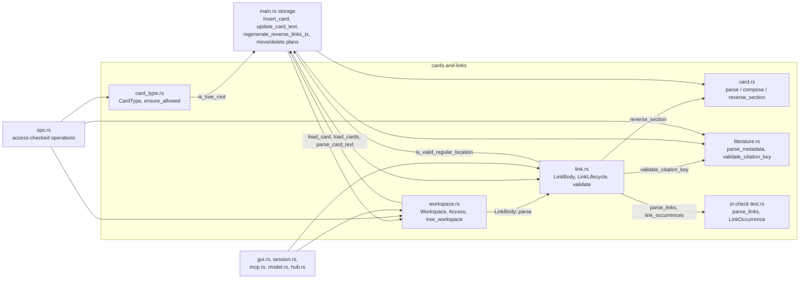
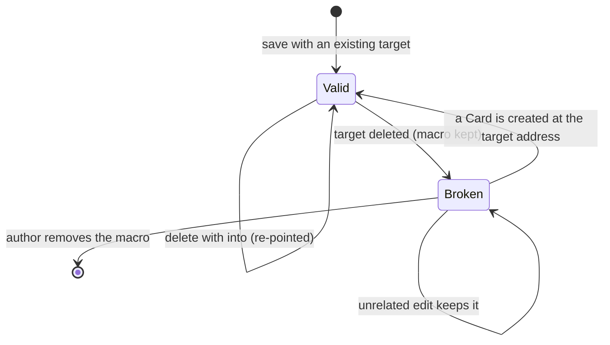

# Cards, Workspaces and Links

## Purpose

This block holds the core vocabulary of ZT's card archive: what a Card's stored text looks like and how it is parsed and composed, which Card types exist and where each may stand, how a Literature Card's BibTeX metadata gives its Citation key and title, which Workspace a tree belongs to and which client may change it, and how `[[target]]` and Term `[[label@address]]` links are found, checked, rewritten, turned into Reverse links, and reported as Broken links. Every other block that reads or writes a Card (the shell and service, the Session, the GUI, the MCP server, Card operations, models, hubs) builds on these pure functions and small types. They exist so that the Card format and the Link rules have one implementation, shared by every client.

**Owns:** the Markdown Card text format and the Reverse link marker (`src/card.rs`); the Card type enum and the Tree-root type rule (`src/card_type.rs`); the Term Card's one authored name and its grammar, the client field protocol, the write, the computed Term role, the Term-head test, and the `get_terms` structure read (`src/term.rs`); BibTeX parsing, Citation key validation, and title normalization (`src/literature.rs`); the `Workspace` and `Access` types and the cross-Workspace checks (`src/workspace.rs`); Link recognition (the lexical scan is the checker's, `zt_check::text`, re-exported here), the root address grammar, edit validation including the Term-head rule and its legacy retention, target rewriting, Reverse link derivation, and Broken link listing (`src/link.rs`).

**Does not own:** SQLite schema, migrations, Location grammar helpers (`is_valid_location`, `tree_id`, `tree_root_address`), the edit lock, the save, delete, move, and Citation-key rename transactions in `src/main.rs`, or the dump ([Service, CLI and storage](service-and-cli.md)); the access-checked operations and place/insert plans ([Card operations](card-operations.md)); Model facets, emphasis, levels, Relation kinds, and Math forms ([Models and math](models-and-math.md)); Hub levels ([Hub Cards](hub-cards.md)); rendering of Links and Cards ([GUI](gui.md), [Terminal Session](session.md)); MCP tool schemas ([MCP server](mcp-server.md)); the Card layer rules for Finding and Event bodies ([zt-check](zt-check.md)).

## At a glance

| | |
|---|---|
| Entry points | `card::parse_card_text`, `card::parse_literature_edit_text`, `card::compose_card_text`, `card::reverse_section`, `card::card_template`, `card::from_legacy_text`; `CardType::parse` / `from_stored`, `card_type::ensure_allowed`; `literature::parse_metadata`, `literature::validate_citation_key`; `Workspace::parse` / `from_stored`, `Access::ensure_writable`, `Access::ensure_link_rewrites_allowed`, `workspace::tree_workspace`, `workspace::ensure_same_workspace`, `workspace::counts`; `LinkBody::parse`, `LinkBody::rewrite_targets`, `LinkForm`, `LinkOccurrence`, `link::validate`, `LinkLifecycle::from_cards` and its methods, `link::code_ranges`, `link::fenced_code_ranges`; `term::is_head` |
| Key files | `src/card.rs` — Markdown Card text: parse, compose, templates, Reverse link section, legacy conversion, authored fingerprint. `src/card_type.rs` — `CardType` (`idea`, `event`, `finding`, `model`, `hub`, `term`) and the Tree-root rule. `src/term.rs` — the Term Card name parser (`normalize_name`), the `term` field protocol, the type rule and the one-row write, the Term-head test (`is_head`), and the computed Term structure: `Role`, `place`, `role`, `facts`, `resolve_list`, `structure`, the seven placement/coverage faults, and the two T8 table-shape faults (`extra_column`, `hidden_comment`). `src/literature.rs` — BibTeX metadata parser, Citation key rules, title normalization. `src/workspace.rs` — `Workspace`, `Access`, `WorkspaceCounts`, tree Workspace lookup and the no-cross-Workspace-move rule. `src/link.rs` — `LinkBody` (one body's Links), `LinkLifecycle` (Links against an archive snapshot), the root address grammar, Term-link validation and legacy retention; the lexical scan itself is `zt_check::text`'s. `tests/card_types.rs` — end-to-end tests of Card types through the shell, Session, MCP, GUI, dump, and schema upgrades, including the Term field protocol; `tests/term_links.rs` — end-to-end tests of direct Term links through the public MCP writes and reads (S10, #151); `tests/term_structure.rs` — end-to-end tests of `get_terms` and the computed role facts (owned by [MCP server](mcp-server.md)) |
| Depends on | [Service, CLI and storage](service-and-cli.md) (`crate::Card`, `is_tree_root`, `is_valid_location`, `is_valid_regular_location`, `tree_id`, `tree_root_address`, `load_card`, `load_cards`, `parse_card_text` re-export in `src/main.rs`); [zt-check](zt-check.md) (`zt_check::text`: `parse_links`, `link_occurrences`, `code_ranges`, `fenced_code_ranges`, `LinkForm`, `LinkOccurrence`, `MAX_TERM_NAME`); `anyhow`; `rusqlite` (only in `src/workspace.rs`); `nom-bibtex` 0.6 (`Bibtex::raw_parse`) |
| Used by | [Service, CLI and storage](service-and-cli.md), [Card operations](card-operations.md), [Terminal Session](session.md), [GUI](gui.md), [MCP server](mcp-server.md), [Models and math](models-and-math.md), [Hub Cards](hub-cards.md) |
| Tests | Unit tests in each of `src/card.rs`, `src/card_type.rs`, `src/literature.rs`, `src/workspace.rs`, `src/link.rs`; integration tests in `tests/card_types.rs`, `tests/term_links.rs` (Link behaviour is also exercised by `tests/cli_service.rs`, `tests/pty_session.rs`, `tests/workspaces_mcp.rs`, owned by other blocks); the Term content template and its T rules are tested by `tools/zt-check/src/term.rs` and the root `tests/term_cards.rs` (owned by [zt-check](zt-check.md)) |

## Concepts

- `Card` — one Markdown document: a `# Title` heading, a Markdown body, and a generated Reverse link section after the `<!-- zt:reverse-links -->` marker. The parsed form is `ParsedCard { title, body, reverse }` in `src/card.rs`; the stored row is `crate::Card` in `src/main.rs`.
- `Reverse link marker` — the line `<!-- zt:reverse-links -->` (`REVERSE_MARKER` in `src/card.rs`). An HTML comment, so rendered Markdown hides it. Everything after it is generated.
- `Reverse link` — the generated section after the marker: `## Reverse links` (`REVERSE_HEADING`), a blank line, and one `- [[source]] Title` item per source Card. A target that also has Term uses carries a second `## Term uses` section (`TERM_HEADING`) with the same item shape for the Cards that write a Term use to it; either section is omitted when empty. Both are built by `card::reverse_section` from the sources `LinkLifecycle::reverse_sections` derives.
- `Card type` — what a Card holds: `CardType::{Idea, Event, Finding, Model, Hub, Term}` in `src/card_type.rs`; stored as `idea`, `event`, `finding`, `model`, `hub`, `term`. `Idea` is the default.
- `Term Card` — a Regular Card of type `term` (S07, #149) that defines one term or holds one book's term table. Its optional `term_name` column holds the exact name; no name means a candidate Term list. A Topic or Literature root can never be one.
- `Term name` — one line of at most 40 Unicode scalar values, outer whitespace trimmed, holding no `[`, `]`, `@`, `|`, or backtick. The `term` client field is omitted (preserve), `null` or a trimmed-empty string (clear), or a string (set). It is valid only on a Term Card, and a type change away clears it. It is authored identity: `card::authored_fingerprint` appends `term_name\0<name>\0` only for a nonempty name, so a Card without one keeps its old bytes.
- `Term role` — how a Term Card takes part in one Term list (S08, #150; design 9.2): `list` (a Term Card with no name), `card` (a head: a named Term Card that is an immediate Side successor of a list), `part` (a named Term Card that continues a same-named head or part as its Direct successor), or `unfiled` (no valid placement). A Card of another type has no role. The role is computed from the Card type, the exact name and the placement on every read; no column, facet, or ownership table stores it.
- `Term use` — a stored `links` row with `kind = 'term'`: one `[[label@address]]` occurrence whose label is the term written in the sentence and whose target is the head it names. A write indexes it from the shared lexical scan with the head's address, never the `label@address` text; the label stays in the authored macro. The target Card's generated `## Term uses` section lists its using Cards separately from ordinary Reverse links, deduplicated by source within each section; one source may appear in both. A Term use to a missing target, or to an existing row that is no longer a head, is reported with its label (`missing` / `not_head`) by `lsbk`, `list_broken_links`, the GUI broken list and the `get_terms` faults.
- `Term link` — the direct word-to-Term-Card reference `[[label@address]]` (S10, #151; design 10.1). Split at the first `@`: the label is 1–40 scalar values on one line, the address is a Regular Location, and a second `@` is malformed. Outside code it is a Term use; inside inline/display math a Term-like macro is literal and no use. A new Term use must name a Term head; a move rewrites only the address bytes.
- `Term structure` — the computed read of one Term list (`term::structure`): the four-column rows of its body, its heads, parts and unfiled Cards, its Term uses, its coverage counts, and its faults. One read inside one transaction carries its archive revision and identity.
- `Term content template` — the authored text of a named Term Card (S09, #152; design 11). A head opens with `术语：`, optional `原文：`, `不用：`, `类别：`, `首次定义：`, and the optional `自动链接：否`/`自动链接理由：` pair, then the fixed section order `释义`, `书中的说法`, `数学定义`, `等价形式`, `推导：…`, `极限与特例`, `例子`, `直觉`, `区别`, `常见误读`, `在本书中的作用`, and ends with `来源：[[book]] locator`. A part (a continuation) starts with `类别：` and `续：[[head]]`, carries only its continuation sections, keeps the same stored term name, and is titled `推导（续 k/n）：…`. The head lines are authored metadata, not prose: the language rules skip them, and T1/T2 read them.
- `Automatic-link opt-out` — `自动链接：否` plus a nonempty `自动链接理由：…` on a head records that the term must stay unlinked; absence means enabled, a reason without the off line decides nothing, and only `否` is a recognized value (design 9.4, R0231). The list's four-column table gains no column or comment.
- `Term continuation marker` — `（续见下卡）`, the line that ends a derivation chunk that is not the derivation's last Card. The renderer writes it when it partitions at a whole-step boundary, and T5 accepts it in place of the final `结果：` line; it never stands for truncated content.
- `Regular Card` / `Tree root` — a Tree root is a Topic Card (`is_topic`) or a Literature Card (`is_lit`); `crate::is_tree_root` in `src/main.rs`. Only Regular Cards may have a type other than `idea`.
- `Literature Card` — the root of a Literature tree; its address is its Citation key and its title comes from BibTeX. `LiteratureMetadata { citation_key, title }` in `src/literature.rs`.
- `Citation key` — the BibTeX entry key, matching `^[A-Za-z][A-Za-z0-9_-]{0,127}$`, never a Windows reserved filename stem, never a valid Location (it has no `/` and starts with a letter). Case-significant for lookup and Links; unique case-insensitively (enforced in `src/main.rs`).
- `Workspace` — `Workspace::{Human, Agent}` in `src/workspace.rs`, stored as `human` / `agent`. Every tree belongs to one Workspace, read from its Tree root.
- `Access` — `Access::{Owner, Agent}` in `src/workspace.rs`: which Workspaces a client may change. Owner (Session, GUI, shell) changes both; Agent (the MCP server) changes only the agent Workspace.
- `Zone` — the Topic zone and Literature zone of a Workspace; `WorkspaceCounts { topic_trees, literature_trees, cards }` counts their trees.
- `Link` — a `[[target]]` macro in a Card body whose target is a Location or a Citation key. One occurrence is `LinkOccurrence { target, label, form, macro_range, target_range, label_range }` (`zt_check::text`, re-exported by `src/link.rs`); a Term link's `form` is `LinkForm::Term` and carries its `label` and `label_range`.
- `Broken link` — a Link whose target Card does not exist; `BrokenLink { source_address, source_title, target, source_line }` and `LinkStatus::Broken` in `src/link.rs`.
- `Link lifecycle` — `LinkLifecycle`: the set of Card snapshots (`CardSnapshot { address, title, body }`) against which Links are classified, validated, and turned into Reverse links and Broken links.

## Architecture

The five source files are pure, crate-private modules with one exception: `src/workspace.rs` takes a `rusqlite::Connection` to look up a tree root or to scan every Card for rewrites. None of them opens the database, takes the edit lock, or runs a transaction; `src/main.rs` and `src/ops.rs` do that and call into this block.



- `src/card.rs` knows only the text format. It does not know Links: the Reverse link section is passed in as a string.
- `src/link.rs` adds the root's meaning to the checker's lexical scan. `zt_check::text::parse_links` / `link_occurrences` own the macro shape, the Term label grammar, the code-span/fence exclusion, and the math-literal rule; `src/link.rs` validates the target grammar (an ordinary Link is a Location or a Citation key, a Term link is a Regular Location only), checks a new Term target is a head, and derives Reverse and Broken links. It calls back into `crate::is_valid_location`, `crate::is_valid_regular_location` (Location grammar, `src/main.rs`) and `literature::validate_citation_key`, and calls `card::reverse_section` to format Reverse links. It never touches SQLite: callers load `CardSnapshot`s (address, title, body) with `link_lifecycle` / `link_lifecycle_from_cards` in `src/main.rs`.
- `src/workspace.rs` reads Tree roots with `crate::load_card` and, for agent Access, scans every Card with `crate::load_cards`, `crate::parse_card_text`, and `LinkBody`.
- `src/card_type.rs` checks one rule with `crate::is_tree_root`; the per-type field rules (facet, emphasis, level, form, hub level) live in `src/model.rs`, `src/math.rs`, and `src/hub.rs`.
- `src/literature.rs` is standalone apart from `nom-bibtex`.

## Interfaces

`card::body_starts_with_title(title, body)` recognizes an exact repeated first nonblank body line, either plain title text or a level-one heading with valid closing ATX decoration. An indented code line is literal content. The storage validator calls it after parsing the one legitimate Card envelope; parsing alone still accepts legacy Cards so they can be read/reviewed.


`src/card.rs::authored_body_range` validates a Card and locates its original authored body bytes without normalizing line endings, heading decoration, whitespace or the generated section. `with_reverse_section` changes only the generated suffix, preserving the authored prefix and existing marker line. The indexed Reverse-link refresh uses this helper, including when an unrelated inbound Link changes during an owned paragraph correction. Ordinary authored creates/saves still normalize their own text explicitly through `compose_card_text`; generated maintenance is not an implicit whole-Card formatter.


All items are `pub(crate)`; ZT is one binary crate (`src/main.rs`), so there is no library API. `src/main.rs` re-exports `ParsedCard`, `compose_card_text`, `parse_card_text`, `parse_literature_edit_text`, `regular_template`, `topic_template`, `CardType`, `Access`, and `Workspace` at the crate root.

### Card text (`src/card.rs`)

| Item | Signature | Behaviour and errors |
|---|---|---|
| `REVERSE_MARKER` | `&str = "<!-- zt:reverse-links -->"` | The marker line. Matched after trimming the line. |
| `REVERSE_HEADING` | `&str = "## Reverse links"` | Heading of a non-empty Reverse link section. |
| `ParsedCard` | `{ title: String, body: String, reverse: String }` | Body and reverse are trimmed of leading and trailing blank lines. |
| `parse_card_text` | `fn(&str) -> Result<ParsedCard>` | For Topic, Regular, and stored Literature text. Errors: ``card text must contain at most one <!-- zt:reverse-links --> line``, ``card text must start with a `# Title` heading``, `card title cannot be empty`. |
| `parse_literature_edit_text` | `fn(&str) -> Result<ParsedCard>` | For edited Literature text: the heading is optional. With no heading, `title` is empty and the whole head is the body. With a heading, its title is returned but callers ignore it. Only the marker error applies. |
| `compose_card_text` | `fn(title, body, reverse: &str) -> String` | Canonical text: `# {title}\n\n{body}\n\n<!-- zt:reverse-links -->\n{reverse}`. The body paragraph is left out when the body is blank; trailing newlines of the body are cut. `reverse` is written verbatim. |
| `reverse_section` | `fn(impl IntoIterator<Item = (&str, &str)>) -> String` | `(address, title)` pairs to `## Reverse links\n\n- [[a]] Title\n…\n`; an empty title gives `- [[a]]`; no pairs give `""`. Order is the caller's. |
| `card_template` | `fn(title: &str) -> String` | `# {title}\n\n\n<!-- zt:reverse-links -->\n`: heading, blank line, empty body line, marker. |
| `topic_template` / `regular_template` | `fn(&str) -> String` / `fn() -> String` | `card_template(title)` and `card_template("")`. |
| `from_legacy_text` | `fn(&str) -> Option<String>` | Converts the pre-Markdown format (`title lines`, `<--->`, body, `<--->`, old reverse text). Title lines are joined with spaces, the body is trimmed, the old reverse text is dropped. `None` unless the text has exactly two `<--->` lines. |
| `authored_fingerprint` | `fn(&Card) -> Result<String>` | The Card's authored identity: SHA-256 over its title, body, BibTeX and type fields (type, facet, emphasis, level or hub level, form), each followed by a NUL byte. The generated Reverse section is not authored, so writing a reply that links the Card changes its Reverse links without changing this value; a reader's captured fingerprint (the GUI's Reply, S18) therefore stays valid exactly while the authored text does. |
| `statement_fingerprint` | `fn(&str) -> String` | The exact statement fingerprint of one authored body (S08, #107; design §4.5, D087). SHA-256 over the statement text: line endings are normalised to `\n`, a separately labelled source line (`来源：…`, `出处：`, `Source:`) is dropped outside fenced code, and each syntactically valid Term-link macro reads as the label a reader sees (S12, #154; R0276) — adding or moving that markup cannot invent a different claim, while a changed label is a changed claim. Nothing else is normalised, so formulas, values, signs, variable names, negation, assumptions and scope stay in the hash and a changed sign, value, variable or assumption is a different statement. Formula text is never renamed or shortened. Every Card read carries it as `statement_fingerprint`, computed from the raw authored body in either read mode, and `restatement` marks the derived navigation role of a `## 同述入口` entry; neither is stored. |
| `statement_text` | `fn(&str) -> String` | The statement text one fingerprint covers: line endings normalised, separately labelled source lines dropped outside fenced code, outer whitespace trimmed, and each valid Term link projected to its label through the shared `zt_check::text::strip_term_links`. Ordinary Links stay authored: this comparison ignores no other syntax. |

Title rule (`title_from_heading`): the first non-blank line before the marker must be `# Title` with `#` in column 0 and one space, or the bare line `#` (which gives an empty title). A closing `#` run is dropped only when a space precedes it: `# Closed #` gives `Closed`, `# C#` gives `C#`. `#Title`, `## Title`, and an indented heading are refused for Topic and Regular Cards.

### Card types (`src/card_type.rs`)

| Item | Signature | Behaviour |
|---|---|---|
| `CardType` | `enum { Idea (default), Event, Finding, Model, Hub, Term }` | Derives `Copy`, `Ord`, `Hash`, `Default`. `Display` writes `id()`. |
| `CardType::id` | `fn(self) -> &'static str` | `idea`, `event`, `finding`, `model`, `hub`, `term`: the stored and typed name. |
| `CardType::parse` | `fn(&str) -> Result<Self>` | Trims and lowercases. Error: ``unknown card type `<x>`; expected idea, event, finding, model, hub, or term``. |
| `CardType::from_stored` | `fn(&str) -> Self` | Like `parse`, but an unknown stored value reads as `Idea`. |
| `ensure_allowed` | `fn(&Card, CardType) -> Result<()>` | Refuses a non-`Idea` type on a Tree root: `only Regular Cards can be Event, Finding, Model, Hub, or Term Cards`. |

The rules for each type:

| Type | Where | Extra fields and rules | Enforced by |
|---|---|---|---|
| `idea` | any Card; always for Topic and Literature Cards | none | `ensure_allowed`; `insert_card` and `insert_literature_card` in `src/main.rs` write `idea` for roots |
| `event` | Regular Cards only | no facet, emphasis, level, form, or hub level; the body convention (date, place, actors, source) is not validated | `ensure_allowed`; schema CHECKs; [zt-check](zt-check.md) E rules for digests |
| `finding` | Regular Cards only | no facet, emphasis, level, form, or hub level; the six labelled lines (`测量`, `数据`, `方法`, `结果`, `局限`, `来源`) are a convention | `ensure_allowed`; schema CHECKs; [zt-check](zt-check.md) F rules |
| `model` | Regular Cards only | a Model Card (no facet) may carry `model_level` and `math_form`; a Model part has a `model_facet` and an optional `model_emphasis`; a Model Card with parts cannot change type or become a part | `ensure_allowed`; `model::ensure_allowed` / `model::set` in `src/model.rs` ([Models and math](models-and-math.md)) |
| `hub` | Regular Cards only | only a Hub Card may carry `hub_level` (`line`, `topic`, `field`, `register`) | `ensure_allowed`; `hub::set_level` in `src/hub.rs` ([Hub Cards](hub-cards.md)) |
| `term` | Regular Cards only | only a Term Card may carry `term_name` (S07, #149); a name is one line of at most 40 scalar values with no `[`, `]`, `@`, `\|`, backtick; no name is a Term list. Its role and structure are computed (see below) | `ensure_allowed`; `term::ensure_on_type`; the schema CHECK `term_name IS NULL OR card_type = 'term'` |

`model::set` (in `src/model.rs`) also clears `model_level` and `math_form` when a Card stops being a Model Card head, and clears `hub_level` when it stops being a Hub Card. `ops::resolve_term` clears `term_name` when a Card stops being a Term Card, unless the same combined edit sets a term.

### Term structure and roles (`src/term.rs`)

| Item | Signature | Behaviour and errors |
|---|---|---|
| `Role` | `enum { List, Head, Part, Unfiled }` | `List` is a Term Card with no name, `Head` a named immediate Side successor of a list, `Part` a named same-name Direct successor of a head or part, `Unfiled` no valid placement. `id()` gives `list`, `card` (a head's wire role), `part`, `unfiled`. A Card of another type has no role. |
| `MAX_CHAIN` | `usize = 128` | The longest placement chain a read follows before it refuses. |
| `Placement` | `{ address, reason: "depth" \| "cycle" }` | The typed read error: `code = "term_placement"`, the reason, and the address. A chain that is too long, or one that revisited an address, fails visibly rather than being cut. |
| `place` | `fn(address, name, lookup) -> Result<Option<Placed>>` | Walks the placement chain with the Location parser. `Placed { role, list, head }` names the owning list and the head a part continues. A missing ancestor, another Card type, or another name ends the walk with no placement. |
| `role` | `fn(&Connection, address, CardType, Option<&str>) -> Result<Option<(Role, Option<String>)>>` | The stored Card's role and owning list; `None` when it is not a Term Card. A list owns itself. |
| `facts` | `fn(&Connection, &Card) -> Result<Option<Value>>` | The computed `term_role`, `term_list`, and `term_uses` facts every Card read publishes. `term_uses` counts the stored `kind = 'term'` rows that name the Card. |
| `resolve_list` | `fn(&Connection, at) -> Result<Card>` | The list a `get_terms {at}` names: the Card itself, the nearest list on its placement chain, or the one Term list of a tree root's tree. Errors name a card that does not exist, a Card that is neither a list nor under one, a tree with no list, and a tree with several lists (all addresses listed, none selected). |
| `structure` | `fn(&Connection, at) -> Result<Value>` | The whole read: `rows`, `row_duplicates`, `heads`, `parts`, `unfiled`, `uses`, `faults` (the seven placement/coverage faults plus the T8 `extra_column` and `hidden_comment`; a T8 coverage fault carries its `rule`), `coverage`, and `complete`. See [MCP server](mcp-server.md#get_terms) for the reply. |
| `is_head` | `fn(&Connection, at) -> Result<bool>` | Whether an address is a Term head right now: a named Term Card that is an immediate Side successor of a list. The one role a new Term use may name (S10, #151); a list, part, another type, or a missing Card answers `false`. |
| `facts::label_of` | `fn(body, target) -> Option<String>` | The authored label of the first Term use of `target` in one body, read from the shared `LinkOccurrence` (`form`, `label`, `target`); it never splits `@` itself. |

The seven faults (design 9.2) plus the two T8 table-shape faults (S09, #152), reported, never refused:

| Fault | Report |
|---|---|
| `term_unfiled` | A named Term Card whose placement is no list, head, or part (`address`, `term`). |
| `term_duplicate` | More than one head for one exact name under one list (`term`, `heads`); carries `rule: "T8"`. |
| `term_row_without_card` | A table row with no head of its exact spelling (`row`, `term`); carries `rule: "T8"`. |
| `term_card_without_row` | A head whose exact name is in no table row (`address`, `term`); carries `rule: "T8"`. |
| `term_part_name` | A Direct successor whose name differs from the valid head or part it continues (`address`, `term`, `expected`, `continues`, `role`). |
| `term_label_mismatch` | A stored Term use whose authored label differs from its target's exact name (`source`, `target`, `label`, `term`). |
| `term_link_target` | A stored Term use whose target is missing or is not a head (`source`, `target`, `label`, `reason` = `missing` / `not_head`). |
| `extra_column` | A table row wider than the four template columns (`row`, `columns`); carries `rule: "T8"`, so no fifth column or link metadata rides in the list body. |
| `hidden_comment` | An HTML comment in the list body other than the generated Reverse marker (`line`, `comment`); carries `rule: "T8"`. |

The row reader is shared with the checker: `zt_check::text::term_table` (the compatibility view R6 and the digest already read), `term_rows_raw` (every row before case-insensitive replacement), and `term_row_duplicates` (raw rows whose names clash exactly or by case). `structure` reports the raw duplicate groups in `row_duplicates`, so a publisher resolves them before it allocates one head per row; the compatibility rows keep their existing input.


### Literature metadata (`src/literature.rs`)

| Item | Signature | Behaviour and errors |
|---|---|---|
| `LiteratureMetadata` | `{ citation_key: String, title: String }` | The entry key exactly as written, and the normalized display title. |
| `parse_metadata` | `fn(raw: &str) -> Result<LiteratureMetadata>` | Uses `nom_bibtex::Bibtex::raw_parse` (no macro expansion). Errors: `invalid BibTeX metadata` (parser failure), `BibTeX metadata must contain exactly one bibliographic entry`, `BibTeX metadata must contain exactly one ordinary bibliographic entry` (`@comment`, `@preamble`, `@string`), any `validate_citation_key` error, `BibTeX metadata must contain exactly one title field` (field names compared case-insensitively), `BibTeX title must be a literal value, not a string macro`, `BibTeX title must be nonempty`. The raw string is not changed; the caller stores it. |
| `validate_citation_key` | `fn(&str) -> Result<()>` | 1 to 128 bytes, first an ASCII letter, then ASCII letters, digits, `_`, `-`. Errors: ``invalid Citation key `<k>`; expected ^[A-Za-z][A-Za-z0-9_-]{0,127}$`` and ``Citation key `<k>` is a Windows reserved filename stem`` (`CON`, `PRN`, `AUX`, `NUL`, `COM1`–`COM9`, `LPT1`–`LPT9`, any case). |

Title normalization (`normalize_title`): grouping braces `{` `}` are removed; any whitespace run (including newlines) becomes one space; leading and trailing space is cut; a backslash and the character after it are kept together, so `\{`, `\}`, and `\LaTeX` survive. Example: `{A}   \LaTeX{}\n    研究` gives `A \LaTeX 研究`.

### Workspaces and Access (`src/workspace.rs`)

| Item | Signature | Behaviour and errors |
|---|---|---|
| `Workspace` | `enum { Human, Agent }`, `ALL: [Workspace; 2]` (human first) | `id()`: `human` / `agent`; `label()`: `Human` / `AI agent`; `Display` writes `id()`. |
| `Workspace::parse` | `fn(&str) -> Result<Self>` | Trims, lowercases; accepts `human`, `agent`, `ai`. Error: ``unknown workspace `<x>`; expected human or agent``. |
| `Workspace::from_stored` | `fn(&str) -> Self` | Unknown stored values read as `Human`. |
| `Access` | `enum { Owner, Agent }` | Owner: Session, GUI, shell. Agent: `zt mcp`. |
| `Access::can_write` | `fn(self, Workspace) -> bool` | Owner: always; Agent: only `Workspace::Agent`. |
| `Access::ensure_writable` | `fn(self, Workspace) -> Result<()>` | Error: `the human workspace is read-only for AI agents; only the agent workspace can be changed`. |
| `Access::ensure_link_rewrites_allowed` | `fn(self, &Connection, &BTreeMap<String, String>) -> Result<()>` | For Agent Access and a non-empty old-to-new address mapping: loads every Card, and for each Card it may not write (and whose own address is not in the mapping) refuses if `LinkBody::rewrite_targets` would change its body. Error: ``this change would rewrite Links in human workspace Card `<a>`, which is read-only for AI agents``. Reverse link sections are not counted. |
| `WorkspaceCounts` | `{ topic_trees, literature_trees, cards: usize }` | |
| `counts` | `fn(&[Card], Workspace) -> WorkspaceCounts` | Counts Topic roots, Literature roots, and all Cards of one Workspace. |
| `tree_workspace` | `fn(&Connection, address: &str) -> Result<Workspace>` | The Workspace of the Tree root of `tree_id(address)`. Error: ``tree root `<r>` does not exist``. |
| `ensure_same_workspace` | `fn(&Connection, from: &str, to: &str) -> Result<()>` | Error: ``Cards cannot move between workspaces: `<from>` is in the <a> workspace and `<to>` is in the <b> workspace``. |

### Links (`src/link.rs`)

| Item | Signature | Behaviour and errors |
|---|---|---|
| `LinkOccurrence<'a>` | `{ target: &'a str, label: Option<&'a str>, form: LinkForm, macro_range: Range<usize>, target_range: Range<usize>, label_range: Option<Range<usize>> }` | UTF-8 byte ranges into the body (`zt_check::text`, re-exported): the whole `[[…]]`, the address alone, and for a Term link the label. `LinkForm::{Ordinary, Term}` is derived from syntax (`@`). |
| `LinkOccurrence::is_valid_term_macro` | `fn(&self) -> bool` | Whether this occurrence is a syntactically valid Term link (`S12, #154`): a Term form with a nonempty 1–40-scalar one-line label, one nonempty address, and no second `@`. Target resolution is not part of the decision. |
| `strip_term_links` | `fn(&str) -> String` | The one visible-text projection (S12, #154; design 10.4): each syntactically valid Term macro outside code, fences and math becomes its label, every other byte stays. Lexical, so a stale target still strips; ordinary Links are never stripped; a malformed Term-like macro stays authored for the strict scan. Shared by the checker's prose projection, the Literature scope, the statement comparison and the optional label-only reads (`get_card`/`get_cards`/`get_tree` `term_links:"label"`). |
| `LinkBody::parse` | `fn(&'a str) -> Result<LinkBody<'a>>` | Strict shared scan plus the root grammar. Errors: `invalid link macro` (a `[[` with no `]]`, or a stray `]]` in prose after the last Link), ``invalid link macro target `<t>` `` (target is neither a valid Location nor a valid Citation key), an invalid Term label (`invalid Term link label: 1-40 characters on one line`), a second `@` (`invalid Term link macro: one `@` separates the label and the address`), and ``invalid Term link macro target `<t>` `` (not a Regular Location). |
| `LinkBody::for_rendering` | `fn(&'a str) -> LinkBody<'a>` | Tolerant shared scan (never fails): every `[[target]]` outside code, valid or not; stops at a `[[` with no `]]`. A Term-like macro in prose is a `Term` occurrence; inside math it is literal and absent. Used by `classify_for_rendering` and by `hub::parse_body` for member lines. |
| `LinkBody::occurrences` | `fn(&self) -> &[LinkOccurrence]` | In text order, duplicates kept. |
| `LinkBody::rewrite_targets` | `fn(&self, &BTreeMap<String, String>) -> LinkRewrite` | Replaces only `target_range` bytes whose target is a mapping key; every other byte stays, including a Term link's label and punctuation. `LinkRewrite { body, count }` counts replaced occurrences. |
| `link::validate` | `fn(body, old_body, exists, is_head) -> Result<()>` | The one edit rule (S10, #151): an ordinary new target must exist, while an old Broken target may stay at any occurrence count; a new Term use must name a Term head. An old invalid Term use may stay only with the same `(label, target)`, up to its old multiplicity, so a changed invalid target is never retention; a malformed Term macro is refused even when the old body held it. Errors: ``link target `<t>` does not exist``, ``Term link target `<t>` does not exist``, ``Term link target `<t>` is not a Term head``. `src/link_index.rs::validate` passes the stored-Card lookups; the test-only `LinkLifecycle::validate_edit` passes its snapshot set. |
| `code_ranges` | `fn(&str) -> Vec<Range<usize>>` | Fenced code blocks plus inline code spans, sorted by start (`zt_check::text`, re-exported). Used by the GUI's TeX-delimiter rewrite and the shared Link scan. |
| `fenced_code_ranges` | `fn(&str) -> Vec<Range<usize>>` | Fenced code blocks only, from opening through closing fence line (`zt_check::text`, re-exported). Used by the GUI, the Session's Markdown view, and search excerpts in `src/ops.rs`. |
| `CardSnapshot` | `{ address, title, body: String, term_head: bool }` | One Card as the lifecycle sees it. `term_head` is whether the Card is a currently valid Term head; `main.rs` computes it with `term::head_addresses` from the same stored identities `term::is_head` reads. |
| `LinkLifecycle::from_cards` | `fn(Vec<CardSnapshot>) -> Self` | Keeps the snapshots, the set of their addresses, and the set of their Term heads. |
| `LinkLifecycle::classify_for_rendering` | `fn(&self, &'a str) -> Vec<ClassifiedLink<'a>>` | Tolerant scan (never fails): each occurrence as `ClassifiedLink { target, label, form, macro_range, status, reason }`, with `LinkStatus::Valid` when its target is well formed and exists and, for a Term use, is a Term head, else `Broken` and the same `BrokenReason` the Broken-link report uses (S13, #156). A trailing `[[` with no `]]` is dropped. |
| `LinkLifecycle::validate_edit` | `fn(&self, body: &'a str, old_body: Option<&str>) -> Result<LinkBody<'a>>` | Strict parse of the new body; each target must exist or already be a Broken target in `old_body`. Error: ``link target `<t>` does not exist``. |
| `LinkLifecycle::reverse_sections` | `fn(&self) -> Result<BTreeMap<String, String>>` | For every snapshot address, its generated tail text (possibly `""`): ordinary sources under `## Reverse links`, Term-use sources under `## Term uses`, each deduplicated by source and ordered by address. Errors if any body fails strict parsing. |
| `BrokenReason` | `enum { Missing, NotHead }`, `id()`: `missing` / `not_head` | Why one occurrence is Broken: the target holds no Card, or a Term use names an existing row that is no Term head. One rule, `LinkLifecycle::broken_reason`, decides both `broken_links` and the rendering classification's `reason`, so a reader and the Broken-link report cannot disagree (S13, #156). |
| `BrokenLink` | `{ source_address, source_title, target, label: Option<String>, reason: BrokenReason, source_line }`, `detail()` | One Broken occurrence (duplicates kept), in snapshot and body order. `detail()` is the shell/Session `-> …` part: the address alone for an ordinary Link, and `address (term `label`, missing\|not a Term head)` for a Term use. |
| `LinkLifecycle::broken_links` | `fn(&self) -> Result<Vec<BrokenLink>>` | One `BrokenLink` per Broken occurrence (duplicates kept), in snapshot and body order, with the full source line around it (`\r` cut). A Term use to an existing non-head is Broken even though the row exists. |

### Where users meet this block

- Shell `zt lsbk` (`cmd_lsbk` in `src/main.rs`) prints `<source> <title> -> <target>: <line>` per ordinary `BrokenLink`, and for a Term use `<source> <title> -> <target> (term “label”, missing|not a Term head): <line>`; Session `lsbk` shows the same list ([Terminal Session](session.md)); MCP `list_broken_links` and the GUI broken list and overview count read the same facts, with `label` and `reason` ([MCP server](mcp-server.md), [GUI](gui.md)).
- `zt workspaces` (`cmd_workspaces` in `src/main.rs`) prints each Workspace's `id`, `label`, `counts`, and MCP access.
- Session `ty <idea|event|finding|model|hub|term> [<facet>]`, MCP `type` arguments on `create_successor`, `insert_card`, `edit_card`, `search_cards`, and GUI `/api/create` / `/api/edit` `type` fields parse through `CardType::parse`.
- MCP `get_terms {at}` returns the computed Term structure of one list (rows, heads, parts, unfiled Cards, uses, faults, coverage), and `get_card`, `get_cards` and `get_tree` carry each Term Card's `term_role`, `term_list` and `term_uses` ([MCP server](mcp-server.md)).

## Behaviour

### Saving a Card's text

1. A client hands full Card text to `update_card_text` (or `insert_card` for a new Card) in `src/main.rs`, normally through `ops::edit` / `ops::create_successor` in `src/ops.rs`, which first calls `Access::ensure_writable`.
2. `validate_card_text` calls `parse_card_text` on the new text and on the old text, builds a `LinkLifecycle` from all stored Cards (`link_lifecycle`), and calls `validate_edit(new_body, old_body)`.
3. The text is written as given, then `regenerate_reverse_links_tx` runs in the same transaction: it loads every Card, derives every Reverse link section with `reverse_sections`, and rewrites each Card as `compose_card_text(title, body, reverse)`. So whatever the client wrote after the marker is replaced, and every Card's text becomes canonical.

### Creating and editing a Literature Card

1. `literature::parse_metadata(bibtex)` gives the Citation key and title (`ops::create_literature`, `shell_create_literature`, Session `l`, GUI create).
2. The client's text is parsed with `parse_literature_edit_text`; only its body is kept. The text becomes `compose_card_text(metadata.title, body, "")`.
3. `insert_literature_card` (`src/main.rs`) validates the key again, refuses a key that exists case-insensitively (``Literature Card `<k>` already exists``), validates Links, inserts the row with `is_lit = 1`, the raw BibTeX, the Workspace, and type `idea`, and regenerates Reverse links.
4. A text edit (`update_literature_text`) re-parses the stored BibTeX and always replaces the title with the BibTeX title.
5. A metadata edit (`ops::edit_metadata`, `update_literature_metadata`) with a new entry key renames the tree: `citation_rename_mapping` maps `Old -> New` and each `Old/<suffix> -> New/<suffix>`; a new key equal to the old one ignoring case, or used by another Card, is refused; agent Access runs `ensure_link_rewrites_allowed`; the client must confirm with `move`; the row, `apply_location_mapping_tx` (which rewrites Links with `LinkBody::rewrite_targets`), and Reverse links change in one transaction.

### Link recognition (`zt_check::text::parse_links`)

1. `zt_check::text::code_ranges` finds code: `scan_code` walks lines; a line with up to 3 spaces of indent and a run of 3 or more `` ` `` or `~` opens a fence; a line with the same character, a run at least as long, and nothing else closes it; an unclosed fence runs to the end of the text. In the prose between fences, `inline_code_ranges` pairs backtick runs of equal length; an unmatched run is literal text.
2. The scanner finds each `[[`. If it lies in a code range, scanning jumps to the end of that range. Otherwise the macro is the text up to the next `]]`. A content with `@` is a `Term` form (split at the first `@` into label and target); otherwise it is `Ordinary`.
3. A Term-like macro whose `[[` lies in an inline (`$…$`) or display (`$$…$$`) math range is literal and is skipped, so it is no occurrence; an ordinary macro in math stays an ordinary Link. A `$` inside a code span opens no math.
4. Strict mode refuses a missing `]]`, a Term label that is empty, longer than 40 scalar values or on more than one line, a second `@`, and (in `src/link.rs`) a target outside the root grammar: an ordinary target must be a valid Location or Citation key, a Term target a Regular Location. After the last Link, any `]]` outside code is refused.
5. Tolerant mode (`for_rendering`) keeps malformed targets and labels (classified Broken later) and stops at a `[[` with no `]]`.

### Reverse links

1. `reverse_sections` parses every snapshot body strictly.
2. Each occurrence whose target exists is split by its form (S11, #153): an ordinary Link goes to the target's `## Reverse links` sources, a Term use to its `## Term uses` sources. The source address is added once per `(form, target)`, so one source gives one line in each section however often it writes that form; a source that writes both forms to one target appears once in each section.
3. Sources are kept in a `BTreeSet<&str>` per section and target: byte order of the address string.
4. Each Card gets `card::reverse_section` of its ordinary sources and then its Term-use sources, each with their titles. An empty section is omitted, so a Card with no Term use keeps its earlier bytes; Broken targets give no Reverse link or Term use.

### The Link lifecycle across changes



- New Link: `validate_edit` refuses a target that does not exist, unless it was already Broken in the old body (any number of occurrences may stay). A new Term use must name a current Term head; an old invalid Term use may stay only with its label and target and up to its old multiplicity (S10, #151).
- Move, insert, side compaction, Citation-key rename: `src/main.rs` builds an old-to-new mapping; `count_rewritten_links` counts occurrences for the confirmation preview; `apply_location_mapping_tx` renames rows and rewrites each body with `rewrite_targets`, which includes Term occurrences and changes only their target bytes; Reverse links and Term uses are regenerated. Agent Access first runs `ensure_link_rewrites_allowed` (`src/ops.rs`), which sees Term occurrences too.
- Delete: `delete_plan` lists the inbound Links (`links_into`, which sees Term uses) as `links that will break`; the macros stay in the source bodies and become Broken links (a Term use also Broken when its target still exists but is no longer a head), listed by `broken_links`. With `into`, each inbound target is mapped to the `into` Card first and rewritten.

### Workspace rules

1. A new Topic or Literature Card names the Workspace of its new tree.
2. `insert_card` (`src/main.rs`) refuses a Regular Card whose Workspace differs from `tree_workspace(location)`: ``card `<l>` belongs to the <a> workspace, not the <b> workspace``. `ops::create_successor` always passes the parent's Workspace.
3. `move_plan` (`src/main.rs`) and `place.rs` call `ensure_same_workspace` for every client, so no Card moves between Workspaces. Literature tree Cards also cannot leave their tree, and Topic tree Cards cannot enter a Literature tree (`ensure_same_tree_kind_boundary`, `src/main.rs`).
4. Links may cross Workspaces freely; addresses are unique across both.
5. Agent Access may delete an agent Card that a human Card links to (the human Card gets a Broken link), but may not make a change that would rewrite a human Card's body.

### Rules the code keeps

- At most one marker line per Card; the marker is optional when editing.
- Only the body contributes outbound Links. Titles, BibTeX, and the generated tail (both `## Reverse links` and `## Term uses`) are never scanned, so a generated item is never reindexed as an authored Link.
- A Card type belongs to the row, not to the Location: moves, compaction, and renames keep it (`tests/card_types.rs`).
- Citation keys are case-significant for Links and lookup; `[[smith2024]]` does not reach `Smith2024`.
- These functions hold no state and take no locks; callers serialize writes with the edit lock.

## Data and storage

This block persists nothing itself; it defines the formats that `src/main.rs` stores.

### Stored Card text (`cards.text`)

```markdown
# Ownership drives investment

See [[1/1]] and [[1/1|a]], and the term [[均衡@2/1|a|a]].

<!-- zt:reverse-links -->
## Reverse links

- [[1/3]] Missing insurance lowers investment

## Term uses

- [[1/4]] The equilibrium condition
```

The `## Term uses` section appears only on a Card that Term uses name, and `## Reverse links` is omitted when nothing writes an ordinary Link to it; the marker line then directly precedes the one section, or the text ends at the marker when both are empty. A new Card's editor text is `card_template`.

### Columns this block's types read and write

| Column | Type | Meaning | Type in Rust |
|---|---|---|---|
| `location` | `TEXT UNIQUE`, NULL for Literature Cards | Topic or Regular Card address | `Card::address` |
| `citation_key` | `TEXT UNIQUE`, NOCASE unique index `cards_citation_key_nocase` | Literature Card address | `LiteratureMetadata::citation_key` |
| `is_topic`, `is_lit` | `INTEGER 0/1` | Tree-root kind | `crate::is_tree_root` |
| `bibtex` | `TEXT`, non-NULL only for Literature Cards | raw BibTeX, stored unchanged | input of `parse_metadata` |
| `text` | `TEXT NOT NULL` | the Markdown Card text above | `ParsedCard` |
| `workspace` | `TEXT NOT NULL DEFAULT 'human' CHECK(IN ('human','agent'))` | | `Workspace` |
| `card_type` | `TEXT NOT NULL DEFAULT 'idea' CHECK(IN ('idea','event','finding','model','hub','term'))` | | `CardType` |
| `term_name` | `TEXT`, `CHECK(term_name IS NULL OR length BETWEEN 1 AND 40)`, `CHECK(term_name IS NULL OR card_type = 'term')` | the exact name of a named Term Card; NULL for a list or another type | `term::normalize_name` |

The table definition and its migrations are in `cards_table`, `ensure_card_type_column`, `ensure_workspace_column`, `ensure_finding_cards`, and `ensure_markdown_cards` in `src/main.rs` ([Service, CLI and storage](service-and-cli.md)). `metadata.card_format = 'markdown'` records that `from_legacy_text` has run.

### Authored identity and a Lock (`card::authored_fingerprint`)

`card::authored_fingerprint(card)` hashes the parsed title, the parsed body, the raw BibTeX, the Card type, the Model facet, the emphasis, the effective Model or Hub level, and the Math form, each field followed by one NUL byte, with SHA-256. A nonempty Term name adds the explicit domain tag `term_name\0<name>\0` after those bytes (S07, #149); an absent or empty name adds nothing, so every pre-Term fingerprint stays byte-identical (fixture-tested, including the SQL wrapper's retained eight-argument form). It is the identity a Tree Lock promises and the value its seal is computed from. The byte framing lives in one helper, `card::authored_fingerprint_framed`, so the SQL `zt_authored_fp` wrapper on every `zt` connection produces exactly the same digest; the wrapper validates a stored enum instead of falling back to a default, and a parse or hash failure aborts the statement. The generated Reverse section is not authored, so refreshing it changes neither value.

A Lock is a separate promise layered beside `Access`: the Workspace rules still decide whether a client may change a Card at all, and the Lock gate then decides whether the owner has frozen its tree ([Service, CLI and storage](service-and-cli.md#tree-lock-storage-src_tree_lockrs), [Card operations](card-operations.md#the-lock-gate)). Owner Access has no exemption. The pins a Lock takes come from the authored `[[target]]` occurrences of its members, resolved by the ordinary Link parser: a target inside the same tree is not a pin, a target in another tree is, and a target that does not resolve is a warning only. A Term use is such an occurrence: a cross-tree head is pinned like any target, a same-tree head creates no pin, and a move that would rewrite a Term use in a Locked source is refused (S11, #153). One pin is one distinct `(locked source row, existing target row)` pair, so a body that names the same target twice still writes one row, while two members naming it keep two rows and the refusal can name both. A Link between the two Workspaces qualifies like any other. Only an authored macro qualifies: an example inside a fenced block or an inline code span, generated Reverse text, an artifact, a Document link and a chart's `data-zt` navigation pin nothing. A pinned target keeps its body, title, BibTeX without a Citation-key rename, type, and model/hub/math fields editable; its address, row identity, Workspace and Tree kind are frozen. A pinned target that itself belongs to a Locked tree obeys that stronger Lock first. Pins do not propagate: A links B and B links C pins only B, and several active Locks may pin one target, each releasing only its own rows.

A target that was already broken when the owner accepted the Lock is a warning, never a pin: the plan and the retained `lock` event keep its source and target addresses, `/api/locks` reports them again as the Lock's `warnings`, and a target that resolves later joins the promise only after an unlock and a new Lock. The seal covers authored Card identity alone, so a pinned target's meaning and any external document, artifact or cache availability stay outside it.

The Lock's own history is separate from the Cards it promised: an owner note change appends one `note` event carrying the previous and the new note and never touches the seal, a member fingerprint or a pin row, and an unlock keeps the whole reviewed snapshot in its initial `lock` event after deleting only the live rows — so the record still names the addresses and fingerprints it promised after the tree is renamed or deleted ([GUI](gui.md#tree-lock-panel-and-dialogs-s01-124-lockpanel-lockdialog-srcguilockjs), R104).

### Dump

`archive.json` in a `zt dp` dump lists every Card's Workspace, every non-Idea Card's type, and the term name of every named Term Card (from `tests/card_types.rs`). A Term list and every non-Term Card are omitted from `term_names` exactly as an Idea Card is omitted from `types`, while a head and each of its continuation parts all appear; the dump's Markdown keeps the raw authored macros and the generated Term-use section, and the whole payload is round-tripped in `tests/term_portability.rs` (S17 #155):

```json
{"next_topic_id":2,"workspaces":{"0/0":"human","0/1":"human","1/0":"agent","1/1":"agent","1/1|a":"agent","1/1|b":"agent"},"types":{"1/1":"model","1/1|a":"event","1/1|b":"hub"},"term_names":{},"facets":{},"emphasis":{},"levels":{"1/1":"formal"},"forms":{},"hub_levels":{"1/1|b":"line"}}
```

## Configuration

None: the formats, rules, and limits in this block are constants in code (for example the 128-byte Citation key limit); no flag, environment variable, or config key changes them.

## Usage

### Parse, change, and recompose a Card

```rust
let parsed = crate::parse_card_text(&card.text)?;
let body = crate::link::LinkBody::parse(&parsed.body)?
    .rewrite_targets(&mapping)
    .body;
let text = crate::compose_card_text(&parsed.title, &body, &parsed.reverse);
```

This is `replace_link_locations` in `src/main.rs`.

### Validate an edit's Links and list Broken links

```rust
crate::link_index::validate(&conn, &new.body, Some(&old.body))?;
let lifecycle = crate::link_lifecycle(&conn)?; // full report oracle
for broken in lifecycle.broken_links()? {
    println!("{} {} -> {}: {}", broken.source_address, broken.source_title,
             broken.target, broken.source_line);
}
```

`link_index::validate` is the transactional rule: an ordinary new target must exist, and a new Term use must name a Term head; an old Broken ordinary target and an old invalid Term use (same label and target, old multiplicity) may stay. A term use is Broken when its head is gone, and a Term use never adds an ordinary Reverse link.

### Check Access before a change that renames addresses

```rust
access.ensure_writable(card.workspace)?;
let plan = crate::place::move_plan(&conn, at, target, alone)?;
access.ensure_link_rewrites_allowed(&conn, &plan.mapping)?;
```

This is `ops::move_card` in `src/ops.rs`; every renaming operation there follows the same order.

### Parse BibTeX

```rust
let meta = crate::literature::parse_metadata("@article{Klein1978, title = {Vertical Integration}}")?;
assert_eq!(meta.citation_key, "Klein1978");
assert_eq!(meta.title, "Vertical Integration");
```

### Set a Card type from the outside

```text
MCP:      create_successor {"at":"1/0","title":"GHM property-rights model","type":"model"}
MCP:      edit_card {"at":"1/2","type":"event"}        # type alone leaves the text
Session:  ty event
GUI:      POST /api/edit {"at":"0/1|a","type":"idea"}
```

### Add a new Card type

1. Add the variant to `CardType` in `src/card_type.rs`, with its `id`, a `parse` arm, the `parse` error text, the `ensure_allowed` refusal text, and the unit test.
2. Extend the `card_type` CHECK in `cards_table` (`src/main.rs`) and add a one-time table rebuild like `ensure_finding_cards`: SQLite cannot change a CHECK in place ([Service, CLI and storage](service-and-cli.md)).
3. Add the name to every place that lists types: MCP `type` enums and server instructions (`src/mcp.rs`), the Session `ty` help (`src/session/command.rs`), the GUI type selector, stamps, and search chips, `list_trees` counts, and the dump `types` map.
4. Update `ROOT_REFUSAL` and the enum assertions in `tests/card_types.rs`, plus `CONTEXT.md`. The Finding Card commit (`753bd7b`, design in `docs/finding-cards-design.md`) is a complete example.

## Testing

Unit tests live beside the code; the integration tests are in `tests/card_types.rs` and `tests/term_links.rs`. Build in `D:/zt-target` on this machine (E: is short of space), and keep `ZT_GUI_PORT=0` (the test helpers set it) so a test daemon never takes port 4717.

```bash
# unit tests of this block (the binary crate holds them)
CARGO_TARGET_DIR=D:/zt-target cargo test --bin zt card::
CARGO_TARGET_DIR=D:/zt-target cargo test --bin zt card_type::
CARGO_TARGET_DIR=D:/zt-target cargo test --bin zt literature::
CARGO_TARGET_DIR=D:/zt-target cargo test --bin zt workspace::
CARGO_TARGET_DIR=D:/zt-target cargo test --bin zt link::
# integration tests of Card types, direct Term links, and the Term lifecycle
CARGO_TARGET_DIR=D:/zt-target cargo test --test card_types
CARGO_TARGET_DIR=D:/zt-target cargo test --test term_links
CARGO_TARGET_DIR=D:/zt-target cargo test --test term_lifecycle
```

What they cover:

- `src/card.rs`: compose/parse round trip, empty body, templates, the marker's uniqueness, heading rules (`#Title`, `## x`, closing `#`, `C#`), Literature text without a heading, the Reverse link format, legacy conversion.
- `src/card_type.rs`: names, case and whitespace, the unknown-type error, `from_stored` fallback.
- `src/term.rs`: name normalization, the field protocol, the type rule, and the placement walk: each role, a Side successor of a head, another name, a synthetic cycle refused, and a chain past `MAX_CHAIN` refused with the depth reason. `tests/term_structure.rs` drives the same roles and faults through the real MCP reads.
- `src/literature.rs`: identity and title normalization, refusal of `@comment` / `@preamble` / `@string`, two entries, no or empty title, macro title; Citation key grammar and reserved stems.
- `src/workspace.rs`: name parsing (`ai`), `from_stored` fallback, Access matrix and error text.
- `src/link.rs`: exact ranges (macro, target, and a Term link's label), strict errors (ordinary target, Term label, second `@`, malformed Term target), rendering classification (a Term use carries its label, form and status; a use of an existing non-head is Broken with `not_head`, a missing target with `missing`, both from the same `broken_reason` rule `broken_links` uses), old-versus-new Broken targets, old invalid Term uses retained only with their label and multiplicity, byte-exact rewriting of a Term target with its label intact, the two generated reverse sections with independent dedupe and order, a Broken Term use's label/reason/detail, code spans and fences (unclosed fence, unmatched backtick), Broken link source lines and occurrence order, and a Term-like macro in math that is literal while an ordinary Link there stays a Link.
- `src/term.rs`: `head_addresses` answers exactly the head set of `head_of`, from stored identities alone, so the lifecycle classifies a Term use without a database read.
- `src/card.rs`: the generated tail emits `## Reverse links`, then `## Term uses`, omits an empty section, and leaves a Card with no Term use byte-identical to the earlier release.
- `tests/term_lifecycle.rs` (S11, #153): the generated Term uses section beside ordinary Reverse links, one source in both sections, a move, a side compaction and a Citation-key rename rewriting only target bytes, a deleted head and a retyped head reported with label and reason by `lsbk`, `list_broken_links`, GUI `/api/broken` and `get_terms`, the GUI `/api/card` `reverse_links`/`term_uses` split, an agent move refused when it would rewrite a human Term use while the owner's move succeeds, an interruption/reindex repair, and indexed-versus-lifecycle report order. `src/tree_lock.rs` adds the cross-tree Term pin, the same-tree no-pin case, and the Locked-source rewrite refusal.
- `src/tree_lock.rs`: the SQL `zt_authored_fp` digest equals `card::authored_fingerprint` for every authored field (Idea, Event, Model part, Model Card with a level and a Math form, Hub Card), an invalid stored enum aborts, and the seal hashes address-sorted `<address>\t<fingerprint>\n` lines ([Service, CLI and storage](service-and-cli.md)).
- `tests/card_types.rs`: the `card_type` column added to a 0.4 archive once; MCP create/edit/get/tree/search by type and the root and human-Workspace refusals; types kept through moves and Citation-key renames; Session `ty`; GUI `/api/create`, `/api/edit`, `/api/overview` counts; the dump `archive.json`; Finding Cards through MCP (`insert_card`, `list_trees` counts); the one-time rebuild of a 0.17 archive for `finding` with its backup. The dump test returns early when no zip backend is found (`tar` on Windows, `zip` elsewhere).
- `tests/term_links.rs` (S10, #151): a created Card keeps `[[均衡@address]]` byte for byte and indexes it as one `kind = 'term'` row at the head's address; `get_terms` sees the use and label with no fault; a refused new use (list, part, ordinary Card, missing target, non-Location, second `@`, empty or 41-scalar label) writes nothing and advances no revision; a mismatched label is advice and stays authored; an old invalid use is retained only with its label/target and multiplicity; math and code examples are literal while an ordinary Link in math keeps its kind; a batch commits or rolls back whole; and moving the head rewrites only the target bytes, then `zt status --check-links` passes.

Gaps: no unit test drives `Access::ensure_link_rewrites_allowed`, `tree_workspace`, `ensure_same_workspace`, or `counts` directly (they are covered end to end in `tests/workspaces_mcp.rs`); no test covers a stray `]]` before a later Link, indented code blocks, a marker line inside a code fence, or Reverse link order with `0/10` beside `0/2`. The restatement-entry reader (`zt_check::text::entry_section`) still takes the raw bracket content as a navigation target, so a Term use inside `## 同述入口` reads as `label@address` there; that reader names a Card, not prose, so S12's projection (the checks, the scope, the statement comparison and the label-only reads) does not touch it.

## Decisions and pitfalls

### Decisions

- **One Markdown document per Card, generated tail.** The marker is an HTML comment so rendered Markdown hides it; the client never supplies Reverse links ([docs/markdown-cards-and-gui-design.md](../markdown-cards-and-gui-design.md)).
- **One lexical scanner in the checker; the root owns the meaning.** Macro shape, the label grammar, code and math exclusion, and tolerant rendering are `zt_check::text`'s, so the service, the checker, and every future consumer read one implementation. `src/link.rs` adds the address grammar, the Term-head rule, and the lifecycle, and it takes snapshots instead of a connection, so it has no storage seam to mock. No other code splits `label@address` ([docs/link-lifecycle-and-session-command-policy-deepening-design.md](../link-lifecycle-and-session-command-policy-deepening-design.md)). "New Broken link" means a target absent from the old body's Broken set, not a count of occurrences.
- **Code is not a Link; math is no Term use.** Inline code spans and fenced blocks are excluded from validation, rewriting, and Reverse links, so Cards can show `[[x]]` literally and charts in ```` ```chart ```` fences are not Links ([docs/markdown-cards-and-gui-design.md](../markdown-cards-and-gui-design.md)). A Term-like macro inside inline or display math is literal too, while an ordinary Link there keeps its ordinary meaning: the relinker's broader protected-span set is S22's, not this parser's, so the ordinary grammar does not grow.
- **A Term use is syntax plus a role, not a second store.** `[[label@address]]` is recognized lexically; the write checks the address is a Term head by the same `term::is_head` the read uses, and the index keeps only source, ordinal, target and `kind = 'term'`. The label stays in the authored macro, where a mismatch is advice; nothing normalizes or rewrites the word (S10, #151; design 10.1).
- **The generated tail has two independent sections, not one merged list.** Term uses are not reasoning Links, so the ordinary Reverse section and the `## Term uses` section are derived and deduplicated separately; one source may appear once in each, and an empty section writes nothing (S11, #153; design 10.3). A Term use to a missing or non-head target is Broken and carries its label, because the reader needs the authored word, not only the address.
- **Citation key is the BibTeX entry key, ASCII and filename-safe.** The dump writes `<citation-key>.bib`, so keys exclude Windows reserved stems and are unique case-insensitively while Links stay case-sensitive. A real BibTeX parser is used, the raw string is stored unchanged, and only the display title is normalized ([docs/literature-card-design.md](../literature-card-design.md)).
- **Workspaces share one address space.** Links keep one meaning everywhere; Cards and trees never cross Workspaces; regenerating a human Card's Reverse links is not a change to it ([docs/workspaces-and-mcp-design.md](../workspaces-and-mcp-design.md)).
- **Type is row data, not formatting.** It is stored on the row, survives moves and renames, and body conventions are taught, not validated ([docs/event-and-model-cards-design.md](../event-and-model-cards-design.md), [docs/finding-cards-design.md](../finding-cards-design.md), [docs/hub-cards-design.md](../hub-cards-design.md)).
- **A Term role is computed, never stored.** `list`, `card`, `part`, `unfiled` follow only from the Card type, the exact `term_name`, and the placement, the way model faults follow from filed parts and Links. A stored discriminator or an ownership table would be a second truth that placement changes could contradict; the read recomputes it from one transaction (issue #150, design §9.2).

### Pitfalls

- **Bodies remain authoritative; the Link index is derived.** Ordinary writes validate referenced targets and maintain only their source/targets through `src/link_index.rs` ([Service and storage](service-and-cli.md)). Structural changes and explicit integrity/reindex commands retain a full parse. The full `LinkLifecycle::validate_edit` remains a test oracle; production validation no longer parses unrelated bodies. Never patch live Card storage by hand.
- **The marker is found everywhere, even in code.** `parse` matches `<!-- zt:reverse-links -->` on any trimmed line, including inside a fenced code block, so a Card that quotes the marker loses the rest of its body (or is refused if it quotes it twice).
- **Stray `]]` is checked only after the last Link.** Strict parsing refuses `[[0/1]] then ]]` but accepts `a ]] b [[0/1]]`, because the tail check starts at the end of the last Link.
- **Only fenced and inline code is code.** Indented code blocks (4 spaces) and fences indented more than 3 spaces (for example inside a list item) are prose, so `[[…]]` in them are Links and must be valid.
- **A stray `$` in prose can hide a Term use.** The math exclusion pairs dollar signs without Markdown context, so `$` … `$` around a Term-like macro makes it literal; a `$` inside a code span opens no formula.
- **An old invalid Term use is retained by identity, not by target.** The legacy allowance counts `(label, target)` occurrences in the old body, so a third copy, a changed target, or a changed label is a new invalid use and is refused; a malformed Term macro is refused even when stored (S10-AC04).
- **A Term target's role is checked now, not carried.** A head that is later retyped, moved out of its list, or deleted leaves the stored use invalid; the source Card can still be edited while keeping that use, and `get_terms` reports it as `not_head`/`missing`. `lsbk`, `list_broken_links` and the GUI broken list report it with the authored label and the same reason, while an ordinary Link to the same row stays valid. Editing another Card does not revalidate the use.
- **Reverse link order is byte order.** `BTreeSet<&str>` sorts `0/10` before `0/2` and Citation keys by ASCII (uppercase first); it is not Folgezettel order (`model::address_order`).
- **Headings are stricter than CommonMark.** The title must be `# ` at column 0; a tab after `#` or a leading space is refused.
- **Literature titles are not editable in the text.** Any heading in edited Literature text is dropped and the BibTeX title wins; change the `title` field instead.
- **A case-only Citation key change is refused.** Renaming `smith2024` to `Smith2024` fails the case-insensitive conflict check; it needs a rename to a different key and back.
- **Unknown stored values fall back silently.** `CardType::from_stored` reads garbage as `idea` and `Workspace::from_stored` as `human`; the schema CHECKs are what keep bad values out.
- **Agent rewrite checks are archive-wide.** `ensure_link_rewrites_allowed` parses every Card in the archive for each agent move, insert, delete, or rename; it is O(Cards).
- **zt-check's restatement-entry reader still reads raw brackets.** `zt_check::text::entry_section` (the `## 同述入口` navigation rules) takes `[[…]]` content as a target with its own pattern, which does not skip code spans and does not know a Term label; that section's Links name a Card, so it is navigation, not prose, and the shared visible-text projection does not rewrite it. The lexical Link scan itself is shared.
- **Stale test message.** In `tests/card_types.rs`, the assertion message "the schema accepts only the three Card types" predates Finding and Hub Cards; the check itself (refusing `fact`) is still right.

## Change history

- `2026-10-25` — S13 (#156): one Broken rule for the reader and the report. `ClassifiedLink` gains `label`, `form` and `reason` beside `target`, `macro_range` and `status`, so a reader can show a Term use's authored word and explain a broken one without a second scan, and both `classify_for_rendering` and `broken_links` ask the one `LinkLifecycle::broken_reason` (`missing` for a target that holds no Card, `not_head` for a Term use of an existing non-head row). Ordinary Link classification is unchanged. The GUI's rendering and `Snapshot::term_meaning` are documented in [GUI](gui.md).
- `2026-10-25` — S12 (#154): the statement comparison reads the visible term, not the markup. `card::statement_text` projects each syntactically valid Term link to its label through the shared `zt_check::text::strip_term_links` before the established normalization (line endings, outer whitespace, separately labelled source lines), so adding or moving Term markup cannot invent a different prose claim and a changed visible label is a changed claim; ordinary Links, formulas, values, signs, variables, negation and assumptions stay significant. The authored fingerprint is unchanged, so Lock seals and receipts keep their bytes. Unit test `the_statement_fingerprint_reads_a_term_link_as_its_visible_label`; zt 0.33.0, zt-check 0.9.0.
- `2026-10-25` — S11 (#153): the Term use lifecycle. `card::reverse_section` takes the ordinary and Term-use sources and emits `## Reverse links` then `## Term uses`, omitting an empty section; `LinkLifecycle` carries the current Term-head set and derives both sections independently (a source with both forms appears once in each), and `broken_links` reports a Term use to a missing or non-head target with its authored label and `missing`/`not_head` reason. `term::head_addresses` shares the head rule with `term::is_head`; `read::broken`, `ops::broken`, `cmd_lsbk`, Session `lsbk`, MCP `list_broken_links` and GUI `/api/broken` carry the same facts, and `/api/card` adds `reverse_links` and `term_uses`. `link_index::refresh_reverse` writes the two sections from the `kind = 'term'` rows, with no label column or table. zt 0.32.0.
- `2026-10-25` — S10 (#151): direct Term links. `zt_check::text` gains the shared lexical Link scan (`LinkForm`, `LinkOccurrence` with macro/target/label byte ranges, `LinkFault`, `link_occurrences`, `parse_links`, `code_ranges`, `fenced_code_ranges`, `MAX_TERM_NAME`); `src/link.rs` reuses it and adds the root address grammar, the Term-head write rule with its multiplicity-aware legacy retention (`link::validate`), and Term uses in `LinkLifecycle::broken_links` while ordinary Reverse links skip them. `term::is_head` exposes the computed head role and `term::label_of` reads the shared occurrence. Writing `[[均衡@address]]` keeps the label and punctuation, indexes `kind = 'term'` at the head's address, and moving the head rewrites only the target bytes; a Term-like macro in math is literal. zt 0.30.0, zt-check 0.7.0.
- `2026-10-25` — S08 (#150): `src/term.rs` computes the Term structure beside the name it already owns. `Role` (`list`, `card`, `part`, `unfiled`), `place` (one placement walk, `MAX_CHAIN = 128`, a typed `Placement` refusal for a cycle or a too-long chain), `role`, `facts`, `resolve_list` (a list, a descendant, or the one list of a tree, with every ambiguous list named), and `structure` (rows, `row_duplicates`, heads, parts, unfiled Cards, uses, the seven faults, coverage). The table parse moved earlier into the shared text module; `term_rows_raw` and `term_row_duplicates` add the raw rows a publication must resolve before one head per row. No schema, name grammar, or fingerprint changed (zt 0.29.0, zt-check 0.6.0).
- `2026-10-24` — S07 (#149): `CardType::Term` and the nullable `cards.term_name` column. `src/term.rs` owns the one name parser (trim; at most 40 Unicode scalar values; one line; no `[`, `]`, `@`, `|`, backtick), the `term` field protocol (omitted/null/set), the Regular-Card rule and the one-row write. The authored fingerprint appends `term_name\0<name>\0` only for a nonempty name, so existing Lock seals keep their bytes; the SQL wrapper keeps its eight-argument form and adds a nine-argument term-aware one. The dump manifest gains `term_names`.
- `2026-10-22` — Tree Lock S04 (#127): the reviewed identity now has an owner history beside it. A note change is one `lock_events` row with the previous and the new note and changes no authored fingerprint, seal or pin, and an unlock deletes only the Lock's live `lock_members`/`lock_pins` rows while its initial `lock` event keeps every promised address, row and fingerprint, which `GET /api/locks` reads back as the Lock's `members` and `pins`. Authored identity, the seal framing and the pin rules are unchanged.
- `2026-10-21` — Tree Lock S02 (#125): pins are one row per distinct `(locked source row, existing target row)` pair, so a repeated authored macro deduplicates while two sources keep separate rows; a cross-Workspace Link qualifies; only macros the ordinary parser reads as authored Links qualify (fenced or inline code, generated Reverse text, artifacts, Document links and `data-zt` chart navigation do not); a pinned target that is also a Locked member obeys that Lock; and a Broken Link present at lock time is retained as a warning with its source and target, creates no pin, and joins the promise only after an unlock and a new Lock.
- `2026-10-21` — #124 S01: the authored fingerprint's byte framing becomes `card::authored_fingerprint_framed`, shared with the SQL `zt_authored_fp` wrapper, so a Lock's seal and its SQL baseline are one algorithm; the MCP and shell writers answer a Lock refusal with the stored kind, Lock id, root address and pinning sources.
- `2026-10-19` — #107 S08: add `card::statement_fingerprint` (design §4.5, D087), the exact statement hash that later search folding may use. It ignores only line endings, outer whitespace and separately labelled source lines, and keeps formulas, values, signs, variable names, negation, assumptions and scope in the hash; formula text is never renamed or shortened. Its unit test covers CRLF, outer blank lines and another source line, and a changed sign, value, variable or assumption.\n- `2026-10-19` — Add `card::authored_fingerprint` (S18, #99): the SHA-256 of a Card's title, body, BibTeX and type fields, with the generated Reverse section left out, so the GUI's Reply can capture a target and refuse a Save when its authored text changed while its own generated Reverse links may change freely.
- `2026-10-17` — Expose the existing `line_around` helper to the indexed Broken-link reader so repeated occurrences retain the original source-line rendering.

- `2026-10-17` — Keep the body parser and exact Reverse link rendering as the oracle for the new transactional occurrence index; production target validation is scoped and the full lifecycle validator is test-only.

- `2026-10-16` — Wiki doc created.
- `2026-10-16` — The dump type test adds a line Hub Card and checks `hub_levels`.
- `2026-10-16` — `LinkBody::for_rendering` is `pub(crate)` for `hub::parse_body`.
- `2026-10-16` `753bd7b` — Finding Cards: `CardType::Finding`, error texts name Finding, the one-time `cards` table rebuild and its tests (zt 0.20.0).
- `2026-10-15` `9918ba6` — Math forms on Model Cards; the type tests and dump manifest gain `forms`.
- `2026-10-14` `82eac86` — Hub Cards: `CardType::Hub` and the Hub refusal text (zt 0.16.0).
- `2026-10-13` `4f0414d` — the GUI runs inside the service; the GUI type test reads the URL from `zt gui` (zt 0.14.0).
- `2026-10-13` `7d636e4` — elaboration levels; the dump manifest gains `levels` (zt 0.13.0).
- `2026-10-11` `eec0940`, `2b05ba6` — Model parts: storing a type moved out of `src/card_type.rs` into `model::set`, which also handles facet and emphasis (zt 0.6.0, 0.7.0).
- `2026-10-10` `09f7e46` — `src/card_type.rs` with Event and Model Cards and `tests/card_types.rs` (zt 0.5.0); `db67049` adjusted the dump test's zip backend check.
- `2026-10-10` `d52b4ae` — `src/workspace.rs`: human and agent Workspaces, `Access`, the no-cross-Workspace rule, and agent rewrite checks for `zt mcp`.
- `2026-09-30` `316b454` — `src/card.rs`: Markdown Card text with the `<!-- zt:reverse-links -->` marker, legacy `<--->` conversion; `src/link.rs` gains `code_ranges` / `fenced_code_ranges`, so Links in code spans and fences are plain text.
- `2026-07-22` `41155ad` — `src/link.rs`: one Link module (`LinkBody`, `LinkLifecycle`) replacing the scattered scanners.
- `2026-07-14` `b7bf74d` — `src/literature.rs`: Literature Cards, BibTeX parsing with `nom-bibtex`, Citation key rules.
