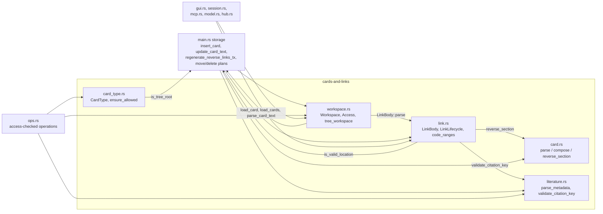
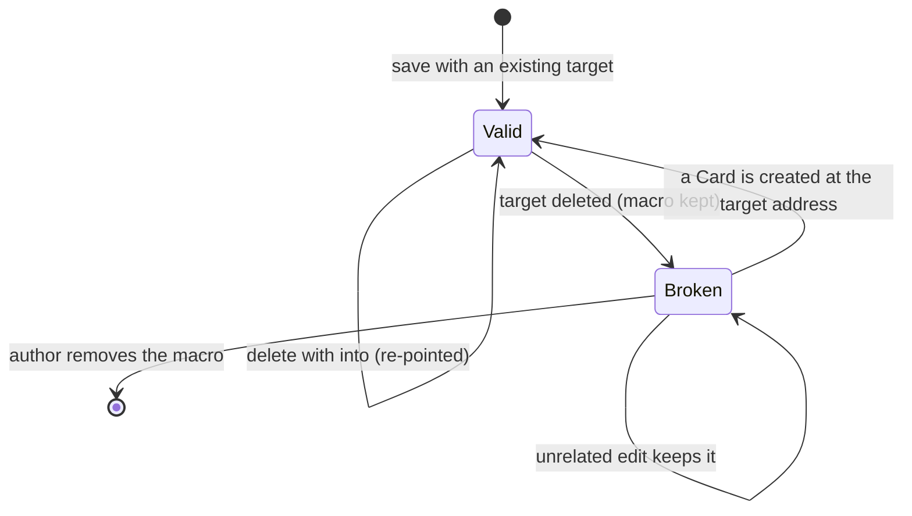

# Cards, Workspaces and Links

## Purpose

This block holds the core vocabulary of ZT's card archive: what a Card's stored text looks like and how it is parsed and composed, which Card types exist and where each may stand, how a Literature Card's BibTeX metadata gives its Citation key and title, which Workspace a tree belongs to and which client may change it, and how `[[target]]` Links are found, checked, rewritten, turned into Reverse links, and reported as Broken links. Every other block that reads or writes a Card (the shell and service, the Session, the GUI, the MCP server, Card operations, models, hubs) builds on these pure functions and small types. They exist so that the Card format and the Link rules have one implementation, shared by every client.

**Owns:** the Markdown Card text format and the Reverse link marker (`src/card.rs`); the Card type enum and the Tree-root type rule (`src/card_type.rs`); BibTeX parsing, Citation key validation, and title normalization (`src/literature.rs`); the `Workspace` and `Access` types and the cross-Workspace checks (`src/workspace.rs`); Link recognition (including code spans and fences), edit validation, target rewriting, Reverse link derivation, and Broken link listing (`src/link.rs`).

**Does not own:** SQLite schema, migrations, Location grammar helpers (`is_valid_location`, `tree_id`, `tree_root_address`), the edit lock, the save, delete, move, and Citation-key rename transactions in `src/main.rs`, or the dump ([Service, CLI and storage](service-and-cli.md)); the access-checked operations and place/insert plans ([Card operations](card-operations.md)); Model facets, emphasis, levels, Relation kinds, and Math forms ([Models and math](models-and-math.md)); Hub levels ([Hub Cards](hub-cards.md)); rendering of Links and Cards ([GUI](gui.md), [Terminal Session](session.md)); MCP tool schemas ([MCP server](mcp-server.md)); the Card layer rules for Finding and Event bodies ([zt-check](zt-check.md)).

## At a glance

| | |
|---|---|
| Entry points | `card::parse_card_text`, `card::parse_literature_edit_text`, `card::compose_card_text`, `card::reverse_section`, `card::card_template`, `card::from_legacy_text`; `CardType::parse` / `from_stored`, `card_type::ensure_allowed`; `literature::parse_metadata`, `literature::validate_citation_key`; `Workspace::parse` / `from_stored`, `Access::ensure_writable`, `Access::ensure_link_rewrites_allowed`, `workspace::tree_workspace`, `workspace::ensure_same_workspace`, `workspace::counts`; `LinkBody::parse`, `LinkBody::rewrite_targets`, `LinkLifecycle::from_cards` and its methods, `link::code_ranges`, `link::fenced_code_ranges` |
| Key files | `src/card.rs` — Markdown Card text: parse, compose, templates, Reverse link section, legacy conversion. `src/card_type.rs` — `CardType` (`idea`, `event`, `finding`, `model`, `hub`) and the Tree-root rule. `src/literature.rs` — BibTeX metadata parser, Citation key rules, title normalization. `src/workspace.rs` — `Workspace`, `Access`, `WorkspaceCounts`, tree Workspace lookup and the no-cross-Workspace-move rule. `src/link.rs` — `LinkBody` (one body's Links), `LinkLifecycle` (Links against an archive snapshot), code-range scanning. `tests/card_types.rs` — end-to-end tests of Card types through the shell, Session, MCP, GUI, dump, and schema upgrades |
| Depends on | [Service, CLI and storage](service-and-cli.md) (`crate::Card`, `is_tree_root`, `is_valid_location`, `tree_id`, `tree_root_address`, `load_card`, `load_cards`, `parse_card_text` re-export in `src/main.rs`); `anyhow`; `rusqlite` (only in `src/workspace.rs`); `nom-bibtex` 0.6 (`Bibtex::raw_parse`) |
| Used by | [Service, CLI and storage](service-and-cli.md), [Card operations](card-operations.md), [Terminal Session](session.md), [GUI](gui.md), [MCP server](mcp-server.md), [Models and math](models-and-math.md), [Hub Cards](hub-cards.md) |
| Tests | Unit tests in each of `src/card.rs`, `src/card_type.rs`, `src/literature.rs`, `src/workspace.rs`, `src/link.rs`; integration tests in `tests/card_types.rs` (Link behaviour is also exercised by `tests/cli_service.rs`, `tests/pty_session.rs`, `tests/workspaces_mcp.rs`, owned by other blocks) |

## Concepts

- `Card` — one Markdown document: a `# Title` heading, a Markdown body, and a generated Reverse link section after the `<!-- zt:reverse-links -->` marker. The parsed form is `ParsedCard { title, body, reverse }` in `src/card.rs`; the stored row is `crate::Card` in `src/main.rs`.
- `Reverse link marker` — the line `<!-- zt:reverse-links -->` (`REVERSE_MARKER` in `src/card.rs`). An HTML comment, so rendered Markdown hides it. Everything after it is generated.
- `Reverse link` — the generated section after the marker: `## Reverse links` (`REVERSE_HEADING`), a blank line, and one `- [[source]] Title` item per source Card. Built by `card::reverse_section` from the sources `LinkLifecycle::reverse_sections` derives.
- `Card type` — what a Card holds: `CardType::{Idea, Event, Finding, Model, Hub}` in `src/card_type.rs`; stored as `idea`, `event`, `finding`, `model`, `hub`. `Idea` is the default.
- `Regular Card` / `Tree root` — a Tree root is a Topic Card (`is_topic`) or a Literature Card (`is_lit`); `crate::is_tree_root` in `src/main.rs`. Only Regular Cards may have a type other than `idea`.
- `Literature Card` — the root of a Literature tree; its address is its Citation key and its title comes from BibTeX. `LiteratureMetadata { citation_key, title }` in `src/literature.rs`.
- `Citation key` — the BibTeX entry key, matching `^[A-Za-z][A-Za-z0-9_-]{0,127}$`, never a Windows reserved filename stem, never a valid Location (it has no `/` and starts with a letter). Case-significant for lookup and Links; unique case-insensitively (enforced in `src/main.rs`).
- `Workspace` — `Workspace::{Human, Agent}` in `src/workspace.rs`, stored as `human` / `agent`. Every tree belongs to one Workspace, read from its Tree root.
- `Access` — `Access::{Owner, Agent}` in `src/workspace.rs`: which Workspaces a client may change. Owner (Session, GUI, shell) changes both; Agent (the MCP server) changes only the agent Workspace.
- `Zone` — the Topic zone and Literature zone of a Workspace; `WorkspaceCounts { topic_trees, literature_trees, cards }` counts their trees.
- `Link` — a `[[target]]` macro in a Card body whose target is a Location or a Citation key. One occurrence is `LinkOccurrence { target, macro_range, target_range }` in `src/link.rs`.
- `Broken link` — a Link whose target Card does not exist; `BrokenLink { source_address, source_title, target, source_line }` and `LinkStatus::Broken` in `src/link.rs`.
- `Link lifecycle` — `LinkLifecycle`: the set of Card snapshots (`CardSnapshot { address, title, body }`) against which Links are classified, validated, and turned into Reverse links and Broken links.

## Architecture

The five source files are pure, crate-private modules with one exception: `src/workspace.rs` takes a `rusqlite::Connection` to look up a tree root or to scan every Card for rewrites. None of them opens the database, takes the edit lock, or runs a transaction; `src/main.rs` and `src/ops.rs` do that and call into this block.



- `src/card.rs` knows only the text format. It does not know Links: the Reverse link section is passed in as a string.
- `src/link.rs` knows Link syntax. It calls back into `crate::is_valid_location` (Location grammar, `src/main.rs`) and `literature::validate_citation_key` to decide whether a target is well formed, and calls `card::reverse_section` to format Reverse links. It never touches SQLite: callers load `CardSnapshot`s (address, title, body) with `link_lifecycle` / `link_lifecycle_from_cards` in `src/main.rs`.
- `src/workspace.rs` reads Tree roots with `crate::load_card` and, for agent Access, scans every Card with `crate::load_cards`, `crate::parse_card_text`, and `LinkBody`.
- `src/card_type.rs` checks one rule with `crate::is_tree_root`; the per-type field rules (facet, emphasis, level, form, hub level) live in `src/model.rs`, `src/math.rs`, and `src/hub.rs`.
- `src/literature.rs` is standalone apart from `nom-bibtex`.

## Interfaces

All items are `pub(crate)`; ZT is one binary crate (`src/main.rs`), so there is no library API. `src/main.rs` re-exports `ParsedCard`, `compose_card_text`, `parse_card_text`, `parse_literature_edit_text`, `regular_template`, `topic_template`, `CardType`, `Access`, and `Workspace` at the crate root.

### Card text (`src/card.rs`)

| Item | Signature | Behaviour and errors |
|---|---|---|
| `REVERSE_MARKER` | `&str = "<!-- zt:reverse-links -->"` | The marker line. Matched after trimming the line. |
| `REVERSE_HEADING` | `&str = "## Reverse links"` | Heading of a non-empty Reverse link section. |
| `ParsedCard` | `{ title: String, body: String, reverse: String }` | Body and reverse are trimmed of leading and trailing blank lines. |
| `parse_card_text` | `fn(&str) -> Result<ParsedCard>` | For Topic, Regular, and stored Literature text. Errors: ``card text must contain at most one <!-- zt:reverse-links --> line``, ``card text must start with a `# Title` heading``, `card title cannot be empty`. |
| `parse_literature_edit_text` | `fn(&str) -> Result<ParsedCard>` | For edited Literature text: the heading is optional. With no heading, `title` is empty and the whole head is the body. With a heading, its title is returned but callers ignore it. Only the marker error applies. |
| `compose_card_text` | `fn(title, body, reverse: &str) -> String` | Canonical text: `# {title}\n\n{body}\n\n<!-- zt:reverse-links -->\n{reverse}`. The body paragraph is left out when the body is blank; trailing newlines of the body are cut. `reverse` is written verbatim. |
| `reverse_section` | `fn(impl IntoIterator<Item = (&str, &str)>) -> String` | `(address, title)` pairs to `## Reverse links\n\n- [[a]] Title\n…\n`; an empty title gives `- [[a]]`; no pairs give `""`. Order is the caller's. |
| `card_template` | `fn(title: &str) -> String` | `# {title}\n\n\n<!-- zt:reverse-links -->\n`: heading, blank line, empty body line, marker. |
| `topic_template` / `regular_template` | `fn(&str) -> String` / `fn() -> String` | `card_template(title)` and `card_template("")`. |
| `from_legacy_text` | `fn(&str) -> Option<String>` | Converts the pre-Markdown format (`title lines`, `<--->`, body, `<--->`, old reverse text). Title lines are joined with spaces, the body is trimmed, the old reverse text is dropped. `None` unless the text has exactly two `<--->` lines. |

Title rule (`title_from_heading`): the first non-blank line before the marker must be `# Title` with `#` in column 0 and one space, or the bare line `#` (which gives an empty title). A closing `#` run is dropped only when a space precedes it: `# Closed #` gives `Closed`, `# C#` gives `C#`. `#Title`, `## Title`, and an indented heading are refused for Topic and Regular Cards.

### Card types (`src/card_type.rs`)

| Item | Signature | Behaviour |
|---|---|---|
| `CardType` | `enum { Idea (default), Event, Finding, Model, Hub }` | Derives `Copy`, `Ord`, `Hash`, `Default`. `Display` writes `id()`. |
| `CardType::id` | `fn(self) -> &'static str` | `idea`, `event`, `finding`, `model`, `hub`: the stored and typed name. |
| `CardType::parse` | `fn(&str) -> Result<Self>` | Trims and lowercases. Error: ``unknown card type `<x>`; expected idea, event, finding, model, or hub``. |
| `CardType::from_stored` | `fn(&str) -> Self` | Like `parse`, but an unknown stored value reads as `Idea`. |
| `ensure_allowed` | `fn(&Card, CardType) -> Result<()>` | Refuses a non-`Idea` type on a Tree root: `only Regular Cards can be Event, Finding, Model, or Hub Cards`. |

The rules for each type:

| Type | Where | Extra fields and rules | Enforced by |
|---|---|---|---|
| `idea` | any Card; always for Topic and Literature Cards | none | `ensure_allowed`; `insert_card` and `insert_literature_card` in `src/main.rs` write `idea` for roots |
| `event` | Regular Cards only | no facet, emphasis, level, form, or hub level; the body convention (date, place, actors, source) is not validated | `ensure_allowed`; schema CHECKs; [zt-check](zt-check.md) E rules for digests |
| `finding` | Regular Cards only | no facet, emphasis, level, form, or hub level; the six labelled lines (`测量`, `数据`, `方法`, `结果`, `局限`, `来源`) are a convention | `ensure_allowed`; schema CHECKs; [zt-check](zt-check.md) F rules |
| `model` | Regular Cards only | a Model Card (no facet) may carry `model_level` and `math_form`; a Model part has a `model_facet` and an optional `model_emphasis`; a Model Card with parts cannot change type or become a part | `ensure_allowed`; `model::ensure_allowed` / `model::set` in `src/model.rs` ([Models and math](models-and-math.md)) |
| `hub` | Regular Cards only | only a Hub Card may carry `hub_level` (`line`, `topic`, `field`, `register`) | `ensure_allowed`; `hub::set_level` in `src/hub.rs` ([Hub Cards](hub-cards.md)) |

`model::set` (in `src/model.rs`) also clears `model_level` and `math_form` when a Card stops being a Model Card head, and clears `hub_level` when it stops being a Hub Card.

### Literature metadata (`src/literature.rs`)

| Item | Signature | Behaviour and errors |
|---|---|---|
| `LiteratureMetadata` | `{ citation_key: String, title: String }` | The entry key exactly as written, and the normalized display title. |
| `parse_metadata` | `fn(raw: &str) -> Result<LiteratureMetadata>` | Uses `nom_bibtex::Bibtex::raw_parse` (no macro expansion). Errors: `invalid BibTeX metadata` (parser failure), `BibTeX metadata must contain exactly one bibliographic entry`, `BibTeX metadata must contain exactly one ordinary bibliographic entry` (`@comment`, `@preamble`, `@string`), any `validate_citation_key` error, `BibTeX metadata must contain exactly one title field` (field names compared case-insensitively), `BibTeX title must be a literal value, not a string macro`, `BibTeX title must be nonempty`. The raw string is not changed; the caller stores it. |
| `validate_citation_key` | `fn(&str) -> Result<()>` | 1 to 128 bytes, first an ASCII letter, then ASCII letters, digits, `_`, `-`. Errors: ``invalid Citation key `<k>`; expected ^[A-Za-z][A-Za-z0-9_-]{0,127}$`` and ``Citation key `<k>` is a Windows reserved filename stem`` (`CON`, `PRN`, `AUX`, `NUL`, `COM1`–`COM9`, `LPT1`–`LPT9`, any case). |

Title normalization (`normalize_title`): grouping braces `{` `}` are removed; any whitespace run (including newlines) becomes one space; leading and trailing space is cut; a backslash and the character after it are kept together, so `\{`, `\}`, and `\LaTeX` survive. Example: `{A}   \LaTeX{}\n    研究` gives `A \LaTeX 研究`.

### Workspaces and Access (`src/workspace.rs`)

| Item | Signature | Behaviour and errors |
|---|---|---|
| `Workspace` | `enum { Human, Agent }`, `ALL: [Workspace; 2]` (human first) | `id()`: `human` / `agent`; `label()`: `Human` / `AI agent`; `Display` writes `id()`. |
| `Workspace::parse` | `fn(&str) -> Result<Self>` | Trims, lowercases; accepts `human`, `agent`, `ai`. Error: ``unknown workspace `<x>`; expected human or agent``. |
| `Workspace::from_stored` | `fn(&str) -> Self` | Unknown stored values read as `Human`. |
| `Access` | `enum { Owner, Agent }` | Owner: Session, GUI, shell. Agent: `zt mcp`. |
| `Access::can_write` | `fn(self, Workspace) -> bool` | Owner: always; Agent: only `Workspace::Agent`. |
| `Access::ensure_writable` | `fn(self, Workspace) -> Result<()>` | Error: `the human workspace is read-only for AI agents; only the agent workspace can be changed`. |
| `Access::ensure_link_rewrites_allowed` | `fn(self, &Connection, &BTreeMap<String, String>) -> Result<()>` | For Agent Access and a non-empty old-to-new address mapping: loads every Card, and for each Card it may not write (and whose own address is not in the mapping) refuses if `LinkBody::rewrite_targets` would change its body. Error: ``this change would rewrite Links in human workspace Card `<a>`, which is read-only for AI agents``. Reverse link sections are not counted. |
| `WorkspaceCounts` | `{ topic_trees, literature_trees, cards: usize }` | |
| `counts` | `fn(&[Card], Workspace) -> WorkspaceCounts` | Counts Topic roots, Literature roots, and all Cards of one Workspace. |
| `tree_workspace` | `fn(&Connection, address: &str) -> Result<Workspace>` | The Workspace of the Tree root of `tree_id(address)`. Error: ``tree root `<r>` does not exist``. |
| `ensure_same_workspace` | `fn(&Connection, from: &str, to: &str) -> Result<()>` | Error: ``Cards cannot move between workspaces: `<from>` is in the <a> workspace and `<to>` is in the <b> workspace``. |

### Links (`src/link.rs`)

| Item | Signature | Behaviour and errors |
|---|---|---|
| `LinkOccurrence<'a>` | `{ target: &'a str, macro_range: Range<usize>, target_range: Range<usize> }` | Byte ranges into the body: `[[…]]` and the target inside it. |
| `LinkBody::parse` | `fn(&'a str) -> Result<LinkBody<'a>>` | Strict scan. Errors: `invalid link macro` (a `[[` with no `]]`, or a stray `]]` in prose after the last Link), ``invalid link macro target `<t>` `` (target is neither a valid Location nor a valid Citation key). |
| `LinkBody::for_rendering` | `fn(&'a str) -> LinkBody<'a>` | Tolerant scan (never fails): every `[[target]]` outside code, valid or not; stops at a `[[` with no `]]`. Used by `classify_for_rendering` and by `hub::parse_body` for member lines. |
| `LinkBody::occurrences` | `fn(&self) -> &[LinkOccurrence]` | In text order, duplicates kept. |
| `LinkBody::rewrite_targets` | `fn(&self, &BTreeMap<String, String>) -> LinkRewrite` | Replaces only `target_range` bytes whose target is a mapping key; every other byte stays. `LinkRewrite { body, count }` counts replaced occurrences. |
| `code_ranges` | `fn(&str) -> Vec<Range<usize>>` | Fenced code blocks plus inline code spans, sorted by start. Used by the GUI's TeX-delimiter rewrite. |
| `fenced_code_ranges` | `fn(&str) -> Vec<Range<usize>>` | Fenced code blocks only, from opening through closing fence line. Used by the GUI, the Session's Markdown view, and search excerpts in `src/ops.rs`. |
| `CardSnapshot` | `{ address, title, body: String }` | One Card as the lifecycle sees it. |
| `LinkLifecycle::from_cards` | `fn(Vec<CardSnapshot>) -> Self` | Keeps the snapshots and the set of their addresses. |
| `LinkLifecycle::classify_for_rendering` | `fn(&self, &'a str) -> Vec<ClassifiedLink<'a>>` | Tolerant scan (never fails): each occurrence with `LinkStatus::Valid` when the target is well formed and exists, else `Broken`. A trailing `[[` with no `]]` is dropped. |
| `LinkLifecycle::validate_edit` | `fn(&self, body: &'a str, old_body: Option<&str>) -> Result<LinkBody<'a>>` | Strict parse of the new body; each target must exist or already be a Broken target in `old_body`. Error: ``link target `<t>` does not exist``. |
| `LinkLifecycle::reverse_sections` | `fn(&self) -> Result<BTreeMap<String, String>>` | For every snapshot address, its Reverse link section text (possibly `""`). Errors if any body fails strict parsing. |
| `LinkLifecycle::broken_links` | `fn(&self) -> Result<Vec<BrokenLink>>` | One `BrokenLink` per Broken occurrence (duplicates kept), in snapshot order, with the full source line around it (`\r` cut). |

### Where users meet this block

- Shell `zt lsbk` (`cmd_lsbk` in `src/main.rs`) prints `<source> <title> -> <target>: <line>` per `BrokenLink`; Session `lsbk` shows the same list ([Terminal Session](session.md)); MCP `list_broken_links` and the GUI overview count use `broken_links` ([MCP server](mcp-server.md), [GUI](gui.md)).
- `zt workspaces` (`cmd_workspaces` in `src/main.rs`) prints each Workspace's `id`, `label`, `counts`, and MCP access.
- Session `ty <idea|event|finding|model|hub> [<facet>]`, MCP `type` arguments on `create_successor`, `insert_card`, `edit_card`, `search_cards`, and GUI `/api/create` / `/api/edit` `type` fields parse through `CardType::parse`.

## Behaviour

### Saving a Card's text

1. A client hands full Card text to `update_card_text` (or `insert_card` for a new Card) in `src/main.rs`, normally through `ops::edit` / `ops::create_successor` in `src/ops.rs`, which first calls `Access::ensure_writable`.
2. `validate_card_text` calls `parse_card_text` on the new text and on the old text, builds a `LinkLifecycle` from all stored Cards (`link_lifecycle`), and calls `validate_edit(new_body, old_body)`.
3. The text is written as given, then `regenerate_reverse_links_tx` runs in the same transaction: it loads every Card, derives every Reverse link section with `reverse_sections`, and rewrites each Card as `compose_card_text(title, body, reverse)`. So whatever the client wrote after the marker is replaced, and every Card's text becomes canonical.

### Creating and editing a Literature Card

1. `literature::parse_metadata(bibtex)` gives the Citation key and title (`ops::create_literature`, `shell_create_literature`, Session `l`, GUI create).
2. The client's text is parsed with `parse_literature_edit_text`; only its body is kept. The text becomes `compose_card_text(metadata.title, body, "")`.
3. `insert_literature_card` (`src/main.rs`) validates the key again, refuses a key that exists case-insensitively (``Literature Card `<k>` already exists``), validates Links, inserts the row with `is_lit = 1`, the raw BibTeX, the Workspace, and type `idea`, and regenerates Reverse links.
4. A text edit (`update_literature_text`) re-parses the stored BibTeX and always replaces the title with the BibTeX title.
5. A metadata edit (`ops::edit_metadata`, `update_literature_metadata`) with a new entry key renames the tree: `citation_rename_mapping` maps `Old -> New` and each `Old/<suffix> -> New/<suffix>`; a new key equal to the old one ignoring case, or used by another Card, is refused; agent Access runs `ensure_link_rewrites_allowed`; the client must confirm with `move`; the row, `apply_location_mapping_tx` (which rewrites Links with `LinkBody::rewrite_targets`), and Reverse links change in one transaction.

### Link recognition (`scan_occurrences`)

1. `code_ranges` finds code: `scan_code` walks lines; a line with up to 3 spaces of indent and a run of 3 or more `` ` `` or `~` opens a fence; a line with the same character, a run at least as long, and nothing else closes it; an unclosed fence runs to the end of the text. In the prose between fences, `inline_code_ranges` pairs backtick runs of equal length; an unmatched run is literal text.
2. The scanner finds each `[[`. If it lies in a code range, scanning jumps to the end of that range. Otherwise the target is the text up to the next `]]`.
3. Strict mode refuses a missing `]]` and a target that is neither `crate::is_valid_location` nor a valid Citation key. After the last Link, any `]]` outside code is refused.
4. Tolerant mode (`for_rendering`) keeps malformed targets (classified Broken later) and stops at a `[[` with no `]]`.

### Reverse links

1. `reverse_sections` parses every snapshot body strictly.
2. For each occurrence whose target exists, the source address is added once per target (`seen` set), so one source gives one line however often it links.
3. Sources are kept in a `BTreeSet<&str>`: byte order of the address string.
4. Each Card gets `card::reverse_section` of its sources with their titles. Broken targets give no Reverse link.

### The Link lifecycle across changes



- New Link: `validate_edit` refuses a target that does not exist, unless it was already Broken in the old body (any number of occurrences may stay).
- Move, insert, side compaction, Citation-key rename: `src/main.rs` builds an old-to-new mapping; `count_rewritten_links` counts occurrences for the confirmation preview; `apply_location_mapping_tx` renames rows and rewrites each body with `rewrite_targets`; Reverse links are regenerated. Agent Access first runs `ensure_link_rewrites_allowed` (`src/ops.rs`).
- Delete: `delete_plan` lists the inbound Links (`links_into`) as `links that will break`; the macros stay in the source bodies and become Broken links, listed by `broken_links`. With `into`, each inbound target is mapped to the `into` Card first and rewritten.

### Workspace rules

1. A new Topic or Literature Card names the Workspace of its new tree.
2. `insert_card` (`src/main.rs`) refuses a Regular Card whose Workspace differs from `tree_workspace(location)`: ``card `<l>` belongs to the <a> workspace, not the <b> workspace``. `ops::create_successor` always passes the parent's Workspace.
3. `move_plan` (`src/main.rs`) and `place.rs` call `ensure_same_workspace` for every client, so no Card moves between Workspaces. Literature tree Cards also cannot leave their tree, and Topic tree Cards cannot enter a Literature tree (`ensure_same_tree_kind_boundary`, `src/main.rs`).
4. Links may cross Workspaces freely; addresses are unique across both.
5. Agent Access may delete an agent Card that a human Card links to (the human Card gets a Broken link), but may not make a change that would rewrite a human Card's body.

### Rules the code keeps

- At most one marker line per Card; the marker is optional when editing.
- Only the body contributes outbound Links. Titles, BibTeX, and Reverse link sections are never scanned.
- A Card type belongs to the row, not to the Location: moves, compaction, and renames keep it (`tests/card_types.rs`).
- Citation keys are case-significant for Links and lookup; `[[smith2024]]` does not reach `Smith2024`.
- These functions hold no state and take no locks; callers serialize writes with the edit lock.

## Data and storage

This block persists nothing itself; it defines the formats that `src/main.rs` stores.

### Stored Card text (`cards.text`)

```markdown
# Ownership drives investment

See [[1/1]] and [[1/1|a]].

<!-- zt:reverse-links -->
## Reverse links

- [[1/3]] Missing insurance lowers investment
```

A Card with no inbound Links ends at the marker line: `# T\n\n<!-- zt:reverse-links -->\n`. A new Card's editor text is `card_template`.

### Columns this block's types read and write

| Column | Type | Meaning | Type in Rust |
|---|---|---|---|
| `location` | `TEXT UNIQUE`, NULL for Literature Cards | Topic or Regular Card address | `Card::address` |
| `citation_key` | `TEXT UNIQUE`, NOCASE unique index `cards_citation_key_nocase` | Literature Card address | `LiteratureMetadata::citation_key` |
| `is_topic`, `is_lit` | `INTEGER 0/1` | Tree-root kind | `crate::is_tree_root` |
| `bibtex` | `TEXT`, non-NULL only for Literature Cards | raw BibTeX, stored unchanged | input of `parse_metadata` |
| `text` | `TEXT NOT NULL` | the Markdown Card text above | `ParsedCard` |
| `workspace` | `TEXT NOT NULL DEFAULT 'human' CHECK(IN ('human','agent'))` | | `Workspace` |
| `card_type` | `TEXT NOT NULL DEFAULT 'idea' CHECK(IN ('idea','event','finding','model','hub'))` | | `CardType` |

The table definition and its migrations are in `cards_table`, `ensure_card_type_column`, `ensure_workspace_column`, `ensure_finding_cards`, and `ensure_markdown_cards` in `src/main.rs` ([Service, CLI and storage](service-and-cli.md)). `metadata.card_format = 'markdown'` records that `from_legacy_text` has run.

### Dump

`archive.json` in a `zt dp` dump lists every Card's Workspace and every non-Idea Card's type (from `tests/card_types.rs`):

```json
{"next_topic_id":2,"workspaces":{"0/0":"human","0/1":"human","1/0":"agent","1/1":"agent","1/1|a":"agent","1/1|b":"agent"},"types":{"1/1":"model","1/1|a":"event","1/1|b":"hub"},"facets":{},"emphasis":{},"levels":{"1/1":"formal"},"forms":{},"hub_levels":{"1/1|b":"line"}}
```

## Configuration

None: the formats, rules, and limits in this block are constants in code (for example the 128-byte Citation key limit); no flag, environment variable, or config key changes them.

## Usage

### Parse, change, and recompose a Card

```rust
let parsed = crate::parse_card_text(&card.text)?;
let body = crate::link::LinkBody::parse(&parsed.body)?
    .rewrite_targets(&mapping)
    .body;
let text = crate::compose_card_text(&parsed.title, &body, &parsed.reverse);
```

This is `replace_link_locations` in `src/main.rs`.

### Validate an edit's Links and list Broken links

```rust
crate::link_index::validate(&conn, &new.body, Some(&old.body))?;
let lifecycle = crate::link_lifecycle(&conn)?; // full report oracle
for broken in lifecycle.broken_links()? {
    println!("{} {} -> {}: {}", broken.source_address, broken.source_title,
             broken.target, broken.source_line);
}
```

### Check Access before a change that renames addresses

```rust
access.ensure_writable(card.workspace)?;
let plan = crate::place::move_plan(&conn, at, target, alone)?;
access.ensure_link_rewrites_allowed(&conn, &plan.mapping)?;
```

This is `ops::move_card` in `src/ops.rs`; every renaming operation there follows the same order.

### Parse BibTeX

```rust
let meta = crate::literature::parse_metadata("@article{Klein1978, title = {Vertical Integration}}")?;
assert_eq!(meta.citation_key, "Klein1978");
assert_eq!(meta.title, "Vertical Integration");
```

### Set a Card type from the outside

```text
MCP:      create_successor {"at":"1/0","title":"GHM property-rights model","type":"model"}
MCP:      edit_card {"at":"1/2","type":"event"}        # type alone leaves the text
Session:  ty event
GUI:      POST /api/edit {"at":"0/1|a","type":"idea"}
```

### Add a new Card type

1. Add the variant to `CardType` in `src/card_type.rs`, with its `id`, a `parse` arm, the `parse` error text, the `ensure_allowed` refusal text, and the unit test.
2. Extend the `card_type` CHECK in `cards_table` (`src/main.rs`) and add a one-time table rebuild like `ensure_finding_cards`: SQLite cannot change a CHECK in place ([Service, CLI and storage](service-and-cli.md)).
3. Add the name to every place that lists types: MCP `type` enums and server instructions (`src/mcp.rs`), the Session `ty` help (`src/session/command.rs`), the GUI type selector, stamps, and search chips, `list_trees` counts, and the dump `types` map.
4. Update `ROOT_REFUSAL` and the enum assertions in `tests/card_types.rs`, plus `CONTEXT.md`. The Finding Card commit (`753bd7b`, design in `docs/finding-cards-design.md`) is a complete example.

## Testing

Unit tests live beside the code; the integration tests are in `tests/card_types.rs`. Build in `D:/zt-target` on this machine (E: is short of space), and keep `ZT_GUI_PORT=0` (the test helpers set it) so a test daemon never takes port 4717.

```bash
# unit tests of this block (the binary crate holds them)
CARGO_TARGET_DIR=D:/zt-target cargo test --bin zt card::
CARGO_TARGET_DIR=D:/zt-target cargo test --bin zt card_type::
CARGO_TARGET_DIR=D:/zt-target cargo test --bin zt literature::
CARGO_TARGET_DIR=D:/zt-target cargo test --bin zt workspace::
CARGO_TARGET_DIR=D:/zt-target cargo test --bin zt link::
# integration tests of Card types
CARGO_TARGET_DIR=D:/zt-target cargo test --test card_types
```

What they cover:

- `src/card.rs`: compose/parse round trip, empty body, templates, the marker's uniqueness, heading rules (`#Title`, `## x`, closing `#`, `C#`), Literature text without a heading, the Reverse link format, legacy conversion.
- `src/card_type.rs`: names, case and whitespace, the unknown-type error, `from_stored` fallback.
- `src/literature.rs`: identity and title normalization, refusal of `@comment` / `@preamble` / `@string`, two entries, no or empty title, macro title; Citation key grammar and reserved stems.
- `src/workspace.rs`: name parsing (`ai`), `from_stored` fallback, Access matrix and error text.
- `src/link.rs`: exact ranges, strict errors, rendering classification, old-versus-new Broken targets, byte-exact rewriting and counts, Reverse link dedupe and order, code spans and fences (unclosed fence, unmatched backtick), Broken link source lines.
- `tests/card_types.rs`: the `card_type` column added to a 0.4 archive once; MCP create/edit/get/tree/search by type and the root and human-Workspace refusals; types kept through moves and Citation-key renames; Session `ty`; GUI `/api/create`, `/api/edit`, `/api/overview` counts; the dump `archive.json`; Finding Cards through MCP (`insert_card`, `list_trees` counts); the one-time rebuild of a 0.17 archive for `finding` with its backup. The dump test returns early when no zip backend is found (`tar` on Windows, `zip` elsewhere).

Gaps: no unit test drives `Access::ensure_link_rewrites_allowed`, `tree_workspace`, `ensure_same_workspace`, or `counts` directly (they are covered end to end in `tests/workspaces_mcp.rs`); no test covers a stray `]]` before a later Link, indented code blocks, a marker line inside a code fence, or Reverse link order with `0/10` beside `0/2`.

## Decisions and pitfalls

### Decisions

- **One Markdown document per Card, generated tail.** The marker is an HTML comment so rendered Markdown hides it; the client never supplies Reverse links ([docs/markdown-cards-and-gui-design.md](../markdown-cards-and-gui-design.md)).
- **One Link module.** All `[[target]]` interpretation is in `src/link.rs`, and it takes snapshots instead of a connection, so it has no storage seam to mock; raw `[[` scanning elsewhere is not allowed ([docs/link-lifecycle-and-session-command-policy-deepening-design.md](../link-lifecycle-and-session-command-policy-deepening-design.md)). "New Broken link" means a target absent from the old body's Broken set, not a count of occurrences.
- **Code is not a Link.** Inline code spans and fenced blocks are excluded from validation, rewriting, and Reverse links, so Cards can show `[[x]]` literally and charts in ```` ```chart ```` fences are not Links ([docs/markdown-cards-and-gui-design.md](../markdown-cards-and-gui-design.md)).
- **Citation key is the BibTeX entry key, ASCII and filename-safe.** The dump writes `<citation-key>.bib`, so keys exclude Windows reserved stems and are unique case-insensitively while Links stay case-sensitive. A real BibTeX parser is used, the raw string is stored unchanged, and only the display title is normalized ([docs/literature-card-design.md](../literature-card-design.md)).
- **Workspaces share one address space.** Links keep one meaning everywhere; Cards and trees never cross Workspaces; regenerating a human Card's Reverse links is not a change to it ([docs/workspaces-and-mcp-design.md](../workspaces-and-mcp-design.md)).
- **Type is row data, not formatting.** It is stored on the row, survives moves and renames, and body conventions are taught, not validated ([docs/event-and-model-cards-design.md](../event-and-model-cards-design.md), [docs/finding-cards-design.md](../finding-cards-design.md), [docs/hub-cards-design.md](../hub-cards-design.md)).

### Pitfalls

- **Bodies remain authoritative; the Link index is derived.** Ordinary writes validate referenced targets and maintain only their source/targets through `src/link_index.rs` ([Service and storage](service-and-cli.md)). Structural changes and explicit integrity/reindex commands retain a full parse. The full `LinkLifecycle::validate_edit` remains a test oracle; production validation no longer parses unrelated bodies. Never patch live Card storage by hand.
- **The marker is found everywhere, even in code.** `parse` matches `<!-- zt:reverse-links -->` on any trimmed line, including inside a fenced code block, so a Card that quotes the marker loses the rest of its body (or is refused if it quotes it twice).
- **Stray `]]` is checked only after the last Link.** Strict parsing refuses `[[0/1]] then ]]` but accepts `a ]] b [[0/1]]`, because the tail check starts at the end of the last Link.
- **Only fenced and inline code is code.** Indented code blocks (4 spaces) and fences indented more than 3 spaces (for example inside a list item) are prose, so `[[…]]` in them are Links and must be valid.
- **Reverse link order is byte order.** `BTreeSet<&str>` sorts `0/10` before `0/2` and Citation keys by ASCII (uppercase first); it is not Folgezettel order (`model::address_order`).
- **Headings are stricter than CommonMark.** The title must be `# ` at column 0; a tab after `#` or a leading space is refused.
- **Literature titles are not editable in the text.** Any heading in edited Literature text is dropped and the BibTeX title wins; change the `title` field instead.
- **A case-only Citation key change is refused.** Renaming `smith2024` to `Smith2024` fails the case-insensitive conflict check; it needs a rename to a different key and back.
- **Unknown stored values fall back silently.** `CardType::from_stored` reads garbage as `idea` and `Workspace::from_stored` as `human`; the schema CHECKs are what keep bad values out.
- **Agent rewrite checks are archive-wide.** `ensure_link_rewrites_allowed` parses every Card in the archive for each agent move, insert, delete, or rename; it is O(Cards).
- **zt-check finds Links differently.** `tools/zt-check/src/check.rs` uses its own `\[\[[^\]]+\]\]` pattern for the Card layer rules, which does not skip code spans; see [zt-check](zt-check.md).
- **Stale test message.** In `tests/card_types.rs`, the assertion message "the schema accepts only the three Card types" predates Finding and Hub Cards; the check itself (refusing `fact`) is still right.

## Change history

- `2026-10-17` — Expose the existing `line_around` helper to the indexed Broken-link reader so repeated occurrences retain the original source-line rendering.

- `2026-10-17` — Keep the body parser and exact Reverse link rendering as the oracle for the new transactional occurrence index; production target validation is scoped and the full lifecycle validator is test-only.

- `2026-10-16` — Wiki doc created.
- `2026-10-16` — The dump type test adds a line Hub Card and checks `hub_levels`.
- `2026-10-16` — `LinkBody::for_rendering` is `pub(crate)` for `hub::parse_body`.
- `2026-10-16` `753bd7b` — Finding Cards: `CardType::Finding`, error texts name Finding, the one-time `cards` table rebuild and its tests (zt 0.20.0).
- `2026-10-15` `9918ba6` — Math forms on Model Cards; the type tests and dump manifest gain `forms`.
- `2026-10-14` `82eac86` — Hub Cards: `CardType::Hub` and the Hub refusal text (zt 0.16.0).
- `2026-10-13` `4f0414d` — the GUI runs inside the service; the GUI type test reads the URL from `zt gui` (zt 0.14.0).
- `2026-10-13` `7d636e4` — elaboration levels; the dump manifest gains `levels` (zt 0.13.0).
- `2026-10-11` `eec0940`, `2b05ba6` — Model parts: storing a type moved out of `src/card_type.rs` into `model::set`, which also handles facet and emphasis (zt 0.6.0, 0.7.0).
- `2026-10-10` `09f7e46` — `src/card_type.rs` with Event and Model Cards and `tests/card_types.rs` (zt 0.5.0); `db67049` adjusted the dump test's zip backend check.
- `2026-10-10` `d52b4ae` — `src/workspace.rs`: human and agent Workspaces, `Access`, the no-cross-Workspace rule, and agent rewrite checks for `zt mcp`.
- `2026-09-30` `316b454` — `src/card.rs`: Markdown Card text with the `<!-- zt:reverse-links -->` marker, legacy `<--->` conversion; `src/link.rs` gains `code_ranges` / `fenced_code_ranges`, so Links in code spans and fences are plain text.
- `2026-07-22` `41155ad` — `src/link.rs`: one Link module (`LinkBody`, `LinkLifecycle`) replacing the scattered scanners.
- `2026-07-14` `b7bf74d` — `src/literature.rs`: Literature Cards, BibTeX parsing with `nom-bibtex`, Citation key rules.
