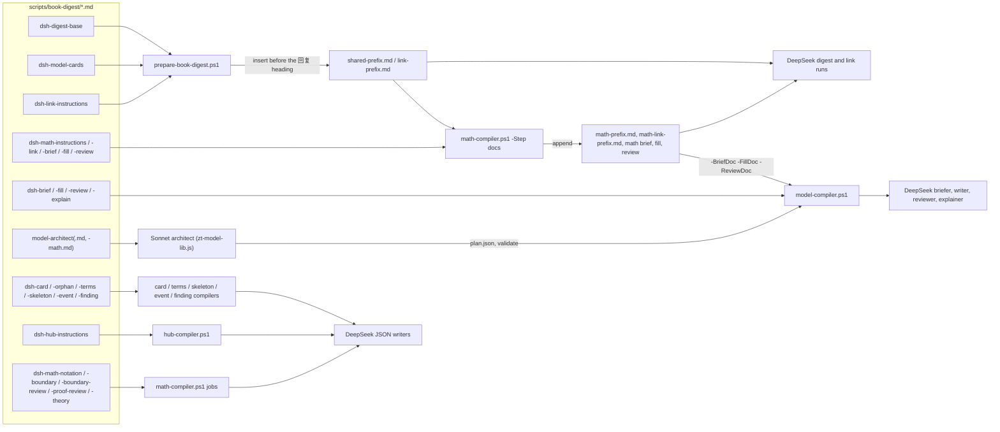

# Digest prompts

## Purpose

This block is the text that the book digest gives to its models. The 27 `dsh-*.zh.md` files are the Chinese instructions for DeepSeek Harness (DSH) runs: the digest writer, the link writer, the model briefer, writer, reviewer and explainer, the Card fixers, the cross-book Bridge judge, and the writers of the term table, skeleton, Event Cards, Finding Cards, Hub Cards, and the math units. The two `model-architect*.md` files are the English instructions for the Sonnet architect that plans each model. The scripts of the digest are deterministic and write no prose. These files are where every writing rule, output format, and self-check loop is set out for the model that does the writing. A developer edits this block to change what a digest writes or how it writes it. The digest prompts file every Card in the book's Literature tree: they create no Topic tree, write no Topic-tree Card and no Hub Card, and link no Topic-tree Card (`docs/literature-only-digest-design.md`). Three files serve other runs: `dsh-hub-instructions.zh.md` and `dsh-restate-instructions.zh.md` are read by the hub round and the restatement review that `zt-idea-grow` runs, and `dsh-concept-instructions.zh.md` by `zt-digest concepts`, which no workflow stage runs now.

**Owns:** the wording of each instruction, the output format each run must produce (JSON shape, reply line, Card body layout), the Card-language limits as they are told to writers, the self-check loop the writers follow, and the placeholders (`{{KEY}}` and the others) that loaders fill in.

**Does not own:** the scripts that load, render, and apply these files ([Digest scripts](digest-scripts.md)); the workflow modules, blueprints, and book profiles that choose which files a run gets ([Digest workflows](digest-workflows.md)); the rules that actually judge the output ([zt-check](zt-check.md)); the `zettelkasten`, `zt-digest-protocol` and `asd-ste100-zh` skills that runs load beside them ([Agent skills](agent-skills.md)); the Card, Model and Hub semantics they describe ([Cards and links](cards-and-links.md), [Models and math](models-and-math.md), [Hub Cards](hub-cards.md)).

## At a glance

| | |
|---|---|
| Entry points | The first entry of a job's `files` list (DSH `prompt_files`), which every compiler step prints in `{"jobs":[{"id","files","prompt"}]}`; the rendered prefixes `shared-prefix.md`, `link-prefix.md`, `math-prefix.md`, `math-link-prefix.md`; the architect prompt in `scripts/book-digest/workflow/modules/zt-model-lib.js`, which names `model-architect.md` for Sonnet to read |
| Key files | Digest: `dsh-digest-base.zh.md` (the digest prompt), `dsh-model-cards.zh.md` (Model Card supplement), `dsh-link-instructions.zh.md` (link pass). Concept review: `dsh-concept-instructions.zh.md` (the meaning judge of `zt-digest concepts`; a supplement; no workflow stage runs it). Restatement review: `dsh-restate-instructions.zh.md` (the judge of `zt-digest restate`, run by `zt-idea-grow`). Model compiler: `dsh-brief-instructions.zh.md`, `model-architect.md`, `dsh-fill-instructions.zh.md`, `dsh-review-instructions.zh.md`, `dsh-explain-instructions.zh.md`. Card layers: `dsh-card-instructions.zh.md`, `dsh-orphan-instructions.zh.md`, `dsh-terms-instructions.zh.md`, `dsh-skeleton-instructions.zh.md`, `dsh-event-instructions.zh.md`, `dsh-finding-instructions.zh.md`. Hubs: `dsh-hub-instructions.zh.md` (the hub round of `zt-idea-grow`). Bridge: `dsh-bridge-instructions.zh.md`. Math: `dsh-math-instructions.zh.md`, `dsh-math-link.zh.md`, `dsh-math-brief.zh.md`, `dsh-math-fill.zh.md`, `dsh-math-review.zh.md`, `dsh-math-notation-instructions.zh.md`, `dsh-math-boundary-instructions.zh.md`, `dsh-math-boundary-review.zh.md`, `dsh-math-proof-review.zh.md`, `dsh-math-theory-instructions.zh.md`, `model-architect-math.md`. All of them are in `scripts/book-digest/`. The table under Interfaces gives the role of each one. |
| Depends on | [zt-check](zt-check.md) (the `SELF-CHECK` and `CHECK` commands the prompts tell writers to run); the zt helper `zt-digest call` (`-Log`, `-SrcLog`, `-Allow`, the `@@N` batch syntax, and the Literature scope that refuses a Topic or hub write with `literature_only` unless the call passes `-Open`; see [zt-digest](zt-digest.md) and [zt-check](zt-check.md); the old path `skills/zt/scripts/zt-mcp.ps1` forwards to it, see [Agent skills](agent-skills.md)); the model compiler `zt-digest model`, which the architect runs for `-Step validate`; the skills `zettelkasten` and `asd-ste100-zh` that runs receive through `skills`; DeepSeek Harness through the `deepseek` MCP bridge; Sonnet through the Workflow runtime |
| Used by | [Digest scripts](digest-scripts.md) (`prepare-book-digest.ps1`, `model-compiler.ps1`, `card-compiler.ps1`, `book-terms.ps1`, `book-skeleton.ps1`, `event-compiler.ps1`, `finding-compiler.ps1`, `hub-compiler.ps1`, `math-compiler.ps1`); [Digest workflows](digest-workflows.md) (`zt-digest-lib.js`, `zt-model-lib.js`, the blueprints' `consts.profile`, `.claude/workflows/zt-econ-digest.js`, `zt-math-digest.js`) |
| Tests | No test reads the prompts on their own. Some assertions on them are in `scripts/book-digest/tests/math-compiler.tests.ps1`, `card-compiler.tests.ps1`, `book-terms.tests.ps1`, `event-compiler.tests.ps1`, `model-compiler.tests.ps1`, `framework-harness.mjs` (see Testing) |

## Concepts

- `Instruction file` — one `dsh-*.zh.md` (or `model-architect*.md`): the rules for one task. It opens every job of that task, so the DSH prompt cache can reuse it as a prefix. Held in `scripts/book-digest/`.
- `Supplement` — an instruction file that is never sent alone. It adds to a base file: `dsh-model-cards.zh.md` to `dsh-digest-base.zh.md`, each `dsh-math-*` digest, link, brief, fill, or review file to its shared file, `model-architect-math.md` to `model-architect.md`, and `dsh-concept-instructions.zh.md` to the digest base (it adds only the meaning judgment; the Card language and the writing rules still hold). Each one says the base rules "照常有效" (still hold). The math ones also say the supplement wins when the two conflict ("两处冲突时，以本节为准").
- `Digest prefix` / `Link prefix` — the rendered, book-specific copy of the digest and link instructions, written once per book into the staging folder (`shared-prefix.md`, `link-prefix.md`; for math `math-prefix.md`, `math-link-prefix.md`). It is identical for every group, so it is the cached part of each run (`prepare-book-digest.ps1`).
- `Job file` — the per-job half of a prompt, written by a compiler: the group file `groups/gNN.md`, a link file `link-gNN.md`, or a task file such as `fix-01.md`. It carries the values a prompt only names: `HELPER`, `CHECK`, `ALLOW`, `LIMITS`, `OUT`, the result-file path, and the `SELF-CHECK:` line.
- `Placeholder` — `{{TITLE}}`, `{{KEY}}`, `{{INDEX}}`, `{{STAGING}}`, `{{SOURCE}}` in an instruction file. The loader replaces it with a book-wide value (the Citation key, the staging folder). It never holds per-job data. The loaders still replace `{{HELPER}}`, but no prompt uses it: the prompts name the helper as `zt-digest call`.
- `Helper command` — the command a prompt shows for zt calls: a JSON array in a here-string piped to `zt-digest call -` (`'@ | zt-digest call - -Log "…"` in the digest prompts, `- -Allow "…"` in the link and fill prompts, a bare `-` for the event prompt's read-only `search_cards`). DeepSeek Harness has no zt tools, so this is its only way to read or write Cards.
- `Literature-only rule` — the digest, link, model-cards, card and skeleton prompts tell the writer that it writes only the book's Literature tree: no `create_topic`, no Topic-tree Card, no Hub Card, no Link to a Topic-tree Card (a Topic tree is a tree whose id is a number). The helper refuses each of these writes with `literature_only` (the Literature scope), and the prompts name that refusal so a writer corrects its draft instead of retrying. Topic trees are grown from the Literature trees by `zt-idea-grow`.
- `SELF-CHECK line` — a line in a job file that gives the exact read-only command a writer runs on its own output (`zt-check …`, or a compiler's `-Step precheck`). The prompt tells the writer to run it, fix each reported line, and stop at `faults: 0`, at most three runs.
- `Reply line` — the one line of JSON a run returns at the end ("只回复一行 JSON，不加其他文字"). Its Haiku manager parses it (`zt-digest-lib.js`).
- `Card language` — the ASD-STE100 rules adapted for Chinese (CONTEXT.md). Every prompt repeats the project's numbers (40 characters a sentence, 30 for a derivation step, no `；`, at most two `的` in a noun phrase, no hedge words) and passes the `asd-ste100-zh` skill. The numbers in the prompt win over the skill's.
- `Kind word` — the word before a Link that gives its Relation kind (`依赖`, `例示`, `对照`, `放宽`, `对应`, `反驳`, `特例`, `案例`, `印证`, `承接`). The prompts tell the writer to put the kind word directly before the `[[…]]` (CONTEXT.md, Relation kind).
- `Supply mark` — the marks that show text the book does not give: `（补：书中略去）` on a filled-in derivation step, `（补：书中未写）` on an explanation the writer adds, `（补：书中未给）` on an example or counterexample the writer supplies (math).
- `Derivation part` sections — `**思路**`, `**起点**`, `**步骤**`, `**结果**`, `**解读**`, in that order, with optional `说明：` lines under steps (`dsh-fill-instructions.zh.md`; zt-check R15 to R17).

## Architecture

The block is a set of flat files. Its structure is how the loaders compose and send them. There are four ways a file reaches a model:

1. **Prefix build** (`prepare-book-digest.ps1`). It takes the first file in `-Instructions` as the template and puts each further file just before the template's `\n## 回复` heading. Then it replaces every placeholder and writes `shared-prefix.md`. `dsh-link-instructions.zh.md` is rendered in the same loop into `link-prefix.md`.
2. **Append** (`math-compiler.ps1 -Step docs`). It appends each math supplement after the end of its shared file (after the reply section, not before it). It writes `math-prefix.md` and `math-link-prefix.md` in the staging folder and `math\brief.zh.md`, `math\fill.zh.md`, `math\review.zh.md` in the work folder. The model compiler gets the last three through `-BriefDoc`, `-FillDoc`, `-ReviewDoc` (profile `compilerDocs`).
3. **Rendered copy** (`card-compiler.ps1`, `book-terms.ps1`, `book-skeleton.ps1`, `event-compiler.ps1`, `finding-compiler.ps1`, `math-compiler.ps1 -Step notation`). Each one writes a copy with `{{KEY}}` (and sometimes `{{STAGING}}`, `{{HELPER}}`) replaced into its work folder, and puts that copy first in each job's `files`.
4. **Raw file** (`model-compiler.ps1` brief, fill, review and explain; `hub-compiler.ps1`; the math boundary, proof and theory steps). The job's `files` names the file in `scripts/book-digest/` directly. These files have no placeholders. Every per-job value is in the job file. The architect files are also raw: the Sonnet prompt in `zt-model-lib.js` names their paths, and Sonnet reads them with the Read tool.



Which digest prompt a book gets depends on its workflow:

| Workflow | Digest prompt (`-Instructions`) | Digest prefix | Link prefix | Model compiler docs | Architect |
| --- | --- | --- | --- | --- | --- |
| `zt-econ-digest` (blueprint `scripts/book-digest/workflow/zt-econ-digest.blueprint.json`) | `dsh-digest-base.zh.md,dsh-model-cards.zh.md`, `-NoEventCandidates` | `shared-prefix.md` | `link-prefix.md` | defaults (`compilerDocs: {}`) | `model-architect.md` |
| `zt-math-digest` (blueprint `zt-math-digest.blueprint.json`) | `dsh-digest-base.zh.md,dsh-model-cards.zh.md`, `-NoEventCandidates` | `math-prefix.md` | `math-link-prefix.md` | `math\brief.zh.md`, `math\fill.zh.md`, `math\review.zh.md` | `model-architect.md` then `model-architect-math.md` |

## Interfaces

### The prompt files

"Loaded by" names the script that puts the file first in a job's `files`, and the workflow module that runs that script. "Reply" is the one JSON line the run returns. All DeepSeek files are Chinese. The architect files are English.

| File | Stage | Read by | Loaded by | Asks for | Output it demands |
| --- | --- | --- | --- | --- | --- |
| `dsh-digest-base.zh.md` | Digest | DeepSeek writer, one run per group | `prepare-book-digest.ps1` as the first `-Instructions` file (`zt-digest-prepare.js` with `consts.profile.instructions`; also the script's default) → `shared-prefix.md` | 6–12 Cards for its sections, all in the book's Literature tree under its anchor: a Card that already states the claim (in this book or another book's Literature tree) is linked, every other Card is built under the anchor in argument order (the next step a Direct successor, an exception or aside a Side successor, at most about 7 Side successors of the anchor, no Idea Card after a Model Card); no `create_topic`, Topic-tree Card, Hub Card or Link to a Topic-tree Card (refused as `literature_only`); the book's figures pasted as ``; Links with kind words in the sentence that uses them; then a rewrite of the anchor (a claim title, a `§2.1 - …` section index, a `在全书中的位置：` paragraph). It reads the snapshot of the box's Literature trees | One here-string batch piped to `zt-digest call -` (`@@N`, `src`, `-Log`); `SELF-CHECK` to `faults: 0`; reply `{"group":N,"cards","models","events","anchor","errors"}` |
| `dsh-model-cards.zh.md` | Digest supplement | DeepSeek writer | inserted before `## 回复` of the base | Model Cards with `level` (`formal`, or `concept`; `formal` when unsure), placed as Side successors of the anchor and before the Cards that discuss them in the batch; every Card that discusses a model (all in the book's Literature tree) links it with a kind word; no Event Cards ("本书的事件卡由事件层另行写出") | None of its own |
| `dsh-link-instructions.zh.md` | Link (gaps only) | DeepSeek Link writer, one run per group that has a semantic gap | `prepare-book-digest.ps1` → `link-prefix.md`; run by `zt-link-pass.js` through `zt-digest-lib.js` | Only the gap Cards the preparation lists: one Link sentence inside the sentence it serves (or one `no_link`/`none` reason, never a 关联 list); no fixed Link count; Model and Event Cards in `cards-all.md` (`[模型]`, `[模型·假设]`, `[事件]`) are linked when discussed; only Literature-tree Cards are linked, never a Topic-tree Card or a Hub Card (`literature_only`); the anchor writes its one `在全书中的位置` paragraph only when it has none, and never a second copy | One JSON draft (the binding from `link-start`), then `SELF-CHECK` = `zt-digest link-finish -CheckOnly` (binding, gap coverage, L1/L2); reply `{"group","linked","none","errors"}` |
| `dsh-brief-instructions.zh.md` | Models: brief | DeepSeek briefer | `model-compiler.ps1 -Step brief` (`$Docs.brief`, or `-BriefDoc`); `zt-model-lib.js` | A brief for the architect: no Cards, no Card changes, read-only helper; the context pack's `## 本章注释` is the book's own reference text for a definition the body leaves out, and a note the pack names as missing is never invented | `brief.md` (at most 6000 characters) with the sections 层级建议, 问题与结论, 参与者、时点、信息, 符号 (table), 方程与推导 (table with book number, `文件:行`, shown or skipped, skipped lines), 直觉 (the book's own words only), 数值例子, 图, 模型外的前提, 已有分卡, 可共用的构件; reply `{"model","level","equations","skipped_steps","chars"}` |
| `model-architect.md` | Models: plan | Sonnet architect | named in the architect prompt (`ARCH_DOC` in `zt-model-lib.js`) | The level, the main line in build order (the setting first), side and off parts, Derivation parts and chains (`derive`, `from`, `to`, `steps`), shared parts (`take`), kept and merged parts, one to three `core` parts; the chapter's endnotes as source; **its required source review** — a `src` `file:from-to` span for every part this build writes, and a `source_review` entry (`supported`, `narrowed`, `supplied`, `absent`, each with a note where the source does not simply support the part) with an independently supplied step marked `（补：书中未写）` or `（补：书中略去）`; and the source's own faults as `source_faults` entries (lines, chapter/equation/note, observed text, proposal, confidence, affected Cards; a verified correction only with its evidence). No Card text, no zt writes, no DeepSeek runs, no skills | `<DIR>\plan.json` (field table in the file); `<COMPILER> -Step validate -Work "<WORK>" -Plan "<DIR>\plan.json" <LIMITS>` until `faults: 0`, which also records the plan's `source_faults` into `<out>\source-faults.md`, records the checked `<DIR>\source-review.json` (one span and outcome per written part, bound to the plan and the context pack) and counts a malformed entry or a written part with no reviewed span as a plan fault, where `COMPILER` is the command `zt-digest model` that the architect prompt passes; report one entry per model (`model`, `status`, `level`, `parts`, `derivations`, `notes`, `summary`) |
| `model-architect-math.md` | Models: plan (math) | Sonnet architect | `profile.architectSupplement` → named after `model-architect.md` | For a unit: the level rule (a proved result is `formal`, a definition is `concept`), the fixed facet table (`前提`, `证明思路`, `证明：…`, `推导：…`, `结论`, `直觉`, `图示`, `例子`, `非例`, `反例：…`, `假设作用：Hi`, …), at most three `core` parts, one crux step, cited premises instead of reach-ins, examples and exercises as parts | Same `plan.json` |
| `dsh-fill-instructions.zh.md` | Models: fill (round 1), derive (round 2), split and fix follow-ups | DeepSeek writer | `model-compiler.ps1 -Step apply`, `derive`, `split` (`$Docs.fill` + `setting.md` + job file) | Bodies of the skeleton Cards only (`edit_card` with `at`, `body`, rarely `title`); the 20-row language table (rules 1–17 are zt-check's R1–R17, rows 18–19 the local-number and unnamed-referent rules, row 20 the distinguishing-title rule); a Derivation part's five sections; charts in ```` ```chart ```` with `var(--zt-…)` colours and SVG width at most 440; the book's figure lines pasted unchanged; keep every skeleton Link, facet, and emphasis | One `zt-digest call -` batch with `-Allow "<ALLOW>"`; `zt-check --addresses … <LIMITS>`; reply one JSON line per part: `{"address","status":"done","style":N}`, `{"status":"split","need":N,"reason"}`, or `{"status":"blocked","reason"}` |
| `dsh-review-instructions.zh.md` | Models: review | DeepSeek reviewer | `model-compiler.ps1 -Step review` (`$Docs.review` + `setting.md` + job) | Recompute each Derivation part of one chain: correct, no jump, not too dense (`MaxSteps`), checkable, explained (思路, 说明, 解读; an explanation fault gives `fix`, never `split`) | JSON array at the job's result path: `{"address","verdict":"ok"}`, `{"verdict":"fix","reason"}`, `{"verdict":"split","parts":N,"cuts":["$$…$$",…],"reason"}`; reply `{"ok","fix","split"}` |
| `dsh-explain-instructions.zh.md` | Mode `explain` | DeepSeek explainer | `model-compiler.ps1 -Step explain` (`$Docs.explain` + `setting.md` + job; `zt-explain.js`) | 思路, 说明 and 解读 for checked Derivation parts, without section headings or `说明：` prefixes (the script adds them) | JSON array `{"address","idea","notes":{"3":"…"},"meaning"}` or `{"address","blocked"}`; `SELF-CHECK` (`-Step explain-check`; `(kept: …)` lines are not counted); reply `{"done","blocked"}` |
| `dsh-card-instructions.zh.md` | Cards cycle | DeepSeek fixer | `card-compiler.ps1` plan (rendered copy in the work folder; `zt-cards-book.js`, `zt-link-check.js`) | A verdict per Card with the faults zt-check found: `fix`, `split` (only on `I2 … split candidate` or two ideas), `ok`, `merge`, `unfaithful`; a fix recipe per fault code (R2–R12, I1–I4, L1–L3, N1, E1, E2, and F1–F3 for Finding Cards: the six labels in order, the 来源 line links the book, one result per Card); no I7 recipe for a Topic Card resting on its own source (only I7's second case, judged in a sample); its "抽查与模型卡" section for a Card with no fault — the placement rule files every idea in the book's Literature tree (no Topic, no Topic-tree or Hub Card, no Link to a Topic-tree Card; refused as `literature_only`) — including a Model draft the cycle owns (`category: model`), whose unsupported claims it removes or narrows and whose supplied steps take `（补：书中未写）` or `（补：书中略去）` only; keep every Link, formula, figure, and source line | `{"cards":[{"address","verdict","title","body","split":[…],"merge_with","note"}]}`; `SELF-CHECK` (`-Step precheck`; codes `refuse`, `entry`, `json`); reply `{"job","cards","fix","split","ok","merge","unfaithful"}` plus `"left"` when faults remain |
| `dsh-orphan-instructions.zh.md` | Cards cycle, orphans | DeepSeek | `card-compiler.ps1` (orphan jobs) | For each Card that only its parent links, one sentence with a kind word to append to one of 3–5 candidate Cards | `{"links":[{"to","from","text"}],"none":[{"orphan","note"}]}`; `SELF-CHECK`; reply `{"job","orphans","links","none"}` |
| `dsh-terms-instructions.zh.md` | Prepare: Book term table | DeepSeek | `book-terms.ps1` plan (rendered copy; `zt-book-terms.js`) | 20–60 terms, each with its 不用 (avoid) words: only other names of the same concept, never a different concept | `{"terms":[{"term","avoid":[…],"meaning","section"}]}`; reply `{"terms","with_avoid"}`; no self-check |
| `dsh-skeleton-instructions.zh.md` | Organize: skeleton | DeepSeek | `book-skeleton.ps1` (rendered copy; `zt-organize.js`) | Short texts for the Literature Card's index and the Structure Card; no Topic bodies (the task file lists no Topic, `key_cards` and `supports` name only the book's Literature Cards) | `{"chapters","argument","models","events"}` (an answer that still carries `topics` fails the check); `SELF-CHECK` is `book-skeleton.ps1 -Step apply` without `-Apply` (passes on `"ok":true` with empty `problems`); reply `{"chapters","argument","models","events"}` counts |
| `dsh-event-instructions.zh.md` | Event layer (economics) | DeepSeek | `event-compiler.ps1` plan (rendered copy; `zt-event-layer.js`) | One entry per real dated event in the candidates, after a read-only `search_cards` (piped to `zt-digest call -`) for an existing Event Card | `{"events":[{"group","src","title","time","place","actors","course","section","supports","role","existing"}]}`; `SELF-CHECK`; reply `{"events","existing"}` |
| `dsh-finding-instructions.zh.md` | Empirical-results layer (economics) | DeepSeek | `finding-compiler.ps1` plan (rendered copy; `zt-finding-layer.js`) | One entry per empirical result (one result per Card; no model results, no reviews of other work) | `{"findings":[{"group","src","title","measure","data","method","result","limits","section","supports","role"}]}`; `SELF-CHECK` (F1–F3 and language); reply `{"findings":N}` |
| `dsh-hub-instructions.zh.md` | Hubs (`zt-idea-grow`'s hub round; no digest stage) | DeepSeek | `zt-digest hub` (`hub-compiler.ps1` forwards), run by `zt-idea-grow` | Topic jobs (`t…`): a topic hub and the required line hubs per topic, grouped by question, 10–25 lines, with neighbours outside the tree; field jobs (`f…`): fields and 30–80 Register terms. Since #93 S03 a hub title may not repeat an anchor's title (whitespace and case ignored) — for a topic hub both its Topic root `<n>/0` and the `<n>/1` it hangs under, for a line hub its `anchor` Card: the prompt names the `anchor-title` precheck code and asks for a title that explains the navigation role. Since #93 S12 a hub that would only repeat the tree's address order is not written at all: the prompt gives the `topic.entries` form (one to three Cards of the tree, each with what it adds, which the compiler writes into the Topic body's `## 入口` section), names the `mirror` and `entry` precheck codes, and states that a one-book hub is reported with the other book's treatment and its source so the writer can add a `neighbours` line when a real relation exists | One hub JSON per topic (`{"tree","topic":{…},"lines":[…]}`) or `fields.json` (`{"fields","register"}`), or an entry-section file (`{"tree","topic":{"entries":[…]},"lines":[]}`); `SELF-CHECK` per file (codes `json`, `shape`, `anchor-title`, `mirror`, `entry`, `broken`, `bare`, `oversize`, `flat`, `unlisted`, `isolated`, `upward`, `kind`, `size`, R codes); reply `{"job","files","topics","lines","errors"}` or `{"job","fields","terms","errors"}` |
| `dsh-bridge-instructions.zh.md` | Bridge (all three workflows) | DeepSeek judge, with `zettelkasten` and `asd-ste100-zh` | `bridge-compiler.ps1` plan (copy in `<out>\bridge`; `zt-bridge.js`, `runBridge()`) | For each source Card and candidate, five questions: same mechanism, same concept, evidence, tension, and use (math profile only). Zero to two Bridges per source; a shared word is no relation. Example sentence: `对应 [[hart1995firms/7\|a]]：两处都在契约不完全时重新配置控制权。` | `out\br-NNN.json`: `{"schema":1,"plan_id","job","sources":[{"source","bridges":[{"carrier","target","word","sentence","why"}],"none"}]}`; `SELF-CHECK` is `bridge-compiler.ps1 -Step precheck`; reply one JSON line with the job, the proposal count, and the faults left |
| `dsh-math-instructions.zh.md` | Math digest supplement | DeepSeek digest writer | `math-compiler.ps1 -Step docs` → appended to `math-prefix.md` | Write the bodies of the unit skeletons (`edit_card`): **动机**, **定义** with `(C1)` clauses or **陈述** with `(H1)` hypotheses and `结论：`, a one-sentence **思路**, a **直觉** for a definition; cite units with `依赖`, `基于`, `按定义`, `特例`; do not change `form` or `level`, make no parts, keep the `来源：` line | Inherits the digest output |
| `dsh-math-link.zh.md` | Math link supplement | DeepSeek link writer | `-Step docs` → `math-link-prefix.md` | Link a unit's Model Card, never a part inside another unit's proof (reach-in); `特例`, `推广`, `对应`, `反例`; leave Theory Cards alone | Inherits the link output |
| `dsh-math-brief.zh.md` | Math brief supplement | DeepSeek briefer | `-Step docs` → `math\brief.zh.md` (`-BriefDoc`) | Extra brief sections: 陈述, 证明的结构, 引用, 例、反例与习题, 直觉 | Inherits `brief.md` |
| `dsh-math-fill.zh.md` | Math fill supplement | DeepSeek writer | `-Step docs` → `math\fill.zh.md` (`-FillDoc`) | A unit's Model Card sections and what each fixed facet holds (a `证明：…` step uses 思路, 起点, 论证, 结果, and 解读 for the crux step); supplied objects marked `（补：书中未给）` or `blocked` | Inherits the fill output |
| `dsh-math-review.zh.md` | Math review supplement | DeepSeek reviewer | `-Step docs` → `math\review.zh.md` (`-ReviewDoc`) | Mathematical validity (quantifier order, inequality direction, limit swaps), labelled hypotheses, the hypotheses of cited results, supplied lines | Inherits the review output |
| `dsh-math-notation-instructions.zh.md` | Math Prepare: Book notation table | DeepSeek | `math-compiler.ps1 -Step notation` (rendered copy; `zt-math-skeleton.js`) | At most 80 symbols the reader must remember | `{"symbols":[{"symbol","meaning","unit"}]}`; reply `{"symbols":N}`; no self-check |
| `dsh-math-boundary-instructions.zh.md` | Math boundary | DeepSeek | `math-compiler.ps1 -Step boundary` (raw; `zt-math-boundary.js`) | Per hypothesis its role, the proof part that uses it, and a strict counterexample; per definition an example and a non-example; supplying is allowed only as the job's licence says (`none` or `examples`) | `{"items":[{"unit","hypothesis","title","role","used_in","counterexample":{…}\|null}, {"unit","example","non_example"}]}`; reply `{"items","supplied"}` |
| `dsh-math-boundary-review.zh.md` | Math boundary review | DeepSeek | `math-compiler.ps1 -Step boundary-apply` (raw) | Check each supplied example, non-example, or counterexample; when in doubt, `wrong` | `{"verdicts":[{"address","verdict":"ok"\|"wrong","reason"}]}`; reply `{"ok","wrong"}` |
| `dsh-math-proof-review.zh.md` | Math proof review | DeepSeek | `math-compiler.ps1 -Step proof` (raw; `zt-math-proof.js`) | Check the proof plan, each `证明：…` step and the conclusion: validity, hypotheses, cited results, the crux step, and titles that read as an outline | `{"verdicts":[{"address","verdict":"ok"\|"fix","reason","body"}]}` (a `fix` body keeps every Link); reply `{"ok","fix"}` |
| `dsh-math-theory-instructions.zh.md` | Math theory | DeepSeek | `math-compiler.ps1 -Step theory` (raw; `zt-math-theory.js`) | The reading part of each Theory Card: title, question, at most 7 main results, objects (the script writes order, tools, and the map) | `{"theories":[{"address","title","question","main_results","objects"}]}`; reply `{"theories":N}` |
| `dsh-restate-instructions.zh.md` | Restatement review (supplement; run by `zt-idea-grow`, no digest stage) | DeepSeek restatement judge | `zt-digest restate -Step prepare` copies it into `<Staging>\restate` and names it as the job's first file (`tools/zt-digest/src/restate.rs`, #107) | Judge each bounded pair of complete statements: `same` names the canonical statement, the scope in which assumptions coincide, and one accepted rewrite of the **new** Card only — a distinct implication (two or three sentences, each at most 40 characters, a reasoned Link with a relation word to the terminal) or an explicit `## 同述入口` entry naming exactly one existing terminal substantive Card — or an explicit `existing-card-change` that writes nothing. A shared formula, title, or relatedness score is a candidate signal, never a verdict: a theorem versus an interpretation, or a shared formula under different conditions, is `different` with the distinction stated. `uncertain` names the missing evidence. Every accepted rewrite keeps the new Card's source Links and never repeats the title in the body. It is a supplement: the base digest rules and the Card language hold, and the judge writes no Card (it only proposes the rewrite that `apply` will carry through its receipt) | `out\rj-01.json`: `{"schema_version":1,"evidence_id","judgments":[{"card","candidate","verdict","canonical","scope","reason","evidence","remedy","title","body","needs"}]}`; `SELF-CHECK` is `zt-digest restate -Step judge -Staging … -File …`; reply `{"judgments","same","different","uncertain"}` |
| `dsh-concept-instructions.zh.md` | Concept review (supplement; `zt-digest concepts`, which no workflow stage runs) | DeepSeek concept judge | `zt-digest concepts -Step prepare` copies it into `<Staging>\concepts` and names it as the job's first file (`zt-digest/src/concepts.rs`) | Three judgments per proposed concept, over the evidence the job prints together: the book's term row (术语, 不用, 意思, 首次定义), the proposed statement with its assumptions and formulas, at most ten Topic candidates with their questions and representative Cards, and at most ten existing statements. Only the statements decide: a shared word, title, or formula is a candidate signal. `same` must state its `scope`, and different assumptions over a shared formula are `different`; insufficient evidence is `uncertain` with the addresses still to read. It is a supplement: the base digest rules and the Card language hold, and the judge writes no Card | `out\cj-01.json`: `{"schema_version":1,"evidence_id","judgments":[{"kind","proposal","candidate","verdict","reason","evidence",…}]}` with optional `scope`, `assumptions`, `needs`, `entry`; `SELF-CHECK` is `zt-digest concepts -Step judge -Staging … -File …`; reply `{"judgments","same","different","uncertain"}` |

### Placeholders

| Placeholder | Value | Files that use it | Rendered by |
| --- | --- | --- | --- |
| `{{TITLE}}` | the book title (`-BookTitle`) | `dsh-digest-base`, `dsh-link-instructions` | `prepare-book-digest.ps1`; `math-compiler.ps1 -Step docs` (from `manifest.book_title`) |
| `{{KEY}}` | the Citation key | the digest, link, model-cards, card, orphan, terms, skeleton, event, finding, and notation files | every rendering loader |
| `{{INDEX}}` | the book index file (`manifest.index`) | digest and link files | `prepare-book-digest.ps1` (`-Step docs` sets it to `math\index.md`, but no math supplement uses it) |
| `{{STAGING}}` | the staging folder | digest, link, terms, event, finding, `dsh-math-instructions`, notation | `prepare-book-digest.ps1`, `book-terms.ps1`, `event-compiler.ps1`, `finding-compiler.ps1`, `math-compiler.ps1` |
| `{{SOURCE}}` | the bilingual source Markdown | digest and link files | `prepare-book-digest.ps1` |
| `{{HELPER}}` | `zt-digest call` (until stage 2 the installed helper path `~\.codex\skills\zt\scripts\zt-mcp.ps1`) | none at present: the digest, link, event, and fill prompts write `zt-digest call` instead | `prepare-book-digest.ps1`, `event-compiler.ps1`, `finding-compiler.ps1` (still rendered, unused) |
| `{{OUTLINE}}` | the group outline | none at present | `prepare-book-digest.ps1` (supported, unused) |

### Job-file lines the prompts rely on

A prompt names these lines and the compiler writes them into the job file. A change to one side needs the same change to the other side.

| Line | Written by | Read by prompt |
| --- | --- | --- |
| `写入命令：… -Log … -SrcLog …（只写本书的文献树）` (no `-TopicGate`), `SELF-CHECK: zt-check --cards <anchor> --log <owned> --book <key>`, `现有文献卡片快照`, `本书术语表`, `事件候选` | `prepare-book-digest.ps1` (group file header) | digest prompts ("照抄组信息中的 `-Log` 参数") |
| `绑定字段：schema_version/unit/token/input_hash`, `草稿路径`, `SELF-CHECK: zt-digest link-finish -Out … -Group n -Token n -Draft … -CheckOnly`, `缺口：`, `> 候选目标…` | `zt-digest link-start`; the gap scope document itself is written by `prepare-link-pass.ps1` | `dsh-link-instructions.zh.md` |
| `HELPER: zt-digest call`, `CHECK:`, `ALLOW:`, `LIMITS:` (`--max-sentences … --require-explain`), `模型卡:` | `zt-digest model` (fill and derive jobs; the brief job has `HELPER: zt-digest call（只读：…-Allow …）`) | `dsh-fill-instructions.zh.md` |
| `结果文件:`, `SELF-CHECK: zt-digest model -Step explain-check …`, `上下文包:` | `zt-digest model` (explain jobs) | `dsh-explain-instructions.zh.md` |
| `SELF-CHECK: zt-digest card -Step precheck -Work … -Job <id>` | `zt-digest card` (`card-compiler.ps1` forwards) | card and orphan prompts |
| `HELPER: zt-digest call`, `ALLOW:` (none.allow.txt), `OUT:`, `LIMITS:` (`max_groups`, `max_lines`, `min_reason`, `field_min`, `field_max`), `SELF-CHECK: zt-digest hub -Step precheck -Work … -File …` | `zt-digest hub` (`hub-compiler.ps1` forwards) | `dsh-hub-instructions.zh.md` |
| `SELF-CHECK: zt-digest event -Step precheck …` or `zt-digest finding -Step precheck …` (`-Staging … -Work … -Job <id>`) | `zt-digest event`, `zt-digest finding` (their scripts forward) | event and finding prompts |
| `SELF-CHECK: zt-digest skeleton -Step apply -Staging … -Work …（不要加 -Apply）` | `zt-digest skeleton` (`book-skeleton.ps1` forwards) | skeleton prompt |
| `## 本章注释（只读参考文本：读它，但不要为注释写卡片）`, with `出处`, `注释编号`, `注释文件`, `缺失的注释`, the inline note text or the labelled `notes\<chapter-id>-<part>.md` list | `prepare-book-digest.ps1` (end of every group file) and `zt-digest model-context` (model context pack) | `dsh-brief-instructions.zh.md` and `model-architect.md` (the brief and the plan read the notes as source) |
| `source-faults: <n> recorded, <m> source faults in <report>`, then `source-review: complete\|incomplete N parts in <file>`, then the plan faults, then `faults: N` | `zt-digest model -Step validate` | `model-architect.md` (it fixes the plan until `faults: 0`; the two report lines are not faults) |

## Behaviour

### Building the digest and link prefixes

1. The `zt-digest-prepare.js` module runs `prepare-book-digest.ps1` with `-Instructions '<profile.instructions>'` and, for econ and math, `-NoEventCandidates`. Both variants pass `dsh-digest-base.zh.md,dsh-model-cards.zh.md`, which is also the script's default `-Instructions`, so a hand run without it builds the same prefix.
2. For each pair (`-Instructions` → `manifest.shared_prefix`, `dsh-link-instructions.zh.md` → `manifest.link_prefix`), the script reads the first file as the template.
3. For each further file it finds the first `"\n## 回复"` in the template and inserts the file (trimmed, plus a blank line) just before it. With no such heading, it appends the file at the end.
4. It replaces `{{KEY}}`, `{{TITLE}}`, `{{HELPER}}`, `{{STAGING}}`, `{{INDEX}}`, `{{SOURCE}}`, `{{OUTLINE}}` and writes UTF-8 without BOM.
5. The digest manager (`zt-digest-lib.js`) starts each group with `prompt_files [DIGEST_PREFIX, g.file]`, skills `zettelkasten` and `asd-ste100-zh`, and the fixed prompt "按以上说明完成你的组，只回复一行 JSON。". The link manager uses `[LINK_PREFIX, g.link]`.

### Building the math prompt files

1. After Prepare, `zt-math-skeleton.js` runs `math-compiler.ps1 -Step docs`.
2. For each of five pairs it reads the shared file (the rendered `shared-prefix.md` and `link-prefix.md`, or the raw brief, fill, and review files) and appends the rendered supplement after `TrimEnd()` and a blank line.
3. The math profile then points the digest at `math-prefix.md` and `math-link-prefix.md`, and the model compiler at `-BriefDoc math\brief.zh.md -FillDoc math\fill.zh.md -ReviewDoc math\review.zh.md` (`compilerDocs` in `zt-digest-lib.js`). The explain step has no math supplement.

### One model-compiler job

1. `model-compiler.ps1` keeps `$Docs = @{ brief; fill; review; explain }`, pointing at the raw files, and replaces each with `-BriefDoc`, `-FillDoc`, `-ReviewDoc` when given.
2. A brief job is `files = [$Docs.brief, <job>]`. A fill, derive, review, or explain job is `files = [<doc>, <model>\setting.md, <job>]`, so the instructions and the model's setting form a prefix that is the same for every job of that model.
3. A follow-up (split, fix, refused explanation) has `continue = <earlier job>` and only the follow-up file. Its `fallback` repeats the full list for the case where the conversation is gone.
4. The Haiku driver passes `files` as `prompt_files` unchanged (`zt-digest-lib.js`, "Run every job below").

### The writer's loop (every prompt with a SELF-CHECK)

1. Read only what the job gives. Most prompts forbid reading the whole book or other files, and set a command budget (digest and link: at most 7 commands; brief: 6; fill: 5; hub: 5 per topic).
2. Write the output in one go: one helper batch, or one JSON file with the write-file tool.
3. Run the `SELF-CHECK` command from the job file unchanged. Each line is `address rule text`; the last line is `faults: N`.
4. Fix and rerun until `faults: 0`, at most three runs. If faults remain, reply anyway and name them (`errors`, `left`, or `"faults": N`).
5. Reply with exactly one line of JSON and no other text.

### Rules the prompts keep

- **No invention.** A missing event field is `原书未写明`. A missing derivation gives `blocked`. An unclear term gives an empty `avoid`. A doubtful counterexample gives `null` or `wrong`.
- **The book first.** An explanation comes from the brief's 直觉 section or the source lines. Text the writer adds carries a supply mark.
- **Structure is fixed by others.** The digest writer passes no `facet` or `emphasis`. The model writer keeps the architect's titles, facets, emphases, and Links. JSON writers never call zt; the script applies their file.
- **Links survive every rewrite.** The card, proof-review, and fill prompts require that every `[[…]]` of the old body stays. The scripts refuse an entry that drops one (`refuse` in the card precheck; `proof-apply` refuses a body without the old Links).
- **Order in a batch.** `@@N` can name only an earlier call. A Model Card comes before the Cards that link it, and back-Links are added at the end with `edit_card`.
- **Figures** are pasted as the exact `` line, once, in the Card that explains the figure. The writer never makes up a hash.
- **File every Card in the book's Literature tree** (`docs/literature-only-digest-design.md`). `dsh-digest-base.zh.md` gives the placement in two steps: a Card that already states the claim (in this book or another book's Literature tree) is linked and only a different explanation or implication is written; every other Card goes under the group's anchor in argument order, and a Card that stands without the book is still written there, as a paragraph that reads on its own. A Card that continues, narrows or refutes another Literature Card says which Card and which claim in its first sentence. The local-statement rule stays (a title never names a book-local number, the assumption is written out), and so does the Link rule: Links sit in the sentences that use their meaning, with no fixed count and no appended “related cards” paragraph. There is no Topic placement order, no concept gate, no `-Beneath` call and no `create_topic` example; the reply names no new Topic. `dsh-card-instructions.zh.md` carries the review half: a draft with no listed fault is sampled, its placement is the same Literature-only rule, an unlinked claim that only holds under the book's assumptions is not `ok` (state the assumption, move it to the Literature tree, or link the book with a truthful kind), and replacing a kind word to silence a check is never a resolution; missing source evidence is missing context, not a pass. The rule that a Topic Idea Card must not rest on its own source (the old item 14 and I7's first case) is gone from the base, fill and card prompts, because the digest writes no Topic Card.
- **Earlier context comes before writing** (S05, #98). The digest writer's job, written by `zt-digest group-start`, names `earlier-context.md`, the frozen pack of at most twenty earlier Cards that `group-start` selected, and tells the writer to read it before it writes and to keep every Card in the book's Literature tree. The pack itself states its reading rules (read the whole Card through its `get_card` locator before asserting a sameness, human Cards are read-only). No prompt file carries a section on the pack.
- **Bridge judges only judge.** A judge reads the frozen candidates, checks actors, time, scope, assumptions, and direction, and writes only its assigned `br-NNN.json`. Its helper reads use the empty `read-only.allow.txt`. A human Card, a Model part, a Theory Card, a root, an anchor, a hub, a 术语表, a 符号表, or a structure Card is never a carrier. A Model Card never links a Model part, and no carrier rests on a Model part. The kind word stands right before the Link, with at most one space. An earlier carrier (a Card of another book that rests on a new math unit) needs its own acceptance. A passed check never means that the relation is true or that the user accepted it.

## Data and storage

The block stores nothing at run time. Its files are the source. The loaders write rendered copies:

| Copy | Where | Written by |
| --- | --- | --- |
| `shared-prefix.md`, `link-prefix.md` | the staging folder (`-Out`) | `prepare-book-digest.ps1` |
| `math-prefix.md`, `math-link-prefix.md` | the staging folder | `math-compiler.ps1 -Step docs` |
| `math\brief.zh.md`, `math\fill.zh.md`, `math\review.zh.md` | `<staging>\math` | `math-compiler.ps1 -Step docs` |
| `dsh-card-instructions.zh.md`, `dsh-orphan-instructions.zh.md` | the card-compiler work folder | `card-compiler.ps1` |
| `terms\dsh-terms-instructions.zh.md` | the staging folder | `book-terms.ps1` |
| `events\dsh-event-instructions.zh.md`, the finding copy, the skeleton copy, `math\notation\dsh-math-notation-instructions.zh.md` | each compiler's work folder | their compilers |

The output formats each prompt demands are listed in the Interfaces table. They are a contract with the script that reads them. Two examples, taken from the files:

```json
{"cards": [
  {"address": "Smith2024/4|a", "verdict": "fix", "title": "……", "body": "……"},
  {"address": "Smith2024/6", "verdict": "merge", "merge_with": "Smith2024/4", "note": "两张卡说同一个观点。"}
]}
```

```text
{"address":"Key/11|b|a|4","status":"done","style":0}
{"address":"Key/11|b|a|6","status":"split","need":3,"reason":"从 (5.5) 到 (5.10) 需要 15 步"}
```

The fixed Card bodies the prompts teach are also formats that zt-check reads: the Event Card labels `时间：`, `地点：`, `参与者：`, `经过：`, `来源：` (E2), the Finding Card labels `测量：`, `数据：`, `方法：`, `结果：`, `局限：`, `来源：` (F1), and the Derivation part sections 思路, 起点, 步骤, 结果, 解读 (R15). The labels in the prompts must stay the same as `EVENT_LABELS`, `FINDING_LABELS`, and `SECTIONS` in `tools/zt-check/src/check.rs`.

## Configuration

| Setting | Where | Default | Effect |
| --- | --- | --- | --- |
| `-Instructions` | `prepare-book-digest.ps1` parameter (`zt-digest prepare`); set from `consts.profile.instructions` | `dsh-digest-base.zh.md,dsh-model-cards.zh.md` | Comma-separated list: the first file is the digest template, each further file goes in before `## 回复` |
| `-NoEventCandidates` | `prepare-book-digest.ps1`; `consts.profile.noEventCandidates` | off | Leaves the `事件候选` list out of the group files. Use it with a prompt that does not ask for Event Cards. |
| `profile.digestPrefix`, `profile.linkPrefix` | blueprint `consts.profile` | `shared-prefix.md`, `link-prefix.md` | Which rendered prefix the digest and link runs read (math: `math-prefix.md`, `math-link-prefix.md`) |
| `profile.compilerDocs` | blueprint | `{}` | Map of `BriefDoc`, `FillDoc`, `ReviewDoc` to files under `OUT`, passed to `model-compiler.ps1` |
| `-BriefDoc`, `-FillDoc`, `-ReviewDoc` | `model-compiler.ps1` | the files in `scripts/book-digest/` | Replace the brief, fill, and review instructions |
| `profile.architectSupplement` | blueprint | `null` | `{file, name}`: a second file the Sonnet architect reads after `model-architect.md` |
| `LIMITS` | `zt-digest-lib.js` from args `maxSentences` (12), `maxPartChars` (400), `maxSteps` (6), `maxExplainSentences` (16), `maxExplainChars` (600) | as shown | Written into the fill job's `LIMITS:` line and the architect's `LIMITS`. They replace the numbers in the fill table ("以 `LIMITS` 为准"). |
| Hub `LIMITS` | `hub-compiler.ps1` (`max_lines` 25, `max_groups` 7, `min_reason` 8, `field_min` 3, `field_max` 12, clamped), run by `zt-idea-grow` | as shown | The numbers `dsh-hub-instructions.zh.md` names |
| `-Supply` | `math-compiler.ps1` (`none`, `examples`, `examples+answers`) | `examples` | The licence line the boundary prompt reads ("补写许可写在任务文件开头") |
| Skills | `zt-digest-lib.js` `DSH_SKILLS` (`zettelkasten`, `asd-ste100-zh`), `FILL_SKILLS`, `CARD_SKILLS`, `HUB_SKILLS` (`asd-ste100-zh`); math `mathOpts` | as shown | The skills each prompt says "经理已通过 `skills` 交给你" |

## Usage

### Change a writing rule

1. Edit the rule in every prompt that states it. The Card-language list is repeated in `dsh-digest-base.zh.md`, `dsh-link-instructions.zh.md`, `dsh-fill-instructions.zh.md` (as a table), `dsh-card-instructions.zh.md`, and in short form in the explain, orphan, terms, skeleton, event, finding, hub, and math prompts. The two standalone rules of #93 S02 that remain (a local number must carry its content, a deictic must name its referent) are in `dsh-digest-base.zh.md` (items 12–13), `dsh-fill-instructions.zh.md` (rows 18–19), and `dsh-card-instructions.zh.md` (items 9–10, plus R20, R21, and I7's second case in 各类问题怎样改); the third (a Topic claim must not rest on its own source tree) is gone, because a digest writes no Topic Card. The distinguishing-title rule of #93 S03 is item 14, table row 20, and item 11 there, and the Card fixer names I6 as advice, with an explicit refusal to delete or merge on a title match alone.
2. If the rule is a number zt-check checks, change `tools/zt-check` at the same time (see [zt-check](zt-check.md)). Otherwise the writer's `SELF-CHECK` disagrees with the prompt.
3. A placement rule must keep every Card in the book's Literature tree: the helper refuses a Topic-tree, Hub or Topic-Link write (`literature_only`), so a prompt that asks for one makes every writer fail. Topic placement rules belong to the `zt-idea-grow` prompts.

### Add a supplement for a new book type

Write `dsh-<type>-cards.zh.md` as a fragment that starts with a `##` heading and has no `## 回复` section, the way `dsh-model-cards.zh.md` does. Then name it in the type's blueprint profile:

```json
"consts": { "profile": {
  "instructions": "dsh-digest-base.zh.md,dsh-model-cards.zh.md,dsh-<type>-cards.zh.md",
  "noEventCandidates": true,
  "digestPrefix": "shared-prefix.md", "linkPrefix": "link-prefix.md",
  "compilerDocs": {}, "architectSupplement": null, "skipForms": []
} }
```

`prepare-book-digest.ps1` inserts the files in this order before `## 回复`. Rebuild and install the workflow through the workflow framework ([Digest workflows](digest-workflows.md)).

### Add a prompt for a new compiler stage

Follow the pattern of `dsh-event-instructions.zh.md` (the compiler cycle in `skills/zt-digest-protocol/SKILL.md`, section "A new stage is a compiler"):

1. A title `# … 任务说明`, one paragraph on the task, and "本说明之后附上任务文件…".
2. `## 你的输出` with a JSON example and one bullet per field.
3. `## 自查` that tells the writer to run the job's `SELF-CHECK` command until `faults: 0`, at most three times.
4. `## 回复` with the one-line JSON.
5. `## 卡片语言` pointing at `asd-ste100-zh`.

Show a zt call as a here-string piped to `zt-digest call -`, as `dsh-event-instructions.zh.md` does:

```
@'
[{"tool":"search_cards","arguments":{"type":"event","query":"通用汽车"}}]
'@ | zt-digest call -
```

Use only `{{KEY}}` and `{{STAGING}}`, and render them in the compiler as `event-compiler.ps1` does (it also still renders `{{HELPER}}`, which no prompt uses):

```powershell
$docCopy = Join-Path $Work 'dsh-event-instructions.zh.md'
[IO.File]::WriteAllText($docCopy, (Get-Content -LiteralPath $Doc -Raw -Encoding utf8).Replace('{{KEY}}', $key).Replace('{{STAGING}}', $Staging).Replace('{{HELPER}}', $installedHelper), $utf8)
$jobs += [ordered]@{ id = $id; files = @($docCopy, $jobFile); prompt = '按以上说明写出这些组的事件卡 JSON 文件，运行 SELF-CHECK 改到 faults: 0。最后只回复一行 JSON。' }
```

## Testing

No test checks a whole prompt's wording. These tests touch the prompt files or their composition. Run them from `E:\zet`. The `.ps1` tests start a scratch zt service (`ZT_CONFIG_DIR`). Give `-Zt <zt.exe>` to test a zt build that is not installed yet. `scripts/book-digest/tests/earlier-context.tests.ps1` (#98) reads the digest writer prompt the real `group-start` publishes and asserts that it names the earlier-context pack it must read; it also still reads `dsh-instructions.zh.md` for the pack's heading and its read-the-whole-Card rule, a file that no longer exists, so that assertion fails until the test reads the pack's own text instead. `scripts/book-digest/tests/standalone-placement.tests.ps1` asserts the assembled `shared-prefix.md` of the econ profile; it still expects the removed Topic placement phrases (`可续写的早前主题卡`, `-Beneath`), so it fails the same way until it pins the Literature-only placement.

```powershell
pwsh -NoProfile -File scripts\book-digest\tests\math-compiler.tests.ps1     # -Step docs: math-prefix.md = shared prefix + 数学书补充说明; fill.zh.md has 填写模型分卡 before 填写数学单元
pwsh -NoProfile -File scripts\book-digest\tests\card-compiler.tests.ps1     # the rendered dsh-card-instructions.zh.md names [[key]]
pwsh -NoProfile -File scripts\book-digest\tests\book-terms.tests.ps1        # the rendered terms instructions name [[key]]
pwsh -NoProfile -File scripts\book-digest\tests\event-compiler.tests.ps1    # the rendered event instructions name [[key]]
pwsh -NoProfile -File scripts\book-digest\tests\model-compiler.tests.ps1    # an explain job opens with dsh-explain-instructions
node scripts/book-digest/tests/framework-harness.mjs                          # econ and math profiles: -Instructions 'dsh-digest-base.zh.md,dsh-model-cards.zh.md' -NoEventCandidates; math reads math-prefix.md and model-architect-math.md
pwsh -NoProfile -File scripts\book-digest\tests\zt-check.tests.ps1          # the rules the SELF-CHECK lines run
pwsh -NoProfile -File scripts\book-digest\tests\zt-helper-gate.tests.ps1    # the helper refuses create_topic, a Topic-tree write and a Topic Link without -Open (the refusal the prompts name)
```

Gaps: no test covers the insert-before-`## 回复` step of `prepare-book-digest.ps1`. No test finds a placeholder that its loader does not render, or checks that each prompt's JSON example parses or matches what its compiler reads. The real check of a prompt change is a pilot run on one book.

## Decisions and pitfalls

### Decisions

- **Scripts do the structure, models write.** Sonnet only plans the model. DeepSeek writes, derives, reviews, and splits. The scripts build skeletons and apply JSON. So the fill prompt forbids creating Cards, and the JSON prompts forbid zt calls ([model compiler design](../model-compiler-design.md), "Why" and "Who does what").
- **The instructions come first and stay the same.** A job's `files` starts with the instruction file (and the model's `setting.md`), so the DSH prompt cache reuses them. That is why per-job values go into the job file and never into a placeholder, and why managers must pass `prompt_files`, prompt, skills, model, and effort unchanged (`zt-digest-lib.js`).
- **Writers check themselves.** Every `SELF-CHECK` runs the same rules as the apply step, so a writer fixes faults in its own cached conversation. This saves fix rounds (`skills/zt-digest-protocol/SKILL.md`; [zt-check](zt-check.md)).
- **Base plus supplements.** The framework digests share `dsh-digest-base.zh.md`. A book type adds its layers by supplement ([digest framework](../zt-digest-framework.md)). The math prompts append to the shared files and never replace them, so every rule of the book digest still holds ([math cards design](../math-cards-design.md), "One standard for both workflows").
- **Explanations go into the Derivation part, with their own budget.** 思路, 说明, and 解读 are limited to 16 sentences and 600 characters together. Only the steps (R14) decide a split. The book's own intuition comes first ([derivation explanations](../derivation-explanations-proposal.md), D1 to D5).
- **Levels.** The digest writer sets `level` and writes `formal` when unsure, because the model stage reviews it ([elaboration levels](../model-elaboration-levels-design.md)).
- **Finding Cards link the anchor in their source line** (`来源：[[Key/n]] §…`, where `n` is the group's anchor), unlike Event Cards (`来源：[[Key]] §…`). `finding-compiler.ps1` writes it so ([Finding Cards design](../finding-cards-design.md), "Card template").

### Pitfalls

- **One digest prompt.** `dsh-digest-base.zh.md` (with `dsh-model-cards.zh.md`) is the only digest prompt; `prepare-book-digest.ps1` defaults to the same pair. `skills/zt-digest-protocol/SKILL.md` and two tests (see Testing) still name the deleted `dsh-instructions.zh.md`.
- **A prompt that asks for a Topic write fails at the helper.** The Literature scope refuses `create_topic`, a Topic-tree or Hub write and a Link to a Topic-tree Card, and on the helper's plain path the refusal ends the whole call (exit 1, `literature_only: <tool>: <reason>`), so an example call or a fix recipe that a writer copies with a numbered tree (`12/1`) makes it fail. The example calls in the digest and skeleton prompts use Literature addresses (`{{KEY}}/7`, `Smith2024/2|a`). The card and fill prompts still show `40/1…` addresses as format examples of a verdict or a sentence; the job's own addresses replace them, so they do not reach a write.
- **Placeholders render only where the loader renders them.** The brief, fill, review, explain, hub, architect, and math boundary, proof, and theory files are sent raw. A `{{KEY}}` added there reaches DeepSeek literally. Put the value in the job file.
- **The `## 回复` heading is an anchor.** `prepare-book-digest.ps1` inserts supplements before the first line that starts with `## 回复`. Renaming or removing that heading in `dsh-digest-base.zh.md` makes supplements land at the end, after the reply instruction. A supplement must not contain its own `## 回复` heading. `dsh-link-instructions.zh.md` has no `## 回复` heading (its reply sits under `## 写入命令`), so a link supplement would be appended at the end.
- **The math supplements are appended after the reply section**, not inserted before it. They say they win in a conflict. A supplement that adds output fields must say so itself, because the reply line before it does not list them.
- **Headings are test anchors.** `math-compiler.tests.ps1` matches `填写模型分卡` (the fill title) before `填写数学单元` (the math fill title). The card, terms, and event tests need `[[{{KEY}}]]` to appear in those prompts.
- **Rule numbers differ between prompts and zt-check.** The fill table's rule numbers 1 to 17 are the zt-check codes R1 to R17. The numbered language lists in the digest and card prompts have 14 and 11 items, and their title items (11 in the digest list, 8 in the card list) are zt-check's R12, and R8 (keep the book's tone) and R10 (lists) are not checked. Writers see R codes in `SELF-CHECK` output. The card prompt's "各类问题怎样改" section is keyed by R code for that reason.
- **The term rule is not in the digest SELF-CHECK.** The digest prompt says "检查脚本按此表检查" for the term table, but `zt-check --cards` filters by `DEFAULT_RULES`, which leaves R6 out (`tools/zt-check/src/check.rs`). The writer never sees R6 in its own check. `digest-audit.ps1` and the card cycle report it later.
- **Output shapes are contracts.** A field renamed in a prompt's JSON example must also be renamed in the compiler that reads it (verdict names in `card-compiler.ps1`, `status` values in `model-compiler.ps1 -Step split`, hub codes in `hub-compiler.ps1`), and in the manager's answer schema for digest and link replies (`zt-digest-lib.js`).
- **Line endings are mixed.** Most files are CRLF. `dsh-brief-instructions.zh.md`, `dsh-review-instructions.zh.md`, `dsh-terms-instructions.zh.md`, and `model-architect.md` are LF. `.gitattributes` does not cover `scripts/book-digest/*.md`. The loaders handle both (the insert searches for `"\n## 回复"`). Keep the encoding UTF-8 without BOM.
- **Two helper forms in one job.** The digest, link, event, and fill prompts and the group files' `写入命令：… | zt-digest call - …` lines (`prepare-book-digest.ps1`, `prepare-link-pass.ps1`) show `zt-digest call`. The `HELPER:` line that the brief, fill, and hub prompts read still names the old path (`model::Scripts` in `zt-digest model`, `$script:ZtHelper` in `hub-compiler.ps1`). Both forms run `zt-digest call`, because `zt-mcp.ps1` forwards to it, and the managers approve both ([Digest workflows](digest-workflows.md), Approvals). A writer that copies only the `-Log` or `-Allow` arguments gets the same result either way.
- **Per-prompt command budgets** ("全程最多 7 条命令") are part of the cost design: each extra DSH command re-reads the conversation. Do not add steps that read files back to confirm a write.

## Change history

- `2026-10-22` — The digest prompts' examples use Literature-tree addresses (`Smith2024/…`), not Topic-tree ones (`40/1|a`, `12/1|a`): `dsh-card-instructions.zh.md` (the answer format and the split Link), `dsh-fill-instructions.zh.md` (rule 19), `dsh-event-instructions.zh.md` and `dsh-finding-instructions.zh.md` (`supports`, `role`), `dsh-orphan-instructions.zh.md` (`to`, `from`, `none`). A digest files every Card in its own Literature tree and the Literature scope refuses a Link to a Topic-tree Card, so an example that taught a Topic address invited a refused write. The idea-grow prompt `scripts/idea-grow/dsh-grow-instructions.zh.md` adds the guidance for mathematics textbooks ([Idea-grow workflow](idea-grow-workflow.md)).
- `2026-10-22` — Literature-only digests (`docs/literature-only-digest-design.md`). `dsh-instructions.zh.md` is deleted; `prepare-book-digest.ps1` (`zt-digest prepare`) defaults `-Instructions` to `dsh-digest-base.zh.md,dsh-model-cards.zh.md`. `dsh-digest-base.zh.md` files every Card in the book's Literature tree: the `create_topic` example and tool, the Topic gate, the five-step Topic placement order, the `-Beneath` continuation and item 14 (a Topic claim must not rest on its own source) are gone; the snapshot lists Literature trees; a Card that continues another Literature Card names it in its first sentence; the reply drops `topics`; and the prompt names the helper's `literature_only` refusal. `dsh-card-instructions.zh.md` drops I7's first-case recipe and the old item 11, and its sampling placement rule is Literature-only; `dsh-fill-instructions.zh.md` drops row 20 (the table has 20 rows); `dsh-link-instructions.zh.md` links Literature-tree Cards only; `dsh-model-cards.zh.md` says the discussing Cards are in the Literature tree; `dsh-skeleton-instructions.zh.md` writes the Literature index and the structure Card only (no `topics` field). The group file's write line carries no `-TopicGate`. The hub and restatement prompts now serve `zt-idea-grow` only.

- `2026-10-20` — `dsh-card-instructions.zh.md`: D1, an Idea Card that repeats a Model part. The writer gives the Idea Card the angle the part does not have (intuition, implication, conditions, an example) and writes `对应 [[part]]` in the sentence that states the relation, or judges `merge` with the part named in `note`; the part itself is not changed (slip-box practice: one idea, one Card).

- `2026-10-20` — `dsh-digest-base.zh.md`: (1) every `$` of a formula is paired, titles too; drafts and calls are written with the Write tool or a single-quoted here-string, never a PowerShell double-quoted string (`"$A_I"` expands to nothing), and a currency is `美元`; zt-check R22 reports an open formula. On grossman2002integration trial 8 the group 4 writer's anchor title reached the archive as `…当且仅当 <A_O$`. (2) Literature-tree Cards follow the argument: the next step of a Card (derived from it, holding under its conditions, giving its result) is its Direct successor, an exception, contrast or aside its Side successor, and only parallel claims that each open a line are Side successors of the anchor, at most about 7 (slip-box practice: a Direct successor for the true next step). Trials 8 and 9 hung 6 to 12 Side successors on each anchor with almost no continuation (2 Direct successors in 8 groups). `dsh-card-instructions.zh.md` says how to repair R22. (3) An Idea Card never follows a Model Card: the Model Card's successors are its own parts, which the model compiler files; a result of the model is an Idea Card in the anchor's line or after another Idea Card, and links the Model Card with `依赖` or `例示`. Trial 10, the first run under rule (2), filed four and five Idea Cards as Direct successors of the Model Cards `4|a` and `8|a`.

- `2026-10-20` — `dsh-link-instructions.zh.md`: `already_linked` holds only when the gap Card's own body already carries a sentence with a relation word and a Link outside its group; a Link to it from another Card, its successors or children and the 来源 line do not count; when unsure the writer writes a sentence, and it handles only the Cards of its gap list. (The refusals of Topic roots and unbuilt Model Cards on grossman2002integration trials 7 and 8 were `link-finish`'s own, fixed there.) It reaches a run through `link-prefix.md`, which prepare builds from it.

- `2026-10-19` — #105 S12: `dsh-hub-instructions.zh.md` teaches crossing hubs and the entry-section alternative. It gains two rules: rule 8 tells the writer not to write a topic hub whose only use is the tree's address order, but to give `topic.entries` (one to three Cards of the tree, each with what it adds), which the compiler writes into the Topic Card's `## 入口` section and which satisfies the topic-hub requirement; rule 9 says ZT reports a one-book hub with the other book's treatment and its source, and that a shared keyword is no relation so a neighbour line is written only when a real relation exists. The output section shows the `entries` file shape and says `entries` and `groups` are exclusive, and the fault-code list names `mirror` and `entry`.
- `2026-10-19` — The live digest prompt now carries the S06 filing rules (reverification of #103). `dsh-digest-base.zh.md` — the prompt the econ and math workflows build `shared-prefix.md` from — still had the old fixed Link quota while only the standalone `dsh-instructions.zh.md` had been edited. It now states the five-step placement order, the local claim and condition rule, the first-sentence relation for a Card continuing earlier thought, the `-Beneath` call that files beside an earlier agent Topic Card, the inline-Link rule and source/formula fidelity; its old “at least one Link beyond the parent” and “at least half the Cards across parts” bullets are gone. `standalone-placement.tests.ps1` asserts the assembled `shared-prefix.md` of the econ profile (`-Instructions dsh-digest-base.zh.md,dsh-model-cards.zh.md`) carries the rules and no quota.

- `2026-10-19` — The writer and Card-review prompts carry the ordered filing decision (#103, S06; D097–D107). `dsh-instructions.zh.md` states the five-step placement order, the local claim and condition rule (no book-local number in a title), the first-sentence relation for a Card continuing earlier thought, the `-Beneath` call that files beside an earlier agent Topic Card, and the inline-Link rule with no quota or appended association paragraph. `dsh-card-instructions.zh.md` adds I7's second case — an unlinked claim that only holds under the book's assumptions is not a pass — and the review rule that a kind-word substitution to silence a check is no resolution.

- `2026-10-19` — The digest writer reads the group's earlier context (#98, S05; D088–D096, D286): `dsh-instructions.zh.md` lists `earlier-context.md` among the disks' read-only material, makes reading it the one exploration command, and adds the "早前上下文包" section — the pack is reading material, not a link list; an identity, a contradiction or an exact-formula match needs the whole Card through the pack's locator, not the excerpt; human Cards are read-only references and never a destination; an earlier agent Card may be a Link target but its body is not rewritten; an earlier Card that already states the claim means rewriting or merging, never a near-duplicate title.

- `2026-10-19` — #107 S08: add `dsh-restate-instructions.zh.md`, the restatement judge of the Card cycle. It gives the judge both complete statements, their assumptions, formulas and sources, and the three candidate signals (relatedness, title similarity, exact shared formula) with the rule that none of them is a verdict; it defines `same` with a canonical statement, a scope and one new-Card-only rewrite (`distinct-implication` or `entry` naming exactly one terminal substantive Card), `different` with the distinction stated, and `uncertain` with the missing evidence; and it fixes the answer JSON and its `SELF-CHECK`.
- `2026-10-19` — Add the concept judge (#97, S04; D008, D064, D065): `dsh-concept-instructions.zh.md` is the one new Chinese prompt of the slice, and a supplement — the base digest rules and the Card language still hold. It shows the judge the book's term row (术语, 不用, 意思, 首次定义), the proposed statement with its assumptions and formulas, at most ten Topic candidates with their questions and representative Cards, and at most ten existing statements together, and it decides only `topic-concept` and `restatement`: `same` needs a stated `scope`, a shared formula under different assumptions is `different`, a shared word or title is a candidate signal and not a verdict, and insufficient evidence is `uncertain` with the addresses still to read. It writes one JSON file and no Card, and its `SELF-CHECK` is `zt-digest concepts -Step judge`.

- `2026-10-18` — Give each Model draft's source review one owner and mark supplied steps: `model-architect.md` now requires a `src` span for every part the build writes and adds the `source_review` table (`supported`, `narrowed`, `supplied`, `absent`, with a note; a supplied step carries `（补：书中未写）` or `（补：书中略去）`), so `validate` records `<DIR>\source-review.json` for the whole-book Card cycle to consume instead of repeating the review. `dsh-card-instructions.zh.md` gains the "抽查与模型卡" section: a card with no listed fault is a source-fidelity sample, a Model draft the cycle owns is reviewed and corrected through `unfaithful`, and any `（补…）` form other than the two established markers is refused.

- `2026-10-18` — The notes and the source's own faults reach the models: `dsh-brief-instructions.zh.md` reads the context pack's `## 本章注释` as source and never invents a note the pack names as missing; `model-architect.md` uses the chapter's endnotes for a definition the body leaves out, and adds the `source_faults` table (lines, chapter/equation/note, observed text, proposal, confidence, affected Cards, verified corrections with their evidence) and the rule that only the current book's text is reported. `validate` records those entries into `<out>\source-faults.md` and still ends with `faults: N`.

- `2026-10-16` — Stage 2 of zt-digest: every loader of these files is a `zt-digest` tool (the scripts named above forward to them). The job files' lines that a prompt reads name the tools: `HELPER: zt-digest call` (hub and model jobs), `SELF-CHECK: zt-digest <hub, event, finding, or bridge> -Step precheck …`, `zt-digest skeleton -Step apply …`. `{{HELPER}}` renders as `zt-digest call`; no prompt uses it. No prompt text changed.
- `2026-10-16` — The prompts name the helper `zt-digest call`: `dsh-digest-base.zh.md`, `dsh-instructions.zh.md`, `dsh-link-instructions.zh.md`, `dsh-fill-instructions.zh.md`, and `dsh-event-instructions.zh.md` pipe the here-string to `zt-digest call -` instead of `pwsh -NoProfile -File "{{HELPER}}"` (or `"<HELPER>"`), so no prompt uses `{{HELPER}}` now. `model-architect.md` runs `<COMPILER> -Step validate …`, where `COMPILER` is the command `zt-digest model`.
- `2026-10-16` — Review fixes: `dsh-bridge-instructions.zh.md` names the five questions (same mechanism, same concept, evidence, tension, use for math only), gives an example sentence, and allows one space between the kind word and the Link. `dsh-card-instructions.zh.md` gets fix recipes for F1 to F3 (Finding Cards).
- `2026-10-16` — Implement report-first Bridge selection, guarded apply/recovery, math citation direction, semantic audits and workflow adapters; installed and live gates are recorded separately.
- `2026-10-16` — `dsh-bridge-instructions.zh.md` judges frozen cross-book candidates, returns zero to two directed relations per source, preserves model and human boundaries, and runs the read-only Bridge precheck. The script derives ids and kinds. It grants no Card-edit acceptance.

- `2026-10-16` `cbba3b1` — Added `dsh-finding-instructions.zh.md`: the empirical-results layer (Finding Cards) of the economics digest.
- `2026-10-16` `1d585ef` — Split the digest prompt into `dsh-digest-base.zh.md` and `dsh-model-cards.zh.md`. Added `dsh-event-instructions.zh.md`, so Event Cards come from their own layer in the economics set.
- `2026-10-15` `02499c0` — Writers check their own work. The digest, link, card, orphan, explain, skeleton, and hub prompts gained `SELF-CHECK` loops on zt-check (`faults: 0`, at most three runs).
- `2026-10-15` `298d4db` — Added the math prompts: the digest, link, brief, fill, and review supplements, notation, boundary, boundary review, proof review, theory, and `model-architect-math.md`.
- `2026-10-15` `fc7dfba` — Derivation explanations: 思路, 说明, and 解读 in the fill and review prompts, 直觉 in the brief, and the new `dsh-explain-instructions.zh.md`.
- `2026-10-15` `caf2cdc` — Card layers: `dsh-card-instructions.zh.md`, `dsh-orphan-instructions.zh.md`, `dsh-terms-instructions.zh.md`, `dsh-skeleton-instructions.zh.md`. Event Card template and duplicate search in the digest prompt.
- `2026-10-15` `6b36918` — The book's own figures: prompts paste `` lines. The architect gained the `figure` field.
- `2026-10-14` `82eac86`, `07a7836` — Added `dsh-hub-instructions.zh.md` and the hub stage. Then nested line hubs, with 邻近 kept out of the hub size.
- `2026-10-14` `67b80a9`, `1e738ac` — The model compiler: `model-architect.md` (Sonnet only plans), `dsh-brief-instructions.zh.md`, `dsh-review-instructions.zh.md`. The fill prompt was rewritten for skeleton jobs. `model-elaboration.md` was removed. Pilot fixes followed.
- `2026-10-13` `1bec685`, `7d636e4` — Derivation chains sized by the Card. Elaboration levels (`level: concept|formal`) in the digest prompt.
- `2026-10-12` `7a878da`, `d92f367` — Self-sufficient models: the first `dsh-fill-instructions.zh.md`, with model rules added to the digest and link prompts. Kind words directly before Links in the digest prompt.
- `2026-10-10` to `2026-10-11` `fcc5226`, `eec0940`, `2b05ba6`, `ea9a8f0` — The first `dsh-instructions.zh.md` and `dsh-link-instructions.zh.md` with the zt-book-digest workflow, then Model parts, author-designed models, and paper figures.
- `2026-10-16` — Wiki doc created.

