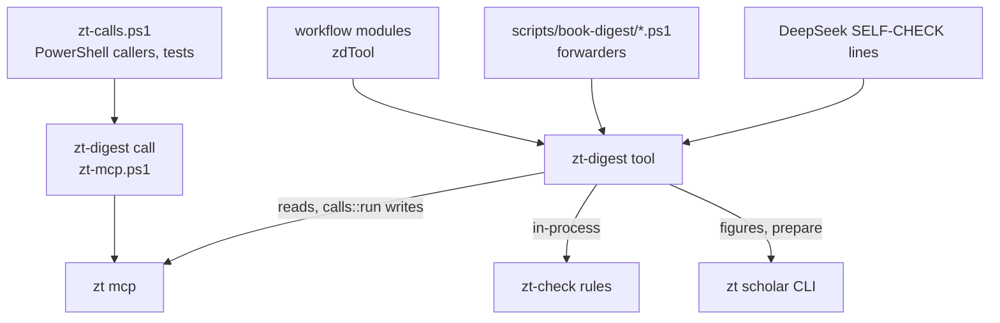

# Digest scripts

## Purpose

`tests/bridge-human.tests.ps1` seeds human Cards only through direct SQL in its stopped scratch archive (a human Literature tree, because Bridge targets are Literature-tree Cards; the human Card that links the book links a Card of the book's own Literature tree), then runs public `zt reindex` before exercising the agent interfaces. This fixture setup must refresh the derived index; direct SQL is outside normal Card-write maintenance. The final audit checks actual incoming human and unattributed Links as well as outgoing human Links.

`tests/mcp-lifecycle.tests.ps1` exercises the shared checker/compiler transport through both public binaries. Temporary fixtures hang during initialize, receive, unrelated reply noise, a large blocked stdin write or EOF shutdown; each command must return within a finite test deadline, remove its owned descendants and preserve an independent control process. Killing only the compiler tests Windows job ownership. Real proxy cases hang before/after an actual archive batch commit and retry the original receipt keys. An independently restarted ZT daemon and mock Scholar Archive service must survive client cleanup; the latter also checks that no capture pipe is retained and that unsigned responses are rejected. This runs no provider or book workflow and only its namespaced temp config can shorten production transport deadlines.

Its optional `-Python <executable>` (or `ZT_TEST_PYTHON`) additionally checks that a Python-based external service starter has valid stdout. The Windows checkpoint enables this probe explicitly; the ordinary Node-based suite has no machine-specific Python path dependency.

`tests/ledger-core.tests.ps1` exercises the real opt-in prepared-ledger path through a temporary archive: complete group registration, placeholder/open coverage, five-table WAL storage, success/settled prerequisites, stable retry identity, input/contract/archive mismatch refusal without ledger-row changes, protected prepared files and offline read-only `ledger status`. It inspects retained SQL facts through the existing Node SQLite seam. `ledger-preparation.tests.ps1` also requires reliable prepare to initialize that ledger before returning. These tests do not launch provider jobs or an actual digest workflow.

`tests/ledger-prepare-recovery.tests.ps1` interrupts actual identified setup after its first 64-operation chunk commits. The existing MCP proxy loses the reply; the retained prepare token and plan recover three remaining anchors, keeping the original run, 66 groups and all frozen files. Its 25 assertions include current-token renewal before the tail exists, source/setup changes, an edited committed Card, a missing prerequisite and missing completion registration. Fault injection before/after the ledger commit checks atomic worker release and read-only receipt recovery. A mismatched BibTeX key creates neither tree. `ledger-group-start.tests.ps1` observes the group's newly created guard separately from preparation's existing guard, then tests actual lock contention. These test the tool path and existing temporary-archive/SQLite seams, not a digest workflow or expired-owner reclamation.

`tests/ledger-claims.tests.ps1` adds actual two-process claiming, current/stale renewal/failure tokens, typed classification, real bounded backoffs and exhaustion after three claims. It asserts exact partial/blocked coverage with zero dependency-wait attempts, prerequisite/downstream rerun closure, deliberate variant exclusions, unsealed empty queues, append-only events/foreign keys and missing-publication faults. Its two backoff waits total about 25 seconds plus bounded jitter. `ledger-core` also injects an archive-id change after the Card read and verifies that no claim/ledger row changes are published. No public test infers a verified group from a placeholder anchor.

`tests/ledger-schema.tests.ps1` changes only its isolated ledger's schema markers, index, append-only trigger, table set, journal mode and dependency foreign keys. Public init and offline status must refuse each malformed schema; restoring the injected faults verifies the same retained run. `ledger-claims` also adds a second isolated prerequisite and checks that an already-blocked group's named faults update when that producer fails, while independent ready work can still be claimed.

`tests/ledger-dependencies.tests.ps1` seeds only pending nodes/dependencies in its isolated ledger, then uses real next/status commands. It checks all producers in overlapping cycles receive exact closed-path content faults without attempts, each returned path follows actual dependency edges, an outside dependant becomes blocked and an independent unit is still claimed. It supplies no synthetic done output or domain-verification evidence.

`tests/finalize.tests.ps1` drives the finite finalization (`zt-digest finalize plan|scope|changes|refresh|stage|final`) on a scratch archive with a real prepare, audit and Card cycle, covering its four branches (no-fix, fix, conflict, unresolved), the scoped correction cycle, the changed-Card manifest, the new publication revisions and their reuse, the refused stale final audit and the refused second cycle, and the stage publication (`-Step stage`: Organize and the skeleton publish their own revisions, a repeat reuses it, an excluded layer publishes nothing, a layer no stage owns is refused). S26 (#169) adds a real Term list and head, a whole-book Term-link no-op pass, a correction that rewrites a Card body without its Term link, the scoped `termlink/final@R` round and the restored link in the final audit, a changed Term list and head that replan and relink the whole book, `-Step changes` before and after the final audit, and the final report's round and Term quality.

`tests/ledger-settings.tests.ps1` covers the managed run's two bounded settings (prepared contract and `ledger status`, refusal outside 1–10 attempts and 60–3600 seconds before any file is written), the real duration and bound of `ledger next -Wait`, and the provider cap facts (`cap_exceeded`/`action`, cancel → await terminal, the blocked replacement claim, the terminal observation and the `provider_cap` retry). `tests/ledger-options.tests.ps1` prepares both variants through `-RunOptions`, verifies deliberate exclusions/omitted roots and a group claim after Terms is explicitly disabled, and refuses in-place target changes. Invalid keys/types/duplicates/variant choices/figure conflicts must fail before files or archive setup. It tests that retained choices survive deletion of the original options file, that modified target metadata cannot hide core work, and that the earlier schema-1 contract shape without optional choices keeps its original run identity/defaults.

`tests/ledger-group-start.tests.ps1` checks the real startup command against snapshot failure with a pre-existing anchor, fresh post-preparation context (another book's Literature tree, because the startup snapshot lists Literature trees only) and one MCP/title export. It validates the frozen source/job envelope, input hashes, near-expiry renewal without another attempt/completion, unchanged Card revision, accepted-file replay/tamper refusal and actual Windows OS-lock exclusion across processes. A held guard also refuses failure transitions; stale tokens are identified before guard contention, and a released guard file does not act as ownership. The test declares draft-job permissions but runs no provider or actual digest workflow.

`tests/standalone-placement.tests.ps1` (#103, S06) drives the place-beside rule through `zt-digest call -Open -Beneath` (hand work) and a real group on a scratch archive: the permission matrix (one Side successor beneath an earlier agent Topic Card allowed; a Direct successor, an edit, an unlisted Card and a human parent refused), the earlier Card's authored body unchanged, the assembled `shared-prefix.md` of the econ profile (`-Instructions dsh-digest-base.zh.md,dsh-model-cards.zh.md`) carrying the ordered filing decision and the inline-Link rule with no fixed quota while it offers no earlier Topic Card to continue and names no `-Beneath` call, the place-beside file `group-start` publishes with no Topic Card on it, `group-finish` refusing a draft that files a Card beside the earlier Topic Card (the Literature write scope), a group draft that files its Card under its own anchor completing with two receipts, the replay returning the same Cards, every older authored body byte-identical afterwards, and the human Card keeping its authored body. `tests/gate.tests.ps1` (69 assertions) drives the concept-meaning Topic gate (#100, S07) through `zt-digest gate -Step prepare|decide|create|report` and the `-ConceptGate` form of `zt-digest call -Open` on a scratch archive: the shortlist of two spellings of equilibrium multiplicity beside two senses of learning and an unrelated Topic, its real ten-Topic bound (twelve term-named Topics), the exact-title fast check, the accepted register term and the labelled term meaning, the representative Cards, the TF-IDF order reaching a Topic that names no term row, that preparing and judging run while another process holds the run's `topic-gate.lock` and that a creation waits for that same file and writes nothing until released, the refused answers (partial `different`, contradiction, unknown verdict, unread citation, repeated JSON key), the `same` and `uncertain` outcomes that create nothing, the locked receipt-owned creation and its guarantee note, the replay that returns the committed Topic, a changed-payload replay refused by its operation key, the exact-title refusal under the lock, the stale decision beside an unrelated Card edit that does not stale one, a third learning sense kept apart and created, the empty complete shortlist beside a bare archive that reports an absent register and term table, an unreadable term table and two registers that leave the inputs incomplete and refuse a creation by `incomplete_evidence`, the helper's gate form with its own replay and its refusal of an uncleared title, two concurrent managed writers that leave one Topic, and the refused legacy option combinations. `tests/earlier-context.tests.ps1` checks the group's earlier-Card pack (#98, S05) against the real `group-start` on a scratch archive with twenty-five earlier control-rights Cards in an earlier book's Literature tree, a sparse photosynthesis book's Literature tree (two short Cards, one body longer than one excerpt, and a Model head with a part), a human Literature tree with its Idea, an accepted register entry and a four-group book; the pack reads Literature trees only. It asserts the published `earlier-context.json`/`earlier-context.md` and its counts, every excerpt within 800 characters and the pack within 16 000, each candidate's `get_card` locator, content hash and write scope (an agent Card is `agent-card`; a human Card is a read-only reference), that no unfinished group anchor, Literature root or unrelated Card is offered while all four anchors are named as refused, the prompt and writer-job wiring, the frozen `inputs.earlier_context` hash, the byte-identical reuse of a repeated start, one title catalogue and one bounded body batch with no read above 200 addresses, an accepted register term whose own target comes first, a reply-limit refusal that halves the earlier-Card read and still yields twenty Cards, one crossed read set retried into a single-view pack, a persistent crossing as one `read_view_changed` fault, the sparse pack's `enough: false`, shortened excerpt and Model part, a duplicated register reported as a fault while that pack still builds, a start refused when an earlier Card cannot be read, the bound archive identity, and an unchanged archive revision. It runs no provider and no real digest workflow.

`tests/ledger-group-finish.tests.ps1` validates the actual draft/claim binding and checker, empty-answer/no-cards refusal for prose, a complete 66-operation preview, corruption and ownership/alias placement guards. It injects four pre-commit completion faults, verifies zero partial ledger state/outputs/children/events, and recovers the committed archive receipts through typed `ledger done`. It checks the actual owned manifest, idempotent completion, changed files/child inputs, exact offline reconciliation and missing SELF-CHECK output registration.

`tests/ledger-group-finish-boundaries.tests.ps1` adds a real Model header/part candidate filed in the book's Literature tree, its checked quality-fault consumer, the refusal of a draft that creates a Topic tree (the Literature write scope: `creates no Topic tree`) and of a draft that files a Card in another book's Literature tree (`files its Cards in the book's Literature tree`), malformed native-preview completeness, a post-commit reply failure, actual first-chunk reply loss and two-operation tail recovery, deliberate optional exclusions, a late draft replacement, a concurrent real slot reservation and a heading-only source-backed no-cards disposition. The seam's lost-batch-reply hook fires only on actual writes; preview transactions roll back and cannot be called committed work. All fixtures use temporary archives and explicit frozen options, and no provider or real digest workflow runs.

`tests/link-finish.tests.ps1` completes the `link/gNNN@1` unit that a real `group-finish` registered, on a temporary archive. It first proves the Link unit waits for the Cards/group child, then completes that child with the real `cards-finish` command rather than seeding it. It exercises `-CheckOnly` (no Card, revision, accepted plan or state change), every coverage refusal (a Card with no outcome, an invented address, a duplicate outcome, an unkinded paragraph, an `L2` reason fault, a false `already_linked`, a raw body edit, a missing authored base, an unknown envelope field, a wrong input hash or token), an unkinded Link in an owned Card the draft does not write, and an injected post-write ledger fault that rolls the ledger back while the archive receipt survives. The same accepted plan then recovers exactly once, reuse is duplicate-free, a changed owned manifest, a changed accepted plan and a later edit of a changed Link Card all refuse, and `ledger publish -Layer link-check` derives the revision that consumes the checked result. No provider or real digest workflow runs.

`tests/cards-finish.tests.ps1` completes the `cards/gNNN@1` offline check that a real `group-finish` registered, on two temporary single-group books. A clean owned set completes as `verified` through the actual checker with the whole-book Card rules; `-CheckOnly` reports the same check while writing no evidence and changing no unit state; the completion is reused and `ledger done` dispatches the same verifier; an owned-Card edit, a changed owned manifest, a wrong token and an unknown group refuse, and an injected post-outputs fault leaves the unit claimed and commits once on retry. A group whose owned Card carries a real `R3` sentence fault completes as `deferred` and names `cards-book/book@1` as the registered consumer, while a terminal consumer and a Card category the book cycle cannot repair (a terms-titled Card) refuse; an advisory stays out of the hard-fault count. The suite also checks that `ledger gate -Layer cards` settles on the done unit without claiming the whole run, that a child layer with no items settles only after its producer enumeration closes, and that `ledger publish -Layer cards-book` derives the next revision from the completed unit. No provider or real digest workflow runs.

`tests/finish-batch.tests.ps1` (zt-digest 0.12.0) drives `zt-digest finish-batch` on a temporary single-group book through the real verifiers: the claim form claims the ready Cards unit and finishes it in one command, the printed line names the unit, its token, its status and its disposition and stays short (a few hundred characters) while the full completion goes to the batch file, a repeated batch and a stale token never fault a unit the ledger holds done, a claim that finds nothing finishes nothing, and every other ready unit's batch outcome (the fixture's Event and Finding units, whose jobs never ran) matches the ledger state with its fault recorded by the batch. It also checks the argument refusals (more than eight units, a unit named twice, a digest unit, `-Units` with `-Layer`, a claim layer outside the batch layers, and `model-deps -Units` with a non-Model unit). No provider or workflow runs.

`tests/ledger-owner-recovery.tests.ps1` drives owner recovery through the real commands on two prepared books. A claim whose manager process has already exited is completed by a separately started compiler with no duplicate attempt. A `group-start` held past a shortened lease by the seam's slowed title export still finishes under its own token because its internal heartbeat renewed it; the retained `renewed` events carry the compiler's process id and a later lease. While a real OS guard holder keeps the unit's lock file open, `ledger reclaim` refuses `lock_busy` and changes no claim; after release it names the lost owner, moves the token forward and yields the replacement claim, while the lost owner's `renew`/`fail` and its frozen draft job refuse. A registered external run blocks reclaim until its cancellation is requested and a terminal observation recorded, its old owner cannot register under the fenced token, and a pending run also refuses a `-CheckOnly` completion preview. It runs no provider and no real digest workflow.

`tests/ledger-terms.tests.ps1` drives the normal enabled Terms prerequisite in both variants: one bound job for actual source candidates, an explicit zero-candidate no-op, strict row/JSON/UTF-8 validation and source/job/configuration integrity. It checks unclaimed-command refusal and a corrupted retained call before any commit, loses a real committed MCP reply, injects pre/post-commit completion faults, recovers via typed `ledger done`, checks actual Card/table/receipt/context readback and starts an economics group from that context. Removing a retained archive receipt or required context output must refuse verified completion or name the missing registration. No group dependency-wait attempt is spent, and no provider/workflow is run.

`tests/ledger-publication.tests.ps1` drives the aggregate publication boundary through the real CLI on temporary archives. It registers and re-registers derived revisions, checks that an unchanged sorted manifest reuses the revision preparation registered without adding a unit/dependency/event, and that a real producer failure derives the next revision while the older open one becomes terminal `superseded` history excluded from `failed`, `unresolved` and `rerun-list`. It claims the sealed revision once its producers settle, completes it only when the whole manifest is accounted for with hash-bound `decisions`/`applied` artifacts, and injects a completion fault that must roll outputs, done state and event back together. It completes a skeleton only when every prepared anchor is indexed substantive work or an explicitly reasoned gap, refuses a hub publication because `hubs` is an excluded layer of every prepared run (`is an excluded layer of this prepared run`; zt-idea-grow builds the hubs), and completes an immutable Bridge report only when its recomputed `r-<Content-Hash>` id and exact proposal set match. Each note suggestion registers its own unit and reaches one archive-checked outcome (`applied` after a real `apply_batch` edit, `already_present`, or a reasoned `refused`). A real `move_card` recorded with `call -Moves` updates the published locators, while an unexplained address refuses with `unreconciled_move`. One fixture also verifies that a layer excluded by the prepared run cannot publish at all, and another completes a producer that registers real Model work and confirms that `organize/book@2` names that Model candidate as an explicit pending disposition while `organize/book@1` stays terminal, and that the skeleton and Link-pass revisions consume the same Model work, so repaired model work can never leave a stale downstream publication. The suite also requires that a done revision stays done, and that a changed input set (one more note suggestion Organize must dispose) derives the next Organize revision beside it, reported as superseded history rather than reopened, that a completed Organize revision disposes every suggestion by its `notes/<id>@1` unit with the outcome the suggestion retained (a restatement is refused), and that a skeleton indexes a substantive producer's anchor while a producer which completed without substantive Cards completes as a named gap rather than a dead end.

`tests/ledger-math.tests.ps1` drives the mathematics variant's ledger adapter through the real `zt-digest math` steps and `zt-digest ledger` commands on one prepared staging folder. Its 72 assertions check the declared stage-order prerequisites (notation before boundary work, the skeleton before its per-unit obligations, the audit before the final check); that an index leaving a prepared statement out and a group whose unit list is gone cannot complete; that the retained math prompt files are the shared instruction files with their math supplements; that the skeleton accounts for every indexed statement and Theory Card while a `待写` statement stays open; that a notation table which is not what the retained answer produces cannot complete; that a supplied boundary candidate without its independent review cannot settle; that the rejected part and the role naming it go through the archive's confirmed deletion with its recorded mapping while a hidden deletion is refused; that every selected proof step needs a review, an accepted fix keeps its Links and a refusal stays a named obligation; that a real `link-check` revision completed through its own publication boundary is the revision the theory publication consumes, that a changed Link pass makes the theory revision stale and derives the next one, and that Organize follows the completed theory revision; that an audit republished while the final check is open leaves the open check waiting instead of blocked, that an audit republished while the check is claimed cannot be described until it completes, that the completed check names that final revision, and a stale audit is refused; and that draining those obligations leaves a done Model unit and its Card untouched and out of the resume list.

The digest scripts are the deterministic half of the book digest workflows (`zt-econ-digest`, `zt-math-digest`), which turn a Scholar Archive book into the book's agent Literature tree with its Idea, Event, Finding and Model Cards (`docs/literature-only-digest-design.md`); the Topic trees, Topic Cards, hubs and the register are written by zt-idea-grow, which runs the hub and register tools of this folder. Every stage follows one pattern: a script plans the work and writes job files, a DeepSeek Harness run (or a Sonnet architect, or Opus) writes only JSON or Card prose, a script checks that output (the writer's own `SELF-CHECK:` command), applies it through the zt helper, checks the result, and reports. The scripts exist so that structure (Locations, Links, moves, tables, skeletons, ownership, retries) is done by code that costs no model tokens and follows one rule, and so that a model's text is checked by `zt-check` before it reaches a Card. Their code now lives in [zt-digest](zt-digest.md): each script is a PowerShell 7 forwarder to its `zt-digest` tool (one Rust process per step, one `zt mcp`, zt-check in-process), with the same parameters, files, and output. The workflow's Haiku drivers run the tools directly (`zt-digest <tool> …`, one command per step), and so does every `SELF-CHECK:` line; the scripts stay for developers and old commands. This doc describes what each step does; [zt-digest](zt-digest.md) describes the code and what the port changed.

**Owns:** the scripts in `scripts/book-digest/` (forwarders to the `zt-digest` tools) and what each step does (preparation of the staging folder, the compiler cycles of every layer, the read-only audit and surveys, figure attachment), the job, plan, answer, and state JSON formats they read and write, the `zt-calls.ps1` bridge from a PowerShell caller to the zt helper and to `zt-check`, `book-of.ps1` and `relatedness.ps1` (kept as PowerShell), and the tests and fixtures in `scripts/book-digest/tests/`.

**Does not own:** the stage order, roles, retries, and modes that call these scripts ([Digest workflows](digest-workflows.md), which also owns `framework-harness.mjs` and `bridge-workflow-harness.mjs`); the DeepSeek instruction files `dsh-*.zh.md` and the architect files `model-architect*.md` that the job files open with ([Digest prompts](digest-prompts.md)); the zt helper `skills/zt/scripts/zt-mcp.ps1` and the installed skills ([Agent skills](agent-skills.md)); the code of the forwarded scripts, which lives in `tools/zt-digest` ([zt-digest](zt-digest.md)); the Card language and Card layer rules themselves ([zt-check](zt-check.md)); the MCP tools the helper calls ([MCP server](mcp-server.md)); how ZT computes models, build reports, units, and theories ([Models and math](models-and-math.md)); hub faults and `list_hubs` ([Hub Cards](hub-cards.md)); the Scholar Archive bridge behind `zt scholar …` ([Scholar bridge](scholar-bridge.md)).

## At a glance

| | |
|---|---|
| Entry points | One `zt-digest <tool> [-Step <step>] …` per stage step, or the same arguments to `pwsh -NoProfile -File scripts/book-digest/<script>.ps1` (a forwarder; the tool of each script is in [zt-digest](zt-digest.md)); dot-sourced libraries `zt-calls.ps1`, `relatedness.ps1`, `book-of.ps1` for PowerShell callers; the tests `scripts/book-digest/tests/*.tests.ps1` |
| Key files | Every script below forwards to its `zt-digest` tool, except `book-of.ps1`, `relatedness.ps1`, and `zt-calls.ps1` |
| | `prepare-book-digest.ps1` — Chinese-only text, section groups, group files, shared prefixes, manifest, the chapter endnotes (`notes/`, design 11.6) and (`-Apply`) the Literature tree with its anchors; its notes faults, and the architects' source faults, go into the run's `source-faults.json` and `source-faults.md` ([zt-digest](zt-digest.md)) |
| | `snapshot-topics.ps1` — a compact list of every tree for one digest run |
| | `book-terms.ps1` — the Book term table (术语表) |
| | `card-compiler.ps1` — the card layer cycle: fix, review, orphan Links, Organize notes. A forwarder to `zt-digest card` (`tools/zt-digest/src/card.rs`, [zt-digest](zt-digest.md)) |
| | `list-models.ps1` — the Model Cards a digest wrote, with level, parts, and faults (forwards to `zt-digest list-models`) |
| | `model-context.ps1` — the context pack of one model (forwards to `zt-digest model-context`) |
| | `model-compiler.ps1` — the model compiler (brief, validate, apply, derive, review, split, report) and the explain steps (forwards to `zt-digest model`) |
| | `event-compiler.ps1` — the event layer: Event Cards from dated sentences |
| | `finding-compiler.ps1` — the empirical-results layer: Finding Cards |
| | `prepare-link-pass.ps1` — the link pass: card snapshot, ownership, candidates, allow lists |
| | `organize-survey.ps1` — read-only survey of what Opus must decide |
| | `organize-apply.ps1` — Topic merges and Card moves from Opus's `decisions.json` |
| | `book-skeleton.ps1` — Literature Card index, Structure Card, Topic bodies |
| | `attach-figures.ps1` — the book's figures (`artifact:`) in the Cards that name them; Document links on the Literature Card |
| | `hub-compiler.ps1` — the Hub Cards of the whole agent Workspace |
| | `math-compiler.ps1` — units, Theory Cards, notation, boundary, proof review, rules M1 to M18 |
| | `digest-audit.ps1` — read-only audit of a book or of the Workspace. A forwarder to `zt-digest audit` (`tools/zt-digest/src/audit.rs`) |
| | `concept-compiler.ps1` — the concept, restatement and filing review of one prepared run (steps `prepare`, `judge`, `report`, `decision`). A forwarder to `zt-digest concepts` (`tools/zt-digest/src/concepts.rs`); it writes no Card and sets `ZT_DIGEST_SCRIPTS` so the job names `dsh-concept-instructions.zh.md` |
| | `register-compiler.ps1` — the concept register of one Workspace (steps `plan`, `apply`, `check`, #101, S11 #104). A forwarder to `zt-digest register` (`tools/zt-digest/src/register.rs`): `plan` stages `out\register-plan.json` from the agent book term tables, the model-head names, an optional reviewed concept report (a reviewed human Card is a read-only target), and the accepted pinyin readings (`-Readings`, default `out\register-readings.json`); `apply` publishes the register and its `词条分册` parts (parts first, the root last) and verifies every page through `get_register` |
| | `book-of.ps1` — pure `Get-BookIndex -Trees -Cards`, shared Card categories and inferred book attribution; only its own test loads it now, and the tools use the Rust copy (`tools/zt-digest/src/audit/book_of.rs`) |
| | `bridge-compiler.ps1` — frozen candidate plans, checked judge output, immutable review reports, and guarded apply of accepted proposals |
| | `zt-calls.ps1` — `Invoke-Zt` (zt MCP tools through the helper) and `Invoke-ZtCheck` (`zt-check`), for PowerShell callers and the tests; no digest script loads it any more |
| | `relatedness.ps1` — TF-IDF over Chinese character bigrams, compiled ranking; no script loads it any more, and the tools use the Rust copy (`tools/zt-digest/src/card/relatedness.rs`) |
| | `scripts/book-digest/tests/*.tests.ps1`, `scripts/book-digest/tests/card-layer-fixture.json`, `scripts/book-digest/tests/card-style-fixture.json` — tests and fixtures |
| | `scripts/book-digest/tests/topic-join.tests.ps1` — the scratch-archive test of `zt-digest join` (#109, S22): the existing-Topic pair review and its refused human-Link/model plans, then the report-bound applies with fresh mappings, a quiet window and read-back verification. It creates its human Topic and Cards through the GUI, as the owner does |
| | `scripts/book-digest/tests/topic-home.tests.ps1` — the scratch-archive test of `zt-digest topic-home` (#113, S21): a real `concepts` review, the read-only Topic-home transfer review, then the report-bound applies with the created Literature statement, the guarded old-Card entry, a receipt replay after a lost reply and a writer between the two writes. Its human Topic and Card are created through the GUI, as the owner creates them |
| | `scripts/book-digest/tests/resolve.tests.ps1` — the scratch-archive test of `zt-digest resolve` (#122, S29): the two qualified reports turned into one batch, its deferred and declined dispositions, the approved backup and the per-report selections, one transfer and one move executed in that order, the receipt replay, the stale base, the changed protected Model Card and an edited batch refused. Its human Topic and Card are created through the GUI, as the owner creates them |
| Depends on | [zt-digest](zt-digest.md) (the tools every script forwards to, on PATH or in `ZT_DIGEST`), which starts `zt mcp` ([MCP server](mcp-server.md)); `skills/zt/scripts/zt-mcp.ps1` (the zt helper path, [Agent skills](agent-skills.md)); `zt-check` on PATH ([zt-check](zt-check.md)); `zt scholar keep-figures`, `zt scholar sql`, `zt scholar file` ([Scholar bridge](scholar-bridge.md)); `get_model`, `get_hub`, `list_hubs` reports ([Models and math](models-and-math.md), [Hub Cards](hub-cards.md)); the instruction files in `scripts/book-digest/*.md` ([Digest prompts](digest-prompts.md)); `zt-digest` on PATH or in `ZT_DIGEST` for the forwarders ([zt-digest](zt-digest.md)); PowerShell 7 (`ForEach-Object -Parallel`, `Add-Type`, `Start-ThreadJob` in a test) |
| Used by | [Digest workflows](digest-workflows.md) (the modules in `scripts/book-digest/workflow/modules/`); the DeepSeek writers, through the `SELF-CHECK:` lines of their job files; [Agent skills](agent-skills.md) (`skills/zt-digest-protocol/references/scripts.md` describes them) |
| Tests | `scripts/book-digest/tests/*.tests.ps1` (one per script or helper, run one by one) |

## Concepts

- `Staging folder` — the digest's output folder (`-Out` of `prepare-book-digest.ps1`, `-Staging` everywhere else): `manifest.json`, `book.zh.md`, `sections/`, `groups/`, `notes/` (the chapter endnotes), `source-faults.json` and `source-faults.md` (the retained source-fault record), the logs, and one sub-folder per stage. Every later script reads `manifest.json` from it.
- `Group` — one or more consecutive section units of one chapter (at most `-MaxUnits`, at most `-MaxChars` characters) handled by one DeepSeek digest run; numbered `n` from 1, id `gNN`. Built in `prepare-book-digest.ps1`.
- `Anchor` — the Literature tree Card `<key>/<n>` of group `n`, a Direct successor chain under the Literature Card. `digest-audit.ps1` gives it the category `anchor`.
- `Owned Cards` — the Cards a group wrote: `owned-gNN.txt`, written by the helper's `-Log` during the digest, republished by `group-finish` from its checked results, and extended by `card-compiler.ps1` (split Cards) and `math-compiler.ps1` (unit skeletons). Read by `list-models.ps1`, `model-context.ps1`, `prepare-link-pass.ps1`, `event-compiler.ps1`, `finding-compiler.ps1`. The file is a write receipt, not a completion: `prepare-link` decides completion from the staging ledger's `digest/gNNN@R` state and uses the log only as a legacy folder's fallback (#92).
- `Source log` — `src-gNN.txt`: `<address><TAB><sections/sNN.md:from-to>`, written by the helper's `-SrcLog` from a create call's `src` field. `card-compiler.ps1` hands a reviewer only those lines.
- `Category` — how `digest-audit.ps1` (`Get-Category`) classifies a Card: `root`, `anchor`, `idea`, `event`, `model` (a Model Card), `part` (a Model part), `hub`, `terms` (the Book term table), `structure` (the Structure Card). zt-check applies the Card layer rules only to entries that carry a category.
- `Book of a Card` — a Literature tree Card belongs to its tree; a Topic tree Card belongs to the book whose Literature tree it links most (a Link to the Literature Card or an anchor counts 10, to another Card of the tree 1); a Card that links no book is unattributed (`digest-audit.ps1`).
- `Job` — one DeepSeek task: `{"id","files":[…],"prompt","continue"?,"fallback"?}`. `files` are opened in order (the instruction file first, so DeepSeek caches it); `continue` names the earlier job whose conversation continues; `fallback` lists the files a fresh conversation needs when that one is gone.
- `SELF-CHECK line` — a line in a job file naming the read-only command the writer runs on its own JSON before it replies (`zt-digest card -Step precheck`, `zt-digest hub -Step precheck`, `zt-digest event -Step precheck`, `zt-digest finding -Step precheck`, `zt-digest bridge -Step precheck`, `zt-digest model -Step explain-check`, `zt-digest skeleton -Step apply` without `-Apply`, or `zt-check --cards … --log …` in a group file). No SELF-CHECK line starts a pwsh.
- `Fault line` — `<address> <rule or check> <text>`, one per fault, with `faults: N` as the last line. Same format from zt-check and from every precheck.
- `Allow file` — a list of addresses (one per line) passed to the helper's `-Allow`: a writer may only edit or extend those Cards (and Cards it makes in the same run).
- `Model` terms — Model Card, Model part, Model facet, Emphasis, Derivation part, Derivation chain, Build order, Elaboration level (`concept`, `formal`), Self-sufficient model, as in `CONTEXT.md`. The model compiler's plan names parts by a plan `id`; `state.json` maps each id to its address.
- `Unit`, `Theory Card`, `Math form`, `Cited premise`, `Book notation table` — as in `CONTEXT.md`; built by `math-compiler.ps1`.
- `Hub level`, `Register`, `Hub range` — as in `CONTEXT.md`; built by `hub-compiler.ps1` (the field-hub navigation) and `register-compiler.ps1` (the term rows). A legacy hub is an Idea Card under `<n>/1` (or at `<n>/2`) with 8 or more Links whose excerpt says 枢纽, 核心卡片, or 清单.
- `Register term row` — one `## 词条` item of the register: one term before `：`, then one to three Links to the Cards that carry the term's substance. `register-compiler.ps1` writes them from the agent book term tables (each row's `不用` words become further accepted spellings of the same concept) and the model-head names, using a reviewed `concept-review.json` as read-only evidence for one accepted entry and for keeping a distinct sense out. A reviewed entry in the human Workspace is an explicitly selected read-only target; an entry in neither Workspace is excluded as a stale review. It is the only publication path for these rows; `hub-compiler.ps1`'s `fields.json` register still lists field and topic hubs, and `register-compiler.ps1` keeps that `## 领域` group. A `Register part` — one `## 词条分册` item of a register: an ordinary Idea Card holding term rows whose accepted pinyin-initial range (`A–F`, `0–9`, `其他`) is the declaration's label. `register-compiler.ps1` publishes and reuses them; [Hub Cards](hub-cards.md) reads the parts a register declares.
- `Structure Card` — a Side successor of `<key>/1` whose body starts with `本卡是《…》的结构卡`; an older one is recognised by linking at least half of the anchors (`book-skeleton.ps1`, `digest-audit.ps1`).

## Architecture

Every step is one `zt-digest` process: the script, when it is called at all, only starts it. A tool opens one `zt mcp` for all its reads and writes (`bridge` alone still reads above 40 calls on up to six worker threads, one `zt mcp` each), runs zt-check and the audit in-process, and shares data with the other steps only through files in the staging folder (and through the archive). No step calls a model: each step that needs one prints jobs, and the workflow runs them.



How a tool reaches the archive:

- **Reads** go to the tool's one `zt mcp` (`calls::invoke`, `model::read_calls`); a failed read fails the step with `zt-mcp failed: <i> error <message>`, the text `Invoke-Zt` used. `audit`, `prepare-link` and every Card cycle read their complete required scope through that one client in bounded chunks. Only `bridge` reads above 40 calls on up to six worker threads, each with its own `zt mcp`.
- **Writes** go through `calls::run`, the helper in-process, with the options the scripts gave the helper (`-Log`, `-SrcLog`, `-Allow`, `-Moves`); the per-call `N ok <address>` lines and the stop at the first failed call are the helper's. `model` and `organize-apply` send renumbering calls one at a time and follow each `moved` map.
- **A PowerShell caller** (a test, a script of your own) dot-sources `zt-calls.ps1`: `Invoke-Zt` sends read batches straight to one long-lived `zt mcp` (direct reads; `ZT_CALLS_DIRECT=0` turns them off) and any other batch to the helper.

The stage order (from [Digest workflows](digest-workflows.md)) and the script each stage runs:

| Stage (workflow module) | Script and steps |
| --- | --- |
| prepare (`zt-digest-prepare`) | `prepare-book-digest.ps1 -Apply` |
| math-skeleton, after prepare (`zt-math-skeleton`) | `math-compiler.ps1` `index`, `docs`, `skeleton -Apply`, `notation`, `notation-apply -Apply` |
| terms (`zt-book-terms`) | `book-terms.ps1` `plan` → DeepSeek → `apply -Apply` |
| digest blocks (`zt-digest-lib`, `zt-digest-blocks`) | `snapshot-topics.ps1` before each run; the run writes through the helper and checks with `zt-check --cards`; then a card cycle per block: `card-compiler.ps1 -Work <out>\cards-gNN -Groups … -Sample … -NoOrphans` |
| models (`zt-model-layer`, `zt-model-lib`) | `list-models.ps1`, then per batch `model-compiler.ps1` `brief` → Sonnet `validate` → `apply` → `derive` → `review` → `split` → `report` |
| explain (`zt-explain`) | `model-compiler.ps1` `explain` → `explain-check` (writer) → `explain-apply` → `explain-report` |
| events (`zt-event-layer`) | `event-compiler.ps1` `plan` → DeepSeek (`precheck`) → `apply -Apply` → `report` |
| findings (`zt-finding-layer`) | `finding-compiler.ps1` `plan` → DeepSeek (`precheck`) → `apply -Apply` → `report` |
| math-boundary, math-proof (`zt-math-boundary`, `zt-math-proof`) | `math-compiler.ps1` `boundary` → `boundary-apply` → review → `boundary-settle`; `proof` → `proof-apply` |
| link-prepare, link (`zt-link-prepare`, `zt-link-pass`) | `prepare-link-pass.ps1` computes the receipt-owned gap scope; each Link chain writes through `zt-digest link-finish`, which refuses any Card outside that scope |
| link-check (`zt-link-check`) | `card-compiler.ps1 -Work <out>\cards-link` (with orphan jobs) |
| math-theory (`zt-math-theory`) | `math-compiler.ps1` `theory` → `theory-apply` |
| cards mode (`zt-cards-book`) | `card-compiler.ps1 -Work <out>\cards` |
| organize (`zt-organize`) | `organize-survey.ps1` → Opus `decisions.json` → `organize-apply.ps1` → notes cycle `card-compiler.ps1 -Notes` → `book-skeleton.ps1` `plan` → DeepSeek → `apply -Decisions … -Apply` |
| figures (`zt-figures`) | `attach-figures.ps1 -Staging <out> -Report <out>\figures-report.json -Apply` |
| audit (`zt-audit`) | `digest-audit.ps1 [-CitationKey <key>] -Out <out>` |
| math-check (`zt-math-check`) | `math-compiler.ps1 -Step check` |

The workflows run each script of this table as its tool (`zt-digest prepare`, `math`, `terms`, `snapshot-topics`, `card`, `list-models`, `model`, `event`, `finding`, `prepare-link`, `organize-survey`, `organize-apply`, `skeleton`, `figures`, `hub`, `audit`, `bridge`). `zt-digest card` runs the audit in-process (every `plan`, `check`, `report`, with `-SkipModels`); so do `organize-survey` and `skeleton` (when no `-Audit` is given). `zt-digest model` builds the context pack of `model-context` in its own process (`brief`, and `explain` when `-Staging` is given).

## Interfaces

### Every script at a glance

All paths are relative to `scripts/book-digest/`. "Writes" means changes to Cards.

| Script | Steps | Parameters (default) | Reads | Writes files | Writes Cards |
| --- | --- | --- | --- | --- | --- |
| `prepare-book-digest.ps1` | — | `-Source` (from `-Book`), `-Out`*, `-CitationKey` (from `-Book`; generated from metadata when neither is given), `-BibTeX` (from `-Book`), `-Book` (a Scholar Archive Work id or exact title), `-BookTitle`, `-StartHeading` (导论, or the proposal), `-EndHeading` (参考, or the proposal), `-SkipHeadings`, `-MaxChars` (20000), `-MaxUnits` (3), `-MinUnitChars` (1000), `-FileId` (0: read from a `scholar-archive\files\<n>\` path, or the resolution's file), `-MinFigureBytes` (3000), `-MaxEventCandidates` (12), `-Instructions` (`dsh-digest-base.zh.md,dsh-model-cards.zh.md`), `-NoEventCandidates`, `-NoFigures`, `-Apply`, and the Term backfill branches `-Validate` and `-Sections` (with `-Out` of an already prepared run; they write no Card and reuse or reconstruct only `sections/sNN.md` and `book.zh.md`, see [zt-digest](zt-digest.md#the-term-backfill-branch-of-prepare-s25-168)) | the bilingual Markdown, instruction files, and with `-Book` the read-only Scholar Archive bridge (`scholar_archive_read`, `scholar_archive_file` on `zt mcp`) | `book.zh.md`, `sections/sNN.md`, `sections/index.md`, `groups/gNN.md`, `shared-prefix.md`, `link-prefix.md`, `figures.json`, `events.json`, `manifest.json`, `setup-calls.json`, and with `-Book` `preparation.json` (the frozen Work, file, BibTeX, range, source hash and every excluded section, before any group work; an unresolved choice writes only this and exits 3) | with `-Apply`: the Literature Card and anchors `<key>/1..N`; refuses when the tree exists |
| `snapshot-topics.ps1` | — | `-Out`*, `-TitleChars` (40) | every tree | the snapshot Markdown | no |
| `book-terms.ps1` | `plan`, `apply` | `-Step`*, `-Staging`*, `-MaxTerms` (60), `-MaxCandidates` (160), `-Apply` | manifest, `sections/s*.md`, `terms/out/terms.json` | `terms/job.md`, `terms/dsh-terms-instructions.zh.md`, `<Staging>/terms.md` | with `-Apply`: the 术语表 Card (create or rewrite) |
| `card-compiler.ps1` | `plan`, `apply`, `check`, `report`, `precheck` | `-Step`*, `-Work`*, `-Book`, `-Staging`, `-Groups`, `-PerJob` (8), `-Sample` (0), `-Seed` (1), `-Rules` (`R2,R3,R4,R5,R7,R9,R12,I1,I2,I3,I4,L1,L2,E1,E2`), `-MaxCards` (0), `-NoOrphans`, `-ModelReview` (the cycle also reviews the Model drafts no model chain owns), `-Notes`, `-Compact`, `-MaxJobs` (0), `-Job`, `-File` | audit output, `owned-g*.txt`, `src-g*.txt`, `out/*.json`, notes, `source-faults.json` (for the sample) | `state.json` (including `sampled`, `reviews`, `models`), `fix-NN.md`, `orphans-NN.md`, `*-r2.md`, instruction copies, `before/`, `after/`, `report.json` (a `cards_cycle` with `sample`, `reviews`, audit facts and `quality_complete`), `decisions.json` | `apply`: rewrites, split Side successors, orphan Links |
| `list-models.ps1` (forwards to `zt-digest list-models`) | — | `-Staging`*, `-Groups` (string, e.g. `1,2,3`) or `-All` with `-CitationKey` | `owned-g*.txt`, trees, `get_model` | stdout only | no |
| `model-context.ps1` (forwards to `zt-digest model-context`) | — | `-Staging`*, `-Model`*, `-Out`* | Model Card, `get_model`, book tree, manifest, section headings | the context pack | no |
| `model-compiler.ps1` (forwards to `zt-digest model`) | `brief`, `validate`, `apply`, `derive`, `review`, `split`, `report`, `explain`, `explain-check`, `explain-apply`, `explain-report` | `-Step`*, `-Work`*, `-Staging`, `-Models`, `-Plan`, `-Need`, `-Changed`, `-Rebuild`, `-Level`, `-MaxSentences` (12), `-MaxChars` (400), `-MaxSteps` (6), `-MaxExplainSentences` (16), `-MaxExplainChars` (600), `-MaxParts` (0), `-BriefDoc`, `-FillDoc`, `-ReviewDoc`, `-Job`, `-File` | `<model>/plan.json`, `review-*.json`, `out/explain-*.json`, `figures.json` | `state.json`, per-model folders (context, briefs, jobs, allow files, setting, reviews, follow-ups) | `apply`, `split`, `explain-apply`, chain lines |
| `event-compiler.ps1` | `plan`, `precheck`, `apply`, `report` | `-Step`*, `-Staging`*, `-Work` (`<Staging>/events`), `-Job`, `-GroupsPerJob` (3), `-Apply` | `events.json`, `owned-g*.txt`, `out/ev-*.json` | `ev-NN.md`, instruction copy, `drafts-*.json`, `state.json`, `created.txt` | with `-Apply`: Event Cards, source lines on existing ones, `案例` Links |
| `finding-compiler.ps1` | `plan`, `precheck`, `apply`, `report` | `-Step`*, `-Staging`*, `-Work` (`<Staging>/findings`), `-Job`, `-GroupsPerJob` (3), `-MaxCandidates` (16), `-Apply` | sections, `owned-g*.txt`, `out/fd-*.json` | `fd-NN.md`, instruction copy, `drafts-*.json`, `state.json`, `created.txt` | with `-Apply`: Finding Cards, `印证` Links |
| `prepare-link-pass.ps1` | — | `-Staging`*, `-TitleChars` (40) | manifest, `owned-g*.txt`, `linked-g*.txt`, every Literature tree and its Cards (no Topic tree), `list_links`, both registers | `cards-all.md`, `link-gNN.md`, `link-gap-gNN.json`, `allow-gNN.txt` (the gap set) | no |
| `organize-survey.ps1` | — | `-Staging`*, `-Work`*, `-Notes`, `-Similar` (0.5), `-CrossLinks` (4), `-Small` (3) | audit, `cards*/decisions.json`, notes | `<Work>/audit/*`, `survey.md`, `survey.json` | no |
| `organize-apply.ps1` | — | `-Work`*, `-DryRun`, `-Open` | `<Work>/decisions.json` | `applied.json`, `moves.jsonl`, `decisions.json` (notes translated) | Card moves; Topic merges (move + delete root) and moves of Topic Cards only with `-Open` (a hand merge), since without it the tool runs in the Literature scope |
| `book-skeleton.ps1` | `plan`, `apply` | `-Step`*, `-Staging`*, `-Work`*, `-Audit`, `-Thesis`, `-Decisions`, `-Apply` | audit, `out/skeleton.json`, decisions | `job.md`, instruction copy, `<Work>/audit/*` | with `-Apply`: Structure Card, Literature Card body (no Topic body) |
| `attach-figures.ps1` | — | `-CitationKey`*, `-FileId`, `-Staging`, `-Source`, `-MinFigureBytes` (3000), `-Report`, `-Batch` (40), `-FiguresFile`, `-NoDocuments`, `-Apply` | figures (bridge or `figures.json`), `search_cards` hits | `-Report` JSON | with `-Apply`: figure lines and the Literature Card's document line (`edit_card` with `base`) |
| `hub-compiler.ps1` | `survey`, `plan`, `apply`, `check`, `report`, `precheck` | `-Step`*, `-Work`*, `-File`, `-Limits` (JSON), `-Trees`, `-PerJob` (0), `-Rebuild` | trees, `list_hubs`, `get_hub`, `out/hub-<tree>.json`, `out/fields.json` | `survey.json`, `survey.md`, `limits.json`, `state.json`, `job-*.md`, `fix-*.md`, `none.allow.txt`, `report.json` | `apply`: line, topic, field hubs, the Topic 索引 and the Register, Topic body Links |
| `math-compiler.ps1` | `index`, `docs`, `skeleton`, `notation`, `notation-apply`, `boundary`, `boundary-apply`, `boundary-settle`, `proof`, `proof-apply`, `theory`, `theory-apply`, `check` | `-Step`*, `-Staging`*, `-Out` (`<Staging>`, for `check`), `-UnitsPerJob` (4), `-Supply` (`examples`; `none`, `examples+answers`), `-MainResults` (7), `-CoreBudget` (3, not used by any step), `-MaxSymbols` (80), `-Apply` | sections, manifest, `math/**/out/*.json` | `math/index.json`, `index.md`, `units.json`, `math-prefix.md`, `math-link-prefix.md`, `math/brief.zh.md`, `fill.zh.md`, `review.zh.md`, `notation.md`, job files, `math-audit.json`, `math-audit.md`; appends to `groups/gNN.md`, `owned-gNN.txt`, `src-gNN.txt` | `skeleton`, `notation-apply` (with `-Apply`), `boundary-apply`, `boundary-settle`, `proof-apply`, `theory-apply` |
| `digest-audit.ps1` | — | `-CitationKey` (empty: every agent book), `-Out`*, `-MaxSentences` (12), `-MaxChars` (400), `-MaxSteps` (6), `-Throttle` (6), `-Chunk` (40), `-Sample` (15), `-SampleSeed` (1), `-Baseline`, `-ConceptReport`, `-Decisions`, `-RunReport`, `-TaskSheet` (#94 S01), `-SkipModels` | fresh title catalogue, bounded lean graph batches, scoped `get_model`, hub and per-hub reports, the register's entry pages, Broken link reports, and the five optional baseline inputs | `audit.json` (with `bridges` per book, each book's `terms` section, `workspace.terms`, `gate` and `baseline`), `audit.md` (with the islands and the baseline measures), `audit-faults.txt`, `audit-cards.json`, `audit-addresses.txt`, `audit-sources.json` | never: it refuses any tool outside its read list |
| `concept-compiler.ps1` | `propose`, `prepare`, `judge`, `report`, `decision` | `-Step`*, `-Staging`*, `-Work` (`<Staging>/concepts`), `-File` (judge and decision), `-MaxTopics` (10), `-MaxRestatements` (10) | the book's term table, every agent Topic root, the prefiltered Idea statements, the shortlist's representative Cards | `concepts/evidence.json`, `concepts/endpoints/*.md`, `concepts/cj-01.md`, `concepts/dsh-concept-instructions.zh.md`, `concepts/judged.json`, `concepts/decision.json`, `concept-review.json`, `concept-review.md` | never: `prepare`/`judge` only read, `report`/`decision` read staging |
| `restate-compiler.ps1` | `prepare`, `judge`, `apply`, `report` | `-Step`*, `-Staging`*, `-Cards` (prepare: a caller's new Topic Idea Cards; without it the run's own staged `owned-g*.txt` manifests are narrowed and bounded), `-Work` (`<Staging>/restate`), `-File` (judge), `-OperationPrefix` (apply), `-Merges` (the Card cycle's `decisions.json`), `-MaxCandidates` (10) | the new Cards, `export_titles`, bounded `get_cards` text batches for the book's claim Cards and earlier Topic Cards, `get_register` for an entry's terminal | `restate/evidence.json`, `restate/endpoints/*.md`, `restate/rj-01.md`, `restate/dsh-restate-instructions.zh.md`, `restate/judged.json`, `restate/resolution.json`, `restate/restate-report.json`, `restate/restate-report.md`, `<Staging>/restate-resolution.json` | `apply`: `edit_card` on a listed new Card only, through the identified receipt path with its frozen authored base (verified by readback, zt-check and the watched existing Cards' unchanged fingerprints) |
| `register-compiler.ps1` | `plan`, `apply`, `check` | `-Step`*, `-Work`*, `-Review` (a reviewed `concept-review.json`) | every agent book term table (`export_titles`, `get_cards` text), both Workspaces' card titles (model heads, candidates, and a reviewed human target), `get_register` (every page), `get_card` for the current register | `out/register-plan.json` | `apply`: the Topic 索引 and its register Hub Card, or that one register's body (`create_topic`, `create_successor`, `edit_card`), verified through every page of `get_register` |
| `bridge-compiler.ps1` | `plan`, `precheck`, `report`, `apply`, `project` | `-Step`*, `-Staging`* (not `project`), `-CitationKey`* (not `project`), `-Work` (`<Staging>/bridge`), `-Profile` (`book`; `math`), `-MaxSources` (60, 1 to 120), `-Candidates` (5, 1 to 8), `-Books`, `-Job`, `-ReportId`, `-Accept`, `-AcceptEarlier`, `-Apply`, `-Report`* and `-At`* (`project`) | both Workspaces' trees and Cards (`list_trees`, `get_tree`, `get_card`, `get_model` only, until apply), the term tables, `out/*.json`; `project` reads one selected `proposals.json` and its endpoints only | `plan.json`, job files, `read-only.allow.txt`, `proposals.json`, `report.md`, `state.json`; `project` writes nothing | `apply -Apply`: one `跨书关联：` paragraph per accepted carrier (`edit_card` with `base`); `project` never writes |
| `book-of.ps1` | dot-sourced | `Get-BookIndex -Trees -Cards` | the Cards it is given | — | no |
| `zt-calls.ps1` | dot-sourced | — | — | — | as called |
| `relatedness.ps1` | dot-sourced | — | — | — | no |

`*` marks a mandatory parameter. Every script in the table above `book-of.ps1` forwards every argument to its `zt-digest` tool, which takes the same parameters (names ignore case; a value with no name binds to the next parameter in table order, as in PowerShell). `attach-figures.ps1` runs `zt-digest figures`, which also holds the functions of the removed `figures.ps1` (they add bytes to ZET's artifact store through `zt scholar keep-figures`). Every step prints compact JSON as its last line, except the precheck steps, `model-compiler.ps1 -Step validate`, and `explain-check`, which print fault lines and `faults: N`, and `snapshot-topics.ps1`, which prints `<count> cards -> <file>`.

### zt-calls.ps1: how scripts call zt and zt-check

No digest script loads it any more: the tools do the same in Rust ([zt-digest](zt-digest.md), `calls::invoke`, `check::Check`). It stays for PowerShell callers and the tests. Dot-source it: `. (Join-Path $PSScriptRoot 'zt-calls.ps1')`. Loading it has two side effects: it sets `[Console]::OutputEncoding` to UTF-8 (the helper writes UTF-8; under the default GBK code page a Chinese excerpt can swallow a quote and break the JSON), and it resolves `$script:ZtCheck` (`zt-check` on PATH) and `$script:ZtHelper` (`skills/zt/scripts/zt-mcp.ps1`, relative to the script folder).

```powershell
Invoke-Zt $calls
```

- Input: an array of `@{ tool = '<mcp tool>'; arguments = @{…} }`. It is sent as a JSON array on stdin to `pwsh -NoProfile -File $script:ZtHelper - -Open`. `-Open` puts the helper in the open scope: `Invoke-Zt` is the tests' fixture path (only tests dot-source this file), and the fixtures build Topic trees and hubs; every digest step writes through `zt-digest` itself, in the Literature scope.
- Output: one parsed object (`ConvertFrom-Json -DateKind String`) per helper line `N {json}`, in call order. Write calls print `N ok <address>`, which `Invoke-Zt` drops, so it returns only read results.
- Errors: throws `zt-mcp failed: …` on a non-zero exit, `zt: <message>` on a line `N error <message>`. The helper stops at the first failed call, so the calls after it never run.
- Inside a string argument `@@N` is replaced by the address that call N returned (resolved by the helper).

```powershell
Invoke-ZtCheck [-Json <file> | -Model <address> | -Addresses <a,b,…> | -Cards <anchor>] [-Log <file>] [-Book <key>]
               [-Rules <R2,…>] [-Setting <address>] [-Level concept|formal] [-RequireExplain] [-SkipShared]
               [-MaxSentences 12] [-MaxChars 400] [-MaxSteps 6] [-MaxExplainSentences 16] [-MaxExplainChars 600]
               [-MinIdeaChars 40] [-MaxIdeaChars 300] [-MinReason 8]
```

- Maps the old PowerShell parameter names onto `zt-check` flags: `--json`, `--model`, `--addresses`, or `--cards` (one of them, in that order of precedence; with none it passes `--cards ''`), then `--log`, `--book`, `--rules`, `--setting`, `--level`, `--require-explain`, `--skip-shared`, and always every `--max-*`, `--min-idea-chars`, `--max-idea-chars`, `--min-reason` with the values above.
- Output: zt-check's lines as strings: one fault line each, then `faults: N`, where `N` counts blocking diagnostics (an `(advisory)` line is printed and not counted; S06, #148).
- Errors: throws `zt-check is not installed: run scripts\install-zt-check.ps1` when it is not on PATH, and `zt-check did not run: …` when no `faults: N` line comes back. So no script writes text that was not checked. It deliberately ignores zt-check's process exit code: the exit contract (0 no blocker, 1 blocker, 2 incomplete/invalid) describes the evaluation, while a script's question is "what did the check report", and a live run's `--cards`/`--addresses` already exits 1 for the faults the digest is fixing.
- `--json` takes entries `{address, title, body, facet?, line?, category?, book?, parent?, links?, kinds?, inbound?, inbound_kinded?}`; the Card layer rules (I, E, F, L) apply only to entries with a `category` (`scripts/book-digest/tests/card-layer.tests.ps1`). An offline `--json` run is an incomplete evaluation (it cannot see placement or the archive policy) and exits 2; the digest's in-process `Check::run` (zt-digest) reads the same lines and makes no exit-code decision from them.

### The zt helper protocol as the scripts use it

Owned by [Agent skills](agent-skills.md) (`skills/zt/scripts/zt-mcp.ps1`); the scripts depend on these parts of it:

| Option | Used by | Effect |
| --- | --- | --- |
| `-File -` | every write path | reads a JSON array of calls from stdin |
| `-Open` | `zt-calls.ps1` (`Invoke-Zt`), the tests' fixtures, hand Topic work, zt-idea-grow | the open scope; without it the helper runs in the Literature scope and refuses `create_topic`, a write to a Topic-tree Card, a Hub Card and a Link to a Topic-tree Card (`N error literature_only: …`) |
| `-Log <file>` | digest runs (group file), `event-compiler.ps1`, `finding-compiler.ps1` (`created.txt`), `math-compiler.ps1 skeleton` (`owned-gNN.txt`) | appends the address of every Card a create call makes |
| `-SrcLog <file>` | digest runs, `math-compiler.ps1 skeleton` | appends `<address>\t<src>`; the `src` argument never reaches zt |
| `-Allow <file>` | link runs, model writers, read-only briefs | limits edits to listed Cards and Cards made in the run; refuses `create_topic`, `move_card`, `insert_card`, `delete_card`, `create_literature`, `edit_literature_metadata` |
| `-Moves <file>` | `model-compiler.ps1`, `organize-apply.ps1` | appends `{"i":N,"moved":{old:new}}` per renumbering call |
| `-TopicGate <file>` | hand Topic work with `-Open` (no digest group file names it) | refuses a `create_topic` whose title an agent Topic has or nearly has (bigram similarity 0.8) |
| `append_card` | `card-compiler.ps1` orphan Links | helper-only call: reads the body and sends `edit_card` with the paragraph appended |

Output lines: `N ok <address>` for create, edit, append, move, insert, delete; `N <json>` for reads; `N error <message>` and then `resume: -From N -Addresses …` on failure.

### Dot-sourced helpers

| Function | File | Signature | Returns |
| --- | --- | --- | --- |
| `Get-Terms` | `relatedness.ps1` | `Get-Terms [string]$text` | hashtable term → count: Chinese character bigrams and Latin words of 4+ letters; formulas, Links, and code are removed |
| `New-Relatedness` | `relatedness.ps1` | `New-Relatedness $documents [int]$keep = 150` (`$documents`: `@{ id; text }`) | `{ Vectors; Postings }`: TF-IDF vectors (top `$keep` terms each, L2-normalised); a term in every document is dropped |
| `Find-Related` | `relatedness.ps1` | `Find-Related $model [string]$id [int]$top = 5 [scriptblock]$exclude` | up to `$top` ids, most similar first, skipping ids for which `$exclude` is true; ranking is the compiled C# `BookDigestRelatedness.Rank` (`Add-Type`, once per process) |

The figure functions of the removed `figures.ps1` live in `tools/zt-digest/src/figures.rs` (`book_figures`, `image_name`, `labels`, `Mention`, `document_line`): `zt scholar keep-figures <id> --min-bytes <n> --out <tmp>`, labels from caption lines in the image block and up to 7 following short blocks, the other spelling of a Roman or Chinese numeral (I–XX), mentions such as `图 2.C.1` but never a longer number, and the `原书文档：…` line from `zt scholar sql` on `work_files`.

### Job output shapes

```json
{"jobs":[{"id":"fix-01","files":["<Work>\\dsh-card-instructions.zh.md","<Work>\\fix-01.md"],
          "prompt":"按以上说明处理任务文件中的每张卡，写出 JSON 文件。最后只回复一行 JSON。"}]}
```

A follow-up continues an earlier conversation and carries a fallback:

```json
{"id":"fix-01-r2","continue":"fix-01","files":["<Work>\\fix-01-r2.md"],
 "fallback":["<Work>\\dsh-card-instructions.zh.md","<Work>\\fix-01-r2.md"],"prompt":"…"}
```

`card-compiler.ps1 -Compact` prints the job list once per kind instead (the workflow expands it, `zt-digest-lib.js` `expandJobs`):

```json
{"dir":"<Work>","lead":{"fix":"<Work>\\dsh-card-instructions.zh.md","orphans":"<Work>\\dsh-orphan-instructions.zh.md"},
 "prompts":{"fix":"…","orphans":"…","follow":"…"},
 "jobs":[{"id":"fix-01","kind":"fix","file":"fix-01.md"},{"id":"fix-01-r2","kind":"follow","file":"fix-01-r2.md","continue":"fix-01"}]}
```

Job ids by script: `card-compiler.ps1` `fix-NN`, `orphans-NN`, `fix-NN-r2`; `model-compiler.ps1` `<slug>:brief`, `<slug>:fNN` (fill), `<slug>:dNN` (derive), `<slug>:rNN` (review), `<job>+NN` (split follow-up), `<slug>:xNN` (explain), `<job>+2` (explain follow-up), where `<slug>` is the address with `/`, `\`, `|` replaced by `_`; `hub-compiler.ps1` `tNN`, `fNN`, `<id>-fix`; `event-compiler.ps1` `ev-NN`; `finding-compiler.ps1` `fd-NN`; `book-terms.ps1` `terms`; `book-skeleton.ps1` `skeleton`; `math-compiler.ps1` `notation`, `b-NN`, `v-b-NN`, `p-NN`, `t-NN`.

## Behaviour

The Card compiler's quality inputs are scoped in `tools/zt-digest/src/card.rs`: a local group uses its owned manifest/anchors; a book cycle adds the book, declared owned external Topic Cards and previously attributed Topic members. It uses fresh titles, bounded body batches and indexed relationship addresses, with external carriers marked as context. Parent titles do not require parent bodies. Owned Cards with missing source attribution stay in the checks; another Literature tree, human ownership, unreadable staging or a missing required input is an error. `before`/`after` reports identify their checked group/book scope rather than claiming a global audit. The separate public audit still provides the global report.

### The compiler cycle

Every layer script implements the same cycle (`docs/digest-card-layers-proposal.md`, principle 1):

1. **plan** reads the archive and the staging folder, picks the work, writes job files (each with its `SELF-CHECK:` line and the absolute path of the JSON file to write), copies the instruction file with `{{KEY}}`, `{{STAGING}}`, `{{HELPER}}` filled, saves `state.json`, and prints the jobs.
2. The workflow runs the jobs. A DeepSeek writer writes JSON into `out/` and runs its SELF-CHECK command until it prints `faults: 0`.
3. **precheck** (read-only) judges one answer file exactly as apply will: structure, ownership, Links, and zt-check on the drafts. It never writes a Card or `state.json`.
4. **apply** refuses what precheck reports, writes the rest through the helper, records each applied job in `state.json`, and skips applied jobs on a rerun.
5. **check** (card and hub compilers) reruns the audit or `get_hub` and prints follow-up jobs that continue the writer's conversation.
6. **report** prints counts and writes `report.json`.

### Prepare (`prepare-book-digest.ps1`)

`-Book <Work id|title>` resolves the book before step 1, through the read-only bridge on the same `zt mcp` (`get_work`, `list_works`, `list_work_files` and `scholar_archive_file`; nothing is written to the archive). A Work id must exist; a title resolves only on one exact match, and two exact matches, an inexact title or no match write `preparation.json` with the candidates and exit 3 without a group file. The file is the Work's present Markdown with the best saved preference (`chinese_bilingual_markdown`, then a bilingual file name, then `ocr_markdown`, then any other); several of the best preference need `-FileId`. The BibTeX is generated from the saved metadata (the venue is the publisher) with the given `-CitationKey` as entry key, or a key from the first author and year after the archive collision check. The scanned headings propose `-StartHeading`/`-EndHeading`/`-SkipHeadings` (after the front matter, at the back matter, skipping exercises and references); explicit values are the frozen choice. `preparation.json` freezes the source path and SHA-256, the key, the range, the top headings, the preamble and every excluded section with `before_start`, `skipped` or `after_end`, and `manifest.json` carries `book_resolution` and `preparation`; both exist before any group work. A given `-Source` (the same file or the same bytes), `-BibTeX` (after whitespace), `-BookTitle` or `-FileId` that disagrees with the resolution is an input error.

1. Reads the source (CRLF → LF). With a file id (given, read from a `…\scholar-archive\files\<n>\…` path, or the resolution's file) and without `-NoFigures`, `Get-BookFigures` keeps every image of at least `-MinFigureBytes` in ZET's artifact store.
2. Splits into blank-line blocks and keeps the Chinese: a block with no CJK character is dropped when the next block has CJK; formulas, tables, HTML, and fences (`$$`, `|`, `<`, ` ``` `) stay. Each image line becomes the figure's `line` (``); a figure repeated within the next three kept blocks (the bilingual copy) is written once; images below the size are dropped.
3. Cuts units at one-line `#` and `##` headings from `-StartHeading` until `-EndHeading`; a heading in `-SkipHeadings` drops its unit until the next other heading; a `#` heading sets the chapter. Throws when `-StartHeading` is not found.
4. Merges units shorter than `-MinUnitChars` into the next unit (the last carry goes into the last unit), then groups up to `-MaxUnits` consecutive units of one chapter while the total stays at or below `-MaxChars`.
5. Clears and writes `sections/sNN.md` (one per unit), `book.zh.md`, and `sections/index.md` (file, characters, group, anchor, chapter, headings).
6. Builds a relatedness model over the units and lists for each group up to four related sections of other groups.
7. Finds event candidates: lines of the group with CJK that name a year `1500`–`2029` followed by `年` (not `年代`), after removing citation years (`[… 1991]`, `(1979)`); at most `-MaxEventCandidates` per group.
8. Writes `groups/gNN.md`: a head with the anchor, chapter, headings, related sections, the write command (`… | zt-digest call - -Log owned-gNN.txt -SrcLog src-gNN.txt`, marked 只写本书的文献树: it writes only the book's Literature tree), the `SELF-CHECK: zt-check --cards "<anchor>" --log "owned-gNN.txt" --book <key>` line, the path of the Literature-card snapshot, the index, the term table path, the event candidates (unless `-NoEventCandidates`), then the group's text.
9. Builds `shared-prefix.md` from `-Instructions` (the first file is the template; each further file goes in before its `\n## 回复` section, or at the end) and `link-prefix.md` from `dsh-link-instructions.zh.md`, replacing `{{KEY}}`, `{{TITLE}}`, `{{HELPER}}`, `{{STAGING}}`, `{{INDEX}}`, `{{SOURCE}}`, `{{OUTLINE}}`.
10. With `-Apply`: probes `get_card <key>` (throws unless it fails), then `create_literature` (agent Workspace, the BibTeX, body `（全书索引待整理。）` plus the document line) and one Direct successor per group (`第 n 组：<headings>`), saved as `setup-calls.json` and run through the helper.
11. Writes `manifest.json` and prints it compactly.

### The card cycle (`card-compiler.ps1`, `zt-digest card`)

The logic lives in `tools/zt-digest/src/card.rs`. The script forwards to it and sets `ZT_DIGEST_SCRIPTS` to its own folder. The tool reads the instruction files from that folder and names the script in each `SELF-CHECK:` line.

1. `plan` runs the audit in-process (`-SkipModels`) into `before/`, adds Organize notes from `-Notes` as fault `N1` (and adds `N1` to the rules), restricts to `-Groups` (owned files and anchors) when given, reads every `src-g*.txt`, and picks the book's Cards of category `idea`, `event`, `finding`, or `anchor` (the writable categories). It writes one fix job per `-PerJob` Cards with faults of `-Rules` (each Card with its parent title, its faults, and, for a sampled Card or a fault I3, E1, E2, its source hint), adds the `-Sample` review entries and, with `-ModelReview`, every Model draft of the book as a review entry, and writes one orphan job per `2 × -PerJob` Cards with I5, E4, or F4 (each with up to five candidates from the TF-IDF ranking of `relatedness.ps1`, ported to `card/relatedness.rs`, never the parent or a Card that already links it; the candidates of an Event or Finding Card are Idea Cards only).
2. `apply` reads each answered job not applied yet (up to `-MaxJobs`), plus fix jobs whose writes zt refused (`reason` starts `zt:`). For each fix entry: `ok` is recorded; `merge` goes to `decisions.json`; `fix`, `split`, `unfaithful` must target a writable category, the Card must be unchanged since the plan (title and body, not the stored text), and `Test-Rewrite` must pass. Edits are written first (`invoke_writes` resumes after each failed call); then split Cards as Side successors, only for edits that were written, and each joins the owner's `owned-gNN.txt`. An orphan link needs a candidate as `from`, a text that links the orphan with a kind word before it, no semicolon, and no Link to an unknown Card; it is written with `append_card`. `state.json` is saved after every job.
3. `check` reruns the audit into `after/` and prints one `-r2` follow-up per fix job whose Cards (and split Cards) still have faults or were refused; a fresh fix job for Cards that took an orphan Link and now have faults; and orphan jobs for orphans the plan did not see (mostly split Cards).
4. `report` reruns the audit, compares the faults of the picked Cards per rule before and after, and writes `report.json` (kind `cards_cycle`: rule counts, verdicts, decisions, `sample`, `reviews`, the audit folder with its checked revision, `quality_complete`) and `decisions.json` (`merges`, `orphan_none`, `splits`).
5. `precheck -Job <id> [-File <json>]` applies the same refusal tests and runs zt-check on each new title and body (and each split Card as `<address>+splitN`, and each orphan sentence as `<to><-<from>`), leaving out the rules that need the whole Workspace (I5, E4, I6, E5, L3). With R6 in the rules it adds the book's term table entry as the setting.

**The Idea sample is deterministic and group-covered (R297).** The eligible population is every fault-free Idea Card in scope. Each group of the staged `owned-gNN.txt` manifests gives one Card first, in the groups' own `sha256(seed:group:address)` order; the rest of the budget takes the lowest hashes of the remaining Cards; a Card the retained `source-faults.json` names for this book is always added. `state.sampled` and the report record the fraction, seed, population, eligible count, target, size, per-group coverage, the addresses, their `src-gNN.txt` spans and `proves: "sample"` — a sample is never reported as proof for every Idea Card.

**`-ModelReview` gives the cycle the Model drafts no model chain owns (R247).** The book's Model Cards then join the checked entries and the review jobs; the compiler writes their title and body only in this mode, and each verdict and authored fingerprint lands in `state.reviews`/`report.reviews`, which the `cards-book` ledger coverage reads. A draft an active model chain elaborates keeps that chain's checked `source-review.json` instead, so it is never reviewed twice.

`Test-Rewrite` refuses: an empty title or body; a body that starts with `# `; a `（补…` form other than `（补：书中未写）` and `（补：书中略去）`; a split with no Card or an empty one; a lost Link (unless an Organize note names as many new Links as are lost, decision D14); a new Link to a Card not in `before/audit-addresses.txt`; a lost figure line; a changed formula (whitespace ignored).

`link_kinds` (`tools/zt-digest/src/card/text.rs`, the script's `Get-LinkKinds`) mirrors ZT's reading of Relation kinds (`src/model.rs`): the cue that ends last in the words before the Link, within its sentence and after an earlier Link of that sentence, decides; a Link with no cue there takes the kind of the Link before it; `引出` is a plain reference. The cue lists `CUES` and `CUES_EN` copy ZT's table.

### The model compiler (`model-compiler.ps1`)

`model-compiler.ps1` forwards to `zt-digest model`. The code is in `tools/zt-digest/src/model/compiler.rs` (state, plans, steps, job files) and `tools/zt-digest/src/model/text.rs` (sections, chain lines, the 结构 section, the explanation); see [zt-digest](zt-digest.md). The function names below are the script's; each Rust function says which script function it ports (`Build-Model` is `build_model`, `Test-Plan` is `test_plan`).

One batch of models shares one `-Work` folder (the workflow uses `<out>\models\m-<slug of the first model>`).

1. `brief -Models a,b` skips a model that already has parts, is self-sufficient, has no `beyond_level` fault and has no `待写` Model Card or part (unless `-Rebuild`, or `-Level` differs); runs `model-context.ps1` into `<slug>/context.md`; writes `brief-job.md` and an empty `read-only.allow.txt`; adds the model to `state.order` with status `brief`.
2. `validate -Plan <file>` runs `Test-Plan` and prints fault lines and `faults: N`. It also records the plan's `source_faults` in the run's source-fault store and its checked source review: `<slug>/source-review.json` gives one entry per written part with its resolved `src` spans and its outcome (`supported`, `narrowed`, `supplied`, `absent`; `unverified` when the plan named no span), bound to the plan's hash and to the brief's context pack. It prints `source-review: complete|incomplete N parts in <file>` before the faults; a written part with no reviewed span, an unknown outcome, a `supplied` entry with no note and a span the prepared source does not hold are faults. It does not save state. The architect runs it until `faults: 0` (`scripts/book-digest/model-architect.md`).
3. `apply` builds every model with a `plan.json` and status `brief` or `planned` (`Build-Model`): validates again, records the plan's source faults and its source-review artifact (a written part with no reviewed span fails the model instead of building it), sets the level (and title) on the Model Card; places the main line in build order (a new part goes `insert_card` before the next kept part, else `create_successor` direct after the previous one, else side of the Model Card; a `move` part moves there); places side parts beside their `of` and `off` parts beside the Model Card; merges parts without successors (`delete_card … into`); keeps the old body of each `refill` part; writes skeleton bodies (kinded Links from `rests`, a Derivation part's five sections 思路, 起点, 步骤, 结果, 解读 with its chain position line, the setting's 符号表 and 术语表 for a formal model); rewrites the Model Card's **结构** section; writes `setting.md`; and prints round-1 jobs: one Model Card job and one job per three parts that are not Derivation parts (new or refilled, never taken). A failure marks the model `failed` with its error.
4. `derive` prints one job per three neighbouring Derivation parts of a chain, with each premise's filled body copied in (`Get-Premises -Bodies`), and marks the model `derived`.
5. `review [-Changed]` prints one review job per Derivation chain of the model's own parts (up to six parts, with the members before and after it); a shared part (`take`) is never reviewed. With `-Changed` only chains touched by the last split. Clears `rereview`.
6. `split [-Need a=N;b=M]` reads new `review-*.json` files and writer requests. A verdict `split` with `parts ≥ 2` runs `Split-Part`: inserts N−1 parts after the part (before the next main-line member), writes their 起点 and 结果 from `cuts`, ends the part at the first cut and clears its 解读, re-points the next member to the last new part, adds the parts to the 结构 list and to the writer's allow file. A verdict `fix` only queues the part for re-review. Then `Update-ChainLines` rewrites every chain's position lines, and follow-up jobs continue each writer's conversation (or a new derive job when the part had no job). A target that is not the batch's own part (a shared part) is listed under `orphans`.
7. `report` prints, per model: status, level, parts in build order, relations by kind, neighbours, loose parts, charts, parts still `待写`, Derivation counts (total, explained, chains, longest), splits, moves, shared and tolerated counts, build faults, `get_model` issues, notes, and the style fault count from `Invoke-ZtCheck -Model … -SkipShared`. It records the same facts in `state.steps.report`; `brief`, `plan`, `apply`, `derive`, `review` and `split` record their own step evidence in `state.steps.*` as they run.
8. `resume -Models a,b` finishes a model an interrupted batch left partly written (R235/R236). It requires the accepted plan and part map and the same plan hash, reconciles every mapped Card (a facet the plan does not hold is `stale part`; a missing address is `missing part`; an unwritten shared part waits in its home model), reuses written parts with their current authored fingerprint, and prints the real fill or derive jobs starting at the first missing part in build order. A model with nothing missing reports `complete: true` and starts no job. `state.steps.resume` records the round, first missing part and counts.

Every insert, move, and delete runs as the only call of its helper run with `-Moves`, and `Update-Moved` maps every address in `state.json` (part ids, job addresses) through each `moved` map.

`Test-Plan` faults include: wrong `model`; level not `concept` or `formal`; no `card`; a missing or duplicate id; a `figure` label not in `figures.json` (`Get-FigureLine`: `<Staging>\figures.json`, or without `-Staging`, as the architect's `validate` runs, the nearest folder above `-Work` that holds `figures.json`; the workflow's `-Work` is `<out>\models\<batch>`); more than one of `existing`, `take`, `move`; a bad `line`; a side part without `of`; a new part without facet, title, or spec; a facet over 32 characters; a Derivation part in a concept model, off the main line, without `to`, with a facet not starting `推导`, or with `steps` over `-MaxSteps`; the first Derivation part of a chain without `from` or `rests`; a formal model without a main line, without a setting first (facet 设定, or 前提 for a unit), without `symbols` or `terms`; a concept model with more than four own parts; a `forward` rest; a `closure` rest outside the model (a Model Card with a unit Math form is a Cited premise, `Test-Unit`); an unlisted filed part; kept main-line parts out of order; new main-line parts in a model whose filed parts have no main line (parts filed under another model and joined by a Link do not count, so a model built only from linked parts may start its main line); a merge into an unknown part.

### Explain (`model-compiler.ps1` explain steps)

1. `explain -Models …` skips concept models; for each model writes `setting.md` from the build report's setting Card, the context pack (with `-Staging`), and one job per up to three of the model's own Derivation parts of one chain that lack 思路 or 解读 and are in no pending job. `-MaxParts` caps the total. The job stores each part's body and position line.
2. The writer writes `out/explain-NN.json` and runs `explain-check -Job <id>`.
3. `explain-apply` (via `Test-ExplainJob`): a part whose body changed since its job is refused; an entry with `blocked` is recorded, not counted; `Add-Explanation` builds the new body (思路 after the position line, `说明：` lines under numbered steps, 解读 after 结果, a trailing 来源 line kept last); a body whose core (起点, steps, 结果, other text, line by line) changes is refused; zt-check runs on the old and the new bodies (the new with `--require-explain`, with the setting for R6) and only a fault the old body did not have counts (the others are listed as `kept`). Passing parts are written in batches of 25. Faults send the job back once to the same conversation (`round = 2`, a new result file); a second failure is refused.
4. `explain-report` prints per model: Derivation parts, explained, missing, refused, blocked.

### The event and empirical-results layers

`event-compiler.ps1`:

1. `plan` groups `events.json` candidates by group, reads each group's own Cards (owned file plus anchor) in one zt call, and writes one job per `-GroupsPerJob` groups (skipping applied jobs), listing Idea Cards only (Model, Event, Hub Cards are left out) and the candidates. It also writes the accepted plan `events\plan.json`: every candidate with a stable id (`gNNN/cNNN`) and its source span, and every job with the groups it covers and its answer path. The manifest is kept by id — a later plan may add newly planned jobs but cannot change a recorded job, and after its first jobs exist it cannot change the candidate enumeration.
2. `precheck -Job ev-NN` and `apply` run `Test-Events` (EV1 fields `title`, `time`, `place`, `actors`, `course`, `section`, `role`, and a title without `；` or a line break; EV2 a known group and supports that are Cards of that group; EV6 a `src` that is a declared candidate span of that group; EV3 a role that links a supported Card and starts `本事件例示`, `本事件是`, or `本事件作为`; EV4 an `existing` Card that is an Event Card; EV5 no repeated title) and zt-check on each new Event Card as a draft (`category: event`, `book`).
3. `apply -Apply` skips a faulty event (the first fault per event), adds `来源：[[<key>]] <section>` after the last 来源 line of an `existing` Event Card and appends its `证据作用：` line, or creates the Event Card as a Side successor of its first supported Idea Card (`type: event`, body: 时间, 地点, 参与者, 经过, 来源, then 证据作用); each supported Idea Card gets `案例 [[<event>]]：<title>。` once, in one edit. A job takes two helper runs with `-Log created.txt` (`Invoke-Helper`): first the merges and creates, then the Link edits, which read the Idea Cards again (a new Event Card changes their Reverse links) and carry `base = <stored text>`, so an Idea Card that a parallel stage (models, findings) changed in between is refused, not overwritten. The merge edit also carries `base`. A job whose runs all succeed is recorded under `applied` in `state.json`, with its answer file record (`path`, `sha256`), the groups its entries name, and one entry per written candidate (candidate id, span, section, title, supports, merged flag, Card) plus the entries it refused and their fault. A job whose run fails part way is not: `partial[<id>]` keeps the Cards made so far (event place → address), the Links written, and the error, `pending_jobs` counts it, and the next `apply` reuses those Cards, skips a merge already in the existing Event Card and a Link already in the Idea Card, and writes the rest. A revised answer re-opens its applied job and reuses the Cards it made by place, so a corrected entry is written once and no Card is duplicated; `zt-digest events-finish` is the ledger completion that consumes these facts (see [zt-digest](zt-digest.md)).

`finding-compiler.ps1` follows the same cycle. `plan` finds result candidates in each group's section files: lines with CJK, not an image, table, or heading, that contain a digit and a cue (`数据`, `样本`, `调查`, `问卷`, `访谈`, `受访`, `回归`, `估计`, `系数`, `显著`, `实验`, `统计`, `观测`, `面板`, `普查`, `抽样`, `比例`, `百分之`, `%`), at most `-MaxCandidates` per group; groups with no candidate get no job. It writes `findings\plan.json` with the same accepted candidate/job facts, and its `-MaxCandidates` bound is frozen there as the enumeration's evidence. Checks are FD1 (fields `title`, `measure`, `data`, `method`, `result`, `limits`, `section`, `role`, one line each), FD2, FD5 (a `src` that is a declared candidate span of the group), FD3 (role starts `这一结果印证`, `这一结果支持`, or `这一结果例示`), FD4 (no repeated title), plus zt-check (F1 to F3 and the Card language) on drafts with `category: finding`. `apply -Apply` creates each Finding Card (`type: finding`) as a Side successor of the group's anchor (body: 测量, 数据, 方法, 结果, 局限, `来源：[[<key>/<n>]] <section>`, then the role) and appends `印证 [[<finding>]]：<title>。` to each supported Idea Card (a Link already there is not added again). Its `apply` writes in the same two runs with `base`, and keeps a failed job under `partial` in the same way. `zt-digest findings-finish` is its ledger completion. It needs zt 0.20.0 or later.

### The link pass preparation (`prepare-link-pass.ps1`)
### The receipt-owned semantic gap preparation (`prepare-link-pass.ps1`)

1. Writes `cards-all.md`: every Literature tree of both Workspaces (agent first; no Topic tree, which is zt-idea-grow's), each Card with its address, a type mark (`[模型]`, `[模型·<facet>]`, `[事件]`), and its cut title.
2. Reads every Literature Card of both Workspaces through one `export_titles` and one bounded bulk text `get_cards` read in the same `zt mcp` process, then the archive-wide gap facts: one `list_links` and both `get_register` views. A missing Card, a changing revision or an incomplete export stops the command instead of shrinking the catalogue.
3. Ownership is receipt-based (#92, refined by #110): a group owns exactly its anchor and its `owned-gNN.txt` entries. The body-text inference, the address-based Literature-tree inference and the eight-outbound structure guard are all gone, so no Card of another book, no older Card of a Topic tree and no older body of the book's own tree becomes writable. A receipt naming a missing Card is a preparation fault, and so is one Card named by two groups (`ownership fault`).
4. Completion gate (#92): a group is worked only when its `digest/gNNN@R` unit in the staging ledger is `done`. Any other state — and, in a folder with no ledger, a missing `owned-gNN.txt` receipt — makes the group blocked: its allow-list is written empty and its link file says the digest did not complete.
5. Computes the **semantic gap set** of every completed group with the classifier of `link_gap.rs` (D118–D124): an Idea Card with no kinded semantic Link to another group or earlier material (parent-only, source-place, register and Reverse Links never close a gap), a substantive orphan by the existing authored-Link evidence, and the anchor whose `在全书中的位置` paragraph is missing, duplicated or unlinked. Every other owned Card is `skipped` and never receives a Link job.
6. For each completed group writes `allow-gNN.txt` (the gap addresses: the exact write fence, empty when there is no gap), `link-gap-gNN.json` (the frozen scope, its candidates and the archive revision) and `link-gNN.md` (the gap Cards only, their reasons, bodies and up to five candidate targets from other groups). The binding, draft path and SELF-CHECK line are added by `zt-digest link-start` when the Link unit is claimed.
7. Prints `{"pending":[n…],"no_gap":[n…],"blocked":[…],"groups":[{n,id,owned,done,digest,blocked,gaps,skipped,position}],"owned_total","gap_total","skipped_total","pending_count","no_gap_count","scheduled","unowned","digest_state","cards_all","archive_revision"}`. A group with `linked-gNN.txt` (written by the workflow) is `done`, a gap-free group is `no_gap` (its unit still settles, without a provider run), and a blocked group is never pending.
### Organize

`organize-survey.ps1` (read-only) runs the audit into `<Work>\audit` and writes `survey.md` and `survey.json`: the book's Topics (size, Cards of the book; a Topic-tree Card belongs to no book, so a digest's survey names none and its Topic pairs and small Topics are empty, while every Locked agent Topic is still marked as read-only context); duplicate pairs (title bigram similarity ≥ `-Similar`, one title inside the other, or ≥ `-CrossLinks` Links between their trees from the book's Cards); small Topics (≤ `-Small` Cards, most of them the book's); merge proposals from `cards*/decisions.json` and from the audit's I6 and I2 merge-candidate faults; models not self-sufficient or with issues, and the architect notes from `-Notes`; broken Links and missing hubs.

`organize-apply.ps1` (in the Literature scope unless given `-Open`: a digest's Organize merges no Topic and moves no Topic Card, and a Topic merge run by hand passes `-Open`):

1. For each merge: `drop` and `keep` must be agent Topic roots (`<n>/0`), different, and `under` (default `<keep>/1`) must exist in the kept Topic. It moves `<drop>/1` (with its successors) to the next free Side successor slot of `under` (`Get-FreeSide`: the letter after the highest one), then deletes the drop root with `into = keep`; a drop root that still holds Cards stays and the merge is refused.
2. For each move: the Card must exist in the agent Workspace, not be a Model or Hub Card, not be in a Literature tree, not be a Topic root, and `under` must exist and not be inside it.
3. Every address is translated through the renames so far (`Get-Now`, longest prefix first), fed from the helper's `-Moves` log, so decisions written before the first move still name the right Card.
4. Translates the `notes` addresses and rewrites `decisions.json`; writes `applied.json` (`dry_run`, `done`, `refused`, `blocked`, `preview`, `stopped`, `moved`, `notes_translated`). `-DryRun` plans the targets without a move.

Tree Lock (S16, #139; the tool owns the rules, see [zt-digest](zt-digest.md)): `survey` marks a Locked Topic (`locked`, `survey.json.locks`, the `## 1b` section of `survey.md`); `apply` asks the archive for each move's plan, so the real member, pin, destination and Link-rewrite checks decide, and a merge also checks the emptied root it would delete and every Link `into` would re-point. A blocked decision keeps its Cards and tree, is listed in `blocked` with the archive's own `card_locked` refusal and its full `preview` (mapping, `into.repointed_in`, `side_compaction`), and a decision that names an address a blocked one owns is marked `dependent` with `depends_on`. `complete` is false while anything is blocked; a Lock that appears between a plan and its write stops the run with `applied.json.stopped`, the earlier receipts and exit 2.

`book-skeleton.ps1`:

1. Runs the audit (or reads `-Audit`) and collects anchors, the book's Model Cards and its Event Cards. A digest writes no Topic body, so it collects no Topic.
2. `plan` writes `job.md`: each anchor with title and body (cut at 600), models with level, events with their Links, and a SELF-CHECK line that runs `apply` without `-Apply`.
3. `apply` checks `out/skeleton.json`: every anchor, model and event must belong to the book, every Link must exist, no semicolon; key Cards and an event's supports skip Topic addresses, and an answer that still carries `topics` is the problem `topics: a digest writes no Topic body; Topic trees are zt-idea-grow's`. A missing Link or a semicolon stops the step with `ok: false`.
4. With `-Apply`: the thesis is `-Thesis`, else `thesis` from `-Decisions`, else the existing Structure Card's title, else `《<title>》的论证结构`. It rewrites (or creates as a Side successor of `<key>/1`) the Structure Card: the marker line, `## 论证` in anchor order with up to three key Cards, `## 模型` with levels and dependent models, `## 事件` with supported Cards, `来源：[[<key>]]`. Then it rewrites the Literature Card body (one index line per group, the Structure Card Link, the term table Link, and the old `原书文档` line). It writes no Topic body.

### Figures (`attach-figures.ps1`)

1. Gets figures from `-FiguresFile`, or from the bridge (`Get-BookFigures`; the source Markdown from `-Source`, the manifest, or `zt scholar file <id>`).
2. Maps each label to its first figure (by path), and searches `图 <label>` and `图<label>` (`search_cards`, agent, limit 200, in batches of 60 calls).
3. Keeps hits that are agent Cards in the book's own Literature tree, not Hub Cards, not the Literature Card, not an anchor. A Card elsewhere that cites the book (a Topic Card, another book's Card) is not the book's to edit.
4. `Add-FiguresToBody` puts each figure's line as its own paragraph after the first block that mentions it (image alt text and Link targets are not mentions; a mention inside an open fence goes after the fence closes; a mention only in the title goes on top). A Card that already shows that SHA-256 is skipped, so a rerun changes nothing.
5. Adds the document line to the Literature Card when it has no `](scholar:<n>` yet (unless `-NoDocuments`).
6. With `-Apply` writes each change with `edit_card … base = <stored text>`, so a Card changed in between is refused, in batches of `-Batch`.

### Hubs (`hub-compiler.ps1`)

1. `survey` reads every agent Topic tree and `list_hubs`; counts Links between Topic trees (both ways, not from Hub Cards, not to Topic roots) and the Cards each pair touches; per tree records Cards (without hubs and legacy hubs), Model Cards, hubs, legacy hubs, branches (Side successor Idea Cards whose subtree has ≥ 3 Cards or ≥ 2 Model Cards), up to 8 neighbours, and a hash of addresses and titles. A tree holding the Register is recorded as `register` only. Prints quantiles (`n`, `min`, `p25`, `median`, `p75`, `p90`, `max`) of tree sizes, branch sizes, and neighbour Links.
2. `plan -Limits '<json>'` clamps the limits and saves `limits.json`; clears `out/`, `job-*.md`, `fix-*.md`, and the job list; picks trees with ≥ `topic_min` Cards or a branch with ≥ `line_min` Cards or ≥ 2 Model Cards — except a tree whose accepted `## 入口` section already satisfies the entry requirement — and among them those with a missing, faulty, or mirror hub, a legacy hub, a changed hash, `-Rebuild`, or listed in `-Trees`. Writes one topic job per `per_job` trees (each with its output file, SELF-CHECK line, Topic excerpt, existing hubs, required line hubs, the tree's Cards, neighbours with ≥ `neighbour_links` Links, the `entries` alternative for a tree with no required line hub, and the `one-book` advice) and one field job (all Topics via `survey.md`), unless only `-Trees` without `-Rebuild`.
3. `apply` reads `out/hub-<tree>.json`: creates missing line hubs (Side successor of each anchor, `type hub`, `level line`), reuses or creates the topic hub (the state's, the survey's, a legacy hub, or a new Side successor of `<n>/1`), resolves refs (`line:<anchor>`, `tree:<n>` to its topic hub or root, an address), drops refs that do not resolve, adds a `## 线索` group for line hubs no hub lists (H9), and links the topic hub from the Topic body (H7). A tree file with one to three `topic.entries`, no groups, and no lines instead writes the Topic body's `## 入口` section (replacing any existing one, keeping every other group) and creates no topic hub; an existing topic hub is reported, never deleted (D167, D168). Then `fields.json`: creates the Topic `索引` and the Register when none exists, a field hub per field with at least two Topics (Side successor of the Register), and rewrites the Register (`## 领域`, `## 关键词` with one to three refs each, `## 未归入领域的主题`). The only prose it writes itself is `范围：…`, the entry section's `- [[…]]：reason` lines of the draft, and the Register's fixed lines.
4. `check` runs `get_hub` with the limits on every hub of the state; ignores a topic hub's `unanchored` fault unless it concerns the Topic body; adds `mirror`; collects the `one_book` advice as a report-only list; prints one `<id>-fix` job per writer whose hubs have faults, continuing its conversation; and reads `list_hubs` for the trees that took the entry-section alternative, naming a section that broke or disappeared in `entry_faults` (and in the owning writer's fix job when the tree has one).
5. `report` runs `list_hubs` and writes `report.json` (counts, faults by id, mirrors, the entry sections with `entries_valid`/`entries_invalid`, missing, Register, fields, limits).
6. `precheck -File <hub-<tree>.json | fields.json>` loads only the trees the draft names and reports: `json`, `shape`, `tree`, `anchor-title` (a line or topic hub title that equals the title of an anchor — a line's anchor Card, and for a topic hub both its tree's Topic Card `<n>/0` and the Card apply files it under: the parent of the existing topic hub, else `<n>/1`; whitespace and case ignored, so a new draft cannot copy either — a differently worded navigation title is fine), `broken` (a ref apply would drop), `bare` (a reason shorter than `min_reason` letters and digits without formulas and Links, one that repeats the member's title, or an entry with no reason), `kind` (a neighbour kind outside 依赖, 基于, 例示, 案例, 对照, 区别, 放宽, 推广, 对应, 类比, 反驳, 批评), `upward` (a hub of the same or a higher level, except a nested line hub), `oversize` (more than `max_lines` lines or `max_groups` groups, 邻近 not counted; or more than three `entries`), `flat` (more than 8 lines in fewer than 2 groups), `unlisted` (a Model Card or a required line hub the topic hub does not reach, an inner line hub or Model Card a line hub does not reach), `isolated` (a tree with neighbours but no member outside it), `size` (a field outside `field_min`–`field_max` Topics), `mirror` (a topic hub of four or more lines, all in its own tree, in the tree's address order: write `entries` instead), `entry` (an `entries` section the tree cannot take: it already has a topic hub, it needs a line hub, or an item lies outside the tree, is the root, is a Hub Card, or repeats), and zt-check R2, R3, R4, R5, R7, R9 on bodies and group names. An accepted `entries` draft skips the topic hub's own checks, because no hub is written.

Tree Lock (S16, #139; see [zt-digest](zt-digest.md)): `survey` marks a Locked tree and carries its Lock facts, `plan` allocates no job for it (`locked`), and `apply`/`stage` skip its hub, field and register writes with one typed `blocked` entry per Locked destination and `complete: false` while every unlocked tree keeps its work. A Locked Card stays a valid hub member, neighbour and Link target; a pinned, unlocked Hub stays editable and only its address is frozen (R336); a Lock that appears mid-run stops the apply with the archive's typed JSON and exit 2.

### The concept register (`register-compiler.ps1`)

1. `plan [-Review <concept-review.json>] [-Readings <register-readings.json>]` makes read calls only: one body-free identity probe, `export_titles` for both Workspaces (agent term tables by the `术语表` title prefix, model-head names, and the entry candidates; human titles so a reviewed human entry can be selected and verified), bounded `get_cards` text batches for the term-table bodies (parsed by zt-check's `check::term_table`), `get_register` for the current register, `get_card` for its body, and one `get_cards` batch for the bodies of its declared parts. It groups each term-table row's preferred and `不用` words as one concept's accepted spellings, ranks candidates per term (reviewed entry or a definition/statement, then a whole Model Card, then a standalone Topic claim), reads the accepted readings and checks their shape (a Latin reading with its initial; a missing or uncertain one stays in `其他` and in the unresolved-reading report), and stages `out/register-plan.json` with the exact part bodies, the root body naming each part by `{{part:N}}`, the identified calls that publish them, the accepted and unresolved readings, sources, unresolved rows, faults, review summary, `read_only_targets`, and content `plan_id`. A reviewed entry in the human Workspace is a read-only target; one in neither Workspace is `excluded` as `reviewed_entry_missing`. It writes no Card. A register whose declared parts are moved, missing, a Hub, listed twice, nested, or unlisted is refused before any write (D182, AC05).
2. `apply` publishes the staged publication in two identified batches. The parts batch creates the Topic `索引`, the register shell, and each new part (or edits a reused part in place, or empties an obsolete one), then verifies every part's exact body and the untouched root shell. The root batch publishes the root last with the addresses its receipts returned, so a retry of the same accepted plan replays the Cards it already created instead of duplicating them (`invoke_identified_staged`, D189). It refuses a plan from another archive, one naming a Card in neither Workspace, a plan that keeps more than 120 rows on the root, and a register whose parts are obstructed, never writing before that refusal; then it reads **every page** of the register back through `get_register` at one revision and marks the publication complete only after the exact root and part bodies, the declared labels and addresses, every target, and the rows an earlier equivalent row already serves agree with the plan.
3. `check` reads every page and compares the staged plan with the published entries and prints `missing`, `diverged`, and `extra`; it writes nothing.

Tree Lock (S16, #139; see [zt-digest](zt-digest.md)): before the first write `apply` reads the Lock of every destination the staged plan names (the register root, each part, the anchors its calls create under), and a Locked 索引 tree stops the publication with the archive's typed `card_locked` refusal and exit 2, writing no Card; a Locked target Card is a valid read-only entry and `check` still passes.

The register is the one Hub Card of level `register` ([Hub Cards](hub-cards.md)); its entry projection is read by `get_register` and the GUI. A register over 120 term rows is published as `词条分册` parts grouped by the accepted initials; part addresses are reused by label, then by position, so a rebuild keeps them and a part that is no longer needed stays declared and empty pending a separate deletion plan.

### Math (`math-compiler.ps1`)

1. `index` (files only) finds numbered environments (`定义`, `公理`, `定理`, `命题`, `引理`, `推论`, `例`/`例子`, `习题`/`练习`, and the English words) with an optional `（name）`; each ends at the next mark or heading; it records the proof line, cited statements (resolved by word and number, else by a unique number), and the form; a result with a proof is `formal`, every other unit `concept`; examples and exercises are attached to the last unit of the same section.
2. `docs` writes `math-prefix.md`, `math-link-prefix.md`, `math/brief.zh.md`, `fill.zh.md`, `review.zh.md`: each shared file followed by its math supplement.
3. `skeleton -Apply` creates one unit Model Card per indexed unit not made yet (Side successor of its group's anchor, `form`, `level`, title `<id>（name）：待写`, body `**陈述**：待写。` with its source) through the helper with `-Log owned-gNN.txt -SrcLog src-gNN.txt`; then one Theory Card per chapter (`form theory`, Side successor of the chapter's first anchor, with a **结构** list); then appends `## 本组的数学单元` to each group file (once). A rerun makes nothing twice (`units.json`).
4. `notation` and `notation-apply -Apply` build the Book notation table (符号表) as a Side successor of `<key>/1`, rewriting an existing one.
5. `boundary` finds definitions without an `例子` or `非例` part and results with hypotheses that have no `假设作用：Hi` part; one job per `-UnitsPerJob` units. `boundary-apply` creates counterexample, hypothesis role, example, and non-example parts (a supplied item is marked `（补：书中未给）`, skipped under `-Supply none`), the role linking its counterexample, and prints a review job per batch with supplied items. `boundary-settle` deletes each supplied part judged `wrong`, with the role that names it, the last Card first.
6. `proof` writes review jobs for formal results with main-line 前提, 证明, 结论 parts; `proof-apply` writes each `fix` body that keeps every Link of the old body and refuses the others.
7. `theory` writes one job per four Theory Cards with the units in dependency order; `theory-apply` sets the title, **问题**, **主要结果** (only the theory's own units, at most `-MainResults`), **对象**, then recomputes and writes **结构** (dependency order), **所用工具**, **后续**, and **图** (an SVG dependency map in a ```` ```chart ```` fence whose boxes carry `data-zt`).
8. `check` (read-only) reports M1 (`待写` left, a title over 40 characters), M2 (labels H or C), M3 (reach-in and closure), M4 (theory cycles), M5 (a hypothesis in no proof step and no role part), M6, M7, M13, M14 (from `get_model` `math.faults`), M8 (a proof plan without a method word), M9 (no symbol table and no Link to the notation table), M10 (a supplied item without its mark), M12 (an answer not under `## 答案`), M16 (a proof idea of more than one sentence), M17 (Theory faults); writes `math-audit.json` and `math-audit.md`.

### The audit (`digest-audit.ps1`, `zt-digest audit`)

The logic lives in `tools/zt-digest/src/audit.rs` (with `audit/book_of.rs` and `audit/markdown.rs`). The script forwards to it.

1. Reads a fresh title catalogue and the complete graph in bounded lean batches through one MCP client. The public global report needs categories, attribution, Bridges and inbound facts across both Workspaces. Human Cards are Bridge endpoints, never part of a book. Missing required inputs and revision changes fail explicitly; legacy `-Throttle`/`-Chunk` options remain accepted for wrapper compatibility.
2. Classifies each Card and finds its book with `book_index` (the Rust copy of `Get-BookIndex` in `book-of.ps1`): a Card belongs to a book only when it is in that book's Literature tree, and Links cast no votes, so a Topic-tree Card is unattributed however it links a book. Finding Cards have their own category `finding`. A book audit takes the book's Cards; a Workspace audit adds the unattributed Cards.
3. Reuses the graph's authored bodies and reads complete `get_model` contexts only for scoped Model Cards (unless `-SkipModels`). There is no per-Card second body pass.
4. Checks each model's Cards with its own setting and level (zt-check `--json --setting --level`, in-process), then every other Card per book with the book's term table as setting; each entry carries category, tree, book, parent, Links, kinded Links, their kind words (`relations`, which I7 reads), inbound Links, and inbound kinded Links from Idea Cards.
5. Reports per book: Cards by category, Topic trees, Card language faults by rule and category (the standalone advice R20 and R21 counted apart in `style.advisory` and `style.advice_by_rule`), Card layer faults (advisory I1, I6, E5, L3, and I7's unknown-source line counted apart by rule and by the published `(advisory)` text, so `layer.faults` holds only blocking lines), orphans, Idea, Event, and Finding Cards with no source line (`no_source`), with no kinded Link to a Card other than the parent (`unkinded`), models (level, parts, issues, build faults, self-sufficient, Derivation parts and those with 思路 and 解读), figures named but not shown (`known` when another Card of the book shows them), broken Links, and `bridges`; and for the Workspace: hub counts, missing hubs, broken Links, unattributed Cards, and the islands. A Finding Card's kinded Link counts toward its target's `inbound_kinded`, except toward another Finding Card.
6. `bridges` counts the semantic Bridges of the book: distinct kinded Links (not "refers") between substantive Cards (idea, finding, event, model, part) of this book and a Card outside it. `out` and `in` each hold `books` (count per other book), `human`, and `unattributed`. The public audit requires complete graph input and records `complete: true` plus `archive_revision`; incomplete reads fail before publishing the report. `peers` counts the substantive Cards outside the book. `island` is true when there is no Bridge in or out, and null when `peers` is 0. The pure helper retains its unknown result for incomplete graphs. `audit.md` adds an "Islands" row to the Agent Workspace table and one "Semantic Bridges" line per book.
7. `baseline` (#94 S01, design §4.3 and §14.3) is the reproducible Luhmann baseline, computed from the same read by `audit/measures.rs` and rendered under `## Baseline measures (#94 S01)` in `audit.md`; `audit-sources.json` holds every Card's evidence set. It records the archive identity from one body-free `get_cards` view, the software versions (`zt` from the server's own `initialize` answer), the thresholds, the exact scope, the seeded annotation sample, every named input it read, and every missing input with the measures that input leaves unknown. It derives the explicit source set of every Card from the checker's own rule plus a model head's evidence for a part with none, and shows the Cards where it differs from the inferred attribution. It reports P1's own-source rests-on over new Topic Idea Cards, P2's candidate/judged-same/resolved/pending restatement pairs, P3/P5's mixed-source filing and multi-book Topics, P4's `关联：` tails, duplicate owned paragraphs, Link jobs and exact per-run usage, P7's evidence-only cross-book hub lines with one-book and mirror advice, P8's accepted terms, unresolved rows, two-link outbound reach and the separate hub unreached count, P9's R20/R21 rates and manual annotation, P11's exact and near title pairs for the idea and navigation populations with the anchor-title faults, P12/P13's task-sheet times, removed Cards and entry rank, P14's human Cards and human-to-agent Links, and P15's distant Cards. A measure without its evidence is `known: false` with its reason, never a zero. `comparison` carries an earlier report's values with their own scope and gives a delta only when both scopes match; the accepted proposal's counts are retained with their original scope and never become a delta.
8. The `terms` section (S26, #169; [zt-digest](zt-digest.md)) is one `get_terms` read per book plus the heads' authored bodies: the Term list's rows/published/missing, heads, parts and unfiled counts, each head's `类别：` math/concept, the T1–T10 faults by rule beside the structure's own fault codes, the Term uses by the using Card's type, the heads and substantive Cards with no use, the avoid words still written plainly with Card and line (the list's table, code, math, headings, table rows, metadata, source lines and generated Reverse text are skipped), the ten most-used terms, the four mapping fingerprints (the same shared derivation as `term-link`), the run's Term generation from the staging ledger (the Term-card book unit, the whole-book pass and every finalization round, with state and fault code), and a `complete`/`degraded`/`refused`/`skipped` quality status with its reason. The audit's own `complete` never means the Terms passed. `report.workspace.terms` aggregates the books and `report.gate` is the running service's check contract; `audit-cards.json` carries each Card's `type`, `term`, `term_role`, `term_list` and `auto_link`, which is the before-state a finalization round compares.

### The Bridge compiler (`bridge-compiler.ps1`)

The Bridge stage of all three workflows runs this script (`docs/slip-box-luhmann-design.md`, C2). `plan`, `precheck`, and `report` make only zt read calls. Only `apply -Apply` writes.

1. `plan` reads both Workspaces and classifies the Cards with `book-of.ps1`. It picks up to `-MaxSources` source Cards of the book. For each source it ranks `-Candidates` Cards of other books with `relatedness.ps1`, and adds at most two term matches. A term match uses the source's own terms: the book's term-table terms that occur in the source's title or excerpt, and a Model Card's or unit's name (its title up to the first colon). These terms are matched against the title and excerpt of every Card. `-Books` limits the target books. The plan freezes the endpoint snapshots, writes one judge job (`br-001`, …) per 12 sources with candidates and `read-only.allow.txt` (empty), and hashes canonical JSON into `plan_id`. A resumed unpublished plan makes missing job inputs again from its frozen snapshot. It keeps existing inputs and valid answers, and never reads the archive again.
2. `precheck -Job <id>` checks a judge answer with BR1 to BR9 and with zt-check on the new sentence as an Idea draft (L1, L2, R rules). BR5 needs exactly one Link right after the kind word, with or without a space. A Model Card carrier takes no evidence word (`印证`, `案例`). One relation per pair of Cards: BR6 refuses the reverse of a pair already proposed. R6 uses the model's setting when it holds a 术语表, else the carrier book's term table.
3. `report` publishes `proposals.json` and `report.md` with a `report_id` (proposal ids `b001`, `b002`, …). `report.md` names the book title, has a column per Relation kind in "按目标书", and shows the source titles. New carriers (Cards of this book) and earlier carriers (Cards of an earlier book, for math citations) are separate sections. A published report never changes.
4. `apply -ReportId -Accept -AcceptEarlier [-Apply]` writes only the accepted proposals of that report. Without `-Apply` it is a preview. It adds the paragraph `跨书关联：<sentence>` with `edit_card` and `base` (the carrier's raw stored text). An exclusive file handle per report, a saved intent, and a check of the stored text, Relation, Reverse link, and model shape make an interrupted apply safe to repeat. The changed carrier is checked for L1 and L2 as an Idea draft, also for a Model Card carrier. Model shape is compared with the state just before the edit. A saved but unwritten intent whose ids differ from a new selection is dropped. A blocked carrier gives each accepted id the outcome `blocked`. A verified attempt keeps the carrier's new inferred book, so a repeat apply does not read its own paragraph as drift.
   Apply reads only what it touches: the tree index once, the trees of the carriers and targets, and the Cards in one batched `get_card`. It saves every intent from one read, sends all edits in one helper call (a carrier that is also a target goes first; after a failure it resumes with the next edit; an edit refused only because generated text changed retries once with a fresh base), then reads once and verifies each write.
5. `project -Report <proposals.json> -At <address>` is the read-only projection the GUI's distant slot reads (S20, #112): it validates the selected report exactly as apply does (schema and recomputed `r-` id), reads only that report's endpoints on one `zt mcp`, and returns the proposals that name the Card with both endpoints unchanged, naming the other endpoint, the exact proposal id, the Relation kind and the section, at most 20 in report order. A changed endpoint is `stale` with its field, a Card the report never names is `not_in_report`, and a missing or edited report is an `invalid_report` refusal. It writes no Card and publishes no report.
6. The summary line holds `outcome_counts`, and per-proposal `outcomes` only when there are at most 30. Else `outcomes_in` names `report.md` and `state.json`, which hold them.

### Rules every script keeps

- **Last line is the result.** The workflow parses the last stdout line (`zdLastJson`). Progress goes to `Write-Host`, to the lines before the last (`zt-digest audit`), or nowhere.
- **No unchecked text.** Every step that writes model text first runs the same tests as its precheck, including zt-check; `Invoke-ZtCheck` throws when zt-check does not run.
- **Reruns are safe.** `state.json` records applied jobs (`card-compiler.ps1` after every job); `card-compiler.ps1` records an edit already written and makes a missing split Card once; `event-compiler.ps1`, `finding-compiler.ps1`, `book-terms.ps1`, `book-skeleton.ps1`, `notation-apply`, `math-compiler.ps1 skeleton`, `attach-figures.ps1`, and `hub-compiler.ps1 apply` rewrite or skip what exists.
- **Finished models stay.** `card-compiler.ps1` writes only `idea`, `event`, and `anchor` Cards; `organize-apply.ps1` refuses Model and Hub Cards; `model-compiler.ps1` never splits, reviews, or fixes a shared part (`take`).
- **Renumbering is serial.** `insert_card`, `move_card`, and `delete_card` run as the only call of a helper run, and the script follows the `moved` map.
- **Read-only scripts stay read-only.** `zt-digest audit` calls only `export_titles`, `get_cards`, `get_model`, `get_terms` (one per book, S26), `list_hubs`, `get_hub` (one per hub, #94 S01), `get_register`, and `list_broken_links`; it has no write path. `snapshot-topics.ps1`, `list-models.ps1`, `model-context.ps1`, `prepare-link-pass.ps1`, `organize-survey.ps1`, and every precheck make only reads.
- **Whole trees, not searches.** `list-models.ps1` and `model-context.ps1` read trees with `get_tree`; `snapshot-topics.ps1`, `prepare-link-pass.ps1`, the Card cycles and the audit read their complete scope through one `export_titles` plus bounded `get_cards` batches (the whole-book Card cycle adds one indexed `list_links` for relationship facts). No step uses `search_cards` for completeness, because it stops at 200 results; `attach-figures.ps1` is the exception (limit 200 per label query).

## Data and storage

The scripts keep no database. Everything lives in the staging folder (by default under `D:\zt-digest\…`, chosen by the workflow) and in the archive.

### Staging folder layout

```text
<staging>/
  manifest.json            prepare: the book, its groups, paths
  book.zh.md               prepare: all units, Chinese only
  sections/sNN.md          prepare: one unit each; sections/index.md
  groups/gNN.md            prepare: head + text of group NN (math skeleton appends units)
  shared-prefix.md         prepare: digest instructions with {{…}} filled
  link-prefix.md           prepare: link instructions
  figures.json             prepare: every kept figure with labels
  events.json              prepare: event candidates
  setup-calls.json         prepare -Apply: the calls that made the tree
  topic-gate.lock          helper -TopicGate
  owned-gNN.txt            helper -Log during the digest (+ split Cards, + units)
  src-gNN.txt              helper -SrcLog: address<TAB>sections/sNN.md:from-to
  snapshot-gNN.md          snapshot-topics.ps1 (path chosen by the workflow)
  terms.md, terms/         book-terms.ps1
  cards-gNN/, cards-link/, cards/   card-compiler.ps1 work folders
  models/m-<slug>/         model-compiler.ps1 batch folders
  events/, findings/       event and finding layers
  cards-all.md, link-gNN.md, link-gap-gNN.json, allow-gNN.txt, linked-gNN.txt   link pass
  organize/, skeleton/     organize-survey/apply, book-skeleton
  figures-report.json      attach-figures.ps1 -Report
  math/, math-prefix.md, math-link-prefix.md, notation.md, math-audit.*   math-compiler.ps1
```

### manifest.json

Written by `prepare-book-digest.ps1`; `created` only with `-Apply`.

```json
{
  "citation_key": "grossman2002integration",
  "book_title": "…",
  "staging": "D:\\zt-digest\\grossman",
  "shared_prefix": "D:\\zt-digest\\grossman\\shared-prefix.md",
  "link_prefix": "D:\\zt-digest\\grossman\\link-prefix.md",
  "book": "D:\\zt-digest\\grossman\\book.zh.md",
  "index": "D:\\zt-digest\\grossman\\sections\\index.md",
  "source": "<bilingual Markdown path>",
  "file_id": 83, "figures": 12, "figures_file": "D:\\zt-digest\\grossman\\figures.json",
  "documents": "原书文档：[原书 PDF](scholar:85) · [中英对照 Markdown](scholar:83)",
  "groups": [
    {"n": 1, "id": "g01", "anchor": "grossman2002integration/1", "chapter": "第一章",
     "headings": ["导论", "1.1 …"], "sections": ["s01.md", "s02.md"], "chars": 18234,
     "file": "D:\\zt-digest\\grossman\\groups\\g01.md"}
  ],
  "event_candidates": 9,
  "created": ["0 ok grossman2002integration", "1 ok grossman2002integration/1"]
}
```

### events.json and figures.json

```json
[{"group": 1, "src": "sections/s01.md:3", "text": "1926 年，通用汽车买下了费雪车身公司。"}]
```

```json
{"file_id": 83, "figures": [{"name": "a.jpg", "labels": ["2.C.1"], "alt": "图 2.C.1",
  "line": "", "sha256": "<sha256>", "path": "B/images/a.jpg"}]}
```

### DeepSeek and model answer files

| File | Script | Shape |
| --- | --- | --- |
| `cards*/out/fix-NN.json` | `card-compiler.ps1` | `{"cards":[{"address","verdict":"ok\|fix\|split\|merge\|unfaithful","title","body","split":[{"title","body"}],"merge_with","note"}]}` |
| `cards*/out/orphans-NN.json` | `card-compiler.ps1` | `{"links":[{"to":"<orphan>","from":"<candidate>","text":"对照 [[<orphan>]]：…"}],"none":[{"orphan","note"}]}` |
| `terms/out/terms.json` | `book-terms.ps1` | `{"terms":[{"term","avoid":[…],"meaning","section"}]}` |
| `skeleton/out/skeleton.json` | `book-skeleton.ps1` | `{"chapters":[{"anchor","says"}],"argument":[{"anchor","adds","key_cards":[…]}],"models":[{"address","shows","built_on_by":[…],"builds_on":[…]}],"events":[{"address","supports":[…]}],"topics":[{"root","body"}]}` |
| `organize/decisions.json` | Opus → `organize-apply.ps1`, `book-skeleton.ps1 -Decisions`, `card-compiler.ps1 -Notes` | `{"thesis","merges":[{"drop":"15/0","keep":"12/0","under":"12/1","reason"}],"moves":[{"at","under","reason"}],"notes":[{"address","note"}]}` |
| `-Notes` of `organize-survey.ps1` | workflow | `[{"model","notes":[…]}]` |
| `<hubWork>/out/hub-<tree>.json` | `hub-compiler.ps1` | `{"tree","topic":{"title","scope","groups":[{"name","items":[{"ref","reason"}]}],"neighbours":[{"kind","ref","reason"}]},"lines":[{"anchor","title","scope","groups","neighbours"}]}`; a ref is an address, `line:<anchor>`, `tree:<n>`. A tree with a redundant map instead writes `{"tree","topic":{"entries":[{"ref","reason"}]},"lines":[]}` (one to three Cards of the tree, no topic hub) |
| `<hubWork>/out/fields.json` | `hub-compiler.ps1` | `{"fields":[{"name","title","scope","groups":[{"name","items":[{"tree","reason"}]}]}],"register":[{"term","refs":["tree:<n>","field:<name>"]}]}` |
| `<batch>/<slug>/plan.json` | Sonnet → `model-compiler.ps1` | see below |
| `<batch>/<slug>/review-NN.json` | `model-compiler.ps1` | `[{"address","verdict":"ok\|fix\|split","parts":3,"cuts":["$$P=B$$","$$B\\le L$$"],"reason"}]` |
| `<batch>/out/explain-NN.json` | `model-compiler.ps1` | `[{"address","idea","notes":{"1":"…"},"meaning"}]` or `[{"address","blocked":"…"}]` |
| `events/out/ev-NN.json` | `event-compiler.ps1` | `{"events":[{"group","src","title","time","place","actors","course","section","supports":[…],"role","existing"}]}` |
| `findings/out/fd-NN.json` | `finding-compiler.ps1` | `{"findings":[{"group","src","title","measure","data","method","result","limits","section","supports":[…],"role"}]}` |
| `math/notation/out/notation.json` | `math-compiler.ps1` | `{"symbols":[{"symbol","meaning","unit"}]}` |
| `math/boundary/out/b-NN.json` | `math-compiler.ps1` | `{"items":[{"unit","hypothesis","title","role","used_in","counterexample":{"title","body","supplied"},"example":{…},"non_example":{…}}]}` |
| `math/boundary/out/v-b-NN.json` | `math-compiler.ps1` | `{"verdicts":[{"address","verdict":"wrong\|…","reason"}]}` |
| `math/proof/out/p-NN.json` | `math-compiler.ps1` | `{"verdicts":[{"address","verdict":"fix\|…","reason","body"}]}` |
| `math/theory/out/t-NN.json` | `math-compiler.ps1` | `{"theories":[{"address","title","question","main_results":[{"address","line"}],"objects":[{"address","line"}]}]}` |

A model plan (`plan.json`, from `scripts/book-digest/tests/model-compiler.tests.ps1`):

```json
{
  "model": "Test2020/1|a", "level": "formal", "card": "问题、机制、结论",
  "symbols": [["$L$", "清算价值"]],
  "terms": [["清算", "卖资产", "变卖资产"]],
  "parts": [
    {"id": "S", "line": "main", "facet": "设定", "emphasis": "core", "title": "设定：企业家、项目与清算价值", "spec": "参与者与时点", "src": ["sections/s01.md:2-3"]},
    {"id": "A", "line": "main", "facet": "假设", "title": "假设：投资者只认清算价值", "spec": "假设", "rests": [["S", "用到参与者"]]},
    {"id": "D1", "line": "main", "derive": true, "facet": "推导：还款上限", "title": "推导：还款不超过清算价值", "from": "(5.5)", "to": "$$P\\le L$$", "steps": 4, "rests": [["S", "用到 $L$"]]},
    {"id": "D2", "line": "main", "derive": true, "facet": "推导：融资条件", "title": "推导：得到融资条件", "to": "$$L\\ge K-w \\quad (5.10)$$", "steps": 5},
    {"id": "P", "line": "main", "facet": "命题", "emphasis": "core", "title": "命题：清算价值够大才能融资", "spec": "命题", "rests": [["D2", "用到 (5.10)"]]},
    {"id": "E", "line": "side", "of": "P", "facet": "数值例子", "emphasis": "aside", "title": "例子：L=6 时能融资", "spec": "代入数字", "chart": "画出 L 与 K-w 的比较"},
    {"id": "H", "line": "off", "facet": "历史", "emphasis": "aside", "title": "历史：抵押融资的来历", "spec": "历史"},
    {"id": "T", "take": "Test2020/1|b|a", "use": "还款上限的另一种推导"}
  ]
}
```

Other plan fields: `status: "skip"`; `title` (renames the Model Card); per part `existing` (an address of a current part), `move` (an address to move in), `refill` (rewrite an existing part), `kind` and `why` for an `of` Link (default `illustrates`), `figure` (book figure labels), `rests` items `[ref, why, kind]` with kinds `rests` (依赖), `substitutes` (代入), `illustrates` (例示), `contrasts` (对照), `relaxes` (放宽), `corresponds` (对应), `objects` (反驳), `refers` (见), and refs as a plan id, `<other model>#<id>`, or an address; `merge: [{"from","into"}]`.

### State files

| File | Shape |
| --- | --- |
| `card-compiler.ps1` `state.json` | `{book, staging, groups, rules, sample, seq, no_orphans, picked:[…], before:{addr:[rules]}, plan:{addr:{title,body,category}}, jobs:{id:{kind:"fix"\|"orphans", file, out, cards, candidates?, applied, followed?}}, applied:{addr:{job,verdict,note}}, refused:{key:{job,reason}}, merges, splits:[{from,address,job}], orphan_links:[{to,from,checked?}], orphan_none, src:{addr:src}, notes:{addr:text}}` |
| `model-compiler.ps1` `state.json` | `{order:[…], seq, rereview:[ "<model>#<id>" ], reviews:[files], models:{addr:{level, status:"brief"\|"built"\|"derived"\|"reviewed"\|"failed"\|"skipped", ids:{id:addr}, titles, facets, main, derive, split, added, old, moved, notes, error}}, jobs:{id:{model, round, ids, addresses, allow, file}}, explain:{models, settings, jobs:{id:{model,file,out,addresses,done,round,bodies,positions}}, refused, blocked}}` |
| `hub-compiler.ps1` `state.json` | `{trees:{tree:{topic, lines:{anchor:hub}, hash}}, fields:{name:addr}, register, jobs:{id:{kind:"topic"\|"field", trees?, file}}, seq}`; `limits.json` holds the clamped limits |
| `event-compiler.ps1`, `finding-compiler.ps1` `state.json` | `{applied:{id:{id, created:[…], merged?:[…], linked, error}}, partial:{id:{made:{"<place>":address}, linked, error}}, refused:["<job> <fault line>"]}`; `report` adds `pending` (the `partial` count) and lists `partial` errors under `errors` |
| `math-compiler.ps1` | `math/index.json` `{units, others}`, `math/units.json` `{key, units (with address), others, theories:[{chapter,anchor,address,units}]}`, `math/boundary/state.json` `{batches:{name:[units]}, created:{name:[{address,unit,facet,supplied,partner}]}}` |

### Audit output

`audit-faults.txt` holds one fault line per Card language and Card layer fault (`<address> <rule> <text>`), sorted by address; `audit-cards.json` every Card checked outside a model with body, Links, kinds, their kind words (`relations`), inbound Links, category, tree, book, parent; `audit-addresses.txt` every agent address (the known set for "Link to a Card that does not exist"); `audit.json` the report (`workspace`, `books[]`); `audit.md` the same for people. The summary line:

```json
{"scope":"Key2024","out":"…","seconds":12,"cards":40,"hubs_missing":0,"broken_links":0,"unattributed":0,
 "books":[{"key":"Key2024","cards":12,"topic_trees":1,"style_faults":3,"style_advisory":2,"layer_faults":2,"layer_advisory":1,
           "orphans":1,"no_source":0,"unkinded":1,"models":0,"not_self_sufficient":0,"derivations":0,"explained":0,"figures_missing":0}]}
```

## Configuration

| Setting | Where | Default | Effect |
| --- | --- | --- | --- |
| `zt` on PATH | environment | the installed `zt.exe` | the tools and the helper start `zt mcp`; `zt-digest figures` and `prepare` run `zt scholar …` |
| `zt-check` on PATH | environment | installed by `scripts/install-zt-check.ps1` | `Invoke-ZtCheck` and every SELF-CHECK; missing → every check throws |
| `ZT_CONFIG_DIR` | environment | the user's config | which archive the helper's `zt mcp` opens; every test sets a scratch one |
| `ZT_GUI_PORT` | environment | the service default | tests set `0` so a scratch service does not take the live GUI port |
| `ZT_DIGEST` | environment | `zt-digest` on PATH | the binary that every forwarder and the helper run (a test of an unreleased build) |
| `ZT_DIGEST_SCRIPTS` | set by the forwarders of `card`, `math`, `bridge`, `event`, `finding`, `terms`, `skeleton`, `prepare` | the `scripts/book-digest` folder of the repository `zt-digest` was built from | where those tools read their instruction files (`dsh-*.zh.md`) and the folder their job files name for them |
| `[Console]::OutputEncoding` | set by `zt-calls.ps1` and every forwarder | UTF-8 | reading the tools' and the helper's output without GBK corruption |
| Helper command | `zt-digest call` in the group files, link files, and instruction copies (`{{HELPER}}`) | — | the write command DeepSeek sees; `~\.codex\skills\zt\scripts\zt-mcp.ps1` forwards to it |
| Card size limits | `-MaxSentences`, `-MaxChars`, `-MaxSteps`, `-MaxExplainSentences`, `-MaxExplainChars` (`model-compiler.ps1`, `digest-audit.ps1`, `Invoke-ZtCheck`) | 12, 400, 6, 16, 600 | R13, R14, R16, R17; the workflow passes `maxSentences`, `maxPartChars`, `maxSteps`, `maxExplainSentences`, `maxExplainChars` |
| Idea Card size and reason | `-MinIdeaChars`, `-MaxIdeaChars`, `-MinReason` of `Invoke-ZtCheck` | 40, 300, 8 | I2 and L2 (no script passes other values; the test passes `-MaxIdeaChars 250`) |
| Card cycle rules | `card-compiler.ps1 -Rules` | `R2,R3,R4,R5,R7,R9,R12,I1,I2,I3,I4,L1,L2,E1,E2` | which faults become jobs; R6 is left out on purpose (D13) |
| Hub limits | `hub-compiler.ps1 -Limits` (JSON), saved to `limits.json` | `topic_min` 7 [4–30], `line_min` 12 [5–40], `max_lines` 25 [12–30], `max_groups` 7 [3–9], `min_reason` 8 [4–30], `neighbour_links` 3 [2–20], `field_min` 3 [2–8], `field_max` 12 [4–25], `per_job` 5 [1–12] | every value is clamped to its range; `-PerJob` overrides `per_job` |
| Topic gate similarity | the helper's `-TopicSimilarity` | 0.8 | duplicate Topic refusal with `-Open` (not set by the scripts) |
| Book profile | `prepare-book-digest.ps1 -Instructions`, `-NoEventCandidates`; `model-compiler.ps1 -BriefDoc`, `-FillDoc`, `-ReviewDoc` | `dsh-digest-base.zh.md,dsh-model-cards.zh.md`; the shared files | the framework variants pass `dsh-digest-base.zh.md` plus supplements, and the math supplements (`docs/zt-digest-framework.md`) |
| Math supply | `math-compiler.ps1 -Supply` | `examples` | whether supplied (not in the book) examples and counterexamples are written |

## Usage

Prepare a book and create its tree (from `scripts/book-digest/workflow/modules/zt-digest-prepare.js`):

```powershell
pwsh -NoProfile -File scripts\book-digest\prepare-book-digest.ps1 -Source "<bilingual.md>" -Out "D:\zt-digest\key" `
  -CitationKey key2020 -BibTeX '@book{key2020, title={…}}' -BookTitle '…' -MaxChars 20000 -MaxUnits 3 -Apply
```

Run a card cycle on groups 1 to 3 the way the workflow does (`zt-digest-lib.js` `runCards`):

```powershell
$cc = 'scripts\book-digest\card-compiler.ps1'; $w = 'D:\zt-digest\key\cards-g01'
pwsh -NoProfile -File $cc -Step plan -Work $w -Compact -Book key2020 -Staging D:\zt-digest\key -Groups "1,2,3" -Sample 0.1 -NoOrphans
# DeepSeek writes $w\out\fix-01.json and runs its SELF-CHECK line:
pwsh -NoProfile -File $cc -Step precheck -Work $w -Job fix-01
pwsh -NoProfile -File $cc -Step apply -Work $w -Compact -MaxJobs 30   # repeat until pending_jobs is 0
pwsh -NoProfile -File $cc -Step check -Work $w -Compact
pwsh -NoProfile -File $cc -Step report -Work $w -Compact
```

One model batch (`zt-model-lib.js`):

```powershell
$mc = 'scripts\book-digest\model-compiler.ps1'; $w = 'D:\zt-digest\key\models\m-key2020_3_a'
$lim = '-MaxSentences 12 -MaxChars 400 -MaxSteps 6 -MaxExplainSentences 16 -MaxExplainChars 600'
pwsh -NoProfile -File $mc -Step brief -Work $w -Staging D:\zt-digest\key -Models 'key2020/3|a'
pwsh -NoProfile -File $mc -Step validate -Work $w -Plan "$w\key2020_3_a\plan.json"
pwsh -NoProfile -File $mc -Step apply  -Work $w -Staging D:\zt-digest\key
pwsh -NoProfile -File $mc -Step derive -Work $w -Staging D:\zt-digest\key
pwsh -NoProfile -File $mc -Step review -Work $w -Staging D:\zt-digest\key
pwsh -NoProfile -File $mc -Step split  -Work $w -Staging D:\zt-digest\key -Need 'key2020/3|a|2=2'
pwsh -NoProfile -File $mc -Step report -Work $w -Staging D:\zt-digest\key
```

Audit one book read-only, or the whole agent Workspace:

```powershell
pwsh -NoProfile -File scripts\book-digest\digest-audit.ps1 -CitationKey key2020 -Out D:\zt-digest\key\audit
pwsh -NoProfile -File scripts\book-digest\digest-audit.ps1 -Out D:\zt-digest\audit-all
```

Call zt and zt-check from a new script:

```powershell
. (Join-Path $PSScriptRoot 'zt-calls.ps1')
$tree = @(Invoke-Zt @(@{ tool = 'get_tree'; arguments = @{ tree = 'key2020' } }))[0]
$lines = @(Invoke-ZtCheck -Json $draftFile -Setting 'key2020/3|a|a')   # fault lines, then "faults: N"
```

### Adding a new layer

A new layer is a `zt-digest` tool. Follow `event` and `finding` (`tools/zt-digest/src/event.rs`, `finding.rs`, the shared cycle `event/layer.rs`):

1. Steps `plan`, `precheck`, `apply`, `report`; `-Staging` mandatory, `-Work` defaulting to a folder under it; one `zt mcp` per run (reads `model::read_calls`, writes `calls::run`); end every step with one compact JSON line (`util::print_last`). Add a forwarding `.ps1` only if something names a script.
2. `plan`: read `manifest.json` and the owned files; copy the instruction file into `-Work` with `{{KEY}}`, `{{STAGING}}`, `{{HELPER}}` replaced; write one job file per batch with the answer path and a `SELF-CHECK: zt-digest <tool> -Step precheck … -Job <id>` line; skip applied jobs.
3. One test function used by both `precheck` and `apply`, plus zt-check on drafts in-process (`check::Check`; give each draft `category` and `book`, or the layer rules do not apply).
4. `apply` writes only through `calls::run` and records each job in `state.json`.
5. Add a scratch-archive test in `tests/` (copy the setup of `scripts/book-digest/tests/event-compiler.tests.ps1`), the workflow module ([Digest workflows](digest-workflows.md)), the instruction file ([Digest prompts](digest-prompts.md)), and a row in `skills/zt-digest-protocol/references/scripts.md` ([Agent skills](agent-skills.md)).

## Testing

`tests/release-set.tests.ps1` (S28, #170) is the static release-set suite: it reads `docs/term-cards-links-and-check-gate-release-manifest.json` and fails when the executable, rule, archive-schema or workflow version differs from the code that carries it (both Cargo manifests, both lockfiles, `contract.rs`, `tree_lock.rs`, the installed `zt version --json`, `zt-check --version`, `zt-digest version`), when a frozen variant's lock, installed script hash, composed base version or recorded source hashes drifted, when a new workflow version reused or dropped frozen history, or when the shipped guidance (three skills and their `references/scripts.md`, both READMEs, the `CONTEXT.md` glossary entries) lost the Term/check text the release ships. It starts no service and writes no Card; `scripts/verify-release.ps1` runs it and adds the installed binaries, installed skills, live daemon metadata, a scratch advisory/hard-invariant check and the wiki check. Both are boundary tools: the release suite is a `*.tests.ps1` file and `run-all.ps1` picks it up, while `verify-release.ps1` is run explicitly at a release.

`tests/release-live.tests.ps1` (S31, #173) drives `scripts/release-live.ps1` on an isolated scratch archive (own `ZT_CONFIG_DIR` and GUI port, no live Card, no provider): it proves preflight passes on a quiet archive, refuses while a fresh `zt.digest.run` marker is inside its TTL and accepts a stale one, the backup stops and restarts the service with the same archive id/revision/Card count and leaves a copy that starts and validates, a promotion without a decision file is refused, and a promote → quality-refusal → rollback round rewrites no Card (Card-text digest equal before and after), returns the quality checks to advice, and keeps the mandatory Term-link target invariant refusing in both stages; it closes with the read-only advisory observation over every Card. The suite is also picked up by `run-all.ps1`.


`tests/pilot.tests.ps1` (#117, S26; 53 assertions) is the one-book pilot gate's public suite. It drives `zt-digest pilot`'s three steps on a scratch archive with one prepared run of the bounded pilot source and an earlier book's Literature tree: the plan's refusals (no authorization record, an approved old-Card edit, a cap or group set that differs from the prepared contract, an unnamed binary), the written plan's book, frozen variant version and script hash, three binaries with their SHA-256, caps, exact launch line, verified `VACUUM INTO` backup, read-only baseline, preserved build and protected scope with `decision: pending-human`, a passing preflight that reports every group's Link prerequisite, then the refusals of a moved run, a moved archive and a claimed unit with the record kept; qualify's refusal without the run report, then a real group cycle through `ledger next`/`group-start`/`group-finish` whose owned Cards (all in the run's own Literature tree: the group links the earlier book's Card instead of filing beside it), review gap, missing Link completion, unknown baseline and unexercised interruption the qualification names; a retained Card-cycle report and `link-completion-gNNN.json` read per Card and group; a changed protected Card named as one old-data proposal with `scope.no_old_change` failing and `applied` empty; and the pending decision in every run. It starts no provider run and no Workflow. The retained Card-cycle review and Link completion are fixtures here: their writers are `card-compiler.tests.ps1` and `link-gaps.tests.ps1`.

`tests/publish.tests.ps1` (#119, S27; 114 assertions) is the review and publication gate's public suite. It drives `zt-digest hub -Step stage` and `zt-digest publish`'s three steps on a scratch archive with a book's Literature Cards, a Topic and its topic hub, a second Topic, the register, a term table, two Model Cards and an accepted pinyin reading: the hub stage writing no Card while it lists its exact changes with the authored body and fingerprint each edit replaces; the review's `xp-` id, its register and hub plan ids, its archive identity and revision, one item per planned term and per staged hub change, each term's exact row and the row the register carries today, its targets with Zone, type and substantiveness, its term-table source, the accepted and unresolved readings, the retained bodies, the model Cards in the protected scope and the policy checks; every refused selection (no selection, another review id, no note, an unknown item, accepted terms without the reviewed readings, no backup, a backup whose bytes are not the recorded ones) leaving the revision unchanged; the full publication with its read-back register rows, its persisted hub bodies, the advanced `<Work>\state.json`, the recorded backup and protected scope, and `check` reporting the register complete with no divergence; the same selection retried creating no second Card; a stale hub base that is a conflict with the other writer's body preserved and `requires_revision: true`; a changed protected Model Card that makes every item `pending` with nothing written; a review over a hub plan whose authored base moved being refused as stale; a register plan re-staged after the review publishing nothing (every accepted row a conflict); a register with a declared part whose review names the part address, body and authored fingerprint; and a declined row the register already serves that publishes no register row. Its last case (#120, S24) injects a parallel writer through the `seam-zt-mcp` `ZT_DRIFT_REVISION`/`ZT_DRIFT_AFTER` knobs: a plan review over a view that keeps changing fails with `the archive changed while it was read (… then …); run -Step plan again`, replaces no reviewed plan and writes no Card (design §12.3, D300). It reads the newest built `zt-digest` and takes `-Zt`/`-Digest` like the other suites.

`tests/qualify-gui-fixture.ps1` (#120, S24) is not a suite but the browser-pass fixture for the S24 GUI checks: it builds the two-book qualification archive (cross-linked books, an Idea Topic with a Model Card, its part and a line hub, the register with a three-target and a two-target term, an empty human Workspace, one kept Spread) through the public `zt mcp` tools, starts the service, prints the GUI URL, the token and each Card's address, and holds until Enter; `-Action touch` edits book B's Card after the page opened it, for the Reply changed-target case, and `-Action stop` takes the scratch service down. It never touches the live archive.
`tests/qualify-term-gui-fixture.ps1` (S29, #171) is the browser-pass fixture for the Term reader (S29-AC08): it builds one agent book (`TermBook2026`) with a four-row Term list and three published heads, an Idea Card that uses 均衡 twice beside an ordinary reasoned Link, a broken ordinary Link (a Card deleted after being linked), a deleted head (弹性) whose use stays as a labelled broken Term use, and a human Workspace Card linking into the agent book for the cross-Workspace ink; it prints the GUI URL, the token, the archive and the fixture addresses, then holds the service. `-Action url` reprints it, `-Action stop` stops the scratch service, `-Reset` rebuilds and waits for the old scratch daemon process to exit before it deletes the archive (`zt down` clears the record before the process ends). It never touches the live archive.

`tests/register-compiler.tests.ps1` (added by #101) drives `register-compiler.ps1` through `zt-digest register` on a scratch archive: an agent book term table with an accepted `不用` word and an unresolvable row, three model-head names, and a reviewed `concept-review.json` whose `same` finding supplies one entry and whose `different` finding keeps a Topic sense out. It asserts the staged plan's seven terms with one, two and three targets, both spellings of one term sharing their targets, the reviewed statement first, the unresolved row naming its source and both spellings, and the recorded report id; the apply that creates the Topic 索引 and its register and verifies every term through `get_register`; the unchanged unrelated Card and the unchanged authored title/body of a linked one; the second apply with `created: 0`, `changed: false`, the same plan id and only the two Cards the first run made; `check` reporting no difference; and a re-plan with the same content id. It selects the newest built `zt`/`zt-digest` when they are newer than this slice's sources, so `run-all.ps1 -Zt <build>` and `$env:ZT_DIGEST` work as for the other suites.

`tests/register-human-target.tests.ps1` (added by the #101 re-verification) drives the explicit human-target selection: a human Topic and Card made through the owner GUI's `/api/create`, a book term table whose two rows no agent Card carries, and a review that selects the human Card for one row and a missing address for the other. It asserts that without a review no human Card is a candidate and both rows stay unresolved; that the reviewed human Card is the term target (and its `不用` spelling's too), recorded in `read_only_targets`, with `plan.read_only: 2`; that the missing reviewed entry is `excluded` as `reviewed_entry_missing` and leaves its term unresolved; that `apply` publishes the human Card as a target (`read_only: 2`), keeps its authored title and body, gains no Card in the human Workspace and only the two Cards in the agent one; and that `check` and a second `apply` agree (19 assertions).

`tests/register-paging.tests.ps1` stages a 1,005-row plan in nine `词条分册` parts against one agent Card and drives `apply`/`check`/a second `apply`: `apply` publishes and verifies the parts, then the root, and reports 1,005 entries; `get_register` serves 200 + 800 + 5 entries with one revision, one `entry_total`, and the nine declared parts; `check` reports no missing, diverged, or extra term and the accepted layout; the second `apply` writes nothing (14 assertions). `tests/register-parts.tests.ps1` stages a 128-row plan in four parts (`A–F` 120 rows, `A–F(2)`, `0–9`, `其他`): the parts are published and verified before the root, each carries the register's row grammar and its accepted label, a part's term names its target as a register member, `zt-check` classifies a declared part as navigation (no substantive fault), the readings report 123 accepted and 5 unresolved, a retry after an interrupted publication (the parts batch committed by `zt-digest call`, the root not) replays the six receipts and adds no Card, a declared part that is not an immediate Side successor makes `plan` refuse and leaves the accepted plan file alone, and a plan keeping more than 120 rows on the root is refused (30 assertions).

`tests/ledger-adopt.tests.ps1` (added by #88, extended by #91) drives legacy adoption through the real `zt-digest ledger adopt`, `ledger init`, `ledger status`, `ledger resume`, `ledger next`, `ledger report` and `explain-finish` commands on an isolated legacy fixture built from `prepare`'s own artifacts (its prepared manifest and ledger-era files removed): the read-only plan's identity (Citation key from the retained index, adopted contract versions, live archive identity, the frozen source hash), the owned-log and reconstructed group classifications, a skeleton anchor with no substantive Card staying incomplete, the verified built model with its retained plan and the model whose part still holds `待写` with its exact placeholder, the explanation obligation of an unexplained Derivation part, the recovered note suggestion and the prose note kept as a recorded fact, a missing source review named as a provenance gap, the retained Event/Finding job state with a pending job named as an obligation, the retained Bridge report recorded by hash without applying a proposal, the derived artifacts, the insufficient-evidence and foreign-book refusals that write no ledger, the applied ledger with its `adopted` events, dated read-only verifications and targeted obligations, the idempotent re-apply with byte-identical rows, the variant refusal, one resume that keeps every adopted unit terminal and leaves the unfinished group ready, the Explain unit accepting the adoption record as its producer, the run report, the changed-source refusal with byte-identical rows, and the adopted run's own emission invariant (`ledger status -Verify` names only the seven unbuilt publications, the group's anchor Card is a registered output row, and the prepared manifest is a typed `preparation_adoption` record). #91's real-evidence recount made the last group of assertions RED before that fix.

`tests/ledger-resume.tests.ps1` (added by #87) drives the one supported resume through the real `zt-digest ledger resume`, `group-start`, `group-finish`, `ledger fail`, `ledger reclaim`, `ledger status` and `ledger report` commands on a prepared run with three groups: the legacy-staging and manifest-without-ledger refusals, a changed source, group file, workflow contract and archive identity each refused with byte-identical ledger rows, a live foreign claim refused as `run_active`, one resume that reclaims a stranded claim, resets a failed group and a failed Cards unit, returns a blocked Link unit to dependency evaluation, leaves the done neighbour's result/attempts/time unchanged, keeps the history under invocation 1 and publishes the prerequisite/downstream closure, a second resume refused as `resume_used` with nothing written, a group whose accepted plan already committed recovered by `group-start` (`expected_jobs: 0`, rebound draft, receipts named) and completed by `group-finish` with no new archive revision and no duplicate Card, the report listing the persistent failure as a manual decision instead of another automatic resume, and a run with no executable work reporting `nothing_to_resume` without spending the budget.

ebrill2001modern trial 1 (2026-10-23) added two cases to it: a preparation check whose archive view races four times (`ZT_LEDGER_VIEW_RACE=4`) reads again and passes, while one that races on all five reads is refused (probed with `ledger renew` on a token nobody holds); and the recovered group restores the `src` note its accepted plan keeps in `source_notes`, so the rebound draft finishes. 46 assertions.

`tests/cleanup-resources.tests.ps1` (added by #83) drives the owned-resource and cleanup boundary through the real `zt-digest ledger resource`, `cleanup-finish`, `ledger done` and `ledger gate` commands on three prepared books: registration with the run/unit/token label and the `settled` owner dependency, acceptance of the retained answer under `cleanup/evidence/`, the registration refusals (a target outside the staging root, a retained subtree, a top-level staging file, a relative path, a superseded attempt token), the run-level owner for a stage-wide chain, the label-only recovery of a lost creation response, the terminal/evidence/usage/deletion observations and their refusals, the claim fence and its old token, a `-CheckOnly` preview, a per-unit partial completion whose `content_complete` and `cleanup_complete` differ, the scratch removal that keeps the retained plan and refuses an accepted plan with no durable copy, reuse through `ledger done`, the shared-workspace removal rule with its early-removal refusal, the retryable provider-failure sequence, the cleanup layer's closure, and a reconciliation-only partial completion. `tests/ledger-claims.tests.ps1` now removes the dependencies that named the deleted audit revision, because the run-level cleanup waits on it. Since 0.11.4 it also covers the fenced plain record commands, an ended run's expired claim and the batch `cleanup-finish -Ready`.

`tests/ledger-preparation.tests.ps1` runs actual two-group preparation with a declared variant, checks source/group hashes against files, effective/bibliographic options, real archive identity and versions from the frozen source blueprints. Proxy faults remove identity or mark its empty probe incomplete and must prevent archive setup/manifest publication. The legacy artifact-only path remains tested. A held Windows reader blocks replacement without damaging the old complete artifact; after closing it, retry publishes the full new version. The test does not claim a completed ledger/group lifecycle.

`tests/ledger-report.tests.ps1` (added by #85) drives the verified run report through the real `zt-digest ledger report` and `ledger status` commands on prepared books: the two report files with their hashes, the run/source/range/archive/workflow/binary identity, the per-layer and per-invocation counts, the four completeness flags, the latest required publication revisions, a byte-identical second render that changes no archive revision, the verified placeholder addresses with their gaps, a failed placeholder read through the `seam-zt-mcp` `ZT_FAIL_TREE` fault reported as unknown rather than zero, a failed group and a pending external run as named gaps, the measured external-run time and the one critical path, the deduplicated per-run usage (a run read twice, a request-level continuation, a cancelled run, a labelled estimate, a refused negative charge, an explicit missing run and a labelled resource aggregate that never becomes the run cost), a zero-candidate Terms no-op counted apart from done work, the supported resume invocation in runnable form, an uninstalled variant workflow refused with its reason, and `ledger status -Verify` reporting the same facts while the plain status states it read no placeholder count.

`tests/content-corruption.tests.ps1` exercises the actual checker, audit, Card compiler and Link draft helper. It checks repeated paragraph spans/title lines, outer/line-ending normalization without fuzzy interior normalization, uncertain repeated Chinese characters, code/chart/math/quotation/generated exclusions (including nested quotes), parity of audit fault lines/counts, default Card-cycle repair inclusion, no authored rewrite and actual-title validation in a Link preview. `tests/workspaces_mcp.rs` covers ordinary/identified leading-title refusal, batch rollback and legacy metadata-only preservation.

`tests/orphan-scope.tests.ps1` compares the actual `audit` and `card` commands on identical revisions and target sets. It covers self-Links, outbound source citations, generated Reverse/navigation/filing, authored parent Links, human inbound sources, separate Idea-kinded evidence from a human carrier, every excluded purpose, substantive models/parts, an authored later revision and changed-target facts. The human inbound source is a human Literature-tree Card made through the owner CLI, because the Card cycle reads Literature trees only. It also compares an explicit audit target file with the Card cycle's owned manifest of declared Literature-tree work, injects missing human graph/carrier inputs, and checks that standalone classification uses the full anchor denominator.

The original `audit-bulk-report-fixture.json` and fault fixture remain retained. `digest-audit.tests.ps1` adapts only the documented #76 changes before comparing: notation gets its own classification, anchors leave the orphan target set, and I5's wording names another authored source. The literature-only digests add one more: a Topic-tree Card belongs to no book, so the agent hub `0/1` that links the book is unattributed (`workspace.unattributed`: two Cards, one hub and one root). #93 S01 (#94) adds one more named change: it drops the new `baseline` section before comparing, because that section has its own public suite (`audit-baseline.tests.ps1`) and every pre-existing field must stay byte-identical. The new explicit `orphan_check` is verified by the dedicated public suite; all other historical graph/Bridge/quality fields remain compared to the original fixture.

`tests/term-audit.tests.ps1` (S26, #169) drives the audit's `terms` section through `digest-audit.ps1` on a scratch archive with a Term list, a concept head, a math head and part, a Term use, an avoid word and Cards with no use: the coverage and math/concept counts, the T faults, the uses by Card type, the no-use observations, the avoid list, the ten most-used terms, the mapping fingerprints, the missing generation outside a prepared run, the Workspace aggregate, the `gate` contract, the audited Card Term facts and the Markdown; then a covered row without a Card (degraded, T8, `2/3`) and an authored auto-link opt-out (the head's choice and the fingerprint move). `tests/digest-audit.tests.ps1` keeps every pre-existing field of the retained report byte-identical and excludes only the new `terms`/`gate` sections, which the new test owns. `tests/audit-baseline.tests.ps1` (#94 S01, 55 assertions) drives the reproducible baseline through `digest-audit.ps1` on a scratch archive: two books, a model whose Topic-filed part has no source of its own, Topic Cards with one, two, and no explicit source books, a hub line that crosses books, a hub that copies its anchor's title, a register with an accepted and an over-long row, a `关联：` tail, an R20 and an R21 Card, and exact and near title pairs. It asserts the recorded evidence (identity, revision, software, thresholds, scope, the seed with the sampled addresses, and the four named missing inputs), the source sets and their differences from the inferred attribution (a semantic Link to another book and a Bridge move no inferred attribution, because a Topic Card belongs to no book, while the explicit source evidence stays), the derived head, P1's own-source rests-on over the new Topic Idea Cards, P2's four separate restatement counts, P3/P5's mixed-source filing and multi-book Topics, P4's tails and the run report's Link jobs and usage, P7's evidence-only crossing and unsupported lines, P8's accepted terms, unresolved rows, two-link outbound reach and the separate hub unreached count, P9's rates and manual annotation, P11's idea and navigation populations with the anchor-title fault, P12/P13's task-sheet times and removed Card, P14's interval, P15's distant Cards, the matched delta, the refused scope change, the faulty sheet (two faults, unknown measures), the refused unknown sheet column, the refused baseline from another archive, and that the run changes no Card.

`tests/owned-paragraph.tests.ps1` exercises the actual identified helper and MCP against a temporary archive: append/correct through exact receipts, preservation of independent prose/formulas/figure references, source allow-list refusal before earlier writes, exact-result scope, nested-byte chunking, no-write Link SELF-CHECK, malformed/incomplete preview refusal, then persisted apply of the checked paragraph. The checker tests deliberately retain unrelated English prose so the paragraph check cannot silently turn into a whole-Card language rewrite. It runs through `run-all.ps1` as `owned-paragraph`; `ZT_DIGEST` selects the candidate compiler.

The preparation suite also checks the fresh snapshot's legacy rendering order for multi-digit Topic ids. The bulk title API's numeric order must not change digest rendering or the input order of equal-score ranking candidates.

`identified-batch.tests.ps1` drives the public helper through a 69-operation, two-chunk build of a 66-part model. Its real MCP child exits after the first 64 operations commit, before delivering the reply. A new process recovers the prefix and cross-chunk references, verifies every final authored output and completes without duplicates; another replay changes no revision. Independent output changes fail completion and remain intact. The same test exercises `terms` compiler create/replay, retained accepted plans, guarded edits under a new plan revision and changed-input refusal. It also proves the concurrency rule of #89: with `ZT_RACE_AFTER_BULK_REPLY`, another writer commits an unrelated Card between the helper's own output read and its completion, and the unit still completes — only its own outputs must be unchanged, the archive revision is not its property. It is auto-discovered by `run-all.ps1` and respects `ZT_DIGEST`/`-Zt` candidate builds; no provider or actual workflow runs.

`install-smoke.tests.ps1` is the installation smoke test of #90 (`docs/digest-pilot-90.md`; release qualification section 8). It runs only the installed set on a scratch archive: `zt version` and `zt-digest version`, one real `zt mcp` stdio session (handshake, then `get_cards` on an empty address list), one three-call identified batch through `zt-digest call -OperationPrefix` whose last Card names an earlier result of the same batch, the same batch replayed to its original addresses with no new revision, the committed Card read back byte for byte with its local reference resolved, one `zt-check --cards <address>` run reporting `faults: 0`, and `zt status --check-links` with the batch's three Cards and no fault. It uses no fault seam, so a broken MCP, helper, receipt or checker boundary is found before a real digest run starts. Without `-Zt` it uses the installed binaries on `PATH`; a wrong `zt-digest` fails it before the batch commits (the retained RED log of #90). It declares `-Zt`, so `run-all.ps1 -Zt <build>` tests a candidate set.

`pilot-rehearsal.ps1` (added by #90) rehearses the one authorized pilot's ledger commands on a consistent copy of the archive with the installed binaries, and is deliberately **not** named `*.tests.ps1`: it needs a copy of `-Archive` and one real `prepare -Variant econ -Apply`. It copies with `VACUUM INTO`, starts an isolated service, prepares the bounded pilot source (3 groups), claims the run's next ready unit with its own `ledger next`, refuses a class the fault code does not permit, injects a `check_failed`/`content` failure (the unit stays `failed` with one attempt and 11 unresolved units), runs the one supported `ledger resume` and asserts invocation 2, `resume_count` 1, the reset unit, the three digest groups as its downstream closure, the reset unit ready again and the done `prepare/book@1` result/attempts/completion time unchanged, then a second resume refused as `resume_used` with nothing spent, `ledger report` recording the invocation and 11 gaps without claiming completion, and a passing full-parser Link check. It starts no provider run and writes no live Card; the rehearsal found the runbook's fault-document form and the class that would be auto-retried instead of reaching the resume, and with the frozen prepare stage's own form it proved that the tool must accept JSON text (see the `zt-digest` block). The two suites it drives also carry the tool's JSON-argument contract: `ledger-preparation.tests.ps1` prepares with `-RunOptions` as text and asserts the switches are frozen into the run contract, and `ledger-claims.tests.ps1` records a failure given as text and refuses a stale token with text.

`recovery-rehearsal.ps1` (added by #91) rehearses the Stiglitz reconciliation on a consistent copy of the archive and a copy of the real legacy staging folder, and is deliberately **not** named `*.tests.ps1`: it needs `-Archive`, `-Staging` and takes about a minute. It asserts the plan's classification (171 groups with the eleven named incomplete ones, 170 models in two states, 214 adopted and 127 unresolved, the Bridge report by hash with 57 proposals and none applied, the four derived artifacts, no ledger before `-Apply`), the card-level recount (`audit`'s R18/R19, orphans, unkinded Links, explanations and figures, and that both counts agree on 170 models), the apply (216 done / 127 ready / 8 registered, seven unbuilt publications as the only coverage faults, 232 placeholders in 170 models), a before manifest of all 216 done units, one injected `check_failed`/`content` failure and the one resume (invocation 2, `resume_count` 1, 135 downstream units, every adopted unit's result/attempts/completion time unchanged, the reset group's attempt budget), the refused second resume, the report (374 gaps, 134 unresolved, `complete: false`), the byte-identical Bridge report, an identical after recount, the full-parser Link check, and an unmutated live staging folder; it writes `before-after.json` with the manifest it asserts. It found the two adoption emission defects and is the evidence behind [`digest-recovery-91.md`](../digest-recovery-91.md).

`qualify-release.ps1` is the release-qualification harness of #89 (R347–R356, T32). It is deliberately **not** named `*.tests.ps1`, because the aggregate runner must not pick it up: it needs a consistent copy of the representative archive and takes minutes. Given `-Archive` and `-Source` it makes one isolated archive copy per variant, runs one real `prepare -Variant econ|math -Apply`, and measures `snapshot-topics`, Card `plan`/`check`/`report` and `prepare-link` with one traced warm-up (calls, requested addresses, MCP processes) plus ten untraced runs (median/p95 by nearest rank, stdout and artifact bytes, output projection hash). It then applies a 66-part model as 64+5 identified batches through the real helper (chunk shapes, 69 accepted addresses, stable part map, replay publishing nothing, two revisions per apply), measures an ordinary Card read and write on one warm `zt mcp` with the archive's own `last_write` row counts, runs one 6.5 s live-lock contention trial (it removes a stale lock file, starts the holder and polls for `zt.edit.lock` before the measured write, asserting how long the holder took to acquire it, because a fixed startup sleep raced a slow PowerShell start on a loaded host in #90; the daemon's `edit wait done` line names the queue wait and the hold) and four concurrent applies, and compares a fixed edit and scoped read on a control copy against a copy holding 256 unrelated Cards. Every phase re-runs `zt status --check-links`, so the derived index and all stored Reverse sections equal the full parser. It writes `docs/digest-release-latency-evidence.json` and exits 1 when any target, parity or boundedness check fails. It starts no workflow and writes no live Card.

Its authored-base race appends a real incoming Link from another agent Card after the term-table base read but before apply. The compiler still completes because generated Reverse text is excluded from the base fingerprint. Direct identified edits require a fingerprint/receipt base, and earlier-result edits acquire receipt bases automatically. The public MCP suite also checks metadata-only base conflicts, wrong-Card receipts, missing guards and preservation of the single-operation raw-base behavior.

`service-health.tests.ps1` is the lock-and-restart suite of #84 (R314–R321, T10/T27). On a scratch archive it holds the real `zt.edit.lock` without delete sharing, so a competing `zt-digest call` write meets Windows os error 32 and waits: exactly one `edit wait:` line names the operation, the waiter pid, the observable holder pid and `patience_s=180` (the child `zt mcp`'s declared batch patience), one `edit wait done:` line records the queue wait and the lock-held duration, and the live holder's file is never removed. A directory at `zt.edit.guard` is then a fault, not contention: the command fails at once, names the file, and logs no wait event. It also checks the archive's active-run marker, kills the daemon and drives `zt-digest service-wait -Out`, asserts one recorded restart and one abnormal-exit record naming the missing pid with `exit_info=none`/`cause=unknown`, replays the same receipt-identified write to its original address with no new revision, and finally stops the service and asserts the typed `infrastructure_fault` with exit 4 and no daemon launched. It is auto-discovered by `run-all.ps1` and respects `-Zt`/`$env:ZT_DIGEST`; no provider or actual workflow runs.

The tests are standalone PowerShell 7 scripts and Node harnesses in `scripts/book-digest/tests/`. There is no CI. Run them all, in parallel, from the repository root:

```powershell
pwsh -NoProfile -File scripts\book-digest\tests\run-all.ps1
```

`run-all.ps1` starts up to `-Throttle` files at once (default: the processor count, 2 to 8; use `-Throttle 4` while other builds run, or the machine runs out of memory). Every test runs its tool through the forwarder, so `$env:ZT_DIGEST = '<build>\zt-digest.exe'` tests an unreleased build. A fixture that builds Topic trees or hubs writes in the open scope: `Invoke-Zt` passes `-Open`, and a suite that calls the helper itself passes it (`$script:ZtHelper - -Open`, `& $Digest call -Open`, `@('call','-Open',…)`); the steps under test run in the Literature scope, as in a digest. Each file makes its own scratch archive with its own `ZT_CONFIG_DIR` and `ZT_GUI_PORT=0`, so the files do not share state. It prints one line per file (exit code, seconds, `ok` count), keeps each output in `-Logs`, and exits 1 when a file fails. `-Only bridge-compiler,digest-audit` runs a subset, `-Zt <zt.exe>` goes to every file that declares `-Zt`, and `-Sequential` runs one at a time. On 2026-10-16 the 26 files took 141 s of wall clock in parallel, against about 25 minutes one by one.

Each file also runs alone:

```powershell
pwsh -NoProfile -File scripts\book-digest\tests\zt-check.tests.ps1
pwsh -NoProfile -File scripts\book-digest\tests\card-layer.tests.ps1
pwsh -NoProfile -File scripts\book-digest\tests\card-compiler.tests.ps1 [-Zt <zt.exe>]
pwsh -NoProfile -File scripts\book-digest\tests\model-compiler.tests.ps1
pwsh -NoProfile -File scripts\book-digest\tests\model-resume.tests.ps1
pwsh -NoProfile -File scripts\book-digest\tests\model-finish.tests.ps1
pwsh -NoProfile -File scripts\book-digest\tests\explain-finish.tests.ps1
pwsh -NoProfile -File scripts\book-digest\tests\model-dependencies.tests.ps1
pwsh -NoProfile -File scripts\book-digest\tests\hub-compiler.tests.ps1 [-Zt <zt.exe>]
pwsh -NoProfile -File scripts\book-digest\tests\math-compiler.tests.ps1 [-Zt <zt.exe>]
pwsh -NoProfile -File scripts\book-digest\tests\event-compiler.tests.ps1 [-Zt <zt.exe>]
pwsh -NoProfile -File scripts\book-digest\tests\finding-compiler.tests.ps1 [-Zt <zt.exe>] [-ZtCheck <zt-check.exe>]
pwsh -NoProfile -File scripts\book-digest\tests\ledger-event-finding.tests.ps1
pwsh -NoProfile -File scripts\book-digest\tests\book-terms.tests.ps1 [-Zt <zt.exe>]
pwsh -NoProfile -File scripts\book-digest\tests\organize.tests.ps1 [-Zt <zt.exe>]
pwsh -NoProfile -File scripts\book-digest\tests\attach-figures.tests.ps1 [-Zt <zt.exe>]
pwsh -NoProfile -File scripts\book-digest\tests\prepare.tests.ps1
pwsh -NoProfile -File scripts\book-digest\tests\zt-calls.tests.ps1 [-Script <list-models.ps1>]
pwsh -NoProfile -File scripts\book-digest\tests\zt-helper-gate.tests.ps1 [-Zt <zt.exe>]
pwsh -NoProfile -File scripts\book-digest\tests\lock-preflight.tests.ps1 [-Zt <zt.exe>] [-Digest <zt-digest.exe>]
pwsh -NoProfile -File scripts\book-digest\tests\concepts.tests.ps1
pwsh -NoProfile -File scripts\book-digest\tests\restate.tests.ps1
pwsh -NoProfile -File scripts\book-digest\tests\book-of.tests.ps1
pwsh -NoProfile -File scripts\book-digest\tests\bridge-compiler.tests.ps1 [-Zt <zt.exe>]
pwsh -NoProfile -File scripts\book-digest\tests\bridge-planning.tests.ps1
pwsh -NoProfile -File scripts\book-digest\tests\bridge-validation.tests.ps1
pwsh -NoProfile -File scripts\book-digest\tests\bridge-math.tests.ps1
pwsh -NoProfile -File scripts\book-digest\tests\bridge-attribution-retry.tests.ps1
pwsh -NoProfile -File scripts\book-digest\tests\bridge-human.tests.ps1
pwsh -NoProfile -File scripts\book-digest\tests\bridge-projection.tests.ps1
```

`bridge-human.tests.ps1` seeds its scratch database with `node:sqlite`, so it needs no Python. It accepts `-Python` and ignores it.

Each test prints `ok:`/`FAIL:` lines (or only failures) and exits 1 on a failure. `zt-check.tests.ps1` and `card-layer.tests.ps1` need only `zt-check` on PATH and no archive. Every other test sets `ZT_CONFIG_DIR` to a scratch folder under the temp directory, runs `zt config set archive_root <scratch>` and `zt up`, and runs `zt down` and removes the scratch folder at the end; the live archive is not touched. A suite that names its scratch folder after its own pid clears that folder before it starts, because a recycled pid would otherwise inherit the archive an earlier run left there (`bridge-attribution-retry.tests.ps1`). `-Zt` copies an uninstalled zt build into the scratch folder and puts it first on PATH. `finding-compiler.tests.ps1` by default uses the debug builds `D:\zt-target\debug\zt.exe` and `D:\zt-check-target\debug\zt-check.exe` (zt 0.20.0 or later, zt-check with the F rules) and throws when they are missing.

| Test | Covers |
| --- | --- |
| `zt-check.tests.ps1` + `card-style-fixture.json` | Card language rules R2 to R7, R9, R12 to R14 on a fixture with one fault per rule; text that must be skipped (tables, quotation, chart, formulas, a shared part under another term table); R13 counts characters; a concept model has no size fault; R15 to R17 and `-RequireExplain`; the explanation does not count under R13 |
| `bridge-planning.tests.ps1` | Bridge plan selection and caps (the book's Bridge sources are Cards of its own Literature tree; formal, concept and unclassified Model heads precede the book's Idea Cards), frozen plans, partial and repeated apply, a failed tree read publishes no plan; the audit (through the forwarder) reads a complete graph. The rule that an incomplete read leaves `island` null is the Rust test `audit::tests::an_incomplete_read_leaves_the_island_unknown`: the faulting helper no longer reaches the audit |
| `bridge-projection.tests.ps1` | `bridge -Step project` on a scratch archive with a real published report (S20, #112): the current proposal for the carrier and for its target with the direction, the exact report/proposal id and sentence, the counts and the 20-candidate bound, `not_in_report`, a path and an address with shell metacharacters read as one argument, a changed endpoint reported `stale` with its field and current again after the restore, an earlier-carrier proposal with its recalculated report id, and the `invalid_report` refusals (an edited or missing report, an over-long address, a missing `-At`) — with no Card, report byte, or revision change |
| `card-layer.tests.ps1` + `card-layer-fixture.json` | I1 to I6, E1, E2, E4, E5, L1 to L3; entries without a category get R rules only; a formula is a reason (L2); `|` belongs to the address (L3) |
| `card-compiler.tests.ps1` | the digest's Idea Cards are Side successors of the section Cards in the book's Literature tree; plan (fix and orphan jobs, SELF-CHECK lines, instruction copies); precheck (clean, lost Link, R3, split I4, missing file, orphan without kind word); apply (rewrites, split joins the owner, changed Card refused, lost Link refused, non-candidate refused); check (follow-up continues the job, split orphan job, fresh fix after an orphan Link); report; `-Notes` and the one-for-one Link rule; `-Sample`; a stopped apply and `-MaxJobs`; no double orphan Link; `-Compact`; `-Groups` |
| `model-compiler.tests.ps1` | brief, validate (no `card`, forward premise), apply (build order, no build faults, 结构, setting tables, job contents), derive (premise bodies, chain start), Derivation skeleton and position lines, review (shared part excluded), split by verdict and by `-Need`, re-point, 结构, allow file, review `-Changed`, report, explain, explain-check (faults, blocked, kept), explain-apply (follow-up, 来源 last, core unchanged), explain-report |
| `model-resume.tests.ps1` | the checked placeholder facts of `list-models`, `model -Step resume` from the first missing part in build order (the derivation's real derive job before a later fill, then the real fill job), stable reuse fingerprints, a complete model starting no job, a facet the accepted plan does not hold (`stale part`), a part address the archive lost (`missing part`), the `brief` skip fix, and a never-planned model's refusal |
| `model-finish.tests.ps1` | one group registering two Model units, the report/derive/review/placeholder completion gates, the no-write `-CheckOnly`, the typed `model_completion` with its plan hash, step evidence, part map, structure, semantic Links, touched tree and explanation unit, `ledger done`, stale token / wrong-layer evidence / unknown model, a later edit that makes the completion stale, the injected after-outputs fault and its retry, and a concept model's inapplicable explanation layer |
| `explain-finish.tests.ps1` | the registered `explain/…@1` obligation and its checked completion through the real prepare, compiler, group and ledger commands on a three-Model book: the exact own Derivation parts and chain of the checked model, the concept model's inapplicable record and the no-derivation no-op, the separate Models/Explain gates, a refusal that counts and names every unexplained part, `model -Step resume` leaving the obligation in place, the real explain plan → answer → self-check → apply → report cycle with its position lines and unchanged `起点`/steps/`结果`, one part losing its text so only it is planned again while the explained neighbours keep their fingerprints, a stale position line refused and planned as repair work, a no-write `-CheckOnly`, the injected post-outputs fault and its retry, the typed completion with its publication inputs, `ledger done`, wrong token / unknown model / foreign evidence, a later edit that makes the completion stale, and a concept-only book whose empty Explain layer stays unsealed until its Models enumeration closes and then settles with no unit |
| `model-dependencies.tests.ps1` | an `X#A` producer dependency that waits without spending an attempt and is never handed out early, the producer completed through `model-finish`, the late release at the next token with a full budget, the resolved named part and its retained refs file, the dependent's real build on that output, the neighbour's unchanged fingerprints, the closed cycle path, a missing named part, a self reference, an unknown producer, a changed named part, and the settled partial Models gate |
| `hub-compiler.tests.ps1` | survey (legacy hub, sizes), plan (limits, picked trees, jobs, SELF-CHECK), precheck (clean, bare, oversize, broken, R3, isolated, unlisted, register, `anchor-title` for a topic hub copying its Topic Card or the `<n>/1` it hangs under, and for a line hub copying its anchor; a navigation-role title accepted; a `mirror` topic hub refused; an accepted `entries` section, four entries, an entry outside the tree, and an entry with no reason), apply (legacy hub rewritten, line hub slot, Topic body Link, Register; an `entries` draft writing the Topic body's `## 入口` with no topic hub, a re-apply writing it once, and the missing-hub advice returning when it is removed), check (fix job, `one_book` list, `entry_faults`), report (`entries_valid`/`entries_invalid`), a new Topic's topic hub under `<n>/1` |
| `math-compiler.tests.ps1` | index, docs, skeleton and rerun, a unit plan that cites another unit in `model-compiler.ps1 validate`, notation, boundary, boundary-apply, boundary-settle (no broken Link), proof, proof-apply, theory, theory-apply (order, tools, users, chart), check M1, M5, M8 |
| `ledger-math.tests.ps1` | the mathematics ledger adapter on a prepared math run: the stage-order prerequisites, the index/prompt/skeleton accounting against the prepared bytes, the notation gate and applied table, one tracked boundary candidate at a time (review, rejected pair, recorded deletion mapping), the proof review and its Link-preserving fixes and refusals, a real link-check publication before the theory revision and Organize (coverage, stale summary, next revision on a changed unit and on an advanced Link pass), the final M1–M18 check at the republished audit revision (an open check follows it instead of blocking, a claimed check cannot describe an audit revision that is not checked), and the resume facts beside a done Model unit |
| `event-compiler.tests.ps1` | each group's Idea Card in the book's Literature tree under its anchor; plan, precheck (EV2, zt-check E1), apply (new, existing, refused, `案例` Link), zt-check E1/E2 on the new Card, rerun, report; a parallel edit between read and write (the tool's `ZT_RACE_*` seam): refused by `base`, job pending, rerun reuses the Event Card and writes the Link |
| `finding-compiler.tests.ps1` | each group's Idea Card in the book's Literature tree under its anchor; plan (candidates, no model assumption), precheck (FD1, FD2, R rules), apply (Side successor of the anchor, `印证` Link), F1 to F4, `search_cards type finding`, rerun, report; the same parallel-edit case as the event test |
| `ledger-event-finding.tests.ps1` | the registered `events/gNNN@1`/`findings/gNNN@1` obligations and their checked completion through the real prepare, compiler, group and ledger commands: the accepted `plan.json` (stable ids, source spans, job-to-group mapping, the candidate-less group), EV6/FD5, an unapplied job, a wrong token, a no-write `-CheckOnly`, an arbitrary `ledger done` file, the five registered evidence files and their Link/Organize/tree inputs, the reused completion, Event/Finding rule refusals (lost label value, second 结果, lost kinded Link), `no_candidates` and `no_cards`, a missing/changed/empty-jobs manifest, a changed answer, a stale Card, one refused group beside a completed one, the revised-answer recovery, a pending Finding job and its retry, a merged Event Card, and the injected before/after-outputs faults |
| `agent-lock-guidance.tests.ps1` | Tree Lock S17 (#140): the owner's Lock policy as the agents receive it. A real `zt mcp` child answers one `initialize`, and the test requires the policy phrases in `result.instructions` (a Card's `lock`, a locked tree, read and link, another unlocked tree, only the owner changes Locks, `card_locked` as a planning error that is never retried) and the absence of every Lock route, token field and unlock tool; it reads `skills/zt/SKILL.md` and `skills/zettelkasten/SKILL.md` and requires the same rule in their Lock paragraphs, with no route, token, shell command or direct database write. No archive is written and no Card is read |
| `requires-version.tests.ps1` | static: every script under `scripts/` and `skills/` that uses `-DateKind` or dot-sources `zt-calls.ps1` declares `#Requires -Version 7.5` || `seam-zt-mcp.mjs`, `seam-zt-mcp.cmd` | not a test: a stand-in for `zt mcp` (`ZT_CHECK_ZT`) that the Bridge tests put in front of the real server; it injects a failed tree read (`ZT_FAIL_TREE`), a failure after an edit (`ZT_FAIL_AFTER_*`), a parallel edit (`ZT_RACE_*`), and an owner Lock taken through the real `/api/lock` after the Nth call of a tool (`ZT_LOCK_TREE`, `ZT_LOCK_AFTER_TOOL`, `ZT_LOCK_AFTER_N`, `ZT_LOCK_FLAG`), because the tools no longer call a helper that a test could replace |
| `book-terms.tests.ps1` | the book's Idea Card in its Literature tree; plan candidates, apply filtering, rerun rewrites the same Card, audit R6 against the table, `terms` category |
| `organize.tests.ps1` | the survey names no Topic and no duplicate pair as the book's (`topics: 0`, `pairs: 0`, neither Topic in `survey.md`); a hand Topic merge with `organize-apply -Open`: merge, move, three refusals, note translation; skeleton plan (no `topics`) and apply (Structure Card, Literature index with document line, the Topic root unchanged and the `topics` answer reported as a problem), rerun, `structure` category |
| `organize-lock.tests.ps1` | Tree Lock S16 (#139), with `organize-apply -Open`: a real owner Lock on one Topic and an unlocked merge, move, Locked member, pinned target, Locked destination, a merge whose delete would rewrite a Locked Card and a dependent decision; the survey's Lock marks (`topics: 0`, one locked Topic), the `-DryRun` preview (mapping, `into.repointed_in`, `side_compaction`, typed blocked refusals) writing nothing, the real run applying only the permitted decisions with `complete: false`, and the `ZT_LOCK_AFTER_N` seam locking a destination between a plan and its write (exit 2, `applied.json.stopped`, the earlier receipt kept) |
| `hub-lock.tests.ps1` | Tree Lock S16 (#139): the hub survey's Lock marks, `plan` allocating no job for a Locked tree, `precheck` accepting a Locked Card as member and neighbour, `apply` writing the unlocked hub and reporting the Locked tree as blocked with the typed refusal, a pinned unlocked Hub rewritten but not moved (R336), and the register publishing with a Locked target while a Locked 索引 tree stops the next publication with exit 2 and no change |
| `prepare.tests.ps1` | `prepare` (`-NoFigures -Apply`, a refused second `-Apply`), `snapshot-topics`, `prepare-link` (ownership from `owned-gNN.txt` only, an anchor's Side successor, a group's receipt for a Card it made in the book's Literature tree, the unowned count over Literature trees only, an unowned foreign Card that cites a section and an unowned Topic Card that names one, `cards-all.md` listing every Literature Card and no Topic Card, the empty allow-list of a group with no receipt, the gap-only allow files, `linked-gNN.txt`), through the forwarders |
| `prepare-link-scope.tests.ps1` | the #92 boundary on a prepared economics run: no group is pending before its digest completes and every allow-list is empty; another book's Card that cites `来源：[[<key>]] §1.2` and an existing Topic tree's Card that names `§2.1` are never owned, and `cards-all.md` lists every Literature tree and no Topic tree; a group completed through `group-start`/`group-finish` becomes the only pending one and owns exactly its receipts, anchor and Literature-tree Cards; a failed digest group stays blocked with an empty allow-list even with an `owned-gNN.txt` naming a foreign Card |
| `attach-figures.tests.ps1` | placement after a paragraph and after a table; a Card of the book's Literature tree gets the figure its Chinese numeral names, while a Topic Card that cites the book is left alone; longer numbers, other books, anchors left alone; Chinese numeral to Roman label; rerun changes nothing |
| `zt-calls.tests.ps1` | `list-models.ps1` reads UTF-8 under a GBK (936) console |
| `zt-helper-gate.tests.ps1` | the helper's `-SrcLog` and `-TopicGate` (with `-Open`), including two helpers racing; without `-Open` the helper refuses `create_topic`, a Card in a Topic tree and a Link to a Topic-tree Card (`literature_only: …`) and still writes a Literature tree |
| `lock-preflight.tests.ps1` | Tree Lock S14 (#137): a real owner Lock of a book's Literature tree, taken through the page-token `/api/lock` plan and confirmation, and every digest writing entry point's precheck on it — `prepare -Apply` (no staging folder), `skeleton -Step plan`/`apply -Apply`, `terms` and its claimed `-Token` form, `event`, `finding`, `math`, `card`, `model brief`, `figures -Apply`, `prepare-link` and `ledger resume` stop with the exact sentence, the typed `card_locked` JSON and exit 2 while writing no job file, work folder or Card; the audit, `list-models` and an unlocked book's plan still run; a job planned while the tree was free keeps its draft and writes nothing after the Lock; and the `ZT_LOCK_TREE` seam commits the run's own first call, locks the tree before its reply, hands the next write the archive's real refusal (earlier receipt, `-Log` line and Card retained, `card_locked` JSON on its own line) while a refused identified chunk writes no Card |
| `standalone-and-source.tests.ps1` | #93 S02 at its public seams on a scratch archive: R20 (`式 (12)` without content, a content-bearing label, a `§1` locator inside a `来源` line, `第一福利定理`, a code fence, a quotation, inline code), R21 (a title and each unnamed sentence, a same-sentence Link passes, a Link in the sentence before does not), I7 (own source, `例示`, another book, a Card filed in that Literature tree, unknown evidence), advice printed but not counted by `--cards`, and the scoped audit's `style.advisory`/`advice_by_rule` apart from `style.faults`. The book audit reviews the Cards of the book's Literature tree only: a Card there rests on its own book by design and the Topic-tree Cards with own-source premises belong to no book, so the book audit has no I7 line. Its layer assertions compare `layer.faults`/`layer.advisory` with the exact advisory lines in `audit-faults.txt`. The archive and the Link index are unchanged |
| `workspace-titles.tests.ps1` | #93 S03: I6 reaches another tree of the same Workspace, one unordered pair is reported once, a context Card is never the subject of a fault line, a Hub Card is no I6 subject, an unrelated title raises nothing, and the checker leaves the archive service record and the Link index unchanged. The PID-named scratch folder is cleared before the run and in its `finally`, so a reused PID cannot inherit an older run's archive and change the first assertion |
| `calibration.tests.ps1` | #102 S25: the reviewed example set of the proposal's P9/P11/§14.1 examples and their valid counterexamples, each with its source and the reviewer's annotation, on a scratch archive through `zt-check --cards`, the `--json` bundle contract, and `zt-digest concepts prepare/judge/report`. Every example must reproduce the contract it is annotated with: 42 examples (R20 local numbers and named concepts; R21 referents; I7 own-source; I6 duplicate titles, including the cross-Workspace, incomplete-context and unnamed-Workspace cases; the two learning senses, the shared formula under different scope and an identical claim). It retains two false positives (a referent named in words, and an existing hub's copied title as I6 context) and two false negatives (a long model-number title and a bare `11.D.1`), states the unknowns (incomplete context, unnamed Workspace, missing source, and the unexercised semantic judge), proves advice is printed and counted as no fault, and writes `calibration.json`/`calibration.md` with a `pending-human` decision. The archive revision and the Link index are unchanged |

Caption labels, image names, and mention patterns are Rust unit tests of `src/figures.rs`. Gaps: no test covers `prepare` with figures (the side-by-side runs did), `model-context.ps1` (only through `brief`), `digest-audit.ps1` beyond the categories and R6 the other tests check, `organize-apply.ps1 -DryRun`, `math-compiler.ps1 -Supply none`, or `hub-compiler.ps1 -Trees`/`-Rebuild`; `model-compiler.tests.ps1` and `zt-calls.tests.ps1` do not set `ZT_GUI_PORT=0` and take no `-Zt`. The workflow harnesses (`*.mjs`) are covered in [Digest workflows](digest-workflows.md).

## Decisions and pitfalls

### Decisions

- **Scripts build, models write.** The compiler pattern (survey, plan, write, check, fix, report) is shared by every layer so an agent learns one shape; DeepSeek writes JSON, Sonnet only plans models, Opus only judges Organize, Haiku only relays (`docs/digest-card-layers-proposal.md` D1–D3, `docs/model-compiler-design.md`).
- **One checker.** Every check goes through `zt-check` (`Invoke-ZtCheck`), and every writer runs the same check as the apply step through its SELF-CHECK line (`docs/zt-digest-framework.md`).
- **Change detection by title and body, not `base`**, in `card-compiler.ps1`: the stored text holds generated Reverse links that every write to a linking Card changes (D12). `attach-figures.ps1` does pass `base`, so a figure edit is refused when the Card changed in between.
- **R6 is reported, not fixed by default**: a first term table named different concepts as synonyms (D13).
- **A note may replace a Link one for one** (D14); **apply in shares** with `-MaxJobs` because one apply of 226 jobs ran past the 10-minute command limit (D18).
- **Finished models stay as built**: the card layers never touch Model Cards or parts (D7); a shared part is never split or reviewed by another model's batch (`docs/model-compiler-design.md`, Limits).
- **Derivation parts have five sections** and a chain position line written by the script (`docs/derivation-explanations-proposal.md`); explain-apply counts only faults the explanation adds.
- **Finding Cards are a type** (`finding`), not an Idea Card template (D9, `docs/finding-cards-design.md`). Hubs: `docs/hub-cards-design.md`. Math units: `docs/math-cards-design.md`. The whole workflow: `docs/zt-digest-workflow.md`, `docs/zt-digest-framework.md`.

### Pitfalls

- **The last line is parsed.** Any extra `Write-Output` at the end of a step breaks the workflow's `zdLastJson`. Use `Write-Host` for progress.
- **PowerShell 7.5.** `ConvertFrom-Json -DateKind` needs 7.5, and every script that uses it or dot-sources `zt-calls.ps1` declares `#Requires -Version 7.5` (`tests/requires-version.tests.ps1`). A new script that loads `zt-calls.ps1` must too.
- **Encoding.** A script that runs the helper without dot-sourcing `zt-calls.ps1` must set `[Console]::OutputEncoding` to UTF-8 itself (`prepare-book-digest.ps1` does); otherwise Chinese output is decoded as GBK (`scripts/book-digest/tests/zt-calls.tests.ps1`).
- **`-Groups` is a string.** Under `pwsh -File`, `-Groups 1,2,3` arrives as one argument that `[int[]]` would bind as 123 (`list-models.ps1`, `card-compiler.ps1`).
- **Forwarders pass `$args` on.** A forwarder has no `param` block. It joins an array argument with commas and turns `-Name:value` (which `pwsh -File` and `&` split in two) back into one argument, so a switch value such as `-Changed:$false` reaches the tool.
- **Renumbering calls run alone.** Never batch `insert_card`, `move_card`, or `delete_card` with other calls; read addresses again, or follow the `moved` map, after each one.
- **The helper stops at the first failed call.** `Invoke-Zt` throws and the rest of the batch never ran; `zt-digest card` (`invoke_writes`) resumes after the failure, and `event-compiler.ps1` and `finding-compiler.ps1` keep the job pending under `partial` for the next `apply`.
- **`base` and Reverse links.** The stored text holds generated Reverse links, so a create or edit whose body links a Card changes that Card's stored text. A `base` edit must read its Card after every such write in the same job, which is why the event and finding compilers make their Link edits in a second helper run.
- **Jobs applied with an error by an older compiler stay applied.** Before the `partial` state, a job whose run failed was recorded in `applied` with its `error` (`report` still lists these under `errors`). To retry one, remove it from `applied` by hand; the new run will not know which Cards it already made.
- **One helper.** Job files, group heads, and instruction copies name `zt-digest call`; `skills/zt/scripts/zt-mcp.ps1` and its installed copy forward to it. (Before stage 2: **two helper copies.**) Job files and group heads name the installed copy `$HOME\.codex\skills\zt\scripts\zt-mcp.ps1` (and `hub-compiler.ps1`, `model-compiler.ps1` the repository copy); the scripts run the repository copy. After changing the helper, reinstall it ([Agent skills](agent-skills.md)).
- **`Invoke-ZtCheck` and `check::Check` always pass every limit**, so a changed default in `zt-check` has no effect on the tools: change the defaults in `tools/zt-digest/src/check.rs` (and `zt-calls.ps1`) too.
- **Card layer rules need `category`.** A `--json` draft without it gets the R rules only (`scripts/book-digest/tests/card-layer.tests.ps1`).
- **`link_kinds` and `CUES` copy ZT's Relation kind table** (`src/model.rs`); when ZT adds a cue, update `tools/zt-digest/src/card/text.rs`, or precheck and apply disagree with the audit.
- **Two copies of the attribution and the ranking.** `book-of.ps1` and `relatedness.ps1` are kept as PowerShell, but no script loads them; every tool uses `tools/zt-digest/src/audit/book_of.rs` and `card/relatedness.rs`. Change the Rust copies; the PowerShell ones are for old callers and `book-of.tests.ps1`. The two attributions now differ: `book-of.ps1` still gives a Topic-tree Card the book its Links vote for, while `book_of.rs` gives a Card to a book only when it is in that book's Literature tree.
- **A Topic-writing fixture needs `-Open`.** Without it the helper and every digest step run in the Literature scope, so a fixture that makes a Topic, a Topic-tree Card, a Hub Card or a Link to a Topic-tree Card fails with `literature_only: …`. `Invoke-Zt` passes `-Open`; a suite that runs the helper or `zt-digest call` itself must pass it too. Keep the Cards that a digest step under test must read or write in Literature trees: the steps read no Topic tree.
- **`plan` of `hub-compiler.ps1` deletes `out/`**: a new plan starts clean, so DeepSeek files of an earlier plan are not applied again.
- **`digest-audit.ps1 -SkipModels`** leaves Model Cards and parts out of `audit-cards.json`; `zt-digest card` relies on that.
- **`search_cards` stops at 200 results.** Read whole trees for anything complete (`list-models.ps1`, `model-context.ps1`).
- **Hard-coded paths.** `D:\zt-digest\hubs` (the workflow's `hubWork` default), `D:\zt-target`, `D:\zt-check-target` (finding test), and the installed helper path assume this machine.

### Things in the code that look wrong

- `math-compiler.ps1` declares `-CoreBudget` but no step reads it.
- `tests/qualify-release.ps1` passes `-Open` twice to `zt-digest call` (`call -Open -Open …`).
- `hub-compiler.ps1` (`Get-LimitArgs`) and `math-compiler.ps1` (`boundary-apply`) assign to `$args`, a PowerShell automatic variable; it works here but is fragile.
- `skills/zt-digest-protocol/references/scripts.md` does not list `event-compiler.ps1`, `finding-compiler.ps1`, or their tests; it now names the checker's full rule set (R2 to R19 with I, E, F, L), and the code (and `docs/zt-digest-framework.md`) has both layers.

## Change history
- `2026-10-26` — `step-line.ps1` is the one writer of a step's compact line (#180): `Send-StepLine` prints `ok` first, the counts and paths, and nothing else, and writes the step's full data to its `drive-lines\<step>.json`; `Send-StepFail` prints the one `{ok:false, step, error}` line. The Term, layer, book, model, math and grow step scripts print through it (at most 400 characters), and `tests/term-steps.tests.ps1`/`tests/layer-steps.tests.ps1` assert the line's shape. The book and model step scripts are the [Workflow module structure](workflow-module-structure.md) block's (#176–#177, #181).
- `2026-10-26` — `math-steps.ps1` is the mathematics stages' step script (#178) and belongs to the [Workflow module structure](workflow-module-structure.md) block, like `model-steps.ps1`; it runs `zt-digest math` chains (index, docs and the applied skeleton in one step; the notation plan and its apply; boundary write/apply/settle; proof; theory write/apply; the read-only check) and saves each plan step's job list under `<staging>\math\drive`. `tests/math-steps.tests.ps1` runs it against a stand-in `zt-digest` tool (26 checks).
- `2026-10-26` — `book-steps.ps1` is the book-level stages' step script (#176) and belongs to the [Workflow module structure](workflow-module-structure.md) block, like `term-steps.ps1` and `layer-steps.ps1`; `tests/book-steps.tests.ps1` runs it against a stand-in `zt-digest` tool (216 checks, including #181's `<out>\manifest.json` citation-key fallback).
- `2026-10-26` — `layer-steps.ps1` is the digest layers' step script (#175) and belongs to the [Workflow module structure](workflow-module-structure.md) block, like `term-steps.ps1`; `tests/layer-steps.tests.ps1` runs it against a stand-in `zt-digest` tool (24 checks).

- `2026-10-26` — `tests/term-cards-fixture.blueprint.json` is removed with the S20 Term-card harness it served (#172); `term-steps.ps1` belongs to the [Workflow module structure](workflow-module-structure.md) block.
- `2026-10-25` — S31 (#173): new `tests/release-live.tests.ps1`, the suite of `scripts/release-live.ps1` ([Service and CLI](service-and-cli.md)). On an isolated archive it covers the live-release preflight (active-digest refusal inside the 300 s `zt.digest.run` TTL, stale marker accepted), the consistent backup and its scratch validation with the same identity/revision/Cards/Locks, the owner-decision guard, a promote → refusal → rollback round with an unchanged Card-text digest, the mandatory Term-link invariant refusing in both stages, and the read-only observation over every Card. It writes no live Card and starts no provider work. No shipped script changed.
- `2026-10-25` — S28 (#170): `tests/release-set.tests.ps1` is the static half of the release verification seam: the manifest, both Cargo manifests and lockfiles, `contract.rs`, `tree_lock.rs`, the installed `zt version --json`/`zt-check --version`/`zt-digest version`, both source blueprints, both installed locks and scripts (SHA-256), the composed base version, every recorded source hash, the retained frozen history, and the shipped Term/check guidance in the three skills, both READMEs and `CONTEXT.md`. The installed-and-running half is `scripts/verify-release.ps1` (owned by [Service and CLI](service-and-cli.md)). No script behavior changed.
- `2026-10-25` — S29 (#171): `tests/qualify-term-gui-fixture.ps1`, the fixture for the real-browser Term-reading check (S29-AC08). It builds the Term list, heads, a repeated Term use, a broken ordinary Link, a broken Term use and a cross-Workspace Link on a scratch archive, prints the GUI URL/token/addresses and holds the service. It is a fixture, not a suite, and is deliberately not named `*.tests.ps1`.
- `2026-10-25` — S26 (#169): `digest-audit.ps1`'s report gains the per-book `terms` section (the Term list's coverage, heads/parts/unfiled, math/concept, T faults, uses by Card type, no-use observations, remaining avoid words, ten most-used terms, mapping fingerprints, the run generation and a quality status), the `workspace.terms` aggregate and the top-level `gate` check contract, and `audit-cards.json` carries each Card's Term facts; the forwarder and its parameters are unchanged ([zt-digest](zt-digest.md) owns `src/audit/terms.rs`). `tests/term-audit.tests.ps1` is new; `tests/digest-audit.tests.ps1` compares every pre-existing report field byte for byte and excludes only the new sections; `tests/finalize.tests.ps1` gains the finite finalization's Term-link round (`-Step changes` included). The card compiler now lets a correction write a Term's visible word plainly, because the finalization relinks it (a relabelled or truly lost term is still a lost Link); `card/text.rs`'s keep rule is unchanged.
- `2026-10-25` — S27 (#166): `tests/writer-guidance.tests.ps1` compares the shared writer guidance block verbatim in all 20 writer and correction prompts and checks each rule (R0444–R0448) and each prompt's own SELF-CHECK command; `tests/zt-check.tests.ps1` now binds the draft to the rule version the checker publishes in its own status document instead of the stale literal `1` (the checker has used rule version 4 since #158, so the S06 draft assertions had not run). No script changed.
- `2026-10-24` — #148 S06: `Invoke-ZtCheck` keeps its contract (one fault line each, then `faults: N`) but that count is now the blocking diagnostics only and an offline `--json` run exits 2 because placement is unchecked; the wrapper deliberately ignores the exit code, so a digest script still reads what the check reported. The fixture counts moved with the archive policy (`card-style`: 14 → 11 and R6 advice, `card-layer`: 16 → 10 and I5/E4 advice), the three exit-code guards that read zt-check directly now accept a completed run (a missing `faults:` line is the failure), and `calendar`/`audit`/`book-terms` baselines take the named S06 adaptation. zt-digest 0.14.0, zt-check 0.5.0.`r

- `2026-10-24` — #146 S04: two tool fixtures now ignore the write gate's `check:` warning lines when they read the address from `zt b` merged output (`earlier-context.tests.ps1`, `orphan-scope.tests.ps1`); the shell keeps its machine-readable address on stdout and its warnings on the diagnostic stream, so a fixture that merged both must filter them. No tool behavior changed.
- `2026-10-23` — `grow.tests.ps1` adds the zt-idea-grow 4.0.0 run as one command: `grow -Step next` on a scratch archive from the first job set to the done line with canned answers, the checksum computed in PowerShell against the command's, the box pin, `-Step status`, a rerun before the answers (the same set under a new token), `options_changed` and `bad_options`, `next.json`'s rounds, and a finished run that redoes nothing. `prepare -Brief`, `prepare-link -Brief` and the ledger's one classifier (no `-Class`) keep the suites green (run-all 92/92).
- `2026-10-23` — `organize.tests.ps1` checks that `organize-survey` leaves an empty `read-only.allow.txt` in its work folder (zt-digest 0.12.1): the Organize decision agent passes it to its helper reads with `-Allow`, so they are reads only and a run on a box copy reads that box.
- `2026-10-23` — `finish-batch.tests.ps1` (zt-digest 0.12.0, `docs/digest-claude-token-proposal.md` P1/P2): the batch finish against a real scratch archive, its short line and full file, its per-unit faults and its argument refusals. `model-compiler.tests.ps1` checks that `-Step close -Report` on a clean round carries the batch report and writes report.json, and that a close line without `-Report` carries none.
- `2026-10-23` — `attach-figures.tests.ps1` (zt-digest 0.11.8) adds a second panel of 图 IV whose path sorts before the first: the run shows four figures, both panels of 图 IV in the book's order.
- `2026-10-23` — `cleanup-resources.tests.ps1` (zt-digest 0.11.7) checks `cleanup-run`: the plan names every recorded id still to delete and each workspace once after the evidence sweep, results that do not answer the plan are refused, apply records deleted, absent and refused deletions with no agent in between, keeps a terminal outcome already recorded, reports a member the run did not record as the user's, settles the unit whose conversation is gone and leaves none claimed, and a new plan names only the id still owed.
- `2026-10-23` — `cleanup-resources.tests.ps1` (zt-digest 0.11.5) checks that the whole run settles once its layers are terminal (the `notes` enumeration closes after Organize) and that `cleanup-finish -Ready` verifies a resolved reconciliation again and records it complete, leaving a unit another agent holds alone.
- `2026-10-23` — Tests for the ebrill2001modern trial 1 workflow gaps in zt-digest 0.11.4 ([zt-digest](zt-digest.md)): `resource-register-id.tests.ps1` (now 26 assertions) refuses placeholder ids (`PENDING`, `placeholder`, `<session_id>`, `TBD`, an id with a space) at `-RegisterId` and records a fault sent with an empty input hash under the claim's own hash; `cleanup-resources.tests.ps1` checks that `-SettleWorkspace`, `-Settle` and `-EvidenceFor` take the claim holder's `-Unit/-Token`, refuse an unfenced record under a live claim and a superseded token, accept one under an ended run's expired claim (`ZT_LEDGER_LEASE_SECONDS=1`), and that `cleanup-finish -Ready` claims every ready cleanup unit, settles the one that can, faults the others with the claim's hash, leaves none claimed and reports the run-level unit apart. 91 test files pass.
- `2026-10-23` — Tests for the acemoglu2025nobel trial 1 fixes in zt-digest 0.11.3 ([zt-digest](zt-digest.md)): `link-gaps.tests.ps1` checks that `link-start` creates the `link-jobs` folder, `finalize.tests.ps1` that `finalize -Step stage` publishes the `link-check` revision (its refused-layer case now uses `audit`), `event-compiler.tests.ps1` that a re-plan names `applied_jobs`, and `model-compiler.tests.ps1` that a clean close prints `status: clean`.

- `2026-10-22` — The stage table loses the hubs row: the `zt-hubs` module was deleted with base 5.1.0 ([Digest workflows](digest-workflows.md)). `hub-compiler.ps1` stays; `zt-idea-grow`'s hubs round runs it through `zt-digest grow -Step hubs-plan` and `hubs-apply`.
- `2026-10-22` — Literature-only digests (`docs/literature-only-digest-design.md`, zt-digest 0.10.0). `zt-calls.ps1` `Invoke-Zt` passes `-Open` (only tests dot-source it), and every test fixture that builds Topic trees or hubs passes `-Open` (`$script:ZtHelper - -Open`, `& $Digest call -Open`, `@('call','-Open',…)`, `organize-apply -Open`). `prepare-book-digest.ps1` documents the new `-Instructions` default `dsh-digest-base.zh.md,dsh-model-cards.zh.md`. Many suites move their fixtures into Literature trees or assert the new behaviour: the scope refusals (`zt-helper-gate.tests.ps1`), no Topic in `cards-all.md` or the snapshots (`prepare.tests.ps1`, `prepare-link-scope.tests.ps1`, `ledger-group-start.tests.ps1`, `earlier-context.tests.ps1`), no place-beside (`standalone-placement.tests.ps1`), no Topic body from the skeleton and a survey of 0 Topics (`organize.tests.ps1`, `organize-lock.tests.ps1`), the organize layer in place of the refused `hubs` layer (`ledger-publication.tests.ps1`), `group-finish` refusing `create_topic` and a Card in another book's tree (`ledger-group-finish-boundaries.tests.ps1`), no Link-vote attribution (`audit-baseline.tests.ps1`, `digest-audit.tests.ps1`, `bridge-attribution-retry.tests.ps1`, `scoped-bulk.tests.ps1`, `standalone-and-source.tests.ps1`), Literature-tree Bridge sources and targets (`bridge-*.tests.ps1`), figures only in the book's tree (`attach-figures.tests.ps1`), and Link gaps inside the book's tree (`link-gaps.tests.ps1`); `pilot.tests.ps1` files its Cards in its own tree and links the earlier book's Card.
- `2026-10-22` — `tests/grow.tests.ps1` (idea-grow 3.1.0, zt-digest 0.11.0): two new phases on a fresh book and fresh Topics (the earlier trees are Locked by then). The concept review: `concept-books` skips a grown book without a term table with its reason, stages one folder for a named book with a term-table Card (`manifest.json`, `terms.md`) and skips a named book without one; `concepts` propose, prepare and report run on that folder; `hubs-report -Concepts -Register plan` reads the rendered report (`reviews: 1`, the plan names its `report_id`) and without `-Concepts` reads none. Topic maintenance: `organize-plan -Trees` surveys two near-named Topics and finds the pair and a Card that links a third Topic more than its own; the go precheck names a merge without its reason (O1) and a move into itself (O6), then passes; `organize-apply` merges the Topics, moves the Card, deletes the emptied root and renames the run's Card in `state.json`; with no answer it applies nothing.
- `2026-10-22` — `tests/grow.tests.ps1` (idea-grow 2.5.0): the hubs round on a scratch archive. `hubs-plan` gives hub jobs and limits from the survey, and a grow hub job holds the hub instructions and the hub task with its SELF-CHECK. The gh precheck reports a missing hub JSON file. `hubs-report -Register plan` stages a register plan and publishes nothing.
- `2026-10-22` — `tests/grow.tests.ps1` (idea-grow 2.4.0; 84 checks): the plan's run-topics block asks one root placement per Topic; a second idea of one answer at the same Topic root is G13 and its message names the idea to chain from; a doorway with seven lines (`n/1|a…g`) takes no eighth line, so the next root placement becomes `n/1|g|a`, the section chains in it, its receipt records `full`, and the report counts `deeper` and names the doorway.
- `2026-10-22` — `tests/agent-lock-guidance.tests.ps1` (Tree Lock S17, #140): the first test of the agent-facing Lock material. It spawns a real `zt mcp`, sends one `initialize` over stdio, and checks the answer's `instructions` for the policy phrases and against every Lock route, token field and unlock tool; it then reads the two skills and requires the same rule in their Lock paragraphs, with no route, token, shell command or direct database write. It writes no Card and needs no archive.

- `2026-10-22` — `tests/organize-lock.tests.ps1` and `tests/hub-lock.tests.ps1` (Tree Lock S16, #139): the Organize, Hub and register tools on a scratch archive with real owner Locks — the survey's Lock marks, the Organize preview and its typed blocked/dependent decisions with no write, the permitted run with `complete: false`, the Hub plan allocating no job for a Locked tree, a Locked Card as a hub member and a register target, a pinned unlocked Hub edited but not moved, a Locked destination blocked, a Locked `索引` tree stopping the register publication with exit 2 and no change, and a destination Locked between a plan and its write by the seam's new `ZT_LOCK_AFTER_N`. See [zt-digest](zt-digest.md#plans-that-keep-a-locked-card-in-place-r331-r332-r336-s16-139).
- `2026-10-22` — `tests/grow.tests.ps1` (S15, #138; 78 checks): `zt-digest grow` on a scratch archive with real owner Locks — plan files, the read-only allow file, precheck faults G3/G4/G6/G7/G8/G12, apply (doorway, chain, Side successor, `same`, the topic gate), a rerun, check and one fix round, the Topic share in the report, a Locked source book and a Locked Topic as read-only context, a Locked destination refused without substitution, and a mid-run Lock that stops the apply and resumes after the unlock. See [idea-grow-workflow](idea-grow-workflow.md).
- `2026-10-22` — `tests/lock-preflight.tests.ps1` (#137, Tree Lock S14): the digest writing entry points and the helper against a real owner Lock of the book's Literature tree, including a mid-run Lock taken by the `ZT_LOCK_TREE` real-MCP seam. See [zt-digest](zt-digest.md#the-lock-precheck-of-a-writing-mode-r327r334-137).
- `2026-10-20` — `event-compiler.tests.ps1`, `finding-compiler.tests.ps1` and `ledger-event-finding.tests.ps1` use the group-named job ids (`ev-g001-g002`, `fd-g001`, …).

- `2026-10-20` — `framework-harness.mjs`: the stand-in answers `ledger status -Units`, a `dropUnits` case checks that a done unit is never faulted when a manager drops its unit reports and that a still-held unit is, a check that block claims use `-Brief`, and a crashed stand-in command no longer changes the stand-in ledger.

- `2026-10-20` — `framework-harness.mjs` adds the prose-claim case (`proseClaim`: a block manager summarizes its claim line; the failed unit is still recorded against its own attempt and the lane keeps claiming) and the trailing-remark JSON reader; `pilot.tests.ps1` reads the frozen variant version from the econ blueprint instead of a copied number.

- `2026-10-20` — Add `tests/resource-register-id.tests.ps1`: the plain-argument resource records against a scratch archive. A manager registers a created id with `-RegisterId` (a second id of the same workspace joins the resource, a known id is a no-op), names an answer file with `-EvidenceFor -Evidence -Usage` (retained with its hash, usage recorded per conversation), and the cleanup records `-Settle` (confirmed and failed deletions) and `-SettleWorkspace` (listing and removal); an unknown id or workspace, a file outside the run, an unknown deletion result and a superseded token are refused. `framework-harness.mjs` models the block managers, the manager-side records and the self-recording cleanup.

- `2026-10-20` — `tests/ledger-claims.tests.ps1` checks `ledger reclaim -Release`: a fresh claim with a 600-second lease is refused as `claim_recent`; after a one-second quiet window (`ZT_LEDGER_RELEASE_QUIET_SECONDS=1`) the release takes it before its lease ends, reports `released`, and the old token can no longer renew (`stale_claim`).

- `2026-10-20` — #122 S29: add `tests/resolve.tests.ps1` (93 assertions), the scratch-archive test of `zt-digest resolve`, the separately selected historical resolution batch. It drives a real `concepts` review and both qualified plans (`topic-home`, `join`), then the batch: the deferred plan with no selection and its refused `apply`, a declining selection and its `check`, the selection refusals, the approved batch of one transfer and one move with its created statement, rewritten entry, moved Cards, untouched human Card, unchanged model reports and rollback evidence, `check` passing and failing on a changed entry, the same batch applied again with its receipts replayed, a stale base, a changed protected Model Card and an edited batch refused. The human Topic and Card are created through the GUI, as the owner creates them.

- `2026-10-20` — #120 S24: `publish.tests.ps1` reaches 114 assertions with the changing-view case (a plan review over a `ZT_DRIFT_REVISION` read set that keeps moving is refused with the revisions it saw, replaces no reviewed plan and writes no Card), and `tests/qualify-gui-fixture.ps1` joins the folder as the S24 GUI browser-pass fixture (it writes the fixture through `zt mcp`, prints the URL and token, and holds the scratch service; `-Action touch` changes book B's Card for the Reply changed-target check, `-Action stop` ends it; its printed check list names the register's three targets as a set, because the ranking orders them by score).
- `2026-10-19` — #119 S27 (0.4.2): the gate shows each target Card's own text beside its row and publishes the hub state as an overlay, so the trees a plan does not name stay recorded; `publish.tests.ps1` reaches 110 assertions.
- `2026-10-19` — #119 S27 (0.4.1): `publish.tests.ps1` grows to 108 assertions — the stale-hub-plan refusal, the re-staged register plan that publishes nothing, and the register-part review with its authored fingerprint.
- `2026-10-19` — #119 S27: add `tests/publish.tests.ps1` (85 assertions), the scratch-archive test of the review and publication gate for changes to existing Cards. It drives `zt-digest hub -Step stage` (no Card written) and `zt-digest publish`'s `plan`/`apply`/`check` over a register plan and a staged hub plan: the review's ids, rows, targets, sources, readings, retained bodies, protected scope and policy checks; every refused selection with the revision unchanged; the full publication with its read-back register and hub bodies and the advanced hub state; `check`; a retry that creates no second Card; a stale base and a changed protected Model Card that stop at a conflict and a quiet window; and a declined row the register already serves that publishes nothing.
- `2026-10-19` — #117 S26: add `tests/pilot.tests.ps1` (53 assertions), the scratch-archive test of the one-book pilot gate `zt-digest pilot`: the plan's refusals and its written record (book, frozen variant version and script hash, three binaries with their hashes, caps, exact launch line, verified backup, read-only baseline, preserved build, protected scope, `decision: pending-human`), the passing preflight and its refusals (a moved run, a moved archive, a claimed unit), qualify's refusal without the run report and its reading of a real group cycle's owned Cards, earlier filing, review gap, missing Link completion, unknown baseline and unexercised interruption, a retained Card-cycle report and Link completion read per Card and group, a changed protected Card named as one old-data proposal with `scope.no_old_change` failing and `applied` empty, and the pending decision in every run. It starts no provider run and no Workflow and does not touch the live archive.
- `2026-10-19` — #112 S20: `bridge-compiler.ps1` gains the read-only `project` step (`-Report`, `-At`) that the GUI's distant slot reads, and `tests/bridge-projection.tests.ps1` (24 assertions) covers it on a scratch archive with a real published report: the current proposal for each endpoint, the exact ids and direction, the 20-candidate bound and omission count, `not_in_report`, shell metacharacters in the path and the address, a changed endpoint's `stale` and its recovery, a deleted endpoint's missing-endpoint `stale`, an earlier-carrier proposal, and the invalid/missing report refusals, with no Card, report byte, or revision change.
- `2026-10-19` — #109 S22: add `tests/topic-join.tests.ps1` (79 assertions), the scratch-archive test of `zt-digest join`: the existing-Topic pair review with its keeper evidence, the existing-hub crossing and the real `move_card` plans; the refused human-Link and model-boundary plans beside their nonmoving alternatives; the bounds and the partial review over an unread endpoint; then the report-bound applies — a taken destination, an edited endpoint, a new Card inside the moving subtree, a simulated concurrent writer through the `seam-zt-mcp` `ZT_RACE_AFTER_BULK_REPLY` knob, two sequential joins with a refreshed source address, a stale review refused and a regenerated one applied, the followed Spread read through the GUI, the rewritten agent Link with its unchanged Relation kind, the replay and the rollback evidence. Its human Topic and Cards are created through the GUI, as the owner creates them.
- `2026-10-19` — #113 S21: add `tests/topic-home.tests.ps1` (77 assertions), the scratch-archive test of `zt-digest topic-home`: a real concept review (`concepts` prepare/judge/report) whose `topic-home` finding drives the transfer review; the plan's offered, blocked and refused items with their anchor, source Links, formula and model context, and its immutable id; then the report-bound applies — the created Literature statement with its statement fingerprint, source Links and formula, the old Card as an explicit `## 同述入口` entry with one substantive home, unchanged inbound Links and untouched human Cards, the byte-identical replay, the authored distinct interpretation, the reuse that creates no Card, a lost creation reply recovered from its receipt, a writer between the two writes through the new `seam-zt-mcp` `ZT_RACE_AFTER_CREATE` knob (the created statement preserved with a revised review item), a change during the item's own reads that stays pending, the stale finding and the taken destination, and the edited report refused. Its human Topic and Card are created through the GUI, as the owner creates them.
- `2026-10-19` — #105 S12: the hub stage crosses books and stops writing a hub that only repeats the tree map. `precheck` refuses a topic hub whose four or more lines are its own tree in address order (`mirror`) and judges the draft's `topic.entries` (one to three Cards of the tree, each with its reason; `oversize` above three, `entry` for a Card outside the tree, the root, a Hub Card, a repeat, a tree that already has a topic hub, or a tree that needs a line hub, `bare` with no reason); `apply` writes the accepted section into the Topic Card's `## 入口` group and creates no topic hub, keeping an existing hub and reporting it instead of deleting it (D167, D168); `check` reports the `one_book` advice as a report-only list and `entry_faults` for a section that broke or disappeared; `report` counts `entries_valid`/`entries_invalid`; `plan` skips a tree its accepted section already satisfies and its job files teach the `entries` alternative and `one-book`. `hub-compiler.tests.ps1` gains 20 assertions.
- `2026-10-19` — Add `tests/calibration.tests.ps1` (#102, S25): the reviewed example set of the standalone and title checks, with its annotations and its retained false positives and false negatives, measured through `zt-check --cards`, the `--json` bundle contract and `zt-digest concepts`, and a `calibration.json`/`calibration.md` that keeps the decision `pending-human`. `zt-check --version` is read to record the checker.
- `2026-10-19` — Publish stable register parts for #104 (S11). `register-compiler.ps1` gains `-Readings` (default `out\register-readings.json`): the accepted pinyin reading and initial of each term, checked for shape only, grouped into the accepted `A–F`/`G–L`/`M–R`/`S–Z` bands, then `0–9`, then `其他`, each cut into contiguous parts of at most 120 rows. A register over 120 rows, or one already split, is staged as `词条分册` parts with exact bodies and an identified call per part; `apply` publishes and verifies the parts first and the root last, replays receipts instead of duplicating a created part, reuses part addresses by label then position, keeps an unneeded part declared and empty, and marks the publication complete only after a fresh exact read of the root, parts, labels, addresses, targets, duplicates and revision. The old refusal of a register that declares parts is gone. `register-paging.tests.ps1` now stages its 1,005 rows as nine parts (14 assertions); the new `register-parts.tests.ps1` covers the four-bucket split, membership, `zt-check` navigation, the interrupted publication and the refusals (30 assertions); `register-compiler.tests.ps1` adds the readings contract (38 assertions).

- `2026-10-19` — Re-verify `tests/gate.tests.ps1` for #100 (S07) on the tree that carries #97–#106, and cover every case the issue's Verification names (33 → 69 assertions). It now proves that a creation waits for the run's own `topic-gate.lock` while another writer holds it and writes no result until released (the gate previously took a second `gate/topic-gate.lock` beside the run gate, so it did not serialize with the run's managed writers); that two concurrent managed writers leave exactly one Topic and the regenerated decision names it; that a changed-payload replay is refused by its operation key; the ten-Topic bound with twelve term-named Topics; a third learning sense kept apart and created after an unrelated Card edit; a bare archive's absent register and term table, an unreadable term table (`failed`, not `absent`) and two registers (`ambiguous`), which leave the concept inputs incomplete so `create` refuses by `incomplete_evidence` (exit 3) and the report says so in both files; the TF-IDF order reaching a Topic that names no term row; a repeated JSON key in the answer; and the helper's own replay and its refusal of an uncleared title. It runs no provider and no real digest workflow.

- `2026-10-19` — Re-verify `tests/concepts.tests.ps1` for #97 (S04) on the tree that carries #98–#106. It now shares one canned-answer builder (`New-Judgments`) between its two frozen evidence sets and asserts the incomplete read that no pair names: a Topic root hidden from its read by the seam's `ZT_BULK_MISSING` never becomes a candidate, every shortlisted pair is judged, and the report is still `partial`, names that address in `completeness.unread`, and lists it among the `unread_endpoint` reasons and the `unresolved` items. It also refuses a `concept-review.json` edited after the review by that report's own id, and it counts 59 assertions.

- `2026-10-19` — Re-verify `tests/standalone-placement.tests.ps1` for #103 (S06) on the current main: it now prepares with the profile the econ and math workflows use (`-Instructions dsh-digest-base.zh.md,dsh-model-cards.zh.md`) and asserts the assembled `shared-prefix.md` carries the ordered filing decision, the `-Beneath` call and the inline-Link rule with no fixed quota, it refuses a group draft that continues a listed earlier Card as a `direct` successor, and an agent Card links a human Card while the human Card keeps its authored body and gains only the generated Reverse link. 22 → 28 assertions; the prompt and refusal additions were red before the fixes.

- `2026-10-19` — Add `tests/standalone-placement.tests.ps1` (#103, S06): the place-beside rule through the writer's `-Beneath` helper and a real group, including the permission matrix, the unchanged earlier authored bodies, the group-start place-beside file and the receipt-owned replay.

- `2026-10-19` — Add `tests/gate.tests.ps1` (#100, S07): the concept-meaning Topic gate driven through the real `zt-digest gate` steps and the `-ConceptGate` form of `zt-digest call` on a scratch archive, including the lock discipline (preparing and judging while another process holds the gate lock), the judge''s answer rules, the receipt-owned creation and its replay, the stale decision and the exact-title refusal.

- `2026-10-19` — Re-verify `tests/earlier-context.tests.ps1` (#98, S05) on the tree that carries #99–#106. The fixture is now a four-group book whose fourth group is sparse and additionally holds a human Topic and Idea, a photosynthesis Model head and part, a body longer than one excerpt and an accepted register entry; the test drives every case the issue's Verification names — more than twenty candidates, sparse matches, truncated excerpts, Model heads and parts, human targets, a duplicated register, changing revisions, a halved reply-limit read, an unreadable earlier Card and resumed startup — and pins one title catalogue, one register read and one bounded body batch in the MCP trace plus the writer instructions' read-the-whole-candidate rule. 44 assertions.

- `2026-10-19` — Add `tests/earlier-context.tests.ps1` (#98, S05): the earlier-Card pack that `zt-digest group-start` publishes, driven through the real command on a scratch archive with twenty-five earlier Topics and a three-group book. It covers the pack's counts and budgets, each candidate's locator, content hash and write scope, the refused placeholders, the prompt and writer-job wiring, the frozen input hash, the byte-identical resume, the halved read under a reply-limit refusal, and the one-retry change-of-view rule with its `read_view_changed` fault. The seam's two new knobs (`ZT_DRIFT_AFTER`, `ZT_DRIFT_MIN_ADDRESSES`) are documented in [Digest workflows](digest-workflows.md).

- `2026-10-19` — `tests/standalone-and-source.tests.ps1` pins the audit's layer split against the exact `audit-faults.txt` lines: `layer.faults` holds only blocking layer lines, so I7's `(advisory)` unknown-source line counts in `layer.advisory`. The test coverage table also names that file and `tests/workspace-titles.tests.ps1`, which existed without a row (#93 S02/S03).

- `2026-10-19` — Add `register-compiler.ps1` (#101, S10): a forwarder to `zt-digest register` with the steps `plan`, `apply` and `check`. `plan` stages `out/register-plan.json` from the agent book term tables (each row's `不用` words become further accepted spellings of the same concept), the model-head names, and an optional reviewed `concept-review.json` read as evidence; `apply` publishes the one register Hub Card of the Topic 索引 (or edits that one register, keeping its `## 领域` navigation), then verifies every term and target through `get_register` and writes nothing on a second run; `check` reports the difference between the staged plan and the published entries. Public coverage: `register-compiler.tests.ps1`.
- `2026-10-19` — #107 S08: add `restate-compiler.ps1`, a forwarder to `zt-digest restate` (`prepare`, `judge`, `apply`, `report`) that sets `ZT_DIGEST_SCRIPTS` for `dsh-restate-instructions.zh.md`; it writes no Card until `apply`, which rewrites only the listed new Cards through the identified receipt path. `tests/restate.tests.ps1` drives it on a scratch archive: five new cards, one skipped Hub Card, 19 bounded pairs from the book's anchor and model part and an earlier Topic Card, the received judge refusals (unknown verdict, unprepared pair, unread citation, missing scope, non-terminal entry, dropped source, two outcomes for one pair), a stale authored base that writes nothing, two verified rewrites with their receipts and readback fingerprints plus a pending existing-Card change and a covered/uncovered merge verdict, unchanged existing model and Topic text, a repeated operation that replays its receipts, a lost reply recovered by the same operation,  and the report's statuses with one pending and one verified example and its partial form. #115 (S23) adds the run's own population: without `-Cards` the review reads the staging folder's `owned-g*.txt` manifests, narrows them to reviewable agent Topic Idea claims, deduplicates and bounds them, records `population` in the evidence, reports a population of no reviewable claim as a refusal, and still refuses a caller's own list in which no Card is a claim.
- `2026-10-19` — Add `concept-compiler.ps1` (#97, S04): a forwarder to `zt-digest concepts` with the four steps `prepare`, `judge`, `report` and `decision`. It writes no Card: `prepare` freezes the book's term-table evidence and the bounded Topic and restatement shortlists into `concepts/evidence.json` and a judge job, `judge` validates one answer file, `report` renders the immutable `concept-review.json`/`.md` in the staging folder from the frozen files alone, and `decision` validates a reviewed gate decision against that report. Public coverage: `concepts.tests.ps1`.
- `2026-10-19` — #110: `prepare-link` works only the receipt-owned semantic gap set. It drops every remaining ownership inference (the own-tree address match and the eight-outbound guard included), classifies each owned Card into a gap or a skipped Card, writes the gap-only allow-list plus `link-gap-gNN.json`, and prints `pending`/`no_gap` with the gap and skipped totals. `link-gaps.tests.ps1` drives the boundaries: the gap fence, a new Card in an older Topic tree (owned) beside the older Card and another book's matching `§` Card (unwritable), source-place/register/parent-only Links, an orphan reported as `no_link`, an empty gap set with no provider job, one anchor paragraph across a lost reply, and byte-preserved older bodies.

- `2026-10-18` — #92: `prepare-link` owns a Card only by receipt: the group's `owned-gNN.txt` log, its anchor, and a Card of the book's own Literature tree under its anchor. The `names_section` and `cites_section` fallbacks are removed, so a `§1.2`-style reference in another book's Card or in an existing Topic tree no longer hands that Card to a link job. A group is worked only when its `digest/gNNN@R` unit is `done`; any other state (and, without a ledger, a missing owned receipt) is reported in `blocked` with an empty allow-list and a link file that says so. `ledger next -Lease <seconds>` lets a claim cover the provider run it starts, and `ledger renew` keeps it current between jobs. New public suite `prepare-link-scope.tests.ps1`; `prepare.tests.ps1` and `ledger-claims.tests.ps1` extended.

- `2026-10-18` — `prepare-book-digest.ps1` extracts the book's chapter endnotes outside the digest range (`notes/<chapter-id>.md`, `-NoteMaxChars`), records each chapter's id, original line spans, note ids and hashes in `manifest.json`, appends the chapter's notes (or their labelled parts and the missing-note warning) to every group file, and keeps the notes faults in the run's `source-faults.json` and `source-faults.md` (rendered once more after the manifest so the report names the book). New public suite `source-notes.tests.ps1` (55 assertions) covers the notes, the group and model context packs, the mapping faults, the source-fault report and the compiler's plan recording.

- `2026-10-18` — `prepare-book-digest.ps1 -Book <Work id|title>` resolves the book through the read-only Scholar Archive bridge: the Work, its ranked Chinese/bilingual Markdown, the generated BibTeX with the collision-checked Citation key, and the proposed start/end/skip headings, with `preparation.json` (source hash and every excluded section) written before any group work and exit 3 when a choice stays open. New public suite `book-preparation.tests.ps1` (50 assertions) covers the resolution, the selections, the conflicts and the bridge faults on a scratch archive with a fixture in the MCP seam.

- `2026-10-17` — Add the public aggregate-publication suite: derived and superseded revisions, sealed enumeration, manifest-accounted checked completion with hash-bound compiler artifacts, skeleton/figure/Bridge coverage sets, per-suggestion note outcomes, declared hub-refresh scopes and recorded-move locator reconciliation.

- `2026-10-17` — Add public MCP lifetime/timeout qualification for owned process trees, compiler death, real interrupted archive commits and independent service/capture-handle preservation.

- `2026-10-17` — Add the public reliable-prepare recovery suite for lost native-batch replies, exact source/setup binding, prefix conflicts, target/output reconciliation and ledger-commit failure recovery.

- `2026-10-17` — Add preparation coverage for an unlogged structure/index Card with eight distinct targets and repeated references. The lean read must preserve the full-view ownership exclusion; the MCP count fixture separately covers confirmed Broken targets and fenced text.

- `2026-10-17` — Extend `scoped-bulk.tests.ps1` through whole-book quality, declared/inferred Topic members, missing-source detection, incoming anchor/Idea facts, global quality-oracle comparison, missing carriers/manifests/staging, foreign ownership refusal and title-only parent context.

- `2026-10-17` — Extend the public audit fixture with frozen pre-migration report/fault files, bulk-call/process checks, required model scope, missing-input refusal and a real edit between reads. The MCP seam can fail a model read or inject that edit after a bulk reply.

- `2026-10-17` — Extend the real temporary-archive preparation test with MCP call/process traces, fresh per-group title exports, bulk link inputs, existing-target exclusion, chunk reduction and missing-input failure; verify its cleanup path stays under the intended test temp root.
- `2026-10-17` — Add `scoped-bulk.tests.ps1` for group quality and all standalone live checker modes. It checks external terms, formal explanations, full-book local-fault parity, one context for filed model members, no per-Card/tree scans, and missing Card/manifest refusal. Retain scratch data when the exact test executable cannot complete cleanup, and do not fall back to another executable.

- `2026-10-16` — Stage 2 of zt-digest: every remaining script forwards to its tool (`hub-compiler.ps1` → `hub`, `bridge-compiler.ps1` → `bridge`, `math-compiler.ps1` → `math`, `event-compiler.ps1` → `event`, `finding-compiler.ps1` → `finding`, `book-terms.ps1` → `terms`, `book-skeleton.ps1` → `skeleton`, `organize-survey.ps1`, `organize-apply.ps1`, `attach-figures.ps1` → `figures`, `prepare-book-digest.ps1` → `prepare`, `prepare-link-pass.ps1` → `prepare-link`, `snapshot-topics.ps1`). `figures.ps1` is removed; `racing-zt-mcp.ps1` and `faulting-zt-mcp.ps1` give way to the `ZT_RACE_*` seam of `event`/`finding` and `tests/seam-zt-mcp.mjs`; `prepare.tests.ps1` is new. Job files name `zt-digest <tool> -Step precheck …` (hub, Bridge, event, finding) and `zt-digest skeleton -Step apply …` in their SELF-CHECK lines.
- `2026-10-16` — The group files of `prepare-book-digest.ps1` and `prepare-link-pass.ps1` name the write command as `… | zt-digest call - …`. `card-compiler.tests.ps1` and `model-compiler.tests.ps1` expect the `SELF-CHECK: zt-digest card …` and `SELF-CHECK: zt-digest model …` lines.
- `2026-10-16` — `model-compiler.ps1`, `model-context.ps1`, and `list-models.ps1` forward to `zt-digest model`, `model-context`, and `list-models` (same parameters, files, and output; the 19 steps of `model-compiler.tests.ps1` take 1.3 s in the tool instead of 34 s).
- `2026-10-16` — `digest-audit.ps1` and `card-compiler.ps1` are forwarders to `zt-digest audit` and `zt-digest card` (Rust: one process, one `zt mcp`, the audit and zt-check in-process). `relatedness.ps1` and the audit's part of `book-of.ps1` are ported with them; both files stay for their other callers. Same parameters, output lines, and files. A card plan on a 635-Card scratch archive took 1.8 s instead of 12.3 s, and the audit 2.1 s instead of 6.4 s. `bridge-planning.tests.ps1` moves its incomplete-read audit assertion to a Rust test.
- `2026-10-16` — Faster tests. `tests/run-all.ps1` runs every test file and harness in parallel (141 s instead of about 25 min). `zt-calls.ps1` sends batches of read calls to one long-lived `zt mcp` (direct reads), with the helper's output and stop-at-first-error rule. The digest audit, the link-pass preparation, and the Bridge compiler close the server at the end of each parallel block. `hub-compiler.ps1 -Step check` now passes the chosen hub limits to `get_hub`: it used `$args` inside `ForEach-Object`, which is that block's own empty automatic variable, so every hub was checked with the default limits. The helper had hidden this by unwrapping the one-element array.
- `2026-10-16` — Fast Bridge apply. `bridge-compiler.ps1 -Step apply` reads the tree index once, only the trees of the carriers and targets, and the Cards in one batched `get_card`; it prepares every intent from one read, sends all guarded edits in one helper call (resuming after a failure, a target carrier first, one retry with a fresh base when only generated text changed), then reads once and verifies. The same 7 ids took 36 s on an 8,052-Card copy instead of about 7 min, with an identical result.
- `2026-10-16` — Bridge review fixes. `bridge-compiler.ps1`: term matches per source (term-table terms in the source, a model's or unit's name); BR5 takes the kind word with or without a space; a Model Card carrier takes no evidence word; one relation per pair; R6 falls back to the book term table; apply checks the carrier for L1 and L2 as an Idea draft, compares model shape with the state just before the edit, drops a stale saved intent, and marks every id of a blocked carrier `blocked`; a compact summary line; `report.md` shows the book title, a column per Relation kind, and source titles. `digest-audit.ps1`: the `finding` category in `no_source`, `unkinded`, and the card cycle; `bridges` with `complete`, `peers`, and `island`; the Islands row and the Semantic Bridges line in `audit.md`. `card-compiler.ps1`: `finding` is writable, F4 orphans get Idea Card candidates. `book-of.ps1` breaks attribution ties as the old audit did. `tests/bridge-human.tests.ps1` seeds its scratch database with `node:sqlite` and needs no Python.
- `2026-10-16` — Implement report-first Bridge selection, guarded apply/recovery, math citation direction, semantic audits and workflow adapters; installed and live gates are recorded separately.
- `2026-10-16` — The audit uses the pure `book-of.ps1` index: exact ordinal identities, distinct weighted votes, deterministic ties, retained structure detection, and an explicit Finding category. `book-of.tests.ps1` and the public audit fixture verify the change. The index does not assign human Cards to agent books and adds no ownership metadata.
- `2026-10-16` — Bridge compiler plan/precheck/report use the existing relatedness and offline checker. Plans and reports hash canonical JSON and retain frozen endpoints. Current tests exercise read-only planning, term retrieval, validation refusals, and immutable publication. Guarded apply was built in the same commit (`3e066aa`); the live apply pilot waits for the user's acceptance.

- `2026-10-16` — The scripts that use `ConvertFrom-Json -DateKind` or load `zt-calls.ps1` declare `#Requires -Version 7.5`; `tests/requires-version.tests.ps1` checks it.
- `2026-10-16` — `event-compiler.ps1` and `finding-compiler.ps1` `apply`: two helper runs, Link edits with `base`, a failed job stays pending under `partial` and the rerun reuses its Cards (`tests/racing-zt-mcp.ps1`). `model-compiler.ps1` `Get-FigureLine` without `-Staging` finds `figures.json` above `-Work`.
- `2026-10-16` `cbba3b1` — `finding-compiler.ps1` and its test: the empirical-results layer (Finding Cards, F rules).
- `2026-10-16` `1d585ef` — `event-compiler.ps1` and its test; `prepare-book-digest.ps1 -Instructions` takes several files and `-NoEventCandidates`; the model and event layers move into the economics set.
- `2026-10-16` `63d77d1` — Design documents move from `doc/` to `docs/`; references in script headers follow.
- `2026-10-15` `02499c0` — `zt-check` replaces the PowerShell checkers: `Invoke-ZtCheck` in `zt-calls.ps1`; precheck steps and SELF-CHECK lines in `card-compiler.ps1` and `hub-compiler.ps1`; group files carry a `zt-check --cards` SELF-CHECK.
- `2026-10-15` `49513b4`, `fc7dfba` — explain steps in `model-compiler.ps1`: 思路, 说明, 解读 for Derivation parts; only new faults count; the 来源 line stays last.
- `2026-10-15` `298d4db`, `9918ba6` — `math-compiler.ps1` (units, notation, boundary, proof, theory, check) and its test; `model-compiler.ps1` accepts Cited premises and the `-BriefDoc`, `-FillDoc`, `-ReviewDoc` supplements.
- `2026-10-15` `4c18449`, `2cc2bde`, `423fa59` — `card-compiler.ps1 -MaxJobs` and safe reruns of a stopped apply; `-Compact` job lists; fixes from the phase 4 verification.
- `2026-10-15` `caf2cdc`, `ece06eb`, `9cf4097` — the digest card layers: `digest-audit.ps1`, `card-compiler.ps1`, `book-terms.ps1`, `book-skeleton.ps1`, `organize-survey.ps1`, `organize-apply.ps1`, the helper's `-SrcLog` and `-TopicGate`, and their tests; 印证 and 参照 read as kinds.
- `2026-10-15` `6b36918` — `figures.ps1` and `attach-figures.ps1`: book figures as artifacts, Document links on the Literature Card (zt 0.18.0).
- `2026-10-14` `82eac86`, `07a7836`, `34bb067`, `6a2bed2` — `hub-compiler.ps1` and its test: Hub Cards of the agent Workspace (zt 0.16.0); nested line hubs and 邻近 out of hub size (zt 0.16.1).
- `2026-10-14` `67b80a9`, `1e738ac` — `model-compiler.ps1` and its test: Sonnet plans, DeepSeek writes and reviews, the script builds.
- `2026-10-14` `4849d50` — textbook-sized digests: `-SkipHeadings`, parallel reads in `prepare-link-pass.ps1`, compiled ranking in `relatedness.ps1`.
- `2026-10-12`–`2026-10-13` `7a878da`, `7d636e4`, `1bec685`, `eaf854c`, `b61f2c4`, `96def45` — self-sufficient models, Elaboration levels, Derivation chains, the UTF-8 fix in `zt-calls.ps1`, and `zt-calls.tests.ps1`.
- `2026-10-10`–`2026-10-12` `fcc5226`, `eec0940`, `2b05ba6`, `d92f367`, `c9b01a2`, `6ad10ed` — the first digest scripts (`prepare-book-digest.ps1`, `snapshot-topics.ps1`, `prepare-link-pass.ps1`, `list-models.ps1`, `model-context.ps1`, `zt-calls.ps1`) and Model parts.
- `2026-10-16` — Wiki doc created.


