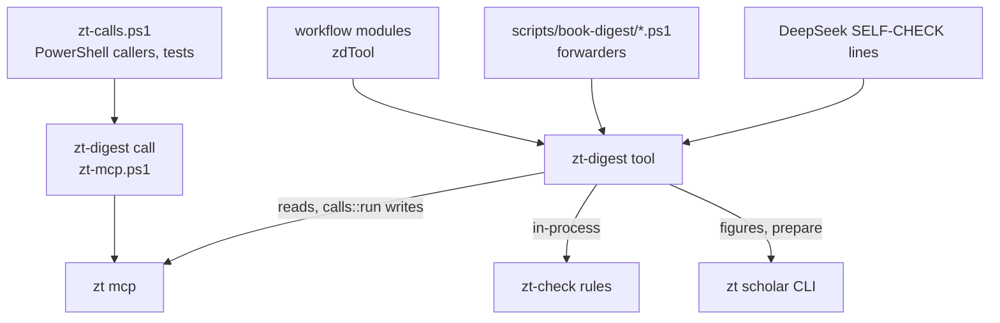

# Digest scripts

## Purpose

`tests/bridge-human.tests.ps1` seeds human Cards only through direct SQL in its stopped scratch archive, then runs public `zt reindex` before exercising the agent interfaces. This fixture setup must refresh the derived index; direct SQL is outside normal Card-write maintenance. The final audit checks actual incoming human and unattributed Links as well as outgoing human Links.

`tests/mcp-lifecycle.tests.ps1` exercises the shared checker/compiler transport through both public binaries. Temporary fixtures hang during initialize, receive, unrelated reply noise, a large blocked stdin write or EOF shutdown; each command must return within a finite test deadline, remove its owned descendants and preserve an independent control process. Killing only the compiler tests Windows job ownership. Real proxy cases hang before/after an actual archive batch commit and retry the original receipt keys. An independently restarted ZT daemon and mock Scholar Archive service must survive client cleanup; the latter also checks that no capture pipe is retained and that unsigned responses are rejected. This runs no provider or book workflow and only its namespaced temp config can shorten production transport deadlines.

Its optional `-Python <executable>` (or `ZT_TEST_PYTHON`) additionally checks that a Python-based external service starter has valid stdout. The Windows checkpoint enables this probe explicitly; the ordinary Node-based suite has no machine-specific Python path dependency.

`tests/ledger-core.tests.ps1` exercises the real opt-in prepared-ledger path through a temporary archive: complete group registration, placeholder/open coverage, five-table WAL storage, success/settled prerequisites, stable retry identity, input/contract/archive mismatch refusal without ledger-row changes, protected prepared files and offline read-only `ledger status`. It inspects retained SQL facts through the existing Node SQLite seam. `ledger-preparation.tests.ps1` also requires reliable prepare to initialize that ledger before returning. These tests do not launch provider jobs or an actual digest workflow.

`tests/ledger-prepare-recovery.tests.ps1` interrupts actual identified setup after its first 64-operation chunk commits. The existing MCP proxy loses the reply; the retained prepare token and plan recover three remaining anchors, keeping the original run, 66 groups and all frozen files. Its 25 assertions include current-token renewal before the tail exists, source/setup changes, an edited committed Card, a missing prerequisite and missing completion registration. Fault injection before/after the ledger commit checks atomic worker release and read-only receipt recovery. A mismatched BibTeX key creates neither tree. `ledger-group-start.tests.ps1` observes the group's newly created guard separately from preparation's existing guard, then tests actual lock contention. These test the tool path and existing temporary-archive/SQLite seams, not a digest workflow or expired-owner reclamation.

`tests/ledger-claims.tests.ps1` adds actual two-process claiming, current/stale renewal/failure tokens, typed classification, real bounded backoffs and exhaustion after three claims. It asserts exact partial/blocked coverage with zero dependency-wait attempts, prerequisite/downstream rerun closure, deliberate variant exclusions, unsealed empty queues, append-only events/foreign keys and missing-publication faults. Its two backoff waits total about 25 seconds plus bounded jitter. `ledger-core` also injects an archive-id change after the Card read and verifies that no claim/ledger row changes are published. No public test infers a verified group from a placeholder anchor.

`tests/ledger-schema.tests.ps1` changes only its isolated ledger's schema markers, index, append-only trigger, table set, journal mode and dependency foreign keys. Public init and offline status must refuse each malformed schema; restoring the injected faults verifies the same retained run. `ledger-claims` also adds a second isolated prerequisite and checks that an already-blocked group's named faults update when that producer fails, while independent ready work can still be claimed.

`tests/ledger-dependencies.tests.ps1` seeds only pending nodes/dependencies in its isolated ledger, then uses real next/status commands. It checks all producers in overlapping cycles receive exact closed-path content faults without attempts, each returned path follows actual dependency edges, an outside dependant becomes blocked and an independent unit is still claimed. It supplies no synthetic done output or domain-verification evidence.

`tests/ledger-options.tests.ps1` prepares both variants through `-RunOptions`, verifies deliberate exclusions/omitted roots and a group claim after Terms is explicitly disabled, and refuses in-place target changes. Invalid keys/types/duplicates/variant choices/figure conflicts must fail before files or archive setup. It tests that retained choices survive deletion of the original options file, that modified target metadata cannot hide core work, and that the earlier schema-1 contract shape without optional choices keeps its original run identity/defaults.

`tests/ledger-group-start.tests.ps1` checks the real startup command against snapshot failure with a pre-existing anchor, fresh post-preparation context and one MCP/title export. It validates the frozen source/job envelope, input hashes, near-expiry renewal without another attempt/completion, unchanged Card revision, accepted-file replay/tamper refusal and actual Windows OS-lock exclusion across processes. A held guard also refuses failure transitions; stale tokens are identified before guard contention, and a released guard file does not act as ownership. The test declares draft-job permissions but runs no provider or actual digest workflow.

`tests/ledger-group-finish.tests.ps1` validates the actual draft/claim binding and checker, empty-answer/no-cards refusal for prose, a complete 66-operation preview, corruption and ownership/alias placement guards. It injects four pre-commit completion faults, verifies zero partial ledger state/outputs/children/events, and recovers the committed archive receipts through typed `ledger done`. It checks the actual owned manifest, idempotent completion, changed files/child inputs, exact offline reconciliation and missing SELF-CHECK output registration.

`tests/ledger-group-finish-boundaries.tests.ps1` adds a real Model header/part candidate, its checked quality-fault consumer, the existing Topic gate, malformed native-preview completeness, a post-commit reply failure, actual first-chunk reply loss and two-operation tail recovery, deliberate optional exclusions, a late draft replacement, a concurrent real slot reservation and a heading-only source-backed no-cards disposition. The seam's lost-batch-reply hook fires only on actual writes; preview transactions roll back and cannot be called committed work. All fixtures use temporary archives and explicit frozen options, and no provider or real digest workflow runs.

`tests/ledger-terms.tests.ps1` drives the normal enabled Terms prerequisite in both variants: one bound job for actual source candidates, an explicit zero-candidate no-op, strict row/JSON/UTF-8 validation and source/job/configuration integrity. It checks unclaimed-command refusal and a corrupted retained call before any commit, loses a real committed MCP reply, injects pre/post-commit completion faults, recovers via typed `ledger done`, checks actual Card/table/receipt/context readback and starts an economics group from that context. Removing a retained archive receipt or required context output must refuse verified completion or name the missing registration. No group dependency-wait attempt is spent, and no provider/workflow is run.

`tests/ledger-publication.tests.ps1` drives the aggregate publication boundary through the real CLI on temporary archives. It registers and re-registers derived revisions, checks that an unchanged sorted manifest reuses the revision preparation registered without adding a unit/dependency/event, and that a real producer failure derives the next revision while the older open one becomes terminal `superseded` history excluded from `failed`, `unresolved` and `rerun-list`. It claims the sealed revision once its producers settle, completes it only when the whole manifest is accounted for with hash-bound `decisions`/`applied` artifacts, and injects a completion fault that must roll outputs, done state and event back together. It completes a skeleton only when every prepared anchor is indexed substantive work or an explicitly reasoned gap, a hub refresh only with its declared touched tree and upper hubs/Register (deriving a new revision from a changed scope, and none from a tree no producer touched), and an immutable Bridge report only when its recomputed `r-<Content-Hash>` id and exact proposal set match. Each note suggestion registers its own unit and reaches one archive-checked outcome (`applied` after a real `apply_batch` edit, `already_present`, or a reasoned `refused`). A real `move_card` recorded with `call -Moves` updates the published locators, while an unexplained address refuses with `unreconciled_move`. One fixture also verifies that a layer excluded by the prepared run cannot publish at all, and another completes a producer that registers real Model work and confirms that `organize/book@2` names that Model candidate as an explicit pending disposition while `organize/book@1` stays terminal, so repaired model work can never leave a stale downstream publication.

`tests/ledger-math.tests.ps1` drives the mathematics variant's ledger adapter through the real `zt-digest math` steps and `zt-digest ledger` commands on one prepared staging folder. It checks the declared stage-order prerequisites (notation before boundary work, the skeleton before its per-unit obligations, the audit before the final check); that an index leaving a prepared statement out and a group whose unit list is gone cannot complete; that the retained math prompt files are the shared instruction files with their math supplements; that the skeleton accounts for every indexed statement and Theory Card while a `待写` statement stays open; that a notation table which is not what the retained answer produces cannot complete; that a supplied boundary candidate without its independent review cannot settle; that the rejected part and the role naming it go through the archive's confirmed deletion with its recorded mapping while a hidden deletion is refused; that every selected proof step needs a review, an accepted fix keeps its Links and a refusal stays a named obligation; and that the final M1–M18 check names the audit revision it describes and refuses a stale audit; and that draining those obligations leaves a done Model unit and its Card untouched and out of the resume list.

The digest scripts are the deterministic half of the book digest workflows (`zt-econ-digest`, `zt-math-digest`), which turn a Scholar Archive book into agent Literature trees, Topic trees, Idea, Event, Finding, Model, and Hub Cards. Every stage follows one pattern: a script plans the work and writes job files, a DeepSeek Harness run (or a Sonnet architect, or Opus) writes only JSON or Card prose, a script checks that output (the writer's own `SELF-CHECK:` command), applies it through the zt helper, checks the result, and reports. The scripts exist so that structure (Locations, Links, moves, tables, skeletons, ownership, retries) is done by code that costs no model tokens and follows one rule, and so that a model's text is checked by `zt-check` before it reaches a Card. Their code now lives in [zt-digest](zt-digest.md): each script is a PowerShell 7 forwarder to its `zt-digest` tool (one Rust process per step, one `zt mcp`, zt-check in-process), with the same parameters, files, and output. The workflow's Haiku drivers run the tools directly (`zt-digest <tool> …`, one command per step), and so does every `SELF-CHECK:` line; the scripts stay for developers and old commands. This doc describes what each step does; [zt-digest](zt-digest.md) describes the code and what the port changed.

**Owns:** the scripts in `scripts/book-digest/` (forwarders to the `zt-digest` tools) and what each step does (preparation of the staging folder, the compiler cycles of every layer, the read-only audit and surveys, figure attachment), the job, plan, answer, and state JSON formats they read and write, the `zt-calls.ps1` bridge from a PowerShell caller to the zt helper and to `zt-check`, `book-of.ps1` and `relatedness.ps1` (kept as PowerShell), and the tests and fixtures in `scripts/book-digest/tests/`.

**Does not own:** the stage order, roles, retries, and modes that call these scripts ([Digest workflows](digest-workflows.md), which also owns `framework-harness.mjs` and `bridge-workflow-harness.mjs`); the DeepSeek instruction files `dsh-*.zh.md` and the architect files `model-architect*.md` that the job files open with ([Digest prompts](digest-prompts.md)); the zt helper `skills/zt/scripts/zt-mcp.ps1` and the installed skills ([Agent skills](agent-skills.md)); the code of the forwarded scripts, which lives in `tools/zt-digest` ([zt-digest](zt-digest.md)); the Card language and Card layer rules themselves ([zt-check](zt-check.md)); the MCP tools the helper calls ([MCP server](mcp-server.md)); how ZT computes models, build reports, units, and theories ([Models and math](models-and-math.md)); hub faults and `list_hubs` ([Hub Cards](hub-cards.md)); the Scholar Archive bridge behind `zt scholar …` ([Scholar bridge](scholar-bridge.md)).

## At a glance

| | |
|---|---|
| Entry points | One `zt-digest <tool> [-Step <step>] …` per stage step, or the same arguments to `pwsh -NoProfile -File scripts/book-digest/<script>.ps1` (a forwarder; the tool of each script is in [zt-digest](zt-digest.md)); dot-sourced libraries `zt-calls.ps1`, `relatedness.ps1`, `book-of.ps1` for PowerShell callers; the tests `scripts/book-digest/tests/*.tests.ps1` |
| Key files | Every script below forwards to its `zt-digest` tool, except `book-of.ps1`, `relatedness.ps1`, and `zt-calls.ps1` |
| | `prepare-book-digest.ps1` — Chinese-only text, section groups, group files, shared prefixes, manifest, and (`-Apply`) the Literature tree with its anchors |
| | `snapshot-topics.ps1` — a compact list of every tree for one digest run |
| | `book-terms.ps1` — the Book term table (术语表) |
| | `card-compiler.ps1` — the card layer cycle: fix, review, orphan Links, Organize notes. A forwarder to `zt-digest card` (`tools/zt-digest/src/card.rs`, [zt-digest](zt-digest.md)) |
| | `list-models.ps1` — the Model Cards a digest wrote, with level, parts, and faults (forwards to `zt-digest list-models`) |
| | `model-context.ps1` — the context pack of one model (forwards to `zt-digest model-context`) |
| | `model-compiler.ps1` — the model compiler (brief, validate, apply, derive, review, split, report) and the explain steps (forwards to `zt-digest model`) |
| | `event-compiler.ps1` — the event layer: Event Cards from dated sentences |
| | `finding-compiler.ps1` — the empirical-results layer: Finding Cards |
| | `prepare-link-pass.ps1` — the link pass: card snapshot, ownership, candidates, allow lists |
| | `organize-survey.ps1` — read-only survey of what Opus must decide |
| | `organize-apply.ps1` — Topic merges and Card moves from Opus's `decisions.json` |
| | `book-skeleton.ps1` — Literature Card index, Structure Card, Topic bodies |
| | `attach-figures.ps1` — the book's figures (`artifact:`) in the Cards that name them; Document links on the Literature Card |
| | `hub-compiler.ps1` — the Hub Cards of the whole agent Workspace |
| | `math-compiler.ps1` — units, Theory Cards, notation, boundary, proof review, rules M1 to M18 |
| | `digest-audit.ps1` — read-only audit of a book or of the Workspace. A forwarder to `zt-digest audit` (`tools/zt-digest/src/audit.rs`) |
| | `book-of.ps1` — pure `Get-BookIndex -Trees -Cards`, shared Card categories and inferred book attribution; only its own test loads it now, and the tools use the Rust copy (`tools/zt-digest/src/audit/book_of.rs`) |
| | `bridge-compiler.ps1` — frozen candidate plans, checked judge output, immutable review reports, and guarded apply of accepted proposals |
| | `zt-calls.ps1` — `Invoke-Zt` (zt MCP tools through the helper) and `Invoke-ZtCheck` (`zt-check`), for PowerShell callers and the tests; no digest script loads it any more |
| | `relatedness.ps1` — TF-IDF over Chinese character bigrams, compiled ranking; no script loads it any more, and the tools use the Rust copy (`tools/zt-digest/src/card/relatedness.rs`) |
| | `scripts/book-digest/tests/*.tests.ps1`, `scripts/book-digest/tests/card-layer-fixture.json`, `scripts/book-digest/tests/card-style-fixture.json` — tests and fixtures |
| Depends on | [zt-digest](zt-digest.md) (the tools every script forwards to, on PATH or in `ZT_DIGEST`), which starts `zt mcp` ([MCP server](mcp-server.md)); `skills/zt/scripts/zt-mcp.ps1` (the zt helper path, [Agent skills](agent-skills.md)); `zt-check` on PATH ([zt-check](zt-check.md)); `zt scholar keep-figures`, `zt scholar sql`, `zt scholar file` ([Scholar bridge](scholar-bridge.md)); `get_model`, `get_hub`, `list_hubs` reports ([Models and math](models-and-math.md), [Hub Cards](hub-cards.md)); the instruction files in `scripts/book-digest/*.md` ([Digest prompts](digest-prompts.md)); `zt-digest` on PATH or in `ZT_DIGEST` for the forwarders ([zt-digest](zt-digest.md)); PowerShell 7 (`ForEach-Object -Parallel`, `Add-Type`, `Start-ThreadJob` in a test) |
| Used by | [Digest workflows](digest-workflows.md) (the modules in `scripts/book-digest/workflow/modules/`); the DeepSeek writers, through the `SELF-CHECK:` lines of their job files; [Agent skills](agent-skills.md) (`skills/zt-digest-protocol/references/scripts.md` describes them) |
| Tests | `scripts/book-digest/tests/*.tests.ps1` (one per script or helper, run one by one) |

## Concepts

- `Staging folder` — the digest's output folder (`-Out` of `prepare-book-digest.ps1`, `-Staging` everywhere else): `manifest.json`, `book.zh.md`, `sections/`, `groups/`, the logs, and one sub-folder per stage. Every later script reads `manifest.json` from it.
- `Group` — one or more consecutive section units of one chapter (at most `-MaxUnits`, at most `-MaxChars` characters) handled by one DeepSeek digest run; numbered `n` from 1, id `gNN`. Built in `prepare-book-digest.ps1`.
- `Anchor` — the Literature tree Card `<key>/<n>` of group `n`, a Direct successor chain under the Literature Card. `digest-audit.ps1` gives it the category `anchor`.
- `Owned Cards` — the Cards a group wrote: `owned-gNN.txt`, written by the helper's `-Log` during the digest, extended by `card-compiler.ps1` (split Cards) and `math-compiler.ps1` (unit skeletons). Read by `list-models.ps1`, `model-context.ps1`, `prepare-link-pass.ps1`, `event-compiler.ps1`, `finding-compiler.ps1`.
- `Source log` — `src-gNN.txt`: `<address><TAB><sections/sNN.md:from-to>`, written by the helper's `-SrcLog` from a create call's `src` field. `card-compiler.ps1` hands a reviewer only those lines.
- `Category` — how `digest-audit.ps1` (`Get-Category`) classifies a Card: `root`, `anchor`, `idea`, `event`, `model` (a Model Card), `part` (a Model part), `hub`, `terms` (the Book term table), `structure` (the Structure Card). zt-check applies the Card layer rules only to entries that carry a category.
- `Book of a Card` — a Literature tree Card belongs to its tree; a Topic tree Card belongs to the book whose Literature tree it links most (a Link to the Literature Card or an anchor counts 10, to another Card of the tree 1); a Card that links no book is unattributed (`digest-audit.ps1`).
- `Job` — one DeepSeek task: `{"id","files":[…],"prompt","continue"?,"fallback"?}`. `files` are opened in order (the instruction file first, so DeepSeek caches it); `continue` names the earlier job whose conversation continues; `fallback` lists the files a fresh conversation needs when that one is gone.
- `SELF-CHECK line` — a line in a job file naming the read-only command the writer runs on its own JSON before it replies (`zt-digest card -Step precheck`, `zt-digest hub -Step precheck`, `zt-digest event -Step precheck`, `zt-digest finding -Step precheck`, `zt-digest bridge -Step precheck`, `zt-digest model -Step explain-check`, `zt-digest skeleton -Step apply` without `-Apply`, or `zt-check --cards … --log …` in a group file). No SELF-CHECK line starts a pwsh.
- `Fault line` — `<address> <rule or check> <text>`, one per fault, with `faults: N` as the last line. Same format from zt-check and from every precheck.
- `Allow file` — a list of addresses (one per line) passed to the helper's `-Allow`: a writer may only edit or extend those Cards (and Cards it makes in the same run).
- `Model` terms — Model Card, Model part, Model facet, Emphasis, Derivation part, Derivation chain, Build order, Elaboration level (`concept`, `formal`), Self-sufficient model, as in `CONTEXT.md`. The model compiler's plan names parts by a plan `id`; `state.json` maps each id to its address.
- `Unit`, `Theory Card`, `Math form`, `Cited premise`, `Book notation table` — as in `CONTEXT.md`; built by `math-compiler.ps1`.
- `Hub level`, `Register`, `Hub range` — as in `CONTEXT.md`; built by `hub-compiler.ps1`. A legacy hub is an Idea Card under `<n>/1` (or at `<n>/2`) with 8 or more Links whose excerpt says 枢纽, 核心卡片, or 清单.
- `Structure Card` — a Side successor of `<key>/1` whose body starts with `本卡是《…》的结构卡`; an older one is recognised by linking at least half of the anchors (`book-skeleton.ps1`, `digest-audit.ps1`).

## Architecture

Every step is one `zt-digest` process: the script, when it is called at all, only starts it. A tool opens one `zt mcp` for all its reads and writes (a few read on worker threads, one `zt mcp` each), runs zt-check and the audit in-process, and shares data with the other steps only through files in the staging folder (and through the archive). No step calls a model: each step that needs one prints jobs, and the workflow runs them.



How a tool reaches the archive:

- **Reads** go to the tool's one `zt mcp` (`calls::invoke`, `model::read_calls`); a failed read fails the step with `zt-mcp failed: <i> error <message>`, the text `Invoke-Zt` used. `audit`, `bridge`, and `prepare-link` read large batches on worker threads, each with its own `zt mcp`.
- **Writes** go through `calls::run`, the helper in-process, with the options the scripts gave the helper (`-Log`, `-SrcLog`, `-Allow`, `-Moves`); the per-call `N ok <address>` lines and the stop at the first failed call are the helper's. `model` and `organize-apply` send renumbering calls one at a time and follow each `moved` map.
- **A PowerShell caller** (a test, a script of your own) dot-sources `zt-calls.ps1`: `Invoke-Zt` sends read batches straight to one long-lived `zt mcp` (direct reads; `ZT_CALLS_DIRECT=0` turns them off) and any other batch to the helper.

The stage order (from [Digest workflows](digest-workflows.md)) and the script each stage runs:

| Stage (workflow module) | Script and steps |
| --- | --- |
| prepare (`zt-digest-prepare`) | `prepare-book-digest.ps1 -Apply` |
| math-skeleton, after prepare (`zt-math-skeleton`) | `math-compiler.ps1` `index`, `docs`, `skeleton -Apply`, `notation`, `notation-apply -Apply` |
| terms (`zt-book-terms`) | `book-terms.ps1` `plan` → DeepSeek → `apply -Apply` |
| digest blocks (`zt-digest-lib`, `zt-digest-blocks`) | `snapshot-topics.ps1` before each run; the run writes through the helper and checks with `zt-check --cards`; then a card cycle per block: `card-compiler.ps1 -Work <out>\cards-gNN -Groups … -Sample … -NoOrphans` |
| models (`zt-model-layer`, `zt-model-lib`) | `list-models.ps1`, then per batch `model-compiler.ps1` `brief` → Sonnet `validate` → `apply` → `derive` → `review` → `split` → `report` |
| explain (`zt-explain`) | `model-compiler.ps1` `explain` → `explain-check` (writer) → `explain-apply` → `explain-report` |
| events (`zt-event-layer`) | `event-compiler.ps1` `plan` → DeepSeek (`precheck`) → `apply -Apply` → `report` |
| findings (`zt-finding-layer`) | `finding-compiler.ps1` `plan` → DeepSeek (`precheck`) → `apply -Apply` → `report` |
| math-boundary, math-proof (`zt-math-boundary`, `zt-math-proof`) | `math-compiler.ps1` `boundary` → `boundary-apply` → review → `boundary-settle`; `proof` → `proof-apply` |
| link-prepare, link (`zt-link-prepare`, `zt-link-pass`) | `prepare-link-pass.ps1`; each link run writes with `-Allow allow-gNN.txt` |
| link-check (`zt-link-check`) | `card-compiler.ps1 -Work <out>\cards-link` (with orphan jobs) |
| math-theory (`zt-math-theory`) | `math-compiler.ps1` `theory` → `theory-apply` |
| cards mode (`zt-cards-book`) | `card-compiler.ps1 -Work <out>\cards` |
| organize (`zt-organize`) | `organize-survey.ps1` → Opus `decisions.json` → `organize-apply.ps1` → notes cycle `card-compiler.ps1 -Notes` → `book-skeleton.ps1` `plan` → DeepSeek → `apply -Decisions … -Apply` |
| figures (`zt-figures`) | `attach-figures.ps1 -Staging <out> -Report <out>\figures-report.json -Apply` |
| hubs (`zt-hubs`) | `hub-compiler.ps1 -Work <hubWork>` `survey` → Haiku limits → `plan -Limits` → DeepSeek (`precheck`) → `apply` → `check` → `apply` → `report` |
| audit (`zt-audit`) | `digest-audit.ps1 [-CitationKey <key>] -Out <out>` |
| math-check (`zt-math-check`) | `math-compiler.ps1 -Step check` |

The workflows run each script of this table as its tool (`zt-digest prepare`, `math`, `terms`, `snapshot-topics`, `card`, `list-models`, `model`, `event`, `finding`, `prepare-link`, `organize-survey`, `organize-apply`, `skeleton`, `figures`, `hub`, `audit`, `bridge`). `zt-digest card` runs the audit in-process (every `plan`, `check`, `report`, with `-SkipModels`); so do `organize-survey` and `skeleton` (when no `-Audit` is given). `zt-digest model` builds the context pack of `model-context` in its own process (`brief`, and `explain` when `-Staging` is given).

## Interfaces

### Every script at a glance

All paths are relative to `scripts/book-digest/`. "Writes" means changes to Cards.

| Script | Steps | Parameters (default) | Reads | Writes files | Writes Cards |
| --- | --- | --- | --- | --- | --- |
| `prepare-book-digest.ps1` | — | `-Source`*, `-Out`*, `-CitationKey`*, `-BibTeX`*, `-BookTitle`, `-StartHeading` (导论), `-EndHeading` (参考), `-SkipHeadings`, `-MaxChars` (20000), `-MaxUnits` (3), `-MinUnitChars` (1000), `-FileId` (0: read from a `scholar-archive\files\<n>\` path), `-MinFigureBytes` (3000), `-MaxEventCandidates` (12), `-Instructions` (`dsh-instructions.zh.md`), `-NoEventCandidates`, `-NoFigures`, `-Apply` | the bilingual Markdown, instruction files | `book.zh.md`, `sections/sNN.md`, `sections/index.md`, `groups/gNN.md`, `shared-prefix.md`, `link-prefix.md`, `figures.json`, `events.json`, `manifest.json`, `setup-calls.json` | with `-Apply`: the Literature Card and anchors `<key>/1..N`; refuses when the tree exists |
| `snapshot-topics.ps1` | — | `-Out`*, `-TitleChars` (40) | every tree | the snapshot Markdown | no |
| `book-terms.ps1` | `plan`, `apply` | `-Step`*, `-Staging`*, `-MaxTerms` (60), `-MaxCandidates` (160), `-Apply` | manifest, `sections/s*.md`, `terms/out/terms.json` | `terms/job.md`, `terms/dsh-terms-instructions.zh.md`, `<Staging>/terms.md` | with `-Apply`: the 术语表 Card (create or rewrite) |
| `card-compiler.ps1` | `plan`, `apply`, `check`, `report`, `precheck` | `-Step`*, `-Work`*, `-Book`, `-Staging`, `-Groups`, `-PerJob` (8), `-Sample` (0), `-Seed` (1), `-Rules` (`R2,R3,R4,R5,R7,R9,R12,I1,I2,I3,I4,L1,L2,E1,E2`), `-MaxCards` (0), `-NoOrphans`, `-Notes`, `-Compact`, `-MaxJobs` (0), `-Job`, `-File` | audit output, `owned-g*.txt`, `src-g*.txt`, `out/*.json`, notes | `state.json`, `fix-NN.md`, `orphans-NN.md`, `*-r2.md`, instruction copies, `before/`, `after/`, `report.json`, `decisions.json` | `apply`: rewrites, split Side successors, orphan Links |
| `list-models.ps1` (forwards to `zt-digest list-models`) | — | `-Staging`*, `-Groups` (string, e.g. `1,2,3`) or `-All` with `-CitationKey` | `owned-g*.txt`, trees, `get_model` | stdout only | no |
| `model-context.ps1` (forwards to `zt-digest model-context`) | — | `-Staging`*, `-Model`*, `-Out`* | Model Card, `get_model`, book tree, manifest, section headings | the context pack | no |
| `model-compiler.ps1` (forwards to `zt-digest model`) | `brief`, `validate`, `apply`, `derive`, `review`, `split`, `report`, `explain`, `explain-check`, `explain-apply`, `explain-report` | `-Step`*, `-Work`*, `-Staging`, `-Models`, `-Plan`, `-Need`, `-Changed`, `-Rebuild`, `-Level`, `-MaxSentences` (12), `-MaxChars` (400), `-MaxSteps` (6), `-MaxExplainSentences` (16), `-MaxExplainChars` (600), `-MaxParts` (0), `-BriefDoc`, `-FillDoc`, `-ReviewDoc`, `-Job`, `-File` | `<model>/plan.json`, `review-*.json`, `out/explain-*.json`, `figures.json` | `state.json`, per-model folders (context, briefs, jobs, allow files, setting, reviews, follow-ups) | `apply`, `split`, `explain-apply`, chain lines |
| `event-compiler.ps1` | `plan`, `precheck`, `apply`, `report` | `-Step`*, `-Staging`*, `-Work` (`<Staging>/events`), `-Job`, `-GroupsPerJob` (3), `-Apply` | `events.json`, `owned-g*.txt`, `out/ev-*.json` | `ev-NN.md`, instruction copy, `drafts-*.json`, `state.json`, `created.txt` | with `-Apply`: Event Cards, source lines on existing ones, `案例` Links |
| `finding-compiler.ps1` | `plan`, `precheck`, `apply`, `report` | `-Step`*, `-Staging`*, `-Work` (`<Staging>/findings`), `-Job`, `-GroupsPerJob` (3), `-MaxCandidates` (16), `-Apply` | sections, `owned-g*.txt`, `out/fd-*.json` | `fd-NN.md`, instruction copy, `drafts-*.json`, `state.json`, `created.txt` | with `-Apply`: Finding Cards, `印证` Links |
| `prepare-link-pass.ps1` | — | `-Staging`*, `-TitleChars` (40) | manifest, `owned-g*.txt`, `linked-g*.txt`, every tree and agent Card | `cards-all.md`, `link-gNN.md`, `allow-gNN.txt` | no |
| `organize-survey.ps1` | — | `-Staging`*, `-Work`*, `-Notes`, `-Similar` (0.5), `-CrossLinks` (4), `-Small` (3) | audit, `cards*/decisions.json`, notes | `<Work>/audit/*`, `survey.md`, `survey.json` | no |
| `organize-apply.ps1` | — | `-Work`*, `-DryRun` | `<Work>/decisions.json` | `applied.json`, `moves.jsonl`, `decisions.json` (notes translated) | Topic merges (move + delete root), Card moves |
| `book-skeleton.ps1` | `plan`, `apply` | `-Step`*, `-Staging`*, `-Work`*, `-Audit`, `-Thesis`, `-Decisions`, `-Apply` | audit, `out/skeleton.json`, decisions | `job.md`, instruction copy, `<Work>/audit/*` | with `-Apply`: Structure Card, Literature Card body, Topic bodies |
| `attach-figures.ps1` | — | `-CitationKey`*, `-FileId`, `-Staging`, `-Source`, `-MinFigureBytes` (3000), `-Report`, `-Batch` (40), `-FiguresFile`, `-NoDocuments`, `-Apply` | figures (bridge or `figures.json`), `search_cards` hits | `-Report` JSON | with `-Apply`: figure lines and the Literature Card's document line (`edit_card` with `base`) |
| `hub-compiler.ps1` | `survey`, `plan`, `apply`, `check`, `report`, `precheck` | `-Step`*, `-Work`*, `-File`, `-Limits` (JSON), `-Trees`, `-PerJob` (0), `-Rebuild` | trees, `list_hubs`, `get_hub`, `out/hub-<tree>.json`, `out/fields.json` | `survey.json`, `survey.md`, `limits.json`, `state.json`, `job-*.md`, `fix-*.md`, `none.allow.txt`, `report.json` | `apply`: line, topic, field hubs, the Topic 索引 and the Register, Topic body Links |
| `math-compiler.ps1` | `index`, `docs`, `skeleton`, `notation`, `notation-apply`, `boundary`, `boundary-apply`, `boundary-settle`, `proof`, `proof-apply`, `theory`, `theory-apply`, `check` | `-Step`*, `-Staging`*, `-Out` (`<Staging>`, for `check`), `-UnitsPerJob` (4), `-Supply` (`examples`; `none`, `examples+answers`), `-MainResults` (7), `-CoreBudget` (3, not used by any step), `-MaxSymbols` (80), `-Apply` | sections, manifest, `math/**/out/*.json` | `math/index.json`, `index.md`, `units.json`, `math-prefix.md`, `math-link-prefix.md`, `math/brief.zh.md`, `fill.zh.md`, `review.zh.md`, `notation.md`, job files, `math-audit.json`, `math-audit.md`; appends to `groups/gNN.md`, `owned-gNN.txt`, `src-gNN.txt` | `skeleton`, `notation-apply` (with `-Apply`), `boundary-apply`, `boundary-settle`, `proof-apply`, `theory-apply` |
| `digest-audit.ps1` | — | `-CitationKey` (empty: every agent book), `-Out`*, `-MaxSentences` (12), `-MaxChars` (400), `-MaxSteps` (6), `-Throttle` (6), `-Chunk` (40), `-Sample` (15), `-SkipModels` | fresh title catalogue, bounded lean graph batches, scoped `get_model`, hub/Broken link reports | `audit.json` (with `bridges` per book), `audit.md` (with the islands), `audit-faults.txt`, `audit-cards.json`, `audit-addresses.txt` | never: it refuses any tool outside its read list |
| `bridge-compiler.ps1` | `plan`, `precheck`, `report`, `apply` | `-Step`*, `-Staging`*, `-CitationKey`*, `-Work` (`<Staging>/bridge`), `-Profile` (`book`; `math`), `-MaxSources` (60, 1 to 120), `-Candidates` (5, 1 to 8), `-Books`, `-Job`, `-ReportId`, `-Accept`, `-AcceptEarlier`, `-Apply` | both Workspaces' trees and Cards (`list_trees`, `get_tree`, `get_card`, `get_model` only, until apply), the term tables, `out/*.json` | `plan.json`, job files, `read-only.allow.txt`, `proposals.json`, `report.md`, `state.json` | `apply -Apply`: one `跨书关联：` paragraph per accepted carrier (`edit_card` with `base`) |
| `book-of.ps1` | dot-sourced | `Get-BookIndex -Trees -Cards` | the Cards it is given | — | no |
| `zt-calls.ps1` | dot-sourced | — | — | — | as called |
| `relatedness.ps1` | dot-sourced | — | — | — | no |

`*` marks a mandatory parameter. Every script in the table above `book-of.ps1` forwards every argument to its `zt-digest` tool, which takes the same parameters (names ignore case; a value with no name binds to the next parameter in table order, as in PowerShell). `attach-figures.ps1` runs `zt-digest figures`, which also holds the functions of the removed `figures.ps1` (they add bytes to ZET's artifact store through `zt scholar keep-figures`). Every step prints compact JSON as its last line, except the precheck steps, `model-compiler.ps1 -Step validate`, and `explain-check`, which print fault lines and `faults: N`, and `snapshot-topics.ps1`, which prints `<count> cards -> <file>`.

### zt-calls.ps1: how scripts call zt and zt-check

No digest script loads it any more: the tools do the same in Rust ([zt-digest](zt-digest.md), `calls::invoke`, `check::Check`). It stays for PowerShell callers and the tests. Dot-source it: `. (Join-Path $PSScriptRoot 'zt-calls.ps1')`. Loading it has two side effects: it sets `[Console]::OutputEncoding` to UTF-8 (the helper writes UTF-8; under the default GBK code page a Chinese excerpt can swallow a quote and break the JSON), and it resolves `$script:ZtCheck` (`zt-check` on PATH) and `$script:ZtHelper` (`skills/zt/scripts/zt-mcp.ps1`, relative to the script folder).

```powershell
Invoke-Zt $calls
```

- Input: an array of `@{ tool = '<mcp tool>'; arguments = @{…} }`. It is sent as a JSON array on stdin to `pwsh -NoProfile -File $script:ZtHelper -`.
- Output: one parsed object (`ConvertFrom-Json -DateKind String`) per helper line `N {json}`, in call order. Write calls print `N ok <address>`, which `Invoke-Zt` drops, so it returns only read results.
- Errors: throws `zt-mcp failed: …` on a non-zero exit, `zt: <message>` on a line `N error <message>`. The helper stops at the first failed call, so the calls after it never run.
- Inside a string argument `@@N` is replaced by the address that call N returned (resolved by the helper).

```powershell
Invoke-ZtCheck [-Json <file> | -Model <address> | -Addresses <a,b,…> | -Cards <anchor>] [-Log <file>] [-Book <key>]
               [-Rules <R2,…>] [-Setting <address>] [-Level concept|formal] [-RequireExplain] [-SkipShared]
               [-MaxSentences 12] [-MaxChars 400] [-MaxSteps 6] [-MaxExplainSentences 16] [-MaxExplainChars 600]
               [-MinIdeaChars 40] [-MaxIdeaChars 300] [-MinReason 8]
```

- Maps the old PowerShell parameter names onto `zt-check` flags: `--json`, `--model`, `--addresses`, or `--cards` (one of them, in that order of precedence; with none it passes `--cards ''`), then `--log`, `--book`, `--rules`, `--setting`, `--level`, `--require-explain`, `--skip-shared`, and always every `--max-*`, `--min-idea-chars`, `--max-idea-chars`, `--min-reason` with the values above.
- Output: zt-check's lines as strings: one fault line each, then `faults: N`.
- Errors: throws `zt-check is not installed: run scripts\install-zt-check.ps1` when it is not on PATH, and `zt-check did not run: …` when no `faults: N` line comes back. So no script writes text that was not checked.
- `--json` takes entries `{address, title, body, facet?, line?, category?, book?, parent?, links?, kinds?, inbound?, inbound_kinded?}`; the Card layer rules (I, E, F, L) apply only to entries with a `category` (`scripts/book-digest/tests/card-layer.tests.ps1`).

### The zt helper protocol as the scripts use it

Owned by [Agent skills](agent-skills.md) (`skills/zt/scripts/zt-mcp.ps1`); the scripts depend on these parts of it:

| Option | Used by | Effect |
| --- | --- | --- |
| `-File -` | every write path | reads a JSON array of calls from stdin |
| `-Log <file>` | digest runs (group file), `event-compiler.ps1`, `finding-compiler.ps1` (`created.txt`), `math-compiler.ps1 skeleton` (`owned-gNN.txt`) | appends the address of every Card a create call makes |
| `-SrcLog <file>` | digest runs, `math-compiler.ps1 skeleton` | appends `<address>\t<src>`; the `src` argument never reaches zt |
| `-Allow <file>` | link runs, model writers, read-only briefs | limits edits to listed Cards and Cards made in the run; refuses `create_topic`, `move_card`, `insert_card`, `delete_card`, `create_literature`, `edit_literature_metadata` |
| `-Moves <file>` | `model-compiler.ps1`, `organize-apply.ps1` | appends `{"i":N,"moved":{old:new}}` per renumbering call |
| `-TopicGate <file>` | digest runs (`topic-gate.lock`) | refuses a `create_topic` whose title an agent Topic has or nearly has (bigram similarity 0.8) |
| `append_card` | `card-compiler.ps1` orphan Links | helper-only call: reads the body and sends `edit_card` with the paragraph appended |

Output lines: `N ok <address>` for create, edit, append, move, insert, delete; `N <json>` for reads; `N error <message>` and then `resume: -From N -Addresses …` on failure.

### Dot-sourced helpers

| Function | File | Signature | Returns |
| --- | --- | --- | --- |
| `Get-Terms` | `relatedness.ps1` | `Get-Terms [string]$text` | hashtable term → count: Chinese character bigrams and Latin words of 4+ letters; formulas, Links, and code are removed |
| `New-Relatedness` | `relatedness.ps1` | `New-Relatedness $documents [int]$keep = 150` (`$documents`: `@{ id; text }`) | `{ Vectors; Postings }`: TF-IDF vectors (top `$keep` terms each, L2-normalised); a term in every document is dropped |
| `Find-Related` | `relatedness.ps1` | `Find-Related $model [string]$id [int]$top = 5 [scriptblock]$exclude` | up to `$top` ids, most similar first, skipping ids for which `$exclude` is true; ranking is the compiled C# `BookDigestRelatedness.Rank` (`Add-Type`, once per process) |

The figure functions of the removed `figures.ps1` live in `tools/zt-digest/src/figures.rs` (`book_figures`, `image_name`, `labels`, `Mention`, `document_line`): `zt scholar keep-figures <id> --min-bytes <n> --out <tmp>`, labels from caption lines in the image block and up to 7 following short blocks, the other spelling of a Roman or Chinese numeral (I–XX), mentions such as `图 2.C.1` but never a longer number, and the `原书文档：…` line from `zt scholar sql` on `work_files`.

### Job output shapes

```json
{"jobs":[{"id":"fix-01","files":["<Work>\\dsh-card-instructions.zh.md","<Work>\\fix-01.md"],
          "prompt":"按以上说明处理任务文件中的每张卡，写出 JSON 文件。最后只回复一行 JSON。"}]}
```

A follow-up continues an earlier conversation and carries a fallback:

```json
{"id":"fix-01-r2","continue":"fix-01","files":["<Work>\\fix-01-r2.md"],
 "fallback":["<Work>\\dsh-card-instructions.zh.md","<Work>\\fix-01-r2.md"],"prompt":"…"}
```

`card-compiler.ps1 -Compact` prints the job list once per kind instead (the workflow expands it, `zt-digest-lib.js` `expandJobs`):

```json
{"dir":"<Work>","lead":{"fix":"<Work>\\dsh-card-instructions.zh.md","orphans":"<Work>\\dsh-orphan-instructions.zh.md"},
 "prompts":{"fix":"…","orphans":"…","follow":"…"},
 "jobs":[{"id":"fix-01","kind":"fix","file":"fix-01.md"},{"id":"fix-01-r2","kind":"follow","file":"fix-01-r2.md","continue":"fix-01"}]}
```

Job ids by script: `card-compiler.ps1` `fix-NN`, `orphans-NN`, `fix-NN-r2`; `model-compiler.ps1` `<slug>:brief`, `<slug>:fNN` (fill), `<slug>:dNN` (derive), `<slug>:rNN` (review), `<job>+NN` (split follow-up), `<slug>:xNN` (explain), `<job>+2` (explain follow-up), where `<slug>` is the address with `/`, `\`, `|` replaced by `_`; `hub-compiler.ps1` `tNN`, `fNN`, `<id>-fix`; `event-compiler.ps1` `ev-NN`; `finding-compiler.ps1` `fd-NN`; `book-terms.ps1` `terms`; `book-skeleton.ps1` `skeleton`; `math-compiler.ps1` `notation`, `b-NN`, `v-b-NN`, `p-NN`, `t-NN`.

## Behaviour

The Card compiler's quality inputs are scoped in `tools/zt-digest/src/card.rs`: a local group uses its owned manifest/anchors; a book cycle adds the book, declared owned external Topic Cards and previously attributed Topic members. It uses fresh titles, bounded body batches and indexed relationship addresses, with external carriers marked as context. Parent titles do not require parent bodies. Owned Cards with missing source attribution stay in the checks; another Literature tree, human ownership, unreadable staging or a missing required input is an error. `before`/`after` reports identify their checked group/book scope rather than claiming a global audit. The separate public audit still provides the global report.

### The compiler cycle

Every layer script implements the same cycle (`docs/digest-card-layers-proposal.md`, principle 1):

1. **plan** reads the archive and the staging folder, picks the work, writes job files (each with its `SELF-CHECK:` line and the absolute path of the JSON file to write), copies the instruction file with `{{KEY}}`, `{{STAGING}}`, `{{HELPER}}` filled, saves `state.json`, and prints the jobs.
2. The workflow runs the jobs. A DeepSeek writer writes JSON into `out/` and runs its SELF-CHECK command until it prints `faults: 0`.
3. **precheck** (read-only) judges one answer file exactly as apply will: structure, ownership, Links, and zt-check on the drafts. It never writes a Card or `state.json`.
4. **apply** refuses what precheck reports, writes the rest through the helper, records each applied job in `state.json`, and skips applied jobs on a rerun.
5. **check** (card and hub compilers) reruns the audit or `get_hub` and prints follow-up jobs that continue the writer's conversation.
6. **report** prints counts and writes `report.json`.

### Prepare (`prepare-book-digest.ps1`)

1. Reads the source (CRLF → LF). With a file id (given, or read from a `…\scholar-archive\files\<n>\…` path) and without `-NoFigures`, `Get-BookFigures` keeps every image of at least `-MinFigureBytes` in ZET's artifact store.
2. Splits into blank-line blocks and keeps the Chinese: a block with no CJK character is dropped when the next block has CJK; formulas, tables, HTML, and fences (`$$`, `|`, `<`, ` ``` `) stay. Each image line becomes the figure's `line` (``); a figure repeated within the next three kept blocks (the bilingual copy) is written once; images below the size are dropped.
3. Cuts units at one-line `#` and `##` headings from `-StartHeading` until `-EndHeading`; a heading in `-SkipHeadings` drops its unit until the next other heading; a `#` heading sets the chapter. Throws when `-StartHeading` is not found.
4. Merges units shorter than `-MinUnitChars` into the next unit (the last carry goes into the last unit), then groups up to `-MaxUnits` consecutive units of one chapter while the total stays at or below `-MaxChars`.
5. Clears and writes `sections/sNN.md` (one per unit), `book.zh.md`, and `sections/index.md` (file, characters, group, anchor, chapter, headings).
6. Builds a relatedness model over the units and lists for each group up to four related sections of other groups.
7. Finds event candidates: lines of the group with CJK that name a year `1500`–`2029` followed by `年` (not `年代`), after removing citation years (`[… 1991]`, `(1979)`); at most `-MaxEventCandidates` per group.
8. Writes `groups/gNN.md`: a head with the anchor, chapter, headings, related sections, the write command (`… | zt-digest call - -Log owned-gNN.txt -SrcLog src-gNN.txt -TopicGate topic-gate.lock`), the `SELF-CHECK: zt-check --cards "<anchor>" --log "owned-gNN.txt" --book <key>` line, the snapshot path, the index, the term table path, the event candidates (unless `-NoEventCandidates`), then the group's text.
9. Builds `shared-prefix.md` from `-Instructions` (the first file is the template; each further file goes in before its `\n## 回复` section, or at the end) and `link-prefix.md` from `dsh-link-instructions.zh.md`, replacing `{{KEY}}`, `{{TITLE}}`, `{{HELPER}}`, `{{STAGING}}`, `{{INDEX}}`, `{{SOURCE}}`, `{{OUTLINE}}`.
10. With `-Apply`: probes `get_card <key>` (throws unless it fails), then `create_literature` (agent Workspace, the BibTeX, body `（全书索引待整理。）` plus the document line) and one Direct successor per group (`第 n 组：<headings>`), saved as `setup-calls.json` and run through the helper.
11. Writes `manifest.json` and prints it compactly.

### The card cycle (`card-compiler.ps1`, `zt-digest card`)

The logic lives in `tools/zt-digest/src/card.rs`. The script forwards to it and sets `ZT_DIGEST_SCRIPTS` to its own folder. The tool reads the instruction files from that folder and names the script in each `SELF-CHECK:` line.

1. `plan` runs the audit in-process (`-SkipModels`) into `before/`, adds Organize notes from `-Notes` as fault `N1` (and adds `N1` to the rules), restricts to `-Groups` (owned files and anchors) when given, reads every `src-g*.txt`, and picks the book's Cards of category `idea`, `event`, `finding`, or `anchor` (the writable categories). It writes one fix job per `-PerJob` Cards with faults of `-Rules` (each Card with its parent title, its faults, and, for a sampled Card or a fault I3, E1, E2, its source hint), adds a `-Sample` share of clean Idea Cards as review entries (only with `-Staging`, seeded by `-Seed`), and writes one orphan job per `2 × -PerJob` Cards with I5, E4, or F4 (each with up to five candidates from the TF-IDF ranking of `relatedness.ps1`, ported to `card/relatedness.rs`, never the parent or a Card that already links it; the candidates of an Event or Finding Card are Idea Cards only).
2. `apply` reads each answered job not applied yet (up to `-MaxJobs`), plus fix jobs whose writes zt refused (`reason` starts `zt:`). For each fix entry: `ok` is recorded; `merge` goes to `decisions.json`; `fix`, `split`, `unfaithful` must target a writable category, the Card must be unchanged since the plan (title and body, not the stored text), and `Test-Rewrite` must pass. Edits are written first (`invoke_writes` resumes after each failed call); then split Cards as Side successors, only for edits that were written, and each joins the owner's `owned-gNN.txt`. An orphan link needs a candidate as `from`, a text that links the orphan with a kind word before it, no semicolon, and no Link to an unknown Card; it is written with `append_card`. `state.json` is saved after every job.
3. `check` reruns the audit into `after/` and prints one `-r2` follow-up per fix job whose Cards (and split Cards) still have faults or were refused; a fresh fix job for Cards that took an orphan Link and now have faults; and orphan jobs for orphans the plan did not see (mostly split Cards).
4. `report` reruns the audit, compares the faults of the picked Cards per rule before and after, and writes `report.json` and `decisions.json` (`merges`, `orphan_none`, `splits`).
5. `precheck -Job <id> [-File <json>]` applies the same refusal tests and runs zt-check on each new title and body (and each split Card as `<address>+splitN`, and each orphan sentence as `<to><-<from>`), leaving out the rules that need the whole Workspace (I5, E4, I6, E5, L3). With R6 in the rules it adds the book's term table entry as the setting.

`Test-Rewrite` refuses: an empty title or body; a body that starts with `# `; a split with no Card or an empty one; a lost Link (unless an Organize note names as many new Links as are lost, decision D14); a new Link to a Card not in `before/audit-addresses.txt`; a lost figure line; a changed formula (whitespace ignored).

`link_kinds` (`tools/zt-digest/src/card/text.rs`, the script's `Get-LinkKinds`) mirrors ZT's reading of Relation kinds (`src/model.rs`): the cue that ends last in the words before the Link, within its sentence and after an earlier Link of that sentence, decides; a Link with no cue there takes the kind of the Link before it; `引出` is a plain reference. The cue lists `CUES` and `CUES_EN` copy ZT's table.

### The model compiler (`model-compiler.ps1`)

`model-compiler.ps1` forwards to `zt-digest model`. The code is in `tools/zt-digest/src/model/compiler.rs` (state, plans, steps, job files) and `tools/zt-digest/src/model/text.rs` (sections, chain lines, the 结构 section, the explanation); see [zt-digest](zt-digest.md). The function names below are the script's; each Rust function says which script function it ports (`Build-Model` is `build_model`, `Test-Plan` is `test_plan`).

One batch of models shares one `-Work` folder (the workflow uses `<out>\models\m-<slug of the first model>`).

1. `brief -Models a,b` skips a model that already has parts, is self-sufficient, and has no `beyond_level` fault (unless `-Rebuild`, or `-Level` differs); runs `model-context.ps1` into `<slug>/context.md`; writes `brief-job.md` and an empty `read-only.allow.txt`; adds the model to `state.order` with status `brief`.
2. `validate -Plan <file>` runs `Test-Plan` and prints fault lines and `faults: N`. It does not save state. The architect runs it until `faults: 0` (`scripts/book-digest/model-architect.md`).
3. `apply` builds every model with a `plan.json` and status `brief` or `planned` (`Build-Model`): validates again; sets the level (and title) on the Model Card; places the main line in build order (a new part goes `insert_card` before the next kept part, else `create_successor` direct after the previous one, else side of the Model Card; a `move` part moves there); places side parts beside their `of` and `off` parts beside the Model Card; merges parts without successors (`delete_card … into`); keeps the old body of each `refill` part; writes skeleton bodies (kinded Links from `rests`, a Derivation part's five sections 思路, 起点, 步骤, 结果, 解读 with its chain position line, the setting's 符号表 and 术语表 for a formal model); rewrites the Model Card's **结构** section; writes `setting.md`; and prints round-1 jobs: one Model Card job and one job per three parts that are not Derivation parts (new or refilled, never taken). A failure marks the model `failed` with its error.
4. `derive` prints one job per three neighbouring Derivation parts of a chain, with each premise's filled body copied in (`Get-Premises -Bodies`), and marks the model `derived`.
5. `review [-Changed]` prints one review job per Derivation chain of the model's own parts (up to six parts, with the members before and after it); a shared part (`take`) is never reviewed. With `-Changed` only chains touched by the last split. Clears `rereview`.
6. `split [-Need a=N;b=M]` reads new `review-*.json` files and writer requests. A verdict `split` with `parts ≥ 2` runs `Split-Part`: inserts N−1 parts after the part (before the next main-line member), writes their 起点 and 结果 from `cuts`, ends the part at the first cut and clears its 解读, re-points the next member to the last new part, adds the parts to the 结构 list and to the writer's allow file. A verdict `fix` only queues the part for re-review. Then `Update-ChainLines` rewrites every chain's position lines, and follow-up jobs continue each writer's conversation (or a new derive job when the part had no job). A target that is not the batch's own part (a shared part) is listed under `orphans`.
7. `report` prints, per model: status, level, parts in build order, relations by kind, neighbours, loose parts, charts, parts still `待写`, Derivation counts (total, explained, chains, longest), splits, moves, shared and tolerated counts, build faults, `get_model` issues, notes, and the style fault count from `Invoke-ZtCheck -Model … -SkipShared`.

Every insert, move, and delete runs as the only call of its helper run with `-Moves`, and `Update-Moved` maps every address in `state.json` (part ids, job addresses) through each `moved` map.

`Test-Plan` faults include: wrong `model`; level not `concept` or `formal`; no `card`; a missing or duplicate id; a `figure` label not in `figures.json` (`Get-FigureLine`: `<Staging>\figures.json`, or without `-Staging`, as the architect's `validate` runs, the nearest folder above `-Work` that holds `figures.json`; the workflow's `-Work` is `<out>\models\<batch>`); more than one of `existing`, `take`, `move`; a bad `line`; a side part without `of`; a new part without facet, title, or spec; a facet over 32 characters; a Derivation part in a concept model, off the main line, without `to`, with a facet not starting `推导`, or with `steps` over `-MaxSteps`; the first Derivation part of a chain without `from` or `rests`; a formal model without a main line, without a setting first (facet 设定, or 前提 for a unit), without `symbols` or `terms`; a concept model with more than four own parts; a `forward` rest; a `closure` rest outside the model (a Model Card with a unit Math form is a Cited premise, `Test-Unit`); an unlisted filed part; kept main-line parts out of order; new main-line parts in a model whose filed parts have no main line (parts filed under another model and joined by a Link do not count, so a model built only from linked parts may start its main line); a merge into an unknown part.

### Explain (`model-compiler.ps1` explain steps)

1. `explain -Models …` skips concept models; for each model writes `setting.md` from the build report's setting Card, the context pack (with `-Staging`), and one job per up to three of the model's own Derivation parts of one chain that lack 思路 or 解读 and are in no pending job. `-MaxParts` caps the total. The job stores each part's body and position line.
2. The writer writes `out/explain-NN.json` and runs `explain-check -Job <id>`.
3. `explain-apply` (via `Test-ExplainJob`): a part whose body changed since its job is refused; an entry with `blocked` is recorded, not counted; `Add-Explanation` builds the new body (思路 after the position line, `说明：` lines under numbered steps, 解读 after 结果, a trailing 来源 line kept last); a body whose core (起点, steps, 结果, other text, line by line) changes is refused; zt-check runs on the old and the new bodies (the new with `--require-explain`, with the setting for R6) and only a fault the old body did not have counts (the others are listed as `kept`). Passing parts are written in batches of 25. Faults send the job back once to the same conversation (`round = 2`, a new result file); a second failure is refused.
4. `explain-report` prints per model: Derivation parts, explained, missing, refused, blocked.

### The event and empirical-results layers

`event-compiler.ps1`:

1. `plan` groups `events.json` candidates by group, reads each group's own Cards (owned file plus anchor) in one zt call, and writes one job per `-GroupsPerJob` groups (skipping applied jobs), listing Idea Cards only (Model, Event, Hub Cards are left out) and the candidates.
2. `precheck -Job ev-NN` and `apply` run `Test-Events` (EV1 fields `title`, `time`, `place`, `actors`, `course`, `section`, `role`, and a title without `；` or a line break; EV2 a known group and supports that are Cards of that group; EV3 a role that links a supported Card and starts `本事件例示`, `本事件是`, or `本事件作为`; EV4 an `existing` Card that is an Event Card; EV5 no repeated title) and zt-check on each new Event Card as a draft (`category: event`, `book`).
3. `apply -Apply` skips a faulty event (the first fault per event), adds `来源：[[<key>]] <section>` after the last 来源 line of an `existing` Event Card and appends its `证据作用：` line, or creates the Event Card as a Side successor of its first supported Idea Card (`type: event`, body: 时间, 地点, 参与者, 经过, 来源, then 证据作用); each supported Idea Card gets `案例 [[<event>]]：<title>。` once, in one edit. A job takes two helper runs with `-Log created.txt` (`Invoke-Helper`): first the merges and creates, then the Link edits, which read the Idea Cards again (a new Event Card changes their Reverse links) and carry `base = <stored text>`, so an Idea Card that a parallel stage (models, findings) changed in between is refused, not overwritten. The merge edit also carries `base`. A job whose runs all succeed is recorded under `applied` in `state.json`. A job whose run fails part way is not: `partial[<id>]` keeps the Cards made so far (event place → address), the Links written, and the error, `pending_jobs` counts it, and the next `apply` reuses those Cards, skips a merge already in the existing Event Card and a Link already in the Idea Card, and writes the rest.

`finding-compiler.ps1` follows the same cycle. `plan` finds result candidates in each group's section files: lines with CJK, not an image, table, or heading, that contain a digit and a cue (`数据`, `样本`, `调查`, `问卷`, `访谈`, `受访`, `回归`, `估计`, `系数`, `显著`, `实验`, `统计`, `观测`, `面板`, `普查`, `抽样`, `比例`, `百分之`, `%`), at most `-MaxCandidates` per group; groups with no candidate get no job. Checks are FD1 (fields `title`, `measure`, `data`, `method`, `result`, `limits`, `section`, `role`, one line each), FD2, FD3 (role starts `这一结果印证`, `这一结果支持`, or `这一结果例示`), FD4 (no repeated title), plus zt-check (F1 to F3 and the Card language) on drafts with `category: finding`. `apply -Apply` creates each Finding Card (`type: finding`) as a Side successor of the group's anchor (body: 测量, 数据, 方法, 结果, 局限, `来源：[[<key>/<n>]] <section>`, then the role) and appends `印证 [[<finding>]]：<title>。` to each supported Idea Card (a Link already there is not added again). Its `apply` writes in the same two runs with `base`, and keeps a failed job under `partial` in the same way. It needs zt 0.20.0 or later.

### The link pass preparation (`prepare-link-pass.ps1`)

1. Writes `cards-all.md`: every tree of both Workspaces (agent first), each Card with its address, a type mark (`[模型]`, `[模型·<facet>]`, `[事件]`), and its cut title.
2. Reads every agent Card that is not a Topic root with `get_card`, in up to 12 parallel helper processes; throws when a Card is missing.
3. Ownership: a group owns its anchor and its `owned-gNN.txt` entries. When a group has no owned file, a Card is inferred: a Literature tree Card under `<key>/<n>|…` that mentions `§` or `来源`, or a Topic tree Card whose source line or first `§` reference names a section of the group (section ids `Intro.N`, `AN`, `N.N`, `第X章`, `导论`). Hub Cards and Cards with 8 or more Links stay unowned.
4. For each group writes `allow-gNN.txt` (its Cards) and `link-gNN.md`: the anchor, source files, index paths, the write command with `-Allow`, `SELF-CHECK: zt-check --log "<allow>" --cards "" --book <key> --rules L1,L2,R2,R3,R4,R5,R7,R9`, and each owned Card with its body and up to five candidate targets (most similar Cards owned by another group, not linked yet, not a Topic root).
5. Prints `{"pending":[n…],"groups":[{n,owned,done}],"unowned":N,"cards_all":…}`; a group with `linked-gNN.txt` (written by the workflow) is `done`.

### Organize

`organize-survey.ps1` (read-only) runs the audit into `<Work>\audit` and writes `survey.md` and `survey.json`: the book's Topics (size, Cards of the book); duplicate pairs (title bigram similarity ≥ `-Similar`, one title inside the other, or ≥ `-CrossLinks` Links between their trees from the book's Cards); small Topics (≤ `-Small` Cards, most of them the book's); merge proposals from `cards*/decisions.json` and from the audit's I6 and I2 merge-candidate faults; models not self-sufficient or with issues, and the architect notes from `-Notes`; broken Links and missing hubs.

`organize-apply.ps1`:

1. For each merge: `drop` and `keep` must be agent Topic roots (`<n>/0`), different, and `under` (default `<keep>/1`) must exist in the kept Topic. It moves `<drop>/1` (with its successors) to the next free Side successor slot of `under` (`Get-FreeSide`: the letter after the highest one), then deletes the drop root with `into = keep`; a drop root that still holds Cards stays and the merge is refused.
2. For each move: the Card must exist in the agent Workspace, not be a Model or Hub Card, not be in a Literature tree, not be a Topic root, and `under` must exist and not be inside it.
3. Every address is translated through the renames so far (`Get-Now`, longest prefix first), fed from the helper's `-Moves` log, so decisions written before the first move still name the right Card.
4. Translates the `notes` addresses and rewrites `decisions.json`; writes `applied.json` (`dry_run`, `done`, `refused`, `moved`, `notes_translated`). `-DryRun` plans the targets without a move.

`book-skeleton.ps1`:

1. Runs the audit (or reads `-Audit`) and collects anchors, the book's Model Cards, its Event Cards, and the Topics where the book holds more than half the Cards.
2. `plan` writes `job.md`: each anchor with title and body (cut at 600), models with level, events with their Links, each Topic's body and first 12 Cards, and a SELF-CHECK line that runs `apply` without `-Apply`.
3. `apply` checks `out/skeleton.json`: every anchor, model, event, and Topic must belong to the book, every Link must exist, no semicolon; a Topic body must link a Card of its own tree. A missing Link or a semicolon stops the step with `ok: false`.
4. With `-Apply`: the thesis is `-Thesis`, else `thesis` from `-Decisions`, else the existing Structure Card's title, else `《<title>》的论证结构`. It rewrites (or creates as a Side successor of `<key>/1`) the Structure Card: the marker line, `## 论证` in anchor order with up to three key Cards, `## 模型` with levels and dependent models, `## 事件` with supported Cards, `来源：[[<key>]]`. Then it rewrites the Literature Card body (one index line per group, the Structure Card Link, the term table Link, and the old `原书文档` line) and each Topic body (keeping every line that links a Hub Card of the tree).

### Figures (`attach-figures.ps1`)

1. Gets figures from `-FiguresFile`, or from the bridge (`Get-BookFigures`; the source Markdown from `-Source`, the manifest, or `zt scholar file <id>`).
2. Maps each label to its first figure (by path), and searches `图 <label>` and `图<label>` (`search_cards`, agent, limit 200, in batches of 60 calls).
3. Keeps hits that are agent Cards of the book (in the Literature tree or linking `[[<key>`), not Hub Cards, not the Literature Card, not an anchor.
4. `Add-FiguresToBody` puts each figure's line as its own paragraph after the first block that mentions it (image alt text and Link targets are not mentions; a mention inside an open fence goes after the fence closes; a mention only in the title goes on top). A Card that already shows that SHA-256 is skipped, so a rerun changes nothing.
5. Adds the document line to the Literature Card when it has no `](scholar:<n>` yet (unless `-NoDocuments`).
6. With `-Apply` writes each change with `edit_card … base = <stored text>`, so a Card changed in between is refused, in batches of `-Batch`.

### Hubs (`hub-compiler.ps1`)

1. `survey` reads every agent Topic tree and `list_hubs`; counts Links between Topic trees (both ways, not from Hub Cards, not to Topic roots) and the Cards each pair touches; per tree records Cards (without hubs and legacy hubs), Model Cards, hubs, legacy hubs, branches (Side successor Idea Cards whose subtree has ≥ 3 Cards or ≥ 2 Model Cards), up to 8 neighbours, and a hash of addresses and titles. A tree holding the Register is recorded as `register` only. Prints quantiles (`n`, `min`, `p25`, `median`, `p75`, `p90`, `max`) of tree sizes, branch sizes, and neighbour Links.
2. `plan -Limits '<json>'` clamps the limits and saves `limits.json`; clears `out/`, `job-*.md`, `fix-*.md`, and the job list; picks trees with ≥ `topic_min` Cards or a branch with ≥ `line_min` Cards or ≥ 2 Model Cards, and among them those with a missing, faulty, or mirror hub, a legacy hub, a changed hash, `-Rebuild`, or listed in `-Trees`. Writes one topic job per `per_job` trees (each with its output file, SELF-CHECK line, Topic excerpt, existing hubs, required line hubs, the tree's Cards, and neighbours with ≥ `neighbour_links` Links) and one field job (all Topics via `survey.md`), unless only `-Trees` without `-Rebuild`.
3. `apply` reads `out/hub-<tree>.json`: creates missing line hubs (Side successor of each anchor, `type hub`, `level line`), reuses or creates the topic hub (the state's, the survey's, a legacy hub, or a new Side successor of `<n>/1`), resolves refs (`line:<anchor>`, `tree:<n>` to its topic hub or root, an address), drops refs that do not resolve, adds a `## 线索` group for line hubs no hub lists (H9), and links the topic hub from the Topic body (H7). Then `fields.json`: creates the Topic `索引` and the Register when none exists, a field hub per field with at least two Topics (Side successor of the Register), and rewrites the Register (`## 领域`, `## 关键词` with one to three refs each, `## 未归入领域的主题`). The only prose it writes itself is `范围：…` and the Register's fixed lines.
4. `check` runs `get_hub` with the limits on every hub of the state; ignores a topic hub's `unanchored` fault unless it concerns the Topic body; adds `mirror`; prints one `<id>-fix` job per writer whose hubs have faults, continuing its conversation.
5. `report` runs `list_hubs` and writes `report.json` (counts, faults by id, mirrors, missing, Register, fields, limits).
6. `precheck -File <hub-<tree>.json | fields.json>` loads only the trees the draft names and reports: `json`, `shape`, `tree`, `broken` (a ref apply would drop), `bare` (a reason shorter than `min_reason` letters and digits without formulas and Links, or one that repeats the member's title), `kind` (a neighbour kind outside 依赖, 基于, 例示, 案例, 对照, 区别, 放宽, 推广, 对应, 类比, 反驳, 批评), `upward` (a hub of the same or a higher level, except a nested line hub), `oversize` (more than `max_lines` lines or `max_groups` groups, 邻近 not counted), `flat` (more than 8 lines in fewer than 2 groups), `unlisted` (a Model Card or a required line hub the topic hub does not reach, an inner line hub or Model Card a line hub does not reach), `isolated` (a tree with neighbours but no member outside it), `size` (a field outside `field_min`–`field_max` Topics), and zt-check R2, R3, R4, R5, R7, R9 on bodies and group names.

### Math (`math-compiler.ps1`)

1. `index` (files only) finds numbered environments (`定义`, `公理`, `定理`, `命题`, `引理`, `推论`, `例`/`例子`, `习题`/`练习`, and the English words) with an optional `（name）`; each ends at the next mark or heading; it records the proof line, cited statements (resolved by word and number, else by a unique number), and the form; a result with a proof is `formal`, every other unit `concept`; examples and exercises are attached to the last unit of the same section.
2. `docs` writes `math-prefix.md`, `math-link-prefix.md`, `math/brief.zh.md`, `fill.zh.md`, `review.zh.md`: each shared file followed by its math supplement.
3. `skeleton -Apply` creates one unit Model Card per indexed unit not made yet (Side successor of its group's anchor, `form`, `level`, title `<id>（name）：待写`, body `**陈述**：待写。` with its source) through the helper with `-Log owned-gNN.txt -SrcLog src-gNN.txt`; then one Theory Card per chapter (`form theory`, Side successor of the chapter's first anchor, with a **结构** list); then appends `## 本组的数学单元` to each group file (once). A rerun makes nothing twice (`units.json`).
4. `notation` and `notation-apply -Apply` build the Book notation table (符号表) as a Side successor of `<key>/1`, rewriting an existing one.
5. `boundary` finds definitions without an `例子` or `非例` part and results with hypotheses that have no `假设作用：Hi` part; one job per `-UnitsPerJob` units. `boundary-apply` creates counterexample, hypothesis role, example, and non-example parts (a supplied item is marked `（补：书中未给）`, skipped under `-Supply none`), the role linking its counterexample, and prints a review job per batch with supplied items. `boundary-settle` deletes each supplied part judged `wrong`, with the role that names it, the last Card first.
6. `proof` writes review jobs for formal results with main-line 前提, 证明, 结论 parts; `proof-apply` writes each `fix` body that keeps every Link of the old body and refuses the others.
7. `theory` writes one job per four Theory Cards with the units in dependency order; `theory-apply` sets the title, **问题**, **主要结果** (only the theory's own units, at most `-MainResults`), **对象**, then recomputes and writes **结构** (dependency order), **所用工具**, **后续**, and **图** (an SVG dependency map in a ```` ```chart ```` fence whose boxes carry `data-zt`).
8. `check` (read-only) reports M1 (`待写` left, a title over 40 characters), M2 (labels H or C), M3 (reach-in and closure), M4 (theory cycles), M5 (a hypothesis in no proof step and no role part), M6, M7, M13, M14 (from `get_model` `math.faults`), M8 (a proof plan without a method word), M9 (no symbol table and no Link to the notation table), M10 (a supplied item without its mark), M12 (an answer not under `## 答案`), M16 (a proof idea of more than one sentence), M17 (Theory faults); writes `math-audit.json` and `math-audit.md`.

### The audit (`digest-audit.ps1`, `zt-digest audit`)

The logic lives in `tools/zt-digest/src/audit.rs` (with `audit/book_of.rs` and `audit/markdown.rs`). The script forwards to it.

1. Reads a fresh title catalogue and the complete graph in bounded lean batches through one MCP client. The public global report needs categories, attribution, Bridges and inbound facts across both Workspaces. Human Cards are Bridge endpoints, never part of a book. Missing required inputs and revision changes fail explicitly; legacy `-Throttle`/`-Chunk` options remain accepted for wrapper compatibility.
2. Classifies each Card and finds its book with `book_index` (the Rust copy of `Get-BookIndex` in `book-of.ps1`). Finding Cards have their own category `finding`. A book audit takes the book's Cards; a Workspace audit adds the unattributed Cards.
3. Reuses the graph's authored bodies and reads complete `get_model` contexts only for scoped Model Cards (unless `-SkipModels`). There is no per-Card second body pass.
4. Checks each model's Cards with its own setting and level (zt-check `--json --setting --level`, in-process), then every other Card per book with the book's term table as setting; each entry carries category, tree, book, parent, Links, kinded Links, inbound Links, and inbound kinded Links from Idea Cards.
5. Reports per book: Cards by category, Topic trees, Card language faults by rule and category, Card layer faults (advisory I1, I6, E5, L3 counted apart), orphans, Idea, Event, and Finding Cards with no source line (`no_source`), with no kinded Link to a Card other than the parent (`unkinded`), models (level, parts, issues, build faults, self-sufficient, Derivation parts and those with 思路 and 解读), figures named but not shown (`known` when another Card of the book shows them), broken Links, and `bridges`; and for the Workspace: hub counts, missing hubs, broken Links, unattributed Cards, and the islands. A Finding Card's kinded Link counts toward its target's `inbound_kinded`, except toward another Finding Card.
6. `bridges` counts the semantic Bridges of the book: distinct kinded Links (not "refers") between substantive Cards (idea, finding, event, model, part) of this book and a Card outside it. `out` and `in` each hold `books` (count per other book), `human`, and `unattributed`. The public audit requires complete graph input and records `complete: true` plus `archive_revision`; incomplete reads fail before publishing the report. `peers` counts the substantive Cards outside the book. `island` is true when there is no Bridge in or out, and null when `peers` is 0. The pure helper retains its unknown result for incomplete graphs. `audit.md` adds an "Islands" row to the Agent Workspace table and one "Semantic Bridges" line per book.

### The Bridge compiler (`bridge-compiler.ps1`)

The Bridge stage of all three workflows runs this script (`docs/slip-box-luhmann-design.md`, C2). `plan`, `precheck`, and `report` make only zt read calls. Only `apply -Apply` writes.

1. `plan` reads both Workspaces and classifies the Cards with `book-of.ps1`. It picks up to `-MaxSources` source Cards of the book. For each source it ranks `-Candidates` Cards of other books with `relatedness.ps1`, and adds at most two term matches. A term match uses the source's own terms: the book's term-table terms that occur in the source's title or excerpt, and a Model Card's or unit's name (its title up to the first colon). These terms are matched against the title and excerpt of every Card. `-Books` limits the target books. The plan freezes the endpoint snapshots, writes one judge job (`br-001`, …) per 12 sources with candidates and `read-only.allow.txt` (empty), and hashes canonical JSON into `plan_id`. A resumed unpublished plan makes missing job inputs again from its frozen snapshot. It keeps existing inputs and valid answers, and never reads the archive again.
2. `precheck -Job <id>` checks a judge answer with BR1 to BR9 and with zt-check on the new sentence as an Idea draft (L1, L2, R rules). BR5 needs exactly one Link right after the kind word, with or without a space. A Model Card carrier takes no evidence word (`印证`, `案例`). One relation per pair of Cards: BR6 refuses the reverse of a pair already proposed. R6 uses the model's setting when it holds a 术语表, else the carrier book's term table.
3. `report` publishes `proposals.json` and `report.md` with a `report_id` (proposal ids `b001`, `b002`, …). `report.md` names the book title, has a column per Relation kind in "按目标书", and shows the source titles. New carriers (Cards of this book) and earlier carriers (Cards of an earlier book, for math citations) are separate sections. A published report never changes.
4. `apply -ReportId -Accept -AcceptEarlier [-Apply]` writes only the accepted proposals of that report. Without `-Apply` it is a preview. It adds the paragraph `跨书关联：<sentence>` with `edit_card` and `base` (the carrier's raw stored text). An exclusive file handle per report, a saved intent, and a check of the stored text, Relation, Reverse link, and model shape make an interrupted apply safe to repeat. The changed carrier is checked for L1 and L2 as an Idea draft, also for a Model Card carrier. Model shape is compared with the state just before the edit. A saved but unwritten intent whose ids differ from a new selection is dropped. A blocked carrier gives each accepted id the outcome `blocked`. A verified attempt keeps the carrier's new inferred book, so a repeat apply does not read its own paragraph as drift.
   Apply reads only what it touches: the tree index once, the trees of the carriers and targets, and the Cards in one batched `get_card`. It saves every intent from one read, sends all edits in one helper call (a carrier that is also a target goes first; after a failure it resumes with the next edit; an edit refused only because generated text changed retries once with a fresh base), then reads once and verifies each write.
5. The summary line holds `outcome_counts`, and per-proposal `outcomes` only when there are at most 30. Else `outcomes_in` names `report.md` and `state.json`, which hold them.

### Rules every script keeps

- **Last line is the result.** The workflow parses the last stdout line (`zdLastJson`). Progress goes to `Write-Host`, to the lines before the last (`zt-digest audit`), or nowhere.
- **No unchecked text.** Every step that writes model text first runs the same tests as its precheck, including zt-check; `Invoke-ZtCheck` throws when zt-check does not run.
- **Reruns are safe.** `state.json` records applied jobs (`card-compiler.ps1` after every job); `card-compiler.ps1` records an edit already written and makes a missing split Card once; `event-compiler.ps1`, `finding-compiler.ps1`, `book-terms.ps1`, `book-skeleton.ps1`, `notation-apply`, `math-compiler.ps1 skeleton`, `attach-figures.ps1`, and `hub-compiler.ps1 apply` rewrite or skip what exists.
- **Finished models stay.** `card-compiler.ps1` writes only `idea`, `event`, and `anchor` Cards; `organize-apply.ps1` refuses Model and Hub Cards; `model-compiler.ps1` never splits, reviews, or fixes a shared part (`take`).
- **Renumbering is serial.** `insert_card`, `move_card`, and `delete_card` run as the only call of a helper run, and the script follows the `moved` map.
- **Read-only scripts stay read-only.** `zt-digest audit` calls only `list_trees`, `get_tree`, `get_card`, `get_model`, `list_hubs`, and `list_broken_links`; it has no write path. `snapshot-topics.ps1`, `list-models.ps1`, `model-context.ps1`, `prepare-link-pass.ps1`, `organize-survey.ps1`, and every precheck make only reads.
- **Whole trees, not searches.** `list-models.ps1`, `model-context.ps1`, and the audit read trees with `get_tree`, because `search_cards` stops at 200 results. `attach-figures.ps1` is the exception (limit 200 per label query).

## Data and storage

The scripts keep no database. Everything lives in the staging folder (by default under `D:\zt-digest\…`, chosen by the workflow) and in the archive.

### Staging folder layout

```text
<staging>/
  manifest.json            prepare: the book, its groups, paths
  book.zh.md               prepare: all units, Chinese only
  sections/sNN.md          prepare: one unit each; sections/index.md
  groups/gNN.md            prepare: head + text of group NN (math skeleton appends units)
  shared-prefix.md         prepare: digest instructions with {{…}} filled
  link-prefix.md           prepare: link instructions
  figures.json             prepare: every kept figure with labels
  events.json              prepare: event candidates
  setup-calls.json         prepare -Apply: the calls that made the tree
  topic-gate.lock          helper -TopicGate
  owned-gNN.txt            helper -Log during the digest (+ split Cards, + units)
  src-gNN.txt              helper -SrcLog: address<TAB>sections/sNN.md:from-to
  snapshot-gNN.md          snapshot-topics.ps1 (path chosen by the workflow)
  terms.md, terms/         book-terms.ps1
  cards-gNN/, cards-link/, cards/   card-compiler.ps1 work folders
  models/m-<slug>/         model-compiler.ps1 batch folders
  events/, findings/       event and finding layers
  cards-all.md, link-gNN.md, allow-gNN.txt, linked-gNN.txt   link pass
  organize/, skeleton/     organize-survey/apply, book-skeleton
  figures-report.json      attach-figures.ps1 -Report
  math/, math-prefix.md, math-link-prefix.md, notation.md, math-audit.*   math-compiler.ps1
```

### manifest.json

Written by `prepare-book-digest.ps1`; `created` only with `-Apply`.

```json
{
  "citation_key": "grossman2002integration",
  "book_title": "…",
  "staging": "D:\\zt-digest\\grossman",
  "shared_prefix": "D:\\zt-digest\\grossman\\shared-prefix.md",
  "link_prefix": "D:\\zt-digest\\grossman\\link-prefix.md",
  "book": "D:\\zt-digest\\grossman\\book.zh.md",
  "index": "D:\\zt-digest\\grossman\\sections\\index.md",
  "source": "<bilingual Markdown path>",
  "file_id": 83, "figures": 12, "figures_file": "D:\\zt-digest\\grossman\\figures.json",
  "documents": "原书文档：[原书 PDF](scholar:85) · [中英对照 Markdown](scholar:83)",
  "groups": [
    {"n": 1, "id": "g01", "anchor": "grossman2002integration/1", "chapter": "第一章",
     "headings": ["导论", "1.1 …"], "sections": ["s01.md", "s02.md"], "chars": 18234,
     "file": "D:\\zt-digest\\grossman\\groups\\g01.md"}
  ],
  "event_candidates": 9,
  "created": ["0 ok grossman2002integration", "1 ok grossman2002integration/1"]
}
```

### events.json and figures.json

```json
[{"group": 1, "src": "sections/s01.md:3", "text": "1926 年，通用汽车买下了费雪车身公司。"}]
```

```json
{"file_id": 83, "figures": [{"name": "a.jpg", "labels": ["2.C.1"], "alt": "图 2.C.1",
  "line": "", "sha256": "<sha256>", "path": "B/images/a.jpg"}]}
```

### DeepSeek and model answer files

| File | Script | Shape |
| --- | --- | --- |
| `cards*/out/fix-NN.json` | `card-compiler.ps1` | `{"cards":[{"address","verdict":"ok\|fix\|split\|merge\|unfaithful","title","body","split":[{"title","body"}],"merge_with","note"}]}` |
| `cards*/out/orphans-NN.json` | `card-compiler.ps1` | `{"links":[{"to":"<orphan>","from":"<candidate>","text":"对照 [[<orphan>]]：…"}],"none":[{"orphan","note"}]}` |
| `terms/out/terms.json` | `book-terms.ps1` | `{"terms":[{"term","avoid":[…],"meaning","section"}]}` |
| `skeleton/out/skeleton.json` | `book-skeleton.ps1` | `{"chapters":[{"anchor","says"}],"argument":[{"anchor","adds","key_cards":[…]}],"models":[{"address","shows","built_on_by":[…],"builds_on":[…]}],"events":[{"address","supports":[…]}],"topics":[{"root","body"}]}` |
| `organize/decisions.json` | Opus → `organize-apply.ps1`, `book-skeleton.ps1 -Decisions`, `card-compiler.ps1 -Notes` | `{"thesis","merges":[{"drop":"15/0","keep":"12/0","under":"12/1","reason"}],"moves":[{"at","under","reason"}],"notes":[{"address","note"}]}` |
| `-Notes` of `organize-survey.ps1` | workflow | `[{"model","notes":[…]}]` |
| `<hubWork>/out/hub-<tree>.json` | `hub-compiler.ps1` | `{"tree","topic":{"title","scope","groups":[{"name","items":[{"ref","reason"}]}],"neighbours":[{"kind","ref","reason"}]},"lines":[{"anchor","title","scope","groups","neighbours"}]}`; a ref is an address, `line:<anchor>`, `tree:<n>` |
| `<hubWork>/out/fields.json` | `hub-compiler.ps1` | `{"fields":[{"name","title","scope","groups":[{"name","items":[{"tree","reason"}]}]}],"register":[{"term","refs":["tree:<n>","field:<name>"]}]}` |
| `<batch>/<slug>/plan.json` | Sonnet → `model-compiler.ps1` | see below |
| `<batch>/<slug>/review-NN.json` | `model-compiler.ps1` | `[{"address","verdict":"ok\|fix\|split","parts":3,"cuts":["$$P=B$$","$$B\\le L$$"],"reason"}]` |
| `<batch>/out/explain-NN.json` | `model-compiler.ps1` | `[{"address","idea","notes":{"1":"…"},"meaning"}]` or `[{"address","blocked":"…"}]` |
| `events/out/ev-NN.json` | `event-compiler.ps1` | `{"events":[{"group","src","title","time","place","actors","course","section","supports":[…],"role","existing"}]}` |
| `findings/out/fd-NN.json` | `finding-compiler.ps1` | `{"findings":[{"group","src","title","measure","data","method","result","limits","section","supports":[…],"role"}]}` |
| `math/notation/out/notation.json` | `math-compiler.ps1` | `{"symbols":[{"symbol","meaning","unit"}]}` |
| `math/boundary/out/b-NN.json` | `math-compiler.ps1` | `{"items":[{"unit","hypothesis","title","role","used_in","counterexample":{"title","body","supplied"},"example":{…},"non_example":{…}}]}` |
| `math/boundary/out/v-b-NN.json` | `math-compiler.ps1` | `{"verdicts":[{"address","verdict":"wrong\|…","reason"}]}` |
| `math/proof/out/p-NN.json` | `math-compiler.ps1` | `{"verdicts":[{"address","verdict":"fix\|…","reason","body"}]}` |
| `math/theory/out/t-NN.json` | `math-compiler.ps1` | `{"theories":[{"address","title","question","main_results":[{"address","line"}],"objects":[{"address","line"}]}]}` |

A model plan (`plan.json`, from `scripts/book-digest/tests/model-compiler.tests.ps1`):

```json
{
  "model": "Test2020/1|a", "level": "formal", "card": "问题、机制、结论",
  "symbols": [["$L$", "清算价值"]],
  "terms": [["清算", "卖资产", "变卖资产"]],
  "parts": [
    {"id": "S", "line": "main", "facet": "设定", "emphasis": "core", "title": "设定：企业家、项目与清算价值", "spec": "参与者与时点", "src": ["sections/s01.md:2-3"]},
    {"id": "A", "line": "main", "facet": "假设", "title": "假设：投资者只认清算价值", "spec": "假设", "rests": [["S", "用到参与者"]]},
    {"id": "D1", "line": "main", "derive": true, "facet": "推导：还款上限", "title": "推导：还款不超过清算价值", "from": "(5.5)", "to": "$$P\\le L$$", "steps": 4, "rests": [["S", "用到 $L$"]]},
    {"id": "D2", "line": "main", "derive": true, "facet": "推导：融资条件", "title": "推导：得到融资条件", "to": "$$L\\ge K-w \\quad (5.10)$$", "steps": 5},
    {"id": "P", "line": "main", "facet": "命题", "emphasis": "core", "title": "命题：清算价值够大才能融资", "spec": "命题", "rests": [["D2", "用到 (5.10)"]]},
    {"id": "E", "line": "side", "of": "P", "facet": "数值例子", "emphasis": "aside", "title": "例子：L=6 时能融资", "spec": "代入数字", "chart": "画出 L 与 K-w 的比较"},
    {"id": "H", "line": "off", "facet": "历史", "emphasis": "aside", "title": "历史：抵押融资的来历", "spec": "历史"},
    {"id": "T", "take": "Test2020/1|b|a", "use": "还款上限的另一种推导"}
  ]
}
```

Other plan fields: `status: "skip"`; `title` (renames the Model Card); per part `existing` (an address of a current part), `move` (an address to move in), `refill` (rewrite an existing part), `kind` and `why` for an `of` Link (default `illustrates`), `figure` (book figure labels), `rests` items `[ref, why, kind]` with kinds `rests` (依赖), `substitutes` (代入), `illustrates` (例示), `contrasts` (对照), `relaxes` (放宽), `corresponds` (对应), `objects` (反驳), `refers` (见), and refs as a plan id, `<other model>#<id>`, or an address; `merge: [{"from","into"}]`.

### State files

| File | Shape |
| --- | --- |
| `card-compiler.ps1` `state.json` | `{book, staging, groups, rules, sample, seq, no_orphans, picked:[…], before:{addr:[rules]}, plan:{addr:{title,body,category}}, jobs:{id:{kind:"fix"\|"orphans", file, out, cards, candidates?, applied, followed?}}, applied:{addr:{job,verdict,note}}, refused:{key:{job,reason}}, merges, splits:[{from,address,job}], orphan_links:[{to,from,checked?}], orphan_none, src:{addr:src}, notes:{addr:text}}` |
| `model-compiler.ps1` `state.json` | `{order:[…], seq, rereview:[ "<model>#<id>" ], reviews:[files], models:{addr:{level, status:"brief"\|"built"\|"derived"\|"reviewed"\|"failed"\|"skipped", ids:{id:addr}, titles, facets, main, derive, split, added, old, moved, notes, error}}, jobs:{id:{model, round, ids, addresses, allow, file}}, explain:{models, settings, jobs:{id:{model,file,out,addresses,done,round,bodies,positions}}, refused, blocked}}` |
| `hub-compiler.ps1` `state.json` | `{trees:{tree:{topic, lines:{anchor:hub}, hash}}, fields:{name:addr}, register, jobs:{id:{kind:"topic"\|"field", trees?, file}}, seq}`; `limits.json` holds the clamped limits |
| `event-compiler.ps1`, `finding-compiler.ps1` `state.json` | `{applied:{id:{id, created:[…], merged?:[…], linked, error}}, partial:{id:{made:{"<place>":address}, linked, error}}, refused:["<job> <fault line>"]}`; `report` adds `pending` (the `partial` count) and lists `partial` errors under `errors` |
| `math-compiler.ps1` | `math/index.json` `{units, others}`, `math/units.json` `{key, units (with address), others, theories:[{chapter,anchor,address,units}]}`, `math/boundary/state.json` `{batches:{name:[units]}, created:{name:[{address,unit,facet,supplied,partner}]}}` |

### Audit output

`audit-faults.txt` holds one fault line per Card language and Card layer fault (`<address> <rule> <text>`), sorted by address; `audit-cards.json` every Card checked outside a model with body, Links, kinds, inbound Links, category, tree, book, parent; `audit-addresses.txt` every agent address (the known set for "Link to a Card that does not exist"); `audit.json` the report (`workspace`, `books[]`); `audit.md` the same for people. The summary line:

```json
{"scope":"Key2024","out":"…","seconds":12,"cards":40,"hubs_missing":0,"broken_links":0,"unattributed":0,
 "books":[{"key":"Key2024","cards":12,"topic_trees":1,"style_faults":3,"layer_faults":2,"layer_advisory":1,
           "orphans":1,"no_source":0,"unkinded":1,"models":0,"not_self_sufficient":0,"derivations":0,"explained":0,"figures_missing":0}]}
```

## Configuration

| Setting | Where | Default | Effect |
| --- | --- | --- | --- |
| `zt` on PATH | environment | the installed `zt.exe` | the tools and the helper start `zt mcp`; `zt-digest figures` and `prepare` run `zt scholar …` |
| `zt-check` on PATH | environment | installed by `scripts/install-zt-check.ps1` | `Invoke-ZtCheck` and every SELF-CHECK; missing → every check throws |
| `ZT_CONFIG_DIR` | environment | the user's config | which archive the helper's `zt mcp` opens; every test sets a scratch one |
| `ZT_GUI_PORT` | environment | the service default | tests set `0` so a scratch service does not take the live GUI port |
| `ZT_DIGEST` | environment | `zt-digest` on PATH | the binary that every forwarder and the helper run (a test of an unreleased build) |
| `ZT_DIGEST_SCRIPTS` | set by the forwarders of `card`, `math`, `bridge`, `event`, `finding`, `terms`, `skeleton`, `prepare` | the `scripts/book-digest` folder of the repository `zt-digest` was built from | where those tools read their instruction files (`dsh-*.zh.md`) and the folder their job files name for them |
| `[Console]::OutputEncoding` | set by `zt-calls.ps1` and every forwarder | UTF-8 | reading the tools' and the helper's output without GBK corruption |
| Helper command | `zt-digest call` in the group files, link files, and instruction copies (`{{HELPER}}`) | — | the write command DeepSeek sees; `~\.codex\skills\zt\scripts\zt-mcp.ps1` forwards to it |
| Card size limits | `-MaxSentences`, `-MaxChars`, `-MaxSteps`, `-MaxExplainSentences`, `-MaxExplainChars` (`model-compiler.ps1`, `digest-audit.ps1`, `Invoke-ZtCheck`) | 12, 400, 6, 16, 600 | R13, R14, R16, R17; the workflow passes `maxSentences`, `maxPartChars`, `maxSteps`, `maxExplainSentences`, `maxExplainChars` |
| Idea Card size and reason | `-MinIdeaChars`, `-MaxIdeaChars`, `-MinReason` of `Invoke-ZtCheck` | 40, 300, 8 | I2 and L2 (no script passes other values; the test passes `-MaxIdeaChars 250`) |
| Card cycle rules | `card-compiler.ps1 -Rules` | `R2,R3,R4,R5,R7,R9,R12,I1,I2,I3,I4,L1,L2,E1,E2` | which faults become jobs; R6 is left out on purpose (D13) |
| Hub limits | `hub-compiler.ps1 -Limits` (JSON), saved to `limits.json` | `topic_min` 7 [4–30], `line_min` 12 [5–40], `max_lines` 25 [12–30], `max_groups` 7 [3–9], `min_reason` 8 [4–30], `neighbour_links` 3 [2–20], `field_min` 3 [2–8], `field_max` 12 [4–25], `per_job` 5 [1–12] | every value is clamped to its range; `-PerJob` overrides `per_job` |
| Topic gate similarity | the helper's `-TopicSimilarity` | 0.8 | duplicate Topic refusal (not set by the scripts) |
| Book profile | `prepare-book-digest.ps1 -Instructions`, `-NoEventCandidates`; `model-compiler.ps1 -BriefDoc`, `-FillDoc`, `-ReviewDoc` | `dsh-instructions.zh.md`; the shared files | the framework variants pass `dsh-digest-base.zh.md` plus supplements, and the math supplements (`docs/zt-digest-framework.md`) |
| Math supply | `math-compiler.ps1 -Supply` | `examples` | whether supplied (not in the book) examples and counterexamples are written |

## Usage

Prepare a book and create its tree (from `scripts/book-digest/workflow/modules/zt-digest-prepare.js`):

```powershell
pwsh -NoProfile -File scripts\book-digest\prepare-book-digest.ps1 -Source "<bilingual.md>" -Out "D:\zt-digest\key" `
  -CitationKey key2020 -BibTeX '@book{key2020, title={…}}' -BookTitle '…' -MaxChars 20000 -MaxUnits 3 -Apply
```

Run a card cycle on groups 1 to 3 the way the workflow does (`zt-digest-lib.js` `runCards`):

```powershell
$cc = 'scripts\book-digest\card-compiler.ps1'; $w = 'D:\zt-digest\key\cards-g01'
pwsh -NoProfile -File $cc -Step plan -Work $w -Compact -Book key2020 -Staging D:\zt-digest\key -Groups "1,2,3" -Sample 0.1 -NoOrphans
# DeepSeek writes $w\out\fix-01.json and runs its SELF-CHECK line:
pwsh -NoProfile -File $cc -Step precheck -Work $w -Job fix-01
pwsh -NoProfile -File $cc -Step apply -Work $w -Compact -MaxJobs 30   # repeat until pending_jobs is 0
pwsh -NoProfile -File $cc -Step check -Work $w -Compact
pwsh -NoProfile -File $cc -Step report -Work $w -Compact
```

One model batch (`zt-model-lib.js`):

```powershell
$mc = 'scripts\book-digest\model-compiler.ps1'; $w = 'D:\zt-digest\key\models\m-key2020_3_a'
$lim = '-MaxSentences 12 -MaxChars 400 -MaxSteps 6 -MaxExplainSentences 16 -MaxExplainChars 600'
pwsh -NoProfile -File $mc -Step brief -Work $w -Staging D:\zt-digest\key -Models 'key2020/3|a'
pwsh -NoProfile -File $mc -Step validate -Work $w -Plan "$w\key2020_3_a\plan.json"
pwsh -NoProfile -File $mc -Step apply  -Work $w -Staging D:\zt-digest\key
pwsh -NoProfile -File $mc -Step derive -Work $w -Staging D:\zt-digest\key
pwsh -NoProfile -File $mc -Step review -Work $w -Staging D:\zt-digest\key
pwsh -NoProfile -File $mc -Step split  -Work $w -Staging D:\zt-digest\key -Need 'key2020/3|a|2=2'
pwsh -NoProfile -File $mc -Step report -Work $w -Staging D:\zt-digest\key
```

Audit one book read-only, or the whole agent Workspace:

```powershell
pwsh -NoProfile -File scripts\book-digest\digest-audit.ps1 -CitationKey key2020 -Out D:\zt-digest\key\audit
pwsh -NoProfile -File scripts\book-digest\digest-audit.ps1 -Out D:\zt-digest\audit-all
```

Call zt and zt-check from a new script:

```powershell
. (Join-Path $PSScriptRoot 'zt-calls.ps1')
$tree = @(Invoke-Zt @(@{ tool = 'get_tree'; arguments = @{ tree = 'key2020' } }))[0]
$lines = @(Invoke-ZtCheck -Json $draftFile -Setting 'key2020/3|a|a')   # fault lines, then "faults: N"
```

### Adding a new layer

A new layer is a `zt-digest` tool. Follow `event` and `finding` (`tools/zt-digest/src/event.rs`, `finding.rs`, the shared cycle `event/layer.rs`):

1. Steps `plan`, `precheck`, `apply`, `report`; `-Staging` mandatory, `-Work` defaulting to a folder under it; one `zt mcp` per run (reads `model::read_calls`, writes `calls::run`); end every step with one compact JSON line (`util::print_last`). Add a forwarding `.ps1` only if something names a script.
2. `plan`: read `manifest.json` and the owned files; copy the instruction file into `-Work` with `{{KEY}}`, `{{STAGING}}`, `{{HELPER}}` replaced; write one job file per batch with the answer path and a `SELF-CHECK: zt-digest <tool> -Step precheck … -Job <id>` line; skip applied jobs.
3. One test function used by both `precheck` and `apply`, plus zt-check on drafts in-process (`check::Check`; give each draft `category` and `book`, or the layer rules do not apply).
4. `apply` writes only through `calls::run` and records each job in `state.json`.
5. Add a scratch-archive test in `tests/` (copy the setup of `scripts/book-digest/tests/event-compiler.tests.ps1`), the workflow module ([Digest workflows](digest-workflows.md)), the instruction file ([Digest prompts](digest-prompts.md)), and a row in `skills/zt-digest-protocol/references/scripts.md` ([Agent skills](agent-skills.md)).

## Testing

`tests/ledger-preparation.tests.ps1` runs actual two-group preparation with a declared variant, checks source/group hashes against files, effective/bibliographic options, real archive identity and versions from the frozen source blueprints. Proxy faults remove identity or mark its empty probe incomplete and must prevent archive setup/manifest publication. The legacy artifact-only path remains tested. A held Windows reader blocks replacement without damaging the old complete artifact; after closing it, retry publishes the full new version. The test does not claim a completed ledger/group lifecycle.


`tests/content-corruption.tests.ps1` exercises the actual checker, audit, Card compiler and Link draft helper. It checks repeated paragraph spans/title lines, outer/line-ending normalization without fuzzy interior normalization, uncertain repeated Chinese characters, code/chart/math/quotation/generated exclusions (including nested quotes), parity of audit fault lines/counts, default Card-cycle repair inclusion, no authored rewrite and actual-title validation in a Link preview. `tests/workspaces_mcp.rs` covers ordinary/identified leading-title refusal, batch rollback and legacy metadata-only preservation.


`tests/orphan-scope.tests.ps1` compares the actual `audit` and `card` commands on identical revisions and target sets. It covers self-Links, outbound source citations, generated Reverse/navigation/filing, authored parent Links, human inbound sources, separate Idea-kinded evidence from a human carrier, every excluded purpose, substantive models/parts, an authored later revision and changed-target facts. It also compares an explicit audit target file with the Card cycle's owned Topic manifest, injects missing human graph/carrier inputs, and checks that standalone classification uses the full anchor denominator.

The original `audit-bulk-report-fixture.json` and fault fixture remain retained. `digest-audit.tests.ps1` adapts only the documented #76 changes before comparing: notation gets its own classification, anchors leave the orphan target set, and I5's wording names another authored source. The new explicit `orphan_check` is verified by the dedicated public suite; all other historical graph/Bridge/quality fields remain compared to the original fixture.


`tests/owned-paragraph.tests.ps1` exercises the actual identified helper and MCP against a temporary archive: append/correct through exact receipts, preservation of independent prose/formulas/figure references, source allow-list refusal before earlier writes, exact-result scope, nested-byte chunking, no-write Link SELF-CHECK, malformed/incomplete preview refusal, then persisted apply of the checked paragraph. The checker tests deliberately retain unrelated English prose so the paragraph check cannot silently turn into a whole-Card language rewrite. It runs through `run-all.ps1` as `owned-paragraph`; `ZT_DIGEST` selects the candidate compiler.


The preparation suite also checks the fresh snapshot's legacy rendering order for multi-digit Topic ids. The bulk title API's numeric order must not change digest rendering or the input order of equal-score ranking candidates.

`identified-batch.tests.ps1` drives the public helper through a 69-operation, two-chunk build of a 66-part model. Its real MCP child exits after the first 64 operations commit, before delivering the reply. A new process recovers the prefix and cross-chunk references, verifies every final authored output and completes without duplicates; another replay changes no revision. Independent output changes fail completion and remain intact. The same test exercises `terms` compiler create/replay, retained accepted plans, guarded edits under a new plan revision and changed-input refusal. It is auto-discovered by `run-all.ps1` and respects `ZT_DIGEST`/`-Zt` candidate builds; no provider or actual workflow runs.

Its authored-base race appends a real incoming Link from another agent Card after the term-table base read but before apply. The compiler still completes because generated Reverse text is excluded from the base fingerprint. Direct identified edits require a fingerprint/receipt base, and earlier-result edits acquire receipt bases automatically. The public MCP suite also checks metadata-only base conflicts, wrong-Card receipts, missing guards and preservation of the single-operation raw-base behavior.

The tests are standalone PowerShell 7 scripts and Node harnesses in `scripts/book-digest/tests/`. There is no CI. Run them all, in parallel, from the repository root:

```powershell
pwsh -NoProfile -File scripts\book-digest\tests\run-all.ps1
```

`run-all.ps1` starts up to `-Throttle` files at once (default: the processor count, 2 to 8; use `-Throttle 4` while other builds run, or the machine runs out of memory). Every test runs its tool through the forwarder, so `$env:ZT_DIGEST = '<build>\zt-digest.exe'` tests an unreleased build. Each file makes its own scratch archive with its own `ZT_CONFIG_DIR` and `ZT_GUI_PORT=0`, so the files do not share state. It prints one line per file (exit code, seconds, `ok` count), keeps each output in `-Logs`, and exits 1 when a file fails. `-Only bridge-compiler,digest-audit` runs a subset, `-Zt <zt.exe>` goes to every file that declares `-Zt`, and `-Sequential` runs one at a time. On 2026-10-16 the 26 files took 141 s of wall clock in parallel, against about 25 minutes one by one.

Each file also runs alone:

```powershell
pwsh -NoProfile -File scripts\book-digest\tests\zt-check.tests.ps1
pwsh -NoProfile -File scripts\book-digest\tests\card-layer.tests.ps1
pwsh -NoProfile -File scripts\book-digest\tests\card-compiler.tests.ps1 [-Zt <zt.exe>]
pwsh -NoProfile -File scripts\book-digest\tests\model-compiler.tests.ps1
pwsh -NoProfile -File scripts\book-digest\tests\hub-compiler.tests.ps1 [-Zt <zt.exe>]
pwsh -NoProfile -File scripts\book-digest\tests\math-compiler.tests.ps1 [-Zt <zt.exe>]
pwsh -NoProfile -File scripts\book-digest\tests\event-compiler.tests.ps1 [-Zt <zt.exe>]
pwsh -NoProfile -File scripts\book-digest\tests\finding-compiler.tests.ps1 [-Zt <zt.exe>] [-ZtCheck <zt-check.exe>]
pwsh -NoProfile -File scripts\book-digest\tests\book-terms.tests.ps1 [-Zt <zt.exe>]
pwsh -NoProfile -File scripts\book-digest\tests\organize.tests.ps1 [-Zt <zt.exe>]
pwsh -NoProfile -File scripts\book-digest\tests\attach-figures.tests.ps1 [-Zt <zt.exe>]
pwsh -NoProfile -File scripts\book-digest\tests\prepare.tests.ps1
pwsh -NoProfile -File scripts\book-digest\tests\zt-calls.tests.ps1 [-Script <list-models.ps1>]
pwsh -NoProfile -File scripts\book-digest\tests\zt-helper-gate.tests.ps1 [-Zt <zt.exe>]
pwsh -NoProfile -File scripts\book-digest\tests\book-of.tests.ps1
pwsh -NoProfile -File scripts\book-digest\tests\bridge-compiler.tests.ps1 [-Zt <zt.exe>]
pwsh -NoProfile -File scripts\book-digest\tests\bridge-planning.tests.ps1
pwsh -NoProfile -File scripts\book-digest\tests\bridge-validation.tests.ps1
pwsh -NoProfile -File scripts\book-digest\tests\bridge-math.tests.ps1
pwsh -NoProfile -File scripts\book-digest\tests\bridge-attribution-retry.tests.ps1
pwsh -NoProfile -File scripts\book-digest\tests\bridge-human.tests.ps1
```

`bridge-human.tests.ps1` seeds its scratch database with `node:sqlite`, so it needs no Python. It accepts `-Python` and ignores it.

Each test prints `ok:`/`FAIL:` lines (or only failures) and exits 1 on a failure. `zt-check.tests.ps1` and `card-layer.tests.ps1` need only `zt-check` on PATH and no archive. Every other test sets `ZT_CONFIG_DIR` to a scratch folder under the temp directory, runs `zt config set archive_root <scratch>` and `zt up`, and runs `zt down` and removes the scratch folder at the end; the live archive is not touched. `-Zt` copies an uninstalled zt build into the scratch folder and puts it first on PATH. `finding-compiler.tests.ps1` by default uses the debug builds `D:\zt-target\debug\zt.exe` and `D:\zt-check-target\debug\zt-check.exe` (zt 0.20.0 or later, zt-check with the F rules) and throws when they are missing.

| Test | Covers |
| --- | --- |
| `zt-check.tests.ps1` + `card-style-fixture.json` | Card language rules R2 to R7, R9, R12 to R14 on a fixture with one fault per rule; text that must be skipped (tables, quotation, chart, formulas, a shared part under another term table); R13 counts characters; a concept model has no size fault; R15 to R17 and `-RequireExplain`; the explanation does not count under R13 |
| `bridge-planning.tests.ps1` | Bridge plan selection and caps, frozen plans, partial and repeated apply, a failed tree read publishes no plan; the audit (through the forwarder) reads a complete graph. The rule that an incomplete read leaves `island` null is the Rust test `audit::tests::an_incomplete_read_leaves_the_island_unknown`: the faulting helper no longer reaches the audit |
| `card-layer.tests.ps1` + `card-layer-fixture.json` | I1 to I6, E1, E2, E4, E5, L1 to L3; entries without a category get R rules only; a formula is a reason (L2); `|` belongs to the address (L3) |
| `card-compiler.tests.ps1` | plan (fix and orphan jobs, SELF-CHECK lines, instruction copies); precheck (clean, lost Link, R3, split I4, missing file, orphan without kind word); apply (rewrites, split joins the owner, changed Card refused, lost Link refused, non-candidate refused); check (follow-up continues the job, split orphan job, fresh fix after an orphan Link); report; `-Notes` and the one-for-one Link rule; `-Sample`; a stopped apply and `-MaxJobs`; no double orphan Link; `-Compact`; `-Groups` |
| `model-compiler.tests.ps1` | brief, validate (no `card`, forward premise), apply (build order, no build faults, 结构, setting tables, job contents), derive (premise bodies, chain start), Derivation skeleton and position lines, review (shared part excluded), split by verdict and by `-Need`, re-point, 结构, allow file, review `-Changed`, report, explain, explain-check (faults, blocked, kept), explain-apply (follow-up, 来源 last, core unchanged), explain-report |
| `hub-compiler.tests.ps1` | survey (legacy hub, sizes), plan (limits, picked trees, jobs, SELF-CHECK), precheck (clean, bare, oversize, broken, R3, isolated, unlisted, register), apply (legacy hub rewritten, line hub slot, Topic body Link, Register), check, fix job, report, a new Topic's topic hub under `<n>/1` |
| `math-compiler.tests.ps1` | index, docs, skeleton and rerun, a unit plan that cites another unit in `model-compiler.ps1 validate`, notation, boundary, boundary-apply, boundary-settle (no broken Link), proof, proof-apply, theory, theory-apply (order, tools, users, chart), check M1, M5, M8 |
| `ledger-math.tests.ps1` | the mathematics ledger adapter on a prepared math run: the stage-order prerequisites, the index/prompt/skeleton accounting against the prepared bytes, the notation gate and applied table, one tracked boundary candidate at a time (review, rejected pair, recorded deletion mapping), the proof review and its Link-preserving fixes and refusals, the final M1–M18 check at the audit revision, and the resume facts beside a done Model unit |
| `event-compiler.tests.ps1` | plan, precheck (EV2, zt-check E1), apply (new, existing, refused, `案例` Link), zt-check E1/E2 on the new Card, rerun, report; a parallel edit between read and write (the tool's `ZT_RACE_*` seam): refused by `base`, job pending, rerun reuses the Event Card and writes the Link |
| `finding-compiler.tests.ps1` | plan (candidates, no model assumption), precheck (FD1, FD2, R rules), apply (Side successor of the anchor, `印证` Link), F1 to F4, `search_cards type finding`, rerun, report; the same parallel-edit case as the event test |
| `requires-version.tests.ps1` | static: every script under `scripts/` and `skills/` that uses `-DateKind` or dot-sources `zt-calls.ps1` declares `#Requires -Version 7.5` |
| `seam-zt-mcp.mjs`, `seam-zt-mcp.cmd` | not a test: a stand-in for `zt mcp` (`ZT_CHECK_ZT`) that the Bridge tests put in front of the real server; it injects a failed tree read (`ZT_FAIL_TREE`), a failure after an edit (`ZT_FAIL_AFTER_*`), and a parallel edit (`ZT_RACE_*`), because the tools no longer call a helper that a test could replace |
| `book-terms.tests.ps1` | plan candidates, apply filtering, rerun rewrites the same Card, audit R6 against the table, `terms` category |
| `organize.tests.ps1` | survey pair, apply merge, move, three refusals, note translation; skeleton plan and apply (Structure Card, Literature index with document line, Topic body keeps its hub line), rerun, `structure` category |
| `prepare.tests.ps1` | `prepare` (`-NoFigures -Apply`, a refused second `-Apply`), `snapshot-topics`, `prepare-link` (ownership from `owned-gNN.txt`, an anchor's Side successor, a `§` reference, allow files, `linked-gNN.txt`), through the forwarders |
| `attach-figures.tests.ps1` | placement after a paragraph and after a table; longer numbers, other books, anchors left alone; Chinese numeral to Roman label; rerun changes nothing |
| `zt-calls.tests.ps1` | `list-models.ps1` reads UTF-8 under a GBK (936) console |
| `zt-helper-gate.tests.ps1` | the helper's `-SrcLog` and `-TopicGate`, including two helpers racing |

Caption labels, image names, and mention patterns are Rust unit tests of `src/figures.rs`. Gaps: no test covers `prepare` with figures (the side-by-side runs did), `model-context.ps1` (only through `brief`), `digest-audit.ps1` beyond the categories and R6 the other tests check, `organize-apply.ps1 -DryRun`, `math-compiler.ps1 -Supply none`, or `hub-compiler.ps1 -Trees`/`-Rebuild`; `model-compiler.tests.ps1` and `zt-calls.tests.ps1` do not set `ZT_GUI_PORT=0` and take no `-Zt`. The workflow harnesses (`*.mjs`) are covered in [Digest workflows](digest-workflows.md).

## Decisions and pitfalls

### Decisions

- **Scripts build, models write.** The compiler pattern (survey, plan, write, check, fix, report) is shared by every layer so an agent learns one shape; DeepSeek writes JSON, Sonnet only plans models, Opus only judges Organize, Haiku only relays (`docs/digest-card-layers-proposal.md` D1–D3, `docs/model-compiler-design.md`).
- **One checker.** Every check goes through `zt-check` (`Invoke-ZtCheck`), and every writer runs the same check as the apply step through its SELF-CHECK line (`docs/zt-digest-framework.md`).
- **Change detection by title and body, not `base`**, in `card-compiler.ps1`: the stored text holds generated Reverse links that every write to a linking Card changes (D12). `attach-figures.ps1` does pass `base`, so a figure edit is refused when the Card changed in between.
- **R6 is reported, not fixed by default**: a first term table named different concepts as synonyms (D13).
- **A note may replace a Link one for one** (D14); **apply in shares** with `-MaxJobs` because one apply of 226 jobs ran past the 10-minute command limit (D18).
- **Finished models stay as built**: the card layers never touch Model Cards or parts (D7); a shared part is never split or reviewed by another model's batch (`docs/model-compiler-design.md`, Limits).
- **Derivation parts have five sections** and a chain position line written by the script (`docs/derivation-explanations-proposal.md`); explain-apply counts only faults the explanation adds.
- **Finding Cards are a type** (`finding`), not an Idea Card template (D9, `docs/finding-cards-design.md`). Hubs: `docs/hub-cards-design.md`. Math units: `docs/math-cards-design.md`. The whole workflow: `docs/zt-digest-workflow.md`, `docs/zt-digest-framework.md`.

### Pitfalls

- **The last line is parsed.** Any extra `Write-Output` at the end of a step breaks the workflow's `zdLastJson`. Use `Write-Host` for progress.
- **PowerShell 7.5.** `ConvertFrom-Json -DateKind` needs 7.5, and every script that uses it or dot-sources `zt-calls.ps1` declares `#Requires -Version 7.5` (`tests/requires-version.tests.ps1`). A new script that loads `zt-calls.ps1` must too.
- **Encoding.** A script that runs the helper without dot-sourcing `zt-calls.ps1` must set `[Console]::OutputEncoding` to UTF-8 itself (`prepare-book-digest.ps1` does); otherwise Chinese output is decoded as GBK (`scripts/book-digest/tests/zt-calls.tests.ps1`).
- **`-Groups` is a string.** Under `pwsh -File`, `-Groups 1,2,3` arrives as one argument that `[int[]]` would bind as 123 (`list-models.ps1`, `card-compiler.ps1`).
- **Forwarders pass `$args` on.** A forwarder has no `param` block. It joins an array argument with commas and turns `-Name:value` (which `pwsh -File` and `&` split in two) back into one argument, so a switch value such as `-Changed:$false` reaches the tool.
- **Renumbering calls run alone.** Never batch `insert_card`, `move_card`, or `delete_card` with other calls; read addresses again, or follow the `moved` map, after each one.
- **The helper stops at the first failed call.** `Invoke-Zt` throws and the rest of the batch never ran; `zt-digest card` (`invoke_writes`) resumes after the failure, and `event-compiler.ps1` and `finding-compiler.ps1` keep the job pending under `partial` for the next `apply`.
- **`base` and Reverse links.** The stored text holds generated Reverse links, so a create or edit whose body links a Card changes that Card's stored text. A `base` edit must read its Card after every such write in the same job, which is why the event and finding compilers make their Link edits in a second helper run.
- **Jobs applied with an error by an older compiler stay applied.** Before the `partial` state, a job whose run failed was recorded in `applied` with its `error` (`report` still lists these under `errors`). To retry one, remove it from `applied` by hand; the new run will not know which Cards it already made.
- **One helper.** Job files, group heads, and instruction copies name `zt-digest call`; `skills/zt/scripts/zt-mcp.ps1` and its installed copy forward to it. (Before stage 2: **two helper copies.**) Job files and group heads name the installed copy `$HOME\.codex\skills\zt\scripts\zt-mcp.ps1` (and `hub-compiler.ps1`, `model-compiler.ps1` the repository copy); the scripts run the repository copy. After changing the helper, reinstall it ([Agent skills](agent-skills.md)).
- **`Invoke-ZtCheck` and `check::Check` always pass every limit**, so a changed default in `zt-check` has no effect on the tools: change the defaults in `tools/zt-digest/src/check.rs` (and `zt-calls.ps1`) too.
- **Card layer rules need `category`.** A `--json` draft without it gets the R rules only (`scripts/book-digest/tests/card-layer.tests.ps1`).
- **`link_kinds` and `CUES` copy ZT's Relation kind table** (`src/model.rs`); when ZT adds a cue, update `tools/zt-digest/src/card/text.rs`, or precheck and apply disagree with the audit.
- **Two copies of the attribution and the ranking.** `book-of.ps1` and `relatedness.ps1` are kept as PowerShell, but no script loads them; every tool uses `tools/zt-digest/src/audit/book_of.rs` and `card/relatedness.rs`. Change the Rust copies; the PowerShell ones are for old callers and `book-of.tests.ps1`.
- **`plan` of `hub-compiler.ps1` deletes `out/`**: a new plan starts clean, so DeepSeek files of an earlier plan are not applied again.
- **`digest-audit.ps1 -SkipModels`** leaves Model Cards and parts out of `audit-cards.json`; `zt-digest card` relies on that.
- **`search_cards` stops at 200 results.** Read whole trees for anything complete (`list-models.ps1`, `model-context.ps1`).
- **Hard-coded paths.** `D:\zt-digest\hubs` (the workflow's `hubWork` default), `D:\zt-target`, `D:\zt-check-target` (finding test), and the installed helper path assume this machine.

### Things in the code that look wrong

- `math-compiler.ps1` declares `-CoreBudget` but no step reads it.
- `hub-compiler.ps1` (`Get-LimitArgs`) and `math-compiler.ps1` (`boundary-apply`) assign to `$args`, a PowerShell automatic variable; it works here but is fragile.
- `skills/zt-digest-protocol/references/scripts.md` does not list `event-compiler.ps1`, `finding-compiler.ps1`, or their tests, and describes zt-check rules as "R2 to R17, I, E, L" without the F rules; the code (and `docs/zt-digest-framework.md`) has both layers.

## Change history

- `2026-10-17` — Add the public aggregate-publication suite: derived and superseded revisions, sealed enumeration, manifest-accounted checked completion with hash-bound compiler artifacts, skeleton/figure/Bridge coverage sets, per-suggestion note outcomes, declared hub-refresh scopes and recorded-move locator reconciliation.

- `2026-10-17` — Add public MCP lifetime/timeout qualification for owned process trees, compiler death, real interrupted archive commits and independent service/capture-handle preservation.

- `2026-10-17` — Add the public reliable-prepare recovery suite for lost native-batch replies, exact source/setup binding, prefix conflicts, target/output reconciliation and ledger-commit failure recovery.

- `2026-10-17` — Add preparation coverage for an unlogged structure/index Card with eight distinct targets and repeated references. The lean read must preserve the full-view ownership exclusion; the MCP count fixture separately covers confirmed Broken targets and fenced text.

- `2026-10-17` — Extend `scoped-bulk.tests.ps1` through whole-book quality, declared/inferred Topic members, missing-source detection, incoming anchor/Idea facts, global quality-oracle comparison, missing carriers/manifests/staging, foreign ownership refusal and title-only parent context.

- `2026-10-17` — Extend the public audit fixture with frozen pre-migration report/fault files, bulk-call/process checks, required model scope, missing-input refusal and a real edit between reads. The MCP seam can fail a model read or inject that edit after a bulk reply.

- `2026-10-17` — Extend the real temporary-archive preparation test with MCP call/process traces, fresh per-group title exports, bulk link inputs, existing-target exclusion, chunk reduction and missing-input failure; verify its cleanup path stays under the intended test temp root.
- `2026-10-17` — Add `scoped-bulk.tests.ps1` for group quality and all standalone live checker modes. It checks external terms, formal explanations, full-book local-fault parity, one context for filed model members, no per-Card/tree scans, and missing Card/manifest refusal. Retain scratch data when the exact test executable cannot complete cleanup, and do not fall back to another executable.

- `2026-10-16` — Stage 2 of zt-digest: every remaining script forwards to its tool (`hub-compiler.ps1` → `hub`, `bridge-compiler.ps1` → `bridge`, `math-compiler.ps1` → `math`, `event-compiler.ps1` → `event`, `finding-compiler.ps1` → `finding`, `book-terms.ps1` → `terms`, `book-skeleton.ps1` → `skeleton`, `organize-survey.ps1`, `organize-apply.ps1`, `attach-figures.ps1` → `figures`, `prepare-book-digest.ps1` → `prepare`, `prepare-link-pass.ps1` → `prepare-link`, `snapshot-topics.ps1`). `figures.ps1` is removed; `racing-zt-mcp.ps1` and `faulting-zt-mcp.ps1` give way to the `ZT_RACE_*` seam of `event`/`finding` and `tests/seam-zt-mcp.mjs`; `prepare.tests.ps1` is new. Job files name `zt-digest <tool> -Step precheck …` (hub, Bridge, event, finding) and `zt-digest skeleton -Step apply …` in their SELF-CHECK lines.
- `2026-10-16` — The group files of `prepare-book-digest.ps1` and `prepare-link-pass.ps1` name the write command as `… | zt-digest call - …`. `card-compiler.tests.ps1` and `model-compiler.tests.ps1` expect the `SELF-CHECK: zt-digest card …` and `SELF-CHECK: zt-digest model …` lines.
- `2026-10-16` — `model-compiler.ps1`, `model-context.ps1`, and `list-models.ps1` forward to `zt-digest model`, `model-context`, and `list-models` (same parameters, files, and output; the 19 steps of `model-compiler.tests.ps1` take 1.3 s in the tool instead of 34 s).
- `2026-10-16` — `digest-audit.ps1` and `card-compiler.ps1` are forwarders to `zt-digest audit` and `zt-digest card` (Rust: one process, one `zt mcp`, the audit and zt-check in-process). `relatedness.ps1` and the audit's part of `book-of.ps1` are ported with them; both files stay for their other callers. Same parameters, output lines, and files. A card plan on a 635-Card scratch archive took 1.8 s instead of 12.3 s, and the audit 2.1 s instead of 6.4 s. `bridge-planning.tests.ps1` moves its incomplete-read audit assertion to a Rust test.
- `2026-10-16` — Faster tests. `tests/run-all.ps1` runs every test file and harness in parallel (141 s instead of about 25 min). `zt-calls.ps1` sends batches of read calls to one long-lived `zt mcp` (direct reads), with the helper's output and stop-at-first-error rule. The digest audit, the link-pass preparation, and the Bridge compiler close the server at the end of each parallel block. `hub-compiler.ps1 -Step check` now passes the chosen hub limits to `get_hub`: it used `$args` inside `ForEach-Object`, which is that block's own empty automatic variable, so every hub was checked with the default limits. The helper had hidden this by unwrapping the one-element array.
- `2026-10-16` — Fast Bridge apply. `bridge-compiler.ps1 -Step apply` reads the tree index once, only the trees of the carriers and targets, and the Cards in one batched `get_card`; it prepares every intent from one read, sends all guarded edits in one helper call (resuming after a failure, a target carrier first, one retry with a fresh base when only generated text changed), then reads once and verifies. The same 7 ids took 36 s on an 8,052-Card copy instead of about 7 min, with an identical result.
- `2026-10-16` — Bridge review fixes. `bridge-compiler.ps1`: term matches per source (term-table terms in the source, a model's or unit's name); BR5 takes the kind word with or without a space; a Model Card carrier takes no evidence word; one relation per pair; R6 falls back to the book term table; apply checks the carrier for L1 and L2 as an Idea draft, compares model shape with the state just before the edit, drops a stale saved intent, and marks every id of a blocked carrier `blocked`; a compact summary line; `report.md` shows the book title, a column per Relation kind, and source titles. `digest-audit.ps1`: the `finding` category in `no_source`, `unkinded`, and the card cycle; `bridges` with `complete`, `peers`, and `island`; the Islands row and the Semantic Bridges line in `audit.md`. `card-compiler.ps1`: `finding` is writable, F4 orphans get Idea Card candidates. `book-of.ps1` breaks attribution ties as the old audit did. `tests/bridge-human.tests.ps1` seeds its scratch database with `node:sqlite` and needs no Python.
- `2026-10-16` — Implement report-first Bridge selection, guarded apply/recovery, math citation direction, semantic audits and workflow adapters; installed and live gates are recorded separately.
- `2026-10-16` — The audit uses the pure `book-of.ps1` index: exact ordinal identities, distinct weighted votes, deterministic ties, retained structure detection, and an explicit Finding category. `book-of.tests.ps1` and the public audit fixture verify the change. The index does not assign human Cards to agent books and adds no ownership metadata.
- `2026-10-16` — Bridge compiler plan/precheck/report use the existing relatedness and offline checker. Plans and reports hash canonical JSON and retain frozen endpoints. Current tests exercise read-only planning, term retrieval, validation refusals, and immutable publication. Guarded apply was built in the same commit (`3e066aa`); the live apply pilot waits for the user's acceptance.

- `2026-10-16` — The scripts that use `ConvertFrom-Json -DateKind` or load `zt-calls.ps1` declare `#Requires -Version 7.5`; `tests/requires-version.tests.ps1` checks it.
- `2026-10-16` — `event-compiler.ps1` and `finding-compiler.ps1` `apply`: two helper runs, Link edits with `base`, a failed job stays pending under `partial` and the rerun reuses its Cards (`tests/racing-zt-mcp.ps1`). `model-compiler.ps1` `Get-FigureLine` without `-Staging` finds `figures.json` above `-Work`.
- `2026-10-16` `cbba3b1` — `finding-compiler.ps1` and its test: the empirical-results layer (Finding Cards, F rules).
- `2026-10-16` `1d585ef` — `event-compiler.ps1` and its test; `prepare-book-digest.ps1 -Instructions` takes several files and `-NoEventCandidates`; the model and event layers move into the economics set.
- `2026-10-16` `63d77d1` — Design documents move from `doc/` to `docs/`; references in script headers follow.
- `2026-10-15` `02499c0` — `zt-check` replaces the PowerShell checkers: `Invoke-ZtCheck` in `zt-calls.ps1`; precheck steps and SELF-CHECK lines in `card-compiler.ps1` and `hub-compiler.ps1`; group files carry a `zt-check --cards` SELF-CHECK.
- `2026-10-15` `49513b4`, `fc7dfba` — explain steps in `model-compiler.ps1`: 思路, 说明, 解读 for Derivation parts; only new faults count; the 来源 line stays last.
- `2026-10-15` `298d4db`, `9918ba6` — `math-compiler.ps1` (units, notation, boundary, proof, theory, check) and its test; `model-compiler.ps1` accepts Cited premises and the `-BriefDoc`, `-FillDoc`, `-ReviewDoc` supplements.
- `2026-10-15` `4c18449`, `2cc2bde`, `423fa59` — `card-compiler.ps1 -MaxJobs` and safe reruns of a stopped apply; `-Compact` job lists; fixes from the phase 4 verification.
- `2026-10-15` `caf2cdc`, `ece06eb`, `9cf4097` — the digest card layers: `digest-audit.ps1`, `card-compiler.ps1`, `book-terms.ps1`, `book-skeleton.ps1`, `organize-survey.ps1`, `organize-apply.ps1`, the helper's `-SrcLog` and `-TopicGate`, and their tests; 印证 and 参照 read as kinds.
- `2026-10-15` `6b36918` — `figures.ps1` and `attach-figures.ps1`: book figures as artifacts, Document links on the Literature Card (zt 0.18.0).
- `2026-10-14` `82eac86`, `07a7836`, `34bb067`, `6a2bed2` — `hub-compiler.ps1` and its test: Hub Cards of the agent Workspace (zt 0.16.0); nested line hubs and 邻近 out of hub size (zt 0.16.1).
- `2026-10-14` `67b80a9`, `1e738ac` — `model-compiler.ps1` and its test: Sonnet plans, DeepSeek writes and reviews, the script builds.
- `2026-10-14` `4849d50` — textbook-sized digests: `-SkipHeadings`, parallel reads in `prepare-link-pass.ps1`, compiled ranking in `relatedness.ps1`.
- `2026-10-12`–`2026-10-13` `7a878da`, `7d636e4`, `1bec685`, `eaf854c`, `b61f2c4`, `96def45` — self-sufficient models, Elaboration levels, Derivation chains, the UTF-8 fix in `zt-calls.ps1`, and `zt-calls.tests.ps1`.
- `2026-10-10`–`2026-10-12` `fcc5226`, `eec0940`, `2b05ba6`, `d92f367`, `c9b01a2`, `6ad10ed` — the first digest scripts (`prepare-book-digest.ps1`, `snapshot-topics.ps1`, `prepare-link-pass.ps1`, `list-models.ps1`, `model-context.ps1`, `zt-calls.ps1`) and Model parts.
- `2026-10-16` — Wiki doc created.
</content>
</invoke>
