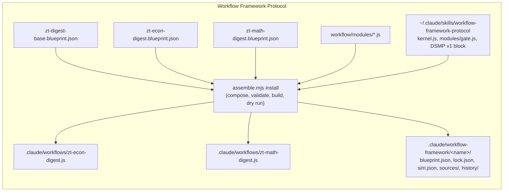
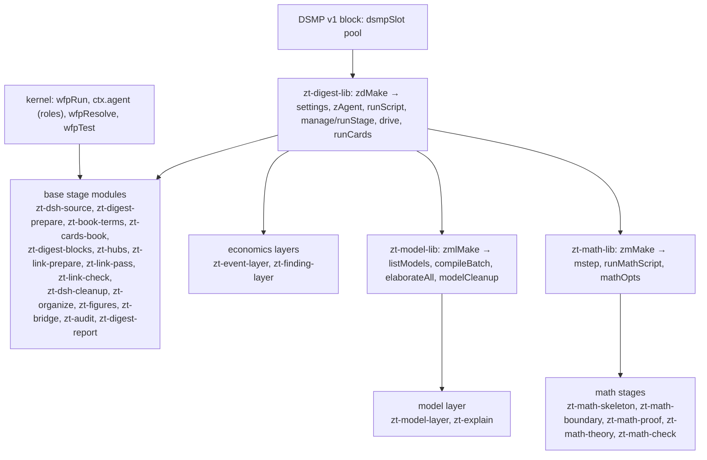

# Digest workflows

## Purpose

The existing real-MCP proxy has two additional lifecycle-only seams: `ZT_HANG_BATCH_BEFORE_WRITE_FLAG` stops before forwarding an actual batch, and `ZT_HANG_BATCH_REPLY_FLAG` stops after the real archive reply. Each writes the actual proxy/writer PIDs and then withholds the response. `hangBatch` refuses flag paths outside a temporary `mcp-lifecycle-test-*` folder. The public lifecycle suite observes timeout and owned-process exit, then retries unchanged operation keys against the actual committed state. These fault switches do not change ordinary or frozen workflow behavior.

The proxy's `ZT_FAIL_BATCH_BEFORE_WRITE` rejects an actual identified write before forwarding it, retaining the compiler's accepted plan without an archive commit. `ZT_RESERVE_BATCH_PARENT` with `ZT_RESERVE_BATCH_FLAG` independently creates one real Side successor before forwarding the planned batch and records its actual result. The group test then verifies that the owned manifest uses committed receipt addresses and excludes the independently reserved Card. These switches are used only by isolated fixtures; ordinary/frozen workflow code is unchanged.

The real-MCP proxy also supports `ZT_REPLACE_PREVIEW_INPUT` and `ZT_PREVIEW_REPLACEMENT_FILE`: after a successful native preview, it copies a fixture replacement over the input file. Both paths must resolve under the temporary directory, including Windows namespace normalization. Group completion must detect that the original checked draft bytes changed before accepting/applying the plan. This exercises a late-output race without launching a provider or modifying frozen workflow stages.

The existing MCP reply seam's `ZT_IDENTITY_FAULT=after_read` preserves the first empty-address identity probe and changes the next one. `ledger-core.tests.ps1` uses it to test archive replacement during preparation verification; the command must refuse before recording a claim. Missing/incomplete identity modes remain available. This seam changes replies in isolated tests and does not alter the archive or frozen workflow.

`ZT_FAIL_EXPORT_TITLES` makes the same proxy refuse the title export for `ledger-group-start.tests.ps1`. Startup must retain open group coverage and publish no accepted job on that failure. The native `group-start` manifest now declares one draft-only job and its archive read/write scope; provider permission enforcement and consumption by frozen stages remain #82 work. Existing frozen workflows have not been rewritten or run by these tests.

`ZT_SLOW_TOOL` with `ZT_SLOW_MS` and `ZT_SLOW_FLAG` makes the proxy wait before forwarding every call of that tool and write the marker flag when the wait starts. `ledger-owner-recovery.tests.ps1` uses it to hold a real `group-start` past a shortened ledger lease, so the command must finish under its own token only because its internal heartbeat renewed the lease. The wait happens in the isolated temp fixture; ordinary and frozen workflow behavior is unchanged.

This block holds the Claude Code Workflow scripts that turn a book from the Scholar Archive into Cards in the agent Workspace: a Literature tree with one anchor per section group, Topic trees, Idea, Event, Finding, and Model Cards, Hub Cards, and a read-only audit. There are two digest workflows: `zt-econ-digest` (economics books) and `zt-math-digest` (mathematics textbooks). Both are built by the Workflow Framework Protocol from one shared base blueprint, a variant blueprint each, and a library of stage modules, and are installed frozen. A workflow script does no Card work itself. It orchestrates agents: Haiku managers relay script commands and drive DeepSeek Harness conversations, one Sonnet architect plans each model batch, and Opus makes the Organize decisions. The scripts do every structural step and DeepSeek writes the text. A script runs as a `zt-digest` tool once it is ported to Rust, else as a PowerShell script. The block exists so that the stage order, the roles and their models, the DeepSeek Subagent Managed Protocol limits, and the failure policy stay fixed and testable while only data moves.

**Owns:** the stage graph and modes of each digest workflow, the args each one takes, the roles and models per stage, the Haiku manager prompts and the DeepSeek job driver (`drive`), the DeepSeek Subagent Managed Protocol limits in code, the base and variant blueprints, the stage modules, the installed scripts with their registry (lock, sim, sources), and the stand-in-runtime harnesses.

**Does not own:** the PowerShell compilers and helpers that the stages run (`prepare-book-digest.ps1`, `card-compiler.ps1`, `model-compiler.ps1`, `math-compiler.ps1`, `hub-compiler.ps1`, `event-compiler.ps1`, `finding-compiler.ps1`, `organize-*.ps1`, `book-skeleton.ps1`, `attach-figures.ps1`, `digest-audit.ps1`, ...): see [Digest scripts](digest-scripts.md). The `zt-digest` binary, its tools (`call`, `audit`, `card`, `model`, `model-context`, `list-models`), and its install: see [zt-digest](zt-digest.md). The DeepSeek and architect instruction files (`dsh-*.zh.md`, `model-architect*.md`, the prefixes): see [Digest prompts](digest-prompts.md). The Card rules the checks apply: see [zt-check](zt-check.md). The Card operations the scripts call through the MCP server: see [MCP server](mcp-server.md) and [Card operations](card-operations.md). Model, unit, and Theory Card semantics: see [Models and math](models-and-math.md). Hub Card semantics: see [Hub Cards](hub-cards.md). Figure artifacts and Document links: see [Scholar bridge](scholar-bridge.md). The skills that describe how to run a digest (`zt-digest-protocol`): see [Agent skills](agent-skills.md).

## At a glance

| | |
|---|---|
| Entry points | `Workflow({ scriptPath: "E:\\zet\\.claude\\workflows\\<name>.js", args: {...} })` for `zt-econ-digest` and `zt-math-digest`; `node ~/.claude/skills/workflow-framework-protocol/tools/assemble.mjs install|verify|simulate ...` to build and install a variant; `node scripts/book-digest/tests/*.mjs` for the harnesses |
| Key files | `.claude/workflows/zt-econ-digest.js` — installed, frozen build of the economics variant (kernel + DSMP block + modules + embedded blueprint) |
| | `.claude/workflows/zt-math-digest.js` — installed, frozen build of the mathematics variant |
| | `scripts/book-digest/workflow/zt-digest-base.blueprint.json` — the base: shared stages, slots, args, roles, base modes, checkpoint |
| | `scripts/book-digest/workflow/zt-econ-digest.blueprint.json` — economics variant: profile, fills `after-digest` with models, explain, events, findings |
| | `scripts/book-digest/workflow/zt-math-digest.blueprint.json` — mathematics variant: profile, fills four slots with the math stages |
| | `scripts/book-digest/workflow/zt-econ-digest.sim.json`, `zt-math-digest.sim.json` — dry-run answers for `assemble.mjs install` |
| | `scripts/book-digest/workflow/modules/` — 30 modules: three libraries (`zt-digest-lib`, `zt-model-lib`, `zt-math-lib`) and 27 stage modules (table in Interfaces) |
| | `.claude/workflow-framework/<name>/` — install registry per variant: `blueprint.json` (composed), `lock.json`, `sim.json`, `sources/`, `history/<version>/` |
| | `scripts/book-digest/tests/framework-harness.mjs` — builds both variants in memory and runs the stand-in runtime checks of each, plus the framework checks |
| | `scripts/book-digest/tests/bridge-workflow-harness.mjs` — builds both variants in memory and checks the Bridge stage |
| Depends on | [Digest scripts](digest-scripts.md) (every PowerShell command a stage runs), [zt-digest](zt-digest.md) (the ported scripts as `zt-digest <tool>`, and the zt helper `zt-digest call`; `zt-digest` must be on PATH), [Digest prompts](digest-prompts.md) (the files the DeepSeek jobs and the architect read), [zt-check](zt-check.md) (the self-checks the managers approve), [MCP server](mcp-server.md) (through the zt helper); external: the Claude Code Workflow runtime (`agent`, `parallel`, `pipeline`, `phase`, `log`, `args`), the DeepSeek Harness MCP bridge (`deepseek_run`, `deepseek_wait`, `deepseek_prompt`, `deepseek_respond`, `deepseek_delete`, `deepseek_list`, `deepseek_remove_workspace`, `deepseek_usage`), the global skills `workflow-framework-protocol` (kernel, `assemble.mjs`, `sim.mjs`, module `gate`) and `deepseek-subagent-managed-protocol` (the inlined DSMP v1 block) |
| Used by | [Agent skills](agent-skills.md) (`skills/zt-digest-protocol/SKILL.md`, `skills/zt-digest-protocol/references/scripts.md`, and `skills/zettelkasten/SKILL.md` name the workflows); the user, who starts a run from a Claude Code session |
| Tests | `scripts/book-digest/tests/framework-harness.mjs`, `scripts/book-digest/tests/bridge-workflow-harness.mjs`; `assemble.mjs verify` |

## Concepts

- `Digest workflow` — a Workflow script that turns one book (or, in modes `hubs` and `audit`, the whole agent Workspace) into Cards. Two exist: `zt-econ-digest` and `zt-math-digest` (`.claude/workflows/`).
- `Mode` — a named subset of stages (`args.mode`, default `full`). `full` runs every stage; the other modes re-run single stages on an existing digest. Declared in each blueprint's `modes`.
- `Section group` — one slice of the book (at most `maxChars` characters, `maxUnits` units) that `prepare-book-digest.ps1` writes as `<out>\groups\gNN.md`; group `n` owns the anchor Card `<key>/<n>` (a Direct successor line under the Literature Card). `groupsOf()` in `zt-digest-lib.js` gives `{ n, nn, file, snapshot, link }` per group.
- `Block` — up to `perManager` (default 5, at most 8) contiguous groups, run by one Haiku manager in book order (`toBlocks()`).
- `Book profile` — `consts.profile` of a variant: the digest instruction files, `noEventCandidates`, `digestPrefix`, `linkPrefix`, `compilerDocs`, `architectSupplement`, `skipForms`. The base leaves it `null`; each variant sets it (`zt-econ-digest.blueprint.json`, `zt-math-digest.blueprint.json`).
- `Base` and `variant` — the base blueprint (`"kind": "base"`) holds every stage all book types share plus four `slot`s (`after-prepare`, `after-digest`, `after-link`, `after-audit`); a variant names the base in `"base"`, sets the profile, and `fill`s the slots with its own layers.
- `Layer` — a book type's own stage set in a slot: the model layer (`models`, `explain`), the event layer (`events`), the empirical-results layer (`findings`), the math stages (`math-skeleton`, `math-boundary`, `math-proof`, `math-theory`, `math-check`).
- `Module` — one `defineModule({ id, version, requires, params, run })` block in `scripts/book-digest/workflow/modules/<id>.js`, framed by `// ==== module <id> v<version> ====` lines. A library module (`library: true`) holds shared functions and is never a stage.
- `Role` — `manager` (Haiku, effort `low`), `architect` (Sonnet), `organizer` (Opus), declared in `zt-digest-base.blueprint.json` `roles`. Modules start agents only through `ctx.agent`, so the role fixes the model and effort.
- `Kernel` — the Workflow Framework Kernel v1 that `assemble.mjs` copies into each installed script (`wfpRun`, `wfpArgs`, `wfpResolve`, `wfpTest`): it checks the fingerprint, deep-freezes the blueprint, args, and outputs, refuses undeclared args and modes, and runs the stage graph.
- `Frozen install` — an installed script whose embedded blueprint matches the `FINGERPRINT` stamped at install; any change makes it refuse to run. Its record is `lock.json` in `.claude/workflow-framework/<name>/`.
- `Checkpoint` — a stage at which `args.until` stops the run; the base declares `digest` (stop before the layers and the link pass).
- `DeepSeek Subagent Managed Protocol (DSMP)` — the run-wide rule: a Haiku manager runs at most 8 DeepSeek conversations, at most 8 managers are alive at once (64 conversations), conversations are deleted and never archived, and a workspace is removed when its work is done. `dsmpSlot` (the inlined DSMP block in each installed script) is the shared pool.
- `Script command` — the command prefix that runs one digest script, from `zdTool(name)` (or `Z.tool(name)`) in `zt-digest-lib.js`: `zt-digest <tool>` for a script listed in `ZD_TOOLS` (since `zt-digest-lib` v6, every digest script), else `pwsh -NoProfile -File "<ZD_SCRIPTS>\<name>.ps1"`. Every stage module builds its commands from it, so a newly ported script needs one entry in `ZD_TOOLS` and no module change.
- `Compiler step` — one script command with `-Step <s> ...` (`zt-digest <tool> -Step <s> ...` or `pwsh -NoProfile -File "<script>.ps1" -Step <s> ...`) whose last output line is compact JSON, often with a `jobs` list for DeepSeek. `drive()` runs it: one Haiku agent runs the command, managers run its jobs, and the returned session ids are recorded for the run-level cleanup, which deletes exactly those ids.
- `Card cycle` — `runCards()`: the card compiler (`zt-digest card`) plan → DeepSeek JSON → apply in shares of `applyShare` jobs → check → up to `cardFixRounds` fix rounds → report (the Card layer rules of the glossary).
- `Model compiler` — `compileBatch()` in `zt-model-lib.js`: DeepSeek brief → Sonnet plan (`plan.json`) → script skeleton and DeepSeek fill → DeepSeek derive → DeepSeek review and script split (up to `reviewRounds`) → script report and cleanup. Concept models skip derive and review.
- `Elaboration level` — `concept` or `formal` on a Model Card; `args.level` forces one level for the run; concept models go in batches of `perConcept`, formal and undecided ones in batches of `perSonnet`.
- `Concept review` — `zt-concepts`: the frozen review of the run's own book term table (`concept-review.json`/`.md` under the staging folder). The proposals are the book's own term rows, so no agent invents a concept; the report step starts no client and writes no Card (S23/#115).\n- `Restatement review` — `zt-review`: the scoped review of the run's own new Cards (`restate-resolution.json` under the staging folder). Its population is the run's staged `owned-g*.txt` manifests, bounded by the tool; a merge verdict the Card cycle recorded stays pending until a rewrite covers it (S23/#115).\n- `Register plan` — `zt-digest register -Step plan` run by the final `hubs` stage after the Bridge report: read-only evidence naming every term entry and its targets. It is published only for the exact accepted plan id in `args.registerPlan` (report-first, S23-AC07).\n- `Staging folder` — `args.out`: every file the run writes besides the Cards (see Data and storage).

## Architecture

### How a digest script is made



`assemble.mjs` loads the variant blueprint, composes it with its base (`composedFrom` in the registry `blueprint.json`), loads the framework module library and the blueprint's `"modules": ["./modules"]` folder, and writes one self-contained script: `meta` (built from the blueprint's description, whenToUse, and stage titles), the kernel, the DSMP v1 block, every module the blueprint uses, `const BLUEPRINT = {...}` (with `installed.modules`: id → version), `const FINGERPRINT = '...'`, and `return await wfpRun(BLUEPRINT, FINGERPRINT)`. The kernel, DSMP block, and module texts in both installed scripts are byte-identical to their sources.

### Module layers



Every stage module calls `zdMake(ctx, params)` (directly or through `zmlMake` / `zmMake`) and gets the settings and helpers back; it never keeps state between stages. Data moves between stages only through stage outputs that later stages read with `{{stages.<id>.output...}}` or `{"$ref": ...}` templates in their params.

### Control inside one compiler step (`drive`)

1. `driveAgent(label, o, 'command')`: one Haiku agent runs `o.command` once (timeout 600000) and returns its last line whole in `output`.
2. `zdLastJson(output)` parses the last JSON line; `expandJobs()` turns it into `{ id, files, prompt, continue?, fallback? }` jobs (a compact list from `zt-digest card ... -Compact` gives `dir`, `lead`, `prompts` once and `{ id, kind, file, continue? }` per job).
3. The jobs split into shares of `dshPerBatch` (8); up to `dshManagers` (8) lanes take shares in turn; each share is one Haiku manager (`driveAgent(..., 'jobs')`) inside `dsmpSlot`, which keeps every manager of the run under the 8-manager cap. A manager starts jobs with `deepseek_run` (or continues a session with `deepseek_prompt` when the job names `continue` and the step's session table holds it), keeps at most 8 running, approves only the listed read-only checks, reads, and writes under `o.writes`, retries once with a resume prompt, and does not delete conversations.
4. A job a manager did not report becomes `{ status: 'failed' }`.
5. The step's returned session ids are recorded at once with `ledger resource -Register`, against the unit that owns the work (`o.unit`, or `run` for a stage-wide chain), together with each accepted answer. Nothing is deleted here: the run-level `cleanup` stage deletes exactly the recorded ids after the owning work settled (R322/R323).

## Interfaces

### Workflows and their stages

#### zt-econ-digest (v5.0.0) and zt-math-digest (v4.0.0) on base v4.0.0: the composed readiness graph

The stage ids, modules, and `after` edges come from the registry `blueprint.json` of each variant; titles are the progress phases. The graph declares **readiness** (which stage may start when), not a mutable runtime schedule: the run ledger inside `zt-digest` decides which unit is actually ready, and each layer's driver claims only ready units (R244/R252).

The edge set is the dependency flow of the parent design's §13.1 placed on the existing stages, not a reordered blueprint (#115, S23): the book term table and the **frozen concept review of that table** precede the first group writer; the per-group Card checks and the whole-book Card cycle come next; the **scoped restatement review** of the run's own new Cards sits inside that Card cycle; the gap-only Link pass follows it; then Organize, Figures, the report-first **Bridge**, and the **hub publication with the register plan that now follows it**; the finite finalization and its read-only audit stay last. The variant's own model/math prerequisites keep their existing slots.

| Stage | Title | Module | After | Runs when (beyond its mode list) | On failure |
|---|---|---|---|---|---|
| `args` | Prepare | `gate` (framework) | — | always; checks `citationKey` (unless mode `hubs`/`audit`/`resume`), refuses every routing argument in mode `resume` (only `out`), and in mode `full` either `book` or `source`, `bibtex` and `bookTitle`; the kernel bounds `maxAttempts` 1–10 and `dshRunCap` 60–3600 | halt |
| `source` | Prepare | `zt-dsh-source` | args | not in modes `figures`, `audit`; not in mode `bridge` with a selection | halt |
| `prepare` | Prepare | `zt-digest-prepare` | source | mode `full` runs the script with `-Variant -MaxAttempts -DshRunCap -RunOptions -Apply`; mode `resume` runs the one `zt-digest ledger resume` and reads the retained groups, settings and Citation key from the ledger; other modes take `args.groups` | halt |
| `math-skeleton` (math) | Prepare | `zt-math-skeleton` | prepare | mode `full` | halt |
| `terms` | Prepare | `zt-book-terms` | prepare (econ), math-skeleton (math) | `args.terms != false`; claims `terms/book@1` and completes it through the claimed Terms apply | continue |
| `concepts` | Prepare | `zt-concepts` | terms | modes `full`, `resume` and `args.terms != false`: `zt-digest concepts propose` derives the proposals from the run's own `terms.md` (one concept per term row), `prepare` freezes the bounded candidate evidence, one DeepSeek judge answers it, `judge` validates that answer and `report` renders the immutable `concept-review.json`/`.md`. It writes no Card; a run without a term row is `skipped` with its reason | continue |
| `events` (econ) | Events | `zt-event-layer` | terms | `args.events != false`; claims ready `events/gNNN@1` units and waits for digest readiness | halt |
| `findings` (econ) | Findings | `zt-finding-layer` | terms | `args.findings != false`; claims ready `findings/gNNN@1` units and waits for digest readiness | halt |
| `digest` | Digest | `zt-group-cycle` (a per-group `foreach` chain) | concepts | mode `full`; one chain per group item, claiming `digest/gNNN@1`, starting it, running the frozen job and recording `group-finish` | halt |
| `cards` | Cards | `zt-cards-layer` | digest | always in a managed run (Card quality is required work); claims `cards/gNNN@1` and records `cards-finish` | halt |
| `models` | Models | `zt-model-layer` | cards | (`full` and `args.models != false`), mode `models`, or mode `resume`; claims `models/gNNN-mIIII@1` and records `model-finish` | halt |
| `explain` | Models | `zt-explain` | models | mode `explain`, or (`full`/`resume` and `args.models != false`); claims `explain/<key>@1` and records `explain-finish` | halt |
| `math-boundary` (math) | Boundary | `zt-math-boundary` | models | mode `full` or `math`, `args.boundary != false` | halt |
| `math-proof` (math) | Proof | `zt-math-proof` | math-boundary | mode `full` or `math`, `args.proof != false` | halt |
| `cards-book` | Cards | `zt-cards-book` | explain (econ), explain (math, after the proof layer) | mode `cards`, or (`full`/`resume` and `args.cardChecks != false`): publishes the present `cards-book` revision, claims it and records `book-cards-finish`; its coverage gate waits for the Model reviews (R248) | halt |
| `review` | Cards | `zt-review` | cards-book | modes `full`, `resume`: `zt-digest restate prepare` reads the run's own staged `owned-g*.txt` manifests (no separate collector), freezes the bounded pair evidence, runs its one judge job, applies each accepted rewrite under the run's own operation prefix and renders the report. The Card cycle's recorded merge verdicts are handed over as `-Merges`, so a merge no rewrite covers stays `pending-existing-card-change`. A run whose listed Cards hold no reviewable claim is `skipped` with its reason | continue |
| `hubs-first` | Hubs | `zt-hubs` | explain (econ), explain (math) | mode `hubs` | halt |
| `link-prepare` | Link | `zt-link-prepare` | events, findings, review, hubs-first | modes `full`, `link` | halt |
| `link` | Link | `zt-link-pass` | link-prepare | modes `full`, `link`; one chain per scheduled or gap-free group fills only the frozen gap set through `link-start`/`link-finish`; a group whose digest unit is not `done` is blocked and named, and a group with no semantic gap runs no provider job | halt |
| `link-check` | Cards | `zt-link-check` | link | `args.cardChecks != false` | halt |
| `math-theory` (math) | Theory | `zt-math-theory` | link-check | mode `full` or `math`, `args.theory != false` | halt |
| `organize` | Organize | `zt-organize` | link-check (econ), math-theory (math) | mode `full`, `resume`, `models`, `explain`, `events` or `findings`, or `args.organize` matches `^(true\|legacy)$` | continue |
| `figures` | Figures | `zt-figures` | organize | mode `figures`, or `args.figures != false` | halt |
| `bridge` | Bridge | `zt-bridge` (`profile.bridgeProfile`) | figures | mode `bridge`, or (`full` and `args.bridge != false`); expects `status != failed`. Report-only: it freezes its endpoint snapshots from the final Card text before the hub and register plan reads them | continue |
| `hubs` | Hubs | `zt-hubs` | bridge | (a draining mode — `full`, `resume`, `models`, `explain`, `events`, `findings` — and `args.hubs != false`) or (`link` and `args.hubs` true): the hub publication, then the concept-register plan. The plan always runs and is reported; it is published only for the exact accepted plan id in `args.registerPlan`, and then checked by reading every page back | halt (the hub half); the register half is reported `planned`/`pending` |
| `audit` | Audit | `zt-audit` | hubs, bridge | mode `audit`, or `args.audit != false`; the final audit **joins** the Hubs branch and the Bridge branch | halt |
| `finalize` | Finalize | `zt-finalize` | audit | (`full` or `resume`) and `args.finalize != false`: the finite audit-plan → one scoped correction cycle → publication refresh → final read-only audit (#86, R299/R300) | continue (a residual fault is a `partial` result) |
| `math-check` (math) | Audit | `zt-math-check` | finalize | mode `math`, or (`args.audit != false` and `citationKey` set); it therefore describes the **final** audit revision | halt |
| `cleanup` | Cleanup | `zt-dsh-cleanup` | finalize (econ), math-check (math) | after the joined audit, as part of the settlement: it settles the owned conversations and renders the run report | continue |
| `report` | Report | `zt-digest-report` | cleanup | always; carries the effective settings, the schedule summary, the verified `run_report`, `link_blocked`, `link_gaps`, and the `concepts`, `review` and `register` facts of the integrated path | halt |

"halt" is the kernel default (`onFail` missing). Most modules log and return `{ status: 'failed', ... }` instead of throwing, so their stage still ends `done`; only a thrown error fails a stage. The modules that throw: `zt-dsh-source` (no source answered), `zt-digest-prepare` (prepare failed, no resumable ledger or no retained groups in mode `resume`, or no groups in modes `full`/`link`), `zt-link-prepare` (script failed), `zt-math-skeleton` (index, docs, or skeleton failed), `zt-model-layer` (listing failed, only in mode `models`), and `gate`.

#### Modes

| Mode | zt-econ-digest | zt-math-digest | Stages it runs | Needs |
|---|---|---|---|---|
| `full` | yes | yes | all | `out`, `citationKey`, and `book` or `source`+`bibtex`+`bookTitle` |
| `link` | yes | yes | args, source, prepare, link-prepare, link, link-check, organize, figures, hubs, cleanup, report | `groups` |
| `cards` | yes | yes | args, source, prepare, cards-book, report | `citationKey`, `out` |
| `hubs` | yes | yes | args, source, prepare, hubs-first, organize, hubs, cleanup, report | `out` only |
| `figures` | yes | yes | args, figures, report | `citationKey`, `out` |
| `audit` | yes | yes | args, audit, cleanup, report | `out` (`citationKey` optional: one book, else every book) |
| `models` | yes | yes | args, source, prepare, models, explain, link-prepare, link, link-check, organize, hubs, audit, cleanup, report | `citationKey`, `out` |
| `explain` | yes | yes | args, source, prepare, explain, link-prepare, link, link-check, organize, hubs, audit, cleanup, report | `citationKey`, `out` (the retained `explain/` units) |
| `bridge` | yes | yes | args, source (skipped when it applies), bridge, report | `citationKey`, `out`; to apply also `bridgeReport` and `bridgeApply` or `bridgeApplyEarlier` |
| `events` | yes | no | args, source, prepare, events, link-prepare, link, link-check, organize, hubs, audit, cleanup, report | `citationKey`, `out` |
| `findings` | yes | no | args, source, prepare, findings, link-prepare, link, link-check, organize, hubs, audit, cleanup, report | `citationKey`, `out` |
| `math` | no | yes | args, source, prepare, math-skeleton, models, math-boundary, math-proof, math-theory, math-check, report | `citationKey`, `out` |
| `resume` | yes | yes | args, prepare, terms, concepts, digest, cards, the book type's layers, cards-book, review, link-prepare, link, link-check, the math tail, organize, figures, bridge, hubs, audit, finalize, the math check, cleanup, report | `out` only: the retained identity, source choices, Citation key, enabled layers, versions and settings come from the ledger |

The repair modes (`models`, `explain`, `events`, `findings`) drain the closure their own layer released — the changed-Card Link pass and check, Organize, the touched hubs and the audit — instead of rebuilding unrelated groups or models (R286). Mode `resume` accepts only `out`, spends the one supported resume through `zt-digest ledger resume`, and drains the whole unresolved closure (R274–R285); its concept and restatement reviews re-freeze from the retained run's own term table and owned-Card manifests, and replay the same operation receipts, so nothing is reviewed twice or lost.

A stage outside the mode passes through with status `not-in-mode` once every stage it waits for has ended, so the order holds. `args.until: "digest"` stops the run after the `digest` stage.

### Roles and models per stage

| Work | Agent | Model | Where |
|---|---|---|---|
| Source probe, prepare, every script relay, list models, cleanups | one agent per command | Haiku (`manager`, effort `low`) | `zdMake().runScript`, `zt-dsh-source`, `zt-digest-prepare`, `zt-link-prepare`, `zt-dsh-cleanup`, `zmlMake().listModels`, `zmMake().runMathScript` |
| Digest and link runs | one manager per block (digest: runs in order; link: all at once) | Haiku | `manage()` in `zt-digest-lib.js` |
| Compiler step jobs (cards, terms, models, hubs, events, findings, explain, skeleton, math) | step agent + one manager per 8 jobs | Haiku | `drive()` |
| Hub limits | hub manager | Haiku | `zt-hubs.js` |
| Model plan (`plan.json`) | one architect per batch | Sonnet (`architect`, model default effort) | `compileBatch()` in `zt-model-lib.js` |
| Organize decisions (`decisions.json`), or the legacy single job | one agent | Opus (`organizer`) | `zt-organize.js` |
| All reading and writing of Card text | DeepSeek Harness conversations | DeepSeek V4.1 Flash, effort `high` or `max` | started by the Haiku managers |

`zAgent` in `zt-digest-lib.js` maps `model: 'sonnet'` to role `architect`, `'opus'` to `organizer`, and everything else to `manager`; it drops any `effort` a caller passes.

DeepSeek skills sent in the `skills` field: digest and link runs `['zettelkasten', 'asd-ste100-zh']`; fill, derive, split, card, term, hub, event, finding, skeleton, explain, and math jobs `['asd-ste100-zh']`; brief and review jobs none.

### The args object

Pass an object, never free text. `wfpArgs` refuses any key not declared (besides `mode` and `until`), checks types, enums, and `min`/`max`, and throws when `out` is missing.

Base args (both workflows):

| Arg | Type | Default (from code) | Meaning |
|---|---|---|---|
| `out` | string, required | — | the staging folder |
| `maxAttempts` | number 1–10 | 3 | the per-unit attempt budget of the managed run; persisted at preparation and reused by a resume (R273) |
| `dshRunCap` | number 60–3600 | 1200 | the seconds one external DeepSeek run may live; persisted at preparation and reused by a resume (R267/R273) |
| `citationKey` | string | — | the book's BibTeX key (all modes but `hubs`, `audit`) |
| `source`, `bibtex`, `bookTitle` | string | — | the bilingual Markdown, the BibTeX entry, the title (mode `full`) |
| `book` | any | — | a Scholar Archive Work id or exact title: mode `full` resolves the Work, its Chinese/bilingual Markdown, the BibTeX and the heading range through the read-only bridge, and the three explicit arguments are left out (base 2.4.0) |
| `fileId` | any | read from the source path | the Scholar Archive file id of the book Markdown |
| `startHeading`, `endHeading`, `skipHeadings` | string | none | where the text starts and stops; headings whose units are left out (`参考文献,习题`) |
| `groups` | number | — | the existing group count (modes `link`, `models`) |
| `organize` | any | false | `true`: Organize after modes `link`, `models`, `hubs`; `"legacy"`: the old single Opus job |
| `perManager` | number ≥ 1 | 5, capped at 8 | groups per digest manager |
| `maxChars`, `maxUnits` | number | 20000, 3 | group size for `prepare-book-digest.ps1` |
| `dshSource` | `auto` \| `official` \| `opencode` | `auto` | where DeepSeek V4.1 Flash runs |
| `dshModel` | string | — | any DeepSeek Harness model; overrides `dshSource` |
| `dshEffort` | string | `high` | every DeepSeek job without its own effort arg (digest, link, fill, card, term, event, finding, skeleton, explain, math); raised to `high` unless `high`/`max` |
| `models` | boolean | true | false skips the model stage |
| `rebuild` (`redoModels`) | boolean | false | rebuild models that already have parts |
| `perSonnet`, `perConcept` | number ≥ 1 | 6, 10 | formal and concept models per architect batch |
| `dshPerBatch` (`dshPerSonnet`) | number ≥ 1 | 8, capped at 8 | jobs per Haiku manager |
| `dshManagers` | number ≥ 1 | 8, capped at 8 | managers of one compiler step in parallel |
| `linkPerManager` | number ≥ 1 | 8, at least `perManager`, at most 8 | link runs per link manager |
| `applyShare` | number ≥ 1 | 30 | jobs per card-cycle apply call |
| `only` | array | all | Model Card addresses (modes `models`, `explain`; a pilot) |
| `level` | `concept` \| `formal` | each model's own | force one elaboration level |
| `briefEffort`, `deriveEffort`, `reviewEffort` | string | `high` | DeepSeek effort per compiler round (raised to `high`) |
| `reviewRounds` | number ≥ 0 | 2 | review, split, review again; 0 skips |
| `maxSentences`, `maxPartChars`, `maxSteps` | number | 12, 400, 6 | Card size of a formal model part (`-MaxSentences`, `-MaxChars`, `-MaxSteps`) |
| `maxExplainSentences`, `maxExplainChars` | number | 16, 600 | explanation budget of a Derivation part |
| `hubs` | boolean | true in `full`, false in `link` | run the hub stage |
| `hubWork` | string | `D:\zt-digest\hubs` | hub folder and DeepSeek workspace |
| `hubLimits` | object | — | overrides the hub manager's limits |
| `hubTrees`, `hubRebuild` | string, boolean | all, false | a pilot on these Topic trees; rewrite every hub |
| `hubEffort`, `hubFixRounds` | string, number ≥ 0 | `high`, 1 | hub writer effort; check-fix-apply rounds |
| `terms`, `audit`, `figures` | boolean | true | false skips that stage in mode `full` |
| `cardChecks` | boolean | true | false skips the whole-book card cycle in mode `full` and the link-check cycle in mode `link` |
| `ideaSample` | number 0–1 | 0.1 in `full` and `cards`, else 0 | share of fault-free Idea Cards reviewed against the source (the deterministic, group-covered sample of R297) |
| `cardRules` | string | all hard rules | the rules the card cycle fixes (`-Rules`) |
| `cardFixRounds` | number ≥ 0 | 1 | card check-fix-apply rounds |
| `cardMax` | number ≥ 1 | — | pilot cap on Cards with faults and orphans (`-MaxCards`) |
| `explainMax` | number ≥ 1 | — | pilot cap on Derivation parts in mode `explain` (`-MaxParts`) |
| `bridge` | boolean | true | false skips the Bridge stage in mode `full` |
| `bridgeMax` | whole number 1–120 | 60 | the most source Cards of the book the plan takes (`-MaxSources`) |
| `bridgeCandidates` | whole number 1–8 | 5 | candidates per source Card, plus at most two term matches (`-Candidates`) |
| `bridgeBooks` | string | all other books | comma-separated Citation keys of the target books (`-Books`) |
| `bridgeReport` | string | — | mode `bridge`: the `report_id` to apply from (`-ReportId`) |
| `bridgeApply` | `"all"` or array of ids | — | mode `bridge`: the new-carrier proposals to apply (`-Accept`) |
| `bridgeApplyEarlier` | `"all"` or array of ids | — | mode `bridge`: the earlier-carrier proposals to apply, a separate selection (`-AcceptEarlier`) |

`zt-econ-digest` adds `events` and `findings` (boolean; false skips that layer).

`zt-math-digest` adds:

| Arg | Type | Default | Meaning |
|---|---|---|---|
| `supply` | `none` \| `examples` \| `examples+answers` | `examples` | what DeepSeek may add that the book does not give (`-Supply`) |
| `unitsPerJob` | number ≥ 1 | 4 | units per boundary or proof job |
| `mainResults` | number ≥ 1 | 7 | main results per Theory Card |
| `coreBudget` | number ≥ 1 | 3 | declared, but no module passes it on (see pitfalls) |
| `notation`, `boundary`, `proof`, `theory` | boolean | true | false skips that math stage |

Control args: `mode` (see Modes) and `until` (value `digest`).

### Results

Both scripts return the kernel report `{ workflow, version, fingerprint, mode, order, halted, stoppedAt, stages: { <id>: { status, error? } }, result, deepseek }`. `result` is the `report` stage's output, which `zt-digest-report.js` shapes per mode: in mode `full` `{ mode, dsh_model, book, citation_key, groups, managers_per_pass, digest, models, model_cleanup, link, terms, cards: { blocks, link }, deepseek_usage, cleanup, organize, figures, bridge, hubs, audit }`, where `bridge` is the compiler summary, `{ status: 'failed', error }`, or `{ status: 'skipped' }`; in a single-stage mode `{ mode, ..., <stage>: report }`; the variant's `extra` adds `events` and `findings` (econ) or `math: { index, docs, skeleton, notation, boundary, proof, theory, check }` (math). In modes `events`, `findings`, and `math` it returns `{ mode, dsh_model, citation_key, ...extra }`. After a halt `report` never ran, so `result` is undefined and `halted` names the stage and error. `deepseek` is the DSMP block's `dsmpLog`, which the digest modules do not feed (they use `drive`, not `dsDispatch`).

### Modules

Library modules (no stage; their top-level names carry a prefix because all modules share one script):

| Module | Version | Requires | Exports |
|---|---|---|---|
| `zt-digest-lib` | 13 | `@dsmp` | constants `ZD_SCRIPTS`, `ZD_DIGEST` (`'zt-digest'`), `ZD_TOOLS` (script name → tool: `digest-audit` → `audit`, `card-compiler` → `card`, `model-compiler` → `model`, `model-context`, `list-models`, `hub-compiler` → `hub`, `bridge-compiler` → `bridge`, `math-compiler` → `math`, `event-compiler` → `event`, `finding-compiler` → `finding`, `book-terms` → `terms`, `book-skeleton` → `skeleton`, `organize-survey`, `organize-apply`, `attach-figures` → `figures`, `prepare-book-digest` → `prepare`, `prepare-link-pass` → `prepare-link`, `snapshot-topics`), `ZD_CALL` (`'zt-digest call'`), `ZD_DSH_SOURCES`, `ZD_PER_MANAGER_MAX` (8), `ZD_MAX_MANAGERS` (8), `ZD_USAGE`, `ZD_USAGE_STEP`, `ZD_RUN_SCHEMA`; `zdTool(name, scripts = ZD_SCRIPTS)` (the script command), `ZD_COMMAND_TIMEOUT_MS` (600000), `ZD_EDIT_PATIENCE` (180), `zdJsonIn(line)`, `zdLastJson(text)`, `zdDefaultModel(A)`; `zdMake(ctx, p)` returning the settings (`A, MODE, KEY, OUT, SCRIPTS, DSH_MODEL, DSH_EFFORT, MODELS, CARD_CHECKS, IDEA_SAMPLE, LIMITS, COMPILER, FILL_SKILLS, HUB_*, PER_MANAGER, LINK_PER_MANAGER, MAX_ATTEMPTS, DSH_RUN_CAP, CLAIM_LEASE, RUNNER, LEDGER, DIGEST, CALL, DSH_SKILLS, raised, profile, ARCH_DOC, ARCH_SUPPLEMENT, MODEL_WORK, PER_SONNET, PER_CONCEPT, DSH_PER_BATCH, REBUILD, LEVEL, *_EFFORT, REVIEW_ROUNDS, COMPILER_DOCS, SKIP_FORMS`) and helpers `zAgent, runScript, groupsOf, toBlocks, runStage, drive, expandJobs, answerLines, chain, stepOf, jsonOf, resultLine, claim, gate, renew, failUnit, jobOf, finishOf, finishOrFault, drain, layer, psQuote, tool, cleanupDsh, runCards`. `tool: name => zdTool(name, SCRIPTS)`. `COMPILER` (`zt-digest model`), `HUB_COMPILER` (`zt-digest hub`), and the internal `CARD_COMPILER` (`zt-digest card`) are command prefixes from `zdTool`, not paths |
| `zt-model-lib` | 3 | `zt-digest-lib` | `zmlMake(ctx, p)` → `{ Z, listModels(selector, label), elaborateAll(models, label), logModels(reports), modelCleanup(), dshJobs() }`; internal `compileBatch(batch, kind)` |
| `zt-math-lib` | 2 | `zt-digest-lib` | `zmMake(ctx, p)` → `{ Z, A, MATH_WORK, SUPPLY, UNITS_PER_JOB, MAIN_RESULTS, mstep(step, more), runMathScript(what, step, extra, phase), mathOpts(stage, phase) }`; `MATH_COMPILER` is `Z.tool('math-compiler')` |

Stage modules. Every one takes `args` (`{{args}}`, required) and `mode` (`{{mode}}`, required); most also take `model` (`stages.source.output.model`).

| Module | Ver | Other params | Runs | Output |
|---|---|---|---|---|
| `zt-dsh-source` | 1 | — | with `dshSource: auto`, a Haiku probe in `<out>\dsh-probe` asks the official source, then OpenCode Go, for `ok`; throws when neither answers; logs efforts raised to high | `{ source, model, errors? }` |
| `zt-digest-prepare` | 7 | `needGroups` (`['full','link']`), `profile`, `instructions`, `noEventCandidates` | mode `full`: `prepare-book-digest.ps1 ... -Instructions '<files>' [-NoEventCandidates] -Apply`; mode `resume` runs the one `zt-digest ledger resume` and reads the retained groups, settings and Citation key from the ledger (#87) | `{ groups, groupList, citation_key }`, plus `resume`, `settings` and `resumed` in mode `resume` |
| `zt-book-terms` | 3 | — | claims `terms/book@1` and runs the claimed Term table (`book-terms -Step plan -Token`, the one job, `-Step apply -Token -Apply`), which completes the unit with its checked evidence; a failure leaves the digest groups waiting on it | `{ status, unit, report }` |
| `zt-concepts` | 1 | — | `zt-digest concepts -Step propose -Staging <out> -Work <out>\review\concepts` (the proposals come from the run's own `terms.md`, so no agent writes one), then one manager chain: `-Step prepare` (the frozen evidence and its one job), `-Step judge -File <work>\out\cj-01.json` (optional: a refused answer leaves pairs unjudged) and `-Step report` (renders both files from the frozen evidence alone and starts no client). It writes no Card; a run with no term row returns `skipped` with the tool's reason (S23/#115) | `{ status, proposals, term_rows, evidence, judged, review, report_path }` |
| `zt-review` | 1 | `cardsBook` | one manager chain over the run's own new Cards: `zt-digest restate -Step prepare -Staging <out> -Work <out>\review\restate` (the staged `owned-g*.txt` manifests are the population; the tool narrows and bounds it and reports its omissions), `-Step judge -File …` (optional), `-Step apply -OperationPrefix "<citation-key>/review/restate" [-Merges <out>\cards\decisions.json]` (optional: a stale or changed endpoint is refused, never applied) and `-Step report` (the frozen files alone). A population with no reviewable claim is `skipped` with the tool's reason (S23/#115) | `{ status, evidence, judged, applied, resolution, resolution_path }` |
| `zt-cards-book` | 3 | — | publishes the present `cards-book` revision (`ledger publish -Layer cards-book`), claims it, runs `runCards('whole book', <out>\cards, [-Sample])` with orphans and records it through `book-cards-finish`; `-ModelReview` in mode `cards` or when `args.models` is false (R247) | `{ status, cycle, unit, completion }` |
| `zt-group-cycle` | 3 | `profile`, `group` | one manager chain per group item: claim one `digest/gNNN@1` with a lease covering the frozen run cap (`-Lease dshRunCap+300`), `group-start` (snapshot before the job manifest), run the one frozen DeepSeek job, `group-finish -Draft`; a failed unit is recorded against its own attempt and claimed again within `maxAttempts`; a group whose accepted plan already committed starts **no** DeepSeek job (`expected_jobs: 0` with the rebound draft) and is completed from its receipts (#87, R280) | `{ status, group, unit, disposition, owned, recovered }` |
| `zt-cards-layer` | 1 | — | claims `cards/gNNN@1` in bounded blocks and records each through `cards-finish`; the layer gate decides complete/partial/active | `{ status, dispositions, gate }` |
| `zt-model-layer` | 2 | `profile` | claims ready `models/gNNN-mIIII@1` blocks, builds them with the existing model chain (`list-models`, `elaborateAll`) and records each through `model-finish`, then the late cleanup and the gate | `{ status, dispositions, gate, model_cleanup }` |
| `zt-explain` | 4 | — | claims ready `explain/<key>@1` units and runs the explanation chain for them (`model -Step explain`, `explain-apply` twice, `explain-report`), recording each through `explain-finish` | `{ status, dispositions, gate }` |
| `zt-event-layer` | 3 | — | claims ready `events/gNNN@1` units (with the bounded readiness wait) and runs `zt-digest event -Step plan` → the jobs it prints → `apply -Apply` → `report` (cleanup) for each block, recording each group through `events-finish`; the digest layer's settled enumeration ends the wait | `{ status, dispositions, gate }` |
| `zt-finding-layer` | 3 | — | the same ready-work driver for the empirical-results layer, recording each group through `findings-finish` | `{ status, dispositions, gate }` |
| `zt-math-skeleton` | 1 | — | `math-compiler.ps1 -Step index`, `docs`, `skeleton -Apply` (throws on a failure); then `notation` and `notation-apply -Apply` unless `notation: false` | `{ index, docs, skeleton, notation? }` |
| `zt-math-boundary` | 1 | — | `boundary -UnitsPerJob -Supply` → `boundary-apply -Supply` → `boundary-settle` (cleanup) | `{ status, plan, applied, settled }` |
| `zt-math-proof` | 1 | — | `proof -UnitsPerJob` → `proof-apply` (cleanup) | `{ status, units, applied }` |
| `zt-math-theory` | 1 | — | `theory -MainResults` → `theory-apply -MainResults` (cleanup) | `{ status, theories, applied }` |
| `zt-math-check` | 1 | — | `math-compiler.ps1 -Step check -Out <out>` (read-only) | the script's JSON, or `{ status: 'failed' }` |
| `zt-hubs` | 3 | `register` (`false`; `true` in the final `hubs` stage), `conceptReview` (`stages.concepts.output`) | Haiku hub manager (`hub-compiler.ps1 -Step survey`, limits by fixed rules), then `plan -Limits '<json>' [-Trees] [-Rebuild]`, `apply`, `check` + fix rounds, `report` (cleanup), workspace `hubWork`. With `register`: `zt-digest register -Step plan -Work <out>\register [-Review <out>\concept-review.json]` (read-only, always reported), then `-Step apply` and `-Step check` only when `args.registerPlan` equals the staged plan id; a failed apply leaves the accepted plan staged and the stage reports `planned`/`pending`, never a clean publication (S23-AC07) | `{ status, limits, reasons, trees, applied, report, register }` |
| `zt-link-prepare` | 5 | `groups` | `prepare-link-pass.ps1 -Staging <out>`; throws on failure. It returns the pending groups (semantic gaps), the gap-free groups (their Link unit still settles, without a provider run), the blocked groups (digest not done) and the per-group gap counts; no stage reads the account-wide usage ledger (R344) | `{ pending, no_gap, blocked, gaps, gap_total, skipped_total, scheduled, skipped, owned_total, unowned, digest_state }` |
| `zt-link-pass` | 4 | `profile`, `groups`, `pending`, `noGap`, `gaps`, `blocked` | one chain per group: claim `link/gNNN@1` → `link-start` (the frozen gap scope and the one job) → the job → `link-finish`; a gap-free group's start declares `expected_jobs: 0` and the empty checked draft settles the unit with no provider run; a content failure is recorded against its own unit, a transient one retried | `{ groups, blocked, scheduled, skipped, gap, skipped_cards, linked, linked_from, already_linked, no_link, provider_runs, quality, verified, failed }` |
| `zt-link-check` | 1 | — | `runCards('link check', <out>\cards-link)`: all hard rules in mode `full`, else `cardRules` or `L1,L2` | the card cycle report |
| `zt-dsh-cleanup` | 3 | — | reads the run's recorded resources (`ledger resource -List`), asks one Haiku agent to delete exactly those conversation ids (an unknown member is reported, never removed wholesale), records every provider fact with `ledger resource -Observe` and settles each cleanup unit with `cleanup-finish`, then renders the verified run report with `zt-digest ledger report` | `{ cleanup, usage, report }` (`cleanup` carries `content_complete` apart from `cleanup_complete`; `usage` is the report's exact per-run usage and `report` its identity, completeness, counts, gaps, placeholders, timing, resume and Bridge facts) |
| `zt-organize` | 2 | `groups`, `digest`, `link`, `models`, `modelsBook` | survey → Opus `decisions.json` → `organize-apply.ps1` → notes card cycle → `book-skeleton.ps1` plan/apply; or the legacy Opus job | `{ survey, decisions, applied, notes, skeleton }` (legacy: the Opus report text) |
| `zt-figures` | 2 | — | `attach-figures.ps1 -CitationKey -Staging [-FileId] -Report <out>\figures-report.json -Apply` | `{ status, ...summary }` |
| `zt-bridge` | 5 | `profile` (`book` or `math`) | `bridge-compiler.ps1` `plan` → read-only judge jobs → `report` (only when every job answered); cleanup in `finally`; with a selection only `apply -Apply`; workspace `<out>\bridge` | the compiler summary (`report_id`, counts, `outcome_counts`, the report path), or `{ status: 'failed', error }` |
| `zt-audit` | 2 | — | `zt-digest audit [-CitationKey] -Out <out>` (read-only) | `{ status, ...summary }` |
| `zt-finalize` | 1 | — | `zt-digest finalize -Step plan` → (`card -Step … -Cards <plan>` once) → `-Step scope` → `-Step refresh -Layer link-check` → `-Step final`; a `fix` branch runs the one cycle, every other branch goes straight to the final audit | `{ status, branch, plan, cycle, scope, refreshed, final }` |
| `zt-digest-report` | 12 | `groups`, `digest`, `models`, `terms`, `concepts`, `review`, `cardsBook`, `explain`, `hubsFirst`, `link`, `linkCheck`, `linkBlocked`, `cleanup`, `organize`, `figures`, `bridge`, `hubs`, `audit`, `finalize`, `extra` | no agent; assembles the result per mode and preserves Bridge failure; `link_blocked` names the groups whose digest unit is not done (#92); `concepts`, `review` and `register` carry the integrated path's reviews, their report ids and their pending/omitted counts | the run's result, with `finalize`, `concepts`, `review` and `register` |

`gate` v1 comes from `~/.claude/skills/workflow-framework-protocol/modules/gate.js`: params `subject`, `checks`; it throws `gate: <message>` on the first failed check.

### Tools per workflow

The tools each framework workflow uses, by the module that uses them. "Compiler step" means `drive()`: a Haiku agent runs the step's command, Haiku managers run its DeepSeek jobs, and the step's returned session ids are recorded for the run-level cleanup, which deletes exactly those ids (see Control inside one compiler step). Every digest script is listed in `ZD_TOOLS` and runs as its `zt-digest` tool (see [zt-digest](zt-digest.md)); what each step does is in [Digest scripts](digest-scripts.md). No stage starts a pwsh. Because every stage command is a `zt-digest` tool, every stage and every retry resolves the archive service before its work (`zt::start`, at most 120 seconds for the configured restart path, one restart and one infrastructure fault when it stays down); the harness checks that no stage bypasses that tool, so the stage health check needs no separate workflow command (R320).

Tools that every workflow uses through `zt-digest-lib`:

- Agents through `ctx.agent`: Haiku (`manager`) for every command runner and DeepSeek manager, Sonnet (`architect`) for the model plans, Opus (`organizer`) for Organize.
- DeepSeek Harness MCP tools (each manager loads them with one ToolSearch call): `deepseek_run`, `deepseek_wait`, `deepseek_respond`, `deepseek_prompt`, `deepseek_delete`, `deepseek_list`, `deepseek_remove_workspace`, `deepseek_usage`.
- The zt helper `zt-digest call` (`ZD_CALL`): the DeepSeek jobs write Cards through it, and the managers approve its commands. The managers also approve the old form, pwsh with `zt-mcp.ps1`, which forwards to `zt-digest call`.
- `zt-check`: the read-only self-checks of the DeepSeek jobs, approved by the managers.
- `zt-digest card` (the card compiler, `card-compiler.ps1` ported): the card cycle (`runCards`) of the digest blocks, `cards-book`, `link-check`, and the Organize notes.

**Base** (`zt-digest-base.blueprint.json`, in both workflows):

| Module | Tools |
|---|---|
| `gate` | none (checks the args in the script) |
| `zt-dsh-source` | a Haiku probe: `deepseek_run`, `deepseek_wait`, `deepseek_delete`, `deepseek_remove_workspace` |
| `zt-digest-prepare` | a Haiku agent: `zt-digest prepare`, `deepseek_usage` |
| `zt-book-terms` | compiler steps `zt-digest terms` (plan, apply) |
| `zt-cards-book` | the card cycle: `zt-digest card` |
| `zt-digest-blocks` | Haiku managers: `deepseek_run` per group (digest prefix, skills, model, effort), `zt-digest snapshot-topics`, the helper `zt-digest call`, `zt-check`; then the card cycle per block |
| `zt-hubs` | a Haiku hub manager (`zt-digest hub -Step survey`), then compiler steps `zt-digest hub` (plan, apply, check, report) |
| `zt-link-prepare` | a Haiku agent: `zt-digest prepare-link`, `deepseek_usage` (mode `link`) |
| `zt-link-pass` | Haiku chain managers: `ledger next`, `link-start`, `deepseek_run` only for a scheduled group (link prefix), `link-finish`; `zt-check` runs inside the finish |
| `zt-link-check` | the card cycle: `zt-digest card` |
| `zt-dsh-cleanup` | `ledger resource -List`, one Haiku agent with `deepseek_list`, `deepseek_delete`, `deepseek_remove_workspace`, then `ledger resource -Observe` and `cleanup-finish`, then `zt-digest ledger report` |
| `zt-organize` | `zt-digest organize-survey`; Opus with the zt skills and every zt call piped to `zt-digest call -`, never the `mcp__zt__*` tools (decisions: read-only `get_card`, `get_tree`, `get_model`, `search_cards`; the legacy job also writes, for example `move_card`, `delete_card`) and Read/Write for `decisions.json`; `zt-digest organize-apply`; the card cycle for the notes; compiler steps `zt-digest skeleton` (plan, apply; DeepSeek skill `asd-ste100-zh`) |
| `zt-figures` | `zt-digest figures` |
| `zt-bridge` | compiler steps `zt-digest bridge` (plan, read-only judge jobs, report; apply with a selection) |
| `zt-audit` | `zt-digest audit` (read-only; `digest-audit.ps1` ported) |
| `zt-finalize` | `zt-digest finalize` (its `plan`, `scope`, `refresh` and `final` steps; the one cycle is `zt-digest card` scoped by the plan) |
| `zt-digest-report` | none (assembles the result) |

**`zt-econ-digest`** (slot `after-digest`):

| Module | Tools |
|---|---|
| `zt-model-layer` (with `zt-model-lib`) | a Haiku agent: `zt-digest list-models`; per batch compiler steps `zt-digest model` (the model compiler, `model-compiler.ps1` ported: brief, skeleton and fill, derive, review and split, report), Sonnet for `plan.json`; every batch conversation is recorded for the run-level cleanup (no per-batch cleanup agent) |
| `zt-explain` | compiler steps `zt-digest model` (`explain`, `explain-apply`, `explain-report`) |
| `zt-event-layer` | compiler steps `zt-digest event` (plan, apply, report) |
| `zt-finding-layer` | compiler steps `zt-digest finding` (plan, apply, report) |

**`zt-math-digest`** (all four slots; the math modules use `zt-math-lib`, which runs `zt-digest math`):

| Module | Slot | Tools |
|---|---|---|
| `zt-math-skeleton` | `after-prepare` | Haiku agents: `zt-digest math` (`index`, `docs`, `skeleton`); compiler steps `notation`, `notation-apply` |
| `zt-model-layer`, `zt-explain` | `after-digest` | as in `zt-econ-digest` |
| `zt-math-boundary` | `after-digest` | compiler steps `zt-digest math` (`boundary`, `boundary-apply`, `boundary-settle`) |
| `zt-math-proof` | `after-digest` | compiler steps `zt-digest math` (`proof`, `proof-apply`) |
| `zt-math-theory` | `after-link` | compiler steps `zt-digest math` (`theory`, `theory-apply`) |
| `zt-math-check` | `after-audit` | a Haiku agent: `zt-digest math -Step check` (read-only) |

## Behaviour

### A framework run (kernel)

1. `wfpRun(BLUEPRINT, FINGERPRINT)` recomputes `wfpFingerprint(wfpStable(BP))` and throws "This workflow's blueprint was changed after it was installed" on a mismatch; it checks each `installed.modules` id and version against the defined modules.
2. `wfpArgs` checks the args against the declarations; an undeclared mode or `until` throws.
3. The stage loop starts every ready stage (all `after` ended) at once; stages outside the mode pass through as `not-in-mode`; a stage whose `when` fails ends `skipped`. A stage with a failed or blocked dependency whose `onFail` is not `continue` ends `blocked`.
4. A stage's params are resolved from the frozen scope (`args`, `mode`, `consts`, `stages`) and frozen; the module's `run(ctx, params)` gets a frozen `ctx` with `agent`, `log`, `role`, `mode`, `args`, `stage`, `phase`.
5. A failed stage with `onFail` `halt` stops new stages; running stages finish. `until` stops after the named stage.
6. The report lists `order`, each stage's status, and `result` (`stages.report.output`).

### Mode full, economics

1. `args` gate; `source` picks the DeepSeek model; `prepare` runs `prepare-book-digest.ps1` with `-Instructions 'dsh-digest-base.zh.md,dsh-model-cards.zh.md' -NoEventCandidates`.
2. `terms`: `book-terms.ps1` plan and apply (Term table Card); a failure continues.
3. `digest`: one Haiku manager per block. For each group in order it snapshots the slip-box (`snapshot-topics.ps1 -Out <out>\snapshot-gNN.md`), starts `deepseek_run` with `prompt_files [<out>\shared-prefix.md, <out>\groups\gNN.md]`, waits, retries once, parses the one-line JSON, and deletes the conversation. No card cycle follows a block (R296): the cheap per-group deterministic checks are the ledger group completion's own offline check, and one whole-book card cycle runs in the `cards-book` stage after the digest and beside the model layer.
4. `models`, `events`, `findings` start together after `digest` (they all wait only for it). `models`: `elaborateAll` batches the Model Cards that still need parts and runs `compileBatch` per batch in parallel, then the late cleanup sweep. `events`/`findings`: plan, DeepSeek JSON with SELF-CHECK, apply, report.
5. `link-prepare` lists pending groups; `link` runs one manager per `linkPerManager` pending groups, all runs at once, each writing `<out>\linked-gNN.txt` when done; `link-check` runs the card cycle with orphans on the whole book.
6. `cleanup` reads the run's recorded resources, deletes exactly those conversation ids, removes the recorded workspaces once no recorded conversation and no unknown member remains, removes only registered scratch inside the staging root, and computes DeepSeek usage against the Prepare reading. It completes each cleanup unit with `content_complete` reported apart from `cleanup_complete`.
7. `organize` (continue on failure), `figures`, `bridge` (report only, continue on failure), `hubs` (whole agent Workspace), `audit` (read-only), `report`.

### Mode full, mathematics

As economics, with: `math-skeleton` after `prepare` (index, docs, skeleton with `-Apply`, notation table); the digest reads `math-prefix.md` and the link pass `math-link-prefix.md` (both written by `math-compiler.ps1 -Step docs`); every model-compiler step gets `-BriefDoc "<out>\math\brief.zh.md" -FillDoc "<out>\math\fill.zh.md" -ReviewDoc "<out>\math\review.zh.md"`; the architect also reads `model-architect-math.md`; Model Cards with `form: theory` never enter the model compiler; `math-boundary` then `math-proof` after `models`; `math-theory` after `link-check`; `math-check` after `audit`. No event or finding layer.

### The model compiler per batch (`compileBatch`)

1. **Brief.** `zt-digest model -Step brief -Models "<a,b>" [-Rebuild] [-Level]` in workspace `<out>\models\m-<slug of first address>`; DeepSeek jobs at `briefEffort`, no skills. Models in `skipped` drop out.
2. **Plan.** One Sonnet agent reads `model-architect.md` (plus the profile's supplement) and writes `plan.json` per model under `DIR`; it returns `plans: [{ model, status: planned|skipped|failed, level, parts, derivations, chains, notes, summary }]`. With no `planned` model, the batch runs `report` with cleanup and returns.
3. **Fill.** `-Step apply`; jobs at `dshEffort` with `asd-ste100-zh`. Any answer line `{"status":"split","address","need":N>1}` triggers `-Step split -Need "<addr>=<n>;..."`, continuing the same conversations.
4. **Derive** (only when a planned model has `derivations > 0`), at `deriveEffort`, then splits.
5. **Review** up to `reviewRounds` times (`-Changed` after the first), at `reviewEffort`; the verdict lines' `split` and `fix` counts decide whether `-Step split` runs; zero of both stops the loop.
6. **Report.** The batch's conversations were recorded when the provider returned their ids; the run-level `cleanup` stage deletes exactly them and removes their workspace, and the batch folder is not deleted by the model stage. The result per model merges the script's report with the plan's `notes` and `summary`; faults and `todo` (待写) parts join `issues`.

`elaborateAll` filters out `skipForms`, keeps `only`, keeps models that need work (`rebuild`, a forced level that differs, or no parts or open issues), sorts by group number then address, and runs every batch in `parallel`. `modelCleanup` then sweeps every batch folder for conversations a failed batch left.

### The card cycle (`runCards`)

1. `zt-digest card -Step plan -Work <work> -Compact -Book <key> -Staging <out> [-Rules] [-MaxCards] [-ModelReview] <extra>`; no output fails the cycle. `-ModelReview` is passed when the cycle owns the Model drafts' source review: in mode `cards` (no model chain runs) or in `full` with `args.models` false.
2. No jobs: `report`, status `done`.
3. `applyAll`: `-Step apply -MaxJobs <applyShare>` repeated while `pending_jobs` is nonzero (at most 100 calls).
4. Up to `cardFixRounds`: `-Step check` (its follow-up jobs continue their conversations), then `applyAll` again; stop when no follow-up jobs.
5. `-Step report`. Status `done` only when both the last apply and the report gave output. When an apply gave none, the result carries `error: 'apply failed: no output from the card compiler -Step apply'`. The report is the `cards_cycle` record — rules, verdicts, the deterministic Idea sample with its population, seed, addresses, spans and group coverage, the Model-draft reviews with their fingerprints, the audit folder and `quality_complete` — that `book-cards-finish` later verifies.

### The concept review (`zt-concepts`)

1. `zt-digest concepts -Step propose -Staging <out> -Work <out>\review\concepts` reads the run's own `<out>\terms.md` through zt-check's row parser and writes `<out>\review\concepts\proposals.json`: one proposed concept per term row, its title the book's preferred word, its question the book's own meaning, and both accepted and rejected spellings (`terms`). No agent writes a proposal, and a run without a term row writes none and says why.
2. One manager chain then runs `-Step prepare` (the frozen bounded candidate evidence, `endpoints\` and `cj-01.md`, plus the one judge job), the judge job itself, `-Step judge -File <work>\out\cj-01.json` (optional: a refused or absent answer leaves those pairs unjudged) and `-Step report`, which renders `<out>\concept-review.json` and `.md` from the frozen evidence and answers alone and starts no `zt mcp`. The stage is `skipped` when the tool proposed nothing and `continue` on failure, so a missing review is reported, never hidden and never a halt.

### The scoped restatement review (`zt-review`)

1. `zt-digest restate -Step prepare -Staging <out> -Work <out>\review\restate` reads the run's own staged `owned-g*.txt` manifests (the receipts-backed lists the Card cycle enumerates), narrows them to reviewable agent Topic Idea claims from the title catalogue, bounds the selection at the tool's `MAX_NEW` and records the omissions in `population`, then freezes the pair evidence and prints its one judge job.
2. The same chain runs the judge job, `-Step judge -File <work>\out\rj-01.json` (optional), `-Step apply -OperationPrefix "<citation-key>/review/restate" -Merges <out>\cards\decisions.json` (optional; only when the whole-book cycle reported) and `-Step report`. A rewrite whose Card changed after the review is refused (`endpoint_changed`), never applied as stale text; a recorded merge verdict no rewrite covers stays `pending-existing-card-change`; a population with no reviewable claim is `skipped` with the tool's reason.

### The hub stage (`zt-hubs`)

1. The Haiku hub manager runs `hub-compiler.ps1 -Step survey -Work <hubWork>` and picks the limits by fixed rules: `topic_min` = `tree_cards.p25` in [5, 12]; `line_min` = `branch_cards.p90` in [6, 20] and at least `topic_min`; `max_lines` = `tree_cards.p75` in [15, 25]; `max_groups` 7 (5 when `max_lines` < 18); `min_reason` 8; `neighbour_links` = median in [2, 6] (3 when n is 0); `field_min` 3; `field_max` = √topics in [6, 15]; `per_job` 6/4/2 by median tree size (≤15, ≤30, more).
2. `args.hubLimits` overrides those keys.
3. `plan` (writes jobs, one is the field planner) → `apply` → `check` and fix rounds (`hubFixRounds`) → `report`; the folder and its `state.json` stay.
4. **The register plan (v3, final `hubs` stage only).** `zt-digest register -Step plan -Work <out>\register [-Review <out>\concept-review.json]` stages the concept register read-only from every agent book term table, the reviewed concept report and the accepted pinyin readings, and reports its `plan_id`, entries, unresolved rows, faults, read-only human targets and parts. The plan is applied only when `args.registerPlan` equals that exact id: then `-Step apply` publishes the staged parts and root through identified calls and `-Step check` reads every page back. An interrupted apply leaves the accepted plan staged and reported `pending`, so the same plan id replays its receipts instead of publishing twice; without the accepted id the register stays report-first (S23-AC07).

### The Bridge stage (`zt-bridge`)

The stage stands after Figures and **before Hubs** in both workflows: its endpoint snapshots are the final Card text that the hub and register plan then describes (§13.1). Each variant passes `profile.bridgeProfile` (`book` for economics, `math` for mathematics). See [docs/zt-digest-framework.md](../zt-digest-framework.md#bridge-discovery-and-apply) for the commands and the operator limits.

1. The module checks that `bridgeMax` (1 to 120, default 60) and `bridgeCandidates` (1 to 8, default 5) are whole numbers, and that each selection is `"all"` or a unique array of ids (`b001`). It returns `{ status: 'failed' }` on a fault.
2. **Apply.** With `bridgeReport` and `bridgeApply` or `bridgeApplyEarlier` (mode `bridge` only), one script relay runs `bridge-compiler.ps1 -Step apply -ReportId ... -Accept ... -AcceptEarlier ... -Apply`. No source probe, judge, model work, Organize, or Hubs runs.
3. **Discover.** Otherwise `drive('bridge: plan')` runs `plan -Profile -MaxSources -Candidates [-Books]` in `<out>\bridge` and its DeepSeek judge jobs (skills `zettelkasten`, `asd-ste100-zh`, writes under `<out>\bridge\out`).
4. **Publish.** `report` runs only when the plan succeeded and every judge job answered. Else the stage returns `{ status: 'failed', error }` and publishes nothing. A run of mode `bridge` with the same `out` resumes.
5. **Clean up.** A `finally` block always deletes every judge conversation and removes the DeepSeek workspace, also after a throw. It never archives. The folder and its review files stay.
6. The stage expects `status != failed` and has `onFail: continue`. So a failure is visible in the stage status, the run goes on to Hubs, and `zt-digest-report` keeps `{ status: 'failed' }` in the result. With `bridge: false`, mode `full` reports `{ status: 'skipped' }`.

### Organize (`zt-organize`)

1. `organize-survey.ps1 -Staging <out> -Work <out>\organize` writes `survey.md`.
2. Opus reads it (read-only zt calls through the helper: a JSON array piped to `zt-digest call -`) and writes `<out>\organize\decisions.json`: `thesis` (≤ 40 characters), `merges`, `moves` (only Idea and Event Cards of Topic trees), `notes` (only Idea Cards, Event Cards, anchors). It makes no zt write.
3. `organize-apply.ps1 -Work <out>\organize` carries out merges and moves.
4. Notes go to a card cycle in `<out>\cards-notes` with `-Notes "<decisions.json>" -NoOrphans` (all hard rules in mode `full`, else `N1`).
5. `book-skeleton.ps1` plan, then apply with `-Decisions ... -Apply`: the Literature Card index, the structure Card, the Topic bodies.
6. `organize: "legacy"`: one Opus agent does all of it through the zt helper `zt-digest call` (the old job).

### Rules the code keeps

- **DSMP limits.** `perManager`, `dshPerBatch`, `dshManagers`, and `linkPerManager` are capped at 8 in code. Every manager prompt (`manage`, `driveAgent` jobs) runs inside `dsmpSlot`; step agents and the cleanup agent never take a slot. Managers never archive; digest and link managers delete each conversation after its answer; compiler-step managers leave conversations for later rounds and the step's cleanup deletes them.
- **Efforts.** `atLeastHigh` turns any DeepSeek effort other than `high`/`max` into `high` and records it in `raised`; `zt-dsh-source` logs the list.
- **Pipelines, not barriers.** Inside `digest`, blocks run in parallel; the whole-book card cycle is its own stage, so a slow block delays the cycle but never the model layer.
- **Missing reports are failures.** A group a manager did not report becomes `{ status: 'failed', errors: 'no report from its manager' }`; a job a step manager did not report becomes `failed`.
- **JSON parsing.** `zdLastJson` takes the last line that holds a JSON object, also after prose on the same line; the step agent is told to return the line whole even when it is tens of kilobytes.
- **Approvals.** Digest and link managers allow only the zt helper (the prompt reads "the zt helper (zt-digest call, or pwsh with zt-mcp.ps1)"), `zt-check`, and read-only reads under `out` or of `source`, and reject every write. Compiler-step managers also allow the read-only `-Step precheck` of the card, hub, event, and finding compilers (`zt-digest card`, `hub`, `event`, `finding`, or their scripts), the model compiler (`zt-digest model`, or `model-compiler.ps1`) with `-Step explain-check`, the book skeleton (`zt-digest skeleton`, or `book-skeleton.ps1`) with `-Step apply` and without `-Apply`, and writes under the step's `writes` folder (else the one file the prompt names). Each approval names both forms, so a job file that still writes the pwsh form passes. Questions get "按任务说明自行决定，不需要询问。". Bridge judge managers (`readOnly`) get one exclusive list instead: the Bridge compiler (`zt-digest bridge`, or `bridge-compiler.ps1`) with `-Step precheck` (never `-Apply`), `zt-check`, the zt helper with `-Allow "<dsh>\read-only.allow.txt"` (an empty list: reads only), reads under `out`, and JSON writes under `<out>\bridge\out`.
- **Skills.** A missing skill marks the group failed; the manager never starts a run without its skills and never pastes a skill into a prompt.
- **Usage.** Each manager copies the numbers its run's own result reports into that result's `usage` object; `registerResources` records them per conversation with `ledger resource -Observe` (keyed by provider run id, so a repeated read or a continuation never double counts). The ledger report deduplicates them by run and request id, separates initial work, retries, fixes and resume, counts a cancelled run the provider recorded, keeps `estimates` apart and states missing coverage instead of a total. No stage reads the account-wide `deepseek_usage` ledger any more: the difference of two rolling totals is not a run's cost (R344).

## Data and storage

### Install registry (`.claude/workflow-framework/<name>/`)

| File | Content |
|---|---|
| `blueprint.json` | the composed blueprint (base stages with the variant's fills, params merged, `composedFrom: { base: "zt-digest-base", version: "2.0.0" }`) |
| `sources/` | the variant and base blueprints as written (identical to `scripts/book-digest/workflow/` at install) |
| `sim.json` | the dry-run answers used at install (identical to `scripts/book-digest/workflow/<name>.sim.json`) |
| `lock.json` | what was installed (below) |
| `history/<version>/` | `blueprint.json` and the script of each installed version (econ 1.0.0, 2.0.0, 3.0.0; math 2.0.0, 2.1.0); outside this block's paths |

`lock.json` (abridged from `zt-econ-digest/lock.json`):

```json
{
  "protocol": "workflow-framework-protocol/1",
  "name": "zt-econ-digest", "version": "3.0.0", "scope": "project",
  "script": ".claude/workflows/zt-econ-digest.js",
  "sha256": "e9a0b994…", "fingerprint": "421596fda65691f4", "blueprintSha256": "6084645e…",
  "modules": { "gate": "1", "zt-digest-lib": "2", "zt-explain": "2", "...": "1" },
  "moduleFiles": { "zt-digest-lib": { "file": "scripts/book-digest/workflow/modules/zt-digest-lib.js", "sha256": "0de75711…" } },
  "sources": [ { "file": "scripts/book-digest/workflow/zt-econ-digest.blueprint.json", "sha256": "515ae7e9…" } ],
  "base": "./zt-digest-base.blueprint.json",
  "installedAt": "2026-10-16T06:59:53.152Z",
  "dryRun": { "agents": 38, "order": ["args", "source", "prepare", "terms", "…", "report"] }
}
```

`sha256` is the installed script's hash, `fingerprint` the FNV-1a fingerprint of the embedded blueprint, `blueprintSha256` the hash of the registry `blueprint.json`. The math lock records 47 dry-run agents.

### sim.json (dry-run answers)

```json
{
  "args": { "out": "D:/x/Key", "citationKey": "Key", "source": "S.md", "bibtex": "@book{Key}", "bookTitle": "书" },
  "answers": [
    { "label": "^prepare book$", "answer": { "ok": true, "groups": 2, "usage_before": { "input_cache_miss": 0, "cached_read": 0, "output": 0, "cost": 0, "calls": 0 } } },
    { "prompt": "event-compiler.ps1\" -Step plan", "answer": { "ok": true, "output": "{\"candidates\":2,\"groups\":2,\"jobs\":[]}", "results": [] } }
  ]
}
```

`sim.mjs` answers an agent with the first entry whose `label` regex matches the agent label and whose `prompt` regex matches the prompt; an unmatched agent gets a minimal answer built from its schema.

### Staging folder (`args.out`)

| Path | Written by | Kept |
|---|---|---|
| `groups\gNN.md`, `shared-prefix.md`, `link-prefix.md`, the manifest, the Chinese text | `prepare-book-digest.ps1` | yes |
| `preparation.json` (`prepare -Book`) | the resolution: the Work, the chosen file, the generated BibTeX, the heading range with every excluded section, the frozen source hash; the manifest names it as `book_resolution.preparation` | yes |
| `snapshot-gNN.md`, `link-gNN.md`, `allow-g*.txt`, `*calls*.json` | digest managers, `prepare-link-pass.ps1`, helpers | kept: a top-level staging file is never cleanup scratch (R329) |
| `owned-gNN.txt`, `cards-all.md` | digest runs, link preparation | yes |
| `linked-gNN.txt` | link managers (`Set-Content ... -Value done`) | yes |
| `dsh-probe\` | source probe | deleted by the probe |
| `terms\`, `terms\out\` | term table step | yes |
| `cards-gNN\` (first group of a block), `cards\`, `cards-link\`, `cards-notes\` | card cycles (`state.json`, `report.json`, `out\`) | yes |
| `models\m-<slug>\` | model compiler batch | disposable scratch: the cleanup removes it only after its accepted plan is retained under `cleanup\evidence\` (R328/R329) |
| `explain\`, `events\`, `findings\` | explain, event, finding layers | yes |
| `organize\survey.md`, `organize\decisions.json` | survey, Opus | yes |
| `skeleton\` | `book-skeleton.ps1` | yes |
| `math\index.json`, `math\index.md`, `math\brief.zh.md`, `fill.zh.md`, `review.zh.md`, `math-prefix.md`, `math-link-prefix.md`, `math\notation\`, `math\boundary\`, `math\proof\`, `math\theory\` | `math-compiler.ps1` and its jobs | yes |
| `figures-report.json` | `attach-figures.ps1` | yes |
| `bridge\` (`plan.json`, `proposals.json`, `report.md`, `state.json`, `out\`) | `bridge-compiler.ps1` and its judge jobs | yes |
| `audit.json`, `audit.md`, `audit-faults.txt`, `math-audit.json`, `math-audit.md` | audit, math check | yes |

`hubWork` (default `D:\zt-digest\hubs`) holds the hub stage's `state.json` (each tree's hubs, so a later run rewrites only trees that changed) and `out\`; it is shared by every book.

### Wire formats between agents and the script

- Digest manager answer: `{ reports: [{ group, status: done|failed, cards, models, events, links, topics, errors, deleted, tool_calls, context_used }] }`.
- Compiler step line: `{ ..., jobs: [{ id, files, prompt, continue?, fallback? }] }`, or the compact form `{ dir, lead: { fix, orphans }, prompts: { fix, orphans, follow }, jobs: [{ id, kind: fix|orphans|follow, file, continue? }] }`.
- Step manager answer: `{ ok, output: "", results: [{ id, session_id, status, answer }] }`; `answer` is the DeepSeek answer text unchanged (JSON lines such as `{"address":"...","status":"split","need":3}` or `{"ok":2,"split":1}`).

## Configuration

The args object (Interfaces) is the run-time configuration. These settings are fixed in code or files:

| Setting | Where | Value | Effect |
|---|---|---|---|
| Script folder | `ZD_SCRIPTS` in `zt-digest-lib.js` | `E:\zet\scripts\book-digest` | every PowerShell command and instruction file path |
| Ported scripts | `ZD_TOOLS` and `zdTool(name, scripts)` in `zt-digest-lib.js` (`Z.tool(name)` in the stage modules) | `digest-audit` → `audit`, `card-compiler` → `card`, `model-compiler` → `model`, `model-context`, `list-models`, `hub-compiler` → `hub`, `bridge-compiler` → `bridge`, `math-compiler` → `math`, `event-compiler` → `event`, `finding-compiler` → `finding`, `book-terms` → `terms`, `book-skeleton` → `skeleton`, `organize-survey`, `organize-apply`, `attach-figures` → `figures`, `prepare-book-digest` → `prepare`, `prepare-link-pass` → `prepare-link`, `snapshot-topics` | a listed script runs as `zt-digest <tool>`; any other as `pwsh -NoProfile -File "<ZD_SCRIPTS>\<name>.ps1"`. The harness keeps the same map in `ZT_DIGEST_TOOLS` |
| zt helper | `ZD_CALL` (`ZD_DIGEST` + ` call`) in `zt-digest-lib.js` | `zt-digest call` | Opus's zt calls in Organize, and the helper the manager approvals name. |
| DeepSeek sources | `ZD_DSH_SOURCES`; `DSH_SOURCES` | `official: deepseek-official/deepseek-flash`, `opencode: opencode-go/deepseek-v4.1-flash` | the model of every DeepSeek run |
| DSMP limits | `ZD_PER_MANAGER_MAX`, `ZD_MAX_MANAGERS`; `DSMP_PER_MANAGER`, `DSMP_MAX_MANAGERS`; `DSMP.perManager`, `DSMP.maxManagers` in the inlined DSMP block | 8, 8 | caps on jobs per manager and managers alive |
| Roles | `roles` in `zt-digest-base.blueprint.json` | `manager` Haiku/low, `architect` Sonnet, `organizer` Opus | models of every agent (frozen) |
| Book profile | `consts.profile` in each variant blueprint | econ: `instructions` `dsh-digest-base.zh.md,dsh-model-cards.zh.md`, `noEventCandidates` true, `shared-prefix.md`, `link-prefix.md`, no compiler docs, no supplement, `skipForms` []; math: same instructions, `math-prefix.md`, `math-link-prefix.md`, `compilerDocs` `{BriefDoc, FillDoc, ReviewDoc}` under `math\`, `architectSupplement` `model-architect-math.md`, `skipForms` `["theory"]` | prompt files, compiler flags, architect supplement, forms left out |
| Checkpoints | `checkpoints` in the base | `["digest"]` | allowed `until` values |
| Wait times | manager prompts | every command-bearing step and manager names `timeout_ms: 600000`; link jobs `0` then `deepseek_wait` 900 / 600; each manager keeps at most 8 DeepSeek jobs | how long agents block, and the explicit command bound (R265) |
| Readiness wait | `ledger next -Wait <0..600>` | 60 s after a retry, 600 s while the Event/Finding layers wait for digest readiness | the tool-side wait that keeps workflow modules clock-free (R270) |
| Provider cap | prepared run contract `settings.dsh_run_cap` | 1200 s | `ledger job` reports `cap_exceeded`/`action` per registered run; cancellation is observed before a retry (R267/R268) |
| Edit patience | `ZT_EDIT_PATIENCE` for the child `zt mcp` | 180 s for write steps, 20 s otherwise | `zt-digest` sets it per step; `zt` refuses a value outside 1–300 (R269) |
| Assembler location | env `WFP_ROOT` (read by `framework-harness.mjs`) | default `~/.claude/skills/workflow-framework-protocol` | which `lib.mjs` the harness builds with |

## Usage

### Run a digest

Run by path, in a session that can see the file, with an args object (from `docs/zt-digest-framework.md` and `docs/zt-math-digest-workflow.md`). Verify first, take a database backup, and run a pilot (one chapter, `cardMax`, `explainMax`, `hubTrees`). `zt-digest` must be installed and on PATH (`scripts/install-zt-digest.ps1` puts it beside `zt.exe`; see [zt-digest](zt-digest.md)), because the ported steps and the helper run as `zt-digest <tool>`.

```powershell
$A = "$HOME\.claude\skills\workflow-framework-protocol\tools\assemble.mjs"
node $A verify zt-econ-digest --scope project --project E:\zet
```

```js
Workflow({ scriptPath: "E:\\zet\\.claude\\workflows\\zt-econ-digest.js", args: {
  book: 20, out: "D:\\zt-digest\\<key>", citationKey: "<key>",
  startHeading: "<first chapter heading>", endHeading: "参考" } })
// or the explicit form of an existing digest: source, bibtex and bookTitle instead of book
Workflow({ scriptPath: "E:\\zet\\.claude\\workflows\\zt-econ-digest.js", args: {
  source: "<the book's Chinese bilingual Markdown>", out: "D:\\zt-digest\\<key>",
  citationKey: "<key>", bibtex: "@book{<key>, title={…}}", bookTitle: "<中文书名>",
  startHeading: "<first chapter heading>", endHeading: "参考" } })
```

`book` is a Scholar Archive Work id or an exact title; prepare resolves the Work, its Chinese/bilingual Markdown, the BibTeX and the heading range through the read-only bridge, and reports the candidates (exit 3) when the title or the file is not unique. See [zt-digest](zt-digest.md), `prepare -Book`.

Re-run one stage on an existing digest:

```js
// economics: the event layer only
Workflow({ scriptPath: "E:\\zet\\.claude\\workflows\\zt-econ-digest.js", args: { mode: "events", out: "D:\\zt-digest\\<key>", citationKey: "<key>" } })
// mathematics: Boundary, Proof, Theory, and the math check; no supplied examples, no proof review
Workflow({ scriptPath: "E:\\zet\\.claude\\workflows\\zt-math-digest.js", args: { mode: "math", out: "D:\\zt-digest\\<key>", citationKey: "<key>", supply: "none", proof: false } })
// a model pilot on two Model Cards, rebuilding them
Workflow({ scriptPath: "E:\\zet\\.claude\\workflows\\zt-econ-digest.js", args: { mode: "models", out: "D:\\zt-digest\\<key>", citationKey: "<key>", only: ["<key>/3|a", "<key>/4|b"], rebuild: true } })
// stop after the digest blocks
Workflow({ scriptPath: "E:\\zet\\.claude\\workflows\\zt-econ-digest.js", args: { ...fullArgs, until: "digest" } })
```

### Change a framework digest

1. Edit a module in `scripts/book-digest/workflow/modules/` (raise its `version` in both the first line and `defineModule` when its behaviour changes), a compiler script, or a blueprint (raise the variant's `version`; update the `preflight` lines it touches). A change to the base or to a shared module changes both variants: reinstall both.
2. Run `node scripts/book-digest/tests/framework-harness.mjs`. Until you reinstall, its two `install:` checks fail (installed is not the current build); every other check runs on the in-memory build.
3. Install and verify:

```powershell
$A = "$HOME\.claude\skills\workflow-framework-protocol\tools\assemble.mjs"
node $A install scripts\book-digest\workflow\zt-econ-digest.blueprint.json --sim scripts\book-digest\workflow\zt-econ-digest.sim.json --scope project --project E:\zet
node $A install scripts\book-digest\workflow\zt-math-digest.blueprint.json --sim scripts\book-digest\workflow\zt-math-digest.sim.json --scope project --project E:\zet
node $A verify zt-econ-digest --scope project --project E:\zet
node $A verify zt-math-digest --scope project --project E:\zet
```

4. Run the harness again; commit the module, blueprint, installed script, and registry together.

### Add a layer (a new stage module)

1. Write `modules/zt-<name>.js` with the frame lines and one `defineModule({ id, version: '1', requires: ['zt-digest-lib'], summary, params: { args: {...}, mode: {...}, model: {...} }, run })`. In `run`, call `const Z = zdMake(ctx, p)` and use `Z.drive(label, { command, dsh, skills, effort: Z.DSH_EFFORT, phase, writes, keep: true, cleanup })` for a compiler cycle, as `zt-event-layer.js` does. Build the command with `Z.tool('<script>')` (for example `` `${Z.tool('event-compiler')} -Step ${s} -Staging "${Z.OUT}"` ``), never with a literal `pwsh -NoProfile -File`, so the stage follows the script when it is ported. Throw only when the run must halt; otherwise return `{ status: 'failed', error }`.
2. Use a `phase` that is a stage title of the blueprint (the kernel throws on an undeclared phase), and prefix any top-level name.
3. Add the stage to a variant's `fill` for the right slot, with `when`, `params` (`"args": "{{args}}"`, `"mode": "{{mode}}"`, `"model": {"$ref": "stages.source.output.model"}`), its own mode in `modes`, any new args, and its output under `params.report.extra`.
4. Add answers for its labels or commands to the variant's `sim.json` and checks to `framework-harness.mjs` (order, commands, result, Haiku-only), then install as above.

### Switch a stage to a newly ported script

When a script gains a `zt-digest` tool ([zt-digest](zt-digest.md)), no stage module changes:

1. Add `'<script>': '<tool>'` to `ZD_TOOLS` in `zt-digest-lib.js` and raise the library's version.
2. In `framework-harness.mjs`, add `<tool>: '<script>'` to `ZT_DIGEST_TOOLS`; `ZT_DIGEST_COMMAND`, `canonical`, and the `ported` regex of the check "the ported scripts run as zt-digest tools" are built from it (tool names longest first). The old command checks then match the canonical form unchanged. A harness that reads commands itself (`bridge-workflow-harness.mjs`) must also match `zt-digest <tool> -…`.
3. Check the variants' `sim.json`: an entry whose `prompt` regex names `<script>.ps1"` no longer matches the tool command.
4. Raise the base and variant versions and reinstall both variants (Change a framework digest).

## Testing

The real-MCP test proxy supports `ZT_IDENTITY_FAULT=missing|incomplete` on an empty `get_cards` probe. It changes only the reply, not archive metadata, and keeps text/structured reply representations aligned. The preparation test verifies neither archive setup nor final manifest publication occurs under that fault. Frozen workflow sources/installed scripts remain unchanged by this test seam.


The real-MCP seam `tests/seam-zt-mcp.mjs` supports `ZT_DRAFT_FAULT=paragraphs|cards|complete` for identified batch previews. It removes required draft inputs or marks the view incomplete while keeping the actual archive rollback behavior. The public owned-paragraph helper test verifies that each injected failure remains explicit and cannot publish a clean SELF-CHECK. This seam is test-only; no actual digest workflow run is performed.


`scripts/book-digest/tests/seam-zt-mcp.mjs` forwards to a real isolated `zt mcp` for compiler tests. It traces requested tools/processes and batch item counts, and can inject bulk limits/missing rows, a required model-read failure, or an actual agent-Card edit after a bulk reply (`ZT_RACE_AFTER_READ` with the existing race target/flag/line). `ZT_RACE_AFTER_BULK_REPLY` (same target/flag/line) commits that edit directly after an addressed `get_cards` reply is produced and before it is returned, which is the exact window a second writer hits while an identified unit verifies its own outputs; the public `identified-batch` suite uses it to prove an unrelated concurrent commit does not refuse a correct unit (issue #89's bounded four-writer workload). `ZT_DROP_BATCH_REPLY_FLAG` terminates the MCP child once after a successful actual-write `apply_batch` reply reaches the seam but before it reaches the compiler; preview calls are explicitly excluded, testing recovery from a committed write with a lost answer. `ZT_RACE_AFTER_CREATE` (with the existing race target/flag/line) commits that edit once after a non-preview `apply_batch` that creates a Card succeeds and before its reply is returned, which is the window a two-step transfer meets between its creation and its guarded old-Card edit; `topic-home.tests.ps1` uses it to prove the created statement is preserved and the changed old Card becomes a conflict instead of an overwrite. `ZT_DRIFT_REVISION` makes every `get_cards`/`export_titles` reply name a higher archive revision than the one before, so a reader that needs one view must retry once and then report its changing-view fault; `once` drifts on the first read only, which is how `concepts.tests.ps1` proves both the retry and the fault (D300). `ZT_DRIFT_AFTER <n>` leaves the first n-1 read replies clean, and `ZT_DRIFT_MIN_ADDRESSES <n>` drifts only a `get_cards` reply that carries at least n Cards, so a test can cross one bulk read set while identity probes and the earlier reads stay clean; `earlier-context.tests.ps1` uses the latter to prove the group's earlier-Card pack retries a crossed read set once and reports a persistent crossing (#98). These seams test completeness, receipt replay and revision guards without running a digest workflow. Production stage modules and frozen workflow scripts do not use them.

Both harnesses build each variant in memory and run the workflow script body as an `AsyncFunction(args, agent, phase, log, parallel, pipeline)` with a stand-in runtime: every agent returns a canned answer chosen by its label or by the command in its prompt. In `framework-harness.mjs` managers stay alive 3 ms so the harness can measure the peak number of managers alive. No model, DeepSeek, or zt call runs.

`commandOf` in `framework-harness.mjs` finds the first `pwsh -NoProfile -File ...` command or `zt-digest <tool> -...` command (`ZT_DIGEST_COMMAND`, built from `ZT_DIGEST_TOOLS` with the longest names first, so `model-context` is not read as `model` nor `prepare-link` as `prepare`; a tool name followed by a parameter, so the approval lines, which name tools without one, do not match) in a prompt. `bridge-workflow-harness.mjs` takes the first `pwsh -NoProfile -File ...` or `zt-digest bridge -...` command. `canonical` rewrites a tool command to the form of the script it replaced, `pwsh -NoProfile -File "E:\zet\scripts\book-digest\<script>.ps1" ...` (map `ZT_DIGEST_TOOLS`), so the command checks written for the PowerShell scripts still match. Each recorded call keeps `cmd` (the canonical command) and `raw` (the `zt-digest` command as the prompt gave it). The Prepare checks allow the quoted script path (`prepare-book-digest\.ps1"?`).

```bash
node scripts/book-digest/tests/framework-harness.mjs       # 216 checks: the readiness graph, the runner rules, the ready-work behaviour and the integrated review/register scenarios
node scripts/book-digest/tests/bridge-workflow-harness.mjs # Bridge discovery, acceptance, cleanup, probe-free apply
```

`framework-harness.mjs` prints one `ok:`/`FAIL:` line per check and `failed: <n>`, and exits 1 when any check fails. It answers the ledger commands with an in-memory ledger that really claims and completes units, so a layer's complete/partial result is measured, not assumed; a `ledger next -Wait` really waits for ready work to appear. `bridge-workflow-harness.mjs` uses `node:assert`: it stops at the first failed check and prints one `ok:` line per variant. `framework-harness.mjs` builds with `$WFP_ROOT/tools/lib.mjs` (default `~/.claude/skills/workflow-framework-protocol`). The framework's own tests: `node ~/.claude/skills/workflow-framework-protocol/tests/run-tests.mjs`. The PowerShell compilers have their own tests (for example `pwsh -NoProfile -File scripts\book-digest\tests\event-compiler.tests.ps1`): see [Digest scripts](digest-scripts.md).

What they cover:

- **framework-harness.mjs**: both variants hold every base stage with the same module and params; each set adds exactly its layers (econ `models,explain,events,findings`; math `math-skeleton,models,explain,math-boundary,math-proof,math-theory,math-check`); the event, finding, and math modules are installed only where they belong; the profiles; installed script = current build; an edited embedded blueprint refuses to run; `architectEffort` and mode `math` (in econ) are refused; `until: "digest"` stops before the link pass; mode `cards` without `citationKey` halts at `args`; then the stand-in runtime checks that `workflow-harness.mjs` and `math-workflow-harness.mjs` ran before they were removed, on the built scripts: stage order, commands and flags, Opus for decisions, Haiku for every relay, the manager split (5→1, 8→1, 16→2, 17→3, 64→8, 70→9, 200→25 managers, peak ≤ 8), compact job expansion, apply in shares, explain follow-ups, failure handling (no group done, a crashed apply), the layer order and results of events and findings, and that the shared stages build the same commands in both variants. Two checks cover the `zt-digest` tools (econ full): the ported scripts (`card-compiler`, `model-compiler`, `digest-audit`, `list-models`, `model-context`) run as `zt-digest <tool> -...` and never through pwsh, and every digest and link manager prompt names `zt-digest call`. The integrated-path block (#115) proves the delivered vertical paths in place: the concept review proposes from the run's own term table before the first group writer and carries its frozen report id in the result; the restatement review reads the staged owned-Card manifests after the whole-book cycle and before the gap-only Link pass, hands the Card cycle's `decisions.json` to `-Merges`, and leaves a merge verdict no rewrite covers `pending`; a refused stale apply reports the unresolved pair without inventing a rewrite; the register plans read-only and stays unpublished without an accepted plan id, publishes and verifies for the accepted id, and an interrupted publication stays `pending` and publishes on the retry with the same plan; the resumed prepared run re-reviews its own term table and Cards and repeats no preparation.

Gaps:

- No check runs a real agent, DeepSeek, zt, or `zt-digest`; the canned answers mirror what the scripts print, so a change in a script's JSON line is caught only by the script and tool tests. The canonical rewrite assumes that a `zt-digest` tool takes the parameters of its script; the harness does not check that.
- The stand-in `pipeline` lets errors propagate, while `sim.mjs`'s `pipeline` and `parallel` swallow them; neither is the real runtime.
- No check covers the concurrency of `models`, `events`, and `findings` in the economics variant.
- No check covers `coreBudget`, the `form` field reaching `elaborateAll`, or mode `hubs` with `organize`.

## Decisions and pitfalls

### Decisions

- **Scripts build, DeepSeek writes, cheap models relay.** Haiku managers only start, supervise, and clean up; Sonnet only writes `plan.json`; Opus only writes `decisions.json`; every structural step is a compiler step (a `zt-digest` tool or a PowerShell script). See [docs/zt-digest-workflow.md](../zt-digest-workflow.md) and the `preflight.P4` line of `zt-digest-base.blueprint.json`.
- **One base, a module set per book type, installed frozen.** Shared stages live once in the base; the economics and mathematics sets fill slots; at run time only data moves (stage order, roles, retries, checks, and modes cannot change). See [docs/zt-digest-framework.md](../zt-digest-framework.md). `architectEffort` is gone because the architect role's effort is frozen (`preflight.P2`).
- **The base writes no Model, Event, or Finding Card.** Its digest prompt is the base prompt plus each type's supplements; the economics event layer writes the Event Cards that the digest runs of the removed `zt-book-digest` wrote (the group files leave out event candidates: `noEventCandidates`).
- **DSMP limits in code.** 8 jobs per manager, 8 managers alive, delete never archive, remove workspaces when done (user rule, `docs/zt-digest-workflow.md`). One manager per 8 jobs of a compiler step.
- **Every DeepSeek effort is high or max.** DeepSeek V4.1 Flash has no `medium`, and the user wants at least medium (`atLeastHigh`).
- **Card cycles apply in shares of 30 jobs.** One apply call must finish inside the 10-minute command limit (a 226-job apply ran past it in the removed `zt-book-digest.js`).
- **Pipelines per block.** A block's follow-up starts when its own manager returns, so later stages overlap slower blocks.

### Pitfalls

- **Never edit an installed framework script.** The kernel refuses a changed embedded blueprint; a changed module of the same version passes the kernel but fails `verify` (sha256) and `framework-harness.mjs` (`install:` checks). Change the module or blueprint and reinstall. A git checkout drops the read-only flag (`verify` notes it).
- **Raise versions.** `install` refuses the same blueprint version with a different build; raise the variant's version for any change, and a module's version when its behaviour changes. A base or shared-module change needs both variants reinstalled.
- **One copy of the shared logic, frozen into two scripts.** The managers, `drive`, the card cycle, the model compiler, hubs, and Organize live once, in the modules. Each installed script holds a frozen copy of the modules it uses, so a module fix reaches a workflow only when it is reinstalled. A fix to a base or shared module needs both variants reinstalled.
- **Run by `scriptPath`.** Named workflows load when a session starts; a just-installed or just-edited script is found only by path.
- **Parallel layers in the economics variant.** `models`, `events`, and `findings` all wait only for `digest`, so they run at the same time. `event-compiler.ps1` and `finding-compiler.ps1` both read an Idea Card with `get_card` and write it back with `edit_card` (no `base`), so an event Link and a finding Link added to the same Idea Card at the same moment can lose one of them.
- **The finding layer needs zt 0.20.0.** Before that, run with `findings: false` (`docs/zt-digest-framework.md`).
- **Phases are declared.** `ctx.agent` throws `phase "<x>" is not declared` when a module files an agent under a phase that is no stage title; `zt-explain` and `zt-model-lib` use `Models`, `zt-math-*` use `Prepare` and `Audit`.
- **Shared top-level names.** All modules end up in one script; name top-level functions and constants with a module prefix (`zd`, `zml`, `zm`, `ZH_`), or `defineModule` and the script collide.
- **No clocks, randomness, or file access** in module code: the Workflow runtime has none (`sim.mjs` makes them throw).
- **A halt hides the result.** A halted framework run has no `report` output; read `report.halted`. A missing `out` or an undeclared arg throws before any stage, so the Workflow tool reports an error, not a report.
- **`report.deepseek` is empty for digests.** The digest modules use `drive`, not `dsDispatch`, so the kernel's DSMP totals do not count their conversations; the cleanup stages are the check.
- **Hard-coded paths.** `E:\zet\scripts\book-digest` and `D:\zt-digest\hubs` are in the code; another machine needs edits and a reinstall. `zt-digest` is called by name, so it must be on PATH; a `zt-digest` build that lacks a tool fails that step.
- **The hub stage is Workspace-wide.** It rewrites hubs of every changed agent Topic tree, not only the book's; `hubTrees` limits a pilot.
- **`coreBudget` goes nowhere.** It is declared in `zt-math-digest.blueprint.json` but no module passes `-CoreBudget` to `math-compiler.ps1`, so the script's default 3 always holds.
- **Theory Cards rely on `form` surviving a Haiku answer.** `elaborateAll` drops models whose `form` is in `skipForms`, but the `MODEL_LIST` schema the Haiku lister answers with does not declare `form`; if the agent leaves it out, Theory Cards reach the model compiler.
- **Unused option.** The `remove: 'delete'` option that several modules pass to `drive` is read nowhere; cleanup deletes stage conversations through its established cleanup path.
- **A full digest changes the slip-box.** Take a database backup, ask the user before the run, never deploy zt during a run.

## Change history

- `2026-10-19` — Base **4.0.0** integrates the delivered vertical paths into the frozen variants (#115, S23; design §13.1–§13.2). The stage graph keeps its stages and gains the dependency flow: `… terms → concepts → digest … cards-book → review → link-prepare → link → link-check → organize → figures → bridge → hubs → audit → finalize …`. New `zt-concepts` v1 drives `zt-digest concepts propose` (the proposals are the run's own term rows, so no agent invents a concept) plus one judge job and the report; new `zt-review` v1 drives `zt-digest restate` over the run's own staged `owned-g*.txt` manifests, hands the Card cycle's recorded merge verdicts to `-Merges` and leaves a merge no rewrite covers `pending`. `zt-hubs` v3 adds the concept-register plan after the hub publication and publishes it only for the exact accepted plan id in the new `args.registerPlan` (report-first; an interrupted apply stays `pending` and replays its receipts). `zt-digest-report` v12 carries `concepts`, `review` and `register` and adds them to the schedule summary. The Bridge report now precedes the hub and register plan, so its endpoint snapshots are the final Card text the hubs describe. `zt-digest` gains `concepts -Step propose` and lets `restate -Step prepare` read the staged owned-Card manifests when `-Cards` is absent (the tool narrows and bounds that population and reports its omissions). The registered versions are `zt-econ-digest` **5.0.0** and `zt-math-digest` **4.0.0**; both installs verify with no problems and no library drift, and `framework-harness.mjs` proves the order and the six scenarios of the integrated path (216 checks).

- `2026-10-19` — Base **3.6.0** runs the Link pass only for the receipt-owned semantic gaps (#110). `zt-link-prepare` v5 returns `pending` (groups with gaps), `no_gap` (their Link unit still settles with no provider run), `blocked` and the per-group gap counts. `zt-link-pass` v4 gives each such group one chain: `ledger next` claims `link/gNNN@1`, `zt-digest link-start` freezes the prepared gap scope against the unit's owned manifest and writes the one job (or declares `expected_jobs: 0` for an empty gap set), the group's job writes the draft, and `zt-digest link-finish` applies only the gap set and records the checked completion with the gap/skipped counts and its `L1,L2` quality. A content fault stays on its own unit; a transient one is retried. `zt-digest-report` v11 carries `link_gaps` and each group's outcome beside `link_blocked`, and `schedule.link` counts scheduled, skipped, verified and failed groups with their provider runs. The registered versions are `zt-econ-digest` **4.6.0** and `zt-math-digest` **3.6.0**; both installs verify with no problems and no library drift, and `framework-harness.mjs` proves one scheduled and one gap-free link chain, no provider job for the latter, and the report fields.

- `2026-10-19` — The test seam can cross one read set instead of a command's earliest reads (#98, S05): `seam-zt-mcp.mjs` gains `ZT_DRIFT_AFTER <n>` (leave the first n-1 read replies clean) and `ZT_DRIFT_MIN_ADDRESSES <n>` (drift only a `get_cards` reply carrying at least n Cards), so `earlier-context.tests.ps1` proves the group's earlier-Card pack retries a crossed read set once and reports a persistent crossing as one `read_view_changed` fault without disturbing the snapshot and identity reads around it. No frozen workflow file or installed script changed.

- `2026-10-18` — Base 3.5.0 keeps the Link pass inside the digested book (#92). `zt-link-prepare` v4 returns the pending groups **and** the blocked groups: a group whose `digest/gNNN@R` unit is not `done` is never pending, its allow-list is empty and it is logged. `zt-link-pass` v3 runs `runStage('link', …)` only for the pending groups, passes the blocked ones through, and `zt-digest-report` v10 carries them as `link_blocked`. `zt-digest-lib` v13 claims with `ledger next -Lease <dshRunCap + 300>` and tells a claimed chain to renew after every 90-second wait on a running job, so a healthy six-minute group job cannot be re-readied under its own claim; `zt-group-cycle` v3 adds the covering lease to its claim. `zt-econ-digest` 4.5.0 and `zt-math-digest` 3.5.0 are installed and verified; `framework-harness.mjs` checks the lease, the renewal and the blocked groups (177 checks).
- `2026-10-18` — Base 3.4.0 adds **mode resume** and closes the repair modes' downstream drain (#87, R274–R286). `resume` accepts only `out`: the `args` gate refuses a new identity, source, group count, model list or Bridge selection, and the `prepare` stage runs the one `zt-digest ledger resume` (invocation 2, `resume_count`, only the unresolved units reset, blocked dependants back to dependency evaluation) instead of preparing; the mode then drains terms, digest, Cards, every enabled layer, the whole-book cycle, the link pass and check, Organize, Figures, Hubs, Bridge, the audit, the finalization, the mathematics tail, cleanup and the report. The repair modes `models`, `explain`, `events` and `findings` gain the tail they released (`link-prepare`, `link`, `link-check`, `organize`, `hubs`, `audit`, `cleanup`, `report`; the mathematics variant adds `math-theory` and `math-check`), and `organize`, `hubs` and `finalize` declare those modes in their own `when`. Every stage after `prepare` now receives the run's Citation key from `stages.prepare.output.citation_key` (`zt-digest-lib` v12 resolves `KEY` from that `key` parameter), so a resume never repeats `args.citationKey`. `zt-digest-prepare` v7 returns `citation_key`, the resume facts and its settings; `zt-group-cycle` v2 reports and logs a group recovered from its committed receipts, whose job declares `expected_jobs: 0`. `framework-harness.mjs` now checks the resume gate, the one ledger resume, the mode closures and stage conditions (172 checks), and `ledger-resume.tests.ps1` covers the command boundary.
- `2026-10-18` — Base 3.3.0 adds the **finite finalization** (#86, R299/R300): the `finalize` stage follows the audit and precedes the settlement, so the graph is `… → bridge → audit → finalize → cleanup → report` (the mathematics `math-check` now follows `finalize` and therefore describes the final audit revision). `zt-finalize` v1 runs `zt-digest finalize -Step plan`, at most **one** `card` correction cycle scoped to the plan's exact Cards (`-Cards`, one declared round whatever `cardFixRounds` says), `-Step scope` for the changed-Card/touched-tree manifest, the dependency-scoped `-Step refresh` of the publication this branch re-derives, and `-Step final` for the fresh read-only audit; a residual hard fault is a `partial` stage result, never a halted run. The base `args.finalize` (default true) can skip the branch. `zt-digest-lib` v11 adds the declared `fixRounds` bound; `zt-digest-report` v9 carries `finalize` in the run's result. Pre-flight P9 names the branch, the dry runs take its fix path, and `framework-harness.mjs` simulates all four branches (no-fix, fix, conflict, unresolved) against the built scripts.

- `2026-10-18` — Base 3.2.0 reports verified coverage, placeholders and exact per-run usage (#85, R331–R346). `zt-dsh-cleanup` v3 settles the recorded conversations as before, then renders the run report with `zt-digest ledger report` and returns its completeness, gaps, current placeholders, timings, exact per-run usage, resume line and Bridge facts; `zt-digest-report` v8 carries that `run_report` in every mode's result. `zt-digest-lib` v10 records each run's own usage from the numbers its result reports (`ledger resource -Observe`, keyed by provider run id and request id) and adds the `ledgerReport` helper; the managers are told to copy those numbers and never to call `deepseek_usage`. The account-wide readings are gone: `zt-digest-prepare` v6 and `zt-link-prepare` v3 no longer read the usage ledger, and the cleanup stage no longer differences two rolling totals, because that difference is not a run's cost (I22/R344). `zt-econ-digest` 4.2.0 and `zt-math-digest` 3.2.0 are installed and verified; `framework-harness.mjs` answers `ledger report` and passes 134 checks, and `ledger-report.tests.ps1` covers the command boundary. The workflow itself is not run here.
- `2026-10-18` — Base 3.1.0 settles owned DeepSeek resources from ledger evidence (#83, R231, R322–R330). `zt-digest-lib` v9 records every conversation the provider returns (`ledger resource -Register`, naming the unit that owns the chain or `run` for a stage-wide chain) together with each accepted answer, so the run retains the answer under the durable evidence path at once (R325). No step deletes its own conversations any more: the `cleanup` stage (module `zt-dsh-cleanup` v2) reads the recorded resources, asks one Haiku agent to delete exactly those ids (never a title match) and to report every unrecorded member, records each provider fact with `ledger resource -Observe` (terminal state, deletion, listing, workspace, usage) and settles every cleanup unit with `cleanup-finish`. A disposable model folder is removed by the verifier only after its accepted plan was retained outside the scratch subtree, and only inside the exact staging root (R328/R329); the model stage's own sweep and every per-step cleanup agent are gone (`zt-model-lib` v3). The report carries `cleanup.content_complete` apart from `cleanup.cleanup_complete`, so a partial or halted run stays honest. `zt-econ-digest` 4.1.0 and `zt-math-digest` 3.1.0 are installed and verified; `framework-harness.mjs` is rebuilt around the recorded resources (101 checks) and `cleanup-resources.tests.ps1` covers the command boundary. The workflow itself is not run here.

- `2026-10-18` — Base 3.0.0 drives the **frozen ready-work schedule** (#82, R243–R273): the stage graph is `args → source → prepare → [after-prepare] → terms → [events, findings] → digest → cards → [after-digest: models] → [after-models: explain] → cards-book → link-prepare → link → link-check → [after-link] → organize → figures ∥ hubs → bridge → audit (joins hubs and bridge) → [after-audit] → cleanup → report`. `digest` is a per-group `foreach` chain (module `zt-group-cycle` v1) whose manager claims `digest/gNNN@1`, starts it (snapshot before the job manifest, R262), runs the one frozen job and records `group-finish -Draft`; a new `cards` stage (module `zt-cards-layer` v1) records the per-group offline checks. Every layer driver claims its ready units in bounded blocks, works each unit's own chain in one manager, records the family's checked completion and settles with the ledger gate, so a unit's failure is its own retry (`maxAttempts`) and the stage is never rerun (R252–R258). The Event and Finding layers start after terms and work from readiness while the remaining digest groups run; the model layer is released by the settled digest; the whole-book cycle waits for the Model reviews; Figures and Hubs are released together by Organize and the final audit joins both branches (R244/R246). `zt-digest-lib` v8 adds the one-manager chain (`CHAIN PLAN`, at most 8 jobs, `timeout_ms: 600000`, no terminal tabs/Monitor/handoff/sleep) and the ledger adapter (`ledger next/gate/publish/renew/fail/job`, the family `*-finish` commands, `finishOrFault`, `layer`); `zt-event-layer`/`zt-finding-layer` v3, `zt-model-layer` v2, `zt-explain` v4, `zt-cards-book` v3, `zt-book-terms` v3, `zt-digest-prepare` v5, `zt-link-pass` v2 and `zt-digest-report` v7 use it. The args gain `maxAttempts` (1–10, default 3) and `dshRunCap` (60–3600 s, default 1200), persisted by `prepare -Variant -MaxAttempts -DshRunCap -RunOptions -Apply` in the immutable contract and read back by `ledger status` on a resume. `zt-digest` gains `ledger next -Wait` (0–600 s), the provider cap facts on `ledger job` (`cap_exceeded`, `action`, `elapsed_seconds`) and `ZT_EDIT_PATIENCE` for write steps (180 s; `zt mcp` reads 1–300, default 20); the shared MCP client already bounds its transport (240 s) and reaps its own child tree. `zt-econ-digest` 4.0.0 and `zt-math-digest` 3.0.0 are installed and verified. `framework-harness.mjs` is rebuilt around the readiness graph (86 checks) and `ledger-settings.tests.ps1` covers the settings, the readiness wait and the cap. The Link draft transport (R263's Link half) remains open: the link pass keeps the helper and records its units as explicit unverified work. The workflow itself is not run here.

- `2026-10-18` — Base 2.5.0 runs one whole-book Card cycle instead of a cycle per digest block (R296, R247): the `cards-book` stage now sits after `digest` and before the link pass, runs in mode `full` as well as `cards`, and `link-prepare` waits for it; `zt-digest-blocks` v3 is content only (no `cardBlock`, output `{reports, managers}`); `zt-cards-book` v2 passes `-ModelReview` in mode `cards` or with `args.models` false, so the cycle owns the source review of the Model drafts no chain elaborates, and the sample runs in both modes; `zt-digest-lib` v7 drops `cardBlock` and its `.NET` sample, adds the `-ModelReview` option, and defaults `ideaSample` to 0.1 in `cards`; `zt-digest-report` v6 returns `cards: { book, link }`. `zt-econ-digest` is 3.5.0 and `zt-math-digest` 2.6.0, both reinstalled and verified; `framework-harness.mjs` checks the whole-book cycle, the stage order, the model layer not waiting for it, and the model review in modes `cards` and `full` with models off (139 checks). The workflow itself is not run here.

- `2026-10-18` — Base 2.4.0 adds `args.book`: a Scholar Archive Work id or exact title that `prepare-book-digest.ps1 -Book` resolves into the Work, its Chinese/bilingual Markdown, the BibTeX and the heading range, so mode `full` takes `book` or `source`+`bibtex`+`bookTitle` and never a silent mix. `zt-digest-prepare` v4 passes `-Book` alone and leaves the explicit arguments out; the args gate accepts either form; `zt-econ-digest` is 3.4.0 and `zt-math-digest` 2.5.0, both reinstalled and verified. `framework-harness.mjs` checks the `-Book` command, the args gate and the explicit form (136 checks). The workflow itself is not run here.

- `2026-10-17` — Add namespaced real-batch hang seams before/after archive commit for bounded transport cleanup and exact receipt-recovery qualification.

- `2026-10-17` — Extend the real-MCP compiler seam with named model-read failure and an edit after a bulk response; global audit tests reject missing inputs and mixed revisions without running workflow agents.

- `2026-10-17` — Extend the MCP stand-in with tool/process tracing, bounded-reply faults and incomplete bulk responses for compiler tests. No installed workflow or actual book run changes in this step.

- `2026-10-16` — Every digest script runs as its `zt-digest` tool (`zt-econ-digest` 3.3.0, `zt-math-digest` 2.4.0, base 2.3.0; `zt-digest-lib` v6). `ZD_TOOLS` now also maps `hub-compiler`, `bridge-compiler`, `math-compiler`, `event-compiler`, `finding-compiler`, `book-terms`, `book-skeleton`, `organize-survey`, `organize-apply`, `attach-figures`, `prepare-book-digest`, `prepare-link-pass`, and `snapshot-topics` to `zt-digest hub`, `bridge`, `math`, `event`, `finding`, `terms`, `skeleton`, `organize-survey`, `organize-apply`, `figures`, `prepare`, `prepare-link`, and `snapshot-topics`; no stage module changed. The manager approvals name the Bridge, hub, event, finding, and skeleton tools beside their scripts, because the job files' SELF-CHECK lines now run the tools. The sim files match `zt-digest <tool> -Step …`; `framework-harness.mjs` builds its tool patterns from `ZT_DIGEST_TOOLS`, and `bridge-workflow-harness.mjs` reads `zt-digest bridge` commands.
- `2026-10-16` — The ported scripts run as `zt-digest` tools (`zt-econ-digest` 3.2.0, `zt-math-digest` 2.3.0, base 2.2.0; `zt-digest-lib` v5 with `ZD_DIGEST`, `ZD_TOOLS`, `ZD_CALL`, `zdTool`, and `tool`; `zt-audit` v2, `zt-book-terms` v2, `zt-bridge` v5, `zt-digest-prepare` v3, `zt-event-layer` v2, `zt-finding-layer` v2, `zt-explain` v3, `zt-figures` v2, `zt-hubs` v2, `zt-link-prepare` v2, `zt-math-lib` v2, `zt-model-lib` v2, `zt-organize` v2). Every stage builds its commands with `Z.tool('<script>')`. `ZD_TOOLS` maps `digest-audit`, `card-compiler`, `model-compiler`, `model-context`, and `list-models` to `zt-digest audit`, `card`, `model`, `model-context`, and `list-models`; the stages run the audit, the card cycle, the model compiler, explain, and the model listing through them. The other scripts still run through pwsh. The helper is `zt-digest call`: Organize's Opus pipes to it, and the manager approvals name it beside pwsh with `zt-mcp.ps1`. `framework-harness.mjs` rewrites tool commands to the canonical pwsh form and gains two checks (131 checks).
- `2026-10-16` — The hand-written `zt-book-digest.js`, the legacy math workflow, its generator `make-math-workflow.mjs`, and `workflow-harness.mjs` and `math-workflow-harness.mjs` are removed; the base and the two variants replace them. `bridge-workflow-harness.mjs` checks only the two variants.
- `2026-10-16` — Interfaces gain "Tools per workflow": the agents, DeepSeek Harness MCP tools, zt tools, and PowerShell scripts that each module of the base, `zt-econ-digest`, and `zt-math-digest` uses.
- `2026-10-16` — Bridge review fixes (`zt-econ-digest` 3.1.3, `zt-math-digest` 2.2.3, base 2.1.3; `zt-bridge` v4, `zt-digest-lib` v4, `zt-digest-report` v5). A Bridge report is published only after every judge job answered, and the cleanup always runs. The stage expects `status != failed` and continues on a failure. The gate checks that `bridgeMax` and `bridgeCandidates` are whole numbers. Judges get one exclusive read-only approval list. `zt-book-digest.js` `runBridge()` follows the same rules.
- `2026-10-16` — Implement report-first Bridge selection, guarded apply/recovery, math citation direction, semantic audits and workflow adapters; installed and live gates are recorded separately.
- `2026-10-16` `cbba3b1` — The economics set gains the empirical-results layer: module `zt-finding-layer`, stage and mode `findings`, arg `findings`; `zt-econ-digest` 3.0.0.
- `2026-10-16` `1d585ef` — The model and event layers move out of the base into the economics set (`zt-model-lib`, `zt-model-layer`, `zt-explain`, `zt-event-layer`); the math build takes the name `zt-math-digest` (from `zt-math-digest-v2`); the hand-written math workflow moves to `.claude/workflows-legacy/`, and `make-math-workflow.mjs` and `math-workflow-harness.mjs` follow it.
- `2026-10-16` `587c572` — The digests are built on the Workflow Framework Protocol: base blueprint, economics and mathematics variants, the module library, sim files, the install registry, and `framework-harness.mjs`.
- `2026-10-15` `02499c0` — zt-check is the only checker; DeepSeek writers run read-only self-checks that the managers approve.
- `2026-10-15` `298d4db` — The `zt-math-digest` workflow (generated from `zt-book-digest.js` by `make-math-workflow.mjs`): units, notation, Boundary, Proof, Theory, math check; `math-workflow-harness.mjs`.
- `2026-10-15` `fc7dfba` — Mode `explain`: 思路, 说明, and 解读 for finished Derivation parts.
- `2026-10-15` `04db7f5`, `63df894`, `4917d67` — A compiler step's jobs run on one Haiku manager per 8 jobs, at most 8 managers, under the DeepSeek Subagent Managed Protocol (`dsmpSlot`).
- `2026-10-15` `2cc2bde`, `4c18449`, `0a2ecfd` — Card cycles hand jobs over as a compact list and apply in shares (`applyShare`).
- `2026-10-15` `caf2cdc`, `ece06eb`, `423fa59` — The card layers: card cycles per block and after the link pass, the term table, the new Organize (survey, Opus decisions, apply, notes, skeleton), mode `cards`, and the read-only Audit stage.
- `2026-10-15` `6b36918` — The Figures stage and mode `figures` (zt 0.18.0).
- `2026-10-14` `336630b`, `34bb067`, `6a2bed2` — DeepSeek V4.1 Flash from a chosen source (`dshSource`, probe), every effort high.
- `2026-10-14` `82eac86` — The hub stage and mode `hubs` (zt 0.16.0).
- `2026-10-14` `67b80a9`, `1e738ac` — The model compiler replaces the Sonnet model manager: Sonnet only plans, DeepSeek writes, derives, and reviews.
- `2026-10-10` to `2026-10-13` `fcc5226` … `1bec685` — The `zt-book-digest` workflow, then structured models, open models, `only` pilots, the model sweep, elaboration levels, and Derivation chains sized by the Card.
- `2026-10-16` — Wiki doc created.


