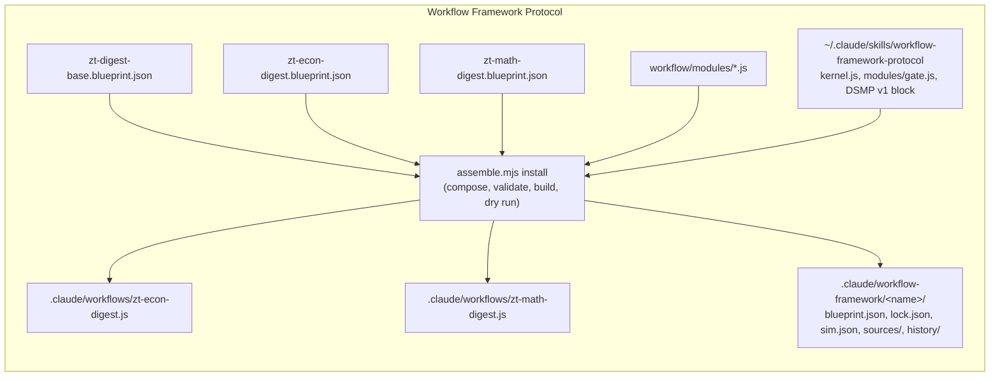

# Digest workflows

## Purpose

The existing real-MCP proxy has two additional lifecycle-only seams: `ZT_HANG_BATCH_BEFORE_WRITE_FLAG` stops before forwarding an actual batch, and `ZT_HANG_BATCH_REPLY_FLAG` stops after the real archive reply. Each writes the actual proxy/writer PIDs and then withholds the response. `hangBatch` refuses flag paths outside a temporary `mcp-lifecycle-test-*` folder. The public lifecycle suite observes timeout and owned-process exit, then retries unchanged operation keys against the actual committed state. These fault switches do not change ordinary or frozen workflow behavior.

The proxy's `ZT_FAIL_BATCH_BEFORE_WRITE` rejects an actual identified write before forwarding it, retaining the compiler's accepted plan without an archive commit. `ZT_RESERVE_BATCH_PARENT` with `ZT_RESERVE_BATCH_FLAG` independently creates one real Side successor before forwarding the planned batch and records its actual result. The group test then verifies that the owned manifest uses committed receipt addresses and excludes the independently reserved Card. These switches are used only by isolated fixtures; ordinary/frozen workflow code is unchanged.

The real-MCP proxy also supports `ZT_REPLACE_PREVIEW_INPUT` and `ZT_PREVIEW_REPLACEMENT_FILE`: after a successful native preview, it copies a fixture replacement over the input file. Both paths must resolve under the temporary directory, including Windows namespace normalization. Group completion must detect that the original checked draft bytes changed before accepting/applying the plan. This exercises a late-output race without launching a provider or modifying frozen workflow stages.

The existing MCP reply seam's `ZT_IDENTITY_FAULT=after_read` preserves the first empty-address identity probe and changes the next one. `ledger-core.tests.ps1` uses it to test archive replacement during preparation verification; the command must refuse before recording a claim. Missing/incomplete identity modes remain available. This seam changes replies in isolated tests and does not alter the archive or frozen workflow.

`ZT_FAIL_EXPORT_TITLES` makes the same proxy refuse the title export for `ledger-group-start.tests.ps1`. Startup must retain open group coverage and publish no accepted job on that failure. The native `group-start` manifest now declares one draft-only job and its archive read/write scope; provider permission enforcement and consumption by frozen stages remain #82 work. Existing frozen workflows have not been rewritten or run by these tests.

`ZT_SLOW_TOOL` with `ZT_SLOW_MS` and `ZT_SLOW_FLAG` makes the proxy wait before forwarding every call of that tool and write the marker flag when the wait starts. `ledger-owner-recovery.tests.ps1` uses it to hold a real `group-start` past a shortened ledger lease, so the command must finish under its own token only because its internal heartbeat renewed the lease. The wait happens in the isolated temp fixture; ordinary and frozen workflow behavior is unchanged.

This block holds the Claude Code Workflow scripts that turn a book from the Scholar Archive into Cards in the agent Workspace: the book's Literature tree, with one anchor per section group and the book's Idea, Event, Finding, and Model Cards under it, and a read-only audit. A digest builds only that Literature tree: it creates no Topic tree, writes no Topic-tree Card, no Hub Card and no concept register, and links no Topic-tree Card. Those belong to `zt-idea-grow` ([Idea-grow workflow](idea-grow-workflow.md); `docs/literature-only-digest-design.md`). There are two digest workflows: `zt-econ-digest` (economics books) and `zt-math-digest` (mathematics textbooks). Both are built by the Workflow Framework Protocol from one shared base blueprint, a variant blueprint each, and a library of stage modules, and are installed frozen. A workflow script does no Card work itself. It orchestrates agents: Haiku managers drive script steps (one step script per block) and DeepSeek Harness conversations, one Sonnet architect plans each model batch, and Opus makes the Organize decisions. The scripts do every structural step and DeepSeek writes the text. A script runs as a `zt-digest` tool once it is ported to Rust, else as a PowerShell script. The block exists so that the stage order, the roles and their models, the DeepSeek Subagent Managed Protocol limits, and the failure policy stay fixed and testable while only data moves.

**Owns:** the stage graph and modes of each digest workflow, the args each one takes, the roles and models per stage, the Haiku manager prompts and the DeepSeek job driver (`drive`), the DeepSeek Subagent Managed Protocol limits in code, the base and variant blueprints, the stage modules, the installed scripts with their registry (lock, sim, sources), and the stand-in-runtime harnesses.

**Does not own:** the PowerShell compilers and helpers that the stages run (`prepare-book-digest.ps1`, `card-compiler.ps1`, `model-compiler.ps1`, `math-compiler.ps1`, `hub-compiler.ps1`, `event-compiler.ps1`, `finding-compiler.ps1`, `organize-*.ps1`, `book-skeleton.ps1`, `attach-figures.ps1`, `digest-audit.ps1`, ...): see [Digest scripts](digest-scripts.md). The `zt-digest` binary, its tools (`call`, `audit`, `card`, `model`, `model-context`, `list-models`), and its install: see [zt-digest](zt-digest.md). The DeepSeek and architect instruction files (`dsh-*.zh.md`, `model-architect*.md`, the prefixes): see [Digest prompts](digest-prompts.md). The Card rules the checks apply: see [zt-check](zt-check.md). The Card operations the scripts call through the MCP server: see [MCP server](mcp-server.md) and [Card operations](card-operations.md). Model, unit, and Theory Card semantics: see [Models and math](models-and-math.md). Topic trees, Topic Cards, hubs and the register, which the digests no longer write: see [Idea-grow workflow](idea-grow-workflow.md) and [Hub Cards](hub-cards.md). The Literature write scope that refuses a Topic or hub write: see [zt-check](zt-check.md) (`tools/zt-check/src/mcp/scope.rs`) and [zt-digest](zt-digest.md) (`literature_scope` in `tools/zt-digest/src/main.rs`). Figure artifacts and Document links: see [Scholar bridge](scholar-bridge.md). The skills that describe how to run a digest (`zt-digest-protocol`): see [Agent skills](agent-skills.md).

## At a glance

| | |
|---|---|
| Entry points | `Workflow({ scriptPath: "E:\\zet\\.claude\\workflows\\<name>.js", args: {...} })` for `zt-econ-digest` and `zt-math-digest`; `node ~/.claude/skills/workflow-framework-protocol/tools/assemble.mjs install|verify|simulate ...` to build and install a variant; `node scripts/book-digest/tests/*.mjs` for the harnesses |
| Key files | `.claude/workflows/zt-econ-digest.js` — installed, frozen build of the economics variant (kernel + DSMP block + modules + embedded blueprint) |
| | `.claude/workflows/zt-math-digest.js` — installed, frozen build of the mathematics variant |
| | `scripts/book-digest/workflow/zt-digest-base.blueprint.json` — the base: shared stages, slots, args, roles, base modes, checkpoint |
| | `scripts/book-digest/workflow/zt-econ-digest.blueprint.json` — economics variant: profile, fills `after-digest` with models, explain, events, findings |
| | `scripts/book-digest/workflow/zt-math-digest.blueprint.json` — mathematics variant: profile, fills four slots with the math stages |
| | `scripts/book-digest/workflow/zt-econ-digest.sim.json`, `zt-math-digest.sim.json` — dry-run answers for `assemble.mjs install` |
| | `scripts/book-digest/workflow/modules/` — 31 modules: four libraries (`zt-digest-lib`, `zt-model-lib`, `zt-math-lib`, `zt-term-link-lib`) and 27 stage modules (table in Interfaces); `zt-term-cards` v3 is the Term-card branch driver of S20 (#164), wired as the `term-cards` stage by S24 (#167); `zt-term-link` v2 is that slice's deterministic Term-link stage, and `zt-term-link-lib` v2 is the pass it shares with the finite finalization (S26, #169) |
| | `.claude/workflow-framework/<name>/` — install registry per variant: `blueprint.json` (composed), `lock.json`, `sim.json`, `sources/`, `history/<version>/` |
| | `scripts/book-digest/tests/framework-harness.mjs` — builds both variants in memory and runs the stand-in runtime checks of each, plus the framework checks |
| | `scripts/book-digest/tests/bridge-workflow-harness.mjs` — builds both variants in memory and checks the Bridge stage |
| | `scripts/book-digest/watch-run.mjs` — the run watcher: only actionable lines (see Usage, "Watch a run") |
| | `scripts/book-digest/token-usage.mjs` — the Claude tokens a run spent per agent kind, phase and relay verb, from its transcripts (weighted: input + 1.25 × cache write + 0.1 × cache read + 5 × output); the measurement gate of `docs/digest-claude-token-proposal.md`. On ebrill2001modern trial 1 it gives 876 agents, 68.7M weighted, 613 relays of about 61k first-request context |
| | `.claude/agents/zt-relay.md` — the agent type of the `relay` role (PowerShell only, a short prompt): every one-command relay (`runScript`, `runMathScript`) ran as it from base 5.3.0 to #178; no stage of either digest workflow, and no idea-grow stage, runs it since (#178/#179). Its first request carried about 9k tokens of context instead of about 59k (`docs/digest-claude-token-proposal.md`, "P5 measurement") |
| Depends on | [Digest scripts](digest-scripts.md) (every PowerShell command a stage runs), [zt-digest](zt-digest.md) (the ported scripts as `zt-digest <tool>`, and the zt helper `zt-digest call`; `zt-digest` must be on PATH), [Digest prompts](digest-prompts.md) (the files the DeepSeek jobs and the architect read), [zt-check](zt-check.md) (the self-checks the managers approve), [MCP server](mcp-server.md) (through the zt helper); external: the Claude Code Workflow runtime (`agent`, `parallel`, `pipeline`, `phase`, `log`, `args`), the DeepSeek Harness MCP bridge (`deepseek_run`, `deepseek_wait`, `deepseek_prompt`, `deepseek_respond`, `deepseek_delete`, `deepseek_list`, `deepseek_remove_workspace`, `deepseek_usage`), the global skills `workflow-framework-protocol` (kernel, `assemble.mjs`, `sim.mjs`, module `gate`) and `deepseek-subagent-managed-protocol` (the inlined DSMP v1 block) |
| Used by | [Agent skills](agent-skills.md) (`skills/zt-digest-protocol/SKILL.md`, `skills/zt-digest-protocol/references/scripts.md`, and `skills/zettelkasten/SKILL.md` name the workflows); the user, who starts a run from a Claude Code session |
| Tests | `scripts/book-digest/tests/framework-harness.mjs`, `scripts/book-digest/tests/bridge-workflow-harness.mjs`; `assemble.mjs verify` |

## Concepts

- `Digest workflow` — a Workflow script that turns one book into the Cards of its Literature tree (mode `audit` reads the whole agent Workspace and writes nothing). Two exist: `zt-econ-digest` and `zt-math-digest` (`.claude/workflows/`).
- `Mode` — a named subset of stages (`args.mode`, default `full`). `full` runs every stage; the other modes re-run single stages on an existing digest. Declared in each blueprint's `modes`.
- `Section group` — one slice of the book (at most `maxChars` characters, `maxUnits` units) that `prepare-book-digest.ps1` writes as `<out>\groups\gNN.md`; group `n` owns the anchor Card `<key>/<n>` (a Direct successor line under the Literature Card). `groupsOf()` in `zt-digest-lib.js` gives `{ n, nn, file, snapshot, link }` per group.
- `Block` — up to 8 contiguous groups (fixed since base 5.4.0; `perManager` left), run by one Haiku manager in book order (`toBlocks()`).
- `Book profile` — `consts.profile` of a variant: the digest instruction files, `noEventCandidates`, `digestPrefix`, `linkPrefix`, `compilerDocs`, `architectSupplement`, `skipForms`. The base leaves it `null`; each variant sets it (`zt-econ-digest.blueprint.json`, `zt-math-digest.blueprint.json`).
- `Base` and `variant` — the base blueprint (`"kind": "base"`) holds every stage all book types share plus four `slot`s (`after-prepare`, `after-digest`, `after-link`, `after-audit`); a variant names the base in `"base"`, sets the profile, and `fill`s the slots with its own layers.
- `Layer` — a book type's own stage set in a slot: the model layer (`models`, `explain`), the event layer (`events`), the empirical-results layer (`findings`), the math stages (`math-skeleton`, `math-boundary`, `math-proof`, `math-theory`, `math-check`).
- `Module` — one `defineModule({ id, version, requires, params, run })` block in `scripts/book-digest/workflow/modules/<id>.js`, framed by `// ==== module <id> v<version> ====` lines. A library module (`library: true`) holds shared functions and is never a stage.
- `Role` — `manager` (Haiku, effort `low`), `relay` (Haiku, effort `low`, agent type `zt-relay`), `architect` (Sonnet), `organizer` (Opus), declared in `zt-digest-base.blueprint.json` `roles`. Modules start agents only through `ctx.agent`, so the role fixes the model and effort.
- `Kernel` — the Workflow Framework Kernel v1 that `assemble.mjs` copies into each installed script (`wfpRun`, `wfpArgs`, `wfpResolve`, `wfpTest`): it checks the fingerprint, deep-freezes the blueprint, args, and outputs, refuses undeclared args and modes, and runs the stage graph.
- `Frozen install` — an installed script whose embedded blueprint matches the `FINGERPRINT` stamped at install; any change makes it refuse to run. Its record is `lock.json` in `.claude/workflow-framework/<name>/`.
- `Checkpoint` — a stage at which `args.until` stops the run; the base declares `digest` (stop before the layers and the link pass).
- `DeepSeek Subagent Managed Protocol (DSMP)` — the run-wide rule: a Haiku manager runs at most 8 DeepSeek conversations, at most 8 managers are alive at once (64 conversations), conversations are deleted and never archived, and a workspace is removed when its work is done. `dsmpSlot` (the inlined DSMP block in each installed script) is the shared pool. The Term-card branch (`zt-term-cards`, S20, #164) keeps the pool deadlock-free: it retains at most four writer conversations per wave and runs at most four reviewers alongside them, so a manager never holds eight writers that are all waiting for a reviewer.
- `Term-card branch` — `zt-term-cards` v2 (S20 #164, S24 #167): the stage runs after `cards-book` (since 5.7.0; before that beside the digest writers after `terms`, where its plan went stale); the compiler's writer jobs are claimed from the run ledger in waves of four, the writers run first, then one review-and-fix job per math draft (since v8, 5.7.1: it reviews, fixes the draft, runs the self-check and writes its verdict, which `finish` binds to the draft it left; no separate fix round); every manager call and the workspace removal take one `dsmpSlot`, so the branch shares the digest's eight managers. The job units complete from the compiler's readiness result and the book unit from its publication report (R0423/R0424). Since v3 (S30 pilot, #172) a job that fails its writer or stays not ready after its one fix fails only its own unit, and the remaining waves are still admitted (design 12.4); when the book unit cannot be claimed, the branch still publishes every ready row (#182; before it, the ready contiguous prefix) with `term-cards -Step apply -Apply` without `-Token`, and the book unit stays incomplete. Its answer-evidence and settle records are run-level (`ledger resource -EvidenceFor`/`-Settle` without `-Unit run`, which the ledger refuses without a token).
- `Term-link pass` — `zt-term-link` v4 (S24, #167; S26, #169): after every Card writer and the Bridge, the deterministic pass claims its `termlink/book@1` unit (or `termlink/final@R`), applies the frozen plan, and completes the unit only from the apply report. Its unit depends on the Term-card book unit and every existing Card-writer unit and publication, so a failed writer or a partial Term-card book leaves the pass blocked with its reason; a disabled Term layer registers no unit at all (R0430). Since `zt-term-link-lib` v2 (S30 pilot, #172) a blocked whole-book pass still links the published prefix: it applies the frozen plan without a claim (the stage runs after every Card writer and the Term-card branch), reports status `partial`, and its unit stays incomplete (R0343 is kept: the unit is never done over a partial book; a later complete book runs the claimed pass). A finalization round keeps the old behaviour. Mode resume reads the prepared run's own `termCards`/`termLink` switches from `ledger status -Summary` (`run_options`, returned by `zt-digest-prepare` v15 as `stages.prepare.output.run_options`), so a run prepared with a Term layer off does not run it on resume. The pass itself is `zt-term-link-lib` v3 (#176: one `book-steps.ps1 -Step term-link` call run by a DeepSeek drive job), so the finite finalization's round runs the same claim/apply/complete sequence after its one correction cycle, for the changed Cards or the whole book when the mapping changed (R0438/R0439).
- `Script command` — the command prefix that runs one digest script, from `zdTool(name)` (or `Z.tool(name)`) in `zt-digest-lib.js`: `zt-digest <tool>` for a script listed in `ZD_TOOLS` (since `zt-digest-lib` v6, every digest script), else `pwsh -NoProfile -File "<ZD_SCRIPTS>\<name>.ps1"`. Every stage module builds its commands from it, so a newly ported script needs one entry in `ZD_TOOLS` and no module change.
- `Compiler step` — one script command with `-Step <s> ...` (`zt-digest <tool> -Step <s> ...` or `pwsh -NoProfile -File "<script>.ps1" -Step <s> ...`) whose last output line is compact JSON, often with a `jobs` list for DeepSeek. `drive()` runs it: one Haiku agent runs the command, managers run its jobs, and the returned session ids are recorded for the run-level cleanup, which deletes exactly those ids.
- `Card cycle` — `cardCycle()` in `zt-digest-lib` v39 (#176): the card compiler (`zt-digest card`) plan → DeepSeek jobs → one apply-and-check step per declared correction round → apply and report, each step one `book-steps.ps1` call run by a DeepSeek drive job (`runCards` remains only for the model layer the later slice migrates).
- `Model compiler` — `compileBatch()` in `zt-model-lib.js` v11 (#177): every deterministic chain is one `model-steps.ps1` step run by a DeepSeek drive job — brief → Sonnet plan (`plan.json`) → fill (plan-status, the batch's `model-deps`, the defer, the fill) → derive → review and split (up to `reviewRounds`) → close (its last round writes the report) → report when a close round still sent follow-ups. The brief, fill, derive, review, split and close jobs are DeepSeek content jobs in Haiku managers. Concept models skip derive and review.
- `Elaboration level` — `concept` or `formal` on a Model Card; `args.level` forces one level for the run; concept models go in batches of `perConcept`, formal and undecided ones in batches of `perSonnet` (default 8; the model layer claims blocks of up to 8 Model units).
- `Literature scope` — the process-wide write scope every `zt-digest` step of a digest runs in (`zt_check::mcp::scope`, set by `literature_scope` in `tools/zt-digest/src/main.rs`). Under it the zt client refuses, before the call reaches the archive, `create_topic`, every write that names a Topic-tree Card, a Hub Card, and authored text that links a Topic-tree Card; the refusal reads `literature_only: <tool>: <reason>`. A Topic tree is a tree whose id is all digits. The helper `zt-digest call` runs in it unless given `-Open`, which no digest stage passes.
- `Staging folder` — `args.out`: every file the run writes besides the Cards (see Data and storage).

## Architecture

### How a digest script is made



`assemble.mjs` loads the variant blueprint, composes it with its base (`composedFrom` in the registry `blueprint.json`), loads the framework module library and the blueprint's `"modules": ["./modules"]` folder, and writes one self-contained script: `meta` (built from the blueprint's description, whenToUse, and stage titles), the kernel, the DSMP v1 block, every module the blueprint uses, `const BLUEPRINT = {...}` (with `installed.modules`: id → version), `const FINGERPRINT = '...'`, and `return await wfpRun(BLUEPRINT, FINGERPRINT)`. The kernel, DSMP block, and module texts in both installed scripts are byte-identical to their sources.

### Module layers


Every stage module calls `zdMake(ctx, params)` (directly or through `zmlMake` / `zmMake`) and gets the settings and helpers back; it never keeps state between stages. Data moves between stages only through stage outputs that later stages read with `{{stages.<id>.output...}}` or `{"$ref": ...}` templates in their params.

### Control inside one compiler step (`drive`, the library's relay-era driver, with no caller since #178)

Since #175–#178 every deterministic chain runs as one step script (`layer-steps.ps1`, `book-steps.ps1`, `model-steps.ps1`, `term-steps.ps1`, `math-steps.ps1`) that `zt-workflow-lib`'s `ztDrive` runs as ONE DeepSeek drive job, so no module calls `drive` any more; it stays in `zt-digest-lib` with no caller. The old driver worked like this:

1. `driveAgent(label, o, 'command')`: one Haiku agent runs `o.command` once (timeout 600000) and returns its last line whole in `output`. It loads no DeepSeek tool (lib v35): only the job managers of step 3 do.
2. `zdLastJson(output)` parses the last JSON line; `expandJobs()` turns it into `{ id, files, prompt, continue?, fallback? }` jobs (a compact list from `zt-digest card ... -Compact` gives `dir`, `lead`, `prompts` once and `{ id, kind, file, continue? }` per job).
3. The jobs split into shares of `dshPerBatch` (8); up to `dshManagers` (8) lanes take shares in turn; each share is one Haiku manager (`driveAgent(..., 'jobs')`) inside `dsmpSlot`, which keeps every manager of the run under the 8-manager cap. A manager starts jobs with `deepseek_run` (or continues a session with `deepseek_prompt` when the job names `continue` and the step's session table holds it), keeps at most 8 running, approves only the listed read-only checks, reads, and writes under `o.writes`, retries once with a resume prompt, and does not delete conversations.
4. A job a manager did not report becomes `{ status: 'failed' }`.
5. Each job manager records its own session ids at once, with plain arguments (`ledger resource -Unit <owner> -Token <t> -RegisterId <session> -Workspace <dsh>`, or `-Unit run` for a stage-wide chain), and, when a job ends, writes the job's final answer to `<out>\answers\<session>.txt` and runs `ledger resource -EvidenceFor <session> -Evidence <that file> [-Usage <numbers>]` (`recordRules`). No relay agent restates another agent's answer: a relay asked to write it refused it as invented content (2026-10-20). Nothing is deleted here: the run-level `cleanup` stage deletes exactly the recorded ids after the owning work settled (R322/R323).

## Interfaces

### Workflows and their stages

#### zt-econ-digest (v6.7.1) and zt-math-digest (v5.7.1) on base v5.7.1: the composed readiness graph

The stage ids, modules, and `after` edges come from the blueprints of each variant (composed with the base); titles are the progress phases. The graph declares **readiness** (which stage may start when), not a mutable runtime schedule: the run ledger inside `zt-digest` decides which unit is actually ready, and each layer's driver claims only ready units (R244/R252).

The edge set is `args → source → prepare → [after-prepare] → terms → digest → cards → … → cards-book → (link … bridge | term-cards) → term-link → audit → …` (term-cards after cards-book since 5.7.0): the book term table precedes the first group writer and the Term-card branch, which run beside each other (S24, #167); the per-group Card checks and the whole-book Card cycle come next; the gap-only Link pass follows the whole-book cycle and the after-terms layers; then Organize (the Literature index and the structure Card), Figures and the report-first **Bridge** between Literature trees; the deterministic **Term-link** pass follows the Bridge and the Term-card branch, and the read-only audit and the finite finalization stay last. The full edge list is `args → source → prepare → [after-prepare] → terms → term-cards → [after-terms] → digest → cards → [after-digest] → [after-models] → cards-book → link-prepare → link → link-check → [after-link] → organize → figures → bridge → term-link → audit → finalize → [after-audit] → cleanup → report`; a stage that waits for `terms` starts beside `term-cards`, never after it. No stage builds a Topic tree, a hub or the register. The variant's own model/math prerequisites keep their existing slots.

| Stage | Title | Module | After | Runs when (beyond its mode list) | On failure |
|---|---|---|---|---|---|
| `args` | Prepare | `gate` (framework) | — | always; checks `citationKey` (unless mode `audit`/`resume`), refuses every routing argument in mode `resume` (only `out`), and in mode `full` either `book` or `source`, `bibtex` and `bookTitle`; the kernel bounds `maxAttempts` 1–10 and `dshRunCap` 60–3600 | halt |
| `source` | Prepare | `zt-dsh-source` | args | not in modes `figures`, `audit`; not in mode `bridge` with a selection | halt |
| `prepare` | Prepare | `zt-digest-prepare` | source | mode `full` runs the script with `-Variant -MaxAttempts -DshRunCap -RunOptions -Apply`; mode `resume` runs the one `zt-digest ledger resume` and reads the retained groups, settings and Citation key from the ledger, and every later stage takes that key from `stages.prepare.output.citation_key` through its `key` param (`args.citationKey` reaches only `prepare`, which creates a fresh run; #181); modes `term-cards` and `term-link` run the backfill branch of the same command — `zt-digest prepare -Out <out> -Sections -Brief` for term-cards (reuse or reconstruct the staged source slices) and `-Validate` for term-link (inspect the book and staging only) — and read the Citation key from the prepared run, halting on a Lock or a typed conflict before any provider work; other modes take `args.groups` | halt |
| `math-skeleton` (math) | Prepare | `zt-math-skeleton` | prepare | mode `full` | halt |
| `terms` | Prepare | `zt-book-terms` | prepare (econ), math-skeleton (math) | `args.terms != false`; claims `terms/book@1` and completes it through the claimed Terms apply | continue |
| `term-cards` | Term cards | `zt-term-cards` | cards-book | (`full`, `resume` or `term-cards`) and `args.termCards != false`: the Term-card branch once the Literature content is settled, or the backfill of one already digested book. It claims ready `termcards/tNNN@<plan revision>` job units in waves of up to four, runs their writers, checks, independent mathematical reviews and one finite fix on the shared DSMP pool, completes each job unit only from the compiler's readiness result and the `termcards/book@<revision>` unit from its publication report. A partial or failed publication leaves the book unit incomplete (R0423/R0424/R0428) | continue |
| `events` (econ) | Events | `zt-event-layer` | terms | `args.events != false`; claims ready `events/gNNN@1` units and waits for digest readiness | halt |
| `findings` (econ) | Findings | `zt-finding-layer` | terms | `args.findings != false`; claims ready `findings/gNNN@1` units and waits for digest readiness | halt |
| `digest` | Digest | `zt-group-cycle` (one module stage) | terms | mode `full`; up to 8 lanes, each a loop of blocks: one Haiku manager claims up to 8 `digest/gNNN@1` units, starts each, runs their frozen jobs side by side, and records each `group-finish` | halt |
| `cards` | Cards | `zt-cards-layer` | digest | always in a managed run (Card quality is required work); claims `cards/gNNN@1` and records `cards-finish`, both in one `zt-digest finish-batch -Layer cards` command per block | halt |
| `models` | Models | `zt-model-layer` | cards | (`full` and `args.models != false`), mode `models`, or mode `resume`; claims `models/gNNN-mIIII@1` in `model-steps.ps1` steps and records `model-finish` through the block's one `finish` step | halt |
| `explain` | Models | `zt-explain` | models | mode `explain`, or (`full`/`resume` and `args.models != false`); claims `explain/<key>@1` and records `explain-finish` | halt |
| `math-boundary` (math) | Boundary | `zt-math-boundary` | models | mode `full` or `math`, `args.boundary != false` | halt |
| `math-proof` (math) | Proof | `zt-math-proof` | math-boundary | mode `full` or `math`, `args.proof != false` | halt |
| `cards-book` | Cards | `zt-cards-book` | explain (econ), explain (math, after the proof layer) | mode `cards`, or (`full`/`resume` and `args.cardChecks != false`): publishes the present `cards-book` revision, claims it and records `book-cards-finish`; its coverage gate waits for the Model reviews (R248) | halt |
| `link-prepare` | Link | `zt-link-prepare` | after-terms (econ: events, findings), cards-book | modes `full`, `link`; the Link candidates come from Literature trees only | halt |
| `link` | Link | `zt-link-pass` | link-prepare | modes `full`, `link`; one chain per scheduled or gap-free group fills only the frozen gap set through `link-start`/`link-finish`; a group whose digest unit is not `done` is blocked and named, and a group with no semantic gap runs no provider job | halt |
| `link-check` | Cards | `zt-link-check` | link | `args.cardChecks != false` | halt |
| `math-theory` (math) | Theory | `zt-math-theory` | link-check | mode `full` or `math`, `args.theory != false` | halt |
| `organize` | Organize | `zt-organize` | link-check (econ), math-theory (math) | mode `full`, `resume`, `models`, `explain`, `events` or `findings`, or `args.organize` is `true`; Literature work only (the thesis, the notes on the book's own Cards, the Literature index and the structure Card) | continue |
| `figures` | Figures | `zt-figures` | organize | mode `figures`, or `args.figures != false` | halt |
| `bridge` | Bridge | `zt-bridge` (`profile.bridgeProfile`) | figures | mode `bridge`, or (`full` and `args.bridge != false`); expects `status != failed`. It applies its own report's new-carrier proposals; its sources, targets and carriers are Literature-tree Cards | continue |
| `term-link` | Term link | `zt-term-link` v2 | bridge, term-cards | (`full`, `resume`, `term-cards` or `term-link`) and `args.termLink != false`: the deterministic Term-link pass after every Card writer and the Bridge, or the backfill pass of one already digested book. It freezes the plan, claims the pass's `termlink/book@1` unit, applies it under the claim and completes the unit only from the apply report; a blocked unit is reported with its ledger reason and no edit (R0425-R0430) | continue |
| `audit` | Audit | `zt-audit` | bridge, term-link | mode `audit`, or `args.audit != false`; read-only: it counts the box's Topic trees and hubs as information, never as a digest fault | halt |
| `finalize` | Finalize | `zt-finalize` v3 | audit | (`full` or `resume`) and `args.finalize != false`: the finite audit-plan → one scoped correction cycle → changed-Card manifest → the round's Term-link pass (the shared `zt-term-link-lib`; the whole book when the correction changed the Term mapping) → publication refresh → final read-only audit (#86, R299/R300; S26, #169). A resume that finds the recorded cycle but no final audit continues from the retained manifest (`finalize -Step changes`) instead of re-entering the cycle or skipping the relink | continue (a residual fault or an incomplete Term-link round is a `partial` result) |
| `math-check` (math) | Audit | `zt-math-check` | finalize | mode `math`, or (`args.audit != false` and `citationKey` set); it therefore describes the **final** audit revision | halt |
| `cleanup` | Cleanup | `zt-dsh-cleanup` | finalize (econ), math-check (math) | after the joined audit, as part of the settlement: it settles the owned conversations and renders the run report | continue |
| `report` | Report | `zt-digest-report` | cleanup | always; carries the effective settings, the schedule summary, the verified `run_report`, `link_blocked` and `link_gaps` | halt |

"halt" is the kernel default (`onFail` missing). Most modules log and return `{ status: 'failed', ... }` instead of throwing, so their stage still ends `done`; only a thrown error fails a stage. The modules that throw: `zt-dsh-source` (no source answered), `zt-digest-prepare` (prepare failed, no resumable ledger or no retained groups in mode `resume`, or no groups in modes `full`/`link`), `zt-link-prepare` (script failed), the mathematics stages on a failed step (`zt-math-skeleton`, `zt-math-boundary`, `zt-math-proof`, `zt-math-theory` and `zt-math-check` all stop with the step's reason; only the notation table is logged and skipped), `zt-model-layer` (listing failed, only in mode `models`), and `gate`.

#### Modes

| Mode | zt-econ-digest | zt-math-digest | Stages it runs | Needs |
|---|---|---|---|---|
| `full` | yes | yes | all | `out`, `citationKey`, and `book` or `source`+`bibtex`+`bookTitle` |
| `link` | yes | yes | args, source, prepare, link-prepare, link, link-check, organize, figures, cleanup, report | `groups` |
| `cards` | yes | yes | args, source, prepare, cards-book, report | `citationKey`, `out` |
| `figures` | yes | yes | args, figures, report | `citationKey`, `out` |
| `audit` | yes | yes | args, audit, cleanup, report | `out` (`citationKey` optional: one book, else every book) |
| `models` | yes | yes | args, source, prepare, models, explain, link-prepare, link, link-check, organize, audit, cleanup, report (math also math-boundary, math-proof, math-theory, math-check) | `citationKey`, `out` |
| `explain` | yes | yes | args, source, prepare, explain, link-prepare, link, link-check, organize, audit, cleanup, report (math also math-theory, math-check) | `citationKey`, `out` (the retained `explain/` units) |
| `bridge` | yes | yes | args, source (skipped when it applies), bridge, report | `citationKey`, `out`; to apply also `bridgeReport` and `bridgeApply` or `bridgeApplyEarlier` |
| `events` | yes | no | args, source, prepare, events, link-prepare, link, link-check, organize, audit, cleanup, report | `citationKey`, `out` |
| `findings` | yes | no | args, source, prepare, findings, link-prepare, link, link-check, organize, audit, cleanup, report | `citationKey`, `out` |
| `math` | no | yes | args, source, prepare, math-skeleton, models, math-boundary, math-proof, math-theory, math-check, report | `citationKey`, `out` |
| `resume` | yes | yes | args, prepare, terms, term-cards, digest, cards, the book type's layers, cards-book, link-prepare, link, link-check, the math tail, organize, figures, bridge, term-link, audit, finalize, the math check, cleanup, report | `out` only: the retained identity, source choices, Citation key, enabled layers, versions and settings come from the ledger (every stage reads the key from `stages.prepare.output.citation_key`, so Organize, Figures, the link check and the Bridge name the book; their step scripts read `<out>\manifest.json` if a step names no key; #181); both Term stages drain their unfinished units against the frozen plans and receipts; a finalization that already published its final audit is reused, and one stopped after its recorded correction cycle continues from that manifest (its round and final audit still run) instead of re-entering the cycle |
| `term-cards` | yes | yes | args, source, prepare, term-cards, term-link, audit, cleanup, report | `out` only, plus the Term settings (`termCards`/`termLink`/`termCardsPerJob`/`termCardsMathPerJob`/`termLinkOccurrences`): the already digested book, its source, headings and limits come from the prepared run; `termCards` false contradicts the mode |
| `term-link` | yes | yes | args, prepare, term-link, audit, cleanup, report | `out` only (plus the Term settings): no source stage, no Term-card branch and no provider probe; the deterministic pass links the book's current Term Cards; `termLink` false contradicts the mode |

The book's Citation key has ONE source (#181): `prepare`'s output (`stages.prepare.output.citation_key`), from `args.citationKey` on a fresh preparation or from the ledger on a resume; no module reads `args.citationKey`, and each book/model step script falls back to `<out>\manifest.json`'s `citation_key` when its options name none. There is no mode `hubs`: the hubs and the register are built by `zt-idea-grow` (its own mode `hubs`). The repair modes (`models`, `explain`, `events`, `findings`) drain the closure their own layer released — the changed-Card Link pass and check, Organize and the audit — instead of rebuilding unrelated groups or models (R286). Mode `resume` accepts only `out`, spends the one supported resume through `zt-digest ledger resume`, and drains the whole unresolved closure (R274–R285).

A stage outside the mode passes through with status `not-in-mode` once every stage it waits for has ended, so the order holds. `args.until: "digest"` stops the run after the `digest` stage.

### Roles and models per stage

| Work | Agent | Model | Where |
|---|---|---|---|
| Source probe, prepare, Link preparation, cleanups | one Haiku manager per `book-steps.ps1` step (#176) | Haiku (`manager`, effort `low`) | `zt-dsh-source`, `zt-digest-prepare`, `zt-link-prepare`, `zt-dsh-cleanup` |
| Digest and link runs | one manager per block (digest: runs in order; link: all at once) | Haiku | `manage()` in `zt-digest-lib.js` |
| Compiler step jobs (cards, terms, events, findings, explain, skeleton, Bridge) | one Haiku manager per script step (#175–#178) plus one content manager per 8 jobs | Haiku | `layer-steps.ps1`, `book-steps.ps1` through `driveStep`/`bookStep`/`cardCycle`, `runJobs` |
| Model layer steps and their content jobs (#177) | one Haiku drive manager per `model-steps.ps1` step, one content manager per 8 jobs | Haiku | `zt-model-lib.js` v11 (`modelStep`, `runJobs`) |
| Mathematics stage steps and their content jobs (#178) | one Haiku drive manager per `math-steps.ps1` step, one content manager per 8 jobs | Haiku | `zt-math-lib.js` v5 (`step`, `jobs`, `runJobs`) |
| Term-card writer waves, review groups, fix continuations and wave settles | one manager per wave, review group, fix group or settle group | Haiku (`manager`, effort `low`) | `zt-term-cards.js` (S20 #164, S24 #167) |
| Term-card and Term-link commands, ledger claims and completions | one DeepSeek drive job per `term-steps.ps1` step | Haiku (`manager`) | `zt-term-cards.js`, `zt-term-link-lib.js` (since #172; S26, #169: the finalization's round too) |
| Model plan (`plan.json`) | one architect per batch | Sonnet (`architect`, model default effort) | `compileBatch()` in `zt-model-lib.js` |
| Organize decisions (`decisions.json`: the thesis and the notes) | one agent | Opus (`organizer`) | `zt-organize.js` |
| All reading and writing of Card text | DeepSeek Harness conversations | DeepSeek V4.1 Flash, effort `high` or `max` | started by the Haiku managers |

`zAgent` in `zt-digest-lib.js` takes the role a caller names (`role: 'relay'`, which only the library's relay driver with no caller since #178 names), else maps `model: 'sonnet'` to role `architect`, `'opus'` to `organizer`, and everything else to `manager`; it drops any `effort` a caller passes. No digest stage starts a `zt-relay` agent any more: the last one left with the mathematics stages' move to `math-steps.ps1` (#178).

DeepSeek skills sent in the `skills` field: digest and link runs `['zettelkasten', 'asd-ste100-zh']`; fill, derive, split, card, term, event, finding, skeleton, explain, and math jobs `['asd-ste100-zh']`; brief and review jobs none. Since S20 (#164) a Term-card job carries its own `skills`, `model` and `effort`: the writer and its fix run with `['zettelkasten', 'asd-ste100-zh']` on the official model at `high`, and the reviewer with `['asd-ste100-zh']`.

### The args object

Pass an object, never free text. `wfpArgs` refuses any key not declared (besides `mode` and `until`), checks types, enums, and `min`/`max`, and throws when `out` is missing.

Base args (both workflows):

| Arg | Type | Default (from code) | Meaning |
|---|---|---|---|
| `out` | string, required | — | the staging folder |
| `maxAttempts` | number 1–10 | 3 | the per-unit attempt budget of the managed run; persisted at preparation and reused by a resume (R273) |
| `dshRunCap` | number 60–3600 | 1200 | the seconds one external DeepSeek run may live; persisted at preparation and reused by a resume (R267/R273) |
| `citationKey` | string | — | the book's BibTeX key (all modes but `audit`) |
| `source`, `bibtex`, `bookTitle` | string | — | the bilingual Markdown, the BibTeX entry, the title (mode `full`) |
| `book` | any | — | a Scholar Archive Work id or exact title: mode `full` resolves the Work, its Chinese/bilingual Markdown, the BibTeX and the heading range through the read-only bridge, and the three explicit arguments are left out (base 2.4.0) |
| `fileId` | any | read from the source path | the Scholar Archive file id of the book Markdown |
| `startHeading`, `endHeading`, `skipHeadings` | string | none | where the text starts and stops; headings whose units are left out (`参考文献,习题`) |
| `groups` | number | — | the existing group count (modes `link`, `models`) |
| `organize` | boolean | false | `true`: Organize after modes `link` and `models` (the Literature index, the structure Card and the notes on the book's own Cards) |
| `maxChars`, `maxUnits` | number | 20000, 3 | group size for `prepare-book-digest.ps1` |
| `dshEffort` | string | `high` | every DeepSeek job without its own effort arg (digest, link, fill, card, term, event, finding, skeleton, explain, math); raised to `high` unless `high`/`max` |
| `models` | boolean | true | false skips the model stage |
| `rebuild` | boolean | false | rebuild models that already have parts (the alias `redoModels` left in base 5.4.0) |
| `perSonnet`, `perConcept` | number ≥ 1 | 6, 10 | formal and concept models per architect batch |
| `dshPerBatch` | number ≥ 1 | 8, capped at 8 | jobs per Haiku manager (the alias `dshPerSonnet` left in base 5.4.0) |
| `dshManagers` | number ≥ 1 | 8, capped at 8 | managers of one compiler step in parallel |
| `applyShare` | number ≥ 1 | 30 | jobs per card-cycle apply call |
| `only` | array | all | Model Card addresses (modes `models`, `explain`; a pilot) |
| `level` | `concept` \| `formal` | each model's own | force one elaboration level |
| `briefEffort`, `deriveEffort`, `reviewEffort` | string | `high` | DeepSeek effort per compiler round (raised to `high`) |
| `reviewRounds` | number ≥ 0 | 2 | review, split, review again; 0 skips |
| `maxSentences`, `maxPartChars`, `maxSteps` | number | 12, 400, 6 | Card size of a formal model part (`-MaxSentences`, `-MaxChars`, `-MaxSteps`) |
| `maxExplainSentences`, `maxExplainChars` | number | 16, 600 | explanation budget of a Derivation part |
| `terms`, `audit`, `figures` | boolean | true | false skips that stage in mode `full` |
| `cardChecks` | boolean | true | false skips the whole-book card cycle in mode `full` and the link-check cycle in mode `link` |
| `ideaSample` | number 0–1 | 0.1 in `full` and `cards`, else 0 | share of fault-free Idea Cards reviewed against the source (the deterministic, group-covered sample of R297) |
| `cardRules` | string | all hard rules | the rules the card cycle fixes (`-Rules`) |
| `cardFixRounds` | number ≥ 0 | 1 | card check-fix-apply rounds |
| `cardMax` | number ≥ 1 | — | pilot cap on Cards with faults and orphans (`-MaxCards`) |
| `explainMax` | number ≥ 1 | — | pilot cap on Derivation parts in mode `explain` (`-MaxParts`) |
| `bridge` | boolean | true | false skips the Bridge stage in mode `full` |
| `bridgeMax` | whole number 1–120 | 60 | the most source Cards of the book the plan takes (`-MaxSources`) |
| `bridgeCandidates` | whole number 1–8 | 5 | candidates per source Card, plus at most two term matches (`-Candidates`) |
| `bridgeBooks` | string | all other books | comma-separated Citation keys of the target books (`-Books`) |
| `bridgeReport` | string | — | mode `bridge`: the `report_id` to apply from (`-ReportId`) |
| `bridgeApply` | `"all"` or array of ids | — | mode `bridge`: the new-carrier proposals to apply (`-Accept`) |
| `bridgeApplyEarlier` | `"all"` or array of ids | — | mode `bridge`: the earlier-carrier proposals to apply, a separate selection (`-AcceptEarlier`) |
| `termCards` | boolean | true | false skips the Term-card branch; the switch is frozen at preparation, so the prepared target excludes the layer and no Term-link pass waits for it |
| `termLink` | boolean | true | false skips the deterministic Term-link pass; frozen at preparation like `termCards` |
| `termCardsPerJob` | number 1–8 | 4 | concept terms per Term-card writer job (`-PerJob`) |
| `termCardsMathPerJob` | number 1–8 | 1 | mathematical terms per Term-card writer job (`-MathPerJob`) |
| `termLinkOccurrences` | `first` \| `all` | `first` | which eligible occurrences the Term-link pass links (`-Occurrences`) |

Modes `term-cards` and `term-link` read everything about the book from the prepared run and accept only `out` besides the Term settings: the args stage refuses `book`, `source`, `bibtex`, `bookTitle`, `citationKey`, `groups`, `only` and the Bridge selections (as mode `resume` does), refuses `termCards: false` in mode `term-cards` and `termLink: false` in mode `term-link`, and then reads the Citation key from `prepare`'s own answer.

No arg selects hub or register work: `hubs`, `hubWork`, `hubLimits`, `hubTrees`, `hubRebuild`, `hubEffort`, `hubFixRounds` and `registerPlan` are not declared, so `wfpArgs` refuses them (`args.<name> is not declared`). The hub options are `zt-idea-grow`'s.

`zt-econ-digest` adds `events` and `findings` (boolean; false skips that layer).

`zt-math-digest` adds:

| Arg | Type | Default | Meaning |
|---|---|---|---|
| `supply` | `none` \| `examples` \| `examples+answers` | `examples` | what DeepSeek may add that the book does not give (`-Supply`) |
| `unitsPerJob` | number ≥ 1 | 4 | units per boundary or proof job |
| `mainResults` | number ≥ 1 | 7 | main results per Theory Card |
| `notation`, `boundary`, `proof`, `theory` | boolean | true | false skips that math stage |

Control args: `mode` (see Modes) and `until` (value `digest`).

### Results

Both scripts return the kernel report `{ workflow, version, fingerprint, mode, order, halted, stoppedAt, stages: { <id>: { status, error? } }, result, deepseek }`. `result` is the `report` stage's output, which `zt-digest-report.js` shapes per mode: in mode `full` `{ mode, dsh_model, book, citation_key, groups, managers_per_pass, digest, models, model_cleanup, link, terms, cards: { blocks, link }, deepseek_usage, cleanup, organize, figures, bridge, term_link, term_cards, audit, finalize, schedule }` (no `concepts`, `review`, `register` or `hubs` entry), where `term_cards` is that stage's truthful `{ status, unit, plan, jobs, readiness, publication, blocked, reason }` summary and `term_link` is the whole-book pass's `{ status, unit, plan, counts, no_op, blocked, reason }`, with `final` (the finite finalization's own round: generation, scope, unit, status and counts, from the final report's ledger facts) and `audit_terms` (the final audit's Term quality) added when a finalization ran (S24, #167; S26, #169); `schedule` names both statuses and the round's status, and `audit` carries the per-book and Workspace `terms` coverage and quality plus the `gate` contract, so `audit ran` never reads as `all terms passed`, where `bridge` is the compiler summary, `{ status: 'failed', error }`, or `{ status: 'skipped' }`; in a single-stage mode `{ mode, ..., <stage>: report }`; the variant's `extra` adds `events` and `findings` (econ) or `math: { index, docs, skeleton, notation, boundary, proof, theory, check }` (math). In modes `events`, `findings`, and `math` it returns `{ mode, dsh_model, citation_key, ...extra }`. After a halt `report` never ran, so `result` is undefined and `halted` names the stage and error. `deepseek` is the DSMP block's `dsmpLog`, which the digest modules do not feed (they run their script steps through `ztDrive` and their content jobs through `runJobs`, not `dsDispatch`).

### Modules

Library modules (no stage; their top-level names carry a prefix because all modules share one script):

| Module | Version | Requires | Exports |
|---|---|---|---|
| `zt-digest-lib` | 40 | `@dsmp`, `zt-workflow-lib` | the batch finish `finishUnits` / `finishBatchCommand` / `batchOutcomes` (a block's checked finishes in one `zt-digest finish-batch` command; a unit its line does not answer runs the batch once more, then `finishOrFault` asks the ledger before any fault); the layer driver `layerRun` / `driveStep` / `runJobs` (#175: one `layer-steps.ps1` step per layer block, run by a DeepSeek drive job, and its content managers); the book-level driver `bookStep` (#176: one `book-steps.ps1` step per block) and `cardCycle` (#176: a card cycle in declared rounds: plan → its DeepSeek jobs → apply/check rounds → apply → report); the resume gate read into `settledOnResume` through the same step; `drive`, `runScript`, `claim`, `gate`, `chain`, `layer`, `finishOf`, `finishUnits`, `holding` and `psQuote` are the relay-era driver, and since #178 they have no caller at all; since #179 the relay-era command runner is this library's own `zdRelay` (the shared `zt-workflow-lib` v3 is drive-only and carries no relay) |
| `zt-model-lib` | 11 | `zt-digest-lib` | `zmlMake(ctx, p)` → `{ Z, start(block), elaborate(models, units, label), finish(units), logModels(reports), modelCleanup(), dshJobs() }`; `start` is the block's one `model-steps.ps1 -Step start` call (a stopped run's claims released, the listing, the claim); `elaborate` batches the models and runs `compileBatch`, whose chains are `model-steps.ps1` steps run by `ztDrive` and whose content jobs run in Haiku managers through `runJobs`; `finish` is the block's one `-Step finish` call; the Sonnet architect stays |
| `zt-math-lib` | 5 | `zt-digest-lib` | `zmMake(ctx, p)` → `{ Z, A, MATH_WORK, MATH_STEPS, SUPPLY, UNITS_PER_JOB, MAIN_RESULTS, step(stage, name, label), must(what, json), jobs(stage, what, json), deepseek }` (#178): `step` is one `math-steps.ps1` chain run by `ztDrive` (its one JSON line), `must` is the stage's stop with the step's reason, `jobs` runs a plan step's content jobs in Haiku managers through `runJobs` |

Stage modules. Every one takes `args` (`{{args}}`, required) and `mode` (`{{mode}}`, required); most also take `model` (`stages.source.output.model`).

| Module | Ver | Other params | Runs | Output |
|---|---|---|---|---|
| `zt-dsh-source` | 2 | — | reports the frozen official source (`deepseek-official/deepseek-flash`; no probe since base 5.4.0) and logs efforts raised to high | `{ source, model }` |
| `zt-digest-prepare` | 16 | `needGroups` (`['full','link']`), `profile`, `instructions`, `noEventCandidates` | one `book-steps.ps1 -Step prepare` step run by a DeepSeek drive job (#176), in mode `full` (the preparation, one brief line), mode `resume` (the one `ledger resume`, its summarized status and the digest-gate fallback: the retained groups, identity, settings and run switches) or modes `term-cards`/`term-link` (the backfill's `-Sections`/`-Validate` validation). A typed `card_locked` from any step stops the run with the archive's own refusal (R326/R337) | `{ groups, groupList, citation_key, backfill? }`, and on resume `{ resumed, resume, settings, run_options }` |
| `zt-book-terms` | 3 | — | claims `terms/book@1` and runs the claimed Term table (`book-terms -Step plan -Token`, the one job, `-Step apply -Token -Apply`), which completes the unit with its checked evidence; a failure leaves the digest groups waiting on it | `{ status, unit, report }` |
| `zt-term-cards` | 8 | `out`, `key`, `tool`, `perJob`, `mathPerJob`, `maxStepsPerCard`, `maxProse`, `relay` | the Term-card branch (S20 #164, S24 #167; it requires `@dsmp` and `zt-workflow-lib`, not `zt-digest-lib`): `term-cards -Step plan` registers the layer's units in a prepared run, then each wave claims up to four ready `termcards/tNNN@<plan revision>` units from `ledger next -Layer termcards`, runs their writers (conversations retained) with `jobs -Tokens`, `check`, `review-plan` and one review-and-fix job per math draft (v8: the job fixes the draft itself and `finish` binds its verdict to the draft it left; no `fix-plan` round); each job unit completes through `ledger done` from `check/readiness.json` (the schema, the shared check, the required reviews and the fix disposition), and when every job is done the claim offers `termcards/book@1`, whose `apply -Token` publishes and whose report completes the book unit. Every manager call and the final workspace removal take one `dsmpSlot`; a review is deleted after its answer and no conversation is archived; a failed writer, a refused row or a partial publication leaves its unit incomplete and is reported | `{ status, book, work, ledger, plan_revision, plan_hash, jobs: { total, done, failed }, waves, reviews, fixes, readiness, publication, book_unit, completion?, deepseek: { registered, evidence, deleted, not_deleted, workspaces }, staging? }` |
| `zt-term-link-lib` | 3 | — | the finalization's deterministic Term-link round (S24 #167; S26 #169; #176): one `book-steps.ps1 -Step term-link` call run by a DeepSeek drive job freezes the round's plan (`termlink/final@R`, the changed Cards or the whole book), claims the unit, applies the frozen plan under its token, completes it only from the apply report and plans a second time; a stopped pass records its fault on the unit and stays incomplete, and a pass with no ready unit is `skipped` with the ledger's reason. A diagnostic `-Cards` subset without a round owns no unit | `{ status, book, work, unit, pass, round, scope, cards, plan, counts, no_op, completion, second, reason?, error? }` |
| `zt-term-link` | 4 | `out`, `key`, `args`, `mode`, `occurrences`, `script` | the `term-link` stage: one `term-steps.ps1 -Step link` drive job (S24 #167; #175) plans, applies under the claim (or links the published prefix when the unit is blocked) and plans again; the finite finalization runs its own round through `ztTermLinkPass` in `zt-term-link-lib` v3 | the step's report, with `status`, `unit`, `counts`, `second` and the deletion tally |
| `zt-cards-book` | 5 | — | publishes the present `cards-book` revision (`book-steps.ps1 -Step publish -Json {Ledger}`, the ledger's own publication), claims it (`cards-book-start`: the revision and one brief claim), runs the whole-book cycle in `book-steps.ps1` steps under DeepSeek content managers (`cards-start` plan → its jobs → `cards-apply` apply+check per declared round → `cards-finish` apply+report), and records it through `cards-book-finish` (the ledger decides a cut line; a refused completion keeps its fault on the claim). A cycle that does not complete faults its claim with `missing_result`. `-ModelReview` in mode `cards` or when `args.models` is false (R247) | `{ status, cycle, unit, completion }` |
| `zt-group-cycle` | 5 | `profile`, `groups` | lanes of blocks (`Z.block`): one manager claims up to 8 `digest/gNNN@1` units with a lease covering the frozen run cap (`-Take 8 -Lease dshRunCap+300`), runs `group-start` for each (snapshot before the job manifest), runs their frozen DeepSeek jobs side by side (renewing every held claim after each wait round), records, retains and deletes each conversation itself (`-RegisterId`, `-EvidenceFor`, `-Settle`), and runs `group-finish -Draft` for each; at most 8 lanes (`ceil(groups/8)`), each claiming block after block (`-Wait 60` after the first) until none is ready; a failed unit is recorded against its own attempt and claimed again by a later block within `maxAttempts`; a group whose accepted plan already committed starts **no** DeepSeek job (`expected_jobs: 0`) and is completed from its receipts (#87, R280) | `{ status, reports: [{ status, group, unit, disposition, owned, recovered, jobs }], verified, failed, lanes }` |
| `zt-cards-layer` | 2 | — | claims `cards/gNNN@1` and records each through `cards-finish` in one `zt-digest finish-batch -Layer cards -Take 4 -Owner "cards claim <n>" -Lease <cap+300>` command per block (layer option `claimFinish`); the layer gate decides complete/partial/active | `{ status, dispositions, gate }` |
| `zt-model-layer` | 7 | `profile` | claims ready `models/gNNN-mIIII@1` blocks in the one start step, builds them with the model chain and records the built ones in the one finish step (`zt-digest finish-batch`); a model released to wait or refused by model-deps is not finished; a failed step stops the stage with its reason; then the late cleanup and the gate | `{ status, dispositions, gate, model_cleanup }` |
| `zt-explain` | 6 | — | claims ready `explain/<key>@1` units and runs the explanation chain for them (`model -Step explain`, `explain-apply` twice, `explain-report`, then `finish-batch` for the block as the chain's last step, `always`), so each unit is recorded through `explain-finish` by the chain's own manager | `{ status, dispositions, gate }` |
| `zt-event-layer` | 4 | — | claims ready `events/gNNN@1` units (with the bounded readiness wait) and runs `zt-digest event -Step plan` → the jobs it prints → `apply -Apply` → `report` → `finish-batch` (the chain's last step, `always`) for each block, so each group is recorded through `events-finish` by the chain's own manager; the digest layer's settled enumeration ends the wait | `{ status, dispositions, gate }` |
| `zt-finding-layer` | 4 | — | the same ready-work driver for the empirical-results layer, recording each group through `findings-finish` in the chain's last step | `{ status, dispositions, gate }` |
| `zt-math-skeleton` | 2 | — | one `math-steps.ps1 -Step skeleton` drive job: the statement index, the prompt files and the skeleton `-Apply`, in ONE process, each command's line kept (`{index, docs, skeleton}`); then, unless `notation: false`, `-Step notation` (its DeepSeek job writes the symbol table) and `-Step notation-apply`; a failed notation table is logged and the digest goes on (P8) | `{ index, docs, skeleton, notation?, deepseek }` |
| `zt-math-boundary` | 2 | — | `-Step boundary` (one DeepSeek job per `-UnitsPerJob` units) → its content managers → `-Step boundary-apply` (the parts, and one review job per supplied batch) → its review managers → `-Step boundary-settle`; a failed step stops the stage | `{ status, plan: {units, jobs}, applied, settled, deepseek }` |
| `zt-math-proof` | 2 | — | `-Step proof` (one reviewer per `-UnitsPerJob` formal results) → its content managers → `-Step proof-apply` (the fixes that keep every Link; the counted `ok` stays nested) | `{ status, units, applied, deepseek }` |
| `zt-math-theory` | 2 | — | `-Step theory` (one job per four Theory Cards) → its content managers → `-Step theory-apply` (问题/主要结果/对象, the dependency order, tools, users and the map) | `{ status, theories, applied, deepseek }` |
| `zt-math-check` | 2 | — | one `math-steps.ps1 -Step check` drive job (`math -Step check -Staging <out> -Out <out>`, read-only) | the check line (`units`, `theories`, `faults`, `by_rule`, `report`) |
| `zt-link-prepare` | 7 | `groups` | one `book-steps.ps1 -Step link-prepare` drive job (`prepare-link -Brief`); throws on failure. It returns the pending groups (semantic gaps), the gap-free groups (their Link unit still settles, without a provider run), the blocked groups (digest not done) and the per-group gap counts; no stage reads the account-wide usage ledger (R344) | `{ pending, no_gap, blocked, gaps, gap_total, skipped_total, scheduled, skipped, owned_total, unowned, digest_state }` |
| `zt-link-pass` | 6 | `profile`, `groups`, `pending`, `noGap`, `gaps`, `blocked` | lanes of blocks like the group cycle: one manager claims up to 8 `link/gNNN@1` units → `link-start` for each (the frozen gap scope; a gap-free group declares no job) → their jobs side by side → `link-finish -Draft` for each; the result keeps the per-group gap counts, the L1/L2 quality and the provider-run count | unchanged |
| `zt-link-check` | 3 | — | the card cycle in `book-steps.ps1` steps (`cardCycle('link check', <out>\cards-link)`: all hard rules in mode `full`, else `cardRules` or `L1,L2`), then one `publish` step (`finalize -Step stage -Layer link-check -Report <out>\cards-link\report.json`) | the card cycle report with its `publication` |
| `zt-dsh-cleanup` | 12 | — | three `book-steps.ps1` drive steps and one manager call: `cleanup-start` records the evidence on disk and writes the plan file, one Haiku manager calls the bridge tool `deepseek_settle` on that plan (it runs no command and deletes nothing), `cleanup-apply` records the provider results and settles every ready cleanup unit (the step falls back to `cleanup-finish -Ready` when the results are unusable), and `cleanup-report` renders the verified run report; no id list passes through an agent | `{ status, cleanup, usage, report }` |
| `zt-organize` | 9 | `groups`, `digest`, `link`, `models`, `modelsBook` | `organize-survey` step → Opus `decisions.json` (the thesis and the notes; `merges` and `moves` always empty) → `organize-apply` step → the notes card cycle (`cardCycle('organize notes', <out>\cards-notes)`) → `publish` step (`organize`) → `skeleton-start` step → its DeepSeek writer → `skeleton-finish` step → `publish` step (`skeleton`) | `{ survey, decisions, applied, notes, skeleton, publications }` |
| `zt-figures` | 6 | — | `book-steps.ps1 -Step figures` (`figures -CitationKey -Staging [-FileId] -Report <out>\figures-report.json -Apply`), then `-Step publish -Json {Layer:figures}` | `{ status, ...summary, publication }` |
| `zt-bridge` | 10 | `profile` (`book` or `math`) | `bridge-start` step (plan → its read-only DeepSeek judge jobs) → `bridge-report` step (only when every job answered) → `bridge-apply` step (`-ReportId <its report> -Accept all -Apply`) when the report has a new-carrier proposal (the apply publishes the Bridge revision), else a `publish` step (`bridge`, `-Report <out>\bridge\proposals.json`); earlier-carrier proposals stay `open`; with a selection only the `bridge-apply` step; workspace `<out>\bridge` | the compiler summary (`report_id`, counts) with its `publication` and, after the automatic apply, `applied`, or `{ status: 'failed', error }` |
| `zt-audit` | 5 | — | one `book-steps.ps1 -Step audit` drive job (`zt-digest audit [-CitationKey] -Out`, read-only) | `{ status, ...summary }` |
| `zt-finalize` | 4 | — | `book-steps.ps1` steps run by DeepSeek drive jobs: `finalize-plan` → (the one correction cycle through `cardCycle('final correction', <out>\finalize\fix)` scoped by the plan) → `finalize-scope` → the round's `ztTermLinkPass` (one drive job) → `finalize-refresh -Layer link-check` → `finalize-final`; a `fix` branch runs the one cycle and its round, every other branch goes straight to the final audit. In mode resume, `finalize-changes` first reads the retained manifest: a branch that already published its final audit is reused, and a branch stopped before it continues from the same manifest without re-entering the cycle (S26, #169) | `{ status, branch, plan, cycle, scope, recovered, refreshed, term_link, final }` |
| `zt-digest-report` | 19 | `groups`, `digest`, `models`, `terms`, `cardsBook`, `explain`, `link`, `linkCheck`, `linkBlocked`, `cleanup`, `organize`, `figures`, `bridge`, `audit`, `finalize`, `termCards`, `termLink`, `extra` | no agent; assembles the result per mode and preserves Bridge failure; since v17 the result carries `term_cards` and `term_link` (status, unit, plan, counts, blocked reason) and the schedule summary names both statuses; since v19 `term_link` also carries `final` (the finalization round, with its generation and scope) and `audit_terms` (the final audit's Term quality), and the schedule names the round's status; `link_blocked` names the groups whose digest unit is not done (#92); the result and its schedule summary carry no concept, review, hub or register entry; since v16 the whole report carries `next` (the zt-idea-grow run for this book) and the stage logs it | the run's result, with `finalize`, `schedule` and `next` |

`zt-concepts`, `zt-review` and `zt-hubs` were deleted in base 5.1.0 (no digest blueprint had used them since 5.0.0; the harness checks the built scripts' module frames), and `zt-digest-lib` v33 lost the hub settings (`hubWork`, the hub compiler, `hubEffort`, `hubFixRounds`) and the hub compiler's self-check in its approval rules. The concept review, the restatement review, the hubs and the register are `zt-idea-grow`'s work.

`gate` v1 comes from `~/.claude/skills/workflow-framework-protocol/modules/gate.js`: params `subject`, `checks`; it throws `gate: <message>` on the first failed check.

### Tools per workflow

The tools each framework workflow uses, by the module that uses them. A "step" is one script call of `zt-workflow-lib`'s `ztDrive` (a Haiku DSMP manager runs one DeepSeek drive job, which runs the step's command and answers with its last JSON line), and the content jobs a step lists run in Haiku managers through `runJobs`; the step's conversations are recorded for the run-level cleanup, which deletes exactly those ids (see Control inside one compiler step). Every digest script is listed in `ZD_TOOLS` and runs as its `zt-digest` tool (see [zt-digest](zt-digest.md)); what each step does is in [Digest scripts](digest-scripts.md). No stage starts a pwsh. Every digest script is listed in `ZD_TOOLS` and runs as its `zt-digest` tool (see [zt-digest](zt-digest.md)); what each step does is in [Digest scripts](digest-scripts.md). No stage starts a pwsh. Because every stage command is a `zt-digest` tool, every stage and every retry resolves the archive service before its work (`zt::start`, at most 120 seconds for the configured restart path, one restart and one infrastructure fault when it stays down); the harness checks that no stage bypasses that tool, so the stage health check needs no separate workflow command (R320). Every tool a digest stage runs is a digest step, so it writes in the Literature scope (see Concepts and "Literature tree only"); none of them is one of the open tools (`grow`, `hub`, `register`, `gate`, `join`, `topic-home`, `publish`, `restate`, …) and no stage passes `-Open`.

Tools that every workflow uses through `zt-digest-lib`:

- Agents through `ctx.agent`: Haiku (`manager`) for every DeepSeek manager and every drive job's manager; Sonnet (`architect`) for the model plans; Opus (`organizer`) for Organize. No stage of either workflow names the `relay` role any more (#178), and neither does `zt-idea-grow` (#179): every chain is a script step run by a DeepSeek drive job. The base blueprint still declares the `relay` role with `agentType: zt-relay`; no module names it, and a later cleanup removes the declaration with the dead relay driver in `zt-digest-lib` (whose private `zdRelay` is the only relay left in the source since #179).
- DeepSeek Harness MCP tools (each manager loads them with one ToolSearch call): `deepseek_run`, `deepseek_wait`, `deepseek_respond`, `deepseek_prompt`, `deepseek_delete`, `deepseek_list`, `deepseek_remove_workspace`, `deepseek_usage`.
- The zt helper `zt-digest call` (`ZD_CALL`): the DeepSeek jobs write Cards through it, in the Literature scope (no `-Open`), and the managers approve its commands. The managers also approve the old form, pwsh with `zt-mcp.ps1`, which forwards to `zt-digest call`. Since `zt-digest-lib` v32 every such approval rule also refuses a helper command that carries `-Open`, in any letter case (`ZD_NO_OPEN`): a DeepSeek job that added the flag would leave the Literature scope.
- `zt-check`: the read-only self-checks of the DeepSeek jobs, approved by the managers.
- `zt-digest card` (the card compiler, `card-compiler.ps1` ported): the card cycle (`runCards`) of the digest blocks, `cards-book`, `link-check`, and the Organize notes.

**Base** (`zt-digest-base.blueprint.json`, in both workflows):

| Module | Tools |
|---|---|
| `gate` | none (checks the args in the script) |
| `zt-dsh-source` | a Haiku probe: `deepseek_run`, `deepseek_wait`, `deepseek_delete`, `deepseek_remove_workspace` |
| `zt-digest-prepare` | one `book-steps.ps1 -Step prepare` drive job: `zt-digest prepare` (full, resume or the Term backfill), `ledger resume`/`ledger status -Summary`/`ledger gate` on resume |
| `zt-book-terms` | compiler steps `zt-digest terms` (plan, apply) |
| `zt-term-cards` | relayed compiler steps `zt-digest term-cards` (plan, jobs with `-Tokens`, check, review-plan, apply) through `term-steps.ps1` drive jobs, the run ledger (`ledger next -Layer termcards`, `ledger done`, `ledger fail`), and its writer and review-and-fix managers on the DSMP pool |
| `zt-term-link` | relayed compiler steps `zt-digest term-link` (plan, apply) and the run ledger (`ledger next -Layer termlink`, `ledger gate`, `ledger done`, `ledger fail`) |
| `zt-cards-book` | `book-steps.ps1` steps: `ledger publish` (cards-book), `ledger next` (the claim), `zt-digest card` (the cycle), `book-cards-finish` |
| `zt-group-cycle` | Haiku block managers: `ledger next -Take 8`, `group-start` per group (the snapshot of the box's Literature trees, the earlier-Card pack and the frozen job), `deepseek_run` per group (digest prefix, skills, model, effort), the helper `zt-digest call` in the Literature scope, `zt-check`, `group-finish -Draft` |
| `zt-link-prepare` | one `book-steps.ps1 -Step link-prepare` drive job: `zt-digest prepare-link -Brief` |
| `zt-link-pass` | Haiku block managers (up to 8 units each): `ledger next -Take 8`, `link-start`, `deepseek_run` only for a scheduled group (link prefix), the manager's own `ledger resource -RegisterId/-EvidenceFor/-Settle`, `link-finish`; `zt-check` run by DeepSeek | the Link units |
| `zt-link-check` | the card cycle's `book-steps.ps1` steps (`zt-digest card`); its `link-check` publication step: `zt-digest finalize -Step stage` |
| `zt-dsh-cleanup` | `book-steps.ps1` plan, apply and report drive steps (`zt-digest cleanup-run -Step plan|apply`, `cleanup-finish -Ready` as the apply step's fallback, `ledger report`), and one Haiku manager that only calls `deepseek_settle` on the plan |
| `zt-organize` | `book-steps.ps1` steps: `zt-digest organize-survey`, `organize-apply`, the notes card cycle (`zt-digest card`), `finalize -Step stage` (organize), `skeleton -Step plan|apply`, `finalize -Step stage` (skeleton); Opus reads the survey through `zt-digest call - -Allow "<organize>\read-only.allow.txt"` and writes `decisions.json` (v7) |
ead-only.allow.txt"` (the survey's empty list: reads only, and a staging path for the box pin; since v7) (`get_card`, `get_tree`, `get_model`, `search_cards`), never the `mcp__zt__*` tools, and Read/Write for `decisions.json`; `zt-digest organize-apply` (in the Literature scope, without `-Open`); the card cycle for the notes; compiler steps `zt-digest skeleton` (plan, apply; DeepSeek skill `asd-ste100-zh`) |
| `zt-figures` | `book-steps.ps1` steps: `zt-digest figures`, `zt-digest finalize -Step stage` |
| `zt-bridge` | `book-steps.ps1` steps: `zt-digest bridge` (plan, read-only judge jobs, report, apply), `finalize -Step stage` |
| `zt-audit` | one `book-steps.ps1 -Step audit` step: `zt-digest audit` (read-only) |
| `zt-finalize` | `book-steps.ps1` steps: `zt-digest finalize` (plan, changes, scope, refresh, final), the one cycle (`zt-digest card` scoped by the plan) and the round's `book-steps.ps1 -Step term-link` |
| `zt-digest-report` | none (assembles the result) |

**`zt-econ-digest`** (slot `after-digest`):

| Module | Tools |
|---|---|
| `zt-model-layer` (with `zt-model-lib`) | per block one `model-steps.ps1 -Step start` drive job (its claim, its listing and its gate) and one `-Step finish` drive job (`zt-digest finish-batch`); per batch `-Step brief`, `-Step fill` (plan-status, the one `model-deps -Units`, the defer and the fill), `-Step derive`, `-Step review`, `-Step split`, `-Step close` and, when needed, `-Step report`; Sonnet for `plan.json`; every batch conversation is recorded for the run-level cleanup (no per-batch cleanup agent) |
| `zt-explain` | compiler steps `zt-digest model` (`explain`, `explain-apply`, `explain-report`) and `zt-digest finish-batch`, all in the chain's manager |
| `zt-event-layer` | compiler steps `zt-digest event` (plan, apply, report) and `zt-digest finish-batch`, all in the chain's manager |
| `zt-finding-layer` | compiler steps `zt-digest finding` (plan, apply, report) and `zt-digest finish-batch`, all in the chain's manager |

**`zt-math-digest`** (all four slots; the math modules use `zt-math-lib`, which runs `zt-digest math` inside `math-steps.ps1` steps):

| Module | Slot | Tools |
|---|---|---|
| `zt-math-skeleton` | `after-prepare` | one `math-steps.ps1 -Step skeleton` drive job (`zt-digest math -Step index`, `-Step docs`, `-Step skeleton -Apply` in one process), the notation plan's DeepSeek writer, and one `-Step notation-apply` drive job (`zt-digest math -Step notation`, `notation-apply -Apply`) |
| `zt-model-layer`, `zt-explain` | `after-digest` | as in `zt-econ-digest` |
| `zt-math-boundary` | `after-digest` | `math-steps.ps1` steps `boundary` → `boundary-apply` → `boundary-settle` (`zt-digest math`), and the writer and reviewer content jobs |
| `zt-math-proof` | `after-digest` | `math-steps.ps1` steps `proof` → `proof-apply` (`zt-digest math`), and the reviewer content jobs |
| `zt-math-theory` | `after-link` | `math-steps.ps1` steps `theory` → `theory-apply` (`zt-digest math`), and the writer content jobs |
| `zt-math-check` | `after-audit` | one `math-steps.ps1 -Step check` drive job (`zt-digest math -Step check`, read-only) |

## Behaviour

### A framework run (kernel)

1. `wfpRun(BLUEPRINT, FINGERPRINT)` recomputes `wfpFingerprint(wfpStable(BP))` and throws "This workflow's blueprint was changed after it was installed" on a mismatch; it checks each `installed.modules` id and version against the defined modules.
2. `wfpArgs` checks the args against the declarations; an undeclared mode or `until` throws.
3. The stage loop starts every ready stage (all `after` ended) at once; stages outside the mode pass through as `not-in-mode`; a stage whose `when` fails ends `skipped`. A stage with a failed or blocked dependency whose `onFail` is not `continue` ends `blocked`.
4. A stage's params are resolved from the frozen scope (`args`, `mode`, `consts`, `stages`) and frozen; the module's `run(ctx, params)` gets a frozen `ctx` with `agent`, `log`, `role`, `mode`, `args`, `stage`, `phase`.
5. A failed stage with `onFail` `halt` stops new stages; running stages finish. `until` stops after the named stage.
6. The report lists `order`, each stage's status, and `result` (`stages.report.output`).

### Mode full, economics

1. `args` gate; `source` picks the DeepSeek model; `prepare` runs `prepare-book-digest.ps1` with `-Instructions 'dsh-digest-base.zh.md,dsh-model-cards.zh.md' -NoEventCandidates`.
2. `terms`: `book-terms.ps1` plan and apply (Term table Card); a failure continues.
3. `term-cards` starts beside `digest` once `terms` is done: the compiler plans and registers `termcards/tNNN@<revision>`/`termcards/book@<revision>`, the stage claims job units in waves of four and runs the writers, checks, reviews and one fix on the shared pool, then applies the ready prefix and completes the book unit from its report. A failed or partial book leaves the unit incomplete, so the later Term-link pass stays blocked and the audit still reports the debt.
4. `digest`: one Haiku manager per block. For each group in order `group-start` snapshots the box's Literature trees (`<out>\snapshot-gNN.md`; no Topic tree is listed), starts `deepseek_run` with `prompt_files [<out>\shared-prefix.md, <out>\groups\gNN.md]`, waits, retries once, parses the one-line JSON, and deletes the conversation. No card cycle follows a block (R296): the cheap per-group deterministic checks are the ledger group completion's own offline check, and one whole-book card cycle runs in the `cards-book` stage after the digest and beside the model layer.
5. `models`, `events`, `findings` start together after `digest` (they all wait only for it). `models`: `elaborate` batches the Model Cards that still need parts and runs `compileBatch` per batch in parallel, then the late cleanup sweep. `events`/`findings`: plan, DeepSeek JSON with SELF-CHECK, apply, report.
6. `link-prepare` (one relay, `prepare-link -Brief`) lists pending groups; `link` runs one block manager per 8 pending groups, all runs at once, each writing `<out>\linked-gNN.txt` when done; `link-check` runs the card cycle with orphans on the whole book.
7. `cleanup` runs with no model deciding anything: `cleanup-run -Step plan` lists from the ledger every recorded id not yet deleted and every recorded workspace not yet removed, `deepseek_settle` deletes exactly those ids and removes each workspace only when it lists nothing (a member the run did not record is kept and reported), and `cleanup-run -Step apply` records each fact and completes every cleanup unit, with `content_complete` reported apart from `cleanup_complete`. One Haiku agent makes the three calls; it sees two file paths and three short lines, never an id list.
8. `organize` (continue on failure), `figures`, `bridge` (report only, continue on failure), then `term-link` (continue on failure: a blocked or failed pass is reported and keeps its debt), `audit` (read-only), `finalize`, `report`. No stage writes a hub or the register; `zt-idea-grow` builds them later from the Literature trees.

### Mode full, mathematics

As economics, with: `math-skeleton` after `prepare` (index, docs, skeleton with `-Apply`, notation table); the digest reads `math-prefix.md` and the link pass `math-link-prefix.md` (both written by `math-compiler.ps1 -Step docs`); every model-compiler step gets `-BriefDoc "<out>\math\brief.zh.md" -FillDoc "<out>\math\fill.zh.md" -ReviewDoc "<out>\math\review.zh.md"`; the architect also reads `model-architect-math.md`; Model Cards with `form: theory` never enter the model compiler; `math-boundary` then `math-proof` after `models`; `math-theory` after `link-check`; `math-check` after `audit`. No event or finding layer.

### Modes term-cards and term-link: one book's Term backfill (S25, #168)

A backfill adds the Term Cards and Term links of one already digested book; it never digests that book again.

1. `args` reads only `out` (plus the Term settings) and refuses a new identity, source, group count or Bridge selection, and a mode's own switch set to false.
2. `prepare` runs the one `zt-digest prepare` command's backfill branch on the prepared run's staging folder: `-Sections` in mode `term-cards` (reuse or reconstruct the staged source slices) and `-Validate` in mode `term-link` (inspect the book and staging only). It reads the Citation key, source, headings and limits from `manifest.json`/`run_contract`, checks the Workspace, the one Term list, its published heads and parts, the staged source fingerprints and the owner's Lock, writes `<out>\backfill.json` and `manifest.backfill`, and stops before any provider work on a Lock (`card_locked`) or a typed conflict (`backfill_conflict`).
3. Mode `term-cards` then runs the ordinary `term-cards` stage (compiler plan, waves of writers, checks, reviews, one fix, publication) and the `term-link` stage; mode `term-link` runs only the deterministic pass, so no source stage, no Term-card writer and no provider job starts.
4. `audit` is read-only and always runs; `cleanup` settles the run's conversations; `report` returns the validation it bound (`backfill`), each Term stage's truthful result and the audit, never a fresh digest's report.
5. A partial prefix, a failed writer or a stopped pass stays debt in `report` and in the ledger; the owner can fix the book and run the same mode again, and the frozen plans and units are reconciled, not duplicated.
6. The S30 (#172) copied-book pilot runs mode `term-cards` on a copy of the box: its `zt-digest term-pilot` gate plans the copy, prepared run, source and one Term list before the run, preflights it, qualifies the run's retained artifacts (rows, list, preservation, second pass, diagnostics, usage) and records the owner's decision. The runbook is [`docs/term-cards-links-and-check-gate-pilot.md`](../../docs/term-cards-links-and-check-gate-pilot.md). The run itself is the owner's and Claude Code's; the gate writes only under `-Work`.

### The model compiler per batch (`compileBatch`)

Every step is one `model-steps.ps1` call run by a DeepSeek drive job (`zt-workflow-lib`'s `ztDrive`); the content jobs a step lists run in Haiku managers through `runJobs`, at most eight per manager. The batch workspace is `<out>\models\m-<slug of first address>`.

1. **Brief.** `-Step brief -Work <dsh> -Models "<a,b>" [-Rebuild] [-Level]` writes each context pack and lists one brief job per model; DeepSeek writes `brief.md` at `briefEffort`. Models in `skipped` drop out.
2. **Plan.** One Sonnet agent reads `model-architect.md` (plus the profile's supplement) and writes `plan.json` per model under `DIR`; it returns `plans: [{ model, status: planned|skipped|failed, level, parts, derivations, chains, notes, summary }]`.
3. **Fill.** `-Step fill -Models "<a,b>" -Units "<unit:token,...>"` runs, in one process, `-Step plan-status` (the plans the architect wrote; the answer decides nothing), the batch's one `zt-digest model-deps -Units` command, `-Step defer -Models` for the models it releases, and `-Step apply` (the fill jobs at `dshEffort` with `asd-ste100-zh`). A batch line that did not come back whole is decided from `ledger status -Units`: `registered` waits, a unit the batch no longer holds is refused, a claimed one runs `model-deps -Model` on its own. Any answer line `{"status":"split","address","need":N>1}` triggers a `-Step split -Need "<addr>=<n>;..."` step, continuing the same conversations.
4. **Derive** (only when a planned model has `derivations > 0`: the fill step's own `derive` flag), at `deriveEffort`, then splits.
5. **Review** up to `reviewRounds` times (`-Step review`, `-Changed` after the first), at `reviewEffort`; the verdict lines' `split` and `fix` counts decide whether `-Step split` runs; zero of both stops the loop.
6. **Close** up to three rounds (`-Step close -Report`): the build faults the compiler still sees go back as 修正 notes to the conversations that wrote those Cards; a round that sends nothing back also writes the batch report. A last round that still sent follow-ups is followed by `-Step report`.
7. **Report.** The batch's conversations were recorded when the provider returned their ids; the run-level `cleanup` stage deletes exactly them and removes their workspace, and the batch folder is not deleted by the model stage. The result per model merges the script's report with the plan's `notes` and `summary`; faults and `todo` (待写) parts join `issues`.

`elaborate` filters out `skipForms`, keeps `only`, keeps models that need work (`rebuild`, a forced level that differs, or no parts or open issues), sorts by group number then address, and runs every batch in `parallel`. `modelCleanup` then names the batch folders the run-level cleanup settles.

### Checked finishes in one command (lib v35)

Every layer unit still has its own checked verifier (`cards-finish`, `events-finish`, `findings-finish`, `model-finish`, `explain-finish`); what changed is how a block reaches them (`docs/digest-claude-token-proposal.md` P1, P2, P4).

1. **Cards.** `layer('cards', { claimFinish: true })` runs `zt-digest finish-batch -Layer cards -Take 4 -Owner "cards claim <n>" -Lease <dshRunCap+300>` once per round: the tool claims the ready units and runs each one's verifier. A unit the tool's time budget left unstarted (`not_run`, with its token) is finished by `finishUnits`. A line that is not a `finish_batch` line reads `ledger status -Held "<owner>"` and finishes the units still held; with none held and the command ok the round is blind, and three blind rounds in a row count as an empty claim (the gate then decides).
2. **Events, findings, explain.** The block's chain ends with `{ name: 'finish', command: finishBatchCommand(units), always: true }`, so the chain's own manager records the block; the driver reads that step's line (`finishUnits(label, units, jsonOf(chained, 'finish'))`).
3. **Models.** After the batches, the block's one `model-steps.ps1 -Step finish` drive job runs one `finish-batch` for the block's built units; a model that waits or was refused by model-deps is not finished.
4. **Fallbacks.** A unit the line does not answer (a cut or rewritten line, a `not_run`) runs `finish-batch` once more as one relay (every finish is idempotent and fenced by its token); a unit still unanswered is finished on its own by `finishOrFault`, which reads the ledger before any fault. A `card_locked` batch line (exit 2) stops the stage: `runScript` throws on it, and `chain` throws on a failed step that carries it.
5. **Faults.** The tool records a unit's fault itself (`fail`, the class `finishOrFault` gives it); the driver sends no `ledger fail` for a batch unit. A disposition is `{ unit, status: done|partial|retry|failed, result|error }`, as before.

### The card cycle (`runCards`)

1. `zt-digest card -Step plan -Work <work> -Compact -Book <key> -Staging <out> [-Rules] [-MaxCards] [-ModelReview] <extra>`; no output fails the cycle. `-ModelReview` is passed when the cycle owns the Model drafts' source review: in mode `cards` (no model chain runs) or in `full` with `args.models` false.
2. No jobs: `report`, status `done`.
3. `applyAll`: `-Step apply -MaxJobs <applyShare>` repeated while `pending_jobs` is nonzero (at most 100 calls).
4. Up to `cardFixRounds`: `-Step check` (its follow-up jobs continue their conversations), then `applyAll` again; stop when no follow-up jobs.
5. `-Step report`. Status `done` only when both the last apply and the report gave output. When an apply gave none, the result carries `error: 'apply failed: no output from the card compiler -Step apply'`. The report is the `cards_cycle` record — rules, verdicts, the deterministic Idea sample with its population, seed, addresses, spans and group coverage, the Model-draft reviews with their fingerprints, the audit folder and `quality_complete` — that `book-cards-finish` later verifies.

### Literature tree only

A digest builds only the book's Literature tree (`docs/literature-only-digest-design.md`; base 5.0.0, econ 6.0.0, math 5.0.0; the patch 5.0.1/6.0.1/5.0.1 closes the `-Open` approval gap; 5.1.0/6.1.0/5.1.0 names the zt-idea-grow follow-up in the report and removes the hub leftovers). The concept review of the term table against the Topics, the restatement review of new Topic Idea Cards, the hub publication and the concept register are not digest stages: they belong to `zt-idea-grow`, which grows the Topic trees, their hubs and the register from the Literature trees of the whole box (see [Idea-grow workflow](idea-grow-workflow.md)).

1. **The write scope.** `zt-digest` puts every digest step in the Literature scope before its first archive call (`literature_scope` in `tools/zt-digest/src/main.rs` calls `zt_check::mcp::scope::set_literature_only`). Only the open tools (`grow`, `hub`, `register`, `gate`, `join`, `topic-home`, `publish`, `resolve`, `pilot`, `restate`, `snapshot-topics`, `service-wait`, `list-models`, `version`) keep the open scope, and `call` and `organize-apply` are open only with `-Open`, which no stage passes. Under the scope the client refuses `create_topic`, a write whose `at`, `before`, `to` or `into` is a Topic-tree Card, a Hub Card (`type: hub`), and a `title`, `body` or `text` that links a Topic-tree Card; it checks each `apply_batch` item. The refusal is `literature_only: <tool>: <reason>`, raised before the call reaches the archive.
2. **The reads.** The group snapshot, the earlier-Card pack, place-beside, the Link candidates and the Bridge candidates come from Literature trees only, and a Card belongs to a book only when it is in that book's Literature tree.
3. **The prompts.** The digest, link, model, card and skeleton prompts file every Card in the Literature tree and name the `literature_only` refusal (see [Digest prompts](digest-prompts.md)).
4. **The approvals.** The managers approve the zt helper only without `-Open` (`ZD_NO_OPEN` in every approval rule, `zt-digest-lib` v32), so a DeepSeek job cannot reopen the scope; `framework-harness.mjs` checks every econ and math approval rule that names the helper.
5. **The follow-up.** The whole report carries `next`: `{workflow: "zt-idea-grow", script: ".claude/workflows/zt-idea-grow.js", args: {book, out: "<a fresh work folder>"}, why}`, and the report stage logs `Next: run zt-idea-grow …`, because the book has no Topic Card, Hub Card or register entry until that run (`zt-digest-report` v16).
6. **The stages.** Organize decides no Topic merge or move and writes no Topic body; Finalize refreshes no hub (prepare freezes no `hubs` switch, and the ledger excludes the hubs layer); the audit still counts the box's Topic trees and hubs, as information only.

### The Bridge stage (`zt-bridge`)

The stage stands after Figures and before the audit in both workflows. Its sources, targets and carriers are Literature-tree Cards: a cross-book Link from the book's Literature tree to another book's Literature tree is the one link across trees a digest writes. Each variant passes `profile.bridgeProfile` (`book` for economics, `math` for mathematics). See [docs/zt-digest-framework.md](../zt-digest-framework.md#bridge-discovery-and-apply) for the commands and the operator limits.

1. The module checks that `bridgeMax` (1 to 120, default 60) and `bridgeCandidates` (1 to 8, default 5) are whole numbers, and that each selection is `"all"` or a unique array of ids (`b001`). It returns `{ status: 'failed' }` on a fault.
2. **Apply.** With `bridgeReport` and `bridgeApply` or `bridgeApplyEarlier` (mode `bridge` only), one script relay runs `bridge-compiler.ps1 -Step apply -ReportId ... -Accept ... -AcceptEarlier ... -Apply`. No source probe, judge, model work, or Organize runs.
3. **Discover.** Otherwise `drive('bridge: plan')` runs `plan -Profile -MaxSources -Candidates [-Books]` in `<out>\bridge` and its DeepSeek judge jobs (skills `zettelkasten`, `asd-ste100-zh`, writes under `<out>\bridge\out`).
4. **Publish.** `report` runs only when the plan succeeded and every judge job answered. Else the stage returns `{ status: 'failed', error }` and publishes nothing. A run of mode `bridge` with the same `out` resumes.
5. **Apply the new proposals.** When the report holds a new-carrier proposal, one script relay runs `apply -ReportId <the report's id> -Accept 'all' -Apply` at once: every Link the judges proposed from this book's Cards is written with no review by the user (base 5.4.1; acemoglu2007equilibrium had left 67 proposals open). The apply publishes the Bridge revision with these proposals accepted. An apply that fails returns `{ status: 'failed' }`; a partial apply (a carrier changed since the report) returns its state and the stage goes on. Earlier-carrier proposals write a Link into another book's tree, which is usually locked, so they stay `open` for an explicit apply in mode `bridge`. With no new-carrier proposal the stage publishes the report as before.
6. **Clean up.** A `finally` block always deletes every judge conversation and removes the DeepSeek workspace, also after a throw. It never archives. The folder and its review files stay.
7. The stage expects `status != failed` and has `onFail: continue`. So a failure is visible in the stage status, the run goes on to the audit, and `zt-digest-report` keeps `{ status: 'failed' }` in the result. With `bridge: false`, mode `full` reports `{ status: 'skipped' }`.

### Organize (`zt-organize`)

1. `organize-survey.ps1 -Staging <out> -Work <out>\organize` writes `survey.md`.
2. Opus reads it (read-only zt calls through the helper: a JSON array piped to `zt-digest call -`) and writes `<out>\organize\decisions.json`: `thesis` (≤ 40 characters), `merges: []` and `moves: []` (always empty: the digest merges no Topic and moves no Card), and `notes` (only Idea Cards, Event Cards and anchors of the book's Literature tree; never a Topic-tree Card or a note that asks for a Link to one). The prompt tells it that the survey's Topics and hubs are not its work. It makes no zt write.
3. `organize-apply.ps1 -Work <out>\organize` runs in the Literature scope and applies the empty merges and moves.
4. Notes go to a card cycle in `<out>\cards-notes` with `-Notes "<decisions.json>" -NoOrphans` (all hard rules in mode `full`, else `N1`).
5. `book-skeleton.ps1` plan, then apply with `-Decisions ... -Apply`: the Literature Card index and the structure Card. The skeleton writes no Topic body, and an answer that carries `topics` fails its SELF-CHECK.

### Rules the code keeps

- **DSMP limits.** `dshPerBatch` and `dshManagers` are capped at 8 in code, and a block holds 8 units. Every manager prompt (`driveAgent` jobs, `chain`, `block`, the cleanup chunks and workspace batches) runs inside `dsmpSlot`, which keeps at most 8 managers alive in the run; step agents never take a slot. A block manager runs up to 8 units (8 DeepSeek conversations), so the digest and Link layers spend one Haiku manager per 8 groups, not one per group. Managers never archive; a block manager deletes each conversation once its answer is retained and records the deletion; compiler-step managers leave conversations for later rounds and the cleanup stage deletes them.
- **Efforts.** `atLeastHigh` turns any DeepSeek effort other than `high`/`max` into `high` and records it in `raised`; `zt-dsh-source` logs the list.
- **Pipelines, not barriers.** Inside `digest`, blocks run in parallel; the whole-book card cycle is its own stage, so a slow block delays the cycle but never the model layer.
- **Missing reports are failures.** A group a manager did not report becomes `{ status: 'failed', errors: 'no report from its manager' }`; a job a step manager did not report becomes `failed`.
- **JSON parsing.** `zdLastJson` takes the last line that holds a JSON object, also after prose on the same line and before a trailing remark (`zdJsonIn` tries the longest object from each brace); the step agent is told to return the line whole even when it is tens of kilobytes.
- **Approvals.** Digest and link managers allow only the zt helper (the prompt reads "the zt helper (zt-digest call, or pwsh with zt-mcp.ps1)"), `zt-check`, and read-only reads under `out` or of `source`, and reject every write. Compiler-step managers also allow the read-only `-Step precheck` of the card, hub, event, and finding compilers (`zt-digest card`, `hub`, `event`, `finding`, or their scripts), the model compiler (`zt-digest model`, or `model-compiler.ps1`) with `-Step explain-check`, the book skeleton (`zt-digest skeleton`, or `book-skeleton.ps1`) with `-Step apply` and without `-Apply`, and writes under the step's `writes` folder (else the one file the prompt names). Each approval names both forms, so a job file that still writes the pwsh form passes. Questions get "按任务说明自行决定，不需要询问。". Bridge judge managers (`readOnly`) get one exclusive list instead: the Bridge compiler (`zt-digest bridge`, or `bridge-compiler.ps1`) with `-Step precheck` (never `-Apply`), `zt-check`, the zt helper with `-Allow "<dsh>\read-only.allow.txt"` (an empty list: reads only), reads under `out`, and JSON writes under `<out>\bridge\out`.
- **Skills.** A missing skill marks the group failed; the manager never starts a run without its skills and never pastes a skill into a prompt.
- **The owner's Lock stops the affected stage.** `zt-digest-lib` v31 reads the archive's typed `card_locked` JSON out of a relayed line (`zdLockRefusal`: a `{code, …, tree, lock_id}` preflight object or the MCP `{error: "card_locked", …}` one), never an English sentence, and the stage throws one `card_locked at <where>: <sentence> <JSON>` stop with it (`zdLockStop`). The seam covers a failed script command (`runScript`), a failed compiler step (`drive`), a failed chain step (`chain`), and a claimed unit's start or checked finish (`blockSettle`, which first records that unit's content fault with `code: card_locked`, never `provider_transient`); `drain` and `finishOrFault` record the same fault and rethrow instead of scheduling a retry. Preparation reads the refusal out of the prepare answer. The stop is the stage's own failure, so the kernel's declared `onFail` policy decides: a halted run names the stopped stage and marks the rest `not-run (halted)`, while an `onFail: continue` stage reports itself and the run goes on. Nothing is undone and nothing is claimed complete: the atomic batch wrote nothing, the drafts and the receipts already committed stay, and no stage unlocks, changes Access or reaches another write path (R326/R337/R338). A successful read that merely names a retained fault never stops a stage. An older frozen install keeps its own behaviour — it never picks the new preparation check up without a new install — while the storage gate still refuses its writes.
- **Usage.** Each manager records the numbers its run's own result reports with `ledger resource -EvidenceFor <session> -Usage <numbers>` (keyed by provider run id, so a repeated read or a continuation never double counts). The ledger report deduplicates them by run and request id, separates initial work, retries, fixes and resume, counts a cancelled run the provider recorded, keeps `estimates` apart and states missing coverage instead of a total. No stage reads the account-wide `deepseek_usage` ledger: the difference of two rolling totals is not a run's cost (R344).

## Data and storage

### Install registry (`.claude/workflow-framework/<name>/`)

| File | Content |
|---|---|
| `blueprint.json` | the composed blueprint (base stages with the variant's fills, params merged, `composedFrom: { base: "zt-digest-base", version: "2.0.0" }`) |
| `sources/` | the variant and base blueprints as written (identical to `scripts/book-digest/workflow/` at install) |
| `sim.json` | the dry-run answers used at install (identical to `scripts/book-digest/workflow/<name>.sim.json`) |
| `lock.json` | what was installed (below) |
| `history/<version>/` | `blueprint.json` and the script of each installed version (econ 1.0.0, 2.0.0, 3.0.0; math 2.0.0, 2.1.0); outside this block's paths |

`lock.json` (abridged from `zt-econ-digest/lock.json`):

```json
{
  "protocol": "workflow-framework-protocol/1",
  "name": "zt-econ-digest", "version": "3.0.0", "scope": "project",
  "script": ".claude/workflows/zt-econ-digest.js",
  "sha256": "e9a0b994…", "fingerprint": "421596fda65691f4", "blueprintSha256": "6084645e…",
  "modules": { "gate": "1", "zt-digest-lib": "2", "zt-explain": "2", "...": "1" },
  "moduleFiles": { "zt-digest-lib": { "file": "scripts/book-digest/workflow/modules/zt-digest-lib.js", "sha256": "0de75711…" } },
  "sources": [ { "file": "scripts/book-digest/workflow/zt-econ-digest.blueprint.json", "sha256": "515ae7e9…" } ],
  "base": "./zt-digest-base.blueprint.json",
  "installedAt": "2026-10-16T06:59:53.152Z",
  "dryRun": { "agents": 38, "order": ["args", "source", "prepare", "terms", "…", "report"] }
}
```

`sha256` is the installed script's hash, `fingerprint` the FNV-1a fingerprint of the embedded blueprint, `blueprintSha256` the hash of the registry `blueprint.json`. The math lock records 47 dry-run agents.

### sim.json (dry-run answers)

```json
{
  "args": { "out": "D:/x/Key", "citationKey": "Key", "source": "S.md", "bibtex": "@book{Key}", "bookTitle": "书" },
  "answers": [
    { "label": "^prepare book$", "answer": { "ok": true, "groups": 2, "usage_before": { "input_cache_miss": 0, "cached_read": 0, "output": 0, "cost": 0, "calls": 0 } } },
    { "prompt": "event-compiler.ps1\" -Step plan", "answer": { "ok": true, "output": "{\"candidates\":2,\"groups\":2,\"jobs\":[]}", "results": [] } }
  ]
}
```

`sim.mjs` answers an agent with the first entry whose `label` regex matches the agent label and whose `prompt` regex matches the prompt; an unmatched agent gets a minimal answer built from its schema.

### Staging folder (`args.out`)

| Path | Written by | Kept |
|---|---|---|
| `groups\gNN.md`, `shared-prefix.md`, `link-prefix.md`, the manifest, the Chinese text | `prepare-book-digest.ps1` | yes |
| `preparation.json` (`prepare -Book`) | the resolution: the Work, the chosen file, the generated BibTeX, the heading range with every excluded section, the frozen source hash; the manifest names it as `book_resolution.preparation` | yes |
| `snapshot-gNN.md`, `link-gNN.md`, `allow-g*.txt`, `*calls*.json` | digest managers, `prepare-link-pass.ps1`, helpers | kept: a top-level staging file is never cleanup scratch (R329) |
| `owned-gNN.txt`, `cards-all.md` | digest runs, link preparation | yes |
| `linked-gNN.txt` | link managers (`Set-Content ... -Value done`) | yes |
| `terms\`, `terms\out\` | term table step | yes |
| `cards-gNN\` (first group of a block), `cards\`, `cards-link\`, `cards-notes\` | card cycles (`state.json`, `report.json`, `out\`) | yes |
| `models\m-<slug>\` | model compiler batch | disposable scratch: the cleanup removes it only after its accepted plan is retained under `cleanup\evidence\` (R328/R329) |
| `explain\`, `events\`, `findings\` | explain, event, finding layers | yes |
| `organize\survey.md`, `organize\decisions.json` | survey, Opus | yes |
| `skeleton\` | `book-skeleton.ps1` | yes |
| `math\index.json`, `math\index.md`, `math\brief.zh.md`, `fill.zh.md`, `review.zh.md`, `math-prefix.md`, `math-link-prefix.md`, `math\notation\`, `math\boundary\`, `math\proof\`, `math\theory\` | `math-compiler.ps1` and its jobs | yes |
| `figures-report.json` | `attach-figures.ps1` | yes |
| `bridge\` (`plan.json`, `proposals.json`, `report.md`, `state.json`, `out\`) | `bridge-compiler.ps1` and its judge jobs | yes |
| `audit.json`, `audit.md`, `audit-faults.txt`, `math-audit.json`, `math-audit.md` | audit, math check | yes |

A digest keeps no folder outside `args.out`: the hub folder (`D:\zt-digest\hubs`) and its `state.json` are `zt-idea-grow`'s.

### Wire formats between agents and the script

- Digest manager answer (`manage()` in `zt-digest-lib.js`): `{ reports: [{ group, status: done|failed, cards, models, events, links, topics, errors, deleted, tool_calls, context_used }] }`. The digest writer's own reply (`dsh-digest-base.zh.md`) is `{"group","cards","models","events","anchor","errors"}` and names no new Topic, so `topics` stays empty.
- Compiler step line: `{ ..., jobs: [{ id, files, prompt, continue?, fallback? }] }`, or the compact form `{ dir, lead: { fix, orphans }, prompts: { fix, orphans, follow }, jobs: [{ id, kind: fix|orphans|follow, file, continue? }] }`.
- Step manager answer: `{ ok, output: "", results: [{ id, session_id, status, answer }] }`; `answer` is the DeepSeek answer text unchanged (JSON lines such as `{"address":"...","status":"split","need":3}` or `{"ok":2,"split":1}`).

## Configuration

The args object (Interfaces) is the run-time configuration. These settings are fixed in code or files:

| Setting | Where | Value | Effect |
|---|---|---|---|
| Script folder | `ZD_SCRIPTS` in `zt-digest-lib.js` | `E:\zet\scripts\book-digest` | every PowerShell command and instruction file path |
| Ported scripts | `ZD_TOOLS` and `zdTool(name, scripts)` in `zt-digest-lib.js` (`Z.tool(name)` in the stage modules) | `digest-audit` → `audit`, `card-compiler` → `card`, `model-compiler` → `model`, `model-context`, `list-models`, `hub-compiler` → `hub`, `bridge-compiler` → `bridge`, `math-compiler` → `math`, `event-compiler` → `event`, `finding-compiler` → `finding`, `book-terms` → `terms`, `book-skeleton` → `skeleton`, `organize-survey`, `organize-apply`, `attach-figures` → `figures`, `prepare-book-digest` → `prepare`, `prepare-link-pass` → `prepare-link`, `snapshot-topics` | a listed script runs as `zt-digest <tool>`; any other as `pwsh -NoProfile -File "<ZD_SCRIPTS>\<name>.ps1"`. The harness keeps the same map in `ZT_DIGEST_TOOLS` |
| zt helper | `ZD_CALL` (`ZD_DIGEST` + ` call`) in `zt-digest-lib.js` | `zt-digest call` | Opus's zt calls in Organize, and the helper the manager approvals name. |
| DeepSeek sources | `ZD_DSH_SOURCES`; `DSH_SOURCES` | `official: deepseek-official/deepseek-flash`, `opencode: opencode-go/deepseek-v4.1-flash` | the model of every DeepSeek run |
| DSMP limits | `ZD_PER_MANAGER_MAX`, `ZD_MAX_MANAGERS`; `DSMP_PER_MANAGER`, `DSMP_MAX_MANAGERS`; `DSMP.perManager`, `DSMP.maxManagers` in the inlined DSMP block | 8, 8 | caps on jobs per manager and managers alive |
| Roles | `roles` in `zt-digest-base.blueprint.json` | `manager` Haiku/low, `relay` Haiku/low as `zt-relay`, `architect` Sonnet, `organizer` Opus | models of every agent (frozen) |
| Book profile | `consts.profile` in each variant blueprint | econ: `instructions` `dsh-digest-base.zh.md,dsh-model-cards.zh.md`, `noEventCandidates` true, `shared-prefix.md`, `link-prefix.md`, no compiler docs, no supplement, `skipForms` []; math: same instructions, `math-prefix.md`, `math-link-prefix.md`, `compilerDocs` `{BriefDoc, FillDoc, ReviewDoc}` under `math\`, `architectSupplement` `model-architect-math.md`, `skipForms` `["theory"]` | prompt files, compiler flags, architect supplement, forms left out |
| Checkpoints | `checkpoints` in the base | `["digest"]` | allowed `until` values |
| Wait times | manager prompts | every command-bearing step and manager names `timeout_ms: 600000`; link jobs `0` then `deepseek_wait` 900 / 600; each manager keeps at most 8 DeepSeek jobs | how long agents block, and the explicit command bound (R265) |
| Readiness wait | `ledger next -Wait <0..600>` | 60 s after a retry, 600 s while the Event/Finding layers wait for digest readiness | the tool-side wait that keeps workflow modules clock-free (R270) |
| Provider cap | prepared run contract `settings.dsh_run_cap` | 1200 s | `ledger job` reports `cap_exceeded`/`action` per registered run; cancellation is observed before a retry (R267/R268) |
| Edit patience | `ZT_EDIT_PATIENCE` for the child `zt mcp` | 180 s for write steps, 20 s otherwise | `zt-digest` sets it per step; `zt` refuses a value outside 1–300 (R269) |
| Assembler location | env `WFP_ROOT` (read by `framework-harness.mjs`) | default `~/.claude/skills/workflow-framework-protocol` | which `lib.mjs` the harness builds with |

## Usage

### Run a digest

Run by path, in a session that can see the file, with an args object (from `docs/zt-digest-framework.md` and `docs/zt-math-digest-workflow.md`). Verify first, take a database backup, and run a pilot (one chapter, `cardMax`, `explainMax`). The run leaves the book as a Literature tree; run `zt-idea-grow` afterwards to grow the Topic trees, the hubs and the register from it. `zt-digest` must be installed and on PATH (`scripts/install-zt-digest.ps1` puts it beside `zt.exe`; see [zt-digest](zt-digest.md)), because the ported steps and the helper run as `zt-digest <tool>`.

```powershell
$A = "$HOME\.claude\skills\workflow-framework-protocol\tools\assemble.mjs"
node $A verify zt-econ-digest --scope project --project E:\zet
```

```js
Workflow({ scriptPath: "E:\\zet\\.claude\\workflows\\zt-econ-digest.js", args: {
  book: 20, out: "D:\\zt-digest\\<key>", citationKey: "<key>",
  startHeading: "<first chapter heading>", endHeading: "参考" } })
// or the explicit form of an existing digest: source, bibtex and bookTitle instead of book
Workflow({ scriptPath: "E:\\zet\\.claude\\workflows\\zt-econ-digest.js", args: {
  source: "<the book's Chinese bilingual Markdown>", out: "D:\\zt-digest\\<key>",
  citationKey: "<key>", bibtex: "@book{<key>, title={…}}", bookTitle: "<中文书名>",
  startHeading: "<first chapter heading>", endHeading: "参考" } })
```

`book` is a Scholar Archive Work id or an exact title; prepare resolves the Work, its Chinese/bilingual Markdown, the BibTeX and the heading range through the read-only bridge, and reports the candidates (exit 3) when the title or the file is not unique. See [zt-digest](zt-digest.md), `prepare -Book`.

Re-run one stage on an existing digest:

```js
// economics: the event layer only
Workflow({ scriptPath: "E:\\zet\\.claude\\workflows\\zt-econ-digest.js", args: { mode: "events", out: "D:\\zt-digest\\<key>", citationKey: "<key>" } })
// mathematics: Boundary, Proof, Theory, and the math check; no supplied examples, no proof review
Workflow({ scriptPath: "E:\\zet\\.claude\\workflows\\zt-math-digest.js", args: { mode: "math", out: "D:\\zt-digest\\<key>", citationKey: "<key>", supply: "none", proof: false } })
// a model pilot on two Model Cards, rebuilding them
Workflow({ scriptPath: "E:\\zet\\.claude\\workflows\\zt-econ-digest.js", args: { mode: "models", out: "D:\\zt-digest\\<key>", citationKey: "<key>", only: ["<key>/3|a", "<key>/4|b"], rebuild: true } })
// stop after the digest blocks
Workflow({ scriptPath: "E:\\zet\\.claude\\workflows\\zt-econ-digest.js", args: { ...fullArgs, until: "digest" } })
```

### A test box

A pilot runs on a copy of the box with its own zt service, never on the live archive (the user's rule: never copy or open `D:ztzt.sqlite3` directly). `scripts/book-digest/copy-tree.mjs --tree <key> --to-config <dir>` copies one tree through MCP: it reads the live box with read tools only, writes the test box parent before child and stops on the first address that differs, writes a body's Links to Cards not yet made as plain text first and its exact text in a second pass, copies the figure files the Cards name, and compares both trees card by card (`report.json`). A Link into the tree from another tree (another book's Bridge, a Topic Card) cannot exist in a one-tree copy, so the comparison drops those lines from the live reverse-links section and lowers the live inbound count by as many; `report.json` lists them in `outside_inbound`, not in `differences` (since 2026-10-25, found on the S30 grossman copy: 12 such Links from `ebrill2001modern`). Tests: `scripts/book-digest/tests/copy-tree.tests.mjs`. The 2026-10-23 box is `D:zt-test-box` (config, archive, a copied `zt.exe` in `bin`; GUI port 48777), holding acemoglu2025nobel. A staging or work folder under it names the box in `zt-box.txt`.

### Watch a run

Start one watch per run, beside the Workflow, in the session that launched it (`docs/digest-claude-token-proposal.md` P9, P10):

```powershell
node scripts/book-digest/watch-run.mjs "$HOME\.claude\projects\E--zet\<session>\subagents\workflows\<run id>\journal.jsonl" "D:\zt-digest\<key>"
```

It prints only lines that need the session: `ABNORMAL` (an agent answered a failure, refusal, crash or undefined value), `FAILED` (a unit the ledger newly holds failed; a publication revision superseded by a newer one, fault code `superseded`, is by design and is neither reported nor counted), `EXPIRED` (a claim past its lease), `STALL` (no journal event for 20 minutes), `SUMMARY` (the ledger's counts per layer every 30 minutes, so an unforeseen problem still shows) and `END` (the run reported its run report; the watch exits). Every finished agent goes to `<out>\watch\progress.log`; its place is kept in `<out>\watch\state.json`, so a watch started again reports nothing twice and exits at once on an ended run. It reads the journal and `zt-digest ledger status` only. Replayed over ebrill2001modern trial 1 (876 agents) it prints 19 ABNORMAL lines and END; the session that watched that trial woke 82 times. Repairs go to their own session (a fork or a fresh one with a short brief, ending in a commit), so the watching session's context stays near its start size.

### Change a framework digest

1. Edit a module in `scripts/book-digest/workflow/modules/` (raise its `version` in both the first line and `defineModule` when its behaviour changes), a compiler script, or a blueprint (raise the variant's `version`; update the `preflight` lines it touches). A change to the base or to a shared module changes both variants: reinstall both.
2. Run `node scripts/book-digest/tests/framework-harness.mjs`. Until you reinstall, its two `install:` checks fail (installed is not the current build); every other check runs on the in-memory build.
3. Install and verify:

```powershell
$A = "$HOME\.claude\skills\workflow-framework-protocol\tools\assemble.mjs"
node $A install scripts\book-digest\workflow\zt-econ-digest.blueprint.json --sim scripts\book-digest\workflow\zt-econ-digest.sim.json --scope project --project E:\zet
node $A install scripts\book-digest\workflow\zt-math-digest.blueprint.json --sim scripts\book-digest\workflow\zt-math-digest.sim.json --scope project --project E:\zet
node $A verify zt-econ-digest --scope project --project E:\zet
node $A verify zt-math-digest --scope project --project E:\zet
```

4. Run the harness again; commit the module, blueprint, installed script, and registry together.

### Add a layer (a new stage module)

1. Write `modules/zt-<name>.js` with the frame lines and one `defineModule({ id, version: '1', requires: ['zt-digest-lib'], summary, params: { args: {...}, mode: {...}, model: {...} }, run })`. In `run`, call `const Z = zdMake(ctx, p)` and use `Z.drive(label, { command, dsh, skills, effort: Z.DSH_EFFORT, phase, writes, keep: true, cleanup })` for a compiler cycle, as `zt-event-layer.js` does. Build the command with `Z.tool('<script>')` (for example `` `${Z.tool('event-compiler')} -Step ${s} -Staging "${Z.OUT}"` ``), never with a literal `pwsh -NoProfile -File`, so the stage follows the script when it is ported. Throw only when the run must halt; otherwise return `{ status: 'failed', error }`.
2. Use a `phase` that is a stage title of the blueprint (the kernel throws on an undeclared phase), and prefix any top-level name.
3. Add the stage to a variant's `fill` for the right slot, with `when`, `params` (`"args": "{{args}}"`, `"mode": "{{mode}}"`, `"model": {"$ref": "stages.source.output.model"}`), its own mode in `modes`, any new args, and its output under `params.report.extra`.
4. Add answers for its labels or commands to the variant's `sim.json` and checks to `framework-harness.mjs` (order, commands, result, Haiku-only), then install as above.

### Switch a stage to a newly ported script

When a script gains a `zt-digest` tool ([zt-digest](zt-digest.md)), no stage module changes:

1. Add `'<script>': '<tool>'` to `ZD_TOOLS` in `zt-digest-lib.js` and raise the library's version.
2. In `framework-harness.mjs`, add `<tool>: '<script>'` to `ZT_DIGEST_TOOLS`; `ZT_DIGEST_COMMAND`, `canonical`, and the `ported` regex of the check "the ported scripts run as zt-digest tools" are built from it (tool names longest first). The old command checks then match the canonical form unchanged. A harness that reads commands itself (`bridge-workflow-harness.mjs`) must also match `zt-digest <tool> -…`.
3. Check the variants' `sim.json`: an entry whose `prompt` regex names `<script>.ps1"` no longer matches the tool command.
4. Raise the base and variant versions and reinstall both variants (Change a framework digest).

## Testing

The real-MCP test proxy supports `ZT_IDENTITY_FAULT=missing|incomplete` on an empty `get_cards` probe. It changes only the reply, not archive metadata, and keeps text/structured reply representations aligned. The preparation test verifies neither archive setup nor final manifest publication occurs under that fault. Frozen workflow sources/installed scripts remain unchanged by this test seam.

The real-MCP seam `tests/seam-zt-mcp.mjs` supports `ZT_DRAFT_FAULT=paragraphs|cards|complete` for identified batch previews. It removes required draft inputs or marks the view incomplete while keeping the actual archive rollback behavior. The public owned-paragraph helper test verifies that each injected failure remains explicit and cannot publish a clean SELF-CHECK. This seam is test-only; no actual digest workflow run is performed.

`scripts/book-digest/tests/seam-zt-mcp.mjs` forwards to a real isolated `zt mcp` for compiler tests. It traces requested tools/processes and batch item counts, and can inject bulk limits/missing rows, a required model-read failure, or an actual agent-Card edit after a bulk reply (`ZT_RACE_AFTER_READ` with the existing race target/flag/line). `ZT_RACE_AFTER_BULK_REPLY` (same target/flag/line) commits that edit directly after an addressed `get_cards` reply is produced and before it is returned, which is the exact window a second writer hits while an identified unit verifies its own outputs; the public `identified-batch` suite uses it to prove an unrelated concurrent commit does not refuse a correct unit (issue #89's bounded four-writer workload). `ZT_DROP_BATCH_REPLY_FLAG` terminates the MCP child once after a successful actual-write `apply_batch` reply reaches the seam but before it reaches the compiler; preview calls are explicitly excluded, testing recovery from a committed write with a lost answer. `ZT_RACE_AFTER_CREATE` (with the existing race target/flag/line) commits that edit once after a non-preview `apply_batch` that creates a Card succeeds and before its reply is returned, which is the window a two-step transfer meets between its creation and its guarded old-Card edit; `topic-home.tests.ps1` uses it to prove the created statement is preserved and the changed old Card becomes a conflict instead of an overwrite. `ZT_DRIFT_REVISION` makes every `get_cards`/`export_titles` reply name a higher archive revision than the one before, so a reader that needs one view must retry once and then report its changing-view fault; `once` drifts on the first read only, which is how `concepts.tests.ps1` proves both the retry and the fault (D300). `ZT_DRIFT_AFTER <n>` leaves the first n-1 read replies clean, and `ZT_DRIFT_MIN_ADDRESSES <n>` drifts only a `get_cards` reply that carries at least n Cards, so a test can cross one bulk read set while identity probes and the earlier reads stay clean; `earlier-context.tests.ps1` uses the latter to prove the group's earlier-Card pack retries a crossed read set once and reports a persistent crossing (#98). These seams test completeness, receipt replay and revision guards without running a digest workflow. `ZT_LOCK_TREE` with `ZT_LOCK_AFTER_TOOL`, `ZT_LOCK_AFTER_N` and `ZT_LOCK_FLAG` freezes that whole tree through the real page-token GUI route once, after the N-th (default first) forwarded call of that tool succeeded and before its reply is sent, so the run's own earlier receipt is committed and its next write meets the archive's real `card_locked` refusal (#137, S14; the count is S16, #139); `lock-preflight.tests.ps1` fires it after one call and `organize-lock.tests.ps1` after three, locking a destination between a plan and its write. Production stage modules and frozen workflow scripts do not use them.

Both harnesses build each variant in memory and run the workflow script body as an `AsyncFunction(args, agent, phase, log, parallel, pipeline)` with a stand-in runtime: every agent returns a canned answer chosen by its label or by the command in its prompt. In `framework-harness.mjs` managers stay alive 3 ms so the harness can measure the peak number of managers alive. No model, DeepSeek, or zt call runs.

`commandOf` in `framework-harness.mjs` finds the first `pwsh -NoProfile -File ...` command or `zt-digest <tool> -...` command (`ZT_DIGEST_COMMAND`, built from `ZT_DIGEST_TOOLS` with the longest names first, so `model-context` is not read as `model` nor `prepare-link` as `prepare`; a tool name followed by a parameter, so the approval lines, which name tools without one, do not match) in a prompt. `bridge-workflow-harness.mjs` takes the first `pwsh -NoProfile -File ...` or `zt-digest bridge -...` command. `canonical` rewrites a tool command to the form of the script it replaced, `pwsh -NoProfile -File "E:\zet\scripts\book-digest\<script>.ps1" ...` (map `ZT_DIGEST_TOOLS`), so the command checks written for the PowerShell scripts still match. Each recorded call keeps `cmd` (the canonical command) and `raw` (the `zt-digest` command as the prompt gave it). The Prepare checks allow the quoted script path (`prepare-book-digest\.ps1"?`).

```bash
node scripts/book-digest/tests/framework-harness.mjs       # 474 checks: the readiness graph, the runner rules, the ready-work behaviour, the Term stages' full-mode dependencies, the two Term backfill modes, the finalization's Term-link round and resume paths, the Literature-only checks, the Tree Lock stop and the S29 recorded-resource cleanup of full, failed, resumed and dedicated runs
node scripts/book-digest/tests/grow-workflow-harness.mjs   # 46 checks: the idea-grow Tree Lock seam, a normal grow run, mode hubs, the restatement, Topic maintenance and concept rounds
node scripts/book-digest/tests/bridge-workflow-harness.mjs # Bridge discovery, acceptance, cleanup, probe-free apply
```

`framework-harness.mjs` prints one `ok:`/`FAIL:` line per check and `failed: <n>`, and exits 1 when any check fails. It answers the ledger commands with an in-memory ledger that really claims and completes units, so a layer's complete/partial result is measured, not assumed; a `ledger next -Wait` really waits for ready work to appear. `bridge-workflow-harness.mjs` uses `node:assert`: it stops at the first failed check and prints one `ok:` line per variant. `framework-harness.mjs` builds with `$WFP_ROOT/tools/lib.mjs` (default `~/.claude/skills/workflow-framework-protocol`). The framework's own tests: `node ~/.claude/skills/workflow-framework-protocol/tests/run-tests.mjs`. The PowerShell compilers have their own tests (for example `pwsh -NoProfile -File scripts\book-digest\tests\event-compiler.tests.ps1`): see [Digest scripts](digest-scripts.md).

What they cover:

- **framework-harness.mjs**: both variants hold every base stage with the same module and params; each set adds exactly its layers (econ `models,explain,events,findings`; math `math-skeleton,models,explain,math-boundary,math-proof,math-theory,math-check`); the event, finding, and math modules are installed only where they belong; the profiles; installed script = current build; an edited embedded blueprint refuses to run; `architectEffort` and mode `math` (in econ) are refused; `until: "digest"` stops before the link pass; mode `cards` without `citationKey` halts at `args`; then the stand-in runtime checks that `workflow-harness.mjs` and `math-workflow-harness.mjs` ran before they were removed, on the built scripts: stage order, commands and flags, Opus for decisions, Haiku for every relay, the manager split (5→1, 8→1, 16→2, 17→3, 64→8, 70→9, 200→25 managers, peak ≤ 8), compact job expansion, apply in shares, explain follow-ups, failure handling (no group done, a crashed apply), the layer order and results of events and findings, and that the shared stages build the same commands in both variants. Two checks cover the `zt-digest` tools (econ full): the ported scripts (`card-compiler`, `model-compiler`, `digest-audit`, `list-models`, `model-context`) run as `zt-digest <tool> -...` and never through pwsh, and every digest and link manager prompt names `zt-digest call`. The schedule checks prove that the group writers follow the term table directly, that the gap-only Link pass waits for the after-terms layers and the whole-book cycle, that the audit follows the Bridge, and that no `concepts`, `review`, `hubs` or `hubs-first` stage exists. The Literature-only block proves that a full run starts no `zt-digest hub`, `register`, `concepts`, `restate`, `grow`, `gate`, `join`, `topic-home` or `publish` command and relays no hub, concept, review or register step; that no helper call passes `-Open`; that the result and the stage report have no concept, review, register or hub entry; that Organize's decision prompt keeps `merges` and `moves` empty; that the prepared run freezes no `hubs` switch; that neither build declares a concept, review or hub stage, mode `hubs`, a hub or register arg, or a `legacy` Organize, or carries the `zt-concepts`, `zt-review` or `zt-hubs` module; and that `args.hubs`, `args.registerPlan` and mode `hubs` are refused as undeclared. The Tree Lock block (#140) refuses a destination with the tool's own typed refusal and checks that a refused preparation halts at `prepare` with the sentence and Lock id and runs once; that a `group-finish` refused mid-run stops `digest`, leaves the group committed before the Lock `done`, retries nothing and reports no completed result; that a refused `card -Step apply` stops the card-cycle stage with the same refusal and never records it as a provider fault; and that the frozen build carries `zt-digest-lib` v37 and `zt-digest-prepare` v13 with the reader and the stop. The S24 block (S24, #167) proves the two Term stages' edges (`term-cards` after `terms`, `term-link` after `bridge` and `term-cards`, the audit after it) and their resume membership; the declared and bounded `termCards`, `termLink`, per-job and occurrence args, with an undeclared occurrence and an out-of-range size refused before any stage; that each module claims from the run ledger (`ledger next`, `ledger done`) and starts no second scheduler; a full run whose `termcards/*` job and book units and its `termlink/book@1` unit all complete (at most four writer jobs per manager, every Term command on the Haiku relay role, every Term-card manager the blueprint's Haiku manager); a disabled layer frozen into `-RunOptions` that registers no waiting unit; a failed writer that fails only the branch, keeps both job faults and leaves the book unit incomplete while the pass stays blocked with its ledger reason and the audit and run report still run; a partial publication that reports its incomplete book; a stopped pass that records its fault and keeps its unit incomplete; a proven no-op that completes with no edit; and the mathematics variant's inherited pair. The S25 block adds the two backfill modes: both variants inherit exactly `args,source,prepare,term-cards,term-link,audit,cleanup,report` and `args,prepare,term-link,audit,cleanup,report`, no digest, Card, model, Link, Organize, Figures, Bridge or finalization stage runs, mode `term-link` has no source stage, the args gate refuses a new source/Citation key and a mode's own switch set to false, the sections-only prepare relay and the validation relay are the mode's own command, mode `term-cards` completes both Term units and carries the bound validation, mode `term-link` starts no Term-card writer and no manager at all and reports the Term-card branch as skipped, and a Locked or conflicting book stops at prepare with its typed reason and no Term command or provider job. S29 (#171) adds `settledResources`: after a full run with a failed Term job, after a resume, and after a dedicated backfill mode, every conversation the stand-in recorded is terminal and deleted and every recorded workspace registration is removed (a full failure run records 18 conversations and 14 workspaces); the check reads the stand-in's own resource records, not a message.
- **grow-workflow-harness.mjs**: the idea-grow build carries `zt-grow-cycle` v10 and its own Lock reader; mode hubs, the restatement review, the Topic maintenance round and the concept review run in their order (3.1.0); a normal run (plan, no section job, check, report) completes; a `grow -Step topics -Apply` the owner's Lock refused stops the `grow` stage with the refusal's sentence, `tree` and `lock_id`, runs that step once, plans no Topic Card write, keeps the work reported before the Lock, leaves the report stage unrun and reports no completed result; a refusal with no English sentence still stops the stage on its typed code.

Gaps:

- No check runs a real agent, DeepSeek, zt, or `zt-digest`; the canned answers mirror what the scripts print, so a change in a script's JSON line is caught only by the script and tool tests. The canonical rewrite assumes that a `zt-digest` tool takes the parameters of its script; the harness does not check that.
- The stand-in `pipeline` lets errors propagate, while `sim.mjs`'s `pipeline` and `parallel` swallow them; neither is the real runtime.
- No check covers the concurrency of `models`, `events`, and `findings` in the economics variant.
- No check covers `coreBudget` or the `form` field reaching `elaborateAll`.
- The harness checks that no stage runs a Topic or hub tool, but not the Literature scope itself: no stand-in agent writes a Card, so a `literature_only` refusal is proved only by the Rust unit tests (`tools/zt-check/src/mcp/scope.rs`, the `scope_tests` of `tools/zt-digest/src/main.rs`) and `scripts/book-digest/tests/zt-helper-gate.tests.ps1`.

## Decisions and pitfalls

### Decisions

- **Scripts build, DeepSeek writes, cheap models relay.** Haiku managers only start, supervise, and clean up; Sonnet only writes `plan.json`; Opus only writes `decisions.json`; every structural step is a compiler step (a `zt-digest` tool or a PowerShell script). See [docs/zt-digest-workflow.md](../zt-digest-workflow.md) and the `preflight.P4` line of `zt-digest-base.blueprint.json`.
- **One base, a module set per book type, installed frozen.** Shared stages live once in the base; the economics and mathematics sets fill slots; at run time only data moves (stage order, roles, retries, checks, and modes cannot change). See [docs/zt-digest-framework.md](../zt-digest-framework.md). `architectEffort` is gone because the architect role's effort is frozen (`preflight.P2`).
- **A digest builds only the Literature tree.** Composing ideas into Topic trees, the Topic Cards, the hubs and the concept register belong to `zt-idea-grow`, which reads the Literature trees of the whole box; a digest that also wrote Topics filed one book's ideas without the rest of the box. The rule is enforced in code (the Literature scope) as well as in the prompts and the stage graph (owner decision, `docs/literature-only-digest-design.md`).
- **The base writes no Model, Event, or Finding Card.** Its digest prompt is the base prompt plus each type's supplements; the economics event layer writes the Event Cards that the digest runs of the removed `zt-book-digest` wrote (the group files leave out event candidates: `noEventCandidates`).
- **DSMP limits in code.** 8 jobs per manager, 8 managers alive, delete never archive, remove workspaces when done (user rule, `docs/zt-digest-workflow.md`). One manager per 8 jobs of a compiler step.
- **Every DeepSeek effort is high or max.** DeepSeek V4.1 Flash has no `medium`, and the user wants at least medium (`atLeastHigh`).
- **Card cycles apply in shares of 30 jobs.** One apply call must finish inside the 10-minute command limit (a 226-job apply ran past it in the removed `zt-book-digest.js`).
- **Pipelines per block.** A block's follow-up starts when its own manager returns, so later stages overlap slower blocks.

### Pitfalls

- **Never edit an installed framework script.** The kernel refuses a changed embedded blueprint; a changed module of the same version passes the kernel but fails `verify` (sha256) and `framework-harness.mjs` (`install:` checks). Change the module or blueprint and reinstall. A git checkout drops the read-only flag (`verify` notes it).
- **Raise versions.** `install` refuses the same blueprint version with a different build; raise the variant's version for any change, and a module's version when its behaviour changes. A base or shared-module change needs both variants reinstalled.
- **One copy of the shared logic, frozen into two scripts.** The managers, `drive`, the card cycle, the model compiler, and Organize live once, in the modules. Each installed script holds a frozen copy of the modules it uses, so a module fix reaches a workflow only when it is reinstalled. A fix to a base or shared module needs both variants reinstalled.
- **Run by `scriptPath`.** Named workflows load when a session starts; a just-installed or just-edited script is found only by path.
- **Parallel layers in the economics variant.** `models`, `events`, and `findings` all wait only for `digest`, so they run at the same time. `event-compiler.ps1` and `finding-compiler.ps1` both read an Idea Card with `get_card` and write it back with `edit_card` (no `base`), so an event Link and a finding Link added to the same Idea Card at the same moment can lose one of them.
- **The finding layer needs zt 0.20.0.** Before that, run with `findings: false` (`docs/zt-digest-framework.md`).
- **Phases are declared.** `ctx.agent` throws `phase "<x>" is not declared` when a module files an agent under a phase that is no stage title; `zt-explain` and `zt-model-lib` use `Models`, `zt-math-*` use `Prepare` and `Audit`.
- **Shared top-level names.** All modules end up in one script; name top-level functions and constants with a module prefix (`zd`, `zml`, `zm`, `ZH_`), or `defineModule` and the script collide.
- **No clocks, randomness, or file access** in module code: the Workflow runtime has none (`sim.mjs` makes them throw).
- **A halt hides the result.** A halted framework run has no `report` output; read `report.halted`. A missing `out` or an undeclared arg throws before any stage, so the Workflow tool reports an error, not a report.
- **`report.deepseek` is empty for digests.** The digest modules use `drive`, not `dsDispatch`, so the kernel's DSMP totals do not count their conversations; the cleanup stages are the check.
- **Hard-coded paths.** `E:\zet\scripts\book-digest` is in the code (and `zt-digest-lib` still computes the unused hub folder `D:\zt-digest\hubs`); another machine needs edits and a reinstall. `zt-digest` is called by name, so it must be on PATH; a `zt-digest` build that lacks a tool fails that step.
- **The scope comes with the `zt-digest` build, not the workflow.** The Literature scope is set by the `zt-digest` binary, so an older installed `zt-digest` writes Topics again even under a 5.0.0 workflow, and a new `zt-digest` refuses the Topic writes of an older frozen workflow. Reinstall `zt-digest` together with the workflows.
- **A `literature_only` refusal ends the helper run.** On the helper's plain path a refused call is an error of the whole `zt-digest call` (`zt-digest call: literature_only: <tool>: <reason>` on stderr, exit 1), not an `N error` line with a `resume:` line, and the calls before it have already written. In an identified `apply_batch` the refused item stops the batch before it reaches the archive. Either way the writer fixes its draft; nothing retries the call or passes `-Open`.
- **Unused library settings.** `zt-digest-lib` still reads `HUB_*` settings and maps `hub-compiler` and `snapshot-topics` in `ZD_TOOLS`; no digest stage uses them, and the hub args they read are no longer declared, so they always take their defaults.
- **`coreBudget` goes nowhere.** It is declared in `zt-math-digest.blueprint.json` but no module passes `-CoreBudget` to `math-compiler.ps1`, so the script's default 3 always holds.
- **The Model listing reaches the module as the step's own line (#177).** `model-steps.ps1 -Step start` runs `zt-digest list-models` and prints the block's models with their `form`, `level`, `parts` and `issues` in its one JSON line, so a Haiku lister can no longer drop `form` and let Theory Cards reach the model compiler; the step also reads a claim line that lost its units from the ledger by owner.
- **The relay-era driver has no caller.** `zt-digest-lib`'s `drive`, `runScript`, `chain`, `claim`, `gate`, `chain`, `holding`, `layer`, `runCards` and the helpers only they use are dead since #178 (every module runs script steps through `ztDrive`), and the `relay` role they name is declared but unused by the digest; they stay until a later change removes them, and no stage starts a `zt-relay` agent.
- **A full digest changes the slip-box.** Take a database backup, ask the user before the run, never deploy zt during a run.

## Change history
- `2026-10-26` — base **5.7.2**, econ **6.7.2**, math **5.7.2** (`zt-digest-lib` v44, #187 L4): the card layer's review-and-fill job runs two read-only SELF-CHECK commands, so the manager allow-list now names the coverage measurement (`zt-digest coverage`) and the group draft check (`zt-digest group-finish … -CheckOnly`), which the #186 group job already ran. No stage, mode or data-flow change: a patch bump keeps a prepared run drivable. The task file, the `add`/`skip`/`span` draft fields and the apply behaviour are the `card` tool's ([zt-digest](zt-digest.md)); the prompt is in [Digest prompts](digest-prompts.md). Installed in both scopes and verified; `framework-harness.mjs` green.
- `2026-10-26` — base **5.7.1**, econ **6.7.1**, math **5.7.1** (zt-term-cards v8, zt-digest 0.29.13), at the user's request: one DeepSeek job reviews AND fixes each math Term-card draft. `term-steps.ps1 -Step review` gives each review job the writer's instructions and job file (draft path, SELF-CHECK) after the review instructions and lets it write under the Term-card folder; the job fixes what it finds in the draft, runs the self-check to `faults: 0` and writes `{"ok":true,"fixed":n}`, or `{"ok":false,"faults":[…]}` only for a fault it cannot fix. `-Step finish` binds that verdict to the draft it left (an `ok` answer newer than the draft is copied to the current draft's review path; an answer older than the draft never is). The `fix` step, the fix round and the second review are removed. The review criteria are looser: only a fault that teaches a wrong result refuses (a wrong formula, step, number or conclusion, a contradiction with the book, a derivation on an unlisted premise); wording, section numbers, a missing symbol, a missing supplement mark, precision of a type and depth are fixed, never refused. Tests: `term-steps.tests.ps1` (the combined job's files and writes, no fix step, the verdict binding and its age guard), `framework-harness.mjs` (drive order start, review, finish, link).
- `2026-10-26` — base **5.7.0**, econ **6.7.0**, math **5.7.0**: the `term-cards` stage runs `after: cards-book` (was `terms`), so the Term-card branch starts once the Literature content is settled and runs beside the link → organize → figures → bridge chain; `term-steps.ps1 -Step finish` names an apply that answers `{ok:false, code}` in `publish_error` (`plan_stale: run -Step plan again`). Found on the live runs (staging5, staging6): beside the digest writers the frozen Term-card plan went stale before it published (the notation table the model layer writes, the rows' evidence and the job grouping changed), and 0 rows were published. Tests: `framework-harness.mjs` asserts the new edge; `term-steps.tests.ps1` (49) names a refused publication.
- `2026-10-26` — base **5.6.16**, econ **6.6.16**, math **5.6.16** (zt-digest-lib v43): the content managers (`runJobs`, a layer chain, the second content round) run a continued job whose conversation the Desktop answers as unknown or closed once as a new conversation from its fallback files. Found on the live run (staging6, after a Desktop restart): the close rounds' follow-ups were refused as closed sessions, so five models kept their closure faults. Test: `framework-harness.mjs` asserts every continuing manager prompt names the fallback.
- `2026-10-26` — base **5.6.15**, econ **6.6.15**, math **5.6.15**, idea-grow **4.0.6** (zt-workflow-lib v7, zt-term-cards v7): `ztDriveText` cuts a drive answer at the first leaked tool-call tag (`</answer>`, `<parameter …>`, `<invoke …>`) before its last line is read; `term-steps.ps1 -Step finish` names a publication that printed no line (`publish_error`) and the module puts it in the Term-card error, never zero rows with no reason. Found on the live run (staging5): the cleanup report's right line came back followed by `</answer>` and a `<parameter name="session_id">` line and failed the stage; the Term-card publication answered rows 0 with no reason. Tests: `grow-workflow-harness.mjs` reads a line followed by leaked markup; `term-steps.tests.ps1` (48) names a failed publication.
- `2026-10-26` — base **5.6.14**, econ **6.6.14**, math **5.6.14** (zt-cards-book v6): the whole-book Cards claim (`cards-book-start`) requests `LAYER_LEASE` (7200 s) instead of 300 s. On the live run (staging5) the 300-second lease expired during the whole-book card cycle and `book-cards-finish` refused it as `stale_claim`, leaving the cards-book unit in retry. Test: `framework-harness.mjs` asserts the claim's lease is at least 7200.
- `2026-10-26` — base **5.6.13**, econ **6.6.13**, math **5.6.13** (zt-model-lib v13): `step-line.ps1` answers a line still over 400 characters as a failed step (`{ok:false, step, error:"line_overflow: ...", detail}`) instead of `{ok:true, detail}`, which a module read as a success with no fields; `model-steps.ps1` names models without the book key (`2|a`, `Short`) in the start plan, the brief's skipped list (now a list, not a count), the fill's deferred pairs and every statuses list, drops the fill's `planned` list, and `zt-model-lib` v13 adds the key back (`full`). Found on the live run (staging4): the fill line of six formal models overflowed, answered `{ok, detail}`, the module ran no fill job and the six models stayed `待写` (112 placeholders). Tests: `model-steps.tests.ps1` (30) asserts the key-relative lines and the overflow failure; the framework harness stand-in prints the same lines.
- `2026-10-26` — base **5.6.12**, econ **6.6.12**, math **5.6.12**, idea-grow **4.0.5** (zt-workflow-lib v6): a drive answer whose Haiku manager copied each doubled backslash of a Windows path as one (`"file":"D:zt-pilot-172..."`) is read: when the last line does not parse, `ztDriveParse` doubles its lone backslashes and parses that same line once more; it must still be one object with a boolean top-level `ok`. Found on the live run (staging4): the link stage halted at its start step with a right line. Test: `grow-workflow-harness.mjs` reads a jobs line copied with unescaped backslashes.
- `2026-10-26` — base **5.6.11**, econ **6.6.11**, math **5.6.11** (zt-digest-lib v42, zt-digest-prepare v18, zt-digest 0.29.8; #181): every stage takes the book's Citation key from the prepared run (`stages.prepare.output.citation_key`) and never from `args.citationKey`. The base passes `args.citationKey` to `prepare` only (its new `key` param), so a resume that names only `out` still names the book in Organize's Opus decision (title, else the key), Figures, the link-check card cycle and the Bridge; `book-steps.ps1` and `model-steps.ps1` fall back to `<out>\manifest.json`'s `citation_key` when their options name none, so an empty `-CitationKey`/`-Book` never reaches `zt-digest`. The content managers of the card cycles, the skeleton and the Bridge always name their subject (no `ZET undefined` prompt). Found on the live resume (staging3): Organize's prompt named `[[undefined]]`, Figures refused with `-CitationKey is required`, the link-check plan with `plan needs -Book`, and the Bridge bound an empty `-CitationKey`. Tests: six new `framework-harness.mjs` checks (a resume with `{ out }` only: no command or prompt names `undefined`, no empty `-CitationKey`/`-Book`, and Organize, Figures, the link-check plan and the Bridge name the prepared key) and the manifest-fallback checks in `book-steps.tests.ps1` and `model-steps.tests.ps1`.
- `2026-10-26` — base **5.6.8**, econ **6.6.8**, math **5.6.8**, idea-grow **4.0.3**: `zt-workflow-lib` v4 runs every drive job in the run folder (`out`) and keeps the answers in the stage folder. Found on the first live run of the migrated digest (staging3): `deepseek_run` refuses a cwd that does not exist, and the terms, events, findings and digest stages named their own folder, which only their step creates, so all four stopped before any work. Framework harness: a new check that every drive job runs in the staging folder.
- `2026-10-26` — base **5.6.7**, econ **6.6.7**, math **5.6.7**: a patch reinstall (project and global scope, inlined DSMP v1.1) that takes the #179 library changes (`zt-workflow-lib` v3 drive-only, `zt-digest-lib` v40); `verify` reports no library drift. No stage, param, role or mode changed.
- `2026-10-26` — Base **5.6.6**, econ **6.6.6**, math **5.6.6** (zt-math-lib v5, zt-math-skeleton/boundary/proof/theory/check v2; #178, the workflow module structure's fourth slice): the mathematics stages run no relay agent. Every deterministic chain is one `math-steps.ps1` step run by a DeepSeek drive job: `skeleton` runs the statement index, the prompt files and the applied skeleton in ONE process, `notation` and `notation-apply` write the Book notation table, `boundary` → `boundary-apply` → `boundary-settle`, `proof` → `proof-apply`, `theory` → `theory-apply`, and `check` is the read-only M1–M18 report. The steps' DeepSeek writers and reviewers run in Haiku managers (`runJobs`), each plan step's one JSON line saves the job list its content managers read, and a failed step stops its stage with the step's reason (only a failed notation table is logged and skipped). No digest run starts a `zt-relay` agent any more; the library's relay-era driver has no caller left. Tests: `framework-harness.mjs` (new #178 checks: every mathematics agent a Haiku DeepSeek manager, no relay, one `math-steps.ps1` call per step, the stages' steps in order, every content manager reading its step's job file, every stage's own result in the report, and a failed step stopping its stage) and the new `math-steps.tests.ps1` (26 checks against a stand-in tool); the math sim file answers the new drive jobs and content managers.
- `2026-10-26` — Base **5.6.5**, econ **6.6.5**, math **5.6.5** (zt-model-lib v11, zt-model-layer v7; #177, the workflow module structure's third slice): the model layer runs no relay agent. Every deterministic chain is one `model-steps.ps1` step run by a DeepSeek drive job (`start` releases a stopped run's claims, lists the Model Cards and claims the block; `brief`; `fill` runs plan-status, the one `model-deps -Units`, the defer and the fill in one process; `derive`; `review`; `split`; `close` with its report; `report`; `finish` records the block's checked completions), the brief, fill, derive, review, split and close jobs stay DeepSeek content jobs in Haiku managers, and the Sonnet architect stays. The digest run has no `zt-relay` agent left; the mathematics layer keeps its own until #178.
- `2026-10-26` — Base **5.6.4**, econ **6.6.4**, math **5.6.4** (zt-digest-lib v39, zt-digest-prepare v16, zt-link-prepare v7, zt-link-check v3, zt-cards-book v5, zt-figures v6, zt-audit v5, zt-organize v9, zt-bridge v10, zt-finalize v4, zt-term-link-lib v3, zt-dsh-cleanup v12; #176, `docs/workflow-module-structure-proposal.md`): the book-level digest stages run their deterministic chains as script steps too. The new `scripts/book-digest/book-steps.ps1` holds one step per block (the preparation and its resume/backfill branches, the Link preparation, a stage's own publication, the card cycle's plan/apply/check/report, the whole-book claim and checked finish, Organize's survey/apply, the skeleton, Figures, the Bridge, the audit, the finalization's plan/changes/scope/refresh/final, the Term-link round, and the settlement's plan/apply/report), and `zt-digest-lib` v39's `bookStep` and `cardCycle` drive them through `ztDrive`; a card cycle is plan → its DeepSeek jobs → apply-and-check per declared round → apply → report. The preparation, Link preparation, whole-book cycle, Organize, Figures, Bridge, audit, finalization, Term-link round and settlement modules call `ztRelay`/`runScript`/`wfpScript` zero times, and one Haiku manager makes the one call no script can (`deepseek_settle`). The relay helpers stay only for the model and math layers, which the later slices migrate. Tests: `framework-harness.mjs` (every moved stage's agent a Haiku DeepSeek manager, no moved stage relays a command, every step one `book-steps.ps1` call, the drive steps in their stage order, the resume's gates) and the new `book-steps.tests.ps1` (64 checks against a stand-in tool); the sim files stand in for the new drive steps.
- `2026-10-26` — Base **5.6.3**, econ **6.6.3**, math **5.6.3** (zt-digest-lib v38, zt-workflow-lib v2, zt-group-cycle v7, zt-cards-layer v3, zt-link-pass v8, zt-book-terms v5, zt-event-layer v5, zt-finding-layer v5, zt-explain v8, zt-term-cards v5, zt-term-link v4; #175, `docs/workflow-module-structure-proposal.md`): the digest layers run their deterministic chains as script steps. `zt-workflow-lib` v2 adds the one shared drive helper `ztDrive` (a Haiku DSMP manager runs one DeepSeek drive job that executes one script step and answers with its last JSON line; the manager records and deletes the conversation), and the new `scripts/book-digest/layer-steps.ps1` holds the layers' chains: `start` claims a block and runs each held unit's `group-start`/`link-start` or the layer's plan (events, findings, explain, terms) and lists the DeepSeek jobs; `apply` is the explain layer's second content round; `finish` records every held unit's checked completion (`group-finish`, `link-finish`, `finish-batch`), faults the rest, runs the layer's apply/report and the brief gate; the Cards layer's `start` claims and finishes a block in one `finish-batch -Layer cards`. The digest, Cards, Link, Event, Finding, explain and Term-table modules call `ztRelay`/`runScript`/`wfpScript` zero times: no Claude agent relays a command and no Claude agent is spent per group, per model or per finish. The layers claim with the longest lease (7200 s), so a content job capped at 1200 s and the explain layer's two rounds finish under their claim; a failed claim is tried three times, and a claim or completion line that cannot be read is answered from the ledger by owner or by unit before any fault. The relay helpers stay only for the model layer, the whole-book cycle, the preparation and the settlement, which the later slices migrate. The blueprints' P4, P6 and P8 state the structure. Tests: `framework-harness.mjs` (11 new #175 checks: every moved-layer agent a Haiku DeepSeek manager, no moved layer relays a command, every step one `layer-steps.ps1` call, the drive steps in order for every layer, the content managers reading the step's job list; the relay-era claim, prose and dropped-report checks are replaced by the ledger-fallback checks they now exercise), new `layer-steps.tests.ps1` (24 checks against a stand-in tool), and `run-all.ps1` over every book-digest test.
- `2026-10-26` — base **5.6.2**, econ **6.6.2**, math **5.6.2** (#172): the Term stages run only Haiku managers and DeepSeek jobs. `scripts/book-digest/term-steps.ps1` holds the deterministic chains (`start` plan+claim+jobs, `review` check+review-plan, `fix` fix-plan with fresh-conversation fixes, `finish` complete or fail each job and publish the book or its ready prefix, `link` plan+apply+complete or prefix link+second plan); a DeepSeek drive job runs one step, so no Claude relay runs a single command. `zt-term-cards` v4 is linear: start, all writers (at most eight per manager, managers in parallel), review, one fix, review, finish; every conversation is deleted after collection. `zt-term-link` v3 is one link drive job; the finalization round keeps `zt-term-link-lib`. The S20 fixture harness `term-cards-harness.mjs` (waves of four, kept writers) is retired with the design it tested; the framework harness covers the new stages.
- `2026-10-25` — **S30 pilot (#172)**: base **5.6.1**, econ **6.6.1**, math **5.6.1** (a patch release; runs prepared under 5.6.0/6.6.0 stay drivable), installed project and global scope with the inlined DSMP v1.1 block. `zt-term-cards` v3: a failed or not-ready Term-card job fails only its unit and the later waves are still admitted; a book whose unit cannot be claimed publishes its ready prefix without the claim; the evidence/settle records drop `-Unit run`. `zt-term-link-lib` v2: a blocked whole-book Term-link pass links the published prefix without a claim (status `partial`, unit incomplete). `zt-digest-prepare` v15 returns the prepared run's `run_options` on resume, and both Term stages' `when` also require `stages.prepare.output.run_options.termCards`/`termLink` not false. Found on the copied-book pilot: the branch stopped at the first wave with a not-ready math row (10 of 14 jobs never ran, nothing published), a resume ran the Term branch of a run prepared with `termCards: false`, and every settle record was refused. Framework harness: 8 new S30 checks (a 6-job plan with a not-ready job in wave 1, the unclaimed prefix publication and Term-link pass, the run-level records, resume with the Term layers off and on); the S24 checks for a failed or partial Term-card book now expect the prefix pass (`partial`, no claimed apply).
- `2026-10-25` — `copy-tree.mjs`: inbound Links from other trees are reported in `outside_inbound` and no longer counted as differences, so a book that other books link to can pass the S30 gate's zero-difference copy check. The module exports `compare` and runs `main` only when run directly. New `tests/copy-tree.tests.mjs` (5 tests).
- `2026-10-25` — **S28 (#170)**: the coordinated frozen-build publication. The source blueprints rise to base **5.6.0**, econ **6.6.0** and math **5.6.0** (from the 5.5.6/6.5.6/5.5.6 sources, which had never been installed; those numbers stay unused). No stage, stage module, data flow, param, role or mode changed: the release installs the S26 finalization/audit and S27 writer guidance that the sources already carried, assembled by `assemble.mjs install` from the base and modules rather than editing installed scripts. Both variants are installed project-scope, verify with no problems and no library drift, and `framework-harness.mjs` still builds both from source and checks installed = built. The registry keeps the previous frozen builds (`history/6.5.5`, `history/5.5.5`) and adds `history/6.6.0`/`history/5.6.0`; the candidate set is `docs/term-cards-links-and-check-gate-release-manifest.json`, checked by `tests/release_manifest.rs` and `scripts/book-digest/tests/release-set.tests.ps1`.
- `2026-10-25` — S29 (#171): recorded-resource cleanup in the stand-in. `framework-harness.mjs` gains `settledResources` and five checks: after a failed Term job, after a resume, after a dedicated `term-cards` mode, after the deterministic `term-link` mode and after a run keyed by `out` alone, every conversation the stand-in recorded is terminal and deleted and every recorded workspace registration is removed. No workflow module, blueprint, version or stage changed.

- `2026-10-25` — **S26 (#169)**: the finite finalization relinks the Cards its one correction cycle actually changed. Base **5.5.6**, econ **6.5.6**, math **5.5.6** (a patch release: the prepared-run contract, args and data flow do not change; zt-digest 0.27.0 keeps opening runs prepared under 5.5.x). `zt-finalize` v3 calls the new shared library `zt-term-link-lib` v1 after `-Step scope` and before `-Step refresh`/`-Step final`: the round is `termlink/final@R` with R the scheduling audit revision, `-Cards` is exactly the cycle's changed eligible Cards, and it is the whole book (no `-Cards`) when the correction changed the Term list, a head name, an auto-link choice or the vocabulary. `zt-digest finalize -Step scope` classifies that scope from the changed-Card manifest and the audit/plan mapping fingerprints, and `-Step changes` returns the retained manifest for a resume (a branch already published is reused; one stopped before it continues without re-entering the cycle). The final report carries the round's unit/state/status/counts and the final audit's Term quality, and a missing or refused round is an infrastructure fault, so the branch is `partial` rather than a silently linked book. `zt-term-link` v2 is a thin stage over the shared pass; `zt-audit` v4 logs the Terms status; `zt-digest-report` v19 adds `term_link.final` and `audit_terms` and names the round in the schedule. `zt-digest audit` gained the per-book `terms` section (rows/heads/parts, math/concept, T faults, uses by type, no-use observations, remaining avoid words, ten most-used terms, mapping fingerprints, the run generation and the gate contract) and `workspace.terms`. The card compiler now lets a correction write a Term's visible word plainly (the relinker restores the macro; a relabelled or lost word is still refused). Tests: `finalize.tests.ps1` runs a real prepared run, a whole-book no-op pass, the real audit, a correction that drops a Term link, the scoped round, a changed mapping that replans the whole book, and both final reports; `term-audit.tests.ps1` (new) covers the audit's `terms` section, its degraded and auto-link cases; the framework harness checks the round's order and result in both finalize branches and the resume reuse/recovery; `tools/zt-digest/tests/term_link_plan.rs` and `term_link_apply.rs` cover the whole-book round unit and apply; ledger tests cover the completion's `state` and the round's empty Card subset. No zt or zt-check source change.
- `2026-10-25` — **S25 (#168)**: the dedicated Term backfill modes. Base **5.5.5**, econ **6.5.5**, math **5.5.5** (a patch release, because the prepared-run contract and data flow do not change and zt-digest keeps opening runs prepared under 5.5.x; zt-digest 0.26.0). Mode `term-cards` runs args, source, prepare, term-cards, term-link, audit, cleanup and report; mode `term-link` runs args, prepare, term-link, audit, cleanup and report and starts no source probe and no Term-card writer. Both read the book, its source, headings, limits and Citation key from the already prepared run and accept only `out` plus the Term settings: the args gate refuses `book`, `source`, `bibtex`, `bookTitle`, `citationKey`, `groups`, `only` and the Bridge selections, and refuses `termCards:false` in mode `term-cards` and `termLink:false` in mode `term-link`. `zt-digest-prepare` v14 runs the one `zt-digest prepare` backfill branch — `-Sections` for term-cards (reuse or reconstruct only the staged source slices, reproducing the frozen contract' hashes byte for byte) and `-Validate` for term-link (inspect the book and staging only) — reads the Citation key from the prepared run, and halts on a Lock (typed `card_locked`) or a conflict (`backfill_conflict`) before any provider work. `zt-digest-report` v18 returns the bound validation (`backfill`), both Term stages' truthful results and the read-only audit for the two modes. The base's `term-cards` and `term-link` stages open their `when` to the new modes; the audit and settlement run in both. Tests: `framework-harness.mjs` grows from 393 to 433 checks (the two mode lists for both variants, the args gate, term-cards completing both Term units with the bound validation, term-link running only the deterministic plan/apply with no manager at all, and a Locked or conflicting book stopping at prepare with no Term command or provider job); `tools/zt-digest/tests/term_backfill.rs` (11 tests, a new file) covers the real `prepare -Validate|-Sections` branch on real prepared runs: reuse, byte-identical reconstruction, the Lock refusal, an occupied slot, duplicate rows, a missing and a changed source, a staging folder without a contract, and old and new prepared targets that both register the Term units and leave the pass blocked on the Term-card book. No zt or zt-check source change.
- `2026-10-25` — **S24 (#167)**: the two Term stages are base stages. `term-cards` runs after `terms` beside the digest writers and owns the run's `termcards/tNNN@<plan revision>` job units and its `termcards/book@<revision>` unit: the compiler registers them at `plan`; the stage claims ready job units in waves of four with `ledger next -Layer termcards`, runs their writers (with `jobs -Tokens`), checks, independent mathematical reviews and one finite fix on the shared DSMP pool, completes each job unit through `ledger done` from `check/readiness.json`, and completes the book unit from `report.json` after a verified publication — a partial prefix, a refused row or a failed writer leaves it incomplete. `term-link` runs after `bridge` and `term-cards` (and the audit now follows it, `tl --> audit`): a new module `zt-term-link` v1 freezes the deterministic plan, claims `termlink/book@1` (or `termlink/final@R` for a finalization round, so a later correction is never suppressed), applies it under the claim and completes it only from the apply report (complete, no refused Card, every chunk committed/replayed, or a proven no-op); a blocked dependency is reported `skipped` with the ledger's unresolved units, a stopped pass records its fault and stays incomplete, and a diagnostic `-Cards` subset without a round owns no unit. The ledger registers the pass with success dependencies on the Term-card book and every existing Card-writer unit and publication, so a failed Term job leaves the normal pass blocked while audit and report still run (R0423-R0430). The base declares `termCards`, `termLink`, `termCardsPerJob` (1-8, default 4), `termCardsMathPerJob` (1-8, default 1) and `termLinkOccurrences` (`first`|`all`); `zt-digest-prepare` v13 freezes the two layer switches into the prepared target, so a disabled layer registers no unit and no pass waits for it, and both stages are in mode `resume`. `zt-digest-report` v17 adds `term_cards` and `term_link` (status, unit, plan, counts, blocked reason) to the result, the schedule summary and the log. Base **5.5.3**, econ **6.5.3**, math **5.5.3** (zt-digest 0.25.0: `term-cards -Tokens` claims a wave and `apply -Token` binds the book claim in its report; `term-link -Round` and the `termlink/*` unit registration). Tests: `framework-harness.mjs` grows to 393 checks — the stage order and the audit edge, the declared and bounded args, the ledger-only scheduling, a full run that completes both units, at most four writers per manager, a disabled layer that is frozen and registers no dependency, a failed writer that leaves the book unit incomplete and the pass blocked while audit/report run, a partial publication, a stopped pass, a proven no-op, and the math variant's inherited pair; the `term-cards-harness.mjs` fixture answers the publication steps; the Rust unit tests cover `register_term_link`'s dependency set, the finalization round identity, the two completions' refusals and the frozen layer switches. No zt or zt-check source change.
- `2026-10-25` — **S20 (#164)**: the new stage module `zt-term-cards` v1 (not in a variant blueprint yet; S24/#167 wires its stage) runs the Term-card compiler's writer, reviewer and fix jobs on the shared DSMP pool, in waves of at most four retained writers plus at most four reviewers. Every content job keeps the contract the tool prints (`model` = the official DeepSeek V4.1 Flash, `effort` = `high`, its own `skills`, `delete_after_collect`); a review is deleted once its answer is collected; the one fix returns to the writer's own conversation (`deepseek_prompt`, `fallback`) and the wave's writers are deleted by a settle manager before the next wave; every manager call and the workspace removal take one `dsmpSlot`; the workspace registration is removed while the staging files stay. The 240-minute budget, the nonblocking polls and the 90-second block are read from the installed protocol and a changed protocol is reported, not stretched. No base or variant blueprint changed, so both installed digests are unchanged (base 5.4.1, econ 6.4.1, math 5.4.1). Tests: new `term-cards-harness.mjs` — 47 checks on manager roles, the four-then-two wave sizes, four review jobs beside four retained writers, a grouped job's promoted terms reviewed one after another, the fix continuation, ten deleted conversations, the removed workspace, the staged files, ten concurrent branches with a pool peak of exactly 8, the failed-writer path, the no-rows plan and a changed protocol; `framework-harness.mjs` still passes every check.
- `2026-10-24` — Base 5.4.1, econ 6.4.1, math 5.4.1 (`zt-bridge` v9, zt-digest 0.13.5; first numbered 5.5.0/6.5.0/5.5.0, renumbered as a patch because a minor release is a new run contract and zt-digest then refused to record an apply on runs prepared under 5.4.0/6.4.0): the Bridge stage applies every new-carrier proposal of its own report right after the report (`apply -ReportId <id> -Accept 'all' -Apply`, which publishes the Bridge revision), so no proposal waits for the user's review; on acemoglu2007equilibrium all 67 proposals had stayed open. Earlier-carrier proposals (a Link written into another book's tree, usually locked) stay for an explicit mode `bridge` apply. The report's acceptance line says so.
- `2026-10-23` — Base 5.4.0, econ 6.4.0, math 5.4.0 (zt-digest-lib v37, zt-digest 0.13.0; `docs/workflow-simplicity-proposal.md` steps 1–3 and S10, without S4): the shared library `zt-workflow-lib` v1 (`scripts/workflow-shared/modules`, loaded by the digests and zt-idea-grow) holds the one Lock reader, the one JSON line reader and the one relay (S6, S1). Every command runs through the `relay` role (`zt-relay`): the compiler step commands of `drive`, `prepare -Brief` (one short line with the group count, zt-digest-prepare v12), `prepare-link -Brief` (pending, no-gap, blocked with reasons and a gap-count map, zt-link-prepare v6) and the model list (zt-model-lib v10); the Haiku agents that copied those arrays leave, and so does the DeepSeek source probe (zt-dsh-source v2: the official source is frozen). The ledger is the one fault classifier (S5): `ledger fail` takes no `-Class` and reads a fault without a code from its cause (`cause_code`, `fault_class`), `finish-batch` uses the same function, and the scripts' two regexes are gone; `failUnit` returns the unit's state after the fault. S10: `model -Step plan-status` reads the plans the architect wrote (planned, level, parts, Derivation parts), so the architect's answer no longer decides fill-only or derive; `organize-apply` prints the count of notes in `decisions.json` (and whether the thesis is there), which decides the notes cycle (zt-organize v8). S8 dead code and args: the stage managers (`STAGES`, `manage`, `runStage`, `REPORT`), `drain`, `jobOf`, `renew`, `resourceList`, `finishCleanup`, `cleanupDsh` (and its call in zt-bridge v8), `CARD_CHECKS`, `LINK_PER_MANAGER`, the unread `remove: 'delete'`, zt-explain v7's identical branches, zt-math-lib v4's copy of runScript (it lacked the Lock check); args `perManager`, `linkPerManager`, `dshPerSonnet`, `redoModels`, `dshSource`, `dshModel`, math `coreBudget`. S0: P8 states the failure policy as the code behaves. Not done: S4 (every DeepSeek job through `dsDispatch`), because DSMP deletes each conversation once its answer is collected while the model compiler's split and close rounds continue the writers' conversations (`continue`); S2, S3, S7 and D1–D3 follow the proposal's order. Tests: `framework-harness.mjs` 349 checks (18 new: every command a zt-relay, no probe and no array-copying agent, the brief lines, plan-status deciding, the notes count deciding, no `-Class`), the trial-cause table test of the one classifier.

- `2026-10-23` — Base 5.3.0, econ 6.3.0, math 5.3.0 (zt-digest-lib v36, zt-math-lib v3; `docs/digest-claude-token-proposal.md` P5): the `relay` role (Haiku, effort low, `agentType: "zt-relay"`) runs every one-command relay (`runScript`, `runMathScript`); the `.claude/agents/zt-relay.md` type has only PowerShell and a short prompt, and a measured relay of it started with 9.2k tokens of context against 59.2k. The Workflow runtime appends the StructuredOutput instruction to a custom type's prompt, so the relay schema is unchanged. Task text, model and result handling are unchanged. Tests: `framework-harness.mjs` checks that every one-command relay of both variants runs as `zt-relay` on Haiku and that no other agent does (329 checks). Not yet run on a real book.
- `2026-10-23` — Base 5.2.1, econ 6.2.1, math 5.2.1 (zt-organize v7, zt-digest 0.12.1): the Organize decision agent runs its helper reads with `-Allow` on the survey's empty `read-only.allow.txt`. On the token pilot (grossman2002integration on a box copy, `zt-box.txt`), a path-less `… | zt-digest call -` from `E:zet` read the live box's locked trial-20 tree, and the agent left the notes empty because it took the tree as locked. The argument makes the reads read-only by construction and gives the box pin a staging path. `watch-run.mjs` no longer reports a superseded publication revision as FAILED. Tests: `framework-harness.mjs` checks the decision prompt; `organize.tests.ps1` checks the empty list.
- `2026-10-23` — Base **5.2.0** (econ **6.2.0**, math **5.2.0**; `zt-digest-lib` v35, `zt-cards-layer` v2, `zt-event-layer` v4, `zt-finding-layer` v4, `zt-explain` v6, `zt-model-lib` v9, `zt-model-layer` v6; zt-digest 0.12.0), from the token analysis of ebrill2001modern trial 1 (`docs/digest-claude-token-proposal.md` P1, P2, P4, P7, P9): a block's checked finishes run in one `zt-digest finish-batch` command instead of one Haiku relay per unit (311 of the trial's 613 relays); the Cards layer claims and finishes in that one command; the events, findings and explain chains end with it in their own manager; a model batch registers its references with one `model-deps -Units` command and its clean close round writes the report (`-Step close -Report`); a compiler step's command agent loads no DeepSeek tool; `scripts/book-digest/watch-run.mjs` watches a run and prints only what needs the session. No prompt, job list, model, effort, verifier, fault class, lease or attempt budget changed. Harness: the batch paths, a cut and a prose batch line, a cut claim-and-finish line, a garbled model-deps line, content and transient batch faults, a Lock inside a batch.
- `2026-10-23` — Base **5.1.3** (econ **6.1.3**, math **5.1.3**; `zt-dsh-cleanup` v11, zt-digest 0.11.7, dsh-mcp-bridge 0.12.0): no model reads, relays or decides a cleanup fact. The stage's chunk agents (one per 40 conversations), workspace agents (one per 8 workspaces) and listing relay are gone; one Haiku agent runs `cleanup-run -Step plan`, the bridge tool `deepseek_settle` on the plan file, and `cleanup-run -Step apply`. Deletion runs inside the MCP server that holds the conversations open, because the Desktop refuses to delete a conversation another client holds (checked live). The harness simulates the bridge batch and checks one settle agent plus the report, no id in the prompt, and the fallback when the tool is missing.
- `2026-10-23` — Base **5.1.2** (econ **6.1.2**, math **5.1.2**; `zt-digest-lib` v34, `zt-dsh-cleanup` v10, zt-digest 0.11.4), from ebrill2001modern trial 1: a failed claim command is tried three times before its layer hears of it (one refused `ledger next` ended the events layer with 40 of 73 units unclaimed); the cleanup stage settles its units with one `cleanup-finish -Ready` instead of one Haiku agent per unit (about 150, one after another, whose faults went out with an empty input hash and were refused, so the failed units stayed claimed); the workspace agents record a workspace the provider no longer knows as removed (the resume recorded trial 1's removed workspaces as not removed, and `cleanup/book@1` could not settle); every manager prompt registers only the session_id deepseek_run returned and starts no run for a step with no job (an explain manager registered `PENDING`, a findings manager sent DeepSeek the prompt "placeholder"). The framework harness gains the claim-retry, prompt and `-Ready` cases; its `-Wait` claim stand-in now answers a failed command instead of repeating it.
- `2026-10-23` — Base **5.1.1** (econ **6.1.1**, math **5.1.1**; `zt-link-check` v2, zt-digest 0.11.3): the Link check stage publishes its own `link-check` revision with `zt-digest finalize -Step stage -Layer link-check -Report <out>cards-link
eport.json` after its card cycle. On acemoglu2025nobel trial 1 the final audit found nothing to correct, so no refresh published `link-check/book@1` and the run stayed content-incomplete. `framework-harness.mjs` checks the publication. Both installs verify with no problems and no library drift.
- `2026-10-22` — Base **5.1.0** (econ **6.1.0**, math **5.1.0**; `zt-digest-lib` v33, `zt-digest-report` v16, zt-digest 0.11.2): the whole report carries `next`, the zt-idea-grow run that grows the book's Topic Cards, hubs and register, and the report stage logs it; the library loses the hub settings and the hub compiler's self-check in its approval rules; the unreachable modules `zt-concepts`, `zt-review` and `zt-hubs` are deleted; the Card, Event, Finding, fill and orphan prompts give Literature-tree addresses in their examples. `framework-harness.mjs` checks `next`, its log line, and that no approval rule offers the hub compiler; its rewritten-summary case had a backspace character where `\b` belonged and now runs. Idea-grow **3.2.0** alongside ([Idea-grow workflow](idea-grow-workflow.md)).
- `2026-10-22` — idea-grow **3.1.0** (`zt-grow-cycle` v10, zt-digest 0.11.0): the concept review of each source book's term table and the optional Topic maintenance round move into idea-grow ([Idea-grow workflow](idea-grow-workflow.md)). `framework-harness.mjs` pins the idea-grow build at v10; `grow-workflow-harness.mjs` (46 checks) answers DSMP managers and the cleanup agent by label and adds the rounds' order (restate → organize → concepts → hubs), `hubs-report -Concepts`, one decision job go-001 and one judge job per book, the results, the defaults (organize off, `concepts: false`), a term table with no concept, mode hubs with named books, and a Lock refusal of `organize-apply` that stops the stage.
- `2026-10-22` — Literature-only digests (`docs/literature-only-digest-design.md`): base **5.0.0**, econ **6.0.0**, math **5.0.0**; `zt-organize` v6, `zt-digest-report` v15, `zt-digest-prepare` v11. A digest builds only the book's Literature tree. The stages `concepts`, `review`, `hubs-first` and `hubs` and mode `hubs` are gone, and so are the args `hubs`, `hubWork`, `hubLimits`, `hubTrees`, `hubRebuild`, `hubEffort`, `hubFixRounds` and `registerPlan`; `organize` is a boolean (no `"legacy"` Opus job). `digest` follows `terms`, `link-prepare` follows the after-terms layers and `cards-book`, and the audit follows `bridge`; the repair and resume modes no longer list the hub, concept and review stages. Organize decides the thesis and the notes on the book's own Cards only (no Topic merge or move, no Topic body); the report drops its concept, review, hub and register entries; prepare freezes no `hubs` switch. Every `zt-digest` step writes in the Literature scope. `zt-concepts`, `zt-review` and `zt-hubs` stay in the module folder unused. `framework-harness.mjs` drops the integrated review/register scenarios and gains the Literature-only checks (293 checks). The hub work, the register and the restatement review move to `zt-idea-grow` ([Idea-grow workflow](idea-grow-workflow.md)).
- `2026-10-22` — `tests/framework-harness.mjs` and `tests/grow-workflow-harness.mjs` pin the idea-grow build at `zt-grow-cycle` v8 (the hubs round, idea-grow 2.5.0; see [idea-grow-workflow](idea-grow-workflow.md)).
- `2026-10-22` — Tree Lock S17 (#140): base **4.11.0**, econ **5.11.0**, math **4.11.0**, idea-grow **2.3.0**; `zt-digest-lib` v31, `zt-digest-prepare` v10, `zt-grow-cycle` v7. A write the owner's Lock refused is read as the archive's own typed `card_locked` JSON and stops the affected write stage with it (R326/R337/R338): the unit keeps a content fault `code: card_locked`, no retry is scheduled, the drafts and the already committed receipts stay, and the stage is never described as complete. Preparation stops with the refusal before its first write; the chain, compiler-step and block drivers all carry the seam; idea-grow's grow stage and its DeepSeek answers do too. Installed and verified with the existing protocol (`install` then `verify --scope project`): `.claude/workflows/zt-econ-digest.js` 5.11.0 (fingerprint `aaca1f59554adff0`), `zt-math-digest.js` 4.11.0 (`aed08b0dee06fc98`), `zt-idea-grow.js` 2.3.0 (`ce9190cdd04e7cea`), each with `ok: true`, no problem and no library drift; the old builds stay in `workflow-framework/*/history/`. New harness coverage: the Tree Lock block of `framework-harness.mjs` and `grow-workflow-harness.mjs`.
- `2026-10-22` — `tests/seam-zt-mcp.mjs`: `ZT_LOCK_TREE` with `ZT_LOCK_AFTER_TOOL` and `ZT_LOCK_FLAG` takes a real owner Lock of one tree through the page-token GUI route, once, after a forwarded call of that tool succeeded and before its reply (#137, S14); `ZT_LOCK_AFTER_N` (S16, #139) moves that moment to the N-th call, so `organize-lock.tests.ps1` locks a destination between a plan and its write. No stage module, blueprint or installed workflow version changed; `lock-preflight.tests.ps1` and `organize-lock.tests.ps1` use the seam.
- `2026-10-21` — Base **4.10.2** (econ 5.10.2, math 4.10.2; `zt-digest-lib` v30 and the six stage modules): `settledOnResume(label, layers)` lets a stage skip in mode resume when every named ledger layer is complete (Organize: organize and skeleton; Figures; Bridge; Hubs and audit: audit; finalize: audit and link-check); outside mode resume it never skips. On grossman2002integration trial 20 the resume, run only to redo the cleanup, reran Organize's survey and decisions, which can merge or move Cards the run had finished. Still open (staged): the concept review, the restatement review and the link-check card cycle have no ledger unit and rerun on a resume, and the restatement apply's fixed revision `1` then collides with the first review's receipts. Harness case `resume reuse`.
- `2026-10-21` — Base **4.10.1** (econ 5.10.1, math 4.10.1; `zt-dsh-cleanup` v9): the cleanup stage takes a workspace of the `-List -Counts` line by its `path` or its `id` (the same folder). On grossman2002integration trial 20 the relay dropped every `path`, the stage built no settle chunk, and every cleanup unit was refused as "the external run is not terminal yet". Harness case `listing without path`.
- `2026-10-21` — Base **4.10.0** (econ 5.10.0, math 4.10.0; `zt-model-lib` v8, `zt-digest-lib` v29): the model chain runs `model -Step close` again while its last round sent notes and faults remain, at most three rounds; a writer can answer a 修正 note and leave the fault in place. On grossman2002integration trials 17-19 `6|a` kept a rests-on sentence to another model and `7|a` a malformed supplied-step marker after the one close round, and model-finish refused both. Harness case `close rounds`. Also (`zt-digest-lib` v29): `IDEA_SAMPLE` defaults to 0.1 in mode resume too, because `book-cards-finish` requires the deterministic Idea sample (trial 19: the resumed whole-book cycle sampled nothing and its finish was refused); and a layer fault takes its `input_hash` from the ledger read `finishOrFault` already makes when the claim's hash is unknown (trial 19: the cards-book fault went out with an empty hash and the ledger refused it). Harness case `resume sample`. `zt-review` v2: the restatement apply passes the four-part operation prefix `<key>/restate/1/apply` that the identified-call executor requires (run/unit/positive revision/step); the old `<key>/review/restate` made every apply fail (trials 17 and 19: 2 and 4 recommended merges never applied). Harness case `restate prefix`.
- `2026-10-21` — Base **4.9.9** (econ 5.9.9, math 4.9.9): the cards-book and Bridge stages, and the economics events and findings stages, let mode resume through their own `when` conditions; the resume mode list already named them, but each stage's condition matched only its own mode and `full`. On grossman2002integration trial 19 the resumed run skipped the findings stage, so the findings unit a relay had refused could never be drained. Harness case: every stage of the resume list holds its condition for `{mode: resume}`.
- `2026-10-21` — Base **4.9.8** (econ 5.9.8, math 4.9.8; `zt-digest-lib` v28): `RUN_STEP`, in `runScript` and in `RUNNER`, tells every relay that its command is a step of the digest run the user started for the staging folder and that a later user message about the run never cancels its steps. The runtime hands each relay the session's latest user message: on grossman2002integration trials 17-19, after "accelerate it" and "stop trial 18 ... start trial 19", relays refused cards-finish, findings-finish and ledger fail as off-request. Trial 19 resumed under 4.9.8 with its run still bound to 4.9.7 (zt-digest not rebuilt until it ended). Harness case `run step`.
- `2026-10-21` — Base **4.9.7** (econ 5.9.7, math 4.9.7; `zt-digest-lib` v27, `zt-model-layer` v5): the model layer claims blocks of up to eight Model units (was four) and `perSonnet` defaults to eight (was six), so one architect batch plans a book's formal models together: references between them resolve in-batch and no block waits for another. On grossman2002integration trials 16-17 two serial blocks of four took 76 of the 87 minutes before Link. The quality steps are unchanged. Harness case `parallel models`.
- `2026-10-21` — Base **4.9.6** (econ 5.9.6, math 4.9.6; `zt-digest-lib` v26, `zt-group-cycle` v6, `zt-link-pass` v7): `block()` catches a manager whose agent call throws (StructuredOutput retry cap) and treats it as a block with no report; with no claim line and no unit report it reads the units the block's owner holds from the ledger (`ledger status -Held`), and the ledger settles them; a lane whose manager threw before its claim ran takes the next round instead of ending. On grossman2002integration trial 17 a Link block manager finished all eight Link units, then failed its structured answer five times on a 2.6 KB claim line full of Windows paths, and the run halted at link. Harness case `thrown block`.
- `2026-10-21` — Base **4.9.5** (econ 5.9.5, math 4.9.5; `zt-digest-prepare` v9): mode resume takes the retained group count from the digest layer's brief gate (`ledger gate -Layer digest -Brief`, about 640 bytes) when the relayed `ledger status -Summary` line carries no `layers`. On grossman2002integration trial 17 a relay rewrote the 3.8 KB summary into its own `layers_open` map, and the resumed run halted at prepare after the ledger had already opened invocation 2 and spent the one resume; the Workflow runtime's `resumeFromRunId` then replayed the cached `ledger resume` step under the fixed script. The 4.9.4 and 4.9.5 scripts ran trial 17, whose run stays bound to 4.9.3/5.9.3: the contract is the blueprint versions compiled into zt-digest, which was not rebuilt until the run ended, and the workflow script checks none.
- `2026-10-21` — Base **4.9.4** (econ 5.9.4, math 4.9.4; `zt-digest-lib` v25): `claim()` takes a claim line's units only from a `units` array; a line without one is unreadable and the driver reads the held units from the ledger by owner (`ledger status -Held`), never an empty claim that ends the layer. On grossman2002integration trial 17 a relay replaced the second models claim's units with its own `units_claimed` id list, `parsed.units || []` made it an empty claim, and the models layer ended with four models claimed and never built. Harness case `renamed units`.
- `2026-10-20` — Base **4.9.3** (econ 5.9.3, math 4.9.3; zt-model-lib v7, zt-digest-report v14, zt-organize v4): the model compiler's report line carries counts (`parts`, `core`, `moved`) and the full report is `report.json` in the batch folder; the modules read either form. On grossman2002integration trial 12 the relay cut three models' part lists to a note (`(see full line in jobs file; 14 parts, shared 6)`) and the models stage threw on `r.parts.filter` after its first batch had built all four models.

- `2026-10-20` — Base **4.9.2** (econ 5.9.2, math 4.9.2; `zt-dsh-cleanup` v8). (1) The cleanup stage passes no id list through a relay. It reads `ledger resource -List -Counts` (numbers per workspace), records the evidence still missing with one `ledger resource -SweepEvidence <answers>` (the ledger reads the ids itself), and gives each deletion agent a share of one workspace (entries `from`–`to` of its open ids), which it reads with `ledger resource -List -Workspace <path>`; the workspace agents read their recorded ids the same way, and every agent returns counts. On grossman2002integration trial 11 the relay abridged the brief listing's id arrays ("8 ids (none open)") and left out the two model workspaces, so their 83 conversations were never deleted and `cleanup/book@1` could not settle. (2) organize-apply rewrites the staging `owned-gNN.txt` and `src-gNN.txt` manifests through its moved map (see zt-digest).

- `2026-10-20` — Base **4.9.1** (econ 5.9.1, math 4.9.1; `zt-digest-lib` v24). `finishOrFault` asks the ledger whenever a layer finish is not plainly done (not only when its line held no JSON) and faults only a unit the ledger does not hold done: on grossman2002integration trial 10 a relay rewrote the end of a done `cards/g005@1` completion as prose, `zdLastJson` found the nested file record `{"path":…,"sha256":…}`, and the driver sent a fault the ledger refused as stale. Harness case `prose finish`. `model-deps` reads an in-batch reference from the batch folder's plan.json (see zt-digest). `runCards` takes a card cycle whose plan line the relay rewrote from its report line instead of failing it: on trial 10 the relay abridged the whole-book plan inside its `jobs` array (`[fix-01 (fix), …] (abridged: …)`), the cycle ran and reported 0 faults after, and the stage faulted `cards-book/book@2` as "plan failed: no output" and retried it. Harness case `garbled plan`. `zt-dsh-cleanup` v7 claims cleanup units in rounds until none is ready or every unit a claim offers has failed three times in the stage (at most 60 rounds); it reports each unit's last outcome: on trial 10 three rounds of eight claims went to the same failing units, and the eight link cleanup units were never claimed. Harness case `cleanup rounds`.

- `2026-10-20` — Base **4.9.0** (econ 5.9.0, math 4.9.0; `zt-model-lib` v6). On grossman2002integration trial 9 `model-deps` released three of the first batch's four models to wait for `2|a`, which the same batch was building, and the fill still held jobs for all four, so they would have been written without a claim and built again later. Now (1) `model-deps` leaves a reference to a model the same batch planned to the compiler (`in_batch` in its answer) and makes nothing wait for it; (2) `compileBatch` runs `zt-digest model -Step defer -Models <list>` for every model `model-deps` released or refused before the fill, so no later step writes or reports it and its plan is set aside; a defer that fails fills nothing, and a batch left with no planned model only cleans up. Harness case `model-deps` (a resolved batch defers nothing; a waiting model leaves the batch and nothing is filled). The digest base prompt also asks for paired `$` (zt-check R22) and files Literature-tree Cards by the argument (see digest-prompts).

- `2026-10-20` — Base **4.8.0**, further (`zt-dsh-cleanup` v6, `zt-organize` v3, `zt-figures` v3, `zt-bridge` v6). Two more gaps of grossman2002integration trial 8. (1) The cleanup stage reads `ledger resource -List -Brief` and acts on its per-workspace `recorded`/`open`/`bare` id lists: the full listing was about 52 KB, its relay answered in prose, and the cleanup settled nothing and rendered no run report. Harness case `cleanup brief`. (2) Each stage-owned publication is completed by its own stage: Organize after its notes cycle (`-Decisions`, `-Applied`), the skeleton after its apply (`-Skeleton <out>\skeleton\out\skeleton.json`), Figures after attach (`-Report <out>\figures-report.json`), Bridge after its report (`-Report <out>\bridge\proposals.json`), each with `zt-digest finalize -Step stage`; a failed publication is logged and returned, never a halt. finalize leaves these revisions to their stages and no stage published them, so `content_complete` could never be true. Harness cases `stage publish` and the Bridge harness's publication check.

- `2026-10-20` — Base **4.8.0** (econ 5.8.0, math 4.8.0; `zt-model-lib` v5, `zt-model-layer` v4). R233/R234 wired in: the model layer passes each claimed model's claim (`claims[header] = {unit, token}`) to `elaborateAll` → `compileBatch`, and after the architect's plans and before the fill every planned model with a claim runs `zt-digest model-deps -Out <out> -Model <header> -Token <n>`, which registers its `X#A` references to parts of models outside the batch and writes their checked addresses into the batch's state. A model that answers `waiting` (its producer is not done) is reported `waiting` and gets no `model-finish` (the ledger holds it registered and readies it again once the producer is done); one the command refuses (`ok:false`, recorded as its content fault) is reported `refused`. Nothing called `model-deps` before: on grossman2002integration trial 8 batch 2 took `2|a#DA` from batch 1, and all three of its models failed at the fill ("model … has no part DA yet"). Harness case `model-deps`.

- `2026-10-20` — Base **4.7.0** (econ 5.7.0, math 4.7.0; `zt-digest-lib` v23, `zt-model-lib` v4, `zt-dsh-cleanup` v5). Three faults of grossman2002integration trial 6. (1) The layer driver's `rounds` bound its consecutive idle claims (a claim that found nothing ready), and a productive claim resets the count; `MAX_CLAIMS` (200) caps the claims in all. One digest group retried while the events and findings layers, which run beside the digest stage, spent their three rounds on three productive claims and stopped `active` before `events/g003@1` and `findings/g003@1` appeared. Harness case `late units`. (2) The model chain (`compileBatch`) runs `zt-digest model -Step close` after its last fill, derive or split round and before `report`, with the batch's sessions, so each build fault goes back once, as a 修正 note, to the conversation that wrote the Card it sits in; it logs the faults it sent back. All four models were refused by `model-finish` for build faults nothing had sent back (a concept model has no review round at all). Harness case `close`. (3) `zt-dsh-cleanup` records, after it reads the recorded resources and before it settles any of them, the evidence of every recorded conversation (deleted or not) that has none, from `<out>\answers\<id>.txt`, one bounded PowerShell `foreach` per 40 ids; a conversation without an answer file stays without evidence and the verifier names it. Two of three review managers wrote their answer files and skipped the `-EvidenceFor` record, which the cleanup verifier refuses as `cleanup_evidence_missing`. Harness case `evidence sweep`.

- `2026-10-20` — Base **4.6.0** (econ 5.6.0, math 4.6.0; `zt-digest-lib` v22). `finishOrFault`: a finish that ran but whose relayed line is not readable JSON is decided by the ledger (`ledger status -Units <unit>`); a unit the ledger holds `done` or `noop` is reported done with `from: "ledger"` and gets no fault. On grossman2002integration trial 5 a relay cut the end off the 2.5 KB `cards-finish` line of `cards/g008@1`, which the ledger had recorded done, and the driver sent `ledger fail` (refused as `stale_claim`) and counted the unit failed. Harness case `cut finish`. The layer driver takes `hold: true`: `holding(label, units, work)` runs `ledger hold -Units "<id>:<token>,…" -Seconds 540 -Every 60` one command after another beside the work and stops once the work returns and no claim is held (three unreadable hold lines in a row also stop it). `zt-model-layer` v3 and `zt-explain` set it: on trial 5 the model compiler's chains ran past the 1500 s lease of all four model claims, which nothing renewed (the explain chain renewed only its first unit's claim). Harness case `hold`.

- `2026-10-20` — Base **4.5.0** (econ 5.5.0, math 4.5.0; `zt-digest-lib` v21). Three faults of grossman2002integration trial 4. (1) Every layer driver claims with `ledger next -Brief`, whose units keep of their inputs only the Model address (`header`, `model`): a relay returned the models claim whole except the four units' 1.3 KB inputs, and the driver ran `model-finish -Model 'undefined'`. `claim()` also checks that a `models` or `explain` unit carries its address and otherwise reads the held units from the ledger (`ledger status -Held`). (2) A layer fault names the claim's own input hash (`HASHES`, filled by every claim; the block driver falls back to the hash `ledger status -Units` returns): `finishOrFault` and `drain` read it from the unit's inputs, where it never is, so `ledger fail` refused every layer fault ("incomplete prepared contract: input_hash"). (3) A layer gate reports `complete` for its own layer (zt-digest `gate_brief`), so the events layer, 8/8 done and settled, is no longer reported `active`. The harness stand-in now refuses a fault with no input hash, as the ledger does; cases `dropped inputs`, `layer faults` and the prose-claim hash check.

- `2026-10-20` — Base **4.4.0** (econ 5.4.0, math 4.4.0; `zt-digest-lib` v20). The layer driver's `claim()` takes a claim's units from the claim line only when its `units` is an array of `{id, token}` entries; otherwise (a relay retyped it as a sentence) it runs `ledger status -Held "<claim label>"` and works the units the ledger says that claim holds, with their tokens and inputs. On grossman2002integration trial 3 the cards claim came back as "(4 units claimed: cards/g005@1, ...)" and the driver recorded `ledger fail -Unit "undefined" -Token undefined`. The harness case `summarized layer claim` checks the ledger read, that no command names an undefined unit, and that every card check finishes.

- `2026-10-20` — Base **4.3.0** (econ 5.3.0, math 4.3.0; `zt-digest-lib` v19). A `drive` step's job list reaches its DeepSeek managers from the file the step command itself saved: the command runs as `<command> | Tee-Object -Variable zdLines`, then the shell writes the last line to `<out>\jobs\<step label>-<n>.json` and exits with the tool's own exit code. The module takes only the job ids from the relayed line to split the shares; each job manager gets its ids and that file, and takes each job's files, prompt, continue and fallback from it exactly as written (a compact card list expands by the same rules as in a chain). On grossman2002integration trial 2 a relay that retyped a long derivation job list dropped part of a path, and the job failed with "prompt file missing". The harness checks that every drive step saves its line and every drive manager reads that file.

- `2026-10-20` — `zt-digest-lib` v18: the layer driver's `gate()` asks for `ledger gate -Brief`, so a relay returns the gate line whole (the full status was about 49 KB and came back summarized, leaving every layer `active`). The harness checks that every gate is brief.

- `2026-10-20` — Base **4.2.0** (econ 5.2.0, math 4.2.0; `zt-digest-lib` v17, `zt-group-cycle` v5, `zt-link-pass` v6). The ledger decides each block unit's outcome (`blockSettle`): after a block, one `ledger status -Units <held ids>` reads their states; `done` is done whatever the manager reported, a unit already failed, retried or reclaimed is left alone, and only a unit the block still holds under its token gets a fault, classified from the manager's report. On stiglitz2014learning run 6 the block managers returned one of eight unit reports or none, and the module sent a `ledger fail` for each finished unit (all refused by the ledger, but each one a wasted relay and a wrong report). Block claims use `ledger next -Brief` (no unit inputs in the claim line). The harness covers a manager that drops its unit reports, and its stand-in refuses a crashed command before the ledger applies it.

- `2026-10-20` — Base **4.1.1** (econ 5.1.1, math 4.1.1; `zt-digest-lib` v16). On stiglitz2014learning run 5 a block manager returned its claim as prose ("Claimed 8 units … Output abbreviated"): the block driver read no held unit, so that lane stopped after one block and a unit whose finish failed stayed claimed with no fault recorded. `Z.block` now takes the held units from the manager's own unit reports when the claim line does not parse, a lane ends only on a claim that found no ready unit (`empty`), the block prompt says to copy the claim, start and finish lines character for character, and `zdJsonIn` reads a JSON object followed by a remark. The harness covers a prose claim (the failed unit is still recorded, the lane keeps claiming) and the JSON reader.

- `2026-10-20` — Base **4.1.0** (econ 5.1.0, math 4.1.0; `zt-digest-lib` v15, `zt-group-cycle` v4, `zt-link-pass` v5, `zt-dsh-cleanup` v4, `zt-digest-report` v13). One Haiku manager runs a **block** of up to 8 digest or Link units side by side (`Z.block`: claim `-Take 8`, start each, run the jobs, renew every held claim, record and delete each conversation, finish each), at most 8 lanes; the digest stage is one module stage instead of one manager chain per group, which spent a whole Haiku conversation on one DeepSeek job. Every manager records its own DeepSeek ids and answers with plain `ledger resource -RegisterId` / `-EvidenceFor` commands, and the cleanup agents record their own facts with `-Settle` / `-SettleWorkspace`: no relay agent writes a record for another agent (on stiglitz2014learning run 4 a relay refused three of five such records as invented content), and no Haiku agent is spent per recorded fact (the old cleanup started 2–4 relays per conversation). `ledger next` replies with the claimed units and the layer's scheduling state only, so a block's claim line is relayed whole. The harness models block managers, manager-side records and the self-recording cleanup.

- `2026-10-19` — Base **4.0.2** (econ 5.0.2, math 4.0.2; `zt-digest-prepare` v8): mode resume reads `ledger status -Summary` and takes the group count from `layers.digest.total`. The full status of a 171-group book (about 450 KB) is more than the relay agent can return, so the resume of stiglitz2014learning spent its one resume and then halted at prepare. The harness stand-in answers `-Summary` with the same shape.

- `2026-10-19` — Base **4.0.1** (econ 5.0.1, math 4.0.1; `zt-digest-lib` v14): the `ledger resource -Register` and `-Observe` commands create the `resources` folder with `[System.IO.Directory]::CreateDirectory`. The old `New-Item -LiteralPath` is not a `New-Item` parameter in PowerShell 7, so no run id was ever recorded and cleanup could not settle the DeepSeek conversations. `framework-harness.mjs` now refuses a built script that passes `-LiteralPath` to `New-Item`.

- `2026-10-19` — Base **4.0.0** integrates the delivered vertical paths into the frozen variants (#115, S23; design §13.1–§13.2). The stage graph keeps its stages and gains the dependency flow: `… terms → concepts → digest … cards-book → review → link-prepare → link → link-check → organize → figures → bridge → hubs → audit → finalize …`. New `zt-concepts` v1 drives `zt-digest concepts propose` (the proposals are the run's own term rows, so no agent invents a concept) plus one judge job and the report; new `zt-review` v1 drives `zt-digest restate` over the run's own staged `owned-g*.txt` manifests, hands the Card cycle's recorded merge verdicts to `-Merges` and leaves a merge no rewrite covers `pending`. `zt-hubs` v3 adds the concept-register plan after the hub publication and publishes it only for the exact accepted plan id in the new `args.registerPlan` (report-first; an interrupted apply stays `pending` and replays its receipts). `zt-digest-report` v12 carries `concepts`, `review` and `register` and adds them to the schedule summary. The Bridge report now precedes the hub and register plan, so its endpoint snapshots are the final Card text the hubs describe. `zt-digest` gains `concepts -Step propose` and lets `restate -Step prepare` read the staged owned-Card manifests when `-Cards` is absent (the tool narrows and bounds that population and reports its omissions). The registered versions are `zt-econ-digest` **5.0.0** and `zt-math-digest` **4.0.0**; both installs verify with no problems and no library drift, and `framework-harness.mjs` proves the order and the six scenarios of the integrated path (216 checks).

- `2026-10-19` — Base **3.6.0** runs the Link pass only for the receipt-owned semantic gaps (#110). `zt-link-prepare` v5 returns `pending` (groups with gaps), `no_gap` (their Link unit still settles with no provider run), `blocked` and the per-group gap counts. `zt-link-pass` v4 gives each such group one chain: `ledger next` claims `link/gNNN@1`, `zt-digest link-start` freezes the prepared gap scope against the unit's owned manifest and writes the one job (or declares `expected_jobs: 0` for an empty gap set), the group's job writes the draft, and `zt-digest link-finish` applies only the gap set and records the checked completion with the gap/skipped counts and its `L1,L2` quality. A content fault stays on its own unit; a transient one is retried. `zt-digest-report` v11 carries `link_gaps` and each group's outcome beside `link_blocked`, and `schedule.link` counts scheduled, skipped, verified and failed groups with their provider runs. The registered versions are `zt-econ-digest` **4.6.0** and `zt-math-digest` **3.6.0**; both installs verify with no problems and no library drift, and `framework-harness.mjs` proves one scheduled and one gap-free link chain, no provider job for the latter, and the report fields.

- `2026-10-19` — The test seam can cross one read set instead of a command's earliest reads (#98, S05): `seam-zt-mcp.mjs` gains `ZT_DRIFT_AFTER <n>` (leave the first n-1 read replies clean) and `ZT_DRIFT_MIN_ADDRESSES <n>` (drift only a `get_cards` reply carrying at least n Cards), so `earlier-context.tests.ps1` proves the group's earlier-Card pack retries a crossed read set once and reports a persistent crossing as one `read_view_changed` fault without disturbing the snapshot and identity reads around it. No frozen workflow file or installed script changed.

- `2026-10-18` — Base 3.5.0 keeps the Link pass inside the digested book (#92). `zt-link-prepare` v4 returns the pending groups **and** the blocked groups: a group whose `digest/gNNN@R` unit is not `done` is never pending, its allow-list is empty and it is logged. `zt-link-pass` v3 runs `runStage('link', …)` only for the pending groups, passes the blocked ones through, and `zt-digest-report` v10 carries them as `link_blocked`. `zt-digest-lib` v13 claims with `ledger next -Lease <dshRunCap + 300>` and tells a claimed chain to renew after every 90-second wait on a running job, so a healthy six-minute group job cannot be re-readied under its own claim; `zt-group-cycle` v3 adds the covering lease to its claim. `zt-econ-digest` 4.5.0 and `zt-math-digest` 3.5.0 are installed and verified; `framework-harness.mjs` checks the lease, the renewal and the blocked groups (177 checks).
- `2026-10-18` — Base 3.4.0 adds **mode resume** and closes the repair modes' downstream drain (#87, R274–R286). `resume` accepts only `out`: the `args` gate refuses a new identity, source, group count, model list or Bridge selection, and the `prepare` stage runs the one `zt-digest ledger resume` (invocation 2, `resume_count`, only the unresolved units reset, blocked dependants back to dependency evaluation) instead of preparing; the mode then drains terms, digest, Cards, every enabled layer, the whole-book cycle, the link pass and check, Organize, Figures, Hubs, Bridge, the audit, the finalization, the mathematics tail, cleanup and the report. The repair modes `models`, `explain`, `events` and `findings` gain the tail they released (`link-prepare`, `link`, `link-check`, `organize`, `hubs`, `audit`, `cleanup`, `report`; the mathematics variant adds `math-theory` and `math-check`), and `organize`, `hubs` and `finalize` declare those modes in their own `when`. Every stage after `prepare` now receives the run's Citation key from `stages.prepare.output.citation_key` (`zt-digest-lib` v12 resolves `KEY` from that `key` parameter), so a resume never repeats `args.citationKey`. `zt-digest-prepare` v7 returns `citation_key`, the resume facts and its settings; `zt-group-cycle` v2 reports and logs a group recovered from its committed receipts, whose job declares `expected_jobs: 0`. `framework-harness.mjs` now checks the resume gate, the one ledger resume, the mode closures and stage conditions (172 checks), and `ledger-resume.tests.ps1` covers the command boundary.
- `2026-10-18` — Base 3.3.0 adds the **finite finalization** (#86, R299/R300): the `finalize` stage follows the audit and precedes the settlement, so the graph is `… → bridge → audit → finalize → cleanup → report` (the mathematics `math-check` now follows `finalize` and therefore describes the final audit revision). `zt-finalize` v1 runs `zt-digest finalize -Step plan`, at most **one** `card` correction cycle scoped to the plan's exact Cards (`-Cards`, one declared round whatever `cardFixRounds` says), `-Step scope` for the changed-Card/touched-tree manifest, the dependency-scoped `-Step refresh` of the publication this branch re-derives, and `-Step final` for the fresh read-only audit; a residual hard fault is a `partial` stage result, never a halted run. The base `args.finalize` (default true) can skip the branch. `zt-digest-lib` v11 adds the declared `fixRounds` bound; `zt-digest-report` v9 carries `finalize` in the run's result. Pre-flight P9 names the branch, the dry runs take its fix path, and `framework-harness.mjs` simulates all four branches (no-fix, fix, conflict, unresolved) against the built scripts.

- `2026-10-18` — Base 3.2.0 reports verified coverage, placeholders and exact per-run usage (#85, R331–R346). `zt-dsh-cleanup` v3 settles the recorded conversations as before, then renders the run report with `zt-digest ledger report` and returns its completeness, gaps, current placeholders, timings, exact per-run usage, resume line and Bridge facts; `zt-digest-report` v8 carries that `run_report` in every mode's result. `zt-digest-lib` v10 records each run's own usage from the numbers its result reports (`ledger resource -Observe`, keyed by provider run id and request id) and adds the `ledgerReport` helper; the managers are told to copy those numbers and never to call `deepseek_usage`. The account-wide readings are gone: `zt-digest-prepare` v6 and `zt-link-prepare` v3 no longer read the usage ledger, and the cleanup stage no longer differences two rolling totals, because that difference is not a run's cost (I22/R344). `zt-econ-digest` 4.2.0 and `zt-math-digest` 3.2.0 are installed and verified; `framework-harness.mjs` answers `ledger report` and passes 134 checks, and `ledger-report.tests.ps1` covers the command boundary. The workflow itself is not run here.
- `2026-10-18` — Base 3.1.0 settles owned DeepSeek resources from ledger evidence (#83, R231, R322–R330). `zt-digest-lib` v9 records every conversation the provider returns (`ledger resource -Register`, naming the unit that owns the chain or `run` for a stage-wide chain) together with each accepted answer, so the run retains the answer under the durable evidence path at once (R325). No step deletes its own conversations any more: the `cleanup` stage (module `zt-dsh-cleanup` v2) reads the recorded resources, asks one Haiku agent to delete exactly those ids (never a title match) and to report every unrecorded member, records each provider fact with `ledger resource -Observe` (terminal state, deletion, listing, workspace, usage) and settles every cleanup unit with `cleanup-finish`. A disposable model folder is removed by the verifier only after its accepted plan was retained outside the scratch subtree, and only inside the exact staging root (R328/R329); the model stage's own sweep and every per-step cleanup agent are gone (`zt-model-lib` v3). The report carries `cleanup.content_complete` apart from `cleanup.cleanup_complete`, so a partial or halted run stays honest. `zt-econ-digest` 4.1.0 and `zt-math-digest` 3.1.0 are installed and verified; `framework-harness.mjs` is rebuilt around the recorded resources (101 checks) and `cleanup-resources.tests.ps1` covers the command boundary. The workflow itself is not run here.

- `2026-10-18` — Base 3.0.0 drives the **frozen ready-work schedule** (#82, R243–R273): the stage graph is `args → source → prepare → [after-prepare] → terms → [events, findings] → digest → cards → [after-digest: models] → [after-models: explain] → cards-book → link-prepare → link → link-check → [after-link] → organize → figures ∥ hubs → bridge → audit (joins hubs and bridge) → [after-audit] → cleanup → report`. `digest` is a per-group `foreach` chain (module `zt-group-cycle` v1) whose manager claims `digest/gNNN@1`, starts it (snapshot before the job manifest, R262), runs the one frozen job and records `group-finish -Draft`; a new `cards` stage (module `zt-cards-layer` v1) records the per-group offline checks. Every layer driver claims its ready units in bounded blocks, works each unit's own chain in one manager, records the family's checked completion and settles with the ledger gate, so a unit's failure is its own retry (`maxAttempts`) and the stage is never rerun (R252–R258). The Event and Finding layers start after terms and work from readiness while the remaining digest groups run; the model layer is released by the settled digest; the whole-book cycle waits for the Model reviews; Figures and Hubs are released together by Organize and the final audit joins both branches (R244/R246). `zt-digest-lib` v8 adds the one-manager chain (`CHAIN PLAN`, at most 8 jobs, `timeout_ms: 600000`, no terminal tabs/Monitor/handoff/sleep) and the ledger adapter (`ledger next/gate/publish/renew/fail/job`, the family `*-finish` commands, `finishOrFault`, `layer`); `zt-event-layer`/`zt-finding-layer` v3, `zt-model-layer` v2, `zt-explain` v4, `zt-cards-book` v3, `zt-book-terms` v3, `zt-digest-prepare` v5, `zt-link-pass` v2 and `zt-digest-report` v7 use it. The args gain `maxAttempts` (1–10, default 3) and `dshRunCap` (60–3600 s, default 1200), persisted by `prepare -Variant -MaxAttempts -DshRunCap -RunOptions -Apply` in the immutable contract and read back by `ledger status` on a resume. `zt-digest` gains `ledger next -Wait` (0–600 s), the provider cap facts on `ledger job` (`cap_exceeded`, `action`, `elapsed_seconds`) and `ZT_EDIT_PATIENCE` for write steps (180 s; `zt mcp` reads 1–300, default 20); the shared MCP client already bounds its transport (240 s) and reaps its own child tree. `zt-econ-digest` 4.0.0 and `zt-math-digest` 3.0.0 are installed and verified. `framework-harness.mjs` is rebuilt around the readiness graph (86 checks) and `ledger-settings.tests.ps1` covers the settings, the readiness wait and the cap. The Link draft transport (R263's Link half) remains open: the link pass keeps the helper and records its units as explicit unverified work. The workflow itself is not run here.

- `2026-10-18` — Base 2.5.0 runs one whole-book Card cycle instead of a cycle per digest block (R296, R247): the `cards-book` stage now sits after `digest` and before the link pass, runs in mode `full` as well as `cards`, and `link-prepare` waits for it; `zt-digest-blocks` v3 is content only (no `cardBlock`, output `{reports, managers}`); `zt-cards-book` v2 passes `-ModelReview` in mode `cards` or with `args.models` false, so the cycle owns the source review of the Model drafts no chain elaborates, and the sample runs in both modes; `zt-digest-lib` v7 drops `cardBlock` and its `.NET` sample, adds the `-ModelReview` option, and defaults `ideaSample` to 0.1 in `cards`; `zt-digest-report` v6 returns `cards: { book, link }`. `zt-econ-digest` is 3.5.0 and `zt-math-digest` 2.6.0, both reinstalled and verified; `framework-harness.mjs` checks the whole-book cycle, the stage order, the model layer not waiting for it, and the model review in modes `cards` and `full` with models off (139 checks). The workflow itself is not run here.

- `2026-10-18` — Base 2.4.0 adds `args.book`: a Scholar Archive Work id or exact title that `prepare-book-digest.ps1 -Book` resolves into the Work, its Chinese/bilingual Markdown, the BibTeX and the heading range, so mode `full` takes `book` or `source`+`bibtex`+`bookTitle` and never a silent mix. `zt-digest-prepare` v4 passes `-Book` alone and leaves the explicit arguments out; the args gate accepts either form; `zt-econ-digest` is 3.4.0 and `zt-math-digest` 2.5.0, both reinstalled and verified. `framework-harness.mjs` checks the `-Book` command, the args gate and the explicit form (136 checks). The workflow itself is not run here.

- `2026-10-17` — Add namespaced real-batch hang seams before/after archive commit for bounded transport cleanup and exact receipt-recovery qualification.

- `2026-10-17` — Extend the real-MCP compiler seam with named model-read failure and an edit after a bulk response; global audit tests reject missing inputs and mixed revisions without running workflow agents.

- `2026-10-17` — Extend the MCP stand-in with tool/process tracing, bounded-reply faults and incomplete bulk responses for compiler tests. No installed workflow or actual book run changes in this step.

- `2026-10-16` — Every digest script runs as its `zt-digest` tool (`zt-econ-digest` 3.3.0, `zt-math-digest` 2.4.0, base 2.3.0; `zt-digest-lib` v6). `ZD_TOOLS` now also maps `hub-compiler`, `bridge-compiler`, `math-compiler`, `event-compiler`, `finding-compiler`, `book-terms`, `book-skeleton`, `organize-survey`, `organize-apply`, `attach-figures`, `prepare-book-digest`, `prepare-link-pass`, and `snapshot-topics` to `zt-digest hub`, `bridge`, `math`, `event`, `finding`, `terms`, `skeleton`, `organize-survey`, `organize-apply`, `figures`, `prepare`, `prepare-link`, and `snapshot-topics`; no stage module changed. The manager approvals name the Bridge, hub, event, finding, and skeleton tools beside their scripts, because the job files' SELF-CHECK lines now run the tools. The sim files match `zt-digest <tool> -Step …`; `framework-harness.mjs` builds its tool patterns from `ZT_DIGEST_TOOLS`, and `bridge-workflow-harness.mjs` reads `zt-digest bridge` commands.
- `2026-10-16` — The ported scripts run as `zt-digest` tools (`zt-econ-digest` 3.2.0, `zt-math-digest` 2.3.0, base 2.2.0; `zt-digest-lib` v5 with `ZD_DIGEST`, `ZD_TOOLS`, `ZD_CALL`, `zdTool`, and `tool`; `zt-audit` v2, `zt-book-terms` v2, `zt-bridge` v5, `zt-digest-prepare` v3, `zt-event-layer` v2, `zt-finding-layer` v2, `zt-explain` v3, `zt-figures` v2, `zt-hubs` v2, `zt-link-prepare` v2, `zt-math-lib` v2, `zt-model-lib` v2, `zt-organize` v2). Every stage builds its commands with `Z.tool('<script>')`. `ZD_TOOLS` maps `digest-audit`, `card-compiler`, `model-compiler`, `model-context`, and `list-models` to `zt-digest audit`, `card`, `model`, `model-context`, and `list-models`; the stages run the audit, the card cycle, the model compiler, explain, and the model listing through them. The other scripts still run through pwsh. The helper is `zt-digest call`: Organize's Opus pipes to it, and the manager approvals name it beside pwsh with `zt-mcp.ps1`. `framework-harness.mjs` rewrites tool commands to the canonical pwsh form and gains two checks (131 checks).
- `2026-10-16` — The hand-written `zt-book-digest.js`, the legacy math workflow, its generator `make-math-workflow.mjs`, and `workflow-harness.mjs` and `math-workflow-harness.mjs` are removed; the base and the two variants replace them. `bridge-workflow-harness.mjs` checks only the two variants.
- `2026-10-16` — Interfaces gain "Tools per workflow": the agents, DeepSeek Harness MCP tools, zt tools, and PowerShell scripts that each module of the base, `zt-econ-digest`, and `zt-math-digest` uses.
- `2026-10-16` — Bridge review fixes (`zt-econ-digest` 3.1.3, `zt-math-digest` 2.2.3, base 2.1.3; `zt-bridge` v4, `zt-digest-lib` v4, `zt-digest-report` v5). A Bridge report is published only after every judge job answered, and the cleanup always runs. The stage expects `status != failed` and continues on a failure. The gate checks that `bridgeMax` and `bridgeCandidates` are whole numbers. Judges get one exclusive read-only approval list. `zt-book-digest.js` `runBridge()` follows the same rules.
- `2026-10-16` — Implement report-first Bridge selection, guarded apply/recovery, math citation direction, semantic audits and workflow adapters; installed and live gates are recorded separately.
- `2026-10-16` `cbba3b1` — The economics set gains the empirical-results layer: module `zt-finding-layer`, stage and mode `findings`, arg `findings`; `zt-econ-digest` 3.0.0.
- `2026-10-16` `1d585ef` — The model and event layers move out of the base into the economics set (`zt-model-lib`, `zt-model-layer`, `zt-explain`, `zt-event-layer`); the math build takes the name `zt-math-digest` (from `zt-math-digest-v2`); the hand-written math workflow moves to `.claude/workflows-legacy/`, and `make-math-workflow.mjs` and `math-workflow-harness.mjs` follow it.
- `2026-10-16` `587c572` — The digests are built on the Workflow Framework Protocol: base blueprint, economics and mathematics variants, the module library, sim files, the install registry, and `framework-harness.mjs`.
- `2026-10-15` `02499c0` — zt-check is the only checker; DeepSeek writers run read-only self-checks that the managers approve.
- `2026-10-15` `298d4db` — The `zt-math-digest` workflow (generated from `zt-book-digest.js` by `make-math-workflow.mjs`): units, notation, Boundary, Proof, Theory, math check; `math-workflow-harness.mjs`.
- `2026-10-15` `fc7dfba` — Mode `explain`: 思路, 说明, and 解读 for finished Derivation parts.
- `2026-10-15` `04db7f5`, `63df894`, `4917d67` — A compiler step's jobs run on one Haiku manager per 8 jobs, at most 8 managers, under the DeepSeek Subagent Managed Protocol (`dsmpSlot`).
- `2026-10-15` `2cc2bde`, `4c18449`, `0a2ecfd` — Card cycles hand jobs over as a compact list and apply in shares (`applyShare`).
- `2026-10-15` `caf2cdc`, `ece06eb`, `423fa59` — The card layers: card cycles per block and after the link pass, the term table, the new Organize (survey, Opus decisions, apply, notes, skeleton), mode `cards`, and the read-only Audit stage.
- `2026-10-15` `6b36918` — The Figures stage and mode `figures` (zt 0.18.0).
- `2026-10-14` `336630b`, `34bb067`, `6a2bed2` — DeepSeek V4.1 Flash from a chosen source (`dshSource`, probe), every effort high.
- `2026-10-14` `82eac86` — The hub stage and mode `hubs` (zt 0.16.0).
- `2026-10-14` `67b80a9`, `1e738ac` — The model compiler replaces the Sonnet model manager: Sonnet only plans, DeepSeek writes, derives, and reviews.
- `2026-10-10` to `2026-10-13` `fcc5226` … `1bec685` — The `zt-book-digest` workflow, then structured models, open models, `only` pilots, the model sweep, elaboration levels, and Derivation chains sized by the Card.
- `2026-10-16` — Wiki doc created.
- `2026-10-26` — #180: base **5.6.10**, econ **6.6.10**, math **5.6.10**, idea-grow **4.0.4**: every step script (`layer-steps.ps1`, `book-steps.ps1`, `model-steps.ps1`, `math-steps.ps1`, `term-steps.ps1`, `grow-steps.ps1`) prints ONE compact JSON line of at most 400 characters — top-level boolean `ok`, the counts and file paths the module reads, and nothing else — and writes its full data to `<stage>\\drive-lines\\<step>.json`, named in the line as `detail` (`scripts/book-digest/step-line.ps1`). `zt-workflow-lib` v5 reads ONLY an answer whose last non-empty line is one JSON object with a boolean top-level `ok` and tells the manager to copy the final line character for character: a retyped, summarized or nested line fails the stage instead of ending it `done` with its units claimed. The architect batching moved into `model-steps.ps1` (the `start` line names the batches) and a finalization round reads its changed Cards from the immutable manifest; the run result carries the layer totals and the run report's verified counts, the per-unit facts stay in the ledger report and the step detail files. Installed in both scopes; `nd framework-harness` and `grow-workflow-harness` cover the strict reader and the compact lines.


