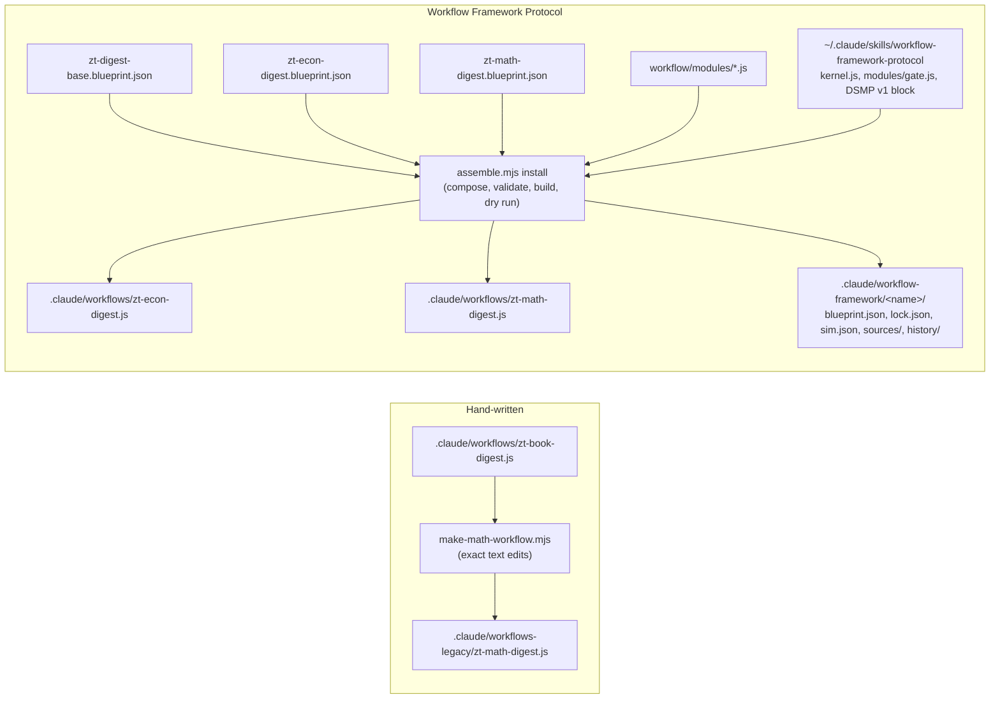
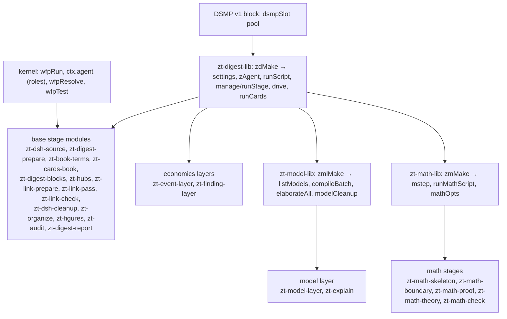

# Digest workflows

## Purpose

This block holds the Claude Code Workflow scripts that turn a book from the Scholar Archive into Cards in the agent Workspace: a Literature tree with one anchor per section group, Topic trees, Idea, Event, Finding, and Model Cards, Hub Cards, and a read-only audit. There are three digest workflows. `zt-book-digest` is hand-written. `zt-econ-digest` (economics books) and `zt-math-digest` (mathematics textbooks) are built by the Workflow Framework Protocol from one shared base blueprint, a variant blueprint each, and a library of stage modules, and are installed frozen. A workflow script does no Card work itself. It orchestrates agents: Haiku managers relay script commands and drive DeepSeek Harness conversations, one Sonnet architect plans each model batch, and Opus makes the Organize decisions. The PowerShell scripts do every structural step and DeepSeek writes the text. The block exists so that the stage order, the roles and their models, the DeepSeek Subagent Managed Protocol limits, and the failure policy stay fixed and testable while only data moves.

**Owns:** the stage graph and modes of each digest workflow, the args each one takes, the roles and models per stage, the Haiku manager prompts and the DeepSeek job driver (`drive`), the DeepSeek Subagent Managed Protocol limits in code, the base and variant blueprints, the stage modules, the installed scripts with their registry (lock, sim, sources), the generator of the legacy math workflow, and the stand-in-runtime harnesses.

**Does not own:** the PowerShell compilers and helpers that the stages run (`prepare-book-digest.ps1`, `card-compiler.ps1`, `model-compiler.ps1`, `math-compiler.ps1`, `hub-compiler.ps1`, `event-compiler.ps1`, `finding-compiler.ps1`, `organize-*.ps1`, `book-skeleton.ps1`, `attach-figures.ps1`, `digest-audit.ps1`, ...): see [Digest scripts](digest-scripts.md). The DeepSeek and architect instruction files (`dsh-*.zh.md`, `model-architect*.md`, the prefixes): see [Digest prompts](digest-prompts.md). The Card rules the checks apply: see [zt-check](zt-check.md). The Card operations the scripts call through the MCP server: see [MCP server](mcp-server.md) and [Card operations](card-operations.md). Model, unit, and Theory Card semantics: see [Models and math](models-and-math.md). Hub Card semantics: see [Hub Cards](hub-cards.md). Figure artifacts and Document links: see [Scholar bridge](scholar-bridge.md). The skills that describe how to run a digest (`zt-digest-protocol`): see [Agent skills](agent-skills.md).

## At a glance

| | |
|---|---|
| Entry points | `Workflow({ scriptPath: "E:\\zet\\.claude\\workflows\\<name>.js", args: {...} })` for `zt-book-digest`, `zt-econ-digest`, `zt-math-digest`; `node ~/.claude/skills/workflow-framework-protocol/tools/assemble.mjs install|verify|simulate ...` to build and install a framework variant; `node scripts/book-digest/make-math-workflow.mjs` to regenerate the legacy math workflow; `node scripts/book-digest/tests/*.mjs` for the harnesses |
| Key files | `.claude/workflows/zt-book-digest.js` — the hand-written book digest (one top-level script, all stages inline) |
| | `.claude/workflows/zt-econ-digest.js` — installed, frozen build of the economics variant (kernel + DSMP block + modules + embedded blueprint) |
| | `.claude/workflows/zt-math-digest.js` — installed, frozen build of the mathematics variant |
| | `scripts/book-digest/workflow/zt-digest-base.blueprint.json` — the base: shared stages, slots, args, roles, base modes, checkpoint |
| | `scripts/book-digest/workflow/zt-econ-digest.blueprint.json` — economics variant: profile, fills `after-digest` with models, explain, events, findings |
| | `scripts/book-digest/workflow/zt-math-digest.blueprint.json` — mathematics variant: profile, fills four slots with the math stages |
| | `scripts/book-digest/workflow/zt-econ-digest.sim.json`, `zt-math-digest.sim.json` — dry-run answers for `assemble.mjs install` |
| | `scripts/book-digest/workflow/modules/` — 26 modules: three libraries (`zt-digest-lib`, `zt-model-lib`, `zt-math-lib`) and 23 stage modules (table in Interfaces) |
| | `.claude/workflow-framework/<name>/` — install registry per variant: `blueprint.json` (composed), `lock.json`, `sim.json`, `sources/`, `history/<version>/` |
| | `scripts/book-digest/make-math-workflow.mjs` — generates `.claude/workflows-legacy/zt-math-digest.js` from `zt-book-digest.js` by exact text edits |
| | `scripts/book-digest/tests/workflow-harness.mjs` — stand-in runtime checks of `zt-book-digest.js` |
| | `scripts/book-digest/tests/math-workflow-harness.mjs` — checks of the legacy math workflow and the generator |
| | `scripts/book-digest/tests/framework-harness.mjs` — builds both variants in memory and runs every check of the other two harnesses plus the framework checks |
| Depends on | [Digest scripts](digest-scripts.md) (every command a stage runs), [Digest prompts](digest-prompts.md) (the files the DeepSeek jobs and the architect read), [zt-check](zt-check.md) (the self-checks the managers approve), [MCP server](mcp-server.md) (through the zt helper `C:\Users\chenx\.codex\skills\zt\scripts\zt-mcp.ps1`); external: the Claude Code Workflow runtime (`agent`, `parallel`, `pipeline`, `phase`, `log`, `args`), the DeepSeek Harness MCP bridge (`deepseek_run`, `deepseek_wait`, `deepseek_prompt`, `deepseek_respond`, `deepseek_delete`, `deepseek_list`, `deepseek_remove_workspace`, `deepseek_usage`), the global skills `workflow-framework-protocol` (kernel, `assemble.mjs`, `sim.mjs`, module `gate`) and `deepseek-subagent-managed-protocol` (the inlined DSMP v1 block) |
| Used by | [Agent skills](agent-skills.md) (`skills/zt-digest-protocol/SKILL.md`, `skills/zt-digest-protocol/references/scripts.md`, and `skills/zettelkasten/SKILL.md` name the workflows); the user, who starts a run from a Claude Code session |
| Tests | `scripts/book-digest/tests/framework-harness.mjs`, `scripts/book-digest/tests/workflow-harness.mjs`, `scripts/book-digest/tests/math-workflow-harness.mjs`; `make-math-workflow.mjs --check`; `assemble.mjs verify` |

## Concepts

- `Digest workflow` — a Workflow script that turns one book (or, in modes `hubs` and `audit`, the whole agent Workspace) into Cards. Three exist: `zt-book-digest`, `zt-econ-digest`, `zt-math-digest` (`.claude/workflows/`).
- `Mode` — a named subset of stages (`args.mode`, default `full`). `full` runs every stage; the other modes re-run single stages on an existing digest. Declared in each blueprint's `modes`; in `zt-book-digest.js` a chain of `if (MODE === ...) return` statements.
- `Section group` — one slice of the book (at most `maxChars` characters, `maxUnits` units) that `prepare-book-digest.ps1` writes as `<out>\groups\gNN.md`; group `n` owns the anchor Card `<key>/<n>` (a Direct successor line under the Literature Card). `groupsOf()` in `zt-digest-lib.js` gives `{ n, nn, file, snapshot, link }` per group.
- `Block` — up to `perManager` (default 5, at most 8) contiguous groups, run by one Haiku manager in book order (`toBlocks()`).
- `Book profile` — `consts.profile` of a variant: the digest instruction files, `noEventCandidates`, `digestPrefix`, `linkPrefix`, `compilerDocs`, `architectSupplement`, `skipForms`. The base leaves it `null`; each variant sets it (`zt-econ-digest.blueprint.json`, `zt-math-digest.blueprint.json`).
- `Base` and `variant` — the base blueprint (`"kind": "base"`) holds every stage all book types share plus four `slot`s (`after-prepare`, `after-digest`, `after-link`, `after-audit`); a variant names the base in `"base"`, sets the profile, and `fill`s the slots with its own layers.
- `Layer` — a book type's own stage set in a slot: the model layer (`models`, `explain`), the event layer (`events`), the empirical-results layer (`findings`), the math stages (`math-skeleton`, `math-boundary`, `math-proof`, `math-theory`, `math-check`).
- `Module` — one `defineModule({ id, version, requires, params, run })` block in `scripts/book-digest/workflow/modules/<id>.js`, framed by `// ==== module <id> v<version> ====` lines. A library module (`library: true`) holds shared functions and is never a stage.
- `Role` — `manager` (Haiku, effort `low`), `architect` (Sonnet), `organizer` (Opus), declared in `zt-digest-base.blueprint.json` `roles`. Modules start agents only through `ctx.agent`, so the role fixes the model and effort.
- `Kernel` — the Workflow Framework Kernel v1 that `assemble.mjs` copies into each installed script (`wfpRun`, `wfpArgs`, `wfpResolve`, `wfpTest`): it checks the fingerprint, deep-freezes the blueprint, args, and outputs, refuses undeclared args and modes, and runs the stage graph.
- `Frozen install` — an installed script whose embedded blueprint matches the `FINGERPRINT` stamped at install; any change makes it refuse to run. Its record is `lock.json` in `.claude/workflow-framework/<name>/`.
- `Checkpoint` — a stage at which `args.until` stops the run; the base declares `digest` (stop before the layers and the link pass).
- `DeepSeek Subagent Managed Protocol (DSMP)` — the run-wide rule: a Haiku manager runs at most 8 DeepSeek conversations, at most 8 managers are alive at once (64 conversations), conversations are deleted and never archived, and a workspace is removed when its work is done. `dsmpSlot` (the inlined DSMP block in the framework scripts, a copy in `zt-book-digest.js`) is the shared pool.
- `Compiler step` — one `pwsh -NoProfile -File <script>.ps1 -Step <s> ...` command whose last output line is compact JSON, often with a `jobs` list for DeepSeek. `drive()` runs it: one Haiku agent runs the command, managers run its jobs, an optional cleanup agent deletes the conversations.
- `Card cycle` — `runCards()`: `card-compiler.ps1` plan → DeepSeek JSON → apply in shares of `applyShare` jobs → check → up to `cardFixRounds` fix rounds → report (the Card layer rules of the glossary).
- `Model compiler` — `compileBatch()` in `zt-model-lib.js` (and in `zt-book-digest.js`): DeepSeek brief → Sonnet plan (`plan.json`) → script skeleton and DeepSeek fill → DeepSeek derive → DeepSeek review and script split (up to `reviewRounds`) → script report and cleanup. Concept models skip derive and review.
- `Elaboration level` — `concept` or `formal` on a Model Card; `args.level` forces one level for the run; concept models go in batches of `perConcept`, formal and undecided ones in batches of `perSonnet`.
- `Staging folder` — `args.out`: every file the run writes besides the Cards (see Data and storage).

## Architecture

### Two ways a digest script is made



- **Hand-written.** `zt-book-digest.js` is one top-level async script body: `export const meta`, a long args comment, constants read from `args`, then the stages in order with early `return`s per mode. `make-math-workflow.mjs` reads it, applies named edits (`rep` replaces a string that must occur exactly once; `between` replaces the text between two markers), and writes `.claude/workflows-legacy/zt-math-digest.js`. The legacy file lies outside this block's paths and is ignored by the wiki (`docs/wiki/README.md`), but the generator and `math-workflow-harness.mjs` keep it current.
- **Framework.** `assemble.mjs` loads the variant blueprint, composes it with its base (`composedFrom` in the registry `blueprint.json`), loads the framework module library and the blueprint's `"modules": ["./modules"]` folder, and writes one self-contained script: `meta` (built from the blueprint's description, whenToUse, and stage titles), the kernel, the DSMP v1 block, every module the blueprint uses, `const BLUEPRINT = {...}` (with `installed.modules`: id → version), `const FINGERPRINT = '...'`, and `return await wfpRun(BLUEPRINT, FINGERPRINT)`. The kernel, DSMP block, and module texts in both installed scripts are byte-identical to their sources.

### Module layers



Every stage module calls `zdMake(ctx, params)` (directly or through `zmlMake` / `zmMake`) and gets the settings and helpers back; it never keeps state between stages. Data moves between stages only through stage outputs that later stages read with `{{stages.<id>.output...}}` or `{"$ref": ...}` templates in their params.

### Control inside one compiler step (`drive`)

1. `driveAgent(label, o, 'command')`: one Haiku agent runs `o.command` once (timeout 600000) and returns its last line whole in `output`.
2. `zdLastJson(output)` parses the last JSON line; `expandJobs()` turns it into `{ id, files, prompt, continue?, fallback? }` jobs (a compact list from `card-compiler.ps1 -Compact` gives `dir`, `lead`, `prompts` once and `{ id, kind, file, continue? }` per job).
3. The jobs split into shares of `dshPerBatch` (8); up to `dshManagers` (8) lanes take shares in turn; each share is one Haiku manager (`driveAgent(..., 'jobs')`) inside `dsmpSlot`, which keeps every manager of the run under the 8-manager cap. A manager starts jobs with `deepseek_run` (or continues a session with `deepseek_prompt` when the job names `continue` and the step's session table holds it), keeps at most 8 running, approves only the listed read-only checks, reads, and writes under `o.writes`, retries once with a resume prompt, and does not delete conversations.
4. A job a manager did not report becomes `{ status: 'failed' }`.
5. With `o.cleanup`, a last Haiku agent lists the workspace `o.dsh`, deletes every conversation that is not running, removes the workspace with `delete_conversations: true`, and deletes the folder unless `o.keep`.

## Interfaces

### Workflows and their stages

#### zt-econ-digest (v3.0.0) and zt-math-digest (v2.1.0): the composed stage graph

The stage ids, modules, and `after` edges come from the registry `blueprint.json` of each variant; titles are the progress phases.

| Stage | Title | Module | After | Runs when (beyond its mode list) | On failure |
|---|---|---|---|---|---|
| `args` | Prepare | `gate` (framework) | — | always; checks `citationKey` (unless mode `hubs`/`audit`) and `source`, `bibtex`, `bookTitle` (mode `full`) | halt |
| `source` | Prepare | `zt-dsh-source` | args | not in modes `figures`, `audit` | halt |
| `prepare` | Prepare | `zt-digest-prepare` | source | mode `full` runs the script; other modes take `args.groups` | halt |
| `math-skeleton` (math) | Prepare | `zt-math-skeleton` | prepare | mode `full` | halt |
| `terms` | Prepare | `zt-book-terms` | prepare (econ), math-skeleton (math) | `args.terms != false` | continue |
| `cards-book` | Cards | `zt-cards-book` | terms | mode `cards` | halt |
| `digest` | Digest | `zt-digest-blocks` | cards-book | mode `full` (only in its list) | halt |
| `models` | Models | `zt-model-layer` | digest | (`full` and `args.models != false`) or mode `models` | halt |
| `explain` | Models | `zt-explain` | digest | mode `explain` | halt |
| `events` (econ) | Events | `zt-event-layer` | digest | mode `full` or `events`, `args.events != false` | halt |
| `findings` (econ) | Findings | `zt-finding-layer` | digest | mode `full` or `findings`, `args.findings != false` | halt |
| `math-boundary` (math) | Boundary | `zt-math-boundary` | models | mode `full` or `math`, `args.boundary != false` | halt |
| `math-proof` (math) | Proof | `zt-math-proof` | math-boundary | mode `full` or `math`, `args.proof != false` | halt |
| `hubs-first` | Hubs | `zt-hubs` | econ: models, explain, events, findings; math: explain, math-proof | mode `hubs` | halt |
| `link-prepare` | Link | `zt-link-prepare` | hubs-first | modes `full`, `link` | halt |
| `link` | Link | `zt-link-pass` | link-prepare | modes `full`, `link` | halt |
| `link-check` | Cards | `zt-link-check` | link | `args.cardChecks != false` | halt |
| `math-theory` (math) | Theory | `zt-math-theory` | link-check | mode `full` or `math`, `args.theory != false` | halt |
| `cleanup` | Cleanup | `zt-dsh-cleanup` | link-check (econ), math-theory (math) | modes `full`, `link` | halt |
| `organize` | Organize | `zt-organize` | cleanup | mode `full`, or `args.organize` matches `^(true\|legacy)$` | continue |
| `figures` | Figures | `zt-figures` | organize | mode `figures`, or `args.figures != false` | halt |
| `hubs` | Hubs | `zt-hubs` | figures | (`full` and `args.hubs != false`) or (`link` and `args.hubs` true) | halt |
| `audit` | Audit | `zt-audit` | hubs | mode `audit`, or `args.audit != false` | halt |
| `math-check` (math) | Audit | `zt-math-check` | audit | mode `math`, or (`args.audit != false` and `citationKey` set) | halt |
| `report` | Report | `zt-digest-report` | audit (econ), math-check (math) | always | halt |

"halt" is the kernel default (`onFail` missing). Most modules log and return `{ status: 'failed', ... }` instead of throwing, so their stage still ends `done`; only a thrown error fails a stage. The modules that throw: `zt-dsh-source` (no source answered), `zt-digest-prepare` (prepare failed, or no groups in modes `full`/`link`), `zt-digest-blocks` (every group failed), `zt-link-prepare` (script failed), `zt-math-skeleton` (index, docs, or skeleton failed), `zt-model-layer` (listing failed, only in mode `models`), and `gate`.

#### Modes

| Mode | zt-book-digest | zt-econ-digest | zt-math-digest | Stages it runs (framework) | Needs |
|---|---|---|---|---|---|
| `full` | yes | yes | yes | all | `out`, `citationKey`, `source`, `bibtex`, `bookTitle` |
| `link` | yes | yes | yes | args, source, prepare, link-prepare, link, link-check, cleanup, organize, hubs, report | `groups` |
| `cards` | yes | yes | yes | args, source, prepare, cards-book, report | `citationKey`, `out` |
| `hubs` | yes | yes | yes | args, source, prepare, hubs-first, organize, report | `out` only |
| `figures` | yes | yes | yes | args, figures, report | `citationKey`, `out` |
| `audit` | yes | yes | yes | args, audit, report | `out` (`citationKey` optional: one book, else every book) |
| `models` | yes | yes | yes | args, source, prepare, models, organize, report | `citationKey`, `out` |
| `explain` | yes | yes | yes | args, source, prepare, explain, report | `citationKey`, `out` (`only` for a pilot) |
| `events` | no | yes | no | args, source, prepare, events, report | `citationKey`, `out` |
| `findings` | no | yes | no | args, source, prepare, findings, report | `citationKey`, `out` |
| `math` | no | no | yes | args, source, prepare, math-boundary, math-proof, math-theory, math-check, report | `citationKey`, `out` |

A stage outside the mode passes through with status `not-in-mode` once every stage it waits for has ended, so the order holds. `args.until: "digest"` (framework only) stops the run after the `digest` stage.

#### zt-book-digest (hand-written)

Order in mode `full`: source probe → `prepare-book-digest.ps1` → term table → digest blocks (each block's model compiler and card cycle start as soon as that block's manager returns, side by side) → whole-book model sweep (`find models: sweep`, `elaborateAll` on any Model Card no block covered) → model cleanup → link preparation → link pass → link check → cleanup → Organize → Figures → Hubs → Audit. Its digest runs write Idea, Event, and Model Cards themselves (no `-Instructions`, event candidates stay in the group files). It has no event, finding, or math layer and no `until`.

### Roles and models per stage

| Work | Agent | Model | Where |
|---|---|---|---|
| Source probe, prepare, every script relay, list models, cleanups | one agent per command | Haiku (`manager`, effort `low`) | `zdMake().runScript`, `zt-dsh-source`, `zt-digest-prepare`, `zt-link-prepare`, `zt-dsh-cleanup`, `zmlMake().listModels`, `zmMake().runMathScript` |
| Digest and link runs | one manager per block (digest: runs in order; link: all at once) | Haiku | `manage()` in `zt-digest-lib.js` |
| Compiler step jobs (cards, terms, models, hubs, events, findings, explain, skeleton, math) | step agent + one manager per 8 jobs + cleanup agent | Haiku | `drive()` |
| Hub limits | hub manager | Haiku | `zt-hubs.js` |
| Model plan (`plan.json`) | one architect per batch | Sonnet (`architect`, model default effort) | `compileBatch()` in `zt-model-lib.js` |
| Organize decisions (`decisions.json`), or the legacy single job | one agent | Opus (`organizer`) | `zt-organize.js` |
| All reading and writing of Card text | DeepSeek Harness conversations | DeepSeek V4.1 Flash, effort `high` or `max` | started by the Haiku managers |

`zAgent` in `zt-digest-lib.js` maps `model: 'sonnet'` to role `architect`, `'opus'` to `organizer`, and everything else to `manager`; it drops any `effort` a caller passes. `zt-book-digest.js` passes `model` and `effort: 'low'` to `agent()` itself, and `architectEffort` to the Sonnet architect.

DeepSeek skills sent in the `skills` field: digest and link runs `['zettelkasten', 'asd-ste100-zh']`; fill, derive, split, card, term, hub, event, finding, skeleton, explain, and math jobs `['asd-ste100-zh']`; brief and review jobs none.

### The args object

Pass an object, never free text. In the framework scripts `wfpArgs` refuses any key not declared (besides `mode` and `until`), checks types, enums, and `min`/`max`, and throws when `out` is missing. In `zt-book-digest.js` a missing field returns `{ stage: 'args', error }`.

Base args (all three workflows; `zt-book-digest` reads the same names):

| Arg | Type | Default (from code) | Meaning |
|---|---|---|---|
| `out` | string, required | — | the staging folder |
| `citationKey` | string | — | the book's BibTeX key (all modes but `hubs`, `audit`) |
| `source`, `bibtex`, `bookTitle` | string | — | the bilingual Markdown, the BibTeX entry, the title (mode `full`) |
| `fileId` | any | read from the source path | the Scholar Archive file id of the book Markdown |
| `startHeading`, `endHeading`, `skipHeadings` | string | none | where the text starts and stops; headings whose units are left out (`参考文献,习题`) |
| `groups` | number | — | the existing group count (modes `link`, `models`) |
| `organize` | any | false | `true`: Organize after modes `link`, `models`, `hubs`; `"legacy"`: the old single Opus job |
| `perManager` | number ≥ 1 | 5, capped at 8 | groups per digest manager |
| `maxChars`, `maxUnits` | number | 20000, 3 | group size for `prepare-book-digest.ps1` |
| `dshSource` | `auto` \| `official` \| `opencode` | `auto` | where DeepSeek V4.1 Flash runs |
| `dshModel` | string | — | any DeepSeek Harness model; overrides `dshSource` |
| `dshEffort` | string | `high` | every DeepSeek job without its own effort arg (digest, link, fill, card, term, event, finding, skeleton, explain, math); raised to `high` unless `high`/`max` |
| `models` | boolean | true | false skips the model stage |
| `rebuild` (`redoModels`) | boolean | false | rebuild models that already have parts |
| `perSonnet`, `perConcept` | number ≥ 1 | 6, 10 | formal and concept models per architect batch |
| `dshPerBatch` (`dshPerSonnet`) | number ≥ 1 | 8, capped at 8 | jobs per Haiku manager |
| `dshManagers` | number ≥ 1 | 8, capped at 8 | managers of one compiler step in parallel |
| `linkPerManager` | number ≥ 1 | 8, at least `perManager`, at most 8 | link runs per link manager |
| `applyShare` | number ≥ 1 | 30 | jobs per card-cycle apply call |
| `only` | array | all | Model Card addresses (modes `models`, `explain`; a pilot) |
| `level` | `concept` \| `formal` | each model's own | force one elaboration level |
| `briefEffort`, `deriveEffort`, `reviewEffort` | string | `high` | DeepSeek effort per compiler round (raised to `high`) |
| `reviewRounds` | number ≥ 0 | 2 | review, split, review again; 0 skips |
| `maxSentences`, `maxPartChars`, `maxSteps` | number | 12, 400, 6 | Card size of a formal model part (`-MaxSentences`, `-MaxChars`, `-MaxSteps`) |
| `maxExplainSentences`, `maxExplainChars` | number | 16, 600 | explanation budget of a Derivation part |
| `hubs` | boolean | true in `full`, false in `link` | run the hub stage |
| `hubWork` | string | `D:\zt-digest\hubs` | hub folder and DeepSeek workspace |
| `hubLimits` | object | — | overrides the hub manager's limits |
| `hubTrees`, `hubRebuild` | string, boolean | all, false | a pilot on these Topic trees; rewrite every hub |
| `hubEffort`, `hubFixRounds` | string, number ≥ 0 | `high`, 1 | hub writer effort; check-fix-apply rounds |
| `terms`, `audit`, `figures` | boolean | true | false skips that stage in mode `full` |
| `cardChecks` | boolean | true | false skips the card cycles in modes `full` and `link` |
| `ideaSample` | number 0–1 | 0.1 in `full`, else 0 | share of fault-free Idea Cards reviewed against the source |
| `cardRules` | string | all hard rules | the rules the card cycle fixes (`-Rules`) |
| `cardFixRounds` | number ≥ 0 | 1 | card check-fix-apply rounds |
| `cardMax` | number ≥ 1 | — | pilot cap on Cards with faults and orphans (`-MaxCards`) |
| `explainMax` | number ≥ 1 | — | pilot cap on Derivation parts in mode `explain` (`-MaxParts`) |

Only `zt-book-digest`: `architectEffort` (the Sonnet architect's effort). The framework scripts refuse it.

`zt-econ-digest` adds `events` and `findings` (boolean; false skips that layer).

`zt-math-digest` adds:

| Arg | Type | Default | Meaning |
|---|---|---|---|
| `supply` | `none` \| `examples` \| `examples+answers` | `examples` | what DeepSeek may add that the book does not give (`-Supply`) |
| `unitsPerJob` | number ≥ 1 | 4 | units per boundary or proof job |
| `mainResults` | number ≥ 1 | 7 | main results per Theory Card |
| `coreBudget` | number ≥ 1 | 3 | declared, but no module passes it on (see pitfalls) |
| `notation`, `boundary`, `proof`, `theory` | boolean | true | false skips that math stage |

Control args: `mode` (see Modes) and `until` (framework only, value `digest`).

### Results

- `zt-book-digest.js` returns the result object directly: in mode `full` (and `link`, and `models`/`hubs` with `organize`) `{ mode, dsh_model, book, citation_key, groups, managers_per_pass, digest, models, model_cleanup, link, terms, cards: { blocks, link }, deepseek_usage, cleanup, organize, figures, hubs, audit }`; a single-stage mode returns `{ mode, ..., <stage>: report }`; an early stop returns `{ stage, error, ... }`.
- The framework scripts return the kernel report `{ workflow, version, fingerprint, mode, order, halted, stoppedAt, stages: { <id>: { status, error? } }, result, deepseek }`. `result` is the `report` stage's output, which `zt-digest-report.js` shapes like `zt-book-digest.js` did for each mode; the variant's `extra` adds `events` and `findings` (econ) or `math: { index, docs, skeleton, notation, boundary, proof, theory, check }` (math). In modes `events`, `findings`, and `math` it returns `{ mode, dsh_model, citation_key, ...extra }`. After a halt `report` never ran, so `result` is undefined and `halted` names the stage and error. `deepseek` is the DSMP block's `dsmpLog`, which the digest modules do not feed (they use `drive`, not `dsDispatch`).

### Modules

Library modules (no stage; their top-level names carry a prefix because all modules share one script):

| Module | Version | Requires | Exports |
|---|---|---|---|
| `zt-digest-lib` | 2 | `@dsmp` | constants `ZD_SCRIPTS`, `ZD_HELPER`, `ZD_DSH_SOURCES`, `ZD_PER_MANAGER_MAX` (8), `ZD_MAX_MANAGERS` (8), `ZD_USAGE`, `ZD_USAGE_STEP`, `ZD_RUN_SCHEMA`; `zdJsonIn(line)`, `zdLastJson(text)`, `zdDefaultModel(A)`; `zdMake(ctx, p)` returning the settings (`A, MODE, KEY, OUT, SCRIPTS, DSH_MODEL, DSH_EFFORT, MODELS, CARD_CHECKS, IDEA_SAMPLE, LIMITS, COMPILER, FILL_SKILLS, HUB_*, PER_MANAGER, LINK_PER_MANAGER, raised, profile, ARCH_DOC, ARCH_SUPPLEMENT, MODEL_WORK, PER_SONNET, PER_CONCEPT, DSH_PER_BATCH, REBUILD, LEVEL, *_EFFORT, REVIEW_ROUNDS, COMPILER_DOCS, SKIP_FORMS`) and helpers `zAgent, runScript, groupsOf, toBlocks, runStage, drive, expandJobs, answerLines, runCards, cardBlock` |
| `zt-model-lib` | 1 | `zt-digest-lib` | `zmlMake(ctx, p)` → `{ Z, listModels(selector, label), elaborateAll(models, label), logModels(reports), modelCleanup(), dshJobs() }`; internal `compileBatch(batch, kind)` |
| `zt-math-lib` | 1 | `zt-digest-lib` | `zmMake(ctx, p)` → `{ Z, A, MATH_WORK, SUPPLY, UNITS_PER_JOB, MAIN_RESULTS, mstep(step, more), runMathScript(what, step, extra, phase), mathOpts(stage, phase) }` |

Stage modules. Every one takes `args` (`{{args}}`, required) and `mode` (`{{mode}}`, required); most also take `model` (`stages.source.output.model`).

| Module | Ver | Other params | Runs | Output |
|---|---|---|---|---|
| `zt-dsh-source` | 1 | — | with `dshSource: auto`, a Haiku probe in `<out>\dsh-probe` asks the official source, then OpenCode Go, for `ok`; throws when neither answers; logs efforts raised to high | `{ source, model, errors? }` |
| `zt-digest-prepare` | 2 | `needGroups` (`['full','link']`), `instructions`, `noEventCandidates` | mode `full`: `prepare-book-digest.ps1 ... -Instructions '<files>' [-NoEventCandidates] -Apply` and a `deepseek_usage` reading | `{ groups, usage_before }` |
| `zt-book-terms` | 1 | — | `book-terms.ps1 -Step plan`, then `-Step apply -Apply` with cleanup, workspace `<out>\terms` | `{ report }` (null on failure) |
| `zt-cards-book` | 1 | — | `runCards('whole book', <out>\cards, [-Sample])` with orphans | the card cycle report |
| `zt-digest-blocks` | 2 | `profile`, `groups` | `runStage('digest', blocks, afterBlock)`: each block's card cycle (`-Groups "<list>" -Sample <s> -NoOrphans`) starts when its manager returns; throws when no group is done | `{ reports, cards, managers }` |
| `zt-model-layer` | 1 | `profile` | `list-models.ps1 -All -CitationKey <key>`, `elaborateAll`, `modelCleanup` | `{ models, model_cleanup, error? }` |
| `zt-explain` | 2 | — | `model-compiler.ps1 -Step explain`, `explain-apply` (twice when refused parts went back), `explain-report`; models from `only` or every non-concept Model Card | `{ status, parts, applied, refused, report }` |
| `zt-event-layer` | 1 | — | `event-compiler.ps1 -Step plan` → `apply -Apply` → `report` (cleanup), workspace `<out>\events` | `{ status, plan, applied, report }` |
| `zt-finding-layer` | 1 | — | `finding-compiler.ps1 -Step plan` → `apply -Apply` → `report` (cleanup), workspace `<out>\findings` | `{ status, plan, applied, report }` |
| `zt-math-skeleton` | 1 | — | `math-compiler.ps1 -Step index`, `docs`, `skeleton -Apply` (throws on a failure); then `notation` and `notation-apply -Apply` unless `notation: false` | `{ index, docs, skeleton, notation? }` |
| `zt-math-boundary` | 1 | — | `boundary -UnitsPerJob -Supply` → `boundary-apply -Supply` → `boundary-settle` (cleanup) | `{ status, plan, applied, settled }` |
| `zt-math-proof` | 1 | — | `proof -UnitsPerJob` → `proof-apply` (cleanup) | `{ status, units, applied }` |
| `zt-math-theory` | 1 | — | `theory -MainResults` → `theory-apply -MainResults` (cleanup) | `{ status, theories, applied }` |
| `zt-math-check` | 1 | — | `math-compiler.ps1 -Step check -Out <out>` (read-only) | the script's JSON, or `{ status: 'failed' }` |
| `zt-hubs` | 1 | — | Haiku hub manager (`hub-compiler.ps1 -Step survey`, limits by fixed rules), then `plan -Limits '<json>' [-Trees] [-Rebuild]`, `apply`, `check` + fix rounds, `report` (cleanup), workspace `hubWork` | `{ status, limits, reasons, trees, applied, report }` |
| `zt-link-prepare` | 1 | `groups` | `prepare-link-pass.ps1 -Staging <out>`; usage reading in mode `link`; throws on failure | `{ pending, owned_total, unowned, usage_before }` |
| `zt-link-pass` | 1 | `profile`, `groups`, `pending` | `runStage('link', blocks of linkPerManager)` on the pending groups | `{ reports }` |
| `zt-link-check` | 1 | — | `runCards('link check', <out>\cards-link)`: all hard rules in mode `full`, else `cardRules` or `L1,L2` | the card cycle report |
| `zt-dsh-cleanup` | 1 | `usageBefore`, `usageBeforeLink`, `groups`, `linkRuns` | deletes leftover conversations in `<out>`, removes the workspace, deletes scratch files, reads usage | `{ cleanup, usage }` |
| `zt-organize` | 1 | `groups`, `digest`, `link`, `models`, `modelsBook` | survey → Opus `decisions.json` → `organize-apply.ps1` → notes card cycle → `book-skeleton.ps1` plan/apply; or the legacy Opus job | `{ survey, decisions, applied, notes, skeleton }` (legacy: the Opus report text) |
| `zt-figures` | 1 | — | `attach-figures.ps1 -CitationKey -Staging [-FileId] -Report <out>\figures-report.json -Apply` | `{ status, ...summary }` |
| `zt-audit` | 1 | — | `digest-audit.ps1 [-CitationKey] -Out <out>` (read-only) | `{ status, ...summary }` |
| `zt-digest-report` | 2 | `groups`, `digest`, `models`, `terms`, `cardsBook`, `explain`, `hubsFirst`, `link`, `linkCheck`, `cleanup`, `organize`, `figures`, `hubs`, `audit`, `extra` | no agent; assembles the result per mode | the run's result |

`gate` v1 comes from `~/.claude/skills/workflow-framework-protocol/modules/gate.js`: params `subject`, `checks`; it throws `gate: <message>` on the first failed check.

### The generator

```text
node scripts/book-digest/make-math-workflow.mjs           writes .claude/workflows-legacy/zt-math-digest.js, prints "N edits (...)"
node scripts/book-digest/make-math-workflow.mjs --check   compares with the file on disk; exit 0 "up to date", exit 1 "out of date"
```

Its edits, in order: the `meta` block (name, description, the 13 math phases); `DIGEST_PREFIX` → `math-prefix.md` and `LINK_PREFIX` → `math-link-prefix.md`; the math settings after `APPLY_SHARE` (`MATH_COMPILER`, `ARCH_MATH_DOC`, `MATH_WORK`, `MATH_DOC_ARGS`, `SUPPLY`, `UNITS_PER_JOB`, `MAIN_RESULTS`, `BOUNDARY`, `PROOF`, `THEORY`, `NOTATION`); `-BriefDoc/-FillDoc/-ReviewDoc` on every model-compiler step; the architect reads `model-architect-math.md`; Theory Cards out of `elaborateAll`; mode `math` needs no groups; index, docs, skeleton, and notation before the term table; Boundary and Proof before the link pass, and mode `math`'s early return; Theory after the link check; the math check after the audit; `math: mathReports` in the result; the math stage functions before the card cycle. Each `rep` throws `expected one match, found N` when its anchor text is not unique; it keeps CRLF line ends when the source has them.

## Behaviour

### A framework run (kernel)

1. `wfpRun(BLUEPRINT, FINGERPRINT)` recomputes `wfpFingerprint(wfpStable(BP))` and throws "This workflow's blueprint was changed after it was installed" on a mismatch; it checks each `installed.modules` id and version against the defined modules.
2. `wfpArgs` checks the args against the declarations; an undeclared mode or `until` throws.
3. The stage loop starts every ready stage (all `after` ended) at once; stages outside the mode pass through as `not-in-mode`; a stage whose `when` fails ends `skipped`. A stage with a failed or blocked dependency whose `onFail` is not `continue` ends `blocked`.
4. A stage's params are resolved from the frozen scope (`args`, `mode`, `consts`, `stages`) and frozen; the module's `run(ctx, params)` gets a frozen `ctx` with `agent`, `log`, `role`, `mode`, `args`, `stage`, `phase`.
5. A failed stage with `onFail` `halt` stops new stages; running stages finish. `until` stops after the named stage.
6. The report lists `order`, each stage's status, and `result` (`stages.report.output`).

### Mode full, economics

1. `args` gate; `source` picks the DeepSeek model; `prepare` runs `prepare-book-digest.ps1` with `-Instructions 'dsh-digest-base.zh.md,dsh-model-cards.zh.md' -NoEventCandidates`.
2. `terms`: `book-terms.ps1` plan and apply (Term table Card); a failure continues.
3. `digest`: one Haiku manager per block. For each group in order it snapshots the slip-box (`snapshot-topics.ps1 -Out <out>\snapshot-gNN.md`), starts `deepseek_run` with `prompt_files [<out>\shared-prefix.md, <out>\groups\gNN.md]`, waits, retries once, parses the one-line JSON, and deletes the conversation. As each block's manager returns, `cardBlock` runs its card cycle in `<out>\cards-gNN`.
4. `models`, `events`, `findings` start together after `digest` (they all wait only for it). `models`: `elaborateAll` batches the Model Cards that still need parts and runs `compileBatch` per batch in parallel, then the late cleanup sweep. `events`/`findings`: plan, DeepSeek JSON with SELF-CHECK, apply, report.
5. `link-prepare` lists pending groups; `link` runs one manager per `linkPerManager` pending groups, all runs at once, each writing `<out>\linked-gNN.txt` when done; `link-check` runs the card cycle with orphans on the whole book.
6. `cleanup` deletes leftover conversations in `<out>`, removes the workspace, deletes scratch files, and computes DeepSeek usage against the Prepare reading.
7. `organize` (continue on failure), `figures`, `hubs` (whole agent Workspace), `audit` (read-only), `report`.

### Mode full, mathematics

As economics, with: `math-skeleton` after `prepare` (index, docs, skeleton with `-Apply`, notation table); the digest reads `math-prefix.md` and the link pass `math-link-prefix.md` (both written by `math-compiler.ps1 -Step docs`); every model-compiler step gets `-BriefDoc "<out>\math\brief.zh.md" -FillDoc "<out>\math\fill.zh.md" -ReviewDoc "<out>\math\review.zh.md"`; the architect also reads `model-architect-math.md`; Model Cards with `form: theory` never enter the model compiler; `math-boundary` then `math-proof` after `models`; `math-theory` after `link-check`; `math-check` after `audit`. No event or finding layer.

### The model compiler per batch (`compileBatch`)

1. **Brief.** `model-compiler.ps1 -Step brief -Models "<a,b>" [-Rebuild] [-Level]` in workspace `<out>\models\m-<slug of first address>`; DeepSeek jobs at `briefEffort`, no skills. Models in `skipped` drop out.
2. **Plan.** One Sonnet agent reads `model-architect.md` (plus the profile's supplement) and writes `plan.json` per model under `DIR`; it returns `plans: [{ model, status: planned|skipped|failed, level, parts, derivations, chains, notes, summary }]`. With no `planned` model, the batch runs `report` with cleanup and returns.
3. **Fill.** `-Step apply`; jobs at `dshEffort` with `asd-ste100-zh`. Any answer line `{"status":"split","address","need":N>1}` triggers `-Step split -Need "<addr>=<n>;..."`, continuing the same conversations.
4. **Derive** (only when a planned model has `derivations > 0`), at `deriveEffort`, then splits.
5. **Review** up to `reviewRounds` times (`-Changed` after the first), at `reviewEffort`; the verdict lines' `split` and `fix` counts decide whether `-Step split` runs; zero of both stops the loop.
6. **Report** with cleanup: deletes the batch's conversations, removes its workspace, deletes its folder (`keep` is not set). The result per model merges the script's report with the plan's `notes` and `summary`; faults and `todo` (待写) parts join `issues`.

`elaborateAll` filters out `skipForms`, keeps `only`, keeps models that need work (`rebuild`, a forced level that differs, or no parts or open issues), sorts by group number then address, and runs every batch in `parallel`. `modelCleanup` then sweeps every batch folder for conversations a failed batch left.

### The card cycle (`runCards`)

1. `card-compiler.ps1 -Step plan -Work <work> -Compact -Book <key> -Staging <out> [-Rules] [-MaxCards] <extra>`; no output fails the cycle.
2. No jobs: `report` with cleanup, status `done`.
3. `applyAll`: `-Step apply -MaxJobs <applyShare>` repeated while `pending_jobs` is nonzero (at most 100 calls).
4. Up to `cardFixRounds`: `-Step check` (its follow-up jobs continue their conversations), then `applyAll` again; stop when no follow-up jobs.
5. `-Step report` with cleanup. Status `done` only when both the last apply and the report gave output.

### The hub stage (`zt-hubs`)

1. The Haiku hub manager runs `hub-compiler.ps1 -Step survey -Work <hubWork>` and picks the limits by fixed rules: `topic_min` = `tree_cards.p25` in [5, 12]; `line_min` = `branch_cards.p90` in [6, 20] and at least `topic_min`; `max_lines` = `tree_cards.p75` in [15, 25]; `max_groups` 7 (5 when `max_lines` < 18); `min_reason` 8; `neighbour_links` = median in [2, 6] (3 when n is 0); `field_min` 3; `field_max` = √topics in [6, 15]; `per_job` 6/4/2 by median tree size (≤15, ≤30, more).
2. `args.hubLimits` overrides those keys.
3. `plan` (writes jobs, one is the field planner) → `apply` → `check` and fix rounds (`hubFixRounds`) → `report` with cleanup; the folder and its `state.json` stay.

### Organize (`zt-organize`)

1. `organize-survey.ps1 -Staging <out> -Work <out>\organize` writes `survey.md`.
2. Opus reads it (read-only zt calls through the helper) and writes `<out>\organize\decisions.json`: `thesis` (≤ 40 characters), `merges`, `moves` (only Idea and Event Cards of Topic trees), `notes` (only Idea Cards, Event Cards, anchors). It makes no zt write.
3. `organize-apply.ps1 -Work <out>\organize` carries out merges and moves.
4. Notes go to a card cycle in `<out>\cards-notes` with `-Notes "<decisions.json>" -NoOrphans` (all hard rules in mode `full`, else `N1`).
5. `book-skeleton.ps1` plan, then apply with `-Decisions ... -Apply` and cleanup: the Literature Card index, the structure Card, the Topic bodies.
6. `organize: "legacy"`: one Opus agent does all of it through the zt helper (the old job).

### Rules the code keeps

- **DSMP limits.** `perManager`, `dshPerBatch`, `dshManagers`, and `linkPerManager` are capped at 8 in code. Every manager prompt (`manage`, `driveAgent` jobs) runs inside `dsmpSlot`; step agents and cleanup agents never take a slot. Managers never archive; digest and link managers delete each conversation after its answer; compiler-step managers leave conversations for later rounds and the step's cleanup deletes them.
- **Efforts.** `atLeastHigh` turns any DeepSeek effort other than `high`/`max` into `high` and records it in `raised`; `zt-dsh-source` logs the list.
- **Pipelines, not barriers.** Inside `digest`, a block's card cycle (and in `zt-book-digest.js` its model compiler) starts when that block's manager returns; a follow-up error is logged and the block still reports.
- **Missing reports are failures.** A group a manager did not report becomes `{ status: 'failed', errors: 'no report from its manager' }`; a job a step manager did not report becomes `failed`.
- **JSON parsing.** `zdLastJson` takes the last line that holds a JSON object, also after prose on the same line; the step agent is told to return the line whole even when it is tens of kilobytes.
- **Approvals.** Digest and link managers allow only `zt-mcp.ps1` calls, `zt-check`, and read-only reads under `out` or of `source`, and reject every write. Compiler-step managers also allow the read-only `-Step precheck` of the card, hub, event, and finding compilers, `model-compiler.ps1 -Step explain-check`, `book-skeleton.ps1 -Step apply` without `-Apply`, and writes under the step's `writes` folder (else the one file the prompt names). Questions get "按任务说明自行决定，不需要询问。". (`zt-book-digest.js` names no event or finding precheck: it has no such layer.)
- **Skills.** A missing skill marks the group failed; the manager never starts a run without its skills and never pastes a skill into a prompt.
- **Usage.** `zt-dsh-cleanup` subtracts the `deepseek_usage` reading taken at Prepare (mode `full`) or at the link preparation (mode `link`) and averages per digest and link run.

## Data and storage

### Install registry (`.claude/workflow-framework/<name>/`)

| File | Content |
|---|---|
| `blueprint.json` | the composed blueprint (base stages with the variant's fills, params merged, `composedFrom: { base: "zt-digest-base", version: "2.0.0" }`) |
| `sources/` | the variant and base blueprints as written (identical to `scripts/book-digest/workflow/` at install) |
| `sim.json` | the dry-run answers used at install (identical to `scripts/book-digest/workflow/<name>.sim.json`) |
| `lock.json` | what was installed (below) |
| `history/<version>/` | `blueprint.json` and the script of each installed version (econ 1.0.0, 2.0.0, 3.0.0; math 2.0.0, 2.1.0); outside this block's paths |

`lock.json` (abridged from `zt-econ-digest/lock.json`):

```json
{
  "protocol": "workflow-framework-protocol/1",
  "name": "zt-econ-digest", "version": "3.0.0", "scope": "project",
  "script": ".claude/workflows/zt-econ-digest.js",
  "sha256": "e9a0b994…", "fingerprint": "421596fda65691f4", "blueprintSha256": "6084645e…",
  "modules": { "gate": "1", "zt-digest-lib": "2", "zt-explain": "2", "...": "1" },
  "moduleFiles": { "zt-digest-lib": { "file": "scripts/book-digest/workflow/modules/zt-digest-lib.js", "sha256": "0de75711…" } },
  "sources": [ { "file": "scripts/book-digest/workflow/zt-econ-digest.blueprint.json", "sha256": "515ae7e9…" } ],
  "base": "./zt-digest-base.blueprint.json",
  "installedAt": "2026-10-16T06:59:53.152Z",
  "dryRun": { "agents": 38, "order": ["args", "source", "prepare", "terms", "…", "report"] }
}
```

`sha256` is the installed script's hash, `fingerprint` the FNV-1a fingerprint of the embedded blueprint, `blueprintSha256` the hash of the registry `blueprint.json`. The math lock records 47 dry-run agents.

### sim.json (dry-run answers)

```json
{
  "args": { "out": "D:/x/Key", "citationKey": "Key", "source": "S.md", "bibtex": "@book{Key}", "bookTitle": "书" },
  "answers": [
    { "label": "^prepare book$", "answer": { "ok": true, "groups": 2, "usage_before": { "input_cache_miss": 0, "cached_read": 0, "output": 0, "cost": 0, "calls": 0 } } },
    { "prompt": "event-compiler.ps1\" -Step plan", "answer": { "ok": true, "output": "{\"candidates\":2,\"groups\":2,\"jobs\":[]}", "results": [] } }
  ]
}
```

`sim.mjs` answers an agent with the first entry whose `label` regex matches the agent label and whose `prompt` regex matches the prompt; an unmatched agent gets a minimal answer built from its schema.

### Staging folder (`args.out`)

| Path | Written by | Kept |
|---|---|---|
| `groups\gNN.md`, `shared-prefix.md`, `link-prefix.md`, the manifest, the Chinese text | `prepare-book-digest.ps1` | yes |
| `snapshot-gNN.md`, `link-gNN.md`, `allow-g*.txt`, `*calls*.json` | digest managers, `prepare-link-pass.ps1`, helpers | deleted by `zt-dsh-cleanup` |
| `owned-gNN.txt`, `cards-all.md` | digest runs, link preparation | yes |
| `linked-gNN.txt` | link managers (`Set-Content ... -Value done`) | yes |
| `dsh-probe\` | source probe | deleted by the probe |
| `terms\`, `terms\out\` | term table step | yes |
| `cards-gNN\` (first group of a block), `cards\`, `cards-link\`, `cards-notes\` | card cycles (`state.json`, `report.json`, `out\`) | yes |
| `models\m-<slug>\` | model compiler batch | deleted by the batch cleanup and the sweep |
| `explain\`, `events\`, `findings\` | explain, event, finding layers | yes |
| `organize\survey.md`, `organize\decisions.json` | survey, Opus | yes |
| `skeleton\` | `book-skeleton.ps1` | yes |
| `math\index.json`, `math\index.md`, `math\brief.zh.md`, `fill.zh.md`, `review.zh.md`, `math-prefix.md`, `math-link-prefix.md`, `math\notation\`, `math\boundary\`, `math\proof\`, `math\theory\` | `math-compiler.ps1` and its jobs | yes |
| `figures-report.json` | `attach-figures.ps1` | yes |
| `audit.json`, `audit.md`, `audit-faults.txt`, `math-audit.json`, `math-audit.md` | audit, math check | yes |

`hubWork` (default `D:\zt-digest\hubs`) holds the hub stage's `state.json` (each tree's hubs, so a later run rewrites only trees that changed) and `out\`; it is shared by every book.

### Wire formats between agents and the script

- Digest manager answer: `{ reports: [{ group, status: done|failed, cards, models, events, links, topics, errors, deleted, tool_calls, context_used }] }`.
- Compiler step line: `{ ..., jobs: [{ id, files, prompt, continue?, fallback? }] }`, or the compact form `{ dir, lead: { fix, orphans }, prompts: { fix, orphans, follow }, jobs: [{ id, kind: fix|orphans|follow, file, continue? }] }`.
- Step manager answer: `{ ok, output: "", results: [{ id, session_id, status, answer }] }`; `answer` is the DeepSeek answer text unchanged (JSON lines such as `{"address":"...","status":"split","need":3}` or `{"ok":2,"split":1}`).

## Configuration

The args object (Interfaces) is the run-time configuration. These settings are fixed in code or files:

| Setting | Where | Value | Effect |
|---|---|---|---|
| Script folder | `ZD_SCRIPTS` in `zt-digest-lib.js`; `SCRIPTS` in `zt-book-digest.js` | `E:\zet\scripts\book-digest` | every PowerShell command and instruction file path |
| zt helper | `ZD_HELPER`; `HELPER` | `C:\Users\chenx\.codex\skills\zt\scripts\zt-mcp.ps1` | Opus's read-only zt calls in Organize |
| DeepSeek sources | `ZD_DSH_SOURCES`; `DSH_SOURCES` | `official: deepseek-official/deepseek-flash`, `opencode: opencode-go/deepseek-v4.1-flash` | the model of every DeepSeek run |
| DSMP limits | `ZD_PER_MANAGER_MAX`, `ZD_MAX_MANAGERS`; `DSMP_PER_MANAGER`, `DSMP_MAX_MANAGERS`; `DSMP.perManager`, `DSMP.maxManagers` in the inlined DSMP block | 8, 8 | caps on jobs per manager and managers alive |
| Roles | `roles` in `zt-digest-base.blueprint.json` | `manager` Haiku/low, `architect` Sonnet, `organizer` Opus | models of every agent (frozen) |
| Book profile | `consts.profile` in each variant blueprint | econ: `instructions` `dsh-digest-base.zh.md,dsh-model-cards.zh.md`, `noEventCandidates` true, `shared-prefix.md`, `link-prefix.md`, no compiler docs, no supplement, `skipForms` []; math: same instructions, `math-prefix.md`, `math-link-prefix.md`, `compilerDocs` `{BriefDoc, FillDoc, ReviewDoc}` under `math\`, `architectSupplement` `model-architect-math.md`, `skipForms` `["theory"]` | prompt files, compiler flags, architect supplement, forms left out |
| Checkpoints | `checkpoints` in the base | `["digest"]` | allowed `until` values |
| Wait times | manager prompts | digest `wait_seconds 900`; link and step jobs `0` then `deepseek_wait` 900 / 600; commands timeout 600000 ms | how long agents block |
| Assembler location | env `WFP_ROOT` (read by `framework-harness.mjs`) | default `~/.claude/skills/workflow-framework-protocol` | which `lib.mjs` the harness builds with |

## Usage

### Run a digest

Run by path, in a session that can see the file, with an args object (from `docs/zt-digest-framework.md` and `docs/zt-math-digest-workflow.md`). Verify first, take a database backup, and run a pilot (one chapter, `cardMax`, `explainMax`, `hubTrees`).

```powershell
$A = "$HOME\.claude\skills\workflow-framework-protocol\tools\assemble.mjs"
node $A verify zt-econ-digest --scope project --project E:\zet
```

```js
Workflow({ scriptPath: "E:\\zet\\.claude\\workflows\\zt-econ-digest.js", args: {
  source: "<the book's Chinese bilingual Markdown>", out: "D:\\zt-digest\\<key>",
  citationKey: "<key>", bibtex: "@book{<key>, title={…}}", bookTitle: "<中文书名>",
  startHeading: "<first chapter heading>", endHeading: "参考" } })
```

Re-run one stage on an existing digest:

```js
// economics: the event layer only
Workflow({ scriptPath: "E:\\zet\\.claude\\workflows\\zt-econ-digest.js", args: { mode: "events", out: "D:\\zt-digest\\<key>", citationKey: "<key>" } })
// mathematics: Boundary, Proof, Theory, and the math check; no supplied examples, no proof review
Workflow({ scriptPath: "E:\\zet\\.claude\\workflows\\zt-math-digest.js", args: { mode: "math", out: "D:\\zt-digest\\<key>", citationKey: "<key>", supply: "none", proof: false } })
// a model pilot on two Model Cards, rebuilding them
Workflow({ scriptPath: "E:\\zet\\.claude\\workflows\\zt-econ-digest.js", args: { mode: "models", out: "D:\\zt-digest\\<key>", citationKey: "<key>", only: ["<key>/3|a", "<key>/4|b"], rebuild: true } })
// stop after the digest blocks (framework only)
Workflow({ scriptPath: "E:\\zet\\.claude\\workflows\\zt-econ-digest.js", args: { ...fullArgs, until: "digest" } })
```

### Change a framework digest

1. Edit a module in `scripts/book-digest/workflow/modules/` (raise its `version` in both the first line and `defineModule` when its behaviour changes), a compiler script, or a blueprint (raise the variant's `version`; update the `preflight` lines it touches). A change to the base or to a shared module changes both variants: reinstall both.
2. Run `node scripts/book-digest/tests/framework-harness.mjs`. Until you reinstall, its two `install:` checks fail (installed is not the current build); every other check runs on the in-memory build.
3. Install and verify:

```powershell
$A = "$HOME\.claude\skills\workflow-framework-protocol\tools\assemble.mjs"
node $A install scripts\book-digest\workflow\zt-econ-digest.blueprint.json --sim scripts\book-digest\workflow\zt-econ-digest.sim.json --scope project --project E:\zet
node $A install scripts\book-digest\workflow\zt-math-digest.blueprint.json --sim scripts\book-digest\workflow\zt-math-digest.sim.json --scope project --project E:\zet
node $A verify zt-econ-digest --scope project --project E:\zet
node $A verify zt-math-digest --scope project --project E:\zet
```

4. Run the harness again; commit the module, blueprint, installed script, and registry together.

### Add a layer (a new stage module)

1. Write `modules/zt-<name>.js` with the frame lines and one `defineModule({ id, version: '1', requires: ['zt-digest-lib'], summary, params: { args: {...}, mode: {...}, model: {...} }, run })`. In `run`, call `const Z = zdMake(ctx, p)` and use `Z.drive(label, { command, dsh, skills, effort: Z.DSH_EFFORT, phase, writes, keep: true, cleanup })` for a compiler cycle, as `zt-event-layer.js` does. Throw only when the run must halt; otherwise return `{ status: 'failed', error }`.
2. Use a `phase` that is a stage title of the blueprint (the kernel throws on an undeclared phase), and prefix any top-level name.
3. Add the stage to a variant's `fill` for the right slot, with `when`, `params` (`"args": "{{args}}"`, `"mode": "{{mode}}"`, `"model": {"$ref": "stages.source.output.model"}`), its own mode in `modes`, any new args, and its output under `params.report.extra`.
4. Add answers for its labels or commands to the variant's `sim.json` and checks to `framework-harness.mjs` (order, commands, result, Haiku-only), then install as above.

### Change zt-book-digest.js

Edit it, then regenerate and check the legacy math workflow:

```bash
node scripts/book-digest/make-math-workflow.mjs
node scripts/book-digest/tests/workflow-harness.mjs
node scripts/book-digest/tests/math-workflow-harness.mjs
```

If the same behaviour also lives in a module (`zt-digest-lib.js` and others say "ported from zt-book-digest.js"), change the module too and reinstall the variants.

## Testing

All three harnesses run the workflow script body as an `AsyncFunction(args, agent, phase, log, parallel, pipeline)` with a stand-in runtime: every agent returns a canned answer chosen by its label or by the `pwsh -NoProfile -File ...` command in its prompt; managers stay alive 3 ms so the harness can measure the peak number of managers alive. No model, DeepSeek, or zt call runs.

```bash
node scripts/book-digest/tests/framework-harness.mjs       # 113 checks: both framework variants
node scripts/book-digest/tests/workflow-harness.mjs        # 60 checks: zt-book-digest.js
node scripts/book-digest/tests/math-workflow-harness.mjs   # 22 checks: legacy math workflow and the generator
node scripts/book-digest/make-math-workflow.mjs --check    # the legacy math workflow is current
```

Each prints one `ok:`/`FAIL:` line per check and `failed: <n>`, and exits 1 when any check fails. `framework-harness.mjs` builds with `$WFP_ROOT/tools/lib.mjs` (default `~/.claude/skills/workflow-framework-protocol`). The framework's own tests: `node ~/.claude/skills/workflow-framework-protocol/tests/run-tests.mjs`. The PowerShell compilers have their own tests (for example `pwsh -NoProfile -File scripts\book-digest\tests\event-compiler.tests.ps1`): see [Digest scripts](digest-scripts.md).

What they cover:

- **framework-harness.mjs**: both variants hold every base stage with the same module and params; each set adds exactly its layers (econ `models,explain,events,findings`; math `math-skeleton,models,explain,math-boundary,math-proof,math-theory,math-check`); the event, finding, and math modules are installed only where they belong; the profiles; installed script = current build; an edited embedded blueprint refuses to run; `architectEffort` and mode `math` (in econ) are refused; `until: "digest"` stops before the link pass; mode `cards` without `citationKey` halts at `args`; then every check of the other two harnesses on the built scripts: stage order, commands and flags, Opus for decisions, Haiku for every relay, the manager split (5→1, 8→1, 16→2, 17→3, 64→8, 70→9, 200→25 managers, peak ≤ 8), compact job expansion, apply in shares, explain follow-ups, failure handling (no group done, a crashed apply), the layer order and results of events and findings, and that the shared stages build the same commands in both variants.
- **workflow-harness.mjs**: the same checks on `zt-book-digest.js`.
- **math-workflow-harness.mjs**: `make-math-workflow.mjs --check`, the math stage order, the math prefixes and compiler docs, no Theory Card in the compiler, cleanups per math stage, DSMP limits, the shared commands equal to `zt-book-digest.js`, mode `math`, `supply: "none"`, `proof: false`.

Gaps:

- No check runs a real agent, DeepSeek, or zt; the canned answers mirror what the scripts print, so a change in a script's JSON line is caught only by the PowerShell tests.
- The stand-in `pipeline` lets errors propagate, while `sim.mjs`'s `pipeline` and `parallel` swallow them; neither is the real runtime.
- No check compares the framework builds with `zt-book-digest.js` directly; only the replicated checks keep them aligned.
- No check covers the concurrency of `models`, `events`, and `findings` in the economics variant.
- No check covers `coreBudget`, the `form` field reaching `elaborateAll`, or mode `hubs` with `organize`.

## Decisions and pitfalls

### Decisions

- **Scripts build, DeepSeek writes, cheap models relay.** Haiku managers only start, supervise, and clean up; Sonnet only writes `plan.json`; Opus only writes `decisions.json`; every structural step is a PowerShell compiler step. See [docs/zt-book-digest-workflow.md](../zt-book-digest-workflow.md) and the `preflight.P4` line of `zt-digest-base.blueprint.json`.
- **One base, a module set per book type, installed frozen.** Shared stages live once in the base; the economics and mathematics sets fill slots; at run time only data moves (stage order, roles, retries, checks, and modes cannot change). See [docs/zt-digest-framework.md](../zt-digest-framework.md). `architectEffort` is gone because the architect role's effort is frozen (`preflight.P2`).
- **The base writes no Model, Event, or Finding Card.** Its digest prompt is the base prompt plus each type's supplements; the economics event layer replaces the Event Cards that `zt-book-digest` digest runs write (the group files leave out event candidates: `noEventCandidates`).
- **DSMP limits in code.** 8 jobs per manager, 8 managers alive, delete never archive, remove workspaces when done (user rule, `docs/zt-book-digest-workflow.md`). One manager per 8 jobs of a compiler step.
- **Every DeepSeek effort is high or max.** DeepSeek V4.1 Flash has no `medium`, and the user wants at least medium (`atLeastHigh`).
- **Card cycles apply in shares of 30 jobs.** One apply call must finish inside the 10-minute command limit (a 226-job apply ran past it; comment in `zt-book-digest.js`).
- **Pipelines per block.** A block's follow-up starts when its own manager returns, so later stages overlap slower blocks.
- **The legacy math workflow is generated, not copied.** `make-math-workflow.mjs` applies named, exact edits so that every shared stage keeps the book digest's text; see [docs/zt-math-digest-workflow.md](../zt-math-digest-workflow.md).

### Pitfalls

- **Never edit an installed framework script.** The kernel refuses a changed embedded blueprint; a changed module of the same version passes the kernel but fails `verify` (sha256) and `framework-harness.mjs` (`install:` checks). Change the module or blueprint and reinstall. A git checkout drops the read-only flag (`verify` notes it).
- **Raise versions.** `install` refuses the same blueprint version with a different build; raise the variant's version for any change, and a module's version when its behaviour changes. A base or shared-module change needs both variants reinstalled.
- **Three copies of the shared logic.** `zt-book-digest.js`, the modules, and the legacy math workflow each hold the managers, `drive`, the card cycle, the model compiler, hubs, and Organize. A fix in one does not reach the others. They already differ: the model layer in the framework runs once after the whole digest (no per-block compile, no sweep), the framework approves event and finding prechecks, and `zt-book-digest.js` passes `effort: 'low'` and `architectEffort` directly.
- **The generator depends on exact text.** Each `rep` anchor in `make-math-workflow.mjs` must occur exactly once in `zt-book-digest.js` (for example `const APPLY_SHARE = Math.max(1, A.applyShare || 30)\n` and `// --- Cards: the card layer cycle ---...`). Editing those lines breaks the generator; run it and `math-workflow-harness.mjs` after every change to `zt-book-digest.js`.
- **Two files named zt-math-digest.js.** `.claude/workflows/zt-math-digest.js` is the framework build; `.claude/workflows-legacy/zt-math-digest.js` is the generated legacy one. `docs/zt-math-digest-workflow.md` still says the generator writes `.claude/workflows/zt-math-digest.js`; it does not.
- **Run by `scriptPath`.** Named workflows load when a session starts; a just-installed or just-edited script is found only by path.
- **Parallel layers in the economics variant.** `models`, `events`, and `findings` all wait only for `digest`, so they run at the same time. `event-compiler.ps1` and `finding-compiler.ps1` both read an Idea Card with `get_card` and write it back with `edit_card` (no `base`), so an event Link and a finding Link added to the same Idea Card at the same moment can lose one of them.
- **The finding layer needs zt 0.20.0.** Before that, run with `findings: false` (`docs/zt-digest-framework.md`).
- **Phases are declared.** `ctx.agent` throws `phase "<x>" is not declared` when a module files an agent under a phase that is no stage title; `zt-explain` and `zt-model-lib` use `Models`, `zt-math-*` use `Prepare` and `Audit`.
- **Shared top-level names.** All modules end up in one script; name top-level functions and constants with a module prefix (`zd`, `zml`, `zm`, `ZH_`), or `defineModule` and the script collide.
- **No clocks, randomness, or file access** in module code: the Workflow runtime has none (`sim.mjs` makes them throw).
- **A halt hides the result.** A halted framework run has no `report` output; read `report.halted`. A missing `out` or an undeclared arg throws before any stage, so the Workflow tool reports an error, not a report.
- **`report.deepseek` is empty for digests.** The digest modules use `drive`, not `dsDispatch`, so the kernel's DSMP totals do not count their conversations; the cleanup stages are the check.
- **Hard-coded paths.** `E:\zet\scripts\book-digest`, the zt helper under `C:\Users\chenx\.codex\skills`, and `D:\zt-digest\hubs` are in the code; another machine needs edits and a reinstall.
- **The hub stage is Workspace-wide.** It rewrites hubs of every changed agent Topic tree, not only the book's; `hubTrees` limits a pilot.
- **`coreBudget` goes nowhere.** It is declared in `zt-math-digest.blueprint.json` (and mentioned by the generator) but no module or the legacy script passes `-CoreBudget` to `math-compiler.ps1`, so the script's default 3 always holds.
- **Theory Cards rely on `form` surviving a Haiku answer.** `elaborateAll` drops models whose `form` is in `skipForms`, but the `MODEL_LIST` schema the Haiku lister answers with does not declare `form`; if the agent leaves it out, Theory Cards reach the model compiler.
- **Stale text.** `zt-digest-base.blueprint.json` `whenToUse` and `preflight.P9` still name `zt-math-digest-v2`; the `zt-digest-lib` module summary still lists the model compiler, which lives in `zt-model-lib`; the `remove: 'delete'` option that several modules pass to `drive` is read nowhere.
- **A full digest changes the slip-box.** Take a database backup, ask the user before the run, never deploy zt during a run.

## Change history

- `2026-10-16` `cbba3b1` — The economics set gains the empirical-results layer: module `zt-finding-layer`, stage and mode `findings`, arg `findings`; `zt-econ-digest` 3.0.0.
- `2026-10-16` `1d585ef` — The model and event layers move out of the base into the economics set (`zt-model-lib`, `zt-model-layer`, `zt-explain`, `zt-event-layer`); the math build takes the name `zt-math-digest` (from `zt-math-digest-v2`); the hand-written math workflow moves to `.claude/workflows-legacy/`, and `make-math-workflow.mjs` and `math-workflow-harness.mjs` follow it.
- `2026-10-16` `587c572` — The digests are built on the Workflow Framework Protocol: base blueprint, economics and mathematics variants, the module library, sim files, the install registry, and `framework-harness.mjs`.
- `2026-10-15` `02499c0` — zt-check is the only checker; DeepSeek writers run read-only self-checks that the managers approve.
- `2026-10-15` `298d4db` — The `zt-math-digest` workflow (generated from `zt-book-digest.js` by `make-math-workflow.mjs`): units, notation, Boundary, Proof, Theory, math check; `math-workflow-harness.mjs`.
- `2026-10-15` `fc7dfba` — Mode `explain`: 思路, 说明, and 解读 for finished Derivation parts.
- `2026-10-15` `04db7f5`, `63df894`, `4917d67` — A compiler step's jobs run on one Haiku manager per 8 jobs, at most 8 managers, under the DeepSeek Subagent Managed Protocol (`dsmpSlot`).
- `2026-10-15` `2cc2bde`, `4c18449`, `0a2ecfd` — Card cycles hand jobs over as a compact list and apply in shares (`applyShare`).
- `2026-10-15` `caf2cdc`, `ece06eb`, `423fa59` — The card layers: card cycles per block and after the link pass, the term table, the new Organize (survey, Opus decisions, apply, notes, skeleton), mode `cards`, and the read-only Audit stage.
- `2026-10-15` `6b36918` — The Figures stage and mode `figures` (zt 0.18.0).
- `2026-10-14` `336630b`, `34bb067`, `6a2bed2` — DeepSeek V4.1 Flash from a chosen source (`dshSource`, probe), every effort high.
- `2026-10-14` `82eac86` — The hub stage and mode `hubs` (zt 0.16.0).
- `2026-10-14` `67b80a9`, `1e738ac` — The model compiler replaces the Sonnet model manager: Sonnet only plans, DeepSeek writes, derives, and reviews.
- `2026-10-10` to `2026-10-13` `fcc5226` … `1bec685` — The `zt-book-digest` workflow, then structured models, open models, `only` pilots, the model sweep, elaboration levels, and Derivation chains sized by the Card.
- `2026-10-16` — Wiki doc created.
