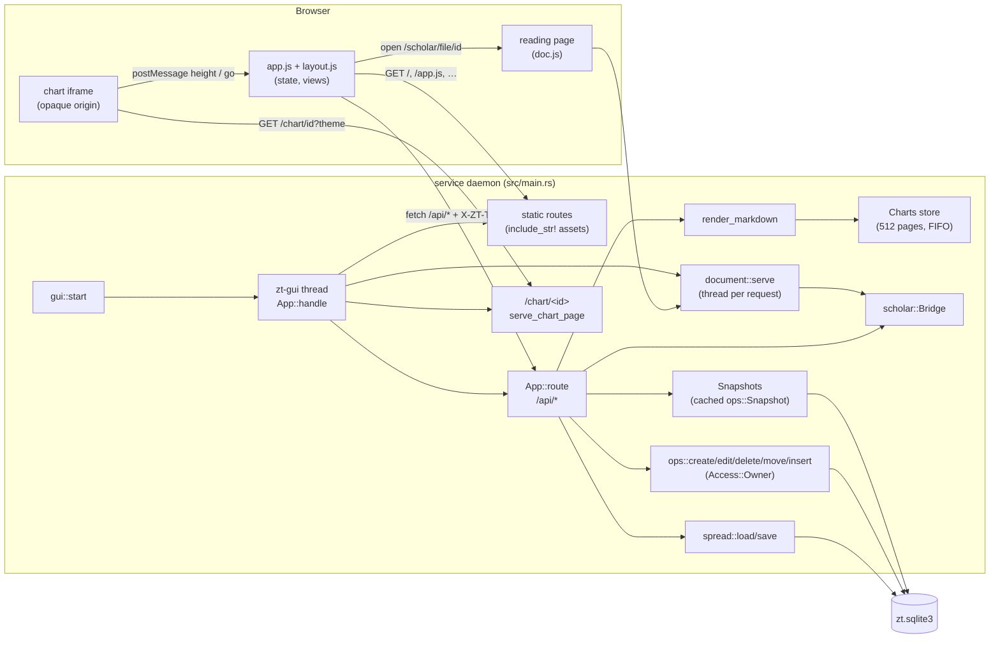

# GUI

## Purpose

The GUI is the local browser interface to the slip-box. The service daemon runs it for its whole life: a loopback HTTP server inside the daemon process serves one single-page app and a JSON API. The human uses it to read Cards (Markdown with TeX, HTML charts, artifacts and Document links), to walk trees on the Folgezettel map, to lay Cards from anywhere side by side on the Table, to see the whole archive as a Constellation, to study models and mathematical units, and to write Cards on the writing desk. Every change it makes goes through the same Card operations as the shell commands and the Session, with Owner Access (both Workspaces). An open GUI window is not a Session: it goes down with the service.

**Owns:** the HTTP server in the daemon (bind, port, the per-service token, the `zt.gui` record), every `/api/` route and static asset route, the cached Snapshot the API reads, the Card-body Markdown-to-HTML renderer (Link chips, math spans, HTML charts, artifact figures, Document links), the sandboxed chart pages, the Scholar Archive reading page, the front-end views (`src/gui/*.js`, `*.css`, `index.html`), the pure layout algorithms (`layout.js`), and Spreads (`src/spread.rs`, the `gui_spreads` metadata row).

**Does not own:**
- Starting and stopping the daemon, the service record, `zt up` / `zt down` / `zt status`: [Service, CLI and storage](service-and-cli.md).
- Card creation, edit, delete, move, insert, their plans and confirmations, and the Snapshot type itself (`ops::Snapshot`): [Card operations](card-operations.md).
- Card text format, Link parsing and classification, Workspaces and Access: [Cards, Workspaces and Links](cards-and-links.md).
- The model structure, build report, Relation kinds, and the `math` report the boards draw: [Models and math](models-and-math.md).
- Hub membership (`hub::hubs_of`): [Hub Cards](hub-cards.md).
- The Scholar Archive bridge, artifact storage and Document targets (`scholar.rs`, `artifact.rs`): [Scholar bridge](scholar-bridge.md).
- The terminal Session, whose command vocabulary the command bar copies: [Terminal Session](session.md).

## At a glance

| | |
|---|---|
| Entry points | `gui::start(root)` (called by the service daemon in `src/main.rs`), `gui::run(args)` (`zt gui [--open]`), `App::handle(request)` (every HTTP request), `boot()` in `src/gui/app.js` (the page) |
| Key files | `src/gui.rs` — server, routes, Snapshot cache, chart store, Card Markdown renderer, response policies |
| | `src/gui/document.rs` — `/scholar/file/<id>` and `/scholar/figure/<id>`: Scholar Archive documents (PDF passthrough, Markdown reading page) |
| | `src/spread.rs` — load, save, normalize, and follow Spreads in the `metadata` table |
| | `src/gui/index.html` — the page shell; the token is substituted for `__ZT_TOKEN__` |
| | `src/gui/app.js` — the whole front end (state, routing, history, search tray, cabinet, desk, Map, Table, Constellation, reader, model board, theory board, study desk, dialogs, writing desk, command bar, keys, heartbeat) |
| | `src/gui/layout.js` — pure, DOM-free geometry (`ZtLayout`): outline, focus lens, Constellation rings, Table placements, threads, theory rows, study stations |
| | `src/gui/chart-frame.js` — the script inlined into every chart page: palette tokens, `[[address]]` links, TeX, height reports |
| | `src/gui/doc.js` — the reading page's script: lazy KaTeX and centring a `#fig-…` target |
| | `src/gui/app.css` — the whole look (index-card paper, light and dark themes) |
| | `src/gui/vendor/katex/**` — vendored KaTeX 0.16 (JS, CSS, WOFF2 fonts); not documented here |
| Depends on | [Card operations](card-operations.md) (`ops::*`, `ops::Snapshot`), [Cards, Workspaces and Links](cards-and-links.md) (`LinkBody`, `LinkStatus`, `parse_card_text`, `Workspace`, `Access`), [Models and math](models-and-math.md) (`model::Part`, `Facet`, `Emphasis`, `math::MathForm`, `Snapshot::model`), [Hub Cards](hub-cards.md) (`hub::hubs_of`), [Scholar bridge](scholar-bridge.md) (`scholar::Bridge`, `artifact::read/source/sniff`), [Service, CLI and storage](service-and-cli.md) (`open_db`, `card_counts`, `log_event`, `require_service_up`); crates `tiny_http` 0.12, `pulldown-cmark` 0.13, `sha2`, `getrandom`, `rusqlite`, `serde_json`; KaTeX in the browser |
| Used by | [Service, CLI and storage](service-and-cli.md) (daemon starts/stops it, `zt status`/`zt up` print its URL, delete/move call `spread::follow`); the human's browser |
| Tests | unit tests in `src/gui.rs` (`tests`, `render_tests`), `src/gui/document.rs`, `src/spread.rs`; integration tests `tests/cli_service.rs`, `tests/model_structure.rs`, `tests/card_types.rs`, `tests/workspaces_mcp.rs`, `tests/self_sufficient_models.rs`, `tests/scholar_bridge.rs` |

## Concepts

- `GUI` — the browser interface the service runs while it is up (CONTEXT.md). `src/gui.rs` `Running` is the running server; `App` holds its state.
- `Access::Owner` — the GUI's Access (`const ACCESS` in `src/gui.rs`): the human's own tool, so it may change both Workspaces.
- `Token` — 32 hex characters from 16 random bytes (`random_token`), new for each daemon start, embedded in the page as `<meta name="zt-token">` and required on every `/api/` call as the `X-ZT-Token` header.
- `Snapshot` — every Card with its parsed text and Link graph (`ops::Snapshot`); the GUI keeps one in `Snapshots` until another commit moves SQLite's `data_version`.
- `Card summary` — the per-Card JSON `Snapshot::summary` builds (address, tree, workspace, title, kind, type, facet, emphasis, level, form, head, edge, parent, excerpt, links, kinds, inbound); `/api/graph` and `/api/tree` return lists of them, and the page indexes them in `state.byAddress`.
- `Fingerprint` — a 24-hex digest of every Card's address, text, BibTeX, Workspace, type, facet, emphasis, level, and form (`Snapshot::fingerprint`); the page polls it to notice changes from other clients.
- `HTML chart` — HTML in a Card body shown as a sandboxed figure (CONTEXT.md). The server stores its page in `Charts` under a content id and the Card HTML holds `<iframe class="zt-chart-frame" data-chart="<id>">`.
- `Artifact` / `Document link` — `` renders as a `.zt-figure`; `[label](scholar:<file_id>)` renders as an `a.zt-doc` to `/scholar/file/<file_id>` (CONTEXT.md; storage in [Scholar bridge](scholar-bridge.md)).
- `Pointer` — the Card the page is at (`state.pointer`, `null` for ROOT), carried in the URL hash `#/card/<address>`.
- `Cabinet` — the left rail: the Workspace switch, the Topic zone and Literature zone drawers (`renderRail`).
- `Desk` — the ROOT view: one stack of index cards per tree of the current Workspace (`renderDesk`).
- `Folgezettel map` — the tree view, laid out by address through a focus lens (`map` in `app.js`, `ZtLayout.focusLens`).
- `Outline` — `layout.js`'s reading of a tree: a Card's outline children are the runs of its Side successors (a run is a Card and its chain of Direct successors); a tree root's outline children are its own Direct run.
- `Table` / `Spread` — the working surface where Cards from anywhere lie side by side, and one named, persisted set of Cards on it with their positions (CONTEXT.md; `tableView`, `spreads` in `app.js`, `src/spread.rs`).
- `Within reach` — the held Card's neighbours that are not yet on the Table, offered as slips beside it (`candidates`, `renderReach`).
- `Constellation` — every tree as a radial outline, the trees set around one ring, Links between trees bundled (`sky` in `app.js`, `ZtLayout.constellation`).
- `Reader` — the right column: the open Card as a ruled index card, then its tools (`renderReader`).
- `Model board` — the view of one model below a Model Card or Model part (CONTEXT.md; `modelBoard`, `modelTabs`, `buildFaults`).
- `Theory board` / `Study desk` — the views of a Theory Card's units by dependency and of a unit's study order, station by station (`theoryBoard`, `study`; layout in `ZtLayout.theoryRows`, `studyStations`, `theoryRun`).
- `Reading mode` — `learn`, `review`, or `lookup` (`READING` in `app.js`), kept in `localStorage` `zt-reading`.
- `Writing desk` — the editor dialog: raw Markdown on the left, a server-rendered preview on the right (`openEditor`).
- `Relation kind` — what a Link says (CONTEXT.md); the page reads it from summary `kinds` and model `relations` and names it with `KINDS` in `app.js`.

## Architecture

Three layers: the server in the daemon (`src/gui.rs` with `src/gui/document.rs` and `src/spread.rs`), the page (`index.html`, `app.js`, `layout.js`, `app.css`, KaTeX), and two kinds of isolated pages the server builds (chart pages with `chart-frame.js` inlined, and the Scholar Archive reading page with `doc.js`).



How data and control move:

1. The daemon calls `gui::start`, which binds a `tiny_http::Server` on `127.0.0.1`, builds an `App` (root, token, port, `Charts`, `Snapshots`), writes `<archive_root>/zt.gui`, and spawns the `zt-gui` thread. That thread handles requests one at a time; each request runs inside `catch_unwind`, so a panic answers nothing for that request but keeps the server up.
2. `App::handle` checks the `Host` header, serves static assets, artifacts, chart pages, and Scholar documents without a token, and passes `/api/*` to `App::route` only with the right `X-ZT-Token`.
3. Read routes take the cached Snapshot (`Snapshots::get`), so most reads do no SQL beyond `PRAGMA data_version`. Write routes call `ops::*` with `ACCESS`, which open their own connections and transactions; the commit moves `data_version`, so the next read rebuilds the Snapshot.
4. Card bodies leave the server as HTML from `render_markdown`; charts inside them become iframes whose pages the server keeps in `Charts`.
5. `/scholar/file/*` and `/scholar/figure/*` are handed to `document::serve`, which answers on a thread of its own, because the bridge may take seconds.
6. On the page, `app.js` holds one `state` object; `route()` follows the URL hash; `renderAll()` redraws the topbar, rail, stage (desk, Map, Table, or Constellation), and reader. Geometry comes from `ZtLayout` (`layout.js`), which is pure and can also be loaded as a CommonJS module.
7. The page polls `/api/overview` every 4 s (and on window focus) for the fingerprint and `/api/ping` every 2 s for the heartbeat; a changed fingerprint triggers `refresh()`.

## Interfaces

### Rust functions (crate-internal)

| Item | Signature | Behaviour |
|---|---|---|
| `gui::run` | `pub(crate) fn run(args: &[String]) -> Result<()>` | `zt gui [--open]`. Requires the service up (`require_service_up`), reads `zt.gui`, prints `zt gui: <url>` and `port: <n>`; `--open` calls `open_window`. Any other argument fails with a usage line that says `--port` and `--no-open` are gone and names `ZT_GUI_PORT`. Fails when the service has no recorded URL (pre-0.14 daemon, or the GUI could not start; points at the log). |
| `gui::recorded_url` | `pub(crate) fn recorded_url(root: &Path) -> Option<String>` | The trimmed contents of `<root>/zt.gui`, or `None` when missing or empty. Used by `zt up`, `zt status`, `print_gui_line` in `src/main.rs`. |
| `gui::clear_record` | `pub(crate) fn clear_record(root: &Path)` | Removes `zt.gui`; ignores errors. Called on stop, when start fails, when a stale service is cleared, and when the system ends the session. |
| `gui::start` | `pub(crate) fn start(root: &Path) -> Result<Running>` | Binds (see Configuration), makes the token, writes `zt.gui` (`http://127.0.0.1:<port>/\n`), spawns the `zt-gui` thread, logs `gui started on <url>`. Errors: invalid `ZT_GUI_PORT`, bind failure, cannot write the record, cannot spawn. The daemon logs `gui did not start: …` and runs on without a GUI. |
| `Running::stop` | `pub(crate) fn stop(self)` | Clears the record, `server.unblock()`, joins the worker (the request in hand finishes), logs `gui stopped`. |
| `spread::load` | `pub(crate) fn load(conn: &Connection) -> Result<Value>` | The stored Spreads, normalized; an unreadable or invalid row reads as `{"current": null, "spreads": []}`. |
| `spread::save` | `pub(crate) fn save(conn: &Connection, value: &Value) -> Result<Value>` | Normalizes (errors on bad shape or bounds) and replaces the row; returns what was kept. |
| `spread::follow` | `pub(crate) fn follow(conn, mapping: &BTreeMap<String,String>, deleted: &BTreeSet<String>) -> Result<()>` | Rewrites every Spread's addresses by `mapping` and drops `deleted` Cards; writes only when something changed. Called inside the delete transaction and by the Location-mapping step in `src/main.rs`, so Spreads follow moves, Citation-key renames, and side-successor compaction. |
| `document::figure_anchor` | `pub(crate) fn figure_anchor(path: &str) -> String` | `fig-<file stem>` with every character outside `[A-Za-z0-9_-]` replaced by `-`. Used by `/api/artifact` to build `in_document`. |

### CLI

```text
zt gui [--open]
```

Output when up:

```text
zt gui: http://127.0.0.1:4717/
port: 4717
```

`--open` prefers a chromeless app window (`--app=<url>`) of Edge (`ProgramFiles(x86)`, `ProgramFiles`) or Chrome (`ProgramFiles`, `LOCALAPPDATA`) on Windows, else `cmd /C start`; `open` on macOS; `xdg-open` on other Unix (`open_window`).

### Static and page routes (no token)

Every request first passes `host_allowed`: the `Host` header must be exactly `127.0.0.1:<port>` or `localhost:<port>` (case-insensitive), else `421 misdirected request`.

| Method and path | Answer | Headers |
|---|---|---|
| `GET /`, `GET /index.html` | `index.html` with `__ZT_TOKEN__` replaced by the token | `respond_text` policy (below) |
| `GET /app.css`, `/app.js`, `/layout.js`, `/doc.js` | the embedded file | `respond_text` policy |
| `GET /vendor/katex/katex.min.js`, `/vendor/katex/katex.min.css` | embedded KaTeX | `Cache-Control: max-age=86400` |
| `GET /vendor/katex/fonts/<name>` | one of the 20 embedded WOFF2 fonts (`font/woff2`), else 404 | `max-age=86400` |
| `GET /artifact/<sha256>` | the artifact bytes from `artifact::read`, with its media type; 404 `artifact not in this archive` | `max-age=31536000, immutable`; CSP `sandbox; default-src 'none'; style-src 'unsafe-inline'` |
| `GET /chart/<id>?theme=dark\|light` | the stored chart page with theme and scripts filled in (`serve_chart_page`); 404 `chart expired; reopen the Card` | chart CSP (below), `no-store` |
| `GET /scholar/file/<file_id>` | via `document::serve`: a Markdown document as a reading page; a PDF inline (`application/pdf`); any other file as an attachment (`application/octet-stream`); 502 when the bridge fails, 500 when the file cannot be read | reading page: `READING_POLICY`, `no-store`, `Referrer-Policy: no-referrer`; files: `Content-Disposition` with an RFC 5987 file name, `private, max-age=60`; all: `Cross-Origin-Resource-Policy: same-origin` |
| `GET /scholar/figure/<file_id>?path=<path>` | an image of the document, fetched through the bridge and sniffed; 415 `not an image`; 502 on bridge errors | `private, max-age=86400`, CSP `sandbox; …` |
| any other non-`/api/` path | 404 `not found` | |

The `respond_text` policy (page, scripts, CSS, JSON) is `Cache-Control: no-store`, `X-Content-Type-Options: nosniff`, and `Content-Security-Policy: default-src 'self'; img-src 'self' https: data:; style-src 'self' 'unsafe-inline'; script-src 'self'; connect-src 'self'; frame-ancestors 'none'`.

The chart policy (`respond_chart`) is `sandbox allow-scripts; default-src 'none'; script-src 'unsafe-inline' <local> https:; style-src 'unsafe-inline' <local> https:; font-src <local> https: data:; img-src <local> https: data: blob:; connect-src https:; frame-ancestors <local>; form-action 'none'; base-uri 'none'`, where `<local>` is `http://127.0.0.1:<port> http://localhost:<port>`.

### API routes (`/api/*`, token required)

All answers are JSON. A missing or wrong token gives `403 {"error":"missing or invalid GUI token"}`. A POST body that is not UTF-8 or not JSON gives 400; an empty POST body reads as `{}`. Any error from a handler gives `400 {"error":"<message with causes>"}`; an unknown path gives 400 `unknown endpoint <path>`. Query parameters are percent-decoded, `+` is a space (`parse_query`).

| Method and path | Inputs | Output | Side effects |
|---|---|---|---|
| `GET /api/ping` | — | `{"ok":true}` | none (heartbeat) |
| `GET /api/overview` | — | `{fingerprint, archive_root, stats:{total,topics,regular,literature}, broken, workspaces:[{id,label,topic_trees,literature_trees,cards,agent_writable}], trees:[Snapshot::trees]}` | built once per Snapshot |
| `GET /api/tree?id=<tree>` | tree id (Topic number or Citation key) | `{tree, root, workspace, kind:"topic"\|"literature", title, cards:[summary]}` | error `tree … does not exist` |
| `GET /api/card?at=<address>` | Location or Citation key | `{address, tree, workspace, kind, type, facet, emphasis, level, form, model, hubs, context:"tree-root"\|"regular", title, text, body, html, bibtex, citation_key, parent, direct, sides, inbound, outbound}` | renders the body (may add charts to the store) |
| `GET /api/graph` | — | `{nodes:[summary]}` for every Card | — |
| `GET /api/search?q=&ws=&type=` | `q` required; `ws` `human`\|`agent`\|`all`; `type` a Card type or `all` | `Snapshot::find` with limit 80: `{results:[{address,title,kind,type,facet,emphasis,level,form,workspace,tree,tree_title,field,score,snippet}], total, workspaces:{id:n}, types:{type:n}}` | — |
| `GET /api/broken` | — | `{broken:[{source,title,workspace,target,line}]}` | — |
| `POST /api/render` | `{text, literature?:bool}` | `{title, html, error}`; `error` is the parse or Link error, the HTML is still given (raw text rendered when the Card text does not parse) | may add charts |
| `POST /api/create` | `{kind:"topic"\|"direct"\|"side", text, at? (successors), workspace? (topic, default human), type?, facet?, emphasis?, level?, form?}` | `{address}` | `ops::create_topic` or `ops::create_successor`; then, when `level`/hub level/`form` is given, a second `ops::edit` |
| `POST /api/literature/check` | `{bibtex}` | `{citation_key, title, exists}` (case-insensitive) | reads the DB |
| `POST /api/literature` | `{bibtex, text, workspace?}` | `{address}` | `ops::create_literature` |
| `POST /api/edit` | `{at, text?, base?, type?, facet?, emphasis?, level?, form?}` | `{address}` | `ops::edit`; `text` required when no type field is given; `base` makes the save fail if the Card changed since it was opened |
| `POST /api/metadata` | `{at, bibtex, base?, confirm?}` | `{confirm, lines}` (plan) or the done result with `address` | `ops::edit_metadata` (a Citation-key rename needs `confirm`) |
| `POST /api/delete` | `{at, into?, confirm?}` | plan `{confirm, lines}`, then `{address, deleted, moved}` | `ops::delete` |
| `POST /api/move` | `{at, to \| before, alone?, confirm?}` | plan, then `{address, moved}` | `ops::move_card`; exactly one of `to`/`before`, else `give either \`to\` or \`before\`` |
| `POST /api/insert` | `{before, text, type?, facet?, emphasis?, confirm?}` | plan, then `{address}` | `ops::insert_card` |
| `GET /api/artifact?sha=<sha256>` | digest | `{sha256, held, source, in_document}`; `in_document` is `/scholar/file/<file_id>#fig-<stem>` when the source names a file and path | — |
| `GET /api/scholar/works?q=` | text (may be empty) | `{works:[{work_id,title,year,authors,doi}]}`: Works with a Markdown file, title or author contains `q`, newest first, 40 at most | bridge SQL |
| `GET /api/scholar/artifacts?work_id=<n>` | number | the bridge's `list_work_artifacts` answer | bridge call |
| `GET /api/scholar/files?work_id=<n>` | number | `{files:[{file_id,name,path,kind,bytes,shown,bilingual,markdown}]}`; only the shown files when the Work shows any; `markdown` is the Document link to insert | bridge SQL |
| `POST /api/scholar/preview` | `{file_id, path}` | `{data_url}` (base64 image) | nothing kept |
| `POST /api/scholar/artifact` | `{file_id, path, caption?}` | `scholar::keep_artifact` result, with `markdown` | copies the image into `artifacts/` |
| `GET /api/spreads` | — | `{current, spreads:[{id,name,cards:[{at,x,y}]}]}` | — |
| `POST /api/spreads` | the whole Spread document | the normalized document | replaces the `gui_spreads` row |

Field rules shared by create, edit, and insert (`type_field`, `facet_field`, `emphasis_field`, `form_field`, `ops::parse_level_arg`): an absent field leaves the value alone; `""` or `null` clears it; a facet makes the Card a Model Card (another type with a facet is refused: `only Model Cards can have a Model facet`); a level needs a Model Card without a facet (`LEVEL_NEEDS_MODEL_CARD`) or, for hub levels, a Hub Card (`LEVEL_NEEDS_HUB_CARD`); a form needs a Model Card without a facet (`FORM_NEEDS_MODEL_CARD`); a Topic must be an Idea Card.

### Messages between a chart frame and the page

| Direction | Message | Effect |
|---|---|---|
| frame → page | `{zt:"height", height:<px>}` | the page sets that iframe's height, clamped to 40–4000 px |
| frame → page | `{zt:"go", target:"<address>"}` | the page goes to the Card, or toasts `card … does not exist` |

The page accepts a message only when `event.source` is the `contentWindow` of one of its `iframe.zt-chart-frame` elements.

### Chart authoring surface (inside a chart)

- `window.ZT_LINKS` — `{ "<address>": {title, exists} }` for each `[[address]]` in the chart source.
- `[[address]]` in chart text becomes `a.zt-link` (or, in SVG text, sets `data-zt` on the text element); any element with `data-zt="<address>"` or `a[href^="#/card/"]` opens that Card on click.
- CSS tokens `--zt-paper`, `--zt-ink`, `--zt-ink-soft`, `--zt-ink-faint`, `--zt-rule`, `--zt-line`, `--zt-accent(-soft)`, `--zt-link(-soft)`, `--zt-topic(-soft)`, `--zt-model(-soft)`, `--zt-event(-soft)`, `--zt-series-1` … `--zt-series-6`, `--zt-serif`, `--zt-sans`, `--zt-mono`, with a dark set under `:root[data-theme="dark"]`.
- TeX in `$…$`, `$$…$$`, `\(…\)`, `\[…\]` in chart text (outside `script, style, textarea, code, pre, svg`) is typeset when KaTeX was inlined.

### `ZtLayout` (`src/gui/layout.js`)

Exported as `window.ZtLayout` or `module.exports`. All functions are pure.

| Function | Inputs → output |
|---|---|
| `sideRank(address)` | the last segment's letter label as a number (`a`=1, `z`=26, `aa`=27) |
| `outline(cards, rootAddress)` | summaries with `address`, `parent`, `edge` → `{root, card, kids, up, depth, size, order}` |
| `pathTo(tree, address)` | outline path from the root, inclusive |
| `focusLens(tree, focus, {links, expandAll})` | `{nodes:[{address,lod,x,y,w,h,depth,folded,role}], index, edges:[{from,to,kind,shape,hot}], focus, bounds}` |
| `edgePath(edge, p, c)`, `elbow(p, c)`, `linkArc(a, b)` | SVG path strings for Map edges and Link arcs |
| `constellation(nodes, treeInfo)` | `{trees:[{id,root,r,local,count,outline,x,y,angle,…}], pos: Map, R, bundles:[{a,b,count}]}` |
| `addressOrder(a, b)` | Folgezettel comparator |
| `freeSpot(rects, want, size)` | nearest free top-left corner |
| `readingOrder(addresses, linksOf)` | an order that follows Links depth first |
| `lineUp(order, size)`, `gather(addresses, focus, isNear, size)`, `byTree(addresses, size)` | `Map(address → {x,y})` |
| `thread(a, b, back)` | `{d, mid, end, angle}` for a sagging thread |
| `theoryRows(units)` | `{rows:[[address]], base:[address], hung: Map}` |
| `labelsIn(text)` | `Set` of `H1`, `C2`, … |
| `studyStations(study, mode, head, isPlan)` | stations of one unit in one reading mode |
| `theoryRun(math, head, mode, unitStations)` | stations of a whole theory |
| `LOD`, `GUTTER`, `TABLE` | sizes: focus 304×136, near 236×76, slip 236×30, gutter 56; Table card 236×150, gap 30 |

### Keys and command bar

The command bar (`installCommandBar`, `runCommand`) speaks the Session vocabulary listed in `COMMANDS` in `app.js`: `go [<target>]`, `root`, `ws [<workspace>]`, `up`, `back`, `fwd`, `ls`, `t <title>`, `l`, `n`, `b`, `e`, `del`, `ins`, `mv [alone] <new-location>`, `mv [alone] before <location>`, `ty <idea|event|finding|model|hub> [<facet>]`, `lv <level|none>`, `mf <form|none>`, `stats`, `status`, `lsbk`, `help`, `q`, each with an availability (`always`, `card`, `regular`). Text that is no command offers `search "…"`.

Keys outside text fields (`installKeys`): `:` command bar, `/` or `Ctrl+K` search, `Alt+←`/`Alt+→` or `Backspace` history, `g` go, `n` `b` `e` `t` `l` `m` `i` `Delete`, `u`/`↑`/`←` parent, `↓` Direct successor, `→` first Side successor, `v` next view, `p` lay on / take off the Table, `P` lay down with every related Card, `w` switch Workspace, `f` fit, `x` unfold the whole tree, `s` study, `?` help, `Esc`. While the study desk is open it takes the keys (`study.key`: `←`/`→`/`j`/`k`/PageUp/PageDown, Space/Enter turn over, `1`/`2`/`3` reading mode, Esc).

## Behaviour

### Daemon start and stop

1. `src/main.rs` (daemon) takes the daemon lock, logs `daemon started`, then calls `gui::start(&root)` before it writes the service record, so a service that reads as up already has its `zt.gui`.
2. `configured_port()` reads `ZT_GUI_PORT`; `bind()` tries that port once, or the default 4717 up to 10 times 100 ms apart (a just-stopped service may still hold it), then port 0 (any free port).
3. `start` creates `App { root, token: random_token(), port, charts, snapshots }`, writes `zt.gui`, and spawns `zt-gui`, which loops over `server.incoming_requests()`.
4. When `shutdown::watch` returns, the daemon calls `Running::stop`: clear the record, unblock the server, join the thread, log `gui stopped`.
5. A restarted service has a new token; old pages get 403 and reload (see Heartbeat).

### Handling one request (`App::handle`)

1. Split the URL into path and query; `parse_query` decodes the query.
2. Refuse a wrong `Host` with 421.
3. Match static routes in order: page, CSS/JS, KaTeX assets and fonts, `/artifact/`, `/doc.js`, `/scholar/file/` and `/scholar/figure/` (handed to `document::serve`, which spawns a thread and returns at once), `/chart/`.
4. Anything else not under `/api/` is 404.
5. Check `X-ZT-Token` (exact match), read and parse a POST body, call `route`, answer 200 with the value or 400 with `{"error"}`.

### The Snapshot and its caching (`Snapshots`)

1. `Snapshots::get` locks the mutex and calls `current`.
2. `current` takes the held `Cached { conn, version, snapshot, overview }`. If `PRAGMA data_version` on the held connection still equals `version`, the same `Arc<Snapshot>` is returned.
3. Otherwise (another connection committed), it keeps the connection (or opens a new one if the query failed), reads `data_version` first, then `Snapshot::read(root)`, and stores both with `overview: None`. Reading the version before the Snapshot means a commit in between makes the next request read again rather than keep a stale Snapshot.
4. `Snapshots::overview(build)` returns the overview JSON memoized for the current Snapshot, building it on the first ask. The page asks for it every 4 seconds, so it must stay cheap.
5. `data_version` changes only for commits on other connections. Every write the GUI makes goes through `ops::*` on its own connection, so the GUI's own writes also invalidate the cache. The unit test `a_snapshot_is_kept_until_another_connection_changes_the_cards` checks this.

### Rendering a Card body (`render_markdown`)

1. `normalize_math_delimiters` rewrites `\(…\)` to `$…$` and `\[…\]` to `$$…$$` outside code ranges (`link::code_ranges`); `\\(` (an escaped backslash) is left alone, and an unclosed opener stops the rewrite.
2. `fence_html_charts` wraps raw HTML charts in a chart fence: a line (indent at most 3 spaces) that opens one of `figure, div, svg, table, section, canvas, script, style, iframe` starts a chart that runs to the line where that element's depth returns to 0 (`chart_end`, counting `<tag` and `</tag` per line; a first line ending `/>` closes itself; an element that never closes ends at the first blank line). Charts separated only by blank lines join into one (a `<div>` and its `<script>`). Lines inside existing fences are skipped. The fence uses one more backtick than the longest run inside.
3. `pulldown_cmark` parses with tables, strikethrough, task lists, footnotes, and math. Events are rewritten:
   - a fenced block whose info string is `chart` or `html … chart` (`is_chart_info`) collects its text; `chart_page` builds a page, `Charts::add` stores it, and the event becomes `<figure class="zt-chart"><iframe class="zt-chart-frame" data-chart="<id>" loading="lazy" title="Chart"></iframe></figure>`;
   - an image whose URL starts with `artifact:` becomes `figure_html`: `<span class="zt-figure" data-artifact="<digest>">" …><span class="zt-figcaption">…</span></span>`; a digest that `artifact::is_digest` rejects becomes `data-artifact=""`;
   - a link whose URL starts with `scholar:` opens with `document_link_open`: `<a class="zt-doc" href="/scholar/file/<id>[#frag]" data-doc="<id>">`, or `<a class="zt-doc broken">` when `scholar::document_target` rejects it;
   - prose text is buffered and flushed through `link_events`, which uses `lifecycle.classify_for_rendering` to turn each `[[target]]` into a valid chip `<a class="zt-link" href="#/card/<pct>" data-target="…"><span class="zt-link-addr">…</span><span class="zt-link-title">title</span></a>` or a broken chip `<span class="zt-link broken">…missing</span>`; text in code blocks is never linked;
   - plain inline tags without attributes (`sub sup br kbd mark small u ins del s b i em strong`) pass through lower-cased; HTML comments vanish; every other raw HTML is pushed as text, so `push_html` escapes it.
4. `$…$` and `$$…$$` arrive as `<span class="math math-inline|math-display">`; the page typesets them with KaTeX (`typeset` in `app.js`).

### Chart pages

1. `chart_page(source, snapshot)` collects each `[[target]]` in the source (non-empty, under 200 bytes, no newline or bracket) with its title and existence into a JSON object, escapes `</` in it, and writes a template: `<html data-theme="__ZT_THEME__">`, a KaTeX placeholder `<!--zt:katex-->` only when the source holds `$`, `\(`, or `\[`, `<script>window.ZT_LINKS = …</script>`, a frame placeholder `<!--zt:frame-->`, and the source inside `<div id="zt-chart">`.
2. `Charts::add` keys the page by the first 16 bytes of its SHA-256 (32 hex characters) and keeps at most 512 pages, dropping the oldest inserted first; adding an existing page keeps its place.
3. The page sets each iframe's `src` to `/chart/<id>?theme=<light|dark>` in `wireCharts` (on every render and on theme toggle).
4. `/chart/<id>` fills the theme, inlines `chart-frame.js` and, when the placeholder is there, KaTeX's JS and its CSS with every font as a `data:font/woff2;base64,…` URI (`katex_inline_css`, built once), and answers with the chart CSP.
5. In the frame, `chart-frame.js` adds the palette, turns `[[…]]` into links, typesets TeX, and reports its height on load, on resize, and at 300 ms and 1500 ms; clicks post `go`.

### Page boot, refresh, and heartbeat (`app.js`)

1. `boot()` installs the theme, steady hand (no text selection during drags), pan/zoom, command bar, keys, buttons, and history; sets the view mode from `localStorage`; then fetches `overview`, `graph`, and `spreads` in parallel, indexes the nodes (`setNodes`: `byAddress`, `inboundOf`, `childrenOf`), and calls `route()`.
2. `route()` reads `#/card/<address>` into `state.pointer`, records the step in `nav`, closes the search tray when the Pointer moved, and calls `loadPointer()`, which fetches `/api/card`, switches the Workspace to the Card's, fetches `/api/tree` when the tree changed (building `state.outline`), and calls `renderAll()`. A Card that no longer exists toasts and falls back to its nearest known ancestor, or keeps stepping in the history direction (`nav.skipMissing`).
3. `watchForChanges()` (every 4 s and on focus, skipped while hidden or editing) compares the overview fingerprint and calls `refresh()` on a change. `refresh()` flushes Spreads, refetches overview, graph, and Spreads, resets the tree, invalidates the Constellation, and reloads the Pointer.
4. `heartbeat()` (every 2 s) pings `/api/ping`. A network failure calls `serviceDown()`: the window closes, or, while a dialog holds text, a notice says the text is kept. A 403 (new token) or a service that is back reloads the page when nothing is being edited; while editing, it fetches `/`, takes the new token from the meta tag, and lets the reader save.

### A change through Card operations

Every change the page makes goes through `api()` to a write route, which calls the same `ops::*` functions as the shell and the Session, with Owner Access:

1. Before any POST except `spreads` and `render`, `api()` awaits `spreads.flush()`, because the server rewrites the Spreads it holds when Cards move or are deleted and must hold the latest ones first.
2. Create: `newCard(kind)` opens the writing desk with the terminal's template (`# <title>\n\n…\n<!-- zt:reverse-links -->\n`); Save posts `/api/create`; `afterChange` toasts, refreshes, and goes to the new address.
3. Edit: `editCard()` posts `/api/edit` with `base: card.text`, so a Card changed elsewhere since it was opened is refused. A Literature Card first asks whether to edit the text or the BibTeX (`choosePart`); metadata goes to `/api/metadata`, and a Citation-key rename returns a plan that `confirmPlan` shows before the confirmed retry.
4. Delete, move, insert are two-phase: the first call without `confirm` returns `{confirm, lines}`; `confirmPlan` shows the lines and asks the reader to type the word (`delete`, `move`, the tree root address, …), exactly like the CLI's type-to-confirm; the second call carries `confirm`. Insert confirms the renumbering first, then opens the writing desk (inside a model, with facet `推导` and emphasis `aside` preset) and sends the text with the confirm word.
5. `ty`, `lv`, `mf` post `/api/edit` with only the type, level, or form field.

### Writing desk (`openEditor`)

1. A dialog with a Markdown textarea (and a BibTeX textarea for Literature Cards), a type picker for Regular Cards, and for Model Cards a free facet field with the common facets as a datalist, an emphasis select (parts) or a level select (whole models).
2. Every edit debounces (160 ms) a `POST /api/render`; the preview shows the title (from BibTeX for Literature Cards), the stamp, and the server HTML, and the message line shows a parse or Link error.
3. `[[` opens Link completion over `state.nodes` (address or title contains the typed text, 8 at most); Enter or Tab accepts.
4. "＋ Figure or document" opens `pickFigure`: search Works (prefilled with the current Literature tree's title), list the Work's documents and figures, preview thumbnails one after another (`/api/scholar/preview`), and insert either a Document link or, after `/api/scholar/artifact` keeps the image, its artifact Markdown.
5. `Ctrl+S` saves; Esc or Cancel asks before discarding a changed text.

### Views

- **Cabinet and desk.** `renderRail` lists the current Workspace's trees as drawers by Zone; `renderDesk` draws each tree as a stack (up to four sheets by size), with stamps and tallies for Event, Finding, and Model Cards and a gauge relative to the largest tree, plus a "new" stack per Zone.
- **Search tray** (`finder`). Debounced (110 ms) `/api/search`; hits grouped by tree behind guide cards, three slips per tree and six trees before a `+N` fold; Workspace and type chips with counts; the selected slip's full Card loads beside the tray (`/api/card`, cached per opening); Enter flies the card to the reader, Shift+Enter lays it on the Table. With no words it lists the last visited Cards (`nav.recent`).
- **History** (`nav`). Every Pointer move is one browser history entry carrying `ztNav: <index>`; the trail of addresses is kept in `sessionStorage` `zt-nav`, so the arrow buttons can name their step and list their steps on right-click or hold.
- **Folgezettel map** (`map`, `ZtLayout.focusLens`). Shown: the root-to-focus path, every outline child of each Card on it, the focus's grandchildren when it has at most 14 children, and the focus's in-tree Link targets with their paths (or every Card with `x`). The focus is a `focus` card, its path, children (at most 14), and run neighbours are `near` cards, the rest are `slip`s; hidden outline descendants fold into a `+N` badge. Columns: depth − 1 (the root's Direct run shares its column); each column is as wide as its widest shown card. Edges follow addresses (a Direct successor hangs `down`, a Side successor branches with an `elbow`), the address chain to the focus is `hot`. Only the Pointer's Links are drawn as arcs (outbound always; inbound only when at most 16), plus the hovered card's. Each Pointer move re-runs the layout and glides cards (360 ms) from where they were; a new card slides out from its nearest shown ancestor. Shift-click lays a card on the Table.
- **Table** (`tableView`, `spreads`). Cards lie at a fixed per-address angle (±1.7°); the held Card (the Pointer, when it lies there) is squared, scaled, and on top; Cards it relates to (`relatedTo`: its Links, Cards linking it, its parent, its successors) keep ink, the rest recede. Threads (`ZtLayout.thread`) join Cards on the Table that link each other, styled by Relation kind and labelled when hot or warm. "Within reach" lists the held Card's neighbours not on the Table (kinded Links first, then plain Links, then its tree), placed in the nearest gap beside it. Drag to move (the card swings with the hand), drop on the box to put it back, click to open. Arrange: Gather (`ZtLayout.gather` around the held Card, nearest cells first), Line up (`readingOrder` then `lineUp`), By tree (`byTree`). "File as card" writes a new Card (a Side successor of the held Regular Card, else a Direct successor) listing the Spread's Cards in reading order as `- [[address]] title`, and lays it on the Table. Every Spread change is saved 450 ms later (`spreads.changed` → `flush`).
- **Constellation** (`sky`, `ZtLayout.constellation`). Canvas drawing: trees ordered human before agent, Topic before Literature, numerically; each tree a radial outline where leaves share the circle; trees around one ring, each taking an arc as long as its diameter; Links between trees bundled into one arc per pair, width by `log2(1+count)`. The Pointer's tree (or, at ROOT, the current Workspace) is lit; only the Pointer's and the hovered Card's single Links are drawn. Click a dot opens it, click a disc opens the tree root.
- **Reader** (`renderReader`). The Card as an index card: model tabs (`modelTabs`, in build order) or a hub guide tab, meta (kind, Workspace, type stamp, address stamp that copies), the hubs that list it (`card.hubs`), title, body; below it the theory board or model board, BibTeX, Referred by and Links out chips (cross-Workspace chips marked), actions, and the stored Markdown.
- **Model board** (`modelBoard`). Rows by `rests-on` depth (a Link closing a cycle is left out of the depth), within a row under the mean slot of what a part rests on; Loose parts in a tray; Derivation parts as slim slips; threads drawn after layout and on every resize (`ResizeObserver`); attention levels `here`/`near`/`mid`/`far`; reasons of the open part's relations; "Beyond the model" neighbours (six, then folded); other models a shared part serves; `buildFaults` lists `closure`, `forward`, `unanchored` faults with their fixes.
- **Theory board and study desk** (`theoryBoard`, `study`). The theory board lays a Theory Card's units by `ZtLayout.theoryRows`, inks by degree of interest, puts tools from other theories and the theories that use it on the edges, and in Review mode lays main results face down. The study desk opens with `s` on a unit or Theory Card: one station of `math.study` at a time (`studyStations` / `theoryRun`), the focus in the centre, up to three companions, Derivation slips below, the rest in a `+N` stack, cited premises as tool tabs that pull a unit half out in Look up mode (`pullOut`), a lemma studied in place (`study.enter` / `leave`), FLIP motion between stations. Label chips (`chipLabels`, `wireLabels`) lift the Cards that use a hypothesis or clause. Card reads go through `cardAt`, a promise cache cleared when the fingerprint changes.
- **Figures.** `wireMarkdown` marks a figure whose image fails as "figure not in this archive"; clicking a figure opens `showFigure`, which asks `/api/artifact` and links "open it in the book" to the reading page anchor.

### Source documents (`document.rs`, `doc.js`)

1. `/scholar/file/<id>` (id > 0) asks `Bridge::document(file_id)` for the document's name, kind, relative path, and local path.
2. A Markdown document (`kind == "markdown"` or `.md`) is read from disk and set by `reading_page`: a head with the file id, name, and path, the KaTeX stylesheet, `READING_CSS` (light/dark by `prefers-color-scheme`), the body from `render_document`, and the scripts `/vendor/katex/katex.min.js` and `/doc.js`.
3. `render_document` parses with tables, strikethrough, footnotes, and math (no task lists); each relative image is resolved below the document's folder (`resolve`: percent-decoded, no scheme, not absolute, `..` may not climb above the archive's `files/` root) and becomes `" src="/scholar/figure/<file_id>?path=<path>" loading="lazy">`. Other images are left as they are. Raw HTML passes through, but `READING_POLICY` allows only this server's scripts, so it cannot act.
4. `doc.js` typesets math spans as they near the screen (`IntersectionObserver`, 1200 px margin) and centres the `#fig-…` target, again when its image loads, when the page loads, and on every hash change.
5. A PDF is streamed inline (`Response::from_file`); other files download as attachments.

### Spreads (`src/spread.rs`)

1. `normalize` requires `spreads` to be a list of at most 64; each needs a unique non-empty `id` (≤ 40 characters), a `name` (≤ 80, trimmed), and `cards` (≤ 400) of `{at (non-empty, ≤ 512), x, y}`.
2. A Card listed twice keeps only its last entry (the one on top); coordinates must be finite, are clamped to ±1e6 and rounded to 0.1.
3. `current` must name a kept Spread, else it becomes the first Spread's id (or `null`).
4. In the page, `spreads.take(kept)` replaces the local document only when nothing is waiting to be saved; `spreads.cards()` hides Cards that no longer exist.

### Rules the code keeps

- Every request is answered by one thread in arrival order, except Scholar documents, which run on their own threads; a slow handler blocks the rest of the API.
- A panic in a request is caught; the client sees the connection close without an answer.
- The token never reaches a chart: chart pages run in an opaque origin (CSP `sandbox allow-scripts`), `connect-src` allows only `https:`, and the API answers no CORS preflight.
- Artifacts and Scholar figures are served sandboxed so an SVG opened on its own cannot script the GUI origin.
- The page never writes to Spreads while a Card write is in flight out of order: writes wait for `spreads.flush()`.
- Saving an edit carries `base`, so a Card changed by the CLI, a Session, or the MCP server since it was opened is refused, not overwritten.
- A write that needs confirmation never happens on the first call.

## Data and storage

### `<archive_root>/zt.gui`

One line, the URL of the running GUI; present only while it runs.

```text
http://127.0.0.1:4717/
```

### `metadata` row `gui_spreads`

`src/spread.rs` stores the Spread document as JSON text in the `metadata` table under the key `gui_spreads` (`INSERT … ON CONFLICT(key) DO UPDATE`). The schema of `metadata` belongs to [Service, CLI and storage](service-and-cli.md).

```json
{
  "current": "lq3x9k2ab1",
  "spreads": [
    {
      "id": "lq3x9k2ab1",
      "name": "Firms",
      "cards": [
        { "at": "1/2", "x": 10.0, "y": -5.0 },
        { "at": "1/1", "x": 300.0, "y": 40.0 }
      ]
    }
  ]
}
```

The last Card in `cards` lies on top. The page makes ids from `Date.now()` and random base-36 digits.

### In-memory caches (lost on restart)

- `Snapshots` — one `Cached { conn, version, snapshot, overview }` (see Behaviour).
- `Charts` — up to 512 chart pages (`CHART_CAPACITY`) by 32-hex id, insertion-ordered. A page asks for an expired id and gets 404 `chart expired; reopen the Card`; reopening the Card renders the body again and stores the page again.
- `katex_inline_css` — the KaTeX stylesheet with fonts as data URIs, built once per process.

### Browser storage

| Key | Store | Value |
|---|---|---|
| `zt-mode` | `localStorage` | `map`, `table`, or `constellation` |
| `zt-workspace` | `localStorage` | `human` or `agent` |
| `zt-expand` | `localStorage` | `1` when the Map shows the whole tree |
| `zt-theme` | `localStorage` | `light` or `dark` (absent: follow the system) |
| `zt-reading` | `localStorage` | `learn`, `review`, or `lookup` |
| `zt-theory-fold` | `localStorage` | `1` when "In theory" is open under a unit |
| `zt-nav` | `sessionStorage` | `{trail:[address or null, …]}` of this tab |

Every access is wrapped in `try`/`catch` (`store` in `app.js`), so private mode works without them.

### Wire format examples

A Card summary from `/api/graph`:

```json
{
  "address": "0/1", "tree": "0", "workspace": "human", "title": "Ownership matters",
  "kind": "regular", "type": "idea", "facet": null, "emphasis": null, "level": null, "form": null,
  "head": null, "edge": "direct", "parent": "0/0", "excerpt": "body",
  "links": ["0/0"], "kinds": { "0/0": "rests-on" }, "inbound": 0
}
```

`/api/card` adds `context`, `text`, `body`, `html`, `bibtex`, `citation_key`, `model` (see [Models and math](models-and-math.md)), `hubs` (`[{address, level, title}]`), `parent`/`direct` (`{address, title, workspace}` or `null`), `sides`, `inbound` (references), and `outbound` (`{address, title, workspace, broken}`).

## Configuration

| Setting | Where | Default | Effect |
|---|---|---|---|
| `ZT_GUI_PORT` | environment of the process that starts the daemon (`zt up`) | unset | A port number binds exactly that port (failure: the GUI does not start). `0` lets the system choose. Unset or blank: 4717, retried 10 × 100 ms, then any free port. A non-numeric value fails `gui::start` with `invalid ZT_GUI_PORT`. Tests set it to `0`. |
| `DEFAULT_PORT` | `src/gui.rs` constant | 4717 | the preferred port |
| `CHART_CAPACITY` | `src/gui.rs` constant | 512 | chart pages kept in memory |
| `MAX_SPREADS`, `MAX_CARDS`, `MAX_NAME`, `MAX_ID`, `MAX_COORD` | `src/spread.rs` constants | 64, 400, 80, 40, 1e6 | Spread bounds |
| search limit | `App::search` | 80 | hits returned by `/api/search` |
| polling | `boot()` in `app.js` | 4 s fingerprint, 2 s heartbeat | how fast other clients' changes and a stopped service show up |
| theme | `zt-theme` in `localStorage`, toggle button | system | light or dark; chart frames reload with `?theme=` |

The page, scripts, styles, and KaTeX are compiled into the binary with `include_str!`/`include_bytes!`; changing any of them needs a rebuild.

## Usage

### Find and call the GUI from a test or a script

Take the URL from `zt.gui` (or `zt gui`) and the token from the page's meta tag, then send the token on every API call, with a matching `Host`. The integration tests do it with raw HTTP (`tests/cli_service.rs` `http_request`, `gui_token`):

```text
GET /api/card?at=0%2F1 HTTP/1.1
Host: 127.0.0.1:4717
X-ZT-Token: 0123456789abcdef0123456789abcdef
Connection: close
```

```text
POST /api/create HTTP/1.1
Host: 127.0.0.1:4717
X-ZT-Token: 0123456789abcdef0123456789abcdef
Content-Type: application/json
Content-Length: <byte length of the body>

{"kind":"direct","at":"0/0","text":"# A first card\n\nbody\n"}
```

A two-phase delete (from `tests/cli_service.rs`):

```json
POST /api/delete {"at":"0/1"}                     → {"confirm":"delete","lines":[…]}
POST /api/delete {"at":"0/1","confirm":"delete"}  → {"address":"0/0","deleted":1,"moved":{}}
```

`address` is the parent to open next (or `null`), `deleted` the number of Cards removed, `moved` the compaction mapping.

### Write a chart in a Card

````markdown
```chart
<svg viewBox="0 0 120 40">
  <rect x="2" y="2" width="50" height="30" fill="var(--zt-series-1)"/>
  <text x="60" y="22">[[0/1]]</text>
</svg>
<p>Price $p$ falls; see [[0/2]].</p>
```
````

A raw block that starts with `<figure>`, `<div>`, `<svg>`, `<table>`, … works too, without the fence.

### Add an API route

1. Add an arm to `App::route` in `src/gui.rs`, for example `(Method::Get, "/api/thing") => self.thing(&param("at")?)`.
2. Write `fn thing(&self, at: &str) -> ApiResult`; read through `self.snapshot()?` (never open your own full read per request); for a write, call an `ops::*` function with `ACCESS` and return its `into_value()` when it has a confirm phase.
3. If the result is built over all Cards and the page polls it, memoize it per Snapshot as `Snapshots::overview` does.
4. Call it from `app.js` with `api('thing?at=' + enc(address))` or `api('thing', body)`; a POST automatically waits for pending Spread saves.
5. Add an integration test that starts a test service with `ZT_GUI_PORT=0` (see `tests/model_structure.rs` `Gui::start`).

### Add a command to the command bar

Add a `[syntax, description, scope]` row to `COMMANDS` and a `case` to `runCommand` in `app.js`; keep the vocabulary and messages the same as the Session's ([Terminal Session](session.md)). Add a key in `installKeys` if it needs one.

### Add a Relation kind or Card type to the views

`KINDS` (Relation kinds), `CARD_TYPES`, `FACETS`, `LEVELS`, `HUB_LEVELS`, `MATH_FORMS` in `app.js` mirror Rust enums (`RelationKind` in `src/model.rs`, `CardType`, `Level`, `MathForm`). Update them with the Rust side, add the CSS (`.type-stamp.<type>`, `.node.type-<type>`, `.thread.kind-<kind>`, dark variables in both dark blocks of `app.css`), and grep `app.css`/`app.js`/`layout.js` for the new class name first so it does not collide.

## Testing

Unit tests (the crate is the binary `zt`):

```bash
cargo test --bin zt gui::
cargo test --bin zt spread::
```

`cargo test --bin zt gui::` runs `src/gui.rs` `tests` (query decoding, the recorded URL, every `RelationKind` id as a `KINDS` key in `app.js`, no `@keyframes` name defined twice in `app.css`) and `render_tests` (Snapshot cache invalidation by another connection, TeX spans and LaTeX delimiters, chart fences and raw HTML charts into frames, plain inline tags and comments, artifact figures and forged digests, Document links, KaTeX inlining with fonts, chart store capacity) and `src/gui/document.rs` `tests` (image path resolution, reading page and its script policy).

Integration tests (each starts a test service with `ZT_GUI_PORT=0` and talks raw HTTP):

```bash
cargo test --test cli_service gui
cargo test --test model_structure gui_renders_math_and_sandboxed_charts_and_edits_model_parts
cargo test --test card_types gui_creates_and_edits_typed_cards_and_reports_types
cargo test --test workspaces_mcp gui_creates_trees_in_either_workspace_and_reports_workspaces
cargo test --test self_sufficient_models the_gui_inserts_a_card_and_moves_one_between_two_cards
cargo test --test scholar_bridge a_card_shows_a_figure_only_after_zet_keeps_it_from_the_archive
```

They cover: the GUI runs with the service and stops with it, `zt gui` only reports, the token guard and a new token after restart, `/api/quit` is gone (400), a dead daemon leaves no `zt.gui`, the API's create/edit/delete with plans and confirmations, rendering of Links and code, KaTeX assets and fonts, chart pages and their CSP, typed Cards, both Workspaces, insert and move, and artifacts.

Gaps: there is no JavaScript test harness; `app.js` and `layout.js` (although `layout.js` exports for CommonJS) have no automated tests, and the views are checked by hand in a browser. `/scholar/file` and `/scholar/figure` are tested only through `document.rs` unit tests, not over HTTP. Spreads following moves and deletes is tested in `src/spread.rs` and `src/ops.rs` unit tests, not through the GUI.

## Decisions and pitfalls

### Decisions

- **The GUI runs inside the daemon, and a window is not a Session** (since `4f0414d`, zt 0.14). `zt gui` starts nothing, `zt down` does not wait for windows, and a stopped service closes the windows. The record is written before the service record, so a service that reads as up always shows its GUI. See [docs/markdown-cards-and-gui-design.md](../markdown-cards-and-gui-design.md) "GUI".
- **Loopback, Host check, per-service token, strict CSP.** The token is a fresh random value per daemon, delivered only inside the page; the Host check blocks DNS rebinding; raw HTML in Cards is shown as text. Same design doc, "Security".
- **The same rules as the CLI.** Writes go through `ops::*`; delete, move, and Citation-key renames show the same lines and need the same typed confirmation; edits carry `base`. Same design doc, "Same rules as the CLI".
- **Charts are sandboxed by response header and self-contained.** The sandbox travels in the chart page's CSP (`sandbox allow-scripts`) instead of the iframe's `sandbox` attribute, and the page inlines `chart-frame.js`, KaTeX, and its fonts, because some embedded browsers refuse to load a frame with a `sandbox` attribute or refuse every subresource of a sandboxed page (comments on `respond_chart` and `serve_chart_page`). The opaque origin keeps chart scripts away from the GUI page and its token. See [docs/model-structure-design.md](../model-structure-design.md) "Rendering".
- **The Snapshot is cached and invalidated by `PRAGMA data_version`** (`33ecec2`): reading and parsing every Card takes hundreds of milliseconds, too slow per request; `data_version` sees commits from every other connection, so CLI, Session, and MCP writes show up on the next request.
- **Layout is linear and deterministic.** `layout.js` has no simulation; every function is linear in Cards (Table helpers at most quadratic in a few dozen Cards), so views re-lay out on each Pointer move. Attention is spent by lift, size, and ink, never blur. See [docs/table-and-spreads-design.md](../table-and-spreads-design.md) and [docs/math-cards-design.md](../math-cards-design.md) "The GUI views".
- **Spreads change no Card** and follow their Cards in the same transaction as the move or delete. See [docs/table-and-spreads-design.md](../table-and-spreads-design.md) "Spreads".
- **Hubs are guide cards**, their tab position showing the level. See [docs/hub-cards-design.md](../hub-cards-design.md) "The GUI: a hub is a guide card".
- **Model boards are laid out by `rests-on` relations, not by address.** See [docs/model-structure-design.md](../model-structure-design.md) "The model board".

### Pitfalls

- **Assets are compiled in.** Every change to `index.html`, `app.js`, `layout.js`, `app.css`, `chart-frame.js`, `doc.js`, or KaTeX needs a rebuild and a service restart.
- **One request thread.** A slow API handler (for example a Scholar bridge call in `/api/scholar/*`) blocks every other API call; only `/scholar/file` and `/scholar/figure` run on their own threads. Those threads are unbounded.
- **Per-request work over all Cards must be memoized per Snapshot**, as the overview is (the page polls it every 4 s). `Snapshot::find` folds case once per Snapshot for the same reason.
- **The `Host` check covers static files too.** A client that sends another `Host` (a proxy, a hostname alias) gets 421 even for `/`.
- **`/api/create` with a level or form is two transactions**: the Card is created, then `ops::edit` sets the level or form; if the second fails, the Card stays without it and the client sees an error.
- **`/api/literature/check` and `/api/spreads` open their own connections** instead of using the Snapshot.
- **The chart store is FIFO, not LRU.** Re-rendering a Card does not refresh its chart's place; with more than 512 distinct charts rendered, a chart still on screen can expire and its frame shows 404 until the Card is opened again.
- **The search tray and the Map share words.** The Map draws far cards as `.node.slip` and folds as `.badge.fold`; the tray uses `.fslip`/`.ffold`/`.in-hand` (`d7168d2` fixed a collision). Grep for a class name before adding one.
- **`kindOf` falls back to `rests-on`.** A kind missing from `KINDS` is drawn on the model board as a `rests-on` thread and placed by it, and the Table labels it "refers to". The unit test `the_front_end_names_every_relation_kind` fails when `RelationKind` gains a kind that `KINDS` lacks.
- **CSS animation names are global.** A second `@keyframes` with the same name replaces the first for the whole page (the table hand once overrode the dialogs' `rise`; it is now `hand-rise`). `each_css_animation_name_is_defined_once` checks it.
- **The system-dark block in `app.css` lacks `--hub`.** `:root[data-theme="dark"]` sets `--hub: #8fd1ae`, but `@media (prefers-color-scheme: dark) :root:not([data-theme="light"])` does not, so with the system theme dark and no explicit choice, hub ink keeps the light green.
- **Mirrors must stay in step.** `parentOf` in `app.js` mirrors `parent_location`; `CARD_TYPES`, `FACETS`, `LEVELS`, `HUB_LEVELS`, `MATH_FORMS`, `KINDS` mirror Rust enums; the command bar mirrors the Session's vocabulary.
- **Tree roots that half the tree links** would light everything: the Map draws inbound Link arcs only when there are at most 16.
- **A restarted service changes the token.** A page with an open writing desk keeps its text and takes the new token from `/`; any other page reloads.
- **The reading page has no `connect-src`**: `fetch()` from it fails by design (`READING_POLICY`).
- **`api()` flushes Spreads before every POST except `spreads` and `render`**; a new write route that should not wait must be added to that exception, and one that moves Cards must not be.

## Change history

- `2026-10-16` — `KINDS` gains `specializes` (`.thread.kind-specializes`), so a `特例` Link is no longer drawn as `rests-on`; the table hand's animation is `hand-rise`, so dialogs, menus, and toasts get their `rise` again; unit tests for both.
- `2026-10-16` `753bd7b` — Finding Cards: the `finding` type in the type picker, stamps, search chips, and desk tallies (zt 0.20.0).
- `2026-10-15` `2597c6c` — Study a whole theory on the desk (`theoryRun`), and a cited lemma inside its step.
- `2026-10-15` `1e67fdc` — GUI views for mathematical units: theory board, study desk, label chips, tool tabs; `theoryRows`, `studyStations`, `labelsIn` in `layout.js`.
- `2026-10-15` `9918ba6` — Math form on Model Cards: `mf` command, `form` in summaries, stamps.
- `2026-10-15` `6b36918` — Book figures and Document links: `document.rs`, `doc.js`, `/scholar/file`, `/scholar/figure`, `/api/scholar/files`, "open it in the book" (zt 0.18.0).
- `2026-10-15` `33ecec2` — Keep the GUI's Snapshot until the Cards change (`Snapshots`, memoized overview).
- `2026-10-15` `1220aec`, `d7168d2` — Search tray and back/forward history (zt 0.17.0); the tray's classes kept off the Map's cards (zt 0.17.1).
- `2026-10-14` `82eac86` — Hub Cards as guide cards, hub chips above titles, hub levels (zt 0.16.0).
- `2026-10-13` `1bec685` — Derivation chains in model tabs and the build report (zt 0.15.0).
- `2026-10-13` `4f0414d`, `4b28237` — The GUI runs inside the service; `zt gui` only reports; heartbeat and new-token handling (zt 0.14.0); drags select no text (zt 0.14.1).
- `2026-10-12` `7a878da`, `7d636e4` — Insert between Cards, build faults, `alone`/`before` moves (zt 0.12.0); elaboration levels in the editor and stamps (zt 0.13.0).
- `2026-10-12` `45552c6` — The Table and Spreads (`spread.rs`, `/api/spreads`, summary `kinds`) (zt 0.11.0).
- `2026-10-11` `eec0940`, `2b05ba6`, `d92f367`, `ea9a8f0` — Model parts, math and HTML charts (zt 0.6.0); author-designed model board (zt 0.7.0); artifacts in Cards (zt 0.9.0); open models and Link kinds (zt 0.10.0).
- `2026-10-10` `d52b4ae`, `09f7e46`, `f9dea67` — Workspaces in the GUI; Event and Model Cards; focus lens for the Map and Constellation.
- `2026-09-30` `316b454` — Markdown Cards and the first `zt gui` slip-box interface; `2026-10-01` real index-card look.
- `2026-10-16` — Wiki doc created.
