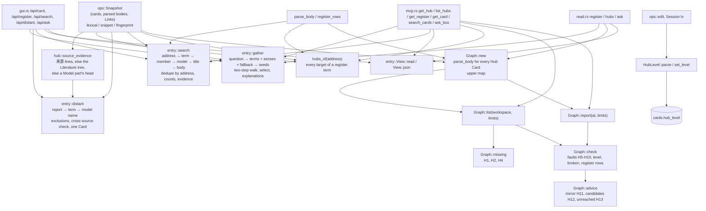

# Hub Cards

## Purpose

This block gives ZT its **Hub Cards**: Regular Cards of type `hub` that are a way into one subject. A Hub Card's body lists, under `##` group headings, one list item per member (a Link to a Card or a lower Hub Card, then what that Card adds), and states no claim of its own. Its **Hub level** (`line`, `topic`, `field`, `register`) says how wide the subject is. `src/hub.rs` stores the level, reads hub bodies, builds the hub graph of the archive (members, Hub range, upper and lower hubs), and reports the faults of the fixed hub policy (H1–H13 in `docs/hub-cards-design.md`) and the hubs a Workspace lacks. It exists so that agents (the book digest's hub stage, an agent writing a hub by hand) and the GUI reader can check and climb the hub graph; ZT reports every fault and never enforces one.

Two reports serve a concept that crosses books (#93 S12, design §8.1, §8.2). A Topic body may carry an **entry section** (`## 入口`): one to three Links a reader enters the subject through, which is the documented exception to the size-based topic-hub requirement — a tree that accepts one needs no topic hub, and a removed or broken section returns the advice. A topic hub whose members carry one book's source evidence gets **one-book advice**: an accepted register term that links a member to a treatment of the same subject sourced from another book, which the hub lists nowhere, is named with its address and its source. Both are reports; neither writes a Card.

The **concept register** is one of those Hub Cards, of level `register`. Its `## 词条` rows are terms with one to three Links to the Cards that carry the term's substance; `src/entry.rs` reads them into one disposable, revision-keyed entry view that the MCP server and the GUI both serve. Nothing else stores a concept, an alias, or an owner: the register lines are the only association between a term and its entries, and between two accepted spellings of one term. A Card also **carries** a term when its own substantive title or prose states the accepted label, so a Card that no row names shares that term for a distant selection (D196); `get_register at=<address>` answers that evidence for one Card.

The same module ranks **entry-first search** (`entry::search`, §9.2): an exact address, a matching register term and its entry Cards, a matching hub member line and the Card it opens, a matching model head, a matching Card title, then a matching authored body. The MCP server's `search_cards mode: entry` and the GUI's `/api/search mode=entry` both return that one projection, so the two transports cannot disagree about order, counts, or evidence. An omitted mode keeps the existing plain order (D198).

That ranking also **folds confirmed restatements** (§4.5, D209): an accepted `## 同述入口` entry and the substantive Card it names, or two Cards whose exact statement fingerprints are equal, are one row that names the canonical substantive Card, reports `+N` folded rows, and exposes every member. The fold is applied to the full scoped match set after the Workspace/type/form filters and before the page limit, so a hidden member is neither lost nor counted twice; `total` counts matching Cards and `row_total` counts rows.

The same projection also answers the **distant selection** (`entry::distant`, §10.2): zero or one Card of another book for the Card a reader has open or holds. It prefers a still-current proposal of a Bridge report the reader selected, then another book's substantive Card reached through an accepted register term, then another book's model head with the same scoped model name, and it explains the choice in one line (`Bridge report r-…, proposal b003: contrasts`, or `Shares register term 多重均衡; source …`). A shared term is never presented as a proven relation, the answer never rotates, and nothing is written (S19, #108; S20, #112).

The same projection answers a **question** (`entry::gather`, §9.3-§9.5): the read-only MCP tool `ask_box` and the authenticated GUI route `POST /api/ask` return one unsaved Spread proposal. The question is normalized and matched against accepted register labels (not every word of the sentence); at most six terms and twelve distinct entry Cards are taken; at most two authored semantic steps are walked from those entries in either direction, each step keeping its own authored direction and Relation kind; and the reply holds the best entry Card plus up to nine Cards, each with the term or exact path that justifies it. Generated Reverse links, `来源` locators, navigation sections, Hub and Structure member lists, Broken links and source tree roots are never walked. The work is bounded (200 visited Cards, 1,000 examined Links) and the reply reports its bounds, actual counts, every exclusion, and whether it is `sparse` or `truncated`. Nothing is written and no model runs: the proposal is a value a caller may keep as a Spread or discard (S15, #114).

The same rules also judge a **hub that is not saved yet** (`hub::precheck` and `hub::draft`, §9.6): a Spread kept from a question becomes one agent Hub Card draft, whose default level and placement, legal destinations and body are planned read-only, and whose drafted Markdown is run against the report's own body rules plus the placement rules before the composing desk offers to Save it (S17, #118).

**Owns:** the `HubLevel` type and its parsing and storage rule, the hub body format and its parser (`parse_body`, and the register's own term-row parser `register_rows` with `register_part_targets` and `register_row_faults`), the hub graph (`Graph`), the hub range, the fault and advice rules, the hub policy limits (`Limits`), the `get_hub` / `list_hubs` report shapes, the `hubs` list a Card reports (`hubs_of`), the Topic body's `## 入口` entry section and the exception it gives the `missing` policy (`EntrySection`, `entry_sections`), the accepted register entry projection (`src/entry.rs`: `View`, `Entry`, `Target`, the body bounds, the flattened page, `terms_at` for the terms one Card carries, and `register_of` for the register's terms), the source-evidence derivation `one-book` advice needs (`source_evidence`, `literature_tree_of`), the confirmed restatement read (`restatement_rows`, shared by a register's view and the search's one scan, `restatement_sections`), the entry-first search ranking over that projection (`Mode`, `SearchArgs`, `search`, the rank tiers, roles, evidence, counts, and bounded scans), the confirmed restatement fold that ranking applies (`fold_groups`, `Group`, `Folds`, `Disjoint`, the `Fold`/`Planned` row, `SEARCH_MEMBER_MAX`), the distant selection over the same projection (`DistantArgs`, `ReportTarget`, the `Offer` order, the exclusions, the cross-source check, `distant`, the `DISTANT_*` bounds), the question path over it (`AskArgs`, the question normalization and label match with its scoped-sense ambiguity and bigram fallback, the entry seeds, `walk` with its role classification and `LinkScan`, `select`, the `ASK_*` bounds, `gather`, and `ask_bounds`), and the not-yet-saved hub (`precheck`, `draft`, `destination_choices`, `side_address`, `topic_hubs_of`, and the body rules `body_faults` / `anchors` / `lower_in` that `Graph::check` and the precheck share).

**Does not own:** the `hub` Card type itself and the rule that only Regular Cards may have it ([Cards, Workspaces and Links](cards-and-links.md), `src/card_type.rs`); Link parsing and Relation kinds ([Cards, Workspaces and Links](cards-and-links.md), [Models and math](models-and-math.md) for `model::read_links`); the `TypeChange` / `level` argument plumbing in `ops::edit` ([Card operations](card-operations.md)); the `hub_level` column and its migration ([Service, CLI and storage](service-and-cli.md)); the plain lexical match set and score, the Snapshot, and its fingerprint ([Card operations](card-operations.md): `Snapshot::lexical`, `Snapshot::snippet`, `Snapshot::find`); the exact statement fingerprint itself and the source-line normalization it uses ([Cards, Workspaces and Links](cards-and-links.md): `card::statement_text`, `card::statement_fingerprint`); the MCP tool schemas and dispatch ([MCP server](mcp-server.md)); the GUI's search-tray drawing, its `All matches` tree groups, its `+N` fold and canonical reference, its Enter/Shift+Enter actions, and the reader and Table slot that shows the distant Card ([GUI](gui.md)); the GUI's `Ask the box` command, its temporary Table preview, its `Keep`/`Cancel` actions, the Spread schema's own `question` field and the recheck of a kept endpoint ([GUI](gui.md), S16 #116); the GUI's hub-draft composer — `File as card` on a kept Spread, the `POST /api/hub/draft` and `POST /api/hub/check` routes, the desk's placement controls and its precheck panel, and the one create or guarded edit the Save posts ([GUI](gui.md), S17 #118); the Session's `ty` and `lv` commands ([Terminal Session](session.md)); the register's publication from book term tables, model-head names, and a reviewed concept report ([zt-digest](zt-digest.md), `zt-digest register`, `scripts/book-digest/register-compiler.ps1`), which reads this projection but decides no meaning itself; the reviewed concept report and its meanings (`zt-digest concepts`, #97); and the Bridge report projection that supplies a selected report's still-current target ([zt-digest](zt-digest.md), S20, #112).

## At a glance

| | |
|---|---|
| Entry points | `hub::Graph::new(&Snapshot)` then `Graph::report` (MCP `get_hub`) or `Graph::list` (MCP `list_hubs`); `Graph::with_links` plus `Graph::with_bodies` for the indexed read; `hub::precheck(&Snapshot, &Value)` (GUI `POST /api/hub/check`) and `hub::draft(&Snapshot, &Value)` (GUI `POST /api/hub/draft`); `read::register` (MCP `get_register`, GUI `/api/register`) and `read::hubs` on a register, both building `entry::View`; `entry::register_of` and `entry::register_addresses` (a Workspace's one register, for `one-book` evidence and a field hub's placement); `entry::restatement_sections` and `entry::restatement_rows` (the confirmed `## 同述入口` read); `entry::search(&Snapshot, &SearchArgs)` (MCP `search_cards mode: entry`, GUI `/api/search mode=entry`); `entry::distant(&Snapshot, &DistantArgs)` (GUI `/api/distant`); `entry::gather(&Snapshot, &AskArgs, revision, identity)` (MCP `ask_box`, GUI `POST /api/ask`, through `read::ask`); `hub::source_evidence(&Snapshot, &str)` (source evidence for both `one-book` advice and the distant check); `Mode::from_args` / `Mode::parse` and `AskArgs::from_args` (both transports); `hub::hubs_of` (MCP `get_card` and GUI `/api/card` field `hubs`); `hub::set_level` (from `ops::edit` and Session `lv`); `HubLevel::parse` / `names_hub_level` (from `ops::parse_level_arg` and Session `lv`); `Limits::from_args` (MCP `get_hub`, `list_hubs`); `EntryArgs::from_args` (MCP `get_hub`, `get_register`; GUI query) |
| Key files | `src/hub.rs` — levels, `set_level`, `Limits`, `Line`/`Body`/`parse_body`, `EntrySection`/`entry_sections`, `RegisterRow`/`register_rows`/`register_part_targets`/`register_row_faults`, `hubs_of`, `source_evidence`, `precheck`/`draft`/`destination_choices`/`side_address`/`topic_hubs_of` with the shared body rules `body_faults`/`anchors`/`lower_in`, and `Graph` (report, check, advice, one-book, source evidence, list, missing); `src/entry.rs` — the accepted entry projection (`EntryArgs`, `bounds`, `Entry`/`Target`/`View`, `bounded_body`, `restatement_links`, `register_of`, `register_addresses`, `restatement_rows`, `restatement_sections`), the entry-first search (`Mode`, `SearchArgs`, `search`, `Query`, `Quality`, `Candidate`, `Registers`, the `SEARCH_*` bounds), the restatement fold (`Group`, `Folds`, `Disjoint`, `substantive`, `register_parts`, `fold_groups`, `Fold`, `Planned`, `fold_of`, `fold_reason`), the distant selection (`DistantArgs`, `ReportTarget`, `Offer`, `Exclusions`, `distant`, `choose`, `added_sources`, `statement_noun`, `ambiguous_terms`, `candidate_json`, `explanation`, the `DISTANT_*` bounds), the question path (`AskArgs`, `folded_question`, `accepted_labels`, `scoped_base`, `question_terms`, `fallback_seeds`, `bigrams`, `Seed`, `Role`, `role_of`, `is_structure_card`, `LinkScan`, `scan_links`, `Walk`, `walk`, `Reached`, `select`, `threads`, `display_name`, `grid_position`, `ask_bounds`, the `ASK_*` bounds), and unit tests; `tests/hub_cards.rs`, `tests/register_entries.rs`, `tests/restatement_entries.rs`, `tests/search_rank.rs`, `tests/distant_card.rs`, `tests/ask_spread.rs`, and `tests/hub_draft.rs` — end-to-end tests through `zt mcp` and the GUI |
| Depends on | [Card operations](card-operations.md) (`ops::Snapshot`: `cards`, `by_address`, `parsed`, `title`, `outbound`, `inbound`, `sides`, `lexical`, `snippet`, `fingerprint`, `kind`, `clip`, `model_head`); [Cards, Workspaces and Links](cards-and-links.md) (`Card`, `CardType`, `Workspace`, `link::LinkBody`, `card::authored_fingerprint`, `card::statement_text`, `card::statement_fingerprint`); [Models and math](models-and-math.md) (`model::read_links` for Relation kinds and sentences, `model::address_order` for the tie-breaks, the member order and the mirror rule); [Service, CLI and storage](service-and-cli.md) (location helpers in `src/main.rs`: `tree_id`, `tree_root_address`, `parent_location`, `direct_successor`, `is_tree_root`, `is_tree_member`, `valid_topic_id`, `last_segment`, `load_card`, `parse_card_text`; the `cards.hub_level` column; `link_index::revision`; the `metadata.archive_id`; `read::ask`'s one transaction); `rusqlite`, `serde_json`, `anyhow` |
| Used by | [MCP server](mcp-server.md) (`get_hub`, `list_hubs`, `get_register`, `search_cards`, `ask_box`, `get_card`, `create_successor`, `edit_card`); [GUI](gui.md) (`/api/card` `hubs`, `/api/register`, `/api/search` entry mode, `/api/distant`, `/api/ask`, `/api/hub/draft`, `/api/hub/check`, create and edit with `level`); [Card operations](card-operations.md) (`ops::edit`, `ops::parse_level_arg`, `TypeChange::resolve_hub_level`); [Terminal Session](session.md) (`lv`); [Service, CLI and storage](service-and-cli.md) (`Card.hub_level`, `Card::level_id`); [zt-digest](zt-digest.md) (`zt-digest hub` reads `get_hub`, `list_hubs`, and the `## 入口` section); [Digest scripts](digest-scripts.md) (`hub-compiler.ps1`, `digest-audit.ps1` call `get_hub` and `list_hubs`); [zt-digest](zt-digest.md) (`zt-digest register` reads `get_register` and `get_hub`) |
| Tests | `tests/hub_cards.rs`, `tests/register_entries.rs`, `tests/search_rank.rs`, `tests/distant_card.rs`, `tests/ask_spread.rs`, `tests/hub_draft.rs`; the `#[cfg(test)] mod tests` at the end of `src/hub.rs` and `src/entry.rs` |

## Concepts

- `Hub Card` — a Regular Card of type `hub` (`CardType::Hub` in `src/card_type.rs`): a way into one subject. Its body lists members in groups and states no claim of its own. A Link from a Hub Card never takes a Model part into a model (model membership comes only from Model Cards, see [Models and math](models-and-math.md)).
- `Hub level` — `HubLevel` in `src/hub.rs`: `Line` (1), `Topic` (2), `Field` (3), `Register` (4); `HubLevel::number` gives the number, `HubLevel::id` the stored name. Stored only on a Hub Card, in `cards.hub_level`.
- `Line` (member line) — `hub::Line`: one list item of a hub body that holds at least one Link: its `group`, its first Link `target` (the member), every Link in `targets`, the `reason` (what the Card adds), and the Relation `kind` of its first Link.
- `Group` — a `##` or `###` heading of a hub body (`Body.groups`). A group named `邻近` (or `neighbours`) points out of the subject and does not count toward the hub's size (`is_neighbour_group`).
- `Hub range` — the Cards a hub is responsible for (`Graph::range`): a line hub's anchor and its subtree, a topic hub's tree, the Trees of a field hub's Topics, or the register's whole Workspace. Tree roots and Hub Cards are never in a range. A field hub's range is its Topic trees: a substantive Literature-tree Card the hub names explains the crossing but is a member, not a whole tree of the range (§8.1, D162).
- `Anchor` — the Card a hub is filed under: `crate::parent_location(hub address)`. For a line hub it is the Card where the line starts; for a topic hub it is `<n>/1`. The `anchor-title` fault also compares a topic hub's title with its tree's Topic Card `<n>/0`, the anchor the hub compiler's precheck names.
- `Upper` / `lower` hubs — the hubs that list this hub, and the hubs this hub lists (`Graph.upper`, `Graph::lower`). The hub graph is a directed graph, not a tree.
- `Register` — the one hub of level `register` in a Workspace, the first Card of the Topic `索引`. Its term rows live in the `## 词条` group (the earlier compiler wrote `## 关键词`; both are read): one term before `：`, then one to three Links to Cards, and nothing else. The groups this grammar does not own stay as they are: `## 领域` keeps the field-hub navigation, `## 未归入领域的主题` the unhoused topic hubs. Because the label ends at the first `：`, a term label cannot itself hold one: `zt-digest register` excludes such a model-head name instead of writing a row whose term is only a prefix ([zt-digest](zt-digest.md)). A rebuild of an existing register, or a change to an old hub, is review-first: it is published only through `zt-digest publish` ([zt-digest](zt-digest.md), #119).
- `Register term row` — `hub::RegisterRow`: the 1-based `line`, the `term` before the colon, every Link `target` in order (repeats kept so the checks can name them), and a `shape` description when the row breaks the grammar (no colon, an empty term, words after the Links). `register_rows` reads the term groups (`词条`, or the older `关键词`) and a row written before any heading, because an existing register may have either; a row that breaks the grammar stays a row so a check can name it.
- `Register part` — `hub::RegisterPartRow`: one `## 词条分册` item of a register: its 1-based `line`, the accepted initial-range `label` the row states (`A–F`, `S–Z、其他`, `其他`, `S–Z(2)`), and the Linked `address` (or none). The same row reads whether the label comes before the Link (`- A–F：[[3/1]]`) or after it (`- [[3/1]] A–F`). An ordinary Idea Card at that address whose place is an immediate Side successor of the register is a part: its body has its own `## 词条` rows and a part cannot contain parts. Its identity is the root's declaration plus that place, so no metadata field marks it. `register_part_rows` is the one parser; `register_part_targets` is its address list for the read adapter. Reading a part's accepted label is S11 (#104); publication is `zt-digest register` ([zt-digest](zt-digest.md)).
- `Entry` — `entry::Entry`: an accepted term, the Card and line it was written on, the declared `part` (or none), all of its projected targets, and its own faults. `complete` is false when a target is missing or repeated.
- `Target` — `entry::Target`: one target address, whether the Card exists, its title/type/facet/Workspace/tree, and its bounded authored body (`body`, `body_chars`, `body_lines`, `body_truncated`). A target in the human Workspace is legal and read-only (D174): the register names it, agents never write it, and only a review's explicit selection makes one a target ([zt-digest](zt-digest.md), `register`).
- `Entry view` — `entry::View`: the register address and its entries in register order, the row/part/restatement/ambiguous-label `faults`, the declared `parts`, `terms_by_card` (the register rows that name each target, in register order), the confirmed `restatements`, and the archive identity/revision it was read at. It is derived and disposable; it stores nothing and is not a concept id.
- `Term evidence` — the accepted terms one Card carries (`View::terms_at`, D196): the register rows that name it, then the accepted labels its own substantive title or prose states, in register order and once each. A label is matched whole after folding case, so `学习（个体行为）` never widens into the bare `学习`. The register, its declared parts, an undeclared Side successor holding term rows, Hub Cards, and tree roots are navigation and supply no occurrence; a `来源`/`出处`/`Source` line, a fenced code block, and a `##` section whose heading is a navigation group (`邻近`, `入口`, `词条`, `词条分册`, `同述入口`) are not prose. A row that is not `complete` supplies no occurrence either (D297). It is asked for one Card (`get_register at=`), not materialized for the whole archive: the live archive's 78 term rows are named by 86 Cards but stated by about 1,481, so a full map would carry four times the register page's bytes to every reader.
- `Ambiguous term` — two or more entries with the same exact term label whose destination sets differ: `View::mark_ambiguous_terms` adds one `ambiguous` fault naming every row (`card`, `line`, `part`, `targets`) and keeps every row and destination as its own entry (`complete: false`). A term with one label and different destinations is never merged and no sense is chosen (D299); the author gives each sense its own scoped label (`学习（个体行为）`), which is a different term. Two rows with the same label and the same destinations are equivalent rows, which a later slice deduplicates (§8.5, S11).
- `Body bound` — the entry projection carries at most 1,200 characters and 24 lines of one target's authored body (`entry::BODY_MAX_CHARS`, `BODY_MAX_LINES`). A cut body says so: `body_truncated: true` with the authored `body_chars`/`body_lines`. The page bound is `entry_limit` 200 by default, at most 1,000.
- `Restatement entry` — a Card whose body has a `## 同述入口` section naming exactly one substantive Card of the same Workspace: the derived navigation role of design §4.5 (D084-D086). The view records the confirmed reference with its `terminal`, and reports a malformed, self-, missing, cross-Workspace, non-substantive, chain, or cycle reference as one `restatement` fault whose `kind` names which. A chain (an entry whose direct target is another entry) is reported with the `terminal` to write, a cycle is reported once per entry on it, and neither is a confirmed row: `complete` is false, so a faulty entry can never become folding evidence.
- `Entry-first search` — `entry::search` (design §9.2, D198-D210): the ranked result of one query over the supplied `Snapshot`. The tiers are lexicographic, not weights: address (1), term (2), member (3), model (4), title (5), body (6). Inside a tier an exact label beats a prefix, which beats a partial match; the current lexical score (`Snapshot::lexical`, the same score plain search uses) orders the rest; natural address order (`model::address_order`) breaks the final tie. A term is never a Card: a target that is also a title or body hit appears once, at its highest tier. The ranking starts no model, follows no Link, writes nothing, and is recalculated from the supplied read (there is no stale view cache).
- `Restatement group` — the Cards a search may fold into one row (D209): the connected components of a confirmed `## 同述入口` entry and the substantive Card it names, and of two **Idea Cards** whose exact statement fingerprints are equal (the fingerprint reads a Term link as its visible label, S12, #154, so adding or moving Term markup cannot split one claim). Only the Cards the query matched, the confirmed entry partners of those Cards, and the exact statements those Cards state take part, so no whole-archive hash pass runs and a Card the query never matched never takes a matched Card's place. A tree root, a Hub Card, a declared register part and a restatement entry are navigation and never join a fingerprint group; a Model part, an Event Card and a Finding Card never join one either, because the fingerprint drops a separately labelled source line on purpose and their model, facet, labels or source are part of their meaning; a Card whose statement text is empty (a source line only) states no claim and never joins one. Nothing else groups two Cards: a shared formula or term, a proposed or uncertain merge, or a changed value, sign, variable, negation, assumption or scope never does, and no similarity is closed transitively — only a confirmed entry Link or an equal exact fingerprint joins two Cards.
- `Canonical statement` — the group's representative: the terminal substantive Card an accepted entry names, or, when no entry names one, the group's substantive member in natural address order. Two terminals in one group are the lower address. A row names it in `representative`.
- `Folded row` — one row for a restatement group, placed where its best-ranked matching member was. It names the canonical statement when that Card survived the filters; otherwise it names the matching member the query ranked first and still reports `representative`, so a filtered-out canonical is never hidden (D209, S14-AC05). `folded` is how many matching rows it replaces (`+N`), `members` lists every member with `role`, `statement` (`entry` or `substantive`), `matched`, `kept`, `canonical`, and `member_total` is the group's size. The row keeps the matching member's `role`, `rank_tier`, evidence and `reason`, with a sentence added about the fold.
- `Search role` — the row field `role`: `entry` (a register entry target), `member` (the Card a hub member line opens), or `hit` (an ordinary matching Card: exact address, model head, title, or body). `rank_tier` is the tier number; `reason` is the sentence that explains the row. A folded row keeps the role of the member that carried its rank; each member names its own role (or `null` when the query did not match that member).
- `Search bounds` — the named constants every entry search reports: `SEARCH_LIMIT_MAX` (200 rows, the MCP clamp), `SEARCH_HUB_MAX` (2,000 Hub Cards scanned for member lines), `SEARCH_TERM_MAX` (1,000 register rows ranked), `SEARCH_FAULT_MAX` (100 register faults reported), `SEARCH_LINE_MAX_CHARS` (200 characters of a matched hub line), `SEARCH_MEMBER_MAX` (200 members one folded row exposes; a bigger group reports `member_total`, `folded` and `members_truncated`). Actual scans and truncation are reported in `scanned`, which also counts the `同述入口` sections read (`restatements`) and the exact statement fingerprints the fold compared (`statements`).
- `Distant Card` — `entry::distant`'s answer for one Card the reader has open or holds (§10.2, D249-D256): zero or one Card of another book, its address, title, type, the evidence that reached it, and one line of explanation. The slot shows it; the selection writes nothing, records no view, and never rotates on refresh (S19, #108).
- `Candidate source` — why a distant Card was offered, in the design's order (D250): `bridge_report` (a still-current proposal of the immutable Bridge report the reader selected), `register_term` (another book's substantive Card reached through an accepted register term the focus carries), then `model_name` (another book's model head whose own name states the same scoped accepted label, D253). The first offer that passes the evidence check wins; the source never changes on a re-read of the same Cards. A report contributes up to `DISTANT_REPORT_MAX` (20) ordered proposals and the first one the exclusions leave wins, so a report target that is gone or already on the Table falls through to the next proposal before any term evidence (S20, #112).
- `Cross-source evidence` — the check every term and model-name offer passes (D255, S19-AC02): both Cards need known source evidence, and the candidate must name at least one source the focus does not. A candidate of the focus's own book is skipped in favour of the next offer. Where either side's evidence is mixed, the explanation says so and claims only the added source; unknown attribution is never a confident cross-book suggestion. A report proposal carries the report's own judged evidence instead: `entry::distant` never re-judges it, and the Bridge compiler has already validated its endpoints (S20, #112).
- `Distant exclusion` — the Cards a distant selection removes before offering (D255, S19-AC03): the focus; the Cards the reader has on the Table; the focus's immediate filing neighbours (its parent, Direct successor, and Side successors); the Cards its Links reach in either direction; Broken links; the register and its parts; the Card that holds the same confirmed statement; and the term rows whose label is ambiguous or whose target is missing. Every removal is counted under `excluded`, so a reader can tell "nothing shares a term" from "everything that shared one was excluded".
- `Covered` — every Card a hub reaches through its own lines and, transitively, its lower hubs (`Graph::covered`).
- `Reached` — a Card is reached when any hub lists it, or lists a Card above it in its tree through `|` segments (`reached`). A Card of a range that is not reached is `unreached` (the design calls it a black hole).
- `Limits` — `hub::Limits`: the six numbers of the policy (`max_groups`, `max_lines`, `min_reason`, `topic_min`, `line_min`, `neighbour_links`), per request.
- `Fault` / `advice` — a fault is a broken rule in the report's `faults` list; advice (`mirror`, `candidates`, `unreached`, `one_book`) is information that is not a fault.
- `Entry section` — `hub::EntrySection`: a Topic Card's `## 入口` group (`entries` or `entrance` is the English spelling, like `邻近`), its tree, and the entry Cards, in body order. One to three list items, each a Link to a Card of the tree followed by what that Card adds; an entry that is missing, outside the tree, the tree root, a Hub Card, written twice, or unexplained is a fault (`entry-shape`, `entry-target`, `entry-bare`) and leaves the topic-hub requirement standing. It is the documented exception to the size-based topic-hub requirement (§8.2, D167, D168): `Graph::missing` reports the topic hub only while the section is absent or invalid, and `list_hubs` reports every section it reads under `entries`.
- `One-book advice` — `Advice.one_book` in the `get_hub` report (§8.2, D166): for a topic hub, the hub's own source evidence (`sources`: the union over its members outside `邻近`, empty when unknown), the accepted register treatments of the same term that a member shares and that carry a source the hub names nowhere (`candidates`, each with `address`, `title`, `term`, `member`, added `source`, and full `sources`), and the treatments whose source evidence this read cannot see (`unknown`). It is null for a hub that is not a topic hub or a read that supplied no evidence bodies (so `list_hubs`, which loads none, reports no `one_book`); candidates are empty when the hub's own evidence is unknown, when the treatment's evidence adds no source, or when the hub lists the treatment anywhere. No relation is invented and nothing is written.
- `Source evidence` — the derivation `one-book` uses (design §4.3, D068-D072, the same rule `zt-check::source_evidence` applies): the Citation keys of the Links on the Card's `来源`/`出处`/`Source` lines, else the Literature tree the Card is filed in, else (for a Model part) its model head's evidence. Several sources are kept as several, never forced to one book; no evidence is `unknown`, never a guess.
- `Question request` — `entry::AskArgs` (design §9.5, D226-D228): `question` (required, trimmed, nonblank, at most 512 Unicode characters), `workspace` (`human`, `agent`, or `all`, the default), and `limit` (5 to 9, default 7, clamped). The MCP server and the GUI parse the same JSON through `AskArgs::from_args`, so both accept and refuse exactly the same requests.
- `Question proposal` — `entry::gather`'s one value (design §9.3-§9.5, D211-D231): `question` (the whole question, never the display name), `workspace`, `limit`, `matched_terms` (the accepted labels whose entries seed the set) and `terms` (each with its first occurrence `at`, its register `origins`, and its `targets`), `ambiguous_terms` (bare words whose senses the question does not distinguish), `fallback` (the low-confidence bigram evidence, or null), `registers` and `faults`, `held` (the best entry Card), `spread` (`name`, `question`, and the suggested `cards` with `x`/`y`), `cards` (each with its term, origin, `via_hub`, `depth`, `seed`, `path`, `statement`, `reason`, and `authored_fingerprint`), `reasons`, `threads`, `excluded`, `sparse`, `truncated`, `counts`, `bounds`, `archive_revision`, and `archive_identity`. It is a proposal: no Card, Link, or Spread is written, and no model runs.
- `Matched question term` — an accepted label found as a substring of the normalized question (`folded_question`: case folded, whitespace collapsed). The rules are the design's (D212): a matched label contained in another matched label is that longer concept's word, so only the longer one matches; two labels that overlap without containing each other both match; two accepted spellings stay two rows and both match; the terms are ordered by first occurrence in the question, then by register order, and at most `ASK_TERM_MAX` are taken. Matching the question is not matching every word of it: `为什么学习可能造成多重均衡？` matches `学习（个体行为）`, `学习（产业生产率）`, and `多重均衡`.
- `Ambiguous bare word` — a word the question states that is the base of two or more accepted scoped labels (such as `学习` for `学习（个体行为）` and `学习（产业生产率）`) while the question states none of those scoped labels in full. Every accepted sense becomes a matched term and the bare word is listed in `ambiguous_terms`; no sense is chosen silently. A full scoped label in the question wins over its bare word and exposes no sense. A bare word with exactly one accepted sense exposes that sense and is not ambiguous.
- `Bigram fallback` — what a question that names no accepted term is answered with (D212, S15-AC03): the distinct character bigrams of the question (letters and digits only, case folded) against each substantive Card's title (a Model Card's title is its model name), keeping a Card that shares at least `FALLBACK_BIGRAM_MIN` (2) bigrams, best overlap first and then natural address order, within the Workspace filter. It is a small pure calculation in `src/entry.rs`; the digest's TF-IDF stack stays in its own crate and is neither copied nor imported. The reply says `kind: bigram`, `confidence: low`, and names the overlap in each reason.
- `Entry seed` — a Card a matched term's row names (`Target`), in row and Link order, at most `ASK_SEED_MAX` (12) distinct addresses. A row that names a Hub Card supplies the hub's member Cards as entries (D216) and the hub itself is never a seed; a row that names a Literature tree root, the register's own navigation, or a Structure Card supplies no seed and is counted under `excluded`. A **Topic** Card is a legitimate seed: `CONTEXT.md`'s Register names "a standalone Topic claim" as one of the Cards that carry a term's substance, so the question path holds and walks it, while a Literature root would join a whole book and is the source root D216 forbids. A target outside the Workspace filter is counted as `workspace`. A fallback seed is an overlapping title instead, with no term and no register origin.
- `Bounded semantic walk` — `entry::walk` (design §9.4, D215-D217): from the seeds, at most `ASK_DEPTH_MAX` (2) steps in either direction, at most `ASK_CARD_MAX` (200) distinct substantive Cards and `ASK_LINK_MAX` (1,000) examined authored semantic Links. Each step records `from`, `to`, `direction` (`out` when the walked Card wrote the Link, `in` when it received it), the Relation `kind`, and the `sentence` the author wrote, so an inbound `rests-on` stays the neighbour's claim about the seed and is never reversed. The frontier is ordered by the matched term's place, then the Card's own term evidence, then natural address order; a visited Card is never visited twice, so a cycle ends.
- `Walk exclusion` — what the walk refuses to treat as a semantic step, each counted under `excluded` (`src/entry.rs::Role`, `LinkScan`): a generated Reverse link (not part of the authored body at all), a `来源`/`出处`/`Source` locator line (`source_locator`), a navigation section's Links (`navigation`: `邻近`, `入口`, `词条`, `词条分册`, `同述入口`), fenced code and charts (`fenced`), a Hub Card (`hub`), a Structure Card whose first line is `本卡是《…》的结构卡` (`structure`), a Literature tree root — the source root that would join a whole book (`source_root`) — the register and its parts (`navigation`), a Broken link (`broken`), a missing target (`missing`), and a Card outside the Workspace filter (`workspace`).
- `Question selection` — `entry::select` (D218-D224): the best entry Card is held (the first seed in evidence order), and each further Card is the best remaining one by this ordered preference — a statement no selected Card holds yet beats another member of the same confirmed restatement set; a directly relevant Card (`depth` 0) and a shorter path beat a longer one; the Card's own term evidence orders comparably relevant Cards; among comparably relevant Cards one that adds a source, a tree, or a Relation kind the proposal does not hold yet wins; natural address order breaks the last tie. Diversity is a tie preference, never a reason to prefer an irrelevant Card, and a duplicate statement is still chosen when nothing else is left.
- `Table thread` — one value of the proposal's `threads`: an authored Link whose two ends are both selected, with its authored `from`/`to`, its Relation `kind`, and its `sentence`. An unkinded Link stays `refers`; the reply never infers a causal or semantic relation and never upgrades one.
- `Ask bounds` — the fixed constants of the question path, all reported under `bounds` with the work actually done under `counts` and the exclusions under `excluded`: `ASK_TERM_MAX` 6, `ASK_SEED_MAX` 12, `ASK_DEPTH_MAX` 2, `ASK_CARD_MAX` 200, `ASK_LINK_MAX` 1,000, `ASK_LIMIT_MIN` 5, `ASK_LIMIT_MAX` 9, `ASK_LIMIT_DEFAULT` 7, `ASK_QUESTION_MAX_CHARS` 512, `ASK_NAME_MAX` 80, `FALLBACK_BIGRAM_MIN` 2.
- `Hub draft` — a Hub Card's title, level and body that is not saved yet, with the placement it would take (design §9.6, D235-D237): `hub::precheck` judges it by the report's own body rules plus the placement rules, and `hub::draft` plans one from a Spread kept from a question. The placement is a side successor of the Card it is filed under, or a rewrite of the hub already filed there. Nothing is stored, so a cancelled draft leaves no Card.
- `Hub placement` — the level and destination a draft is filed at, and the rules that make a pair legal: a `field` hub belongs under the agent Workspace's one register; a `topic` hub inside a Topic tree whose first Card it hangs under, and never beside another topic hub of that Tree; a `line` hub under a Card of a Topic tree where its line starts. Every destination is in the **agent** Workspace, whatever Workspace the composing page shows, and a rewrite keeps the hub's own level.
- `Saved-hub body rules` — the rules a hub body answers without the graph (`Graph::body_faults`, shared by `Graph::check` and `hub::precheck`): `level`, `anchor-title`, `oversize`/`flat`, `bare`, `broken` members, and `upward`. The graph-only rules (`cycle`, `unanchored`, `duplicate` for a saved hub, `unlisted`, `isolated`) are not judged for a draft that does not exist yet.

## Architecture

`src/hub.rs` is one module with four parts, and `src/entry.rs` is the register's reader:

1. **Level** — `HubLevel`, `LEVEL_NEEDS_HUB_CARD`, `names_hub_level`, `set_level`: parsing a level name and writing `cards.hub_level`.
2. **Body parser** — `parse_body`, `list_item`, `clean_reason`, `reason_chars`: turns a hub's Markdown body into a `Body` of groups and `Line`s; `register_rows`, `register_part_targets`, and `register_row_faults` read and judge the register's `词条` grammar (D050, D289, D297). `clean_reason` and `part_label` remove the macros the shared lexical scan reports (`LinkBody::for_rendering`) instead of scanning for `[[` themselves (S10, #151).
3. **Graph** — `Graph<'a>` borrows an `ops::Snapshot`, parses the body of every Hub Card once (`hubs`: address → (level, `Body`)), and builds the reverse map `upper`. Its methods compute `lower`, `covered`, `in_cycle`, `range`, `tree_links`, and then the outputs: `report` (one hub), `list` (the hub graph of a Workspace), `check` (faults), `advice`, and `missing` (required hubs that do not exist).
4. **Card lookup** — `hubs_of`: the hubs that list one Card directly, without building a `Graph`; for a register it reports a target at any position of a term (D051).
5. **Entry projection and entry-first search** (`src/entry.rs`) — `View::read` parses the register and its declared parts with the row parser, projects every target's bounded body, collects `terms_by_card`, adds the confirmed restatements, and marks identical labels with conflicting destinations as one ambiguous term; `View::terms_at` adds the terms one Card's own title and prose state (D196); `View::json` pages the flattened entries with the archive evidence. `search(snapshot, args)` ranks one query over that view: it builds the registers from the supplied Snapshot, reuses `Snapshot::lexical` for the current score, collects the tier candidates, filters target Cards, deduplicates by address (highest tier wins), and returns one JSON projection. `src/read.rs::register` and `src/read.rs::hubs` supply the view from one read transaction; the GUI and MCP supply the Snapshot they already read.
6. **Distant selection** (`src/entry.rs`, `distant`) — over the same view and Snapshot: it takes the focus's accepted terms (`terms_at`) and source evidence, builds the exclusion set, collects the offers of the three sources in rank order, chooses the first whose evidence passes, and renders one candidate with its one-line explanation and the counts of what it dropped. It is one pure function; the GUI route passes the Table's addresses and — when the reader selected one — the Bridge compiler's validated current proposals for that Card, which it never re-reads or starts itself (S20, #112).
7. **Question path** (`src/entry.rs`, `gather`) — over the same view and Snapshot: `folded_question` normalizes the question; `question_terms` matches accepted labels as substrings, drops a label contained in a longer matched one, expands a bare base of scoped labels into every accepted sense (and names it `ambiguous`), and orders the terms by first occurrence then register order; `fallback_seeds` answers a question with no matched term through the small bigram overlap; `role_of`/`LinkScan` classify each Card and its authored Links, excluding navigation, hubs, roots, Structure Cards, source locators and Broken Links; `walk` expands at most two semantic steps in both directions within the fixed bounds; `select` greedily chooses the proposal's Cards by the design's ordered preference; and `threads` lists only the authored Links between two selected Cards. It is one pure function: `src/read.rs::ask` supplies the Snapshot, revision and identity from one transaction, and both transports return the value unchanged (S15, #114).



Every report is computed from the stored Cards in one `Snapshot`; `src/hub.rs` writes nothing except `hub_level` (`set_level`).

## Interfaces

`Graph::with_links(snapshot, links)` uses the existing policy calculations with per-request indexed source-target lists. `Graph::new` retains the full-Snapshot path. Both use the same outbound helper for tree-neighbour counts, candidate scores and Topic-to-hub anchoring. The MCP reader streams global Card metadata/title lines and complete Hub bodies, then supplies the index; ordinary bodies are not parsed to compute hub policy. This is request-local input, not a persistent cache.

All items are `pub(crate)`; ZT is one binary crate (`src/main.rs` declares `mod hub;`).

### Level

| Item | Signature | Behaviour |
|---|---|---|
| `HubLevel` | `enum HubLevel { Line, Topic, Field, Register }` (`Copy`, `Ord`) | Ordered by width. |
| `HubLevel::id` | `fn id(self) -> &'static str` | `line`, `topic`, `field`, `register`: the stored and reported name. |
| `HubLevel::number` | `fn number(self) -> u8` | 1 to 4. A hub without a level counts as 0 wherever levels are compared. |
| `HubLevel::parse` | `fn parse(&str) -> Result<HubLevel>` | Trims and ASCII-lowercases; accepts `line`/`线索`/`线索枢纽`, `topic`/`主题`/`主题枢纽`, `field`/`领域`/`领域枢纽`, `register`/`索引`/`登记簿`. Error: ``unknown hub level `x`; expected line, topic, field, register, or empty for none``. |
| `HubLevel::from_stored` | `fn from_stored(Option<&str>) -> Option<HubLevel>` | Reads the column; an unknown value reads as no level. Used by the card loaders in `src/main.rs`. |
| `names_hub_level` | `fn names_hub_level(&str) -> bool` | True when the text is a hub level name. `ops::parse_level_arg` uses it to tell a hub level from an elaboration level in one `level` argument. |
| `LEVEL_NEEDS_HUB_CARD` | `&str` | `only a Hub Card has a hub level (line, topic, field, or register)`: the refusal text shared by `set_level`, `ops`, `mcp.rs`, and `gui.rs`. |
| `set_level` | `fn set_level(&Connection, &Card, Option<HubLevel>) -> Result<()>` | `UPDATE cards SET hub_level = ? WHERE row_id = ?`. Refuses a level on a Card whose `card_type` is not `Hub`; `None` always clears. The caller holds the edit lock. |

### Limits

`Limits { max_groups, max_lines, min_reason, topic_min, line_min, neighbour_links }` (all `usize`).

| Limit | Default | Rule it sets |
|---|---|---|
| `max_groups` | 7 | H5: most groups outside `邻近` |
| `max_lines` | 25 | H5: most member lines outside `邻近` |
| `min_reason` | 8 | H8: fewest reason characters (letters, digits, CJK) |
| `topic_min` | 7 | H1: Cards in a Topic tree that require a topic hub |
| `line_min` | 12 | H2: Cards in a branch that require a line hub |
| `neighbour_links` | 3 | H10: Links between two Topic trees that make them neighbours |

`Limits::from_args(&Value) -> Result<Limits>` reads each name from a JSON object; a missing or `null` value keeps the default; any other value must be a JSON integer of 1 or more, else ``argument `name` must be a whole number of 1 or more``. A numeric string such as `"7"` is refused. Every report echoes the limits it used under `limits`.

### Body parser

- `struct Body { groups: Vec<String>, lines: Vec<Line> }`
- `struct Line { group: Option<String>, target: String, reason: String, kind: &'static str, targets: Vec<String> }`
- `fn parse_body(body: &str) -> Body` — never fails; text it cannot read holds no members.
- `struct RegisterRow { line: usize, term: String, targets: Vec<String>, shape: Option<String> }`
- `fn register_rows(body: &str) -> Vec<RegisterRow>` — the term rows of the `词条` (or older `关键词`) group, in body order; fenced code is skipped, a row with no Link is still a row.
- `struct RegisterPartRow { line: usize, label: String, address: Option<String> }`
- `fn register_part_rows(body: &str) -> Vec<RegisterPartRow>` — the declared parts of the `词条分册` group, in declaration order; fenced code is skipped and a row with no Link keeps an empty address.
- `fn register_part_targets(body: &str) -> Vec<String>` — the distinct Links of the `词条分册` group, in declaration order, for the read adapter that loads their bodies.
- `fn register_row_faults(row: &RegisterRow, exists: &dyn Fn(&str) -> bool) -> Vec<Value>` — the policy faults of one row: `shape`, `empty`, `oversize`, `duplicate-target`, `broken` (one per missing target, D051).

### Card lookup

`fn hubs_of(snapshot: &Snapshot, address: &str) -> Vec<Value>` — the Hub Cards (other than the Card itself) that list the Card, sorted by level number (no level first, register last) and then by address. For every hub but a register, a line's first Link (its member) must be the Card. A register reports the Card at any position of a term, once per term, with the term and the 0-based target index (D051). Each item:

```json
{ "address": "130/1|b", "title": "逆向选择的入口", "level": "topic" }
{ "address": "196/1", "title": "索引：代理工作区的入口", "level": "register", "term": "多重均衡", "target_index": 1 }
```

### Graph

- `Graph::new(&Snapshot) -> Graph` — parses every Hub Card in the Snapshot (both Workspaces).
- `Graph::report(&self, at: &str, limits: &Limits) -> Result<Value>` — the `get_hub` report. Errors: ``card `at` does not exist``; ``` `at` is not a Hub Card; set type `hub` and a level first```.
- `Graph::list(&self, workspace: Option<Workspace>, limits: &Limits) -> Value` — the `list_hubs` report; `None` means both Workspaces.

### MCP tools

Dispatched in `src/mcp.rs` (see [MCP server](mcp-server.md)); all are read-only and read a fresh transaction per call.

| Tool | Arguments | Result |
|---|---|---|
| `get_hub` | `at` (required), any of the six limits, `entry_offset`, `entry_limit` | `Graph::report`; on a register, plus the flattened entry projection of `get_register` (the two page arguments apply to that projection only) |
| `list_hubs` | `workspace` (`human`, `agent`, or omitted for both), and any of the six limits | `Graph::list` |
| `get_register` | `workspace` (required: `human` or `agent`), `entry_offset`, `entry_limit`, `at` (one Card address) | the register's entry view from `read::register`; a register-less Workspace answers `register_missing` with no entries. `at` adds `terms_at` and `terms`: the accepted terms that Card carries (D196). |
| `search_cards` | `query`, `mode` (`plain` default, `entry`), `type`, `form`, `workspace`, `limit` | `plain` keeps the existing `Snapshot::search_in` listing/search; `entry` with a non-empty query returns `entry::search`. An empty query stays the existing type/form listing in either mode. |
| `get_card` | `at` | adds `hubs: hubs_of(...)`, and `level` shows a hub level through `Card::level_id` |
| `create_successor` | `type: "hub"`, `level` | `ops::parse_level_arg`; a hub level on a non-hub refuses with `LEVEL_NEEDS_HUB_CARD`; the level is written by a follow-up `ops::edit` with a `TypeChange { hub_level }`. The reply's `level` is the elaboration or hub level. |
| `edit_card` | `type`, `level` | `TypeChange { hub_level }` resolved by `TypeChange::resolve_hub_level` in `src/ops.rs` |

`get_register` report shape (from `entry::View::json`, merged into `get_hub` on a register):

```json
{
  "workspace": "agent",
  "register": "196/1",
  "title": "索引：代理工作区的入口",
  "register_missing": false,
  "duplicate_registers": [],
  "entries": [
    { "term": "多重均衡", "line": 4,
      "origin": { "card": "196/1", "line": 4, "part": null },
      "targets": [
        { "address": "161/1", "exists": true, "title": "…", "type": "idea", "facet": null,
          "workspace": "agent", "tree": "161", "body": "…", "body_chars": 96, "body_lines": 3,
          "body_truncated": false }
      ],
      "complete": true, "faults": [] }
  ],
  "entry_offset": 0, "entry_limit": 200, "entry_total": 1, "entry_next_offset": null,
  "parts": [{ "label": "A–F", "address": "196/1|a", "title": "词条 A–F", "exists": true, "place": "ok", "entries": 12 }],
  "duplicates": [{ "term": "均衡", "card": "196/1|a", "part": "196/1|a", "line": 3, "served_by": "196/1", "served_line": 2 }],
  "faults": [], "complete": true,
  "terms_by_card": { "161/1": ["多重均衡"] },
  "terms_at": "161/1", "terms": ["多重均衡", "学习"],
  "restatements": [{ "entry": "88/2|a", "substantive": "88/2", "terminal": "88/2", "title": "…" }],
  "bounds": { "body_max_chars": 1200, "body_max_lines": 24, "entry_limit_default": 200, "entry_limit_max": 1000 },
  "archive_revision": 42,
  "archive_identity": { "id": "…", "path": "…" }
}
```

A `register_missing` answer has `register: null`, no entries, and one `register_missing` fault: an honest empty result, not an error. Two registers give `register: null`, `duplicate_registers`, and one `duplicate` fault; they are never chosen between. `complete` is false while any row, part, restatement, or ambiguous-label fault stands. One label written with different destinations is one `ambiguous` fault that lists every conflicting row and keeps every destination as its own entry; the term stays in the projection, and entry-first search ranks its destinations rather than choosing one. `terms_by_card` holds the register rows' explicit destinations; `terms_at` and `terms` appear only when the request names one Card with `at`, and `terms` is that Card's `Term evidence` (its rows and its own substantive title and prose). On `get_hub` the report's own hub-policy faults (H5's register rows, H8's line reasons) stay in `faults` beside the entry view's faults — the row faults both check appear once — so the legacy report field keeps its checks (D276); `complete` still speaks only for the entry projection.

### Entry-first search

`entry::search(snapshot: &Snapshot, args: &SearchArgs) -> Value` is the one ranking contract (§9.2, D199-D210). It is a read projection over the supplied Snapshot: it parses the register rows (or reports no register), reuses `Snapshot::lexical` for the current score and `Snapshot::snippet` for the preview, and returns one JSON value. The MCP server (`search_cards mode: entry`) and the GUI (`/api/search mode=entry`) return that value unchanged, so one archive and query give identical rows, order, counts, and fields (D194, D198, D278). No model runs, no Card is written, and no Link is walked.

`SearchArgs { query, workspace, card_type, form, limit }`. `Mode::from_args(&Value) -> Result<Mode>` (absent = `plain`, the existing MCP behaviour; error ``unknown search mode `x`; expected plain or entry``) and `Mode::parse(&str)`.

| Tier | `role` | When | Evidence fields |
|---|---|---|---|
| 1 `address` | `hit` | The query is exactly a Card address (case-insensitive). | `field: "address"` |
| 2 `term` | `entry` | Every query word occurs in a register term (case and spacing folded). A row that is not `complete` is ignored (D297). | `matched_term`, `origin {card, line, part}`, `entry_targets` |
| 3 `member` | `member` | A Hub Card's member line names the query in its authored words or in the title of the Card it opens. A register's `词条`/`词条分册` rows are tier 2, not member lines. | `matched_line`, `origin {card, line}` |
| 4 `model` | `hit` | A Model Card without a facet (a model head) whose title holds every query word. | `field: "model"` |
| 5 `title` | `hit` | A Card title holds every query word, from the plain lexical match set. | `field: "title"` |
| 6 `body` | `hit` | Any other plain lexical match (address or authored body). | `field` (`address`/`body`/`title`), lexical `score` |

Inside a tier: `Quality` `Exact` < `Prefix` < `Partial` (case and spacing folded), then the lexical `score` descending, then `model::address_order`. A Card named by several tiers appears once, at its highest tier, so a register target that is also a title or body hit is one `entry` row. A row keeps the plain search's summary fields (`address`, `title`, `kind`, `type`, `facet`, `emphasis`, `level`, `form`, `workspace`, `tree`, `tree_title`, `field`, `score`, `snippet`) and adds `role`, `rank_tier`, `matched_term`, `matched_line`, `reason`, `origin`, `entry_targets`, and the fold fields `folded`, `member_total`, `representative`, `members`, `members_truncated`.

```json
{
  "mode": "entry",
  "query": "学习",
  "results": [
    { "address": "161/1", "role": "entry", "rank_tier": 2, "matched_term": "学习",
      "matched_line": null, "reason": "the accepted register term `学习` names this Card (196/1 line 4)",
      "origin": { "card": "196/1", "line": 4, "part": null },
      "entry_targets": ["161/1"], "field": "term", "score": 0, "snippet": "…",
      "folded": 1, "member_total": 2, "representative": "161/1", "members_truncated": false,
      "members": [
        { "address": "161/1", "title": "…", "role": "entry", "statement": "substantive",
          "matched": true, "kept": true, "canonical": true },
        { "address": "161/2", "title": "…", "role": "hit", "statement": "entry",
          "matched": true, "kept": true, "canonical": false }
      ] }
  ],
  "shown": 1, "total": 3, "row_total": 2, "folded_total": 1,
  "workspaces": { "agent": 3 }, "types": { "hub": 1, "idea": 2 },
  "registers": [
    { "workspace": "human", "card": null, "title": null, "missing": true, "complete": false, "entry_total": 0, "faults": 0 },
    { "workspace": "agent", "card": "196/1", "title": "索引：代理工作区的入口", "missing": false, "complete": true, "entry_total": 4, "faults": 0 }
  ],
  "register_missing": false,
  "register_faults": [], "register_faults_truncated": false,
  "bounds": { "results_limit_max": 200, "hub_scan_max": 2000, "term_max": 1000,
              "register_faults_max": 100, "matched_line_max_chars": 200, "members_max": 200 },
  "scanned": { "registers": 1, "terms": 4, "terms_truncated": false, "hubs": 3, "hubs_truncated": false,
               "restatements": 2, "statements": 140 },
  "archive_fingerprint": "0123456789abcdef01234567"
}
```

`total` counts distinct matching Cards after the Workspace/type/form filters; `row_total` counts the rows left after folding and before the page limit (so it is smaller than the Card count exactly when a confirmed group folded); `folded_total` is the difference; `shown` is the page size. `workspaces` and `types` are the chip counts: one dimension at a time, as in plain search (by Workspace under the type and form filters, by type under the Workspace and form filters). `registers` has one row per Workspace; `register_missing` is true only when no Workspace has a register, and a register that is missing or duplicated has `complete: false`. `register_faults` names the exact Card and line of every ignored row, including a restatement entry's chain or cycle (D297), capped at `SEARCH_FAULT_MAX`; an archive with no register still folds, because the sections are read from the Cards, not from a register. `archive_fingerprint` is the content key of the Snapshot the rows were computed from, so a caller can tell whether two replies describe the same read; a changed Card (register, part, Link, title, or body) changes the key and therefore the derived view.

An empty query is not ranked: `search_cards` and `/api/search` keep their existing type/form listing (or empty result) on the plain path, and the GUI tray shows no result list without words. With no register, entry mode still answers: tier 4-6 rows are ordinary matches and `register_missing` labels them.

#### Restatement folding

1. After the tiers are collected, sorted and deduplicated by address, `ranked` keeps the full scoped match set (`survivors`): every matching Card the Workspace, type, and form filters keep. The chip counts above it are unchanged.
2. `fold_groups(snapshot, sections, candidates)` builds the restatement groups over the matched Cards and their confirmed entry partners: `restatement_rows` confirms the entries (a malformed, self-, missing, cross-Workspace, non-substantive, chain, or cycle section confirms nothing), and two **Idea Cards** with equal `card::statement_fingerprint` join the same group. `register_parts` keeps a declared part out of a fingerprint group, and the type test keeps every Model part, Event Card and Finding Card out of one.
3. The plan walks the survivors in ranked order. A Card in no group is one row. The first survivor of a group emits the group's row, placed where that survivor was: it names the canonical statement when that Card survived the filters, else the survivor (D209, S14-AC05). Every later survivor of the group is folded into it, so the group is one row before the page limit is applied.
4. `fold_of` builds the row's `members` (canonical first, then natural address order, at most `SEARCH_MEMBER_MAX`) with each member's title, `role`, `statement` (`entry` or `substantive`), `matched`, `kept`, and `canonical`; `folded` counts the matching rows the row replaces, and a group larger than the bound reports `member_total` and `members_truncated` instead of growing without limit.
5. `row` renders the page from the plan: the row's summary, `snippet`, `workspace`, `type` and `tree` describe the Card it names; its `role`, `rank_tier`, `matched_term`/`matched_line`, `field`, `score` and `reason` come from the survivor that carried its rank, with one sentence added when the row folds something or when the query matched a different member. The row is a Card projection, so `tree_lock::decorate_card` adds the Card's `lock` and `pinned_by` from the Snapshot's read view (S03, #126); the annotations are descriptive only, because the tiers, the filters, the fold and the page limit are unchanged by a Lock.
6. Nothing is stored: a group exists only in this reply, so a body edit that stops two statements being equal stops the fold on the next read, and an entry's confirmed Link keeps folding through the same edit.

A source-only body (a `来源：` line and nothing else) states no claim and never folds; a changed value, sign, variable, negation, assumption, or scope is a different fingerprint and stays its own row; and an equal body on two Model parts, Event Cards or Finding Cards is not a demonstrated restatement, because a part's model and facet, a Finding's labelled lines and source, and an Event's place and actors are part of what it says.

### Distant selection

`entry::distant(snapshot: &Snapshot, args: &DistantArgs) -> Result<Value>` is the one distant Card (§10.2, D249-D256). It is a read projection over the supplied Snapshot: it opens no file, starts no model, walks no Link, writes no Card, and records no view. The same read always answers the same Card, and the GUI's `GET /api/distant` returns the value unchanged (D280).

`DistantArgs { at, table, report }`: the Card the reader has open or holds, the Cards on the Table (at most `DISTANT_TABLE_MAX`, each at most 512 characters), and an optional `ReportTarget { report, proposal, target, relation }` — the validated output of the Bridge report projection, which S20 (#112) supplies. `DistantArgs::new(at)` starts with no Table and no report.

| Field | Meaning |
|---|---|
| `at`, `title`, `workspace` | The Card the slot is about. A Card that does not exist is an error (``card `x` does not exist``), not an empty answer. |
| `focus` | `terms` (the accepted labels the focus carries, D196) and `sources` (its source evidence). |
| `register` | `{workspace, card, title, missing, duplicate, complete, entry_total}`: the Workspace's one register, or an honest missing/duplicate row. |
| `candidate` | `null` or one Card: `address`, `title`, `workspace`, `tree`, `tree_title`, `kind`, `type`, `level`, `form`, `authored_fingerprint`, `source` (`bridge_report`/`register_term`/`model_name`), `term`, `origin {card,line,part}`, `report`, `reason`, and `evidence {sources, added, focus_sources, mixed}`. |
| `source` | The chosen candidate's source id, or `null`. |
| `excluded` | Counts by reason: `focus`, `table`, `neighbour`, `linked`, `broken`, `navigation`, `restatement`, `missing`, `ambiguous_term`, `same_source`, `unknown_source`, `stale_report`, `report_excluded`. |
| `bounds`, `scanned` | `DISTANT_TABLE_MAX`, `DISTANT_MODEL_MAX`; the Table size (and truncation), the terms, register entries, offers, and model heads actually read. |
| `archive_fingerprint` | The content key of the Snapshot the answer was computed from. |

```json
{
  "at": "161/1", "title": "多重均衡的陈述", "workspace": "agent",
  "focus": { "terms": ["多重均衡"], "sources": ["stiglitz2014learning"] },
  "register": { "workspace": "agent", "card": "196/1", "title": "索引：代理工作区的入口",
                "missing": false, "duplicate": 0, "complete": true, "entry_total": 4 },
  "candidate": {
    "address": "acemoglu2019/3", "title": "多重均衡的另一种说法", "workspace": "agent",
    "tree": "acemoglu2019", "tree_title": "Acemoglu 2019", "kind": "regular", "type": "idea",
    "level": null, "form": null, "authored_fingerprint": "…",
    "source": "register_term", "term": "多重均衡",
    "origin": { "card": "196/1", "line": 4, "part": null }, "report": null,
    "reason": "Shares register term 多重均衡; source acemoglu2019 is not in this Card's sources (stiglitz2014learning)",
    "evidence": { "sources": ["acemoglu2019"], "added": ["acemoglu2019"],
                  "focus_sources": ["stiglitz2014learning"], "mixed": false }
  },
  "source": "register_term",
  "excluded": { "focus": 1, "navigation": 1, "neighbour": 2, "same_source": 3 },
  "bounds": { "table_max": 400, "models_max": 2000 },
  "scanned": { "table": 0, "table_truncated": false, "terms": 1, "entries": 4,
               "offers": 2, "models": 120 },
  "archive_fingerprint": "0123456789ab"
}
```

### Question proposal

`entry::gather(snapshot: &Snapshot, args: &AskArgs, revision: u64, identity: &Value) -> Value` is the one question path (§9.3-§9.5, D211-D231). It is a pure read projection over the supplied Snapshot: it starts no model, writes no Card and saves no Spread, and the same read answers the same question identically. `read::ask(root, args)` supplies the Snapshot, `archive_revision`, and `archive_identity` from one transaction, so both transports can return the value unchanged.

`AskArgs::from_args(&Value) -> Result<AskArgs>` reads `question` (required, trimmed, nonblank, at most 512 Unicode characters), `workspace` (`human`/`agent`/`all`, default `all`), and `limit` (5 to 9, default 7, clamped to the range). Both the MCP tool and the GUI route build it from the request JSON, so both refuse and accept the same requests.

```text
ask_box({ question, workspace?: human|agent|all, limit?: 5..9 })   → MCP tool, read-only
POST /api/ask { question, workspace?, limit? }                    → GUI route, token-guarded
```

| Field | Meaning |
|---|---|
| `question` | The whole question as submitted (trimmed); the display name never replaces it. |
| `workspace`, `limit` | The effective filter and selection size (`all` for both Workspaces). |
| `matched_terms`, `terms` | The accepted labels whose entries seeded the set, and each one's first occurrence `at`, register `origins` (`card`, `line`, `part`), and `targets`. |
| `ambiguous_terms` | Bare words whose accepted senses the question does not distinguish; every sense is a matched term. |
| `fallback` | `null`, or `{kind: "bigram", confidence: "low", min_bigrams, explanation, matched: [{at, bigrams}]}` when no accepted term matched. |
| `registers`, `faults` | The register row of each Workspace in scope (`card`, `title`, `missing`, `complete`, `entry_total`, `faults`) and every fault that kept evidence out (`register_missing`, `duplicate`, and the row/part/restatement faults of the view). |
| `held` | The best entry Card's address, or `null` when nothing justified a Card. |
| `spread` | `{name (at most 80 characters), question (the whole question), cards: [{at, x, y}]}`: the unsaved Spread the proposal suggests. Positions are a stable grid in selection order (card 236×150, gap 30), so the same question lays out the same way. |
| `cards` | Up to `limit` Cards in the order they would lie: `at`, `held`, `title`, `workspace`, `tree`, `type`, `term`, `origin`, `via_hub`, `depth`, `seed`, `path`, `statement`, `reason`, `authored_fingerprint`, and `position {x, y}`. |
| `path` | The exact steps from the seed: `from`, `to`, `direction` (`out`/`in`), `kind`, `sentence`. Empty for a seed. |
| `reasons` | The same selection as `{at, term, path}`, for a caller that reads only the explanation. |
| `threads` | Every authored Link whose two ends are both selected: `from`, `to`, `direction`, `kind`, `sentence`. A plain reference stays `refers`. |
| `excluded` | Counts by reason: `source_locator`, `navigation`, `fenced`, `hub`, `structure`, `source_root`, `broken`, `missing`, `hub_member`, `workspace`. |
| `counts` | `terms`, `terms_dropped`, `seeds`, `seeds_dropped`, `depth`, `visited`, `links`, `candidates`, `selected`, `cards_truncated`, `links_truncated`. |
| `bounds` | `terms` 6, `seeds` 12, `depth` 2, `cards` 200, `links` 1,000, `limit_min` 5, `limit_max` 9, `question_max_chars` 512, `name_max_chars` 80 (`entry::ask_bounds`). |
| `sparse`, `truncated` | `sparse` is true below five justified Cards (zero is a valid answer); `truncated` is true when a term, seed, Card, or Link bound was reached. |
| `archive_revision`, `archive_identity` | The read's revision and `{id, path}` identity, read in the same transaction as the Cards. |

```json
{
  "question": "为什么学习可能造成多重均衡？", "workspace": "all", "limit": 7,
  "matched_terms": ["学习（个体行为）", "学习（产业生产率）", "多重均衡"],
  "ambiguous_terms": ["学习"],
  "terms": [{ "term": "多重均衡", "at": 8, "origins": [{"card": "196/1", "line": 4, "part": null}],
              "targets": ["161/1"] }],
  "fallback": null,
  "registers": [{ "workspace": "human", "card": null, "title": null, "missing": true,
                  "complete": false, "entry_total": 0, "faults": 0 },
                { "workspace": "agent", "card": "196/1", "title": "索引：代理工作区的入口",
                  "missing": false, "complete": true, "entry_total": 4, "faults": 0 }],
  "faults": [],
  "held": "161/1",
  "spread": { "name": "为什么学习可能造成多重均衡？", "question": "为什么学习可能造成多重均衡？",
              "cards": [{ "at": "161/1", "x": 0, "y": 0 }] },
  "cards": [{ "at": "161/1", "held": true, "depth": 0, "term": "多重均衡",
              "origin": {"card": "196/1", "line": 4, "part": null}, "path": [],
              "statement": "161/1", "reason": "States the accepted term 多重均衡.", "…": "…" }],
  "threads": [], "excluded": {},
  "counts": { "terms": 3, "terms_dropped": 0, "seeds": 1, "seeds_dropped": 0, "depth": 2,
              "visited": 1, "links": 0, "candidates": 1, "selected": 1,
              "cards_truncated": false, "links_truncated": false },
  "bounds": { "terms": 6, "seeds": 12, "depth": 2, "cards": 200, "links": 1000,
              "limit_min": 5, "limit_max": 9, "question_max_chars": 512, "name_max_chars": 80 },
  "sparse": true, "truncated": false,
  "archive_revision": 42,
  "archive_identity": { "id": "0123456789abcdef0123456789abcdef", "path": "D:\\zt" }
}
```

The one-Card sketch above shows the shape only. A real question returns whatever the archive justifies, and the design's own example is no expected result (D231).

### The not-yet-saved hub (`precheck`, `draft`)

`hub::precheck(snapshot: &Snapshot, args: &Value) -> Result<Value>` judges one Hub Card draft and `hub::draft(snapshot: &Snapshot, args: &Value) -> Result<Value>` plans one from a Spread (§9.6, D235-D237). Both read the Snapshot and write nothing; the GUI routes `POST /api/hub/check` and `POST /api/hub/draft` are thin wrappers over them.

```text
POST /api/hub/check  { text, level: line|topic|field, how: side|edit, at }
  → { ok, level, title, at, how, address, anchor, tree, workspace, lines,
      faults: [{ fault, detail }] }
POST /api/hub/draft  { cards: [address], question?, title?, reasons?: {at: reason} }
  → { workspace, question, cards: [...], trees: [...], level,
      destination: null | { at, title, level, how, reuse, base? },
      choices: [{ at, title, level, how, reuse, note }],
      missing: "register" | null, note, draft: { title, text }, check }
```

| Field | Meaning |
|---|---|
| `level` | `line`, `topic`, or `field`; the register is never a draft's level (`a draft is filed at line, topic, or field level`). An unknown level is a request error (400). |
| `how` | `side`: the draft becomes a side successor of `at`. `edit`: it rewrites the hub already at `at`, keeping that hub's level, and `base` carries the hub's own text so a change elsewhere is a conflict. |
| `at`, `anchor`, `address`, `tree` | The destination, the Card the draft hangs under, the address the write would give it (the next free side label, `crate::next_side_successor`), and its tree. |
| `workspace` | The destination's Workspace: a draft is filed in the **agent** Workspace, so a human destination is a `workspace` fault. |
| `faults` | The body rules a saved hub is judged by (`body_faults`: `level`, `anchor-title`, `oversize`, `flat`, `bare`, `broken`, `upward`) plus the placement rules: `text` (the draft is not a Card), `level`, `destination` (missing, not a hub for a rewrite, a second topic hub's tree), `workspace`, `placement` (a field hub outside the register, a topic or line hub outside a Topic tree, a tree root as the parent, a rewritten hub's level changed). `ok` is `faults.is_empty()`. |
| `lines` | How many member lines the draft holds (the plan's `check` reports it too). |
| `destination`, `choices` | The planned placement and every legal one, in the placement controls' order: the register (field), each agent Topic's topic hub or first Card (topic, the former keeping its own Tree free of a second hub), and the Cards the Spread's own members hang under (line). |
| `missing`, `note` | Why no placement was planned (`register`, or null) and one sentence the composing desk shows: what the default is, or that a destination must be chosen. |
| `draft` | The Markdown the desk opens with: the title (a rewrite keeps the hub's own title), then a `范围：` line, then one `##` group per Tree with one `- [[at]]：reason` line per member (a rewrite appends one group named by the question to the hub's authored body, byte for byte), and the reverse-links marker last. |
| `check` | The precheck of that draft, so the desk opens knowing whether Save is already allowed. |

The plan's default placement is the design's: a set spanning several Trees is a `field` hub under the agent register; a set inside one agent Topic is a `topic` hub under the Tree's first Card, or a rewrite of the Tree's topic hub when it already has one; a set with no such context asks for a destination instead of filing into a tree the agent does not own.

### `get_hub` report shape

From `Graph::report`:

```json
{
  "address": "130/1|b",
  "title": "逆向选择的入口",
  "workspace": "agent",
  "level": "topic",
  "anchor": "130/1",
  "groups": ["主线", "邻近"],
  "lines": [
    { "group": "主线", "address": "130/2", "title": "…", "type": "idea", "level": null,
      "tree": "130", "kind": "refers", "reason": "知情者按私人信息决定是否交易。", "exists": true }
  ],
  "lower": [{ "address": "130/2|f|c", "title": "…", "level": "line" }],
  "upper": [{ "address": "900/1", "title": "索引", "level": "register" }],
  "range": 42,
  "faults": [{ "fault": "bare", "detail": "[[130/6]] has no reason of 8 or more characters" }],
  "mirror": false,
  "candidates": [{ "address": "130/4|a", "title": "…", "links": 2 }],
  "unreached": ["130/7"],
  "unreached_count": 1,
  "one_book": {
    "sources": ["stiglitz2014learning"],
    "candidates": [{ "address": "acemoglu2019/1", "title": "…", "term": "逆向选择",
                     "member": "130/2", "source": "acemoglu2019", "sources": ["acemoglu2019"] }],
    "unknown": [{ "address": "131/4", "title": "…", "term": "逆向选择", "member": "130/2" }],
    "register": "900/1"
  },
  "limits": { "max_groups": 7, "max_lines": 25, "min_reason": 8, "topic_min": 7, "line_min": 12, "neighbour_links": 3 }
}
```

A line's `level` is the member's elaboration level or hub level (`Card::level_id`); `type` and `level` are `null` and `exists` is `false` for a missing member. `range` is a count. `candidates` holds at most 30 items and `unreached` at most 40 addresses; `unreached_count` is the full count. `one_book.candidates` and `one_book.unknown` hold at most 10 rows each, one per treatment Card.

`list_hubs` report shape (from `Graph::list` and `Graph::missing`):

```json
{
  "workspace": "agent",
  "limits": { "...": "..." },
  "counts": { "topic": 1, "register": 1 },
  "hubs": [
    { "address": "130/1|b", "title": "…", "workspace": "agent", "level": "topic", "tree": "130",
      "lines": 7, "upper": ["900/1"], "lower": [], "faults": ["isolated"], "mirror": false, "unreached": 3 }
  ],
  "entries": [
    { "tree": "130", "card": "130/0", "entries": ["130/2", "130/5"], "valid": true,
      "fault": null, "detail": "" }
  ],
  "missing": [
    { "level": "topic", "tree": "131", "anchor": "131/1", "title": "…", "cards": 9 },
    { "level": "topic", "tree": "132", "anchor": "132/1", "title": "…", "cards": 8,
      "entries": { "valid": false, "fault": "entry-target", "detail": "[[132/9]] does not exist" } },
    { "level": "line", "tree": "130", "anchor": "130/2|f", "title": "…", "cards": 13, "models": 1 },
    { "level": "register", "workspace": "human" },
    { "level": "register", "workspace": "agent", "fault": "duplicate", "registers": 2 }
  ]
}
```

`counts` keys are level ids, or `none` for a Hub Card without a level. In `hubs`, `faults` holds fault names only and `upper`/`lower` hold addresses only. `entries` has one row per Topic body that reads an entry section, including an invalid one; a missing row carries the section's fault only when the tree has one, so a broken section is visible where the requirement returns.

### Faults

| Fault | Rule | When `check` reports it |
|---|---|---|
| `level` | — | The Hub Card has no hub level. |
| `oversize` | H5 | Not a register: more than `max_lines` lines or `max_groups` groups outside `邻近`. Register: one term row that names more than 3 Links. |
| `flat` | H5 | Not a register: fewer than 2 groups outside `邻近` and more than 8 lines outside `邻近` (8 is fixed, not a limit). |
| `bare` | H8 | A line's reason has fewer than `min_reason` characters (1 for a register line, whose reason is its term). |
| `broken` | — | A line's member does not exist. A register row reports one `broken` per missing target, so its second and third targets are validated too (D051, D297). |
| `shape` | D289, D297 | A register row that breaks the term grammar: no `：` before the Links, an empty term, or words after the Links (a definition belongs in the target Cards, not in the row). |
| `empty` | D289, D297 | A register row whose term names no Card. The row is reported and is not an entry. |
| `duplicate-target` | D289 | A register row that names the same Card twice. |
| `upward` | H6 | The hub has a level and lists a hub of the same or a higher level, except a line hub that lists the line hub of a branch strictly inside its own branch (`nested_line`). |
| `cycle` | H6 | A chain of lower hubs leads back to this hub (`in_cycle`). |
| `unanchored` | H3, H4, H7 | A line, topic, or field hub that no hub of a higher level lists; and, for a topic hub, a Topic Card `<n>/0` whose body does not link it. Both may appear. |
| `duplicate` | H1 | A topic hub of a tree that holds another topic hub (each one reports the other). |
| `unlisted` | H9 | Line and topic hubs: a Model Card (type `model`, no facet) of the range, or a line hub whose anchor is in the range, that the hub does not cover. |
| `isolated` | H10 | Topic hubs: the tree has a neighbour Topic tree (at least `neighbour_links` Links either way) and no line of the hub names a Card outside the tree. The detail names up to 5 neighbours with their counts. |
| `anchor-title` | #93 S03 (D130, D169) | A hub whose title equals the title of its anchor — the Card it hangs under, and for a topic hub also its tree's Topic Card `<n>/0`: whitespace collapsed and case ignored (`normalized_title`), never broad similarity. The detail names the matched Card. A title that names the navigation role is no fault. The hub compiler's precheck refuses a new draft with either; an existing hub is reported read-only until its correction is authorized. |

`missing` (in `list_hubs`) reports H1 (topic), H2 (line), and H4 (register, or `fault: duplicate` when a Workspace has two or more registers).

### File format: the hub body

```markdown
范围：主题 130 的全部卡。

## 逆向选择
- [[130/2]]：知情者按私人信息决定是否交易。
- [[130/2|f|c]]（枢纽）：多重均衡一支。

## 邻近
- 对照 [[122/1]]：信号传递是知情一方的应对。
```

A register body keeps its own groups: `## 领域` holds the field-hub navigation, `## 未归入领域的主题` the topic hubs in no field, and `## 词条` the term rows. Each term row is one term before `：`, then one to three Links:

```markdown
范围：代理工作区的全部入口。每个词条指向一到三个实质卡。

## 领域
- 信息经济学：[[196/1|b]]

## 词条
- 多重均衡：[[161/1]] [[stiglitz2014learning/109|a]]
- 均衡的多重性：[[161/1]] [[stiglitz2014learning/109|a]]
```

The two rows are the same entry Cards under two accepted spellings of one term; scope belongs in the term label and the explanation belongs in the target Cards, so a row is an entry and not a paragraph-sized definition. The older compiler wrote its term rows under `## 关键词`, and an older or hand-written register may hold them before any heading; `register_rows` reads all three, so an existing register stays readable.

When a register exceeds 120 term rows, its rows move into ordinary Idea Cards declared under `## 词条分册` (#104, S11):

```markdown
## 词条分册
- [[196/1|a]] A–F
- [[196/1|b]] G–L
- [[196/1|c]] S–Z、其他
```

A part has a descriptive title (`词条 A–F`), its own `## 词条` section, and the same row grammar. Its identity is the declaration plus its place as an immediate Side successor of the register; a missing, misplaced, nested, duplicated, or Hub part is reported (`part-missing`, `part-place`, `part-nested`, `part-duplicate`, `part-hub`) and its rows are not accepted. A declaration without its accepted range is a `part-label` fault: the grouping the register was planned with is then no longer visible, while the row still reads because the Link is the part's identity. A Side successor of the register that holds `词条` rows which the root does not declare is reported as `part-unlisted` and its rows are not accepted, so an interrupted publication is visible instead of silently becoming a second register. A row of a declared part is deduplicated and counted once when an earlier row serves the same term with the same Cards (`duplicates`), and a contradictory target is the `ambiguous` fault; `complete` stays false while any of these stands. Parts do not enter the Hub-level graph, so the archive still has one register per Workspace.

## Behaviour

### Parse a hub body (`parse_body`)

1. Read the body line by line, trimmed. A line that starts with ```` ``` ```` or `~~~` toggles a fence; fenced lines are skipped.
2. A line that starts with `### ` or `## ` opens a group: its trimmed text is pushed to `groups` and becomes the group of the lines after it. `# ` and `#### ` headings are not groups.
3. `list_item` accepts `- `, `* `, `+ `, or a number followed by `. ` or `) `; any other line (such as the `范围` line) is skipped.
4. `LinkBody::for_rendering` (the tolerant scan) reads the item's Links, so a malformed target such as `[[0/01]]` still makes a member, and `check` reports it as `broken` (`[[0/01]] does not exist`). An item that holds no Link (or only a `[[` with no `]]`) is skipped.
5. `target` is the first Link, `targets` every Link in order. `kind` is the Relation kind `model::read_links` gives the first Link in the item's own text (`refers` when no kind word stands before it).
6. `reason` is `clean_reason` of the text after the first Link: later Link macros, `（枢纽）`, and `(hub)` are removed, and leading or trailing spaces and the marks `: ： - — – · ， , 、` are trimmed. When that leaves nothing, the reason is the cleaned text before the first Link, which makes a register term its line's reason.

### Report one hub (`get_hub`)

1. `mcp.rs` reads a `Snapshot`, `Limits::from_args`, and calls `Graph::new(&snapshot).report(at, &limits)`.
2. `report` refuses a missing Card or a Card that is not a Hub Card.
3. `check` computes the faults in this order: `level`; `anchor-title`; size (`oversize`, `flat`); `bare`; `broken`; `upward`; `cycle`; `unanchored` and, for a topic hub, the Topic body Link and `duplicate`; `unlisted`; `isolated`.
4. `range` selects the hub's range: line hub, the anchor and every Card whose address starts with `<anchor>|`; topic hub (or no level), the hub's tree; field hub, every tree named by the first Link of a line; register, every Card of the hub's Workspace. Tree roots and Hub Cards are excluded.
5. `advice` computes `mirror` (H11: a line or topic hub with 4 or more lines, all in its own tree, in non-decreasing `model::address_order`), `candidates` (H12: Cards of the range not covered that link 2 or more covered Cards), `unreached` (H13: Cards of the range that no hub of the archive reaches), and `one_book` (D166: the cross-book treatment an accepted register term links to a member, when the hub's own evidence shows one book; `read::hubs` loads the member and register-target bodies it needs, so an ordinary body never enters the hub read).
6. `report` adds each line's member title, type, level, tree, and whether it exists, plus `lower`, `upper`, the range count, and the limits.

### List the hub graph (`list_hubs`)

1. `Graph::list` runs `check` on every Hub Card of the chosen Workspace (or both) and counts hubs per level.
2. `entry_sections` reads every Topic body's `## 入口` section, and `list` reports each one under `entries`.
3. `missing` walks every Topic Card of the Workspace (Literature trees are never required to have hubs). A Card that a register declares under `词条分册` is navigation, not content: it neither counts toward `topic_min` nor forms a branch, so the `索引` tree never requires a topic hub of its own:
   1. It counts the tree's non-hub Regular Cards. A tree with no such Cards but with Hub Cards (the `索引` register tree) is skipped.
   2. H1: when that count is at least `topic_min` and no hub of the tree has level `topic`, it reports a topic hub missing at `<tree>/1` — unless the tree's entry section is accepted (D168). A section that exists but breaks is named on the row (`entries.valid: false`, its `fault`, its `detail`), so the requirement is never skipped silently.
   3. H2: for each Idea Card whose last segment is a Side label (a branch start; `valid_side_label(last_segment(address))`), it counts the branch's non-hub Cards (the Card and every address under `<branch>|`) and its Model Cards. When the count is at least `line_min` or there are 2 or more Model Cards, and no line hub of the tree has the branch as its `parent_location`, it reports a line hub missing at the branch. A Direct successor is no branch start: the doorway line `<n>/1, <n>/2, …` is mapped by the topic hub (H1), and a Direct chain inside a branch (`<branch>|1`, …) is part of that branch's range. The entry-section exception does not apply here: a line hub is anchored by a topic hub.
4. H4: for each Workspace in scope, a Workspace with Hub Cards and no register reports a missing register; two or more registers report `fault: duplicate`.

### Read the entry section of a Topic body (`entry_sections`)

1. For each Topic Card, parse its body with the hub body parser and keep the items under a group named `入口` (or `entries`/`entrance`). A body with no such group has no section and is not reported.
2. A section with no item or more than three is `entry-shape`; an entry that does not exist, is the tree root, lies outside the tree, is a Hub Card, or repeats another entry is `entry-target`; an entry with no explanation after its Link is `entry-bare`. The first fault found is the one reported, with its detail naming the Card.
3. `Graph::missing` skips H1 for a tree whose section has no fault; every faulted section leaves the requirement standing and its fault rides on the missing row.

### Decide `one-book` advice (`one_book`)

1. Only a topic hub is judged; every other hub reports `one_book: null`. A read that supplied no evidence bodies (an indexed `list_hubs`) also reports null rather than guessing.
2. The hub's own source evidence is the union over its members outside `邻近` (`source_evidence` of each). An empty set is unknown: no candidate is claimed, because "another book" cannot be shown.
3. `entry::register_of` gives the Workspace's one register as an accepted entry view; a Workspace with two registers gives none, so the evidence never chooses between them.
4. For every complete entry, every target that an accepted term links to a member of this hub, that the hub lists nowhere (not in `lines`, `lower`, or `邻近`), is a treatment of the same subject. When its source evidence adds a source the hub's own set does not name, it is a candidate with that `source`; when its evidence is empty it is listed under `unknown`; when its evidence only repeats the hub's own, it is no advice.
5. Candidates and unknown rows are deduplicated per Card in register order and capped at 10. Nothing is written and no Link is added.

### Find the hubs of a Card (`hubs_of`)

1. Keep the Hub Cards whose body contains the text `[[<address>]]` (a cheap filter: no other hub body is parsed).
2. Parse those bodies with `parse_body` and keep the hubs with a line whose first Link is the Card.
3. Sort by level number, then address. `get_card` (MCP) and `/api/card` (GUI, `src/gui.rs`) put the result in the Card's `hubs` field.

### Read the register's entries (`get_register`)

1. `mcp.rs` (or the GUI route) parses `workspace`, `EntryArgs`, and the optional `at`, and calls `read::register(&root, workspace, &entries, terms_for)`. The GUI route reads `ws`, `entry_offset`, `entry_limit`, and `at`.
2. `read.rs::register` opens one read transaction and reads the hub projection: every Card's metadata and heading line, every Hub Card's complete body, and the source→target index (`hub_read`). It also reads the persisted `archive_identity` and the revision.
3. It keeps the Workspace's Hub Cards of level `register`. None is `register_missing` with one fault; two or more are `duplicate_registers` with one `duplicate` fault and no entries; exactly one is projected.
4. `register_view` collects the target addresses of the register's `词条` rows and its declared `词条分册` parts, loads each existing one, and records its authored body. It also loads every immediate Side successor of the register, so an undeclared one holding `词条` rows can be reported as `part-unlisted` instead of vanishing. It then scans for the `## 同述入口` sections of the Workspace and keeps their Links.
5. `entry::View::read` parses the rows with `hub::register_rows`, turns `register_row_faults` into the row and view faults, projects the bounded bodies of the existing targets, accepts the rows that have a term and one to three targets, adds the declared parts' rows after the root's (each part with its accepted `label`), and derives `terms_by_card`. A missing or repeated target leaves the entry visible with `complete: false` (`entry` targets are never silently dropped, D297); a row with no term, no target, or more than three targets is reported and is not an entry. A row an earlier equivalent row already serves is counted once and named in `duplicates`; contradictory destinations stay separate entries under one `ambiguous` fault.
6. `View::json` pages the entries (`entry_offset`, `entry_limit` 200 by default and at most 1,000; `entry_next_offset` is null on the last page) and adds `parts`, `duplicates`, `faults`, `terms_by_card`, `restatements`, the fixed `bounds`, the revision, and the identity. With `at`, it also loads that one Card's authored body, calls `View::terms_at`, and adds `terms_at` and `terms`; no other body is read, so the scoped read keeps its economy.
7. `get_hub` on a register computes its usual report first, then merges the same projection into it; the entry page arguments never truncate the hub report.
8. The GUI's `GET /api/register?ws=…&at=…` calls `read::register` with the same argument parsing, so both clients answer one contract (same addresses, same order, same revision, same `terms`).

### Search entry-first (`search`)

1. The MCP handler reads `mode` (`plain` default), the query, the filters, and `limit` (default 30, clamped to 1-200). The GUI route reads `q`, `ws`, `type`, and `mode` (its page asks `entry` by default). Both build `entry::SearchArgs` and call `entry::search` with the Snapshot they already read; neither builds a second full read per hit.
2. `search` scans the Cards it already read once for `## 同述入口` sections (`restatement_sections`) and builds the archive's registers from the Snapshot: one per Workspace at most. Each register's view reads the entries of its own Workspace. A Workspace with no register is a `missing` row; two in one Workspace add a `duplicate` fault and neither is used, so search never chooses between them (D299).
3. It computes the plain lexical match set once (`Snapshot::lexical`) and collects candidates: the exact address (tier 1); matching terms and every existing target (tier 2, skipping an incomplete row); parsed hub member lines (tier 3, skipping a register's own term and part groups); model heads (tier 4); title matches (tier 5); the rest of the lexical set (tier 6).
4. It sorts candidates by `(tier, quality, score descending, natural address order)` and keeps one row per address, so the highest tier wins.
5. It applies the Workspace, type, and form filters to the target Cards and keeps that full scoped match set as `survivors`; `total` is its size. The chip counts apply one dimension at a time. A term whose targets all fail the filters contributes no row, and a row's `entry_targets` names only the surviving destinations.
6. It folds the confirmed restatement groups over those survivors (see [Restatement folding](#restatement-folding)) and counts `row_total` and `folded_total`, then takes the page. A page boundary therefore never splits a group: the group is one row whether the limit cuts after it or not.
7. It renders the page: the summary fields, `role`, `rank_tier`, the term or line evidence, the explanation, the navigation `origin`, the surviving `entry_targets`, and the fold fields; then the per-Workspace register summary, the capped faults, the named bounds, the actual scan counts (including the sections and fingerprints the fold read), and the Snapshot fingerprint.
8. Nothing is written and no model is started, so the same Snapshot and query give the same value. The view is derived from the Snapshot on every request and is keyed only by its content (`archive_fingerprint`), so a register, part, Link, title, or body change is visible on the next read; the GUI's Snapshot is invalidated by SQLite's `data_version` ([GUI](gui.md)).

### Choose the distant Card (`distant`)

1. The route reads `at` and the optional `table` (the page sends the Cards it has on the Table, comma-separated); the Snapshot is the GUI's cached one. A missing `at` is a 400, a missing Card is a 400 naming it.
2. The focus's accepted terms come from `View::terms_at`: the register rows that name it, then the accepted labels its own substantive title and prose state. A label the register wrote twice with different destinations is `ambiguous`, so it is dropped and counted; a source line, a navigation section, and fenced code state nothing (D196, S19-AC01).
3. The exclusion set is built in this order, and the first reason for an address is the one reported: the focus; the Table's Cards; the focus's parent, Direct successor, and Side successors; every Card its Links reach in either direction, with a Broken link counted as `broken`; the register and every part or undeclared Side successor that holds term rows; and the Card that holds the same confirmed `## 同述入口` statement (one section deep, same Workspace, substantive).
4. The report offer comes first when a validated target is supplied: it must still exist, and it must pass the same exclusions; a target that is gone is `stale_report`, one the exclusions removed is `report_excluded`, and the term evidence follows either way.
5. The term offers come from every complete register entry whose term the focus carries: each existing target of the row, in row and Link order, that the exclusions did not remove and that does not hold the same confirmed statement.
6. The model-name offers come from every Model Card without a facet, in natural address order and bounded by `DISTANT_MODEL_MAX`, whose own name states an accepted label the focus carries (whole-label match, so a scoped label never widens). The offer names the register row that declared that label as its origin.
7. Offers are ordered by source rank, then their stable sequence, then natural address order. The first report offer wins; a term or model-name offer wins only when both sides' source evidence is known and the candidate adds a source the focus does not name. A same-book offer is skipped and the next offer is checked, so a later candidate with a decisive source can still be shown. When the chosen offer's or the focus's evidence is mixed, the explanation names the added source and says the evidence is mixed; it never says a relation is proven (D254, S19-AC02).
8. The answer names the one candidate, the explanation, and the counts of what was excluded or skipped. Nothing is cached by the service: the GUI keeps the answer for one read of one Card and asks again only when the Card, the archive fingerprint, or the Table's Cards change (S19-AC04, S19-AC07).

### Gather a Spread proposal from a question (`ask_box`, `POST /api/ask`)

1. The MCP handler and the GUI route both build `entry::AskArgs` from the request JSON (`AskArgs::from_args`): a nonblank question of at most 512 characters, an optional Workspace filter (`all` by default), and a size of 5 to 9 (7 by default, clamped). A blank, missing, or over-long question is a tool error on MCP and a 400 with an `error` on the GUI.
2. `read::ask` opens one transaction, loads the whole Card set once (`Snapshot::load`), reads the archive identity and revision in the same transaction, and calls `entry::gather`. The walk may need any authored body it reaches, so this read is whole rather than indexed; the bounds keep the work finite.
3. `gather` builds the registers of the Workspaces in scope from the Snapshot and matches the normalized question against their accepted labels: a matched label contained in a longer matched label is dropped, two labels that overlap without containing each other both match, and a bare base of two or more scoped labels becomes `ambiguous_terms` while each sense becomes a matched term. At most six terms are taken, in first-occurrence then register order, and each carries its origins and targets as evidence.
4. When no label matches, `fallback_seeds` computes the character-bigram overlap against substantive titles (a Model Card's title is a model name) within the Workspace filter, keeps at least two shared bigrams, and the reply carries the `fallback` explanation.
5. Each matched term's existing targets become entry seeds in row and Link order, at most twelve distinct addresses. A Hub Card target supplies its member Cards as entries; a Literature tree root, register navigation, or Structure Card supplies none and is counted under `excluded`; a Topic Card is a legal seed because `CONTEXT.md` lets a register name "a standalone Topic claim"; a fallback seed is a title overlap instead.
6. `walk` expands the seeds at most two semantic steps in either direction. For each expanded Card it reads its authored prose Links (`scan_links`: source locator lines, navigation sections, and fenced code are counted and skipped) and then the Cards whose prose Links name it, so an inbound Link keeps its source as `from` and its own kind. A neighbour that is missing, Broken, a Hub, a Literature root, navigation, a Structure Card, or outside the Workspace filter is counted and never entered; a Card already visited keeps its shortest path. The frontier is ordered by term place, the Card's own term evidence, and address; the walk stops at 200 Cards or 1,000 Links and sets `truncated`.
7. `select` holds the first seed and fills up to `limit` Cards by the ordered preference: distinct statement first, then depth, then term place and lexical evidence, then the Card that adds a source, tree, or Relation kind, then address order. `sparse` is true below five Cards; zero is a valid answer and is reported with the register faults that left nothing to gather.
8. The reply renders the selection with each Card's term or exact path, its authored fingerprint, and its statement; adds the `threads` between selected Cards (authored Links only, `refers` never upgraded); and names the counts, bounds, and exclusions. Nothing is written and no model is started, so the same read and question give an identical value.

### Precheck and plan a hub that is not saved yet (S17, #118)

1. `precheck` parses `text` as a Card (`parse_card_text`), reads `level` (`HubLevel::parse`: `line`, `topic`, or `field`; the register is refused as a draft's level), `how` (`side` or `edit`), and `at`, and fails the request when one of them is missing or names no Card (`a draft is filed at line, topic, or field level`, `` `at` must name the Card the draft is filed under ``).
2. The placement is judged first: a destination that does not exist, a rewrite of a Card that is not a hub, a rewrite that changes the hub's level, a destination outside the **agent** Workspace, a tree root as the side parent, a `field` hub that is not the Workspace's one register, a `topic` or `line` hub outside a Topic tree, and a second topic hub in the Tree the draft would join are the `destination`, `workspace`, and `placement` faults. The register is read with `entry::register_addresses`, so a Workspace with two registers reports that no field hub has a place to hang.
3. The body is judged by `body_faults`, the rules `Graph::check` applies to a saved hub: `level`, `anchor-title` (a line or topic hub's title against the Card it hangs under and, for a topic hub, the tree's Topic Card), `oversize`/`flat` (`Limits::default`), `bare`, `broken`, and `upward`, with the draft's hypothetical address computed by `side_address` (the next free side label) so its `upward` nesting reads as the saved hub's would. `cycle`, `unanchored`, `unlisted`, `isolated` and a saved hub's own `duplicate` need the graph the draft is not in yet, so they are not judged here.
4. `draft` validates the Spread's addresses (`cards` must be existing, distinct Cards), groups them by Tree in natural address order, and picks the default placement: several Trees → `field` under the agent register; one agent Topic → its topic hub (a rewrite) or its first Card (`topic`); anything else → a destination is asked for (`missing: "register"`). It lists every legal destination (`destination_choices`): the register, each agent Topic's rewrite or first Card (never both for one Tree), and the members' own parents for a line hub.
5. It writes the draft: the title (a rewrite keeps the hub's title), a `范围：` scope line carrying the whole question, one `##` group per Tree with `- [[at]]：reason` lines (the reasons the answer gave, as supplied; a member without one is still a line and is reported `bare`), and the reverse-links marker last. A rewrite keeps the hub's authored body byte for byte and appends one group named by the question, then `compose_card_text` renders the whole text.
6. The plan runs `precheck` on that draft and returns it as `check`, so the composing desk opens with the faults already known; every later edit asks `precheck` again. Neither function writes a Card, a Link, or a Spread, and the saved hub's anchoring lines remain the hub stage's publication.

### Publish a register (`zt-digest register`, S10, S11)

`tools/zt-digest/src/register.rs` drafts and publishes the body this block reads; the code is [zt-digest](zt-digest.md)'s. It reads the agent Workspace's book term tables and model-head names, reads an optional reviewed concept report and the accepted pinyin readings as read-only evidence, and stages one row per accepted spelling with one to three targets (a reviewed entry or a statement, then a whole model, then a standalone Topic claim). A register over 120 rows is staged as `词条分册` parts grouped by the accepted initials. `apply` publishes and verifies the parts first, then the root last; it creates the Topic `索引` and the register when the Workspace has none, keeps every group it does not own, and verifies the published entries through `get_register`. A stale plan (another archive, or a target that no longer exists) is refused; a register whose declared parts are moved, missing, a Hub, listed twice, nested, or unlisted is refused before any write; a second run over the same plan writes nothing.

### Set a hub level

1. MCP `create_successor` / `edit_card` and the GUI create and edit routes call `ops::parse_level_arg`: an absent `level` changes nothing; `null`, an empty string, or `none` clears both the elaboration level and the hub level; a hub level name gives `hub_level`; anything else is parsed as an elaboration level.
2. `ops::edit` resolves the Card's type first, then `TypeChange::resolve_hub_level`: a hub level on a Card that will not be a Hub Card is refused; a Card that stays a hub keeps its level unless the change names one; a Card that stops being a hub loses it.
3. When a type change stores a new type, `model::set` clears `hub_level` in the same `UPDATE` unless the new type is `hub` (`src/model.rs`); then `hub::set_level` writes the resolved level when it differs from the stored one.
4. The Session's `lv <level|none>` (`src/session/command.rs`) calls `HubLevel::parse` and `hub::set_level` directly when the current Card is a Hub Card, and the elaboration-level path otherwise.

### A Locked tree (Tree Lock, S16, #139)

A hub or register run reads a Locked tree like any other Card and may **name** its Cards: a Locked Card is a valid hub member, `## 邻近` neighbour, `## 入口` entry and register target, and `precheck`/`get_hub`/`get_register` judge it as the ordinary Card it is (`broken`, `kind`, `bare` and the entry rules unchanged). Only a **destination the plan would write** must be unlocked (R331): `zt-digest hub` allocates no job for a Locked tree, writes no line hub, topic hub, `## 入口` section, field hub or register body inside one, and reports it as one `blocked` entry with the archive's `card_locked` refusal; `zt-digest register` refuses a publication whose `索引` tree is Locked before its first write.

A **pin never blocks these edits** (R336): a Hub Card that a Locked tree links but that lives in an unlocked tree keeps its title, body, type and hub level writable, and only its address and existence are frozen (`pinned-move`/`pinned-delete`). A Hub Card that is a *member* of the Locked tree is refused as any member is. The GUI's hub draft (`/api/hub/draft`) is read-only and may plan over Locked Cards, while its Save goes through the ordinary create/edit routes and refuses a Locked destination atomically ([GUI](gui.md)).

### Rules the code keeps

- **Report, never enforce.** No write path checks a hub fault; a hub of any shape can be saved.
- **The entry section is the one documented exception to the size rule.** A tree with a valid `## 入口` section needs no topic hub; a broken or removed section brings the advice back, and `list_hubs` names the fault. A tree that needs a line hub cannot use the exception: a line hub is anchored by a topic hub.
- **`one-book` is advice, never a fault.** It needs three things at once: an accepted register term linking a member to a treatment, that treatment's own source evidence, and a hub that lists it nowhere. Any missing piece gives no advice. A shared keyword alone is not a candidate: the register row is the link, and the sources must differ.
- **The evidence read is bounded and derived.** `read::hubs` loads the member and register-target bodies for one hub report (at most 800 addresses) and nothing else; a Card beyond the bound stays unknown evidence. No source set is stored, so the same Cards always give the same advice.
- **Only a Hub Card has a hub level**, three times over: `set_level`, `TypeChange::resolve_hub_level`, and the table CHECK `hub_level IS NULL OR card_type = 'hub'` in `src/main.rs`.
- **Read-only and stateless.** `Graph` and `hubs_of` read one `Snapshot`; nothing is cached in this block. The GUI keeps its `Snapshot` across requests until SQLite's `data_version` moves ([GUI](gui.md)), so `hubs_of` there runs on the cached Snapshot.
- **Both Workspaces.** `Graph::new` reads every hub in the archive, so `upper`, `covered`, and `reached` cross Workspaces; `list` and `missing` filter by Workspace only for what they report.
- **Self-links are ignored** in `upper`, `lower`, and `hubs_of`; they cause neither `upward` nor `cycle`.
- **Order.** `groups` and `lines` keep body order; `lower` keeps body order without repeats; `upper` is sorted by address (a `BTreeSet`); `hubs` in `list` and `missing` follow `snapshot.cards` order.
- **One ranking, two transports.** The MCP server and the GUI call `entry::search`; neither sorts, filters, or counts results itself. The plain paths are the exception, and they stay what they were: MCP `search_cards` without `mode` is `Snapshot::search_in` in Card order, and the GUI's `All matches` is `Snapshot::find` in lexical order with tree groups (D198, US024).
- **Lexical, not semantic.** A row says only that its words occur in the term, the hub line, the title, the address, or the body. The reply never claims a semantic relevance, and no search starts a model (D010).
- **No new storage, no unbounded walk.** The ranking reads the given Cards and bodies; it never follows a Link, opens a file, or saves anything. The only work beyond one Card read is the hub/term scan, capped by the `SEARCH_*` constants and reported in `scanned`.

## Data and storage

This block persists one column, `cards.hub_level` (in `src/main.rs`'s `cards_table`):

```sql
hub_level TEXT CHECK(hub_level IS NULL OR hub_level IN ('line', 'topic', 'field', 'register')),
-- ...
CHECK(hub_level IS NULL OR card_type = 'hub'),
```

`ensure_hub_cards` in `src/main.rs` adds it to an older archive by rebuilding the cards table after a backup `zt.sqlite3.pre-hub-cards-<unix time>.bak` (see [Service, CLI and storage](service-and-cli.md)). The hub's groups and members are not stored apart from the Card: they live in its Markdown body (format under [Interfaces](#file-format-the-hub-body)) and are parsed on each request. The block exchanges the JSON reports shown under [Interfaces](#mcp-tools).

The register entries add no storage: a term row is Card text, two accepted spellings are two rows, an entry is a Link, and the entry view is rebuilt from one read transaction on every request. There is no concept id, alias table, ownership column, or cache. A moved entry keeps working because the normal Link rewriting maintains the row's target, and a view is keyed to the archive revision it was read at rather than stored.

## Configuration

The six `Limits` are the only settings. They have no config key, flag, or env var: each `get_hub` or `list_hubs` call may pass any of `max_groups`, `max_lines`, `min_reason`, `topic_min`, `line_min`, `neighbour_links` as integer arguments of 1 or more, and every omitted one takes its default (table under [Interfaces](#limits)). The book digest's hub stage chooses them per run and passes them through `hub-compiler.ps1` ([Digest scripts](digest-scripts.md)). The `flat` threshold (8 lines), the register's 3 Links per term, the 30 `candidates`, the 40 `unreached`, and the 5 neighbours named by `isolated` are fixed in `src/hub.rs`.

The entry projection has its own fixed bounds in `src/entry.rs`: `BODY_MAX_CHARS` 1,200, `BODY_MAX_LINES` 24, `ENTRY_LIMIT_DEFAULT` 200, and `ENTRY_LIMIT_MAX` 1,000. `entry_offset` and `entry_limit` are per-call arguments of `get_hub` and `get_register` (and the GUI's `entry_offset`/`entry_limit` query parameters); `entry_limit` is clamped to the maximum and echoed in the report, and no config key changes the bounds.

The distant selection adds two fixed bounds in the same module, reported under `bounds` with the work actually done under `scanned`:

| Constant | Value | Bound |
|---|---|---|
| `DISTANT_TABLE_MAX` | 400 | Cards of the Table context one selection reads (the Spread bound); a longer list is truncated and `scanned.table_truncated` says so |
| `DISTANT_MODEL_MAX` | 2,000 | model heads examined for a shared model name, in natural address order |

A distant selection has no config key, flag, or env var. Its Table context is one query parameter and its report input belongs to the Bridge compiler (S20, #112).

Entry-first search adds five fixed bounds in the same module; every entry reply reports them under `bounds` and the work actually done under `scanned`:

| Constant | Value | Bound |
|---|---|---|
| `SEARCH_LIMIT_MAX` | 200 | rows in one page; the MCP `limit` clamp and the GUI tray's request bound |
| `SEARCH_HUB_MAX` | 2,000 | Hub Cards read for member lines, in natural address order |
| `SEARCH_TERM_MAX` | 1,000 | register term rows ranked, across the archive's registers |
| `SEARCH_FAULT_MAX` | 100 | register faults quoted in one reply |
| `SEARCH_LINE_MAX_CHARS` | 200 | characters of a matched hub line quoted as evidence |
| `SEARCH_MEMBER_MAX` | 200 | members one folded restatement row exposes; a larger group reports `member_total` and `members_truncated` |

Search has no config key, flag, or env var, and the GUI's 80-hit tray page is `SEARCH_LIMIT` in `src/gui.rs`. Folding adds no stored setting: its two inputs, the `## 同述入口` sections and the exact statement fingerprints, are read from the Cards of the same Snapshot on every request.

The question path has its own fixed bounds in `src/entry.rs`, all reported under `bounds` (and `entry::ask_bounds`) with the actual work under `counts`:

| Constant | Value | Bound |
|---|---|---|
| `ASK_QUESTION_MAX_CHARS` | 512 | Unicode characters of the question; longer is refused |
| `ASK_TERM_MAX` | 6 | accepted terms one question takes, in evidence order |
| `ASK_SEED_MAX` | 12 | distinct entry Cards one question takes |
| `ASK_DEPTH_MAX` | 2 | authored semantic steps from a seed, in either direction |
| `ASK_CARD_MAX` | 200 | distinct substantive Cards one walk visits |
| `ASK_LINK_MAX` | 1,000 | authored semantic Links one walk examines |
| `ASK_LIMIT_MIN` / `ASK_LIMIT_MAX` / `ASK_LIMIT_DEFAULT` | 5 / 9 / 7 | the requested selection size; a size outside the range is clamped |
| `FALLBACK_BIGRAM_MIN` | 2 | character bigrams a title must share with a question that names no accepted term |
| `ASK_NAME_MAX` | 80 | characters of the proposed Spread's display name; the whole question stays in `question` and `spread.question` |

`workspace` and `limit` are per-call arguments of both transports; there is no config key, flag, or env var, and the bounds are not configurable. The archive identity and revision are read, never stored.

## Usage

### Create a topic hub and check it over MCP

From `tests/hub_cards.rs`:

```json
{ "name": "create_successor", "arguments": {
    "at": "130/1", "kind": "side", "type": "hub", "level": "topic",
    "title": "逆向选择的入口",
    "body": "## 主线\n- [[130/2]]：逆向选择让市场萎缩。\n\n## 邻近\n- 对照 [[122/1]]：信号传递是知情一方的应对。\n" } }
```

```json
{ "name": "get_hub", "arguments": { "at": "130/1|a", "max_lines": 15 } }
{ "name": "list_hubs", "arguments": { "workspace": "agent", "topic_min": 3 } }
```

The hub is not anchored until the Topic body links it and a field hub or the register lists it:

```json
{ "name": "edit_card", "arguments": { "at": "130/0", "body": "问题。\n\n入口见 [[130/1|a]]。" } }
{ "name": "create_successor", "arguments": { "at": "900/0", "type": "hub", "level": "register",
    "title": "索引", "body": "- 逆向选择：[[130/1|a]]\n" } }
```

### Read a register's entries

```json
{ "name": "get_register", "arguments": { "workspace": "agent", "entry_limit": 50 } }
{ "name": "get_register", "arguments": { "workspace": "agent", "entry_offset": 50, "entry_limit": 50 } }
{ "name": "get_hub", "arguments": { "at": "196/1", "entry_limit": 200 } }
```

```text
GET /api/register?ws=agent&entry_offset=0&entry_limit=50
```

Entry order is register order: the root's `词条` rows first, then the declared parts' rows in declaration order. Targets keep the row's Link order. A Workspace with no register answers `register_missing: true` and no entries instead of failing.

### Search entry-first

```json
{ "name": "search_cards", "arguments": { "query": "学习", "mode": "entry", "limit": 20 } }
{ "name": "search_cards", "arguments": { "query": "学习", "mode": "entry", "workspace": "human" } }
{ "name": "search_cards", "arguments": { "query": "学习", "mode": "entry", "type": "idea" } }
```

```text
GET /api/search?q=%E5%AD%A6%E4%B9%A0&mode=entry
GET /api/search?q=%E5%AD%A6%E4%B9%A0&mode=plain&ws=agent
```

The first reply puts a matching register term's entry Cards first, then hub member lines, model heads, title hits, and body hits, each row naming `role`, `rank_tier`, and its evidence. Omitting `mode` (or asking for `plain`) keeps the existing MCP order and the single `results` key; the GUI's `mode=plain` keeps its lexical score order and tree groups. With no register, the same entry call still answers, with `register_missing: true` and the ordinary tiers.

### Set or clear a level

```text
lv topic      # Session, on a Hub Card (also lv 主题)
lv none       # clears it
```

```json
{ "name": "edit_card", "arguments": { "at": "130/1|a", "level": "线索" } }
{ "name": "edit_card", "arguments": { "at": "130/1|a", "type": "idea" } }
```

The second call makes the Card an Idea Card and clears its hub level.

### Read the distant Card

```text
GET /api/distant?at=161%2F1
GET /api/distant?at=161%2F1&table=130%2F2,161%2F1
```

```rust
let snapshot = crate::ops::Snapshot::read(&root)?;
let value = crate::entry::distant(&snapshot, &crate::entry::DistantArgs::new("161/1"))?;
let candidate = &value["candidate"]; // null, or one Card with its reason
```

The first call offers a Card of another book that shares an accepted register term; the second removes the Cards the reader already has on the Table from the answer. There is no MCP tool: the distant Card is a reader action of the GUI (D280).

### Ask the box

```json
{ "name": "ask_box", "arguments": { "question": "为什么学习可能造成多重均衡？" } }
{ "name": "ask_box", "arguments": { "question": "为什么学习可能造成多重均衡？", "workspace": "agent", "limit": 5 } }
```

```text
POST /api/ask   {"question":"为什么学习可能造成多重均衡？","workspace":"agent","limit":5}
```

```rust
let args = crate::entry::AskArgs::from_args(&json!({"question": "为什么学习可能造成多重均衡？"}))?;
let value = crate::read::ask(&root, &args)?; // one read, one revision, no write
```

The reply holds the best entry Card and up to `limit` explained Cards; `matched_terms` names the accepted terms, `ambiguous_terms` names a bare word whose senses the question does not distinguish, and each Card's `reason` or `path` says why it is there. `sparse` is true below five Cards and `truncated` says a bound cut the walk. An empty answer is valid: it names the register faults that left nothing to gather. Nothing is saved by asking: the GUI's `Ask the box` keeps one ordinary Spread through its own `/api/spreads` path ([GUI](gui.md#ask-the-box-s16-116-askbox-keepaskspread-cancelaskspread-srcguiaskjs)), and the MCP `ask_box` tool still returns only the unsaved proposal and cannot replace the user's saved Table (S16-AC06).

### Use the graph from Rust

```rust
let snapshot = crate::ops::Snapshot::read(&root)?;
let limits = crate::hub::Limits::from_args(&args)?; // or Limits::default()
let report = crate::hub::Graph::new(&snapshot).report("130/1|a", &limits)?;
let graph = crate::hub::Graph::new(&snapshot).list(Some(Workspace::Agent), &limits);
let hubs = crate::hub::hubs_of(&snapshot, "130/2");
```

### Add a new fault

1. Add the rule in `Graph::check` with `fault(&mut faults, "<id>", detail)`; if it needs the range or coverage, compute after `let range = self.range(hub)` and `let covered = self.covered(address)`. A register row rule belongs in `register_row_faults` in `src/hub.rs`, where both `Graph::check` and `entry::View::read` apply it.
2. Name the fault in the `get_hub` tool description in `src/mcp.rs` (its list of fault names) and in the rule table of `docs/hub-cards-design.md`.
3. If the digest should fix it, teach `scripts/book-digest/hub-compiler.ps1`, which turns `get_hub` faults into fix jobs and also predicts some faults before the Cards exist ([Digest scripts](digest-scripts.md)).
4. Add a case to `tests/hub_cards.rs` (or `tests/register_entries.rs` for a register row or entry fault).

### Add a new limit

Add the field to `Limits`, its default to `Limits::default`, its name to the loop in `Limits::from_args`, its key to `Limits::json`, and a property to `hub_limits` in `src/mcp.rs`.

## Testing

```bash
cargo test --test hub_cards        # end-to-end through `zt mcp`
cargo test --test register_entries # the register entry projection through `zt mcp` and the GUI
cargo test --test search_rank      # entry-first search through `zt mcp` and the GUI
cargo test --test distant_card     # the distant Card through the GUI's `/api/distant`
cargo test --test ask_spread       # the question proposal through `zt mcp` and `POST /api/ask`
cargo test --test hub_draft        # the not-yet-saved hub through `/api/hub/draft` and `/api/hub/check`
cargo test --bin zt hub::          # unit tests in src/hub.rs
cargo test --bin zt entry::        # unit tests in src/entry.rs
```

`src/hub.rs`'s unit tests build a scratch archive (`DraftArchive`: the agent register with one accepted term, an agent Topic with two Cards, two books, and one human Topic) and judge the not-yet-saved hub directly: `a_field_hub_draft_is_filed_under_the_agent_register` (a field draft passes under the register and is refused at a Topic Card or in the human tree), `a_topic_hub_draft_is_filed_under_the_trees_first_card_and_reuses_an_existing_hub` (the topic draft's hypothetical address, `anchor-title` against the anchor, a rewrite of a Card that is not a hub, a second topic hub as `duplicate`, reuse at the hub's own address, and reuse that would change the level), `a_hub_draft_runs_the_report_rules_before_it_is_saved` (the register level, `bare`, `broken`, `upward`, `flat`), `a_cross_tree_spread_becomes_a_field_hub_draft_under_the_agent_register` (the plan's level, destination, Trees, scope line, groups, reasons, and passing precheck), `a_single_topic_spread_becomes_a_topic_hub_draft_or_rewrites_the_tree_hub` (one Tree's grouping, the rewrite's kept title and body, one added group, and that a Tree with a topic hub never offers a second one), and `a_spread_without_an_agent_home_asks_for_a_destination` (a missing register asks instead of filing into a viewed tree).

`tests/hub_draft.rs` (S17, #118) drives the same path through the running service: `a_cross_tree_ask_spread_files_as_one_agent_field_hub` (a kept Ask Spread across two books plans a field hub at the agent register, its `draft.text` carries the question, both Tree groups and both reasons, the precheck passes, the plan writes nothing, `POST /api/create` files the hub with `type: hub`, `level: field`, `workspace: agent`, `parent` = the register, both members' fingerprints and the Model Card's text unchanged, and `get_hub` reports the two lines with no body fault), `a_single_topic_ask_spread_rewrites_the_trees_topic_hub` (a reuse plan with the hub's own text as `base`, the guarded `POST /api/edit`, the authored line kept beside the new group, and a stale `base` refused with the changed Card named and nothing written), and `a_spread_without_a_register_asks_for_a_destination` (no field destination, the `destination` fault, the token guard and the 400s of both routes).
`tests/ask_spread.rs` builds a scratch archive with two books that share an accepted term and link to each other, then drives `zt mcp` and the running GUI's `POST /api/ask`. It covers:

- `one_question_proposal_serves_both_transports_without_a_write`: the advertised `ask_box` schema (read-only, the question required, `limit` 5 to 9); the held entry Card, the term and origin evidence, the second Card's authored `kind`/`direction` path step, both authored threads, `sparse`, the counts and bounds, and the archive revision and identity; the MCP and GUI values are byte-identical; the same question answers identically twice; and the overview, graph, Spreads, register, and Broken links are unchanged after the read. A `ZT_DIGEST_HELPER` that cannot run proves no model or helper was started.
- `a_question_refuses_a_blank_or_oversize_input_on_both_transports`: a missing, blank, and 513-character question are a tool error on MCP and a 400 with an `error` on the GUI; the token guard still answers 403; 512 Chinese characters are accepted; and `workspace`/`limit` are honoured, including a human-only question that has no accepted term.
- `a_kept_question_survives_a_restart_and_a_failed_question_leaves_it_alone` (S16, #116): the page's Keep document (`keep_document`, the shape `ZtAsk.askKeep` builds) saves through `POST /api/spreads` with a 126-character question; the display name is cut to 80 characters while `question` is whole and the places are kept; `ask_box` still returns the same proposal and writes no Spread; blank, over-513-character, and untokenized questions leave the saved document exactly as it was; and the kept question survives `zt down`/`zt up`.
- `legacy_spreads_load_beside_a_kept_question_and_follow_a_move_and_a_delete` (S16, #116): a Spread document written before the field existed loads and saves byte for byte and gains no `question`; a kept question sits beside it; and the ordinary `move_card` (a `before` move that rewrites two addresses) and `delete_card` rewrite or drop the addresses while the kept question stays.
`tests/hub_cards.rs` makes a temporary config and archive (`ZT_CONFIG_DIR`, `ZT_GUI_PORT=0`), runs `zt up`, and drives `zt mcp` over stdio JSON-RPC. It covers:

- `a_topic_body_entry_section_satisfies_the_topic_hub_requirement`: eight Cards without a hub report the topic hub; four entries are `entry-shape` and the missing row names the fault; one to three entries are accepted, `list_hubs` reports the section and the tree stops being missing; a deleted entry target returns the advice with `entry-target`; an entry outside the tree is `entry-target`; an entry with no explanation is `entry-bare`; a removed section returns the advice.
- `one_book_advice_names_a_supported_treatment_from_another_book`: a tree whose Cards all cite one book, a register term linking one of them to another book's Literature Card; the candidate names the address, term, member, and source; a treatment of the hub's own book is no candidate; a `邻近` line for the candidate removes the advice; a treatment with no source evidence is listed under `unknown`, not as advice.
- `a_field_hub_crosses_two_topics_and_names_the_literature_cards_it_needs`: a field hub under the register lists members of two Topic trees and one substantive Literature-tree Card; its range is the two Topic trees, the Literature Card is a member (`lines`, `hubs`), and no Literature-tree Card is reported unreached.
- `a_hub_card_carries_a_hub_level_and_only_a_hub_card_does`: create with `type: hub, level: topic`; `get_card` level; refusing a hub level on an Idea Card and an elaboration level on a Hub Card; the Chinese name `线索`; retyping to `idea` clears the level.
- `get_hub_reports_faults_and_list_hubs_finds_the_missing_hubs`: `missing` topic hubs with default and per-call `topic_min`; `mirror`, `bare`, `unanchored`, `isolated`, `unreached`; a clean report after the Topic body Link, a `邻近` line, and a register; `upper`; `get_card` `hubs`; `upward` and `cycle` when a topic hub lists the register; `counts`.
- `a_line_hub_lists_the_line_hub_of_its_sub_branch_and_neighbours_do_not_count_toward_size`: the nested line hub exception (no `upward`, no `unlisted`), `邻近` outside the size limits, and `upward` when the inner hub lists the outer one.
- `a_hub_that_copies_its_anchor_title_is_named`: a line hub whose title repeats its anchor's title with one extra space reports `anchor-title`; a title that names the navigation role does not; the anchor Card is unchanged by the read-only report.
- `only_a_side_branch_requires_a_line_hub_and_the_doorway_line_does_not`: a Topic whose doorway `<n>/1` carries its lines as Side successors (as idea-grow builds it) and a topic hub; with `line_min` 4, the 4-Card Side branch is the only `missing` line row, the doorway (6 Cards under it) and the Direct successors inside the branch are not; its line hub clears the row.
- `a_topic_hub_that_copies_its_topic_title_is_named`: a topic hub filed under `<n>/1` whose title repeats its tree's Topic Card reports `anchor-title` while the report's `anchor` stays `<n>/1`; a navigation-role title does not; copying the `<n>/1` title still reports; the Topic Card is unchanged by the read-only report.

`tests/register_entries.rs` builds a scratch archive whose register has one, two, and three targets per row, and drives `zt mcp` and `zt gui` (the recorded GUI URL and its page token). It covers:

- `a_register_projects_one_two_and_three_targets_with_bounded_bodies`: every target of every term with its title and authored body; a 1,600-character body cut at 1,200 with `body_truncated` and its authored length; the revision and identity; `entry_offset`/`entry_limit` paging and the 1,000 clamp; `get_hub` on the register carrying the same projection; `/api/register` answering the same addresses, order, total, revision, and identity.
- `several_accepted_spellings_are_separate_lines_with_the_same_entries`: two spellings with identical targets; `terms_by_card` naming both; `get_card` listing the register for a term's **second** target with `term` and `target_index`.
- `a_missing_target_is_named_and_the_entry_stays_incomplete`: a target deleted after the register named it; the entry stays visible with `complete: false` and an explicit `exists: false` target; `empty`, `oversize`, and `duplicate-target` rows are reported, not entries; `get_hub` reports `broken` naming the second target.
- `a_declared_part_is_projected_with_its_own_origin`: a declared part's rows flattened after the root's with `origin.part`; a part that is not an immediate Side successor is a `part-place` fault and its rows are not accepted.
- `a_register_written_before_the_term_heading_is_still_read`: a bare term row with no `词条` heading is read and is no fault, because an older register may not have the heading.
- `an_accepted_move_keeps_the_register_entry_current`: moving an entry Card rewrites the register's Link, so the entry, `terms_by_card`, and the register body follow the new address with no stored id to update.
- `an_archive_without_a_register_answers_an_honest_empty`: `register_missing`, no entries, `complete: false`, one named fault, the revision still reported, the same answer from `/api/register`, the other Workspace, and an error (not an empty answer) for an unknown Workspace.
- `a_scoped_term_stays_its_label_and_a_second_destination_is_an_ambiguity_fault`: `学习（个体行为）` and `学习（产业生产率）` are two labels and two entries; when the same label is written again with another destination the `ambiguous` fault names both rows and the conflicting destinations, every row stays an entry, and `get_hub` carries the same fault (D299, §12.3).
- `a_human_card_is_a_read_only_target_of_an_agent_register`: a human Card created through the owner GUI is a term's second target with `workspace: "human"` and its authored body; the human Card's title and body never change (only its generated Reverse section follows the Link), `get_card` reports the register at `target_index: 1`, and the human Workspace has no register (D174).
- `every_entry_page_is_read_at_one_revision_and_a_write_moves_the_register`: two pages of two entries concatenate to the whole catalog at one revision, identity and `entry_total`; a repeated page read is identical; a body edit advances the revision and the page shows the new bounded body.
- `a_confirmed_restatement_is_projected_and_a_malformed_one_is_a_fault`: a `## 同述入口` section naming one substantive Card is projected as `{entry, substantive, terminal, title}`; a section naming two Cards or the entry itself is a `restatement` fault and records no confirmed reference.
- `a_register_hub_report_keeps_its_own_checks_beside_the_entry_faults`: a valid term row and a `## 领域` line with no reason give an empty entry view but the hub report's own `bare` fault: the projection's `faults` and the hub policy's checks are one list with no duplicate row fault (D276).
- `a_card_that_states_an_accepted_term_carries_it_without_being_its_target`: `terms_by_card` keeps the explicit destinations, the page's `terms_at` is null until asked, and `get_register at=` answers a Card's explicit row and, for a non-target, the term its own prose states; a tree root and the register supply none; `get_hub` and `/api/register?at=` answer the same evidence.
- `a_source_line_a_navigation_list_and_a_hub_line_are_not_prose`: a `来源：` line, a `## 邻近` member list, and a Hub Card's own lines supply no term, while an explicit target keeps its row.
- `a_scoped_term_is_never_reduced_to_its_bare_word`: `学习（个体行为）` is matched whole; a Card that writes only `学习` carries neither scoped label, and an explicit destination keeps its own sense.

`tests/search_rank.rs` builds a scratch archive with a register, hubs, model heads, and ordinary Cards, then calls `search_cards mode: entry` and `/api/search mode=entry` and compares whole replies. It covers:

- `entry_points_precede_body_hits_and_both_transports_agree`: the register entry first, then the title hit, then the body hit; roles and tiers 2/5/6; a term's evidence and `entry_targets`; one row per address; the register summary, bounds, scan counts, and fingerprint; and a full equality of the MCP and GUI replies.
- `accepted_spellings_name_the_same_targets_once`: two accepted spellings of one term opening the same two Cards, each once, with the better (prefix) term as `matched_term`.
- `a_register_target_that_is_also_a_body_hit_appears_once_as_an_entry`: a target whose body repeats the query still appears once, as the tier-2 entry.
- `hub_member_lines_and_model_heads_are_ways_in`: a hub member line (role `member`, tier 3, `matched_line`, `origin.card`/`origin.line`) before the ordinary title hit, and a model head (tier 4) before a title (tier 5).
- `an_exact_address_opens_that_card_first`: tier 1 for the address query.
- `filters_apply_to_targets_before_rows_and_counts`: an Idea-only search never receives the term's Model target, the Model-only search keeps the entry row, `entry_targets` holds only surviving destinations, and the chip counts apply one dimension at a time.
- `an_archive_without_a_register_falls_back_honestly`: `register_missing`, both Workspace rows missing, ordinary tier-6 rows, and the same answer from the GUI.
- `a_broken_register_row_is_reported_and_left_out_of_retrieval`: the broken term is no entry, `register_faults` names the exact Card and missing target, the register is `complete: false`, and the valid row still works.
- `plain_search_and_empty_query_listings_keep_their_contract`: the omitted mode keeps the single `results` key and its order, `mode: plain` changes nothing, an empty query keeps the type listing in every mode, the GUI's plain path keeps its lexical score order, and both transports refuse an unknown mode.
- `the_entry_order_is_deterministic_and_bounded`: identical repeated replies, natural address order for equal ranks, `total`/`row_total` distinct from the page size, and the 200-row clamp.
- `a_register_part_is_evidence_not_a_competitor`: a declared part that holds the term rows and repeats the term far more often than either target still ranks below them (tier 6 after tier 2), its rows name the part as `origin.part`, and the part is never an entry.
- `the_form_filter_applies_to_targets_before_rows_and_counts`: a `form: theorem` search keeps only the unit's row with `entry_targets` naming that one destination, and a form no target states returns no row at all.
- `the_cached_gui_read_follows_a_register_row_and_a_title_edit`: the GUI's cached Snapshot follows a register row retarget on the next request, the archive fingerprint changes, and a title edit moves a Card from a title hit to its entry row while a body-only Card stays at tier 6.
- `the_cached_gui_read_follows_a_part_and_a_hub_member_line`: a hub member line added later makes the Card a `member` row (tier 3) on the next read, and moving the rows into a declared part changes the entry row's `origin` without changing its target.
- `within_a_tier_the_lexical_score_orders_the_ties`: two body hits at tier 6 order by their lexical score, and a term with three destinations reports all three on each row in natural address order.
- `a_restatement_entry_and_its_statement_fold_into_one_row`: an accepted entry and the substantive Card it names are one row — the canonical statement as `representative`, `folded: 1`, both members with their roles, `total: 2` against `row_total: 1`; the fold works with **no register in the archive**; and the GUI returns the same reply and serves the tray that draws the fold.
- `an_exact_duplicate_statement_folds_but_a_changed_sign_or_assumption_stays_apart`: the same statement with another line ending and no source line folds, while a changed negation, a changed assumption and a formula with a different sign stay separate rows; two Cards whose body is only a source line state nothing and never fold.
- `two_identical_model_parts_or_findings_never_fold`: two Model parts whose equal `设定`/`假设` bodies differ only in facet, and two Finding Cards whose equal six-label bodies differ only in their `来源` line, are four rows: only an Idea Card folds on an equal statement (S14-AC01, S14-AC06).
- `an_entry_chain_or_cycle_never_folds`: a chain and a cycle are reported as register `chain`/`cycle` faults, the direct entry still folds with its terminal, and the chained and cyclic entries stay their own rows.
- `the_canonical_filtered_out_shows_the_matching_member_with_its_reference`: an Idea-only search drops the Model Card that holds the statement, so the row is the matching entry and names `representative`; the members mark the canonical `kept: false`, and the filtered-out canonical is never a row. The other direction shows the canonical when only it survives.
- `the_canonical_statement_answers_a_query_that_matched_only_its_entry`: a query that names only an entry's title returns the statement Card as its one row, with a `reason` naming the entry and members that mark the entry `matched: true` and the statement `matched: false`. An entry is the statement's navigation, never a rival claim.
- `folding_happens_before_the_page_limit_and_every_member_is_recoverable`: a seven-Card group plus two singles gives `total: 9`, `row_total: 3`, `folded_total: 6`; a page of one row is the whole group with all seven members named and `members_truncated: false`; the full page is the group then the singles in address order, twice identically.
- `folding_follows_a_revision_change`: three Cards fold into one row, a changed statement stops the exact fold while the confirmed entry keeps folding, writing the statement back groups them again, and deleting the entry's section leaves the two statements grouped; `archive_fingerprint` moves with the read.
- `the_search_tray_renders_a_folded_row_and_every_member` (`src/gui.rs`): the served tray draws `+N`, the canonical reference, and every member with its address, title, statement kind, and whether it matched; expanding a fold asks the server nothing and opens a member's Card, and a member is reachable from the keyboard.

The unit tests in `src/hub.rs` cover level parsing in both languages, `parse_body` (groups, reasons, `（枢纽）`, kinds, fences, a malformed member Link kept), register terms as reasons, `reached`, `nested_line`, `is_neighbour_group`, `is_navigation_group`, and `reason_chars`. The unit tests in `src/entry.rs` cover the body bounds, the restatement section's Links (a `来源：` line is not an entry), the page arguments (defaults, clamping, refused types), the `mode` argument (plain by default, `entry` and `plain`, refusals), the label match quality (exact, prefix, partial, spacing, and a query word that is absent), the prose of `Term evidence` (`来源` lines, navigation sections, and fenced code left out), its whole-label matcher (a scoped sense, a bare word, and case folding), and the fold: `a_fold_groups_an_entry_its_terminal_and_an_exact_duplicate_only` (the terminal, its exact duplicate and the entry that names it are one group whose canonical is the terminal, while a different statement, two identical Hub bodies and two identical tree roots never join one, and `statements` counts the substantive candidates), `a_fold_set_unions_in_any_order_to_one_component` (the union order never changes the component; the lowest address is its root), and `a_fold_row_exposes_at_most_the_member_bound` (a 205-member group exposes 200, reports `member_total: 205`, and sets `members_truncated`). Its dirt-archive tests build a real Snapshot through `ops::create_*` and cover the distant selection: an accepted register term across two books (candidate, title, origin, evidence, the one-line reason, and no write); the Table and the immediate filing neighbours; the Cards its Links already reach and a real Broken link (a Card deleted after being Linked); two entries naming the same confirmed statement; the register and a declared part; mixed, unknown, and same-book source evidence; the report target first, a stale report falling back, and a model head with the same scoped model name; stability, no candidate, a missing Card as an error, and evidence that disappears; a term stated only on a source line or in a member group; and an ambiguous term.

The question path's unit tests in the same module cover its behavior through the public function: `ask_arguments_take_a_nonblank_bounded_question_and_a_five_to_nine_selection` (a nonblank question, 512 characters counted not bytes, both Workspaces by default, the 5-to-9 clamp, and every refused type); `a_question_gathers_a_spread_that_holds_its_best_entry_card` (the held entry, the whole question in `question` and `spread.question`, the display name, the reason, the revision and identity, and `sparse`); `a_question_exposes_every_sense_of_a_bare_scoped_word_and_prefers_the_longer_label` (two scoped senses exposed with the bare word `ambiguous`, a full scoped label preferred over its bare word, a contained shorter label dropped, and two overlapping concepts both kept); `a_question_takes_six_terms_and_twelve_seeds_and_reports_the_bounds_it_hit` (the term and seed caps, `counts`, `bounds`, and every Card's term/origin evidence); `a_question_without_an_accepted_term_falls_back_to_a_low_confidence_title_overlap` (the bigram fallback, its low-confidence explanation, and no compiler or TF-IDF dependency in `src/entry.rs`); `a_walk_takes_two_semantic_steps_in_both_directions_and_keeps_each_links_direction` (depths 0-2, an inbound `rests-on` that keeps its authored direction and kind, a two-step path, the depth bound, and the threads); `a_question_never_walks_through_sources_navigation_hubs_roots_or_structure_lists` (a hub's members as entries, and counts for a source locator, a `## 邻近` line, a Structure Card, a Broken link, and a source root); `a_question_walks_a_cycle_once_and_repeats_the_same_answer` (a cycle ends and the same read answers identically); `a_question_stops_at_the_card_bound_and_names_it` (exactly 200 visited Cards, `cards_truncated`, and no Card listed twice); `a_question_stops_at_the_link_bound_and_names_it` (exactly 1,000 examined Links and the Cards reached before the cut); `a_question_selects_distinct_statements_then_cross_source_cards_then_address_order` (the held Card, the other book preferred among comparably relevant Cards, a distinct statement before a restatement entry, `refers` kept in a thread, and no inferred thread); and `a_question_with_no_usable_entry_returns_an_empty_sparse_proposal_and_the_fault` and `a_question_without_a_register_reports_it_and_writes_nothing` (an incomplete row and a missing register are explicit, zero Cards is a valid sparse answer, and the archive fingerprint is unchanged); and `a_question_holds_a_topic_card_a_row_names_but_never_a_source_root` (a Topic Card a row names is held and walked, while a Literature row is counted as `source_root` and seeds nothing).

`tests/distant_card.rs` builds a scratch archive with two books and a register, then drives the real service over HTTP: the candidate's address, title, source, term, origin, evidence, and reason; the same answer twice; the Table's Card excluded and restored; no change to the graph, the Spreads, the register's `archive_revision`, or the Broken links after reading, and after laying the suggestion on the Table (the Spread is the only write); a Reply from the slot saving through `/api/reply` with the candidate's own `authored_fingerprint`; the token guard, a missing `at`, and a missing Card as a 400; the served page's one request and its two slots with their open, lay, and Reply actions; and the CSS rule that keeps the slot faint until focus or hover. `the_cached_gui_read_follows_changed_evidence` edits the focus and the register through `zt mcp` and proves the GUI's cached read follows the new revision: the term stops being evidence, comes back, and stops again when the register no longer accepts it.

Gaps: no test for field hubs (their range, `unanchored` with the register), `duplicate`, `flat`, `candidates`, a `level` fault, the H2 model rule (2 Model Cards in a short branch) and the duplicate register, `list_hubs` without a `workspace`, numbered list items, or malformed Links in a hub body. The entry projection has no test for two registers in one Workspace, a nested or Hub part (the code reports `part-nested`/`part-hub`), or two equivalent rows with the same destinations (S11's deduplication, §8.5). `one-book` has no test for a Model part's evidence coming from its model head (`source_evidence` falls back to it), for a mixed-source hub, or for the `EVIDENCE_MAX` cap of the indexed read's body load. The entry section has no test for a model-part fallback or for the `entries`/`entrance` English headings. Search has no test for the `SEARCH_HUB_MAX`/`SEARCH_TERM_MAX` truncation flags (they need more than 1,000 term rows or 2,000 hubs), or for a query that matches a register's `## 领域` navigation line. `Restatement folding` has no browsed-DOM test (the tray is asserted from the served `app.js`, like the other tray behaviours) and no test for a group whose canonical Card is a whole Workspace away: filters make that a filtered-out canonical, which the `the_canonical_filtered_out_shows_the_matching_member_with_its_reference` case covers. `Term evidence` has no test for a term stated in a Literature Card, for a Model part (it is substance, not navigation), or for a Card whose own body the read could not parse. The distant selection has no test for the `DISTANT_TABLE_MAX`/`DISTANT_MODEL_MAX` truncation flags (they need 400 Table Cards or 2,000 model heads), for a report target that the exclusions removed (its count is `report_excluded`), for a focus that is a Hub Card or tree root named as a register target, or for a model part whose model name comes from its head rather than its own prose.

## Decisions and pitfalls

### Decisions

- **A Card type with a stored level, and a report instead of enforcement** (option C in `docs/hub-cards-design.md`, approved 2026-10-14). ZT reports hub faults the way it reports model faults; the hub compiler acts on them.
- **A separate `hub_level` column**, not a reuse of `model_level`: SQLite cannot change a CHECK in place, so the type CHECK needed a table rebuild anyway, and two columns keep the two kinds of level apart (`docs/hub-cards-design.md`, "Storage"). One `level` argument still carries either kind; `ops::parse_level_arg` tells them apart by name.
- **The limits are per request.** `zt-digest grow -Step hubs-plan` derives them per run from a survey by fixed rules (`hub_limits`), so they are arguments, not constants (`docs/hub-cards-design.md`, "Fixed policy" and "The hub compiler").
- **`邻近` does not count toward size**, and **a line hub may list the line hub of a sub-branch**: both came from the 2026-10-14 pilot, where H5 counted outward Links and H6 contradicted H9 for nested branches (zt 0.16.1, `docs/hub-cards-design.md`, "Pilot").
- **Only a Side successor starts a branch (H2)**, decided 2026-10-22 (`docs/hub-cards-design.md`, "Line-hub branch starts"): Luhmann's branch is a Side successor, the doorway line is what the topic hub maps, and `zt-digest hub`'s survey already counted only `edge: side` Cards. Counting every Idea Card made `<n>/1` of every Topic of `line_min` or more Cards require a line hub that duplicates the topic hub.
- **`hubs_of` parses only the hubs whose body contains `[[address]]`**, so the GUI's `/api/card` stays fast on a cached Snapshot (commit `33ecec2`).
- **Membership comes from Links, not Locations** (`docs/open-models-design.md`, repeated in `docs/hub-cards-design.md`): a hub's members are its Links, and the Location only sets the anchor of a line hub's range.
- **The register is the only concept association** (#93 S10, design §4.1 D058-D062, §8.3-8.5 D170-D175). A term is a row, its entries are Links, and two accepted spellings are two rows with the same targets; there is no concept database, alias table, ownership column, Card type, Hub level, Relation kind, or entry cache. The view is derived, disposable, and keyed to the archive revision, so a moved Card keeps working through normal Link rewriting and no viewer holds a permanent concept id. The service reads the accepted register text; the digest reads book term tables to propose rows and never becomes a second catalog.
- **One entry-first ranking, two transports, and the plain paths kept** (#93 S13, design §9.2 D198-D210). `entry::search` is the only ranking: the MCP server adds `mode: entry` and the GUI asks `mode=entry` by default, while an omitted mode is still the old plain search and the GUI's `All matches` is still `Snapshot::find`. The priority is lexicographic (address, term, member, model, title, body), not a pile of weights; inside a tier exact beats prefix beats partial, then the existing lexical score, then natural address order. Filters apply to target Cards before rows and counts, so a register row cannot carry a Model into an Idea-only result. A term is not a Card: one row per address, at its highest tier.
- **Only a demonstrated restatement folds, and folding never hides a Card** (#93 S14, design §4.5 D084-D087, §9.2 D207, D209). Two Cards share a row only when an accepted `## 同述入口` entry names the other, or when two Idea Cards' exact statement fingerprints are equal; a shared formula or term, a proposed or uncertain merge, and a changed value, sign, variable, negation, assumption or scope never do, and only equality is closed (transitively), never similarity. The fold runs on the full scoped match set after the filters and before the page limit, so hidden members are counted once and stay recoverable in `members`; the canonical substantive Card is the representative, and a matching member replaces it only when the canonical was filtered out. No group is stored: a body or Link edit changes the next read's fold, and the whole thing costs one section scan plus one fingerprint per matched Idea Card.
- **Only an Idea Card folds on an equal statement** (#111 S14, measured on the live archive). The exact fingerprint ignores a separately labelled source line, so two Finding Cards of different books with one result line would otherwise share a row and hide one book's finding; a Model part's meaning is also its model and facet, so 143 unfinished Model parts whose body is `待写` would otherwise fold 143 distinct facet titles into one row. The live archive held exactly two equal-fingerprint populations: three empty-bodied Topic roots (excluded as roots with no statement) and that one 143-part placeholder group, so this gate changes no real duplicate claim today and keeps a structured Card's own report (model structure, `zt-check` F/E rules) owning its duplicates.
- **The distant Card is one Card, offered in a fixed source order, and it writes nothing** (#93 S19, design §10.2, D249-D256, D280). The order is the selected report's still-current target, then a shared accepted register term, then another book's model head with the same scoped model name; inside an order the first offer with supported different-source evidence wins, and a same-book or unknown-source offer is skipped rather than shown. The answer is recomputed from the supplied Snapshot, so it cannot rotate, be random, or go stale behind a cache; the GUI keeps it only for one read of one Card. Opening, laying, or replying writes no Link and no accepted relation, and the service records no view: a shared term is a way in, never a proven relation (D254). The report input is an optional validated value, because the report projection belongs to the Bridge compiler (S20, #112), not to this read.
- **The ranking is a read projection with named bounds** (#93 S13, D195, D208, §12.2). It is recomputed from the supplied `Snapshot` on every request instead of being cached, so a register, part, Link, title, or body change cannot leave a stale ranking (the GUI's Snapshot is already invalidated by `data_version`). It starts no model, walks no Link, writes no Card, and reports its constants and actual scans. A missing register is `register_missing`, not a silently empty result; a broken row is skipped for retrieval and named in `register_faults`; two registers are a `duplicate` fault and neither is used.
- **A question gathers a bounded, explained proposal and writes nothing** (#114 S15, design §9.3-§9.5, D211-D231). The question is not a search for every word: accepted register labels are matched as substrings of the normalized question, and the digest's TF-IDF stack is not imported. A bare word that several accepted scoped labels state exposes every sense with `ambiguous_terms` rather than choosing one, and a full scoped label wins over its bare word. When no label matches, a small character-bigram overlap against titles is labelled low confidence instead of inventing synonyms. The walk follows only authored semantic Links in both directions, keeps each Link's own direction and kind, and never passes through a generated Reverse link, a source locator, a navigation list, a Hub or Structure list, a Broken link, or a source tree root; a Hub Card an entry row names still supplies its members as entries. The selection holds the best entry Card, prefers a distinct statement over a restatement, a direct and short match over a weak two-step one, and a new source, tree, or kind among comparably relevant Cards, then address order; it returns a sparse subset rather than filler, and zero Cards is valid. The read is one transaction with the archive revision and identity, both transports return the same value, and nothing is saved: keeping the Spread is a separate GUI action (S16, #116).

### Pitfalls

- **Member lines are scanned tolerantly.** A stored body passes the strict `LinkBody::parse` as a whole, but one line of it need not (inline code that spans lines). `parse_body` therefore uses the tolerant scan per line: a malformed target stays a member with a `broken` fault instead of vanishing. Only an unclosed `[[` still drops the line (test `a_member_line_with_a_malformed_link_is_kept_for_the_checks`).
- **Only the first Link is the member, except in a register.** `hubs_of`, `field` ranges, `broken`, `bare`, `isolated`'s "outside" test, and `mirror` use `line.target`; `upper`, `lower`, `covered`, and `reached` use every Link in `targets`. A Card named second in an ordinary line is covered but has no chip in the GUI. A register term names one to three members, so its every target is a member, is validated, and is reported with `term` and `target_index` (D051).
- **A register reason may not be its term.** The text before the first Link is used only when nothing follows the Links: in `- 逆向选择：[[a]]、[[b]] 见下`, the old `Line.reason` is `见下`. The entry projection does not rely on that: `register_rows` reads the term before the `：` and reports words after the Links as a `shape` fault.
- **A term row without a Link is not a `Line`.** `parse_body` skips it, so the hub report's `lines` and the GUI's chips never show it; `register_rows` keeps it and `get_register` reports `empty` with its line and term.
- **A missing target stays visible.** The entry keeps the missing address with `exists: false`, makes the entry `complete: false`, and adds a `broken` fault; it is not silently dropped. Entry-first ranking skips an incomplete entry (D297).
- **A register is also an ordinary body hit.** Its body holds every term it lists, so a query for a term also returns the register Card at tier 6 (and a part Card likewise). That never outranks the target at tier 2, and the design keeps authored-body hits honest rather than filtering navigation Cards out of search.
- **Counts are not the page size.** `total` counts distinct matching Cards after the filters; `workspaces` and `types` are chip counts that relax one dimension, so a chip can be larger than `total` or than the page. `row_total` counts the rows after folding and before the page limit, and `folded_total` is `total - row_total`; `row_total` is smaller than `total` exactly while a confirmed group holds more than one matching Card. A GUI that compares its page with `total` would call a folded row a missing Card, so the tray compares `row_total` with `shown` and prints both numbers.
- **Entry rows are not plain rows.** MCP `search_cards` without `mode` still returns `Snapshot::search_in` rows (no `role`, `rank_tier`, or `score`); the GUI's `All matches` still returns `Snapshot::find` rows in lexical order. Only `entry` mode returns the shared rows. Do not compare a plain row's fields with an entry row's.
- **The search view is rebuilt, not cached.** `read::register` owns the storage read for `get_register`; search builds its `View` from the Snapshot it is given (the GUI's cached one, or the MCP request's fresh one). That is why no separate invalidation is needed, and why `archive_fingerprint` is the read's key rather than a revision the search never reads.
- **Entry bodies are bounded by design.** The projection carries 1,200 characters and 24 lines of a target's authored body, never the full text. `body_truncated`, `body_chars`, and `body_lines` describe the authored length, so a caller can tell a whole body from a cut one. A caller that needs the rest reads the Card (`get_card`).
- **`terms_by_card` comes from explicit register targets only.** It is register order and deduplicated per Card, because every reader of the register page pays for it. The literal occurrences of a term in a Card's own substantive title and prose are `Term evidence`, asked for one Card at a time (`get_register at=`/`View::terms_at`, design §9.1 D196): the live archive's 78 rows name 86 Cards but are stated by about 1,481, so materializing every occurrence would grow the register page from 78 KB to 784 KB and load every authored body inside the scoped read. The distant selection (S19, #108) calls `terms_at` for its held Card.
- **The distant selection asks `terms_at` for one Card, not for the archive.** That is why it can offer a Card that states a term it never had a row for: the focus's own title and prose are enough, and the candidate side only needs the register's rows. It never materializes the occurrence map.
- **A distant answer is not a Bridge, a Link, or a verdict.** The slot says what the two Cards share and which source the candidate adds; it never says the Cards are related, so a reader who wants a relation still writes a Link or applies the reviewed Bridge report. A report target is shown with its report and proposal ids, and laying the Card on the Table accepts nothing (S19-AC06, D255).
- **The distant slot prefers the first usable offer, not the best-looking one.** Order is the design's source order and then the row's own order, so a re-read of the same Cards always gives the same Card. Do not sort it by source-evidence richness or by title similarity: that would make it rotate with unrelated edits.
- **An ambiguous term is dropped, not resolved.** `mark_ambiguous_terms` keeps every row and destination and adds one `ambiguous` fault; a distant selection removes the label from the focus's evidence and counts `ambiguous_term`. Choosing one of the senses would be a silent merge the register forbids (D299).
- **The restatement scan is one `LIKE` pass.** `read::register` finds the `## 同述入口` sections with `text LIKE '%同述入口%'` and then reads those Cards' bodies; it runs inside the register read transaction. It confirms one same-Workspace substantive Card and resolves its chain to the terminal; a chain or a cycle is reported, never confirmed (#107 S08). The search cannot use SQL (it has only the Snapshot): `restatement_sections` makes the same substring test over the bodies it already has, which is why a Workspace with no register still folds.
- **A fold is not a merge and not a deletion.** It changes no Card, adds no Link, and hides nothing permanently: `members` names every Card behind the row, and the GUI's `+N` lists them so a reader can open any of them. Nothing is recorded, so the same Cards read again give the same fold, and a changed statement simply stops folding.
- **The register is not checked for place or size.** Nothing checks that it is `<索引>/1`, that it lists every field hub, or how many terms it has; the row checks are `shape`, `empty`, `oversize` (more than 3), `duplicate-target`, `broken`, and `bare` (minimum 1).
- **A line hub's range depends on the anchor's address.** It is the anchor plus every address that starts with `<anchor>|`. For a branch start such as `130/2|f`, that includes its Direct successors (`130/2|f|1`, …); for a main-line Card such as `130/2`, the Direct successor `130/3` is outside.
- **`reached` climbs only through `|` segments.** Listing `130/2` reaches `130/2|a|1` but not `130/3`.
- **A hub without a level** is checked as if its range were its tree, but gets no `upward`, `unanchored`, `unlisted`, or `isolated` checks; it only reports `level`.
- **`H2` branch starts must be Side-successor Idea Cards.** A branch that starts with a Model Card or an Event Card never requires a line hub, a Direct successor (`<n>/1`, `<branch>|1`) never starts one, and nested branches are each counted on their own.
- **`isolated` counts Links from Hub Cards too.** `tree_links` counts every Link between the hub's tree and other Topic trees, including Links from the register and field hubs in the `索引` tree, so `索引` can appear among a topic hub's neighbours.
- **`unanchored` may appear twice** for one topic hub: once for no upper hub, once for the Topic body.
- **`flat` uses a fixed 8**, not `max_lines`.
- **`reason_chars` counts letters, digits, and CJK** (its explicit U+4E00–U+9FFF range is already covered by `is_alphanumeric`); spaces and punctuation do not count.
- **Keep `src/mcp.rs` in step.** The tool descriptions there list the fault names and limits by hand, and `hub-compiler.ps1` copies the reason-counting rule ("The words of a reason as get_hub counts them").
- **A question is neither a search nor a save.** It matches accepted labels, not every word, and it never treats a shared word as a relation; it walks only pasted authored Links, never through navigation, hubs, roots, or the generated Reverse section; and its value is a proposal, so a caller that wants the Table changed must keep the Spread through the GUI's own save path (S16, #116). Do not add reuse telemetry, caching, or a second ranking here: the same read must answer the same question identically, and the archive's revision and identity are reported so a caller can re-check a kept proposal.
- **A bounded walk reports what it cut.** `truncated` names the terms, seeds, Cards and Links bounds; `sparse` says the answer has fewer than five justified Cards; `excluded` counts every Card or Link occurrence the walk refused. A reply that says `truncated: false` is still not a complete search of the archive: it is the answer within depth two and the fixed bounds, never a claim that nothing else exists.
- **The question path reads the whole Card set once.** `read::ask` uses `Snapshot::load` in one transaction because the walk may need any authored body it reaches; the GUI's cached Snapshot is not used, so the two transports answer from the same revision. That is the difference from the hub read (`hub_read` loads only hub and Topic bodies) and is why the ask path's bounding is done in `entry::gather`.

## Change history

- `2026-10-25` — S10 (#151): `clean_reason` and `part_label` splice out the macro ranges of the shared lexical scan (`LinkBody::for_rendering`), so the hub body and register-part parsers reuse one Link implementation; a code span's `[[…]]` is no longer removed as if it were a macro. No hub rule, limit, projection or message changed; the hub and register suites pass unchanged. zt 0.30.0.
- `2026-10-24` — #146 S04: the shared write gate changed the returns of `ops::create_topic`, `ops::create_successor`, `ops::create_literature` and `ops::edit` (they now also carry the check result), so the hub and entry test fixtures read the address with `.0`; no hub rule, projection, route or message changed. `src/hub.rs` and `src/entry.rs` therefore have test-only edits in this commit.
- `2026-10-22` — zt 0.26.2: `Graph::missing` (H2) counts only Idea Cards whose last segment is a Side label as branch starts, as the code comment and this doc already said. Before, every Idea Card was a branch start, so the doorway `<n>/1` of every Topic of `line_min` or more Cards was reported as needing a line hub although the topic hub maps that line (live: `412/1`, 38 Cards, after idea-grow 2.5.1 built its hubs). The model rule (2 or more Model Cards) is unchanged. New coverage: `tests/hub_cards.rs` `only_a_side_branch_requires_a_line_hub_and_the_doorway_line_does_not`.
- `2026-10-21` — #126 S03: an entry-search row is a Card projection, so `entry::row` now adds the Card's `lock` and `pinned_by` through `tree_lock::decorate_card` and the Snapshot's read view. The tiers, the filters, the fold groups, the page limit, `ask_box`'s selection and every other ranking rule are unchanged; the annotations are descriptive only.
- `2026-10-21` — #124 S01: `hub::set_level` now calls the Tree Lock gate before its UPDATE, so a Hub level change on a locked member is refused with the same typed `Refusal` as every other authored metadata change; nothing else in this block changed.

- `2026-10-20` — #120 S24: the integrated release contract that joins this block's reads with the GUI's routes is `tests/integrated_release.rs`, owned by [GUI](gui.md#testing). On one scratch archive it proves the entry ranking and the register projection byte-identical over MCP and the GUI, the three-target term opening exactly its targets, a broken register row reported and left out of retrieval while the other term still enters, and the hub report following an insert and a Citation-key rename. No production code in this block changed; the one edit here is a test function in `src/entry.rs` renamed to snake case, which removed the crate's last build warning.
- `2026-10-22` — Tree Lock S16 (#139): the hub and register code paths are unchanged; what a Lock means for them is fixed and tested. A Locked tree and its Cards stay readable, selectable and linkable hub members, neighbours, entries and register targets (`precheck`, `get_hub`, `get_register` judge them as ordinary Cards); only a destination a plan would write must be unlocked; a pinned Hub Card in an unlocked tree stays editable with only its address frozen (R336); and the GUI's hub draft stays read-only while a Save into a Locked destination is refused atomically. Coverage: `tests/tree_lock.rs`'s `an_unlocked_pinned_hub_stays_editable_and_only_its_address_is_frozen` and `a_draft_into_a_locked_destination_leaves_no_partial_card`, plus `scripts/book-digest/tests/hub-lock.tests.ps1` and the Lock cases of `hub-compiler.tests.ps1`. See [zt-digest](zt-digest.md#plans-that-keep-a-locked-card-in-place-r331-r332-r336-s16-139).
- `2026-10-19` — #118 S17: the same rules now judge a hub that is not saved yet (design §9.6, D235-D237). The body rules of `Graph::check` were extracted into `body_faults` (with `anchors` and `lower_in`), so the report of a saved hub and `hub::precheck` of a draft are one function: `level`, `anchor-title`, `oversize`/`flat`, `bare`, `broken` and `upward`, judged against the Card the draft would hang under (a rewrite keeps the hub's own place and level). `precheck` adds the placement rules — the agent Workspace, a field hub under the Workspace's one register, a topic hub inside a Topic tree and never beside its topic hub, a line hub where its line starts, and a tree root as no side parent — and reports `destination`, `workspace` and `placement` faults; `graph`-only rules (`cycle`, `unanchored`, `unlisted`, `isolated`) are not judged for a Card that does not exist. `hub::draft` plans one draft from a Spread kept from a question (its Cards, question and reasons): Trees in natural order, the design's default placement (several Trees → `field` under the register; one agent Topic → its topic hub rewrite or a new `topic` hub under its first Card; otherwise ask), every legal destination for the desk's placement controls, and the Markdown the composing desk opens with. `entry::register_addresses` became `pub(crate)` so the placement reads the same one-register policy as the entry view. New coverage: six unit tests in `src/hub.rs` (`DraftArchive`) and `tests/hub_draft.rs` through `POST /api/hub/draft`, `POST /api/hub/check`, `/api/create` and `/api/edit`; the GUI's composer and its page test are documented in [GUI](gui.md#filing-a-kept-spread-as-a-hub-draft-s17-118-filespread-fileaskspread-askreasons-openeditors-hub).
- `2026-10-19` — #116 S16: the question proposal gains its kept half, outside this block's code but in its end-to-end test file. `tests/ask_spread.rs` now also proves that the GUI's Keep saves one ordinary Spread through `POST /api/spreads` with the whole `question` (the display name cut to 80 characters), that a legacy document without the field loads unchanged beside it, that the kept question survives a restart, that a failed question or a lost token leaves the saved document exactly as it was, and that the ordinary move and delete paths rewrite or drop addresses without losing the question. `entry::gather` itself is unchanged: `ask_box` still returns the unsaved proposal and saves nothing (S16-AC06). The GUI's preview, Keep/Cancel, endpoint recheck, and the Spread schema's optional field are documented in [GUI](gui.md#ask-the-box-s16-116-askbox-keepaskspread-cancelaskspread-srcguiaskjs).
- `2026-10-19` — #114 S15: the question path. `entry::gather` turns one question into an unsaved Spread proposal and both transports serve it unchanged: MCP `ask_box` and the GUI's authenticated `POST /api/ask` (D226-D228, D277, D279). `AskArgs::from_args` accepts a nonblank question of at most 512 Unicode characters, a Workspace filter (`human`/`agent`/`all`, default `all`), and a selection of 5 to 9 (default 7). Accepted register labels are matched as substrings of the normalized question, a contained shorter label is dropped in favour of the longer one it sits in, a bare base of two or more accepted scoped labels exposes every sense with `ambiguous_terms` (never choosing one silently), and at most six terms and twelve distinct entry seeds are taken with their register origins as evidence; a question that names no accepted term is answered by a small character-bigram overlap against titles and model names, labelled `fallback` `confidence: low`, with no compiler or TF-IDF dependency (D211-D214, D291). `entry::walk` expands at most two authored semantic steps in either direction from the seeds: it keeps each Link's authored `from`/`to`, direction, Relation kind and sentence, so an inbound `rests-on` stays the neighbour's claim; it skips generated Reverse links, `来源` locators, `邻近`/`入口`/`词条`/`词条分册`/`同述入口` navigation, Hub and Structure member lists, Broken links, Literature tree roots (a source root never joins its book), and Cards outside the Workspace filter; a Hub Card an entry row names supplies its members as entries, while a Topic Card a row names is held and walked because the register contract lets it be "a standalone Topic claim"; a visited Card keeps its shortest path, so cycles end; the frontier is ordered by term place, the Card's own term evidence, and address; and the walk stops at 200 Cards or 1,000 examined Links with `truncated` (D215-D217). `entry::select` holds the best entry Card and fills up to the requested size by the design's ordered preference — distinct statement, shorter justified path and direct relevance, then a new source, tree, or Relation kind among comparably relevant Cards, then natural address — and reports `sparse` below five Cards, with zero a valid answer (D218-D224). Each selected Card carries its `term` or exact `path`, `origin`, `via_hub`, `depth`, `statement`, `reason`, and `authored_fingerprint`; `threads` lists only authored Links between selected Cards and never upgrades a `refers` (D225, S15-AC08). The reply also names the registers in scope, every fault that kept evidence out (`register_missing` included), `counts`, `bounds`, `excluded`, and the `archive_revision`/`archive_identity` read in the same transaction (S15-AC09). New coverage: `tests/ask_spread.rs` (both transports byte-identical, no write, the schema, the token guard, and the input bounds) and thirteen unit tests in `src/entry.rs` (arguments, term and sense matching, the fallback, the walk's directions and exclusions, both exact bound crossings, the cycle and repeat, the selection preference, the empty answer, a missing register, and a Topic target against a source root).
- `2026-10-19` — #112 S20: a selected Bridge report now supplies the distant selection's first source. `entry::distant` takes the Bridge compiler's validated projection as an ordered list of current proposals (`DistantArgs::reports`, at most `DISTANT_REPORT_MAX` = 20) instead of one optional target: the first proposal the exclusions leave wins, a proposal whose Card is gone is counted as `stale_report`, one the exclusions remove as `report_excluded`, and when no proposal survives the term and model-name evidence answers exactly as before. The pure function still opens no report and re-judges nothing; the compiler supplied the report id, endpoint fingerprints, and eligibility, and the GUI's helper/cache and the reader action are documented in [GUI](gui.md) (S20-AC02, S20-AC05).
- `2026-10-19` — #108 S19: the distant Card. `entry::distant` selects zero or one Card of another book for the Card the reader has open or holds: a still-current target of a selected Bridge report first (an optional validated input; its projection is S20, #112), then another book's substantive Card reached through an accepted register term the focus carries (`View::terms_at`, D196), then another book's model head whose own name states the same scoped accepted label (D253). It excludes the focus, the Cards on the Table, the focus's parent, Direct and Side successors, every Card its Links reach either way, Broken links, the register and its parts, the Card that holds the same confirmed `## 同述入口` statement, and labels whose register rows are ambiguous or whose targets are gone; every removal is counted under `excluded`. A term or model-name offer needs known different-source evidence on both sides and must add a source the focus does not name; mixed evidence is stated as the limited claim and a shared term is never called a relation (D254, S19-AC01/02/03). The GUI route `GET /api/distant?at=…&table=…` (D280) answers the value unchanged and writes nothing, and the reader and Table each show one faint slot with the ordinary open, lay, and Reply actions (S19-AC04/05/06). `hub::source_evidence` is now a free function so the `one-book` advice and this selection share one derivation. New coverage: `tests/distant_card.rs` (the route, no writes on read or lay, the served page, and a changed archive) and the `distant_*` unit tests in `src/entry.rs`.
- `2026-10-19` — #106 S13 re-verification (D196, §9.1): the accepted terms a Card carries are now derived from its own substantive title and prose, not only from the register rows that name it. `View::terms_at` matches every accepted label whole (a scoped `学习（个体行为）` never widens to `学习`) against one Card's title and the prose of its body — its `来源`/`出处`/`Source` lines, its fenced code, and its `邻近`/`入口`/`词条`/`词条分册`/`同述入口` sections left out — and supplies no evidence for a Hub Card, a tree root, the register, or one of its parts. `get_register` and `/api/register` take an optional `at` and answer `terms_at`/`terms` for that one Card, which is the evidence a distant selection asks about its held Card (S19, #108); `terms_by_card` stays the explicit destinations so the register page's bytes and the scoped read's economy are unchanged. The S13 acceptance walk also pinned the rest with tests: a declared register part never outranks its targets, the `form` filter applies to targets before rows and counts, the GUI's cached read follows a register row, a part declaration, a hub member line, a title, and a body edit, and within a tier the lexical score and then natural address order break the ties.
- `2026-10-19` — #105 S12: hubs cross books and a redundant topic hub is no longer required. A Topic body's `## 入口` section (one to three Links, each saying what it adds) is the documented exception to the size-based topic-hub requirement: `Graph::missing` stops reporting the topic hub while the section is accepted, a removed or broken section returns the advice with its `entry-shape`, `entry-target`, or `entry-bare` fault, and `list_hubs` reports every section under `entries` (D167, D168). `get_hub` adds `one_book` advice: a topic hub whose members carry one book's evidence gets the treatment an accepted register term links them to, with its address and the source it adds, while a treatment whose evidence is unknown is reported separately and no relation is invented (D166, §4.3). `src/hub.rs` derives source evidence the way `zt-check` does (a `来源` line's Citation keys, else the Literature tree, else a Model part's head) and `src/read.rs` loads only the member and register-target bodies one hub report needs. A field hub's range is its Topic trees, so a substantive Literature-tree Card it names is a member, not a whole tree (D162). New coverage: `tests/hub_cards.rs` (entry section, one-book advice, a field hub crossing two books) and `scripts/book-digest/tests/hub-compiler.tests.ps1` (mirror refusal, entry-section validation and apply, the check report's `entry_faults`, `one_book`, and `report.entries_*`).
- `2026-10-19` — #104 S11: register parts become a read contract of their own, and the hub advice stops counting them as content: `missing` reads each register's `词条分册` group from the hub bodies it already holds and excludes those Cards from a tree's content and branches, so a split register never makes the `索引` tree require a topic hub of its own nor a declared part require a line hub (D188, S11-AC06). `hub::register_part_rows` is the one parser of the `词条分册` declaration and carries each part's accepted initial-range label (the row reads with the label before or after its Link); every other reader uses its address list. The entry projection adds the part `label`, reports a label-less declaration as `part-label`, reports a Side successor of the register whose `词条` rows it never declares as `part-unlisted` (so an interrupted publication is visible instead of becoming a second register), and names a row an earlier equivalent row already serves in `duplicates` — counted once, without a fault — while contradictory destinations stay separate entries under the `ambiguous` fault (D189, D298). `read.rs::register_view` loads every immediate Side successor of the register in the same transaction, so the undeclared one can be told from an ordinary Card; `read::context` loads the register of a Card whose term row lives in a part, and `hubs_of` scans the declared parts' rows, so a part's term names its targets as register members with the term and target index (D187, AC09). New coverage: `tests/register_entries.rs` (part label, label-less fault, duplicates, contradiction, unlisted part, part-row membership through `get_card`) and `scripts/book-digest/tests/register-parts.tests.ps1` (parts published before the root, labels and row split, membership, `zt-check` treating a part as navigation, the interrupted publication, the refused obstructed layout).
- `2026-10-19` — #101 S10 re-verification (D299, §12.3): the entry projection now reports identical term labels with different destinations as one `ambiguous` fault (`View::mark_ambiguous_terms`), naming every conflicting row (Card, line, part, targets) and keeping every row and destination as its own entry, so the view is `complete: false` and no sense is chosen. Scoped labels (`学习（个体行为）` vs `学习（产业生产率）`) stay distinct terms. `get_hub` on a register now keeps the hub report's own policy checks in `faults` beside the entry view's faults (the old overlay replaced the whole list), so a `bare` navigation line or an H6/H8 check no longer disappears (D276). New integration coverage in `tests/register_entries.rs`: scoped labels and the ambiguity fault, a human Card as a read-only target (`workspace: "human"`, authored text unchanged, the register in its `hubs`), every page at one revision with a write moving it, the confirmed/malformed `## 同述入口` restatement, and the kept hub checks beside the entry faults.
- `2026-10-19` — #93 S13 (#106): entry-first search. `src/entry.rs` gains `Mode` (`plain`/`entry`), `SearchArgs`, and `search`, the one ranking both transports call: an exact address, a matching register term and its entry Cards, a matching hub member line and the Card it opens, a matching model head, a matching Card title, then a matching authored body, with exact/prefix/partial preference, the existing lexical score, and natural address order as the tie-breaks. Rows add `role`, `rank_tier`, `matched_term`/`matched_line`, `reason`, `origin`, and surviving `entry_targets` to the plain summary fields; replies add `registers`, `register_missing`, `register_faults`, `bounds`, `scanned`, and `archive_fingerprint`. MCP `search_cards` gains `mode` (`plain` default, so the existing order and shape stay) and the GUI's `/api/search` gains `mode=entry` (its page's default) while `All matches` keeps `Snapshot::find`. `Snapshot` exposes the plain lexical match set (`lexical`), `snippet`, and a per-Snapshot `fingerprint`; `hub::Line` gains its body `line` and item `text`; `tests/search_rank.rs` covers the tiers, filters, spellings, fallbacks, plain compatibility, determinism, and bounds.
- `2026-10-19` — #93 S10 (#101): the register's accepted entry projection. `src/entry.rs` reads the `词条` rows and the declared `词条分册` parts, validates every target of every term (D051), projects each target's body within the documented 1,200-character/24-line bound (D049), and pages the flattened entries with the archive identity/revision. `get_register` and the GUI's `/api/register` serve that one contract; `get_hub` on a register merges the same projection; an absent register is an honest empty answer, and two registers are reported, never chosen between. `register_rows`/`register_row_faults` add the register row grammar with the `shape`, `empty`, and `duplicate-target` faults; `hubs_of` reports a term's second and third targets; `zt-digest register` publishes the body this block reads.
- `2026-10-19` — #93 S03 re-verification: a topic hub has two anchors for `anchor-title`. The report still names the Card the hub hangs under (`<n>/1` for one the compiler creates) and now also names the tree's Topic Card `<n>/0`, which is the Card the compiler's precheck anchors a new topic-hub draft to — a draft refused for copying `<n>/0` used to be applied without the report ever naming it, and a draft copying `<n>/1` passed the precheck and then carried the fault. `precheck` compares both. Pinned by `a_topic_hub_that_copies_its_topic_title_is_named` and by the `parent-title.json` case of `scripts/book-digest/tests/hub-compiler.tests.ps1`.
- `2026-10-19` — #93 S03: the `anchor-title` fault. A line or topic hub whose title equals the title of the Card it hangs under (whitespace collapsed, case ignored) is reported read-only by `get_hub`, and `zt-digest hub -Step precheck` refuses a new draft that has it. A differently worded navigation title is no fault.
- `2026-10-17` — Permit indexed outbound input for MCP policy projections, retaining the full Snapshot path as the oracle. Add parity checks for candidates, neighbours, coverage and policy after an unrelated ordinary body's Link syntax is damaged.

- `2026-10-16` — `parse_body` scans each member line with the tolerant `LinkBody::for_rendering`, so a member with a malformed Link is reported as `broken` instead of being dropped.
- `2026-10-16` `63d77d1` — The module doc comment points to `docs/hub-cards-design.md` (documents moved from `doc/` to `docs/`).
- `2026-10-15` `33ecec2` — `hubs_of` becomes a free function (it was `Graph::hubs_of`, which parsed every hub) and parses only hubs whose body holds a Link to the Card, for the GUI's cached Snapshot.
- `2026-10-14` `07a7836` — zt 0.16.1: a line hub may list the line hub of a sub-branch (`nested_line`), and the `邻近` group no longer counts toward `oversize` and `flat`.
- `2026-10-14` `82eac86` — zt 0.16.0: Hub Cards: the `hub` type's level, body parser, hub graph, faults, `get_hub`, `list_hubs`, `get_card` `hubs`, and `tests/hub_cards.rs`.
- `2026-10-16` — Wiki doc created.
