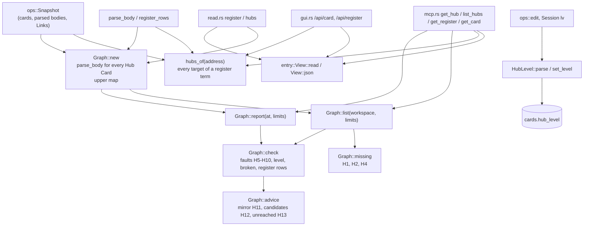

# Hub Cards

## Purpose

This block gives ZT its **Hub Cards**: Regular Cards of type `hub` that are a way into one subject. A Hub Card's body lists, under `##` group headings, one list item per member (a Link to a Card or a lower Hub Card, then what that Card adds), and states no claim of its own. Its **Hub level** (`line`, `topic`, `field`, `register`) says how wide the subject is. `src/hub.rs` stores the level, reads hub bodies, builds the hub graph of the archive (members, Hub range, upper and lower hubs), and reports the faults of the fixed hub policy (H1–H13 in `docs/hub-cards-design.md`) and the hubs a Workspace lacks. It exists so that agents (the book digest's hub stage, an agent writing a hub by hand) and the GUI reader can check and climb the hub graph; ZT reports every fault and never enforces one.

The **concept register** is one of those Hub Cards, of level `register`. Its `## 词条` rows are terms with one to three Links to the Cards that carry the term's substance; `src/entry.rs` reads them into one disposable, revision-keyed entry view that the MCP server and the GUI both serve. Nothing else stores a concept, an alias, or an owner: the register lines are the only association between a term and its entries, and between two accepted spellings of one term.

**Owns:** the `HubLevel` type and its parsing and storage rule, the hub body format and its parser (`parse_body`, and the register's own term-row parser `register_rows` with `register_part_targets` and `register_row_faults`), the hub graph (`Graph`), the hub range, the fault and advice rules, the hub policy limits (`Limits`), the `get_hub` / `list_hubs` report shapes, the `hubs` list a Card reports (`hubs_of`), and the accepted register entry projection (`src/entry.rs`: `View`, `Entry`, `Target`, the body bounds, the flattened page).

**Does not own:** the `hub` Card type itself and the rule that only Regular Cards may have it ([Cards, Workspaces and Links](cards-and-links.md), `src/card_type.rs`); Link parsing and Relation kinds ([Cards, Workspaces and Links](cards-and-links.md), [Models and math](models-and-math.md) for `model::read_links`); the `TypeChange` / `level` argument plumbing in `ops::edit` ([Card operations](card-operations.md)); the `hub_level` column and its migration ([Service, CLI and storage](service-and-cli.md)); the MCP tool schemas and dispatch ([MCP server](mcp-server.md)); the GUI's drawing of hubs ([GUI](gui.md)); the Session's `ty` and `lv` commands ([Terminal Session](session.md)); the register's publication from book term tables, model-head names, and a reviewed concept report ([zt-digest](zt-digest.md), `zt-digest register`, `scripts/book-digest/register-compiler.ps1`), which reads this projection but decides no meaning itself; the reviewed concept report and its meanings (`zt-digest concepts`, #97).

## At a glance

| | |
|---|---|
| Entry points | `hub::Graph::new(&Snapshot)` then `Graph::report` (MCP `get_hub`) or `Graph::list` (MCP `list_hubs`); `read::register` (MCP `get_register`, GUI `/api/register`) and `read::hubs` on a register, both building `entry::View`; `hub::hubs_of` (MCP `get_card` and GUI `/api/card` field `hubs`); `hub::set_level` (from `ops::edit` and Session `lv`); `HubLevel::parse` / `names_hub_level` (from `ops::parse_level_arg` and Session `lv`); `Limits::from_args` (MCP `get_hub`, `list_hubs`); `EntryArgs::from_args` (MCP `get_hub`, `get_register`; GUI query) |
| Key files | `src/hub.rs` — levels, `set_level`, `Limits`, `Line`/`Body`/`parse_body`, `RegisterRow`/`register_rows`/`register_part_targets`/`register_row_faults`, `hubs_of`, `Graph` (report, check, advice, list, missing), and unit tests; `src/entry.rs` — the accepted entry projection (`EntryArgs`, `bounds`, `Entry`/`Target`/`View`, `bounded_body`, `restatement_links`) and unit tests; `tests/hub_cards.rs` and `tests/register_entries.rs` — end-to-end tests through `zt mcp` and the GUI |
| Depends on | [Card operations](card-operations.md) (`ops::Snapshot`: `cards`, `by_address`, `parsed`, `title`, `outbound`); [Cards, Workspaces and Links](cards-and-links.md) (`Card`, `CardType`, `Workspace`, `link::LinkBody`); [Models and math](models-and-math.md) (`model::read_links` for Relation kinds, `model::address_order` for the mirror rule); [Service, CLI and storage](service-and-cli.md) (location helpers in `src/main.rs`: `tree_id`, `parent_location`, `is_tree_root`, `valid_side_label`, `last_segment`, `valid_topic_id`; `load_card`, `parse_card_text`; the `cards.hub_level` column; `link_index::revision`; the `metadata.archive_id`); `rusqlite`, `serde_json`, `anyhow` |
| Used by | [MCP server](mcp-server.md) (`get_hub`, `list_hubs`, `get_register`, `get_card`, `create_successor`, `edit_card`); [GUI](gui.md) (`/api/card` `hubs`, `/api/register`, create and edit with `level`); [Card operations](card-operations.md) (`ops::edit`, `ops::parse_level_arg`, `TypeChange::resolve_hub_level`); [Terminal Session](session.md) (`lv`); [Service, CLI and storage](service-and-cli.md) (`Card.hub_level`, `Card::level_id`); [Digest scripts](digest-scripts.md) (`hub-compiler.ps1`, `digest-audit.ps1` call `get_hub` and `list_hubs`); [zt-digest](zt-digest.md) (`zt-digest register` reads `get_register` and `get_hub`) |
| Tests | `tests/hub_cards.rs`, `tests/register_entries.rs`; the `#[cfg(test)] mod tests` at the end of `src/hub.rs` and `src/entry.rs` |

## Concepts

- `Hub Card` — a Regular Card of type `hub` (`CardType::Hub` in `src/card_type.rs`): a way into one subject. Its body lists members in groups and states no claim of its own. A Link from a Hub Card never takes a Model part into a model (model membership comes only from Model Cards, see [Models and math](models-and-math.md)).
- `Hub level` — `HubLevel` in `src/hub.rs`: `Line` (1), `Topic` (2), `Field` (3), `Register` (4); `HubLevel::number` gives the number, `HubLevel::id` the stored name. Stored only on a Hub Card, in `cards.hub_level`.
- `Line` (member line) — `hub::Line`: one list item of a hub body that holds at least one Link: its `group`, its first Link `target` (the member), every Link in `targets`, the `reason` (what the Card adds), and the Relation `kind` of its first Link.
- `Group` — a `##` or `###` heading of a hub body (`Body.groups`). A group named `邻近` (or `neighbours`) points out of the subject and does not count toward the hub's size (`is_neighbour_group`).
- `Hub range` — the Cards a hub is responsible for (`Graph::range`): a line hub's anchor and its subtree, a topic hub's tree, the trees of a field hub's members, or the register's whole Workspace. Tree roots and Hub Cards are never in a range.
- `Anchor` — the Card a hub is filed under: `crate::parent_location(hub address)`. For a line hub it is the Card where the line starts; for a topic hub it is `<n>/1`.
- `Upper` / `lower` hubs — the hubs that list this hub, and the hubs this hub lists (`Graph.upper`, `Graph::lower`). The hub graph is a directed graph, not a tree.
- `Register` — the one hub of level `register` in a Workspace, the first Card of the Topic `索引`. Its term rows live in the `## 词条` group (the earlier compiler wrote `## 关键词`; both are read): one term before `：`, then one to three Links to Cards, and nothing else. The groups this grammar does not own stay as they are: `## 领域` keeps the field-hub navigation, `## 未归入领域的主题` the unhoused topic hubs.
- `Register term row` — `hub::RegisterRow`: the 1-based `line`, the `term` before the colon, every Link `target` in order (repeats kept so the checks can name them), and a `shape` description when the row breaks the grammar (no colon, an empty term, words after the Links). `register_rows` reads the term groups (`词条`, or the older `关键词`) and a row written before any heading, because an existing register may have either; a row that breaks the grammar stays a row so a check can name it.
- `Register part` — an ordinary Idea Card declared under `## 词条分册` as one of the register's immediate Side successors. Its body has its own `## 词条` rows; a part cannot contain parts. Its identity is the root's Link plus that place, so no metadata field marks it. Publication of parts is S11; this block reads the ones a register declares.
- `Entry` — `entry::Entry`: an accepted term, the Card and line it was written on, the declared `part` (or none), all of its projected targets, and its own faults. `complete` is false when a target is missing or repeated.
- `Target` — `entry::Target`: one target address, whether the Card exists, its title/type/facet/Workspace/tree, and its bounded authored body (`body`, `body_chars`, `body_lines`, `body_truncated`).
- `Entry view` — `entry::View`: the register address and its entries in register order, the row/part/restatement `faults`, the declared `parts`, `terms_by_card` (which terms name each target, in register order), the confirmed `restatements`, and the archive identity/revision it was read at. It is derived and disposable; it stores nothing and is not a concept id.
- `Body bound` — the entry projection carries at most 1,200 characters and 24 lines of one target's authored body (`entry::BODY_MAX_CHARS`, `BODY_MAX_LINES`). A cut body says so: `body_truncated: true` with the authored `body_chars`/`body_lines`. The page bound is `entry_limit` 200 by default, at most 1,000.
- `Restatement entry` — a Card whose body has a `## 同述入口` section naming exactly one substantive Card of the same Workspace: the derived navigation role of design §4.5. The view records the confirmed reference and reports a missing, repeated, self-, or cross-Workspace reference as a `restatement` fault. Cycle and chain resolution is a later slice's finding.
- `Covered` — every Card a hub reaches through its own lines and, transitively, its lower hubs (`Graph::covered`).
- `Reached` — a Card is reached when any hub lists it, or lists a Card above it in its tree through `|` segments (`reached`). A Card of a range that is not reached is `unreached` (the design calls it a black hole).
- `Limits` — `hub::Limits`: the six numbers of the policy (`max_groups`, `max_lines`, `min_reason`, `topic_min`, `line_min`, `neighbour_links`), per request.
- `Fault` / `advice` — a fault is a broken rule in the report's `faults` list; advice (`mirror`, `candidates`, `unreached`) is information that is not a fault.

## Architecture

`src/hub.rs` is one module with four parts, and `src/entry.rs` is the register's reader:

1. **Level** — `HubLevel`, `LEVEL_NEEDS_HUB_CARD`, `names_hub_level`, `set_level`: parsing a level name and writing `cards.hub_level`.
2. **Body parser** — `parse_body`, `list_item`, `clean_reason`, `reason_chars`: turns a hub's Markdown body into a `Body` of groups and `Line`s; `register_rows`, `register_part_targets`, and `register_row_faults` read and judge the register's `词条` grammar (D050, D289, D297).
3. **Graph** — `Graph<'a>` borrows an `ops::Snapshot`, parses the body of every Hub Card once (`hubs`: address → (level, `Body`)), and builds the reverse map `upper`. Its methods compute `lower`, `covered`, `in_cycle`, `range`, `tree_links`, and then the outputs: `report` (one hub), `list` (the hub graph of a Workspace), `check` (faults), `advice`, and `missing` (required hubs that do not exist).
4. **Card lookup** — `hubs_of`: the hubs that list one Card directly, without building a `Graph`; for a register it reports a target at any position of a term (D051).
5. **Entry projection** (`src/entry.rs`) — `View::read` parses the register and its declared parts with the row parser, projects every target's bounded body, collects `terms_by_card`, and adds the confirmed restatements; `View::json` pages the flattened entries with the archive evidence. `src/read.rs::register` and `src/read.rs::hubs` supply it from one read transaction.



Every report is computed from the stored Cards in one `Snapshot`; `src/hub.rs` writes nothing except `hub_level` (`set_level`).

## Interfaces

`Graph::with_links(snapshot, links)` uses the existing policy calculations with per-request indexed source-target lists. `Graph::new` retains the full-Snapshot path. Both use the same outbound helper for tree-neighbour counts, candidate scores and Topic-to-hub anchoring. The MCP reader streams global Card metadata/title lines and complete Hub bodies, then supplies the index; ordinary bodies are not parsed to compute hub policy. This is request-local input, not a persistent cache.

All items are `pub(crate)`; ZT is one binary crate (`src/main.rs` declares `mod hub;`).

### Level

| Item | Signature | Behaviour |
|---|---|---|
| `HubLevel` | `enum HubLevel { Line, Topic, Field, Register }` (`Copy`, `Ord`) | Ordered by width. |
| `HubLevel::id` | `fn id(self) -> &'static str` | `line`, `topic`, `field`, `register`: the stored and reported name. |
| `HubLevel::number` | `fn number(self) -> u8` | 1 to 4. A hub without a level counts as 0 wherever levels are compared. |
| `HubLevel::parse` | `fn parse(&str) -> Result<HubLevel>` | Trims and ASCII-lowercases; accepts `line`/`线索`/`线索枢纽`, `topic`/`主题`/`主题枢纽`, `field`/`领域`/`领域枢纽`, `register`/`索引`/`登记簿`. Error: ``unknown hub level `x`; expected line, topic, field, register, or empty for none``. |
| `HubLevel::from_stored` | `fn from_stored(Option<&str>) -> Option<HubLevel>` | Reads the column; an unknown value reads as no level. Used by the card loaders in `src/main.rs`. |
| `names_hub_level` | `fn names_hub_level(&str) -> bool` | True when the text is a hub level name. `ops::parse_level_arg` uses it to tell a hub level from an elaboration level in one `level` argument. |
| `LEVEL_NEEDS_HUB_CARD` | `&str` | `only a Hub Card has a hub level (line, topic, field, or register)`: the refusal text shared by `set_level`, `ops`, `mcp.rs`, and `gui.rs`. |
| `set_level` | `fn set_level(&Connection, &Card, Option<HubLevel>) -> Result<()>` | `UPDATE cards SET hub_level = ? WHERE row_id = ?`. Refuses a level on a Card whose `card_type` is not `Hub`; `None` always clears. The caller holds the edit lock. |

### Limits

`Limits { max_groups, max_lines, min_reason, topic_min, line_min, neighbour_links }` (all `usize`).

| Limit | Default | Rule it sets |
|---|---|---|
| `max_groups` | 7 | H5: most groups outside `邻近` |
| `max_lines` | 25 | H5: most member lines outside `邻近` |
| `min_reason` | 8 | H8: fewest reason characters (letters, digits, CJK) |
| `topic_min` | 7 | H1: Cards in a Topic tree that require a topic hub |
| `line_min` | 12 | H2: Cards in a branch that require a line hub |
| `neighbour_links` | 3 | H10: Links between two Topic trees that make them neighbours |

`Limits::from_args(&Value) -> Result<Limits>` reads each name from a JSON object; a missing or `null` value keeps the default; any other value must be a JSON integer of 1 or more, else ``argument `name` must be a whole number of 1 or more``. A numeric string such as `"7"` is refused. Every report echoes the limits it used under `limits`.

### Body parser

- `struct Body { groups: Vec<String>, lines: Vec<Line> }`
- `struct Line { group: Option<String>, target: String, reason: String, kind: &'static str, targets: Vec<String> }`
- `fn parse_body(body: &str) -> Body` — never fails; text it cannot read holds no members.
- `struct RegisterRow { line: usize, term: String, targets: Vec<String>, shape: Option<String> }`
- `fn register_rows(body: &str) -> Vec<RegisterRow>` — the term rows of the `词条` (or older `关键词`) group, in body order; fenced code is skipped, a row with no Link is still a row.
- `fn register_part_targets(body: &str) -> Vec<String>` — the distinct Links of the `词条分册` group, in declaration order.
- `fn register_row_faults(row: &RegisterRow, exists: &dyn Fn(&str) -> bool) -> Vec<Value>` — the policy faults of one row: `shape`, `empty`, `oversize`, `duplicate-target`, `broken` (one per missing target, D051).

### Card lookup

`fn hubs_of(snapshot: &Snapshot, address: &str) -> Vec<Value>` — the Hub Cards (other than the Card itself) that list the Card, sorted by level number (no level first, register last) and then by address. For every hub but a register, a line's first Link (its member) must be the Card. A register reports the Card at any position of a term, once per term, with the term and the 0-based target index (D051). Each item:

```json
{ "address": "130/1|b", "title": "逆向选择的入口", "level": "topic" }
{ "address": "196/1", "title": "索引：代理工作区的入口", "level": "register", "term": "多重均衡", "target_index": 1 }
```

### Graph

- `Graph::new(&Snapshot) -> Graph` — parses every Hub Card in the Snapshot (both Workspaces).
- `Graph::report(&self, at: &str, limits: &Limits) -> Result<Value>` — the `get_hub` report. Errors: ``card `at` does not exist``; ``` `at` is not a Hub Card; set type `hub` and a level first```.
- `Graph::list(&self, workspace: Option<Workspace>, limits: &Limits) -> Value` — the `list_hubs` report; `None` means both Workspaces.

### MCP tools

Dispatched in `src/mcp.rs` (see [MCP server](mcp-server.md)); all are read-only and read a fresh transaction per call.

| Tool | Arguments | Result |
|---|---|---|
| `get_hub` | `at` (required), any of the six limits, `entry_offset`, `entry_limit` | `Graph::report`; on a register, plus the flattened entry projection of `get_register` (the two page arguments apply to that projection only) |
| `list_hubs` | `workspace` (`human`, `agent`, or omitted for both), and any of the six limits | `Graph::list` |
| `get_register` | `workspace` (required: `human` or `agent`), `entry_offset`, `entry_limit` | the register's entry view from `read::register`; a register-less Workspace answers `register_missing` with no entries |
| `get_card` | `at` | adds `hubs: hubs_of(...)`, and `level` shows a hub level through `Card::level_id` |
| `create_successor` | `type: "hub"`, `level` | `ops::parse_level_arg`; a hub level on a non-hub refuses with `LEVEL_NEEDS_HUB_CARD`; the level is written by a follow-up `ops::edit` with a `TypeChange { hub_level }`. The reply's `level` is the elaboration or hub level. |
| `edit_card` | `type`, `level` | `TypeChange { hub_level }` resolved by `TypeChange::resolve_hub_level` in `src/ops.rs` |

`get_register` report shape (from `entry::View::json`, merged into `get_hub` on a register):

```json
{
  "workspace": "agent",
  "register": "196/1",
  "title": "索引：代理工作区的入口",
  "register_missing": false,
  "duplicate_registers": [],
  "entries": [
    { "term": "多重均衡", "line": 4,
      "origin": { "card": "196/1", "line": 4, "part": null },
      "targets": [
        { "address": "161/1", "exists": true, "title": "…", "type": "idea", "facet": null,
          "workspace": "agent", "tree": "161", "body": "…", "body_chars": 96, "body_lines": 3,
          "body_truncated": false }
      ],
      "complete": true, "faults": [] }
  ],
  "entry_offset": 0, "entry_limit": 200, "entry_total": 1, "entry_next_offset": null,
  "parts": [{ "address": "196/1|a", "title": "词条分册：A–F", "exists": true, "place": "ok", "entries": 12 }],
  "faults": [], "complete": true,
  "terms_by_card": { "161/1": ["多重均衡"] },
  "restatements": [{ "entry": "88/2|a", "substantive": "88/2", "title": "…" }],
  "bounds": { "body_max_chars": 1200, "body_max_lines": 24, "entry_limit_default": 200, "entry_limit_max": 1000 },
  "archive_revision": 42,
  "archive_identity": { "id": "…", "path": "…" }
}
```

A `register_missing` answer has `register: null`, no entries, and one `register_missing` fault: an honest empty result, not an error. Two registers give `register: null`, `duplicate_registers`, and one `duplicate` fault; they are never chosen between. `complete` is false while any row, part, or restatement fault stands.

`get_hub` report shape (from `Graph::report`):

```json
{
  "address": "130/1|b",
  "title": "逆向选择的入口",
  "workspace": "agent",
  "level": "topic",
  "anchor": "130/1",
  "groups": ["主线", "邻近"],
  "lines": [
    { "group": "主线", "address": "130/2", "title": "…", "type": "idea", "level": null,
      "tree": "130", "kind": "refers", "reason": "知情者按私人信息决定是否交易。", "exists": true }
  ],
  "lower": [{ "address": "130/2|f|c", "title": "…", "level": "line" }],
  "upper": [{ "address": "900/1", "title": "索引", "level": "register" }],
  "range": 42,
  "faults": [{ "fault": "bare", "detail": "[[130/6]] has no reason of 8 or more characters" }],
  "mirror": false,
  "candidates": [{ "address": "130/4|a", "title": "…", "links": 2 }],
  "unreached": ["130/7"],
  "unreached_count": 1,
  "limits": { "max_groups": 7, "max_lines": 25, "min_reason": 8, "topic_min": 7, "line_min": 12, "neighbour_links": 3 }
}
```

A line's `level` is the member's elaboration level or hub level (`Card::level_id`); `type` and `level` are `null` and `exists` is `false` for a missing member. `range` is a count. `candidates` holds at most 30 items and `unreached` at most 40 addresses; `unreached_count` is the full count.

`list_hubs` report shape (from `Graph::list` and `Graph::missing`):

```json
{
  "workspace": "agent",
  "limits": { "...": "..." },
  "counts": { "topic": 1, "register": 1 },
  "hubs": [
    { "address": "130/1|b", "title": "…", "workspace": "agent", "level": "topic", "tree": "130",
      "lines": 7, "upper": ["900/1"], "lower": [], "faults": ["isolated"], "mirror": false, "unreached": 3 }
  ],
  "missing": [
    { "level": "topic", "tree": "131", "anchor": "131/1", "title": "…", "cards": 9 },
    { "level": "line", "tree": "130", "anchor": "130/2|f", "title": "…", "cards": 13, "models": 1 },
    { "level": "register", "workspace": "human" },
    { "level": "register", "workspace": "agent", "fault": "duplicate", "registers": 2 }
  ]
}
```

`counts` keys are level ids, or `none` for a Hub Card without a level. In `hubs`, `faults` holds fault names only and `upper`/`lower` hold addresses only.

### Faults

| Fault | Rule | When `check` reports it |
|---|---|---|
| `level` | — | The Hub Card has no hub level. |
| `oversize` | H5 | Not a register: more than `max_lines` lines or `max_groups` groups outside `邻近`. Register: one term row that names more than 3 Links. |
| `flat` | H5 | Not a register: fewer than 2 groups outside `邻近` and more than 8 lines outside `邻近` (8 is fixed, not a limit). |
| `bare` | H8 | A line's reason has fewer than `min_reason` characters (1 for a register line, whose reason is its term). |
| `broken` | — | A line's member does not exist. A register row reports one `broken` per missing target, so its second and third targets are validated too (D051, D297). |
| `shape` | D289, D297 | A register row that breaks the term grammar: no `：` before the Links, an empty term, or words after the Links (a definition belongs in the target Cards, not in the row). |
| `empty` | D289, D297 | A register row whose term names no Card. The row is reported and is not an entry. |
| `duplicate-target` | D289 | A register row that names the same Card twice. |
| `upward` | H6 | The hub has a level and lists a hub of the same or a higher level, except a line hub that lists the line hub of a branch strictly inside its own branch (`nested_line`). |
| `cycle` | H6 | A chain of lower hubs leads back to this hub (`in_cycle`). |
| `unanchored` | H3, H4, H7 | A line, topic, or field hub that no hub of a higher level lists; and, for a topic hub, a Topic Card `<n>/0` whose body does not link it. Both may appear. |
| `duplicate` | H1 | A topic hub of a tree that holds another topic hub (each one reports the other). |
| `unlisted` | H9 | Line and topic hubs: a Model Card (type `model`, no facet) of the range, or a line hub whose anchor is in the range, that the hub does not cover. |
| `isolated` | H10 | Topic hubs: the tree has a neighbour Topic tree (at least `neighbour_links` Links either way) and no line of the hub names a Card outside the tree. The detail names up to 5 neighbours with their counts. |
| `anchor-title` | #93 S03 (D130, D169) | A line or topic hub whose title equals the title of the Card it hangs under: whitespace collapsed and case ignored (`normalized_title`), never broad similarity. A title that names the navigation role is no fault. The hub compiler's precheck refuses a new draft with it; an existing hub is reported read-only until its correction is authorized. |

`missing` (in `list_hubs`) reports H1 (topic), H2 (line), and H4 (register, or `fault: duplicate` when a Workspace has two or more registers).

### File format: the hub body

```markdown
范围：主题 130 的全部卡。

## 逆向选择
- [[130/2]]：知情者按私人信息决定是否交易。
- [[130/2|f|c]]（枢纽）：多重均衡一支。

## 邻近
- 对照 [[122/1]]：信号传递是知情一方的应对。
```

A register body keeps its own groups: `## 领域` holds the field-hub navigation, `## 未归入领域的主题` the topic hubs in no field, and `## 词条` the term rows. Each term row is one term before `：`, then one to three Links:

```markdown
范围：代理工作区的全部入口。每个词条指向一到三个实质卡。

## 领域
- 信息经济学：[[196/1|b]]

## 词条
- 多重均衡：[[161/1]] [[stiglitz2014learning/109|a]]
- 均衡的多重性：[[161/1]] [[stiglitz2014learning/109|a]]
```

The two rows are the same entry Cards under two accepted spellings of one term; scope belongs in the term label and the explanation belongs in the target Cards, so a row is an entry and not a paragraph-sized definition. The older compiler wrote its term rows under `## 关键词`, and an older or hand-written register may hold them before any heading; `register_rows` reads all three, so an existing register stays readable.

When a register exceeds 120 term rows, independent slices (S11) publish its rows into ordinary Idea Cards declared under `## 词条分册`:

```markdown
## 词条分册
- [[196/1|a]] A–F
- [[196/1|b]] G–L
```

A part has a descriptive title, its own `## 词条` section, and the same row grammar. Its identity is the declaration plus its place as an immediate Side successor of the register; a missing, misplaced, nested, or Hub part is reported (`part-missing`, `part-place`, `part-nested`, `part-hub`) and its rows are not accepted. Parts do not enter the Hub-level graph, so the archive still has one register per Workspace.

## Behaviour

### Parse a hub body (`parse_body`)

1. Read the body line by line, trimmed. A line that starts with ```` ``` ```` or `~~~` toggles a fence; fenced lines are skipped.
2. A line that starts with `### ` or `## ` opens a group: its trimmed text is pushed to `groups` and becomes the group of the lines after it. `# ` and `#### ` headings are not groups.
3. `list_item` accepts `- `, `* `, `+ `, or a number followed by `. ` or `) `; any other line (such as the `范围` line) is skipped.
4. `LinkBody::for_rendering` (the tolerant scan) reads the item's Links, so a malformed target such as `[[0/01]]` still makes a member, and `check` reports it as `broken` (`[[0/01]] does not exist`). An item that holds no Link (or only a `[[` with no `]]`) is skipped.
5. `target` is the first Link, `targets` every Link in order. `kind` is the Relation kind `model::read_links` gives the first Link in the item's own text (`refers` when no kind word stands before it).
6. `reason` is `clean_reason` of the text after the first Link: later Link macros, `（枢纽）`, and `(hub)` are removed, and leading or trailing spaces and the marks `: ： - — – · ， , 、` are trimmed. When that leaves nothing, the reason is the cleaned text before the first Link, which makes a register term its line's reason.

### Report one hub (`get_hub`)

1. `mcp.rs` reads a `Snapshot`, `Limits::from_args`, and calls `Graph::new(&snapshot).report(at, &limits)`.
2. `report` refuses a missing Card or a Card that is not a Hub Card.
3. `check` computes the faults in this order: `level`; `anchor-title`; size (`oversize`, `flat`); `bare`; `broken`; `upward`; `cycle`; `unanchored` and, for a topic hub, the Topic body Link and `duplicate`; `unlisted`; `isolated`.
4. `range` selects the hub's range: line hub, the anchor and every Card whose address starts with `<anchor>|`; topic hub (or no level), the hub's tree; field hub, every tree named by the first Link of a line; register, every Card of the hub's Workspace. Tree roots and Hub Cards are excluded.
5. `advice` computes `mirror` (H11: a line or topic hub with 4 or more lines, all in its own tree, in non-decreasing `model::address_order`), `candidates` (H12: Cards of the range not covered that link 2 or more covered Cards), and `unreached` (H13: Cards of the range that no hub of the archive reaches).
6. `report` adds each line's member title, type, level, tree, and whether it exists, plus `lower`, `upper`, the range count, and the limits.

### List the hub graph (`list_hubs`)

1. `Graph::list` runs `check` on every Hub Card of the chosen Workspace (or both) and counts hubs per level.
2. `missing` walks every Topic Card of the Workspace (Literature trees are never required to have hubs):
   1. It counts the tree's non-hub Regular Cards. A tree with no such Cards but with Hub Cards (the `索引` register tree) is skipped.
   2. H1: when that count is at least `topic_min` and no hub of the tree has level `topic`, it reports a topic hub missing at `<tree>/1`.
   3. H2: for each Idea Card whose last segment is a Side label (a branch start), it counts the branch's non-hub Cards (the Card and every address under `<branch>|`) and its Model Cards. When the count is at least `line_min` or there are 2 or more Model Cards, and no line hub of the tree has the branch as its `parent_location`, it reports a line hub missing at the branch.
3. H4: for each Workspace in scope, a Workspace with Hub Cards and no register reports a missing register; two or more registers report `fault: duplicate`.

### Find the hubs of a Card (`hubs_of`)

1. Keep the Hub Cards whose body contains the text `[[<address>]]` (a cheap filter: no other hub body is parsed).
2. Parse those bodies with `parse_body` and keep the hubs with a line whose first Link is the Card.
3. Sort by level number, then address. `get_card` (MCP) and `/api/card` (GUI, `src/gui.rs`) put the result in the Card's `hubs` field.

### Read the register's entries (`get_register`)

1. `mcp.rs` (or the GUI route) parses `workspace` and `EntryArgs`, and calls `read::register(&root, workspace, &entries)`.
2. `read.rs::register` opens one read transaction and reads the hub projection: every Card's metadata and heading line, every Hub Card's complete body, and the source→target index (`hub_read`). It also reads the persisted `archive_identity` and the revision.
3. It keeps the Workspace's Hub Cards of level `register`. None is `register_missing` with one fault; two or more are `duplicate_registers` with one `duplicate` fault and no entries; exactly one is projected.
4. `register_view` collects the target addresses of the register's `词条` rows and its declared `词条分册` parts, loads each existing one, and records its authored body. It then scans for the `## 同述入口` sections of the Workspace and keeps their Links.
5. `entry::View::read` parses the rows with `hub::register_rows`, turns `register_row_faults` into the row and view faults, projects the bounded bodies of the existing targets, accepts the rows that have a term and one to three targets, adds the declared parts' rows after the root's, and derives `terms_by_card`. A missing or repeated target leaves the entry visible with `complete: false` (`entry` targets are never silently dropped, D297); a row with no term, no target, or more than three targets is reported and is not an entry.
6. `View::json` pages the entries (`entry_offset`, `entry_limit` 200 by default and at most 1,000; `entry_next_offset` is null on the last page) and adds `parts`, `faults`, `terms_by_card`, `restatements`, the fixed `bounds`, the revision, and the identity.
7. `get_hub` on a register computes its usual report first, then merges the same projection into it; the entry page arguments never truncate the hub report.
8. The GUI's `GET /api/register?ws=…` calls `read::register` with the same argument parsing, so both clients answer one contract (same addresses, same order, same revision).

### Publish a register (`zt-digest register`, S10)

`tools/zt-digest/src/register.rs` drafts and publishes the body this block reads; the code is [zt-digest](zt-digest.md)'s. It reads the agent Workspace's book term tables and model-head names, reads an optional reviewed concept report as read-only evidence, and stages one row per accepted spelling with one to three targets (a reviewed entry or a statement, then a whole model, then a standalone Topic claim). `apply` creates the Topic `索引` and the register when the Workspace has none, otherwise edits that one register, keeps every group it does not own, and verifies the published entries through `get_register`. A stale plan (another archive, or a target that no longer exists) is refused; a second run over the same plan writes nothing.

### Set a hub level

1. MCP `create_successor` / `edit_card` and the GUI create and edit routes call `ops::parse_level_arg`: an absent `level` changes nothing; `null`, an empty string, or `none` clears both the elaboration level and the hub level; a hub level name gives `hub_level`; anything else is parsed as an elaboration level.
2. `ops::edit` resolves the Card's type first, then `TypeChange::resolve_hub_level`: a hub level on a Card that will not be a Hub Card is refused; a Card that stays a hub keeps its level unless the change names one; a Card that stops being a hub loses it.
3. When a type change stores a new type, `model::set` clears `hub_level` in the same `UPDATE` unless the new type is `hub` (`src/model.rs`); then `hub::set_level` writes the resolved level when it differs from the stored one.
4. The Session's `lv <level|none>` (`src/session/command.rs`) calls `HubLevel::parse` and `hub::set_level` directly when the current Card is a Hub Card, and the elaboration-level path otherwise.

### Rules the code keeps

- **Report, never enforce.** No write path checks a hub fault; a hub of any shape can be saved.
- **Only a Hub Card has a hub level**, three times over: `set_level`, `TypeChange::resolve_hub_level`, and the table CHECK `hub_level IS NULL OR card_type = 'hub'` in `src/main.rs`.
- **Read-only and stateless.** `Graph` and `hubs_of` read one `Snapshot`; nothing is cached in this block. The GUI keeps its `Snapshot` across requests until SQLite's `data_version` moves ([GUI](gui.md)), so `hubs_of` there runs on the cached Snapshot.
- **Both Workspaces.** `Graph::new` reads every hub in the archive, so `upper`, `covered`, and `reached` cross Workspaces; `list` and `missing` filter by Workspace only for what they report.
- **Self-links are ignored** in `upper`, `lower`, and `hubs_of`; they cause neither `upward` nor `cycle`.
- **Order.** `groups` and `lines` keep body order; `lower` keeps body order without repeats; `upper` is sorted by address (a `BTreeSet`); `hubs` in `list` and `missing` follow `snapshot.cards` order.

## Data and storage

This block persists one column, `cards.hub_level` (in `src/main.rs`'s `cards_table`):

```sql
hub_level TEXT CHECK(hub_level IS NULL OR hub_level IN ('line', 'topic', 'field', 'register')),
-- ...
CHECK(hub_level IS NULL OR card_type = 'hub'),
```

`ensure_hub_cards` in `src/main.rs` adds it to an older archive by rebuilding the cards table after a backup `zt.sqlite3.pre-hub-cards-<unix time>.bak` (see [Service, CLI and storage](service-and-cli.md)). The hub's groups and members are not stored apart from the Card: they live in its Markdown body (format under [Interfaces](#file-format-the-hub-body)) and are parsed on each request. The block exchanges the JSON reports shown under [Interfaces](#mcp-tools).

The register entries add no storage: a term row is Card text, two accepted spellings are two rows, an entry is a Link, and the entry view is rebuilt from one read transaction on every request. There is no concept id, alias table, ownership column, or cache. A moved entry keeps working because the normal Link rewriting maintains the row's target, and a view is keyed to the archive revision it was read at rather than stored.

## Configuration

The six `Limits` are the only settings. They have no config key, flag, or env var: each `get_hub` or `list_hubs` call may pass any of `max_groups`, `max_lines`, `min_reason`, `topic_min`, `line_min`, `neighbour_links` as integer arguments of 1 or more, and every omitted one takes its default (table under [Interfaces](#limits)). The book digest's hub stage chooses them per run and passes them through `hub-compiler.ps1` ([Digest scripts](digest-scripts.md)). The `flat` threshold (8 lines), the register's 3 Links per term, the 30 `candidates`, the 40 `unreached`, and the 5 neighbours named by `isolated` are fixed in `src/hub.rs`.

The entry projection has its own fixed bounds in `src/entry.rs`: `BODY_MAX_CHARS` 1,200, `BODY_MAX_LINES` 24, `ENTRY_LIMIT_DEFAULT` 200, and `ENTRY_LIMIT_MAX` 1,000. `entry_offset` and `entry_limit` are per-call arguments of `get_hub` and `get_register` (and the GUI's `entry_offset`/`entry_limit` query parameters); `entry_limit` is clamped to the maximum and echoed in the report, and no config key changes the bounds.

## Usage

### Create a topic hub and check it over MCP

From `tests/hub_cards.rs`:

```json
{ "name": "create_successor", "arguments": {
    "at": "130/1", "kind": "side", "type": "hub", "level": "topic",
    "title": "逆向选择的入口",
    "body": "## 主线\n- [[130/2]]：逆向选择让市场萎缩。\n\n## 邻近\n- 对照 [[122/1]]：信号传递是知情一方的应对。\n" } }
```

```json
{ "name": "get_hub", "arguments": { "at": "130/1|a", "max_lines": 15 } }
{ "name": "list_hubs", "arguments": { "workspace": "agent", "topic_min": 3 } }
```

The hub is not anchored until the Topic body links it and a field hub or the register lists it:

```json
{ "name": "edit_card", "arguments": { "at": "130/0", "body": "问题。\n\n入口见 [[130/1|a]]。" } }
{ "name": "create_successor", "arguments": { "at": "900/0", "type": "hub", "level": "register",
    "title": "索引", "body": "- 逆向选择：[[130/1|a]]\n" } }
```

### Read a register's entries

```json
{ "name": "get_register", "arguments": { "workspace": "agent", "entry_limit": 50 } }
{ "name": "get_register", "arguments": { "workspace": "agent", "entry_offset": 50, "entry_limit": 50 } }
{ "name": "get_hub", "arguments": { "at": "196/1", "entry_limit": 200 } }
```

```text
GET /api/register?ws=agent&entry_offset=0&entry_limit=50
```

Entry order is register order: the root's `词条` rows first, then the declared parts' rows in declaration order. Targets keep the row's Link order. A Workspace with no register answers `register_missing: true` and no entries instead of failing.

### Set or clear a level

```text
lv topic      # Session, on a Hub Card (also lv 主题)
lv none       # clears it
```

```json
{ "name": "edit_card", "arguments": { "at": "130/1|a", "level": "线索" } }
{ "name": "edit_card", "arguments": { "at": "130/1|a", "type": "idea" } }
```

The second call makes the Card an Idea Card and clears its hub level.

### Use the graph from Rust

```rust
let snapshot = crate::ops::Snapshot::read(&root)?;
let limits = crate::hub::Limits::from_args(&args)?; // or Limits::default()
let report = crate::hub::Graph::new(&snapshot).report("130/1|a", &limits)?;
let graph = crate::hub::Graph::new(&snapshot).list(Some(Workspace::Agent), &limits);
let hubs = crate::hub::hubs_of(&snapshot, "130/2");
```

### Add a new fault

1. Add the rule in `Graph::check` with `fault(&mut faults, "<id>", detail)`; if it needs the range or coverage, compute after `let range = self.range(hub)` and `let covered = self.covered(address)`. A register row rule belongs in `register_row_faults` in `src/hub.rs`, where both `Graph::check` and `entry::View::read` apply it.
2. Name the fault in the `get_hub` tool description in `src/mcp.rs` (its list of fault names) and in the rule table of `docs/hub-cards-design.md`.
3. If the digest should fix it, teach `scripts/book-digest/hub-compiler.ps1`, which turns `get_hub` faults into fix jobs and also predicts some faults before the Cards exist ([Digest scripts](digest-scripts.md)).
4. Add a case to `tests/hub_cards.rs` (or `tests/register_entries.rs` for a register row or entry fault).

### Add a new limit

Add the field to `Limits`, its default to `Limits::default`, its name to the loop in `Limits::from_args`, its key to `Limits::json`, and a property to `hub_limits` in `src/mcp.rs`.

## Testing

```bash
cargo test --test hub_cards        # end-to-end through `zt mcp`
cargo test --test register_entries # the register entry projection through `zt mcp` and the GUI
cargo test --bin zt hub::          # unit tests in src/hub.rs
cargo test --bin zt entry::        # unit tests in src/entry.rs
```

`tests/hub_cards.rs` makes a temporary config and archive (`ZT_CONFIG_DIR`, `ZT_GUI_PORT=0`), runs `zt up`, and drives `zt mcp` over stdio JSON-RPC. It covers:

- `a_hub_card_carries_a_hub_level_and_only_a_hub_card_does`: create with `type: hub, level: topic`; `get_card` level; refusing a hub level on an Idea Card and an elaboration level on a Hub Card; the Chinese name `线索`; retyping to `idea` clears the level.
- `get_hub_reports_faults_and_list_hubs_finds_the_missing_hubs`: `missing` topic hubs with default and per-call `topic_min`; `mirror`, `bare`, `unanchored`, `isolated`, `unreached`; a clean report after the Topic body Link, a `邻近` line, and a register; `upper`; `get_card` `hubs`; `upward` and `cycle` when a topic hub lists the register; `counts`.
- `a_line_hub_lists_the_line_hub_of_its_sub_branch_and_neighbours_do_not_count_toward_size`: the nested line hub exception (no `upward`, no `unlisted`), `邻近` outside the size limits, and `upward` when the inner hub lists the outer one.
- `a_hub_that_copies_its_anchor_title_is_named`: a line hub whose title repeats its anchor's title with one extra space reports `anchor-title`; a title that names the navigation role does not; the anchor Card is unchanged by the read-only report.

`tests/register_entries.rs` builds a scratch archive whose register has one, two, and three targets per row, and drives `zt mcp` and `zt gui` (the recorded GUI URL and its page token). It covers:

- `a_register_projects_one_two_and_three_targets_with_bounded_bodies`: every target of every term with its title and authored body; a 1,600-character body cut at 1,200 with `body_truncated` and its authored length; the revision and identity; `entry_offset`/`entry_limit` paging and the 1,000 clamp; `get_hub` on the register carrying the same projection; `/api/register` answering the same addresses, order, total, revision, and identity.
- `several_accepted_spellings_are_separate_lines_with_the_same_entries`: two spellings with identical targets; `terms_by_card` naming both; `get_card` listing the register for a term's **second** target with `term` and `target_index`.
- `a_missing_target_is_named_and_the_entry_stays_incomplete`: a target deleted after the register named it; the entry stays visible with `complete: false` and an explicit `exists: false` target; `empty`, `oversize`, and `duplicate-target` rows are reported, not entries; `get_hub` reports `broken` naming the second target.
- `a_declared_part_is_projected_with_its_own_origin`: a declared part's rows flattened after the root's with `origin.part`; a part that is not an immediate Side successor is a `part-place` fault and its rows are not accepted.
- `a_register_written_before_the_term_heading_is_still_read`: a bare term row with no `词条` heading is read and is no fault, because an older register may not have the heading.
- `an_accepted_move_keeps_the_register_entry_current`: moving an entry Card rewrites the register's Link, so the entry, `terms_by_card`, and the register body follow the new address with no stored id to update.
- `an_archive_without_a_register_answers_an_honest_empty`: `register_missing`, no entries, `complete: false`, one named fault, the revision still reported, the same answer from `/api/register`, the other Workspace, and an error (not an empty answer) for an unknown Workspace.

The unit tests in `src/hub.rs` cover level parsing in both languages, `parse_body` (groups, reasons, `（枢纽）`, kinds, fences, a malformed member Link kept), register terms as reasons, `reached`, `nested_line`, `is_neighbour_group`, and `reason_chars`. The unit tests in `src/entry.rs` cover the body bounds, the restatement section's Links (a `来源：` line is not an entry), and the page arguments (defaults, clamping, refused types).

Gaps: no test for field hubs (their range, `unanchored` with the register), `duplicate`, `flat`, `candidates`, a `level` fault, the `missing` line hub rule (H2) and the duplicate register, `list_hubs` without a `workspace`, numbered list items, or malformed Links in a hub body. The entry projection has no test for two registers in one Workspace, a nested or Hub part (the code reports `part-nested`/`part-hub`), a restatement cycle, or the prose occurrence expansion that entry-first ranking (S13) owns.

## Decisions and pitfalls

### Decisions

- **A Card type with a stored level, and a report instead of enforcement** (option C in `docs/hub-cards-design.md`, approved 2026-10-14). ZT reports hub faults the way it reports model faults; the hub compiler acts on them.
- **A separate `hub_level` column**, not a reuse of `model_level`: SQLite cannot change a CHECK in place, so the type CHECK needed a table rebuild anyway, and two columns keep the two kinds of level apart (`docs/hub-cards-design.md`, "Storage"). One `level` argument still carries either kind; `ops::parse_level_arg` tells them apart by name.
- **The limits are per request.** The Haiku hub manager chooses them per digest run from a survey, so they are arguments, not constants (`docs/hub-cards-design.md`, "Fixed policy" and "The hub compiler").
- **`邻近` does not count toward size**, and **a line hub may list the line hub of a sub-branch**: both came from the 2026-10-14 pilot, where H5 counted outward Links and H6 contradicted H9 for nested branches (zt 0.16.1, `docs/hub-cards-design.md`, "Pilot").
- **`hubs_of` parses only the hubs whose body contains `[[address]]`**, so the GUI's `/api/card` stays fast on a cached Snapshot (commit `33ecec2`).
- **Membership comes from Links, not Locations** (`docs/open-models-design.md`, repeated in `docs/hub-cards-design.md`): a hub's members are its Links, and the Location only sets the anchor of a line hub's range.
- **The register is the only concept association** (#93 S10, design §4.1 D058-D062, §8.3-8.5 D170-D175). A term is a row, its entries are Links, and two accepted spellings are two rows with the same targets; there is no concept database, alias table, ownership column, Card type, Hub level, Relation kind, or entry cache. The view is derived, disposable, and keyed to the archive revision, so a moved Card keeps working through normal Link rewriting and no viewer holds a permanent concept id. The service reads the accepted register text; the digest reads book term tables to propose rows and never becomes a second catalog.

### Pitfalls

- **Member lines are scanned tolerantly.** A stored body passes the strict `LinkBody::parse` as a whole, but one line of it need not (inline code that spans lines). `parse_body` therefore uses the tolerant scan per line: a malformed target stays a member with a `broken` fault instead of vanishing. Only an unclosed `[[` still drops the line (test `a_member_line_with_a_malformed_link_is_kept_for_the_checks`).
- **Only the first Link is the member, except in a register.** `hubs_of`, `field` ranges, `broken`, `bare`, `isolated`'s "outside" test, and `mirror` use `line.target`; `upper`, `lower`, `covered`, and `reached` use every Link in `targets`. A Card named second in an ordinary line is covered but has no chip in the GUI. A register term names one to three members, so its every target is a member, is validated, and is reported with `term` and `target_index` (D051).
- **A register reason may not be its term.** The text before the first Link is used only when nothing follows the Links: in `- 逆向选择：[[a]]、[[b]] 见下`, the old `Line.reason` is `见下`. The entry projection does not rely on that: `register_rows` reads the term before the `：` and reports words after the Links as a `shape` fault.
- **A term row without a Link is not a `Line`.** `parse_body` skips it, so the hub report's `lines` and the GUI's chips never show it; `register_rows` keeps it and `get_register` reports `empty` with its line and term.
- **A missing target stays visible.** The entry keeps the missing address with `exists: false`, makes the entry `complete: false`, and adds a `broken` fault; it is not silently dropped. Entry-first ranking (S13) must skip an incomplete entry.
- **Entry bodies are bounded by design.** The projection carries 1,200 characters and 24 lines of a target's authored body, never the full text. `body_truncated`, `body_chars`, and `body_lines` describe the authored length, so a caller can tell a whole body from a cut one. A caller that needs the rest reads the Card (`get_card`).
- **`terms_by_card` comes from explicit register targets only.** It is register order, deduplicated per Card. The literal occurrences of a term in other Cards' titles and prose are entry-first ranking's evidence (design §9.1, S13), not this projection's, because the scoped hub read holds no ordinary bodies.
- **The restatement scan is one `LIKE` pass.** `read::register` finds the `## 同述入口` sections with `text LIKE '%同述入口%'` and then reads those Cards' bodies; it runs inside the register read transaction. It confirms one same-Workspace substantive Card; cycles and chains are a later slice's finding.
- **The register is not checked for place or size.** Nothing checks that it is `<索引>/1`, that it lists every field hub, or how many terms it has; the row checks are `shape`, `empty`, `oversize` (more than 3), `duplicate-target`, `broken`, and `bare` (minimum 1).
- **A line hub's range depends on the anchor's address.** It is the anchor plus every address that starts with `<anchor>|`. For a branch start such as `130/2|f`, that includes its Direct successors (`130/2|f|1`, …); for a main-line Card such as `130/2`, the Direct successor `130/3` is outside.
- **`reached` climbs only through `|` segments.** Listing `130/2` reaches `130/2|a|1` but not `130/3`.
- **A hub without a level** is checked as if its range were its tree, but gets no `upward`, `unanchored`, `unlisted`, or `isolated` checks; it only reports `level`.
- **`H2` branch starts must be Idea Cards.** A branch that starts with a Model Card or an Event Card never requires a line hub, and nested branches are each counted on their own.
- **`isolated` counts Links from Hub Cards too.** `tree_links` counts every Link between the hub's tree and other Topic trees, including Links from the register and field hubs in the `索引` tree, so `索引` can appear among a topic hub's neighbours.
- **`unanchored` may appear twice** for one topic hub: once for no upper hub, once for the Topic body.
- **`flat` uses a fixed 8**, not `max_lines`.
- **`reason_chars` counts letters, digits, and CJK** (its explicit U+4E00–U+9FFF range is already covered by `is_alphanumeric`); spaces and punctuation do not count.
- **Keep `src/mcp.rs` in step.** The tool descriptions there list the fault names and limits by hand, and `hub-compiler.ps1` copies the reason-counting rule ("The words of a reason as get_hub counts them").

## Change history

- `2026-10-19` — #93 S10 (#101): the register's accepted entry projection. `src/entry.rs` reads the `词条` rows and the declared `词条分册` parts, validates every target of every term (D051), projects each target's body within the documented 1,200-character/24-line bound (D049), and pages the flattened entries with the archive identity/revision. `get_register` and the GUI's `/api/register` serve that one contract; `get_hub` on a register merges the same projection; an absent register is an honest empty answer, and two registers are reported, never chosen between. `register_rows`/`register_row_faults` add the register row grammar with the `shape`, `empty`, and `duplicate-target` faults; `hubs_of` reports a term's second and third targets; `zt-digest register` publishes the body this block reads.
- `2026-10-19` — #93 S03: the `anchor-title` fault. A line or topic hub whose title equals the title of the Card it hangs under (whitespace collapsed, case ignored) is reported read-only by `get_hub`, and `zt-digest hub -Step precheck` refuses a new draft that has it. A differently worded navigation title is no fault.
- `2026-10-17` — Permit indexed outbound input for MCP policy projections, retaining the full Snapshot path as the oracle. Add parity checks for candidates, neighbours, coverage and policy after an unrelated ordinary body's Link syntax is damaged.

- `2026-10-16` — `parse_body` scans each member line with the tolerant `LinkBody::for_rendering`, so a member with a malformed Link is reported as `broken` instead of being dropped.
- `2026-10-16` `63d77d1` — The module doc comment points to `docs/hub-cards-design.md` (documents moved from `doc/` to `docs/`).
- `2026-10-15` `33ecec2` — `hubs_of` becomes a free function (it was `Graph::hubs_of`, which parsed every hub) and parses only hubs whose body holds a Link to the Card, for the GUI's cached Snapshot.
- `2026-10-14` `07a7836` — zt 0.16.1: a line hub may list the line hub of a sub-branch (`nested_line`), and the `邻近` group no longer counts toward `oversize` and `flat`.
- `2026-10-14` `82eac86` — zt 0.16.0: Hub Cards: the `hub` type's level, body parser, hub graph, faults, `get_hub`, `list_hubs`, `get_card` `hubs`, and `tests/hub_cards.rs`.
- `2026-10-16` — Wiki doc created.
