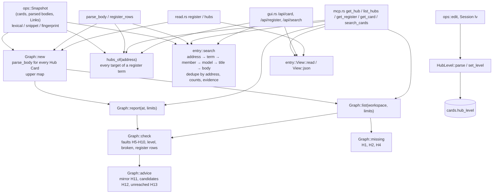

# Hub Cards

## Purpose

This block gives ZT its **Hub Cards**: Regular Cards of type `hub` that are a way into one subject. A Hub Card's body lists, under `##` group headings, one list item per member (a Link to a Card or a lower Hub Card, then what that Card adds), and states no claim of its own. Its **Hub level** (`line`, `topic`, `field`, `register`) says how wide the subject is. `src/hub.rs` stores the level, reads hub bodies, builds the hub graph of the archive (members, Hub range, upper and lower hubs), and reports the faults of the fixed hub policy (H1–H13 in `docs/hub-cards-design.md`) and the hubs a Workspace lacks. It exists so that agents (the book digest's hub stage, an agent writing a hub by hand) and the GUI reader can check and climb the hub graph; ZT reports every fault and never enforces one.

Two reports serve a concept that crosses books (#93 S12, design §8.1, §8.2). A Topic body may carry an **entry section** (`## 入口`): one to three Links a reader enters the subject through, which is the documented exception to the size-based topic-hub requirement — a tree that accepts one needs no topic hub, and a removed or broken section returns the advice. A topic hub whose members carry one book's source evidence gets **one-book advice**: an accepted register term that links a member to a treatment of the same subject sourced from another book, which the hub lists nowhere, is named with its address and its source. Both are reports; neither writes a Card.

The **concept register** is one of those Hub Cards, of level `register`. Its `## 词条` rows are terms with one to three Links to the Cards that carry the term's substance; `src/entry.rs` reads them into one disposable, revision-keyed entry view that the MCP server and the GUI both serve. Nothing else stores a concept, an alias, or an owner: the register lines are the only association between a term and its entries, and between two accepted spellings of one term. A Card also **carries** a term when its own substantive title or prose states the accepted label, so a Card that no row names shares that term for a distant selection (D196); `get_register at=<address>` answers that evidence for one Card.

The same module ranks **entry-first search** (`entry::search`, §9.2): an exact address, a matching register term and its entry Cards, a matching hub member line and the Card it opens, a matching model head, a matching Card title, then a matching authored body. The MCP server's `search_cards mode: entry` and the GUI's `/api/search mode=entry` both return that one projection, so the two transports cannot disagree about order, counts, or evidence. An omitted mode keeps the existing plain order (D198).

**Owns:** the `HubLevel` type and its parsing and storage rule, the hub body format and its parser (`parse_body`, and the register's own term-row parser `register_rows` with `register_part_targets` and `register_row_faults`), the hub graph (`Graph`), the hub range, the fault and advice rules, the hub policy limits (`Limits`), the `get_hub` / `list_hubs` report shapes, the `hubs` list a Card reports (`hubs_of`), the Topic body's `## 入口` entry section and the exception it gives the `missing` policy (`EntrySection`, `entry_sections`), the accepted register entry projection (`src/entry.rs`: `View`, `Entry`, `Target`, the body bounds, the flattened page, `terms_at` for the terms one Card carries, and `register_of` for the register's terms), the source-evidence derivation `one-book` advice needs (`source_evidence`, `literature_tree_of`), and the entry-first search ranking over that projection (`Mode`, `SearchArgs`, `search`, the rank tiers, roles, evidence, counts, and bounded scans).

**Does not own:** the `hub` Card type itself and the rule that only Regular Cards may have it ([Cards, Workspaces and Links](cards-and-links.md), `src/card_type.rs`); Link parsing and Relation kinds ([Cards, Workspaces and Links](cards-and-links.md), [Models and math](models-and-math.md) for `model::read_links`); the `TypeChange` / `level` argument plumbing in `ops::edit` ([Card operations](card-operations.md)); the `hub_level` column and its migration ([Service, CLI and storage](service-and-cli.md)); the plain lexical match set and score, the Snapshot, and its fingerprint ([Card operations](card-operations.md): `Snapshot::lexical`, `Snapshot::snippet`, `Snapshot::find`); the MCP tool schemas and dispatch ([MCP server](mcp-server.md)); the GUI's search-tray drawing, its `All matches` tree groups, and its Enter/Shift+Enter actions ([GUI](gui.md)); the Session's `ty` and `lv` commands ([Terminal Session](session.md)); the register's publication from book term tables, model-head names, and a reviewed concept report ([zt-digest](zt-digest.md), `zt-digest register`, `scripts/book-digest/register-compiler.ps1`), which reads this projection but decides no meaning itself; the reviewed concept report and its meanings (`zt-digest concepts`, #97); restatement folding in results (`zt-digest`/S14, #111).

## At a glance

| | |
|---|---|
| Entry points | `hub::Graph::new(&Snapshot)` then `Graph::report` (MCP `get_hub`) or `Graph::list` (MCP `list_hubs`); `Graph::with_links` plus `Graph::with_bodies` for the indexed read; `read::register` (MCP `get_register`, GUI `/api/register`) and `read::hubs` on a register, both building `entry::View`; `entry::register_of` (a Workspace's one register, for `one-book` evidence); `entry::search(&Snapshot, &SearchArgs)` (MCP `search_cards mode: entry`, GUI `/api/search mode=entry`); `Mode::from_args` / `Mode::parse` (both transports); `hub::hubs_of` (MCP `get_card` and GUI `/api/card` field `hubs`); `hub::set_level` (from `ops::edit` and Session `lv`); `HubLevel::parse` / `names_hub_level` (from `ops::parse_level_arg` and Session `lv`); `Limits::from_args` (MCP `get_hub`, `list_hubs`); `EntryArgs::from_args` (MCP `get_hub`, `get_register`; GUI query) |
| Key files | `src/hub.rs` — levels, `set_level`, `Limits`, `Line`/`Body`/`parse_body`, `EntrySection`/`entry_sections`, `RegisterRow`/`register_rows`/`register_part_targets`/`register_row_faults`, `hubs_of`, `Graph` (report, check, advice, one-book, source evidence, list, missing), and unit tests; `src/entry.rs` — the accepted entry projection (`EntryArgs`, `bounds`, `Entry`/`Target`/`View`, `bounded_body`, `restatement_links`, `register_of`), the entry-first search (`Mode`, `SearchArgs`, `search`, `Query`, `Quality`, `Candidate`, `Registers`, the `SEARCH_*` bounds), and unit tests; `tests/hub_cards.rs`, `tests/register_entries.rs`, and `tests/search_rank.rs` — end-to-end tests through `zt mcp` and the GUI |
| Depends on | [Card operations](card-operations.md) (`ops::Snapshot`: `cards`, `by_address`, `parsed`, `title`, `outbound`, `lexical`, `snippet`, `fingerprint`, `kind`, `clip`, `model_head`); [Cards, Workspaces and Links](cards-and-links.md) (`Card`, `CardType`, `Workspace`, `link::LinkBody`); [Models and math](models-and-math.md) (`model::read_links` for Relation kinds, `model::address_order` for the final tie-break and the mirror rule); [Service, CLI and storage](service-and-cli.md) (location helpers in `src/main.rs`: `tree_id`, `tree_root_address`, `parent_location`, `is_tree_root`, `is_tree_member`, `valid_topic_id`, `last_segment`, `load_card`, `parse_card_text`; the `cards.hub_level` column; `link_index::revision`; the `metadata.archive_id`); `rusqlite`, `serde_json`, `anyhow` |
| Used by | [MCP server](mcp-server.md) (`get_hub`, `list_hubs`, `get_register`, `search_cards`, `get_card`, `create_successor`, `edit_card`); [GUI](gui.md) (`/api/card` `hubs`, `/api/register`, `/api/search` entry mode, create and edit with `level`); [Card operations](card-operations.md) (`ops::edit`, `ops::parse_level_arg`, `TypeChange::resolve_hub_level`); [Terminal Session](session.md) (`lv`); [Service, CLI and storage](service-and-cli.md) (`Card.hub_level`, `Card::level_id`); [zt-digest](zt-digest.md) (`zt-digest hub` reads `get_hub`, `list_hubs`, and the `## 入口` section); [Digest scripts](digest-scripts.md) (`hub-compiler.ps1`, `digest-audit.ps1` call `get_hub` and `list_hubs`); [zt-digest](zt-digest.md) (`zt-digest register` reads `get_register` and `get_hub`) |
| Tests | `tests/hub_cards.rs`, `tests/register_entries.rs`, `tests/search_rank.rs`; the `#[cfg(test)] mod tests` at the end of `src/hub.rs` and `src/entry.rs` |

## Concepts

- `Hub Card` — a Regular Card of type `hub` (`CardType::Hub` in `src/card_type.rs`): a way into one subject. Its body lists members in groups and states no claim of its own. A Link from a Hub Card never takes a Model part into a model (model membership comes only from Model Cards, see [Models and math](models-and-math.md)).
- `Hub level` — `HubLevel` in `src/hub.rs`: `Line` (1), `Topic` (2), `Field` (3), `Register` (4); `HubLevel::number` gives the number, `HubLevel::id` the stored name. Stored only on a Hub Card, in `cards.hub_level`.
- `Line` (member line) — `hub::Line`: one list item of a hub body that holds at least one Link: its `group`, its first Link `target` (the member), every Link in `targets`, the `reason` (what the Card adds), and the Relation `kind` of its first Link.
- `Group` — a `##` or `###` heading of a hub body (`Body.groups`). A group named `邻近` (or `neighbours`) points out of the subject and does not count toward the hub's size (`is_neighbour_group`).
- `Hub range` — the Cards a hub is responsible for (`Graph::range`): a line hub's anchor and its subtree, a topic hub's tree, the Trees of a field hub's Topics, or the register's whole Workspace. Tree roots and Hub Cards are never in a range. A field hub's range is its Topic trees: a substantive Literature-tree Card the hub names explains the crossing but is a member, not a whole tree of the range (§8.1, D162).
- `Anchor` — the Card a hub is filed under: `crate::parent_location(hub address)`. For a line hub it is the Card where the line starts; for a topic hub it is `<n>/1`. The `anchor-title` fault also compares a topic hub's title with its tree's Topic Card `<n>/0`, the anchor the hub compiler's precheck names.
- `Upper` / `lower` hubs — the hubs that list this hub, and the hubs this hub lists (`Graph.upper`, `Graph::lower`). The hub graph is a directed graph, not a tree.
- `Register` — the one hub of level `register` in a Workspace, the first Card of the Topic `索引`. Its term rows live in the `## 词条` group (the earlier compiler wrote `## 关键词`; both are read): one term before `：`, then one to three Links to Cards, and nothing else. The groups this grammar does not own stay as they are: `## 领域` keeps the field-hub navigation, `## 未归入领域的主题` the unhoused topic hubs.
- `Register term row` — `hub::RegisterRow`: the 1-based `line`, the `term` before the colon, every Link `target` in order (repeats kept so the checks can name them), and a `shape` description when the row breaks the grammar (no colon, an empty term, words after the Links). `register_rows` reads the term groups (`词条`, or the older `关键词`) and a row written before any heading, because an existing register may have either; a row that breaks the grammar stays a row so a check can name it.
- `Register part` — `hub::RegisterPartRow`: one `## 词条分册` item of a register: its 1-based `line`, the accepted initial-range `label` the row states (`A–F`, `S–Z、其他`, `其他`, `S–Z(2)`), and the Linked `address` (or none). The same row reads whether the label comes before the Link (`- A–F：[[3/1]]`) or after it (`- [[3/1]] A–F`). An ordinary Idea Card at that address whose place is an immediate Side successor of the register is a part: its body has its own `## 词条` rows and a part cannot contain parts. Its identity is the root's declaration plus that place, so no metadata field marks it. `register_part_rows` is the one parser; `register_part_targets` is its address list for the read adapter. Reading a part's accepted label is S11 (#104); publication is `zt-digest register` ([zt-digest](zt-digest.md)).
- `Entry` — `entry::Entry`: an accepted term, the Card and line it was written on, the declared `part` (or none), all of its projected targets, and its own faults. `complete` is false when a target is missing or repeated.
- `Target` — `entry::Target`: one target address, whether the Card exists, its title/type/facet/Workspace/tree, and its bounded authored body (`body`, `body_chars`, `body_lines`, `body_truncated`). A target in the human Workspace is legal and read-only (D174): the register names it, agents never write it, and only a review's explicit selection makes one a target ([zt-digest](zt-digest.md), `register`).
- `Entry view` — `entry::View`: the register address and its entries in register order, the row/part/restatement/ambiguous-label `faults`, the declared `parts`, `terms_by_card` (the register rows that name each target, in register order), the confirmed `restatements`, and the archive identity/revision it was read at. It is derived and disposable; it stores nothing and is not a concept id.
- `Term evidence` — the accepted terms one Card carries (`View::terms_at`, D196): the register rows that name it, then the accepted labels its own substantive title or prose states, in register order and once each. A label is matched whole after folding case, so `学习（个体行为）` never widens into the bare `学习`. The register, its declared parts, an undeclared Side successor holding term rows, Hub Cards, and tree roots are navigation and supply no occurrence; a `来源`/`出处`/`Source` line, a fenced code block, and a `##` section whose heading is a navigation group (`邻近`, `入口`, `词条`, `词条分册`, `同述入口`) are not prose. A row that is not `complete` supplies no occurrence either (D297). It is asked for one Card (`get_register at=`), not materialized for the whole archive: the live archive's 78 term rows are named by 86 Cards but stated by about 1,481, so a full map would carry four times the register page's bytes to every reader.
- `Ambiguous term` — two or more entries with the same exact term label whose destination sets differ: `View::mark_ambiguous_terms` adds one `ambiguous` fault naming every row (`card`, `line`, `part`, `targets`) and keeps every row and destination as its own entry (`complete: false`). A term with one label and different destinations is never merged and no sense is chosen (D299); the author gives each sense its own scoped label (`学习（个体行为）`), which is a different term. Two rows with the same label and the same destinations are equivalent rows, which a later slice deduplicates (§8.5, S11).
- `Body bound` — the entry projection carries at most 1,200 characters and 24 lines of one target's authored body (`entry::BODY_MAX_CHARS`, `BODY_MAX_LINES`). A cut body says so: `body_truncated: true` with the authored `body_chars`/`body_lines`. The page bound is `entry_limit` 200 by default, at most 1,000.
- `Restatement entry` — a Card whose body has a `## 同述入口` section naming exactly one substantive Card of the same Workspace: the derived navigation role of design §4.5. The view records the confirmed reference and reports a missing, repeated, self-, or cross-Workspace reference as a `restatement` fault. Cycle and chain resolution is a later slice's finding.
- `Entry-first search` — `entry::search` (design §9.2, D198-D210): the ranked result of one query over the supplied `Snapshot`. The tiers are lexicographic, not weights: address (1), term (2), member (3), model (4), title (5), body (6). Inside a tier an exact label beats a prefix, which beats a partial match; the current lexical score (`Snapshot::lexical`, the same score plain search uses) orders the rest; natural address order (`model::address_order`) breaks the final tie. A term is never a Card: a target that is also a title or body hit appears once, at its highest tier. The ranking starts no model, follows no Link, writes nothing, and is recalculated from the supplied read (there is no stale view cache).
- `Search role` — the row field `role`: `entry` (a register entry target), `member` (the Card a hub member line opens), or `hit` (an ordinary matching Card: exact address, model head, title, or body). `rank_tier` is the tier number; `reason` is the sentence that explains the row.
- `Search bounds` — the named constants every entry search reports: `SEARCH_LIMIT_MAX` (200 rows, the MCP clamp), `SEARCH_HUB_MAX` (2,000 Hub Cards scanned for member lines), `SEARCH_TERM_MAX` (1,000 register rows ranked), `SEARCH_FAULT_MAX` (100 register faults reported), `SEARCH_LINE_MAX_CHARS` (200 characters of a matched hub line). Actual scans and truncation are reported in `scanned`.
- `Covered` — every Card a hub reaches through its own lines and, transitively, its lower hubs (`Graph::covered`).
- `Reached` — a Card is reached when any hub lists it, or lists a Card above it in its tree through `|` segments (`reached`). A Card of a range that is not reached is `unreached` (the design calls it a black hole).
- `Limits` — `hub::Limits`: the six numbers of the policy (`max_groups`, `max_lines`, `min_reason`, `topic_min`, `line_min`, `neighbour_links`), per request.
- `Fault` / `advice` — a fault is a broken rule in the report's `faults` list; advice (`mirror`, `candidates`, `unreached`, `one_book`) is information that is not a fault.
- `Entry section` — `hub::EntrySection`: a Topic Card's `## 入口` group (`entries` or `entrance` is the English spelling, like `邻近`), its tree, and the entry Cards, in body order. One to three list items, each a Link to a Card of the tree followed by what that Card adds; an entry that is missing, outside the tree, the tree root, a Hub Card, written twice, or unexplained is a fault (`entry-shape`, `entry-target`, `entry-bare`) and leaves the topic-hub requirement standing. It is the documented exception to the size-based topic-hub requirement (§8.2, D167, D168): `Graph::missing` reports the topic hub only while the section is absent or invalid, and `list_hubs` reports every section it reads under `entries`.
- `One-book advice` — `Advice.one_book` in the `get_hub` report (§8.2, D166): for a topic hub, the hub's own source evidence (`sources`: the union over its members outside `邻近`, empty when unknown), the accepted register treatments of the same term that a member shares and that carry a source the hub names nowhere (`candidates`, each with `address`, `title`, `term`, `member`, added `source`, and full `sources`), and the treatments whose source evidence this read cannot see (`unknown`). It is null for a hub that is not a topic hub or a read that supplied no evidence bodies (so `list_hubs`, which loads none, reports no `one_book`); candidates are empty when the hub's own evidence is unknown, when the treatment's evidence adds no source, or when the hub lists the treatment anywhere. No relation is invented and nothing is written.
- `Source evidence` — the derivation `one-book` uses (design §4.3, D068-D072, the same rule `zt-check::source_evidence` applies): the Citation keys of the Links on the Card's `来源`/`出处`/`Source` lines, else the Literature tree the Card is filed in, else (for a Model part) its model head's evidence. Several sources are kept as several, never forced to one book; no evidence is `unknown`, never a guess.

## Architecture

`src/hub.rs` is one module with four parts, and `src/entry.rs` is the register's reader:

1. **Level** — `HubLevel`, `LEVEL_NEEDS_HUB_CARD`, `names_hub_level`, `set_level`: parsing a level name and writing `cards.hub_level`.
2. **Body parser** — `parse_body`, `list_item`, `clean_reason`, `reason_chars`: turns a hub's Markdown body into a `Body` of groups and `Line`s; `register_rows`, `register_part_targets`, and `register_row_faults` read and judge the register's `词条` grammar (D050, D289, D297).
3. **Graph** — `Graph<'a>` borrows an `ops::Snapshot`, parses the body of every Hub Card once (`hubs`: address → (level, `Body`)), and builds the reverse map `upper`. Its methods compute `lower`, `covered`, `in_cycle`, `range`, `tree_links`, and then the outputs: `report` (one hub), `list` (the hub graph of a Workspace), `check` (faults), `advice`, and `missing` (required hubs that do not exist).
4. **Card lookup** — `hubs_of`: the hubs that list one Card directly, without building a `Graph`; for a register it reports a target at any position of a term (D051).
5. **Entry projection and entry-first search** (`src/entry.rs`) — `View::read` parses the register and its declared parts with the row parser, projects every target's bounded body, collects `terms_by_card`, adds the confirmed restatements, and marks identical labels with conflicting destinations as one ambiguous term; `View::terms_at` adds the terms one Card's own title and prose state (D196); `View::json` pages the flattened entries with the archive evidence. `search(snapshot, args)` ranks one query over that view: it builds the registers from the supplied Snapshot, reuses `Snapshot::lexical` for the current score, collects the tier candidates, filters target Cards, deduplicates by address (highest tier wins), and returns one JSON projection. `src/read.rs::register` and `src/read.rs::hubs` supply the view from one read transaction; the GUI and MCP supply the Snapshot they already read.



Every report is computed from the stored Cards in one `Snapshot`; `src/hub.rs` writes nothing except `hub_level` (`set_level`).

## Interfaces

`Graph::with_links(snapshot, links)` uses the existing policy calculations with per-request indexed source-target lists. `Graph::new` retains the full-Snapshot path. Both use the same outbound helper for tree-neighbour counts, candidate scores and Topic-to-hub anchoring. The MCP reader streams global Card metadata/title lines and complete Hub bodies, then supplies the index; ordinary bodies are not parsed to compute hub policy. This is request-local input, not a persistent cache.

All items are `pub(crate)`; ZT is one binary crate (`src/main.rs` declares `mod hub;`).

### Level

| Item | Signature | Behaviour |
|---|---|---|
| `HubLevel` | `enum HubLevel { Line, Topic, Field, Register }` (`Copy`, `Ord`) | Ordered by width. |
| `HubLevel::id` | `fn id(self) -> &'static str` | `line`, `topic`, `field`, `register`: the stored and reported name. |
| `HubLevel::number` | `fn number(self) -> u8` | 1 to 4. A hub without a level counts as 0 wherever levels are compared. |
| `HubLevel::parse` | `fn parse(&str) -> Result<HubLevel>` | Trims and ASCII-lowercases; accepts `line`/`线索`/`线索枢纽`, `topic`/`主题`/`主题枢纽`, `field`/`领域`/`领域枢纽`, `register`/`索引`/`登记簿`. Error: ``unknown hub level `x`; expected line, topic, field, register, or empty for none``. |
| `HubLevel::from_stored` | `fn from_stored(Option<&str>) -> Option<HubLevel>` | Reads the column; an unknown value reads as no level. Used by the card loaders in `src/main.rs`. |
| `names_hub_level` | `fn names_hub_level(&str) -> bool` | True when the text is a hub level name. `ops::parse_level_arg` uses it to tell a hub level from an elaboration level in one `level` argument. |
| `LEVEL_NEEDS_HUB_CARD` | `&str` | `only a Hub Card has a hub level (line, topic, field, or register)`: the refusal text shared by `set_level`, `ops`, `mcp.rs`, and `gui.rs`. |
| `set_level` | `fn set_level(&Connection, &Card, Option<HubLevel>) -> Result<()>` | `UPDATE cards SET hub_level = ? WHERE row_id = ?`. Refuses a level on a Card whose `card_type` is not `Hub`; `None` always clears. The caller holds the edit lock. |

### Limits

`Limits { max_groups, max_lines, min_reason, topic_min, line_min, neighbour_links }` (all `usize`).

| Limit | Default | Rule it sets |
|---|---|---|
| `max_groups` | 7 | H5: most groups outside `邻近` |
| `max_lines` | 25 | H5: most member lines outside `邻近` |
| `min_reason` | 8 | H8: fewest reason characters (letters, digits, CJK) |
| `topic_min` | 7 | H1: Cards in a Topic tree that require a topic hub |
| `line_min` | 12 | H2: Cards in a branch that require a line hub |
| `neighbour_links` | 3 | H10: Links between two Topic trees that make them neighbours |

`Limits::from_args(&Value) -> Result<Limits>` reads each name from a JSON object; a missing or `null` value keeps the default; any other value must be a JSON integer of 1 or more, else ``argument `name` must be a whole number of 1 or more``. A numeric string such as `"7"` is refused. Every report echoes the limits it used under `limits`.

### Body parser

- `struct Body { groups: Vec<String>, lines: Vec<Line> }`
- `struct Line { group: Option<String>, target: String, reason: String, kind: &'static str, targets: Vec<String> }`
- `fn parse_body(body: &str) -> Body` — never fails; text it cannot read holds no members.
- `struct RegisterRow { line: usize, term: String, targets: Vec<String>, shape: Option<String> }`
- `fn register_rows(body: &str) -> Vec<RegisterRow>` — the term rows of the `词条` (or older `关键词`) group, in body order; fenced code is skipped, a row with no Link is still a row.
- `struct RegisterPartRow { line: usize, label: String, address: Option<String> }`
- `fn register_part_rows(body: &str) -> Vec<RegisterPartRow>` — the declared parts of the `词条分册` group, in declaration order; fenced code is skipped and a row with no Link keeps an empty address.
- `fn register_part_targets(body: &str) -> Vec<String>` — the distinct Links of the `词条分册` group, in declaration order, for the read adapter that loads their bodies.
- `fn register_row_faults(row: &RegisterRow, exists: &dyn Fn(&str) -> bool) -> Vec<Value>` — the policy faults of one row: `shape`, `empty`, `oversize`, `duplicate-target`, `broken` (one per missing target, D051).

### Card lookup

`fn hubs_of(snapshot: &Snapshot, address: &str) -> Vec<Value>` — the Hub Cards (other than the Card itself) that list the Card, sorted by level number (no level first, register last) and then by address. For every hub but a register, a line's first Link (its member) must be the Card. A register reports the Card at any position of a term, once per term, with the term and the 0-based target index (D051). Each item:

```json
{ "address": "130/1|b", "title": "逆向选择的入口", "level": "topic" }
{ "address": "196/1", "title": "索引：代理工作区的入口", "level": "register", "term": "多重均衡", "target_index": 1 }
```

### Graph

- `Graph::new(&Snapshot) -> Graph` — parses every Hub Card in the Snapshot (both Workspaces).
- `Graph::report(&self, at: &str, limits: &Limits) -> Result<Value>` — the `get_hub` report. Errors: ``card `at` does not exist``; ``` `at` is not a Hub Card; set type `hub` and a level first```.
- `Graph::list(&self, workspace: Option<Workspace>, limits: &Limits) -> Value` — the `list_hubs` report; `None` means both Workspaces.

### MCP tools

Dispatched in `src/mcp.rs` (see [MCP server](mcp-server.md)); all are read-only and read a fresh transaction per call.

| Tool | Arguments | Result |
|---|---|---|
| `get_hub` | `at` (required), any of the six limits, `entry_offset`, `entry_limit` | `Graph::report`; on a register, plus the flattened entry projection of `get_register` (the two page arguments apply to that projection only) |
| `list_hubs` | `workspace` (`human`, `agent`, or omitted for both), and any of the six limits | `Graph::list` |
| `get_register` | `workspace` (required: `human` or `agent`), `entry_offset`, `entry_limit`, `at` (one Card address) | the register's entry view from `read::register`; a register-less Workspace answers `register_missing` with no entries. `at` adds `terms_at` and `terms`: the accepted terms that Card carries (D196). |
| `search_cards` | `query`, `mode` (`plain` default, `entry`), `type`, `form`, `workspace`, `limit` | `plain` keeps the existing `Snapshot::search_in` listing/search; `entry` with a non-empty query returns `entry::search`. An empty query stays the existing type/form listing in either mode. |
| `get_card` | `at` | adds `hubs: hubs_of(...)`, and `level` shows a hub level through `Card::level_id` |
| `create_successor` | `type: "hub"`, `level` | `ops::parse_level_arg`; a hub level on a non-hub refuses with `LEVEL_NEEDS_HUB_CARD`; the level is written by a follow-up `ops::edit` with a `TypeChange { hub_level }`. The reply's `level` is the elaboration or hub level. |
| `edit_card` | `type`, `level` | `TypeChange { hub_level }` resolved by `TypeChange::resolve_hub_level` in `src/ops.rs` |

`get_register` report shape (from `entry::View::json`, merged into `get_hub` on a register):

```json
{
  "workspace": "agent",
  "register": "196/1",
  "title": "索引：代理工作区的入口",
  "register_missing": false,
  "duplicate_registers": [],
  "entries": [
    { "term": "多重均衡", "line": 4,
      "origin": { "card": "196/1", "line": 4, "part": null },
      "targets": [
        { "address": "161/1", "exists": true, "title": "…", "type": "idea", "facet": null,
          "workspace": "agent", "tree": "161", "body": "…", "body_chars": 96, "body_lines": 3,
          "body_truncated": false }
      ],
      "complete": true, "faults": [] }
  ],
  "entry_offset": 0, "entry_limit": 200, "entry_total": 1, "entry_next_offset": null,
  "parts": [{ "label": "A–F", "address": "196/1|a", "title": "词条 A–F", "exists": true, "place": "ok", "entries": 12 }],
  "duplicates": [{ "term": "均衡", "card": "196/1|a", "part": "196/1|a", "line": 3, "served_by": "196/1", "served_line": 2 }],
  "faults": [], "complete": true,
  "terms_by_card": { "161/1": ["多重均衡"] },
  "terms_at": "161/1", "terms": ["多重均衡", "学习"],
  "restatements": [{ "entry": "88/2|a", "substantive": "88/2", "title": "…" }],
  "bounds": { "body_max_chars": 1200, "body_max_lines": 24, "entry_limit_default": 200, "entry_limit_max": 1000 },
  "archive_revision": 42,
  "archive_identity": { "id": "…", "path": "…" }
}
```

A `register_missing` answer has `register: null`, no entries, and one `register_missing` fault: an honest empty result, not an error. Two registers give `register: null`, `duplicate_registers`, and one `duplicate` fault; they are never chosen between. `complete` is false while any row, part, restatement, or ambiguous-label fault stands. One label written with different destinations is one `ambiguous` fault that lists every conflicting row and keeps every destination as its own entry; the term stays in the projection, and entry-first search ranks its destinations rather than choosing one. `terms_by_card` holds the register rows' explicit destinations; `terms_at` and `terms` appear only when the request names one Card with `at`, and `terms` is that Card's `Term evidence` (its rows and its own substantive title and prose). On `get_hub` the report's own hub-policy faults (H5's register rows, H8's line reasons) stay in `faults` beside the entry view's faults — the row faults both check appear once — so the legacy report field keeps its checks (D276); `complete` still speaks only for the entry projection.

### Entry-first search

`entry::search(snapshot: &Snapshot, args: &SearchArgs) -> Value` is the one ranking contract (§9.2, D199-D210). It is a read projection over the supplied Snapshot: it parses the register rows (or reports no register), reuses `Snapshot::lexical` for the current score and `Snapshot::snippet` for the preview, and returns one JSON value. The MCP server (`search_cards mode: entry`) and the GUI (`/api/search mode=entry`) return that value unchanged, so one archive and query give identical rows, order, counts, and fields (D194, D198, D278). No model runs, no Card is written, and no Link is walked.

`SearchArgs { query, workspace, card_type, form, limit }`. `Mode::from_args(&Value) -> Result<Mode>` (absent = `plain`, the existing MCP behaviour; error ``unknown search mode `x`; expected plain or entry``) and `Mode::parse(&str)`.

| Tier | `role` | When | Evidence fields |
|---|---|---|---|
| 1 `address` | `hit` | The query is exactly a Card address (case-insensitive). | `field: "address"` |
| 2 `term` | `entry` | Every query word occurs in a register term (case and spacing folded). A row that is not `complete` is ignored (D297). | `matched_term`, `origin {card, line, part}`, `entry_targets` |
| 3 `member` | `member` | A Hub Card's member line names the query in its authored words or in the title of the Card it opens. A register's `词条`/`词条分册` rows are tier 2, not member lines. | `matched_line`, `origin {card, line}` |
| 4 `model` | `hit` | A Model Card without a facet (a model head) whose title holds every query word. | `field: "model"` |
| 5 `title` | `hit` | A Card title holds every query word, from the plain lexical match set. | `field: "title"` |
| 6 `body` | `hit` | Any other plain lexical match (address or authored body). | `field` (`address`/`body`/`title`), lexical `score` |

Inside a tier: `Quality` `Exact` < `Prefix` < `Partial` (case and spacing folded), then the lexical `score` descending, then `model::address_order`. A Card named by several tiers appears once, at its highest tier, so a register target that is also a title or body hit is one `entry` row. A row keeps the plain search's summary fields (`address`, `title`, `kind`, `type`, `facet`, `emphasis`, `level`, `form`, `workspace`, `tree`, `tree_title`, `field`, `score`, `snippet`) and adds `role`, `rank_tier`, `matched_term`, `matched_line`, `reason`, `origin`, and `entry_targets`.

```json
{
  "mode": "entry",
  "query": "学习",
  "results": [
    { "address": "161/1", "role": "entry", "rank_tier": 2, "matched_term": "学习",
      "matched_line": null, "reason": "the accepted register term `学习` names this Card (196/1 line 4)",
      "origin": { "card": "196/1", "line": 4, "part": null },
      "entry_targets": ["161/1"], "field": "term", "score": 0, "snippet": "…" }
  ],
  "shown": 1, "total": 3, "row_total": 3,
  "workspaces": { "agent": 3 }, "types": { "hub": 1, "idea": 2 },
  "registers": [
    { "workspace": "human", "card": null, "title": null, "missing": true, "complete": false, "entry_total": 0, "faults": 0 },
    { "workspace": "agent", "card": "196/1", "title": "索引：代理工作区的入口", "missing": false, "complete": true, "entry_total": 4, "faults": 0 }
  ],
  "register_missing": false,
  "register_faults": [], "register_faults_truncated": false,
  "bounds": { "results_limit_max": 200, "hub_scan_max": 2000, "term_max": 1000,
              "register_faults_max": 100, "matched_line_max_chars": 200 },
  "scanned": { "registers": 1, "terms": 4, "terms_truncated": false, "hubs": 3, "hubs_truncated": false },
  "archive_fingerprint": "0123456789abcdef01234567"
}
```

`total` counts distinct matching Cards after the Workspace/type/form filters; `row_total` counts the rows before the page limit (folding, S14, may make it smaller than the Card count); `shown` is the page size. `workspaces` and `types` are the chip counts: one dimension at a time, as in plain search (by Workspace under the type and form filters, by type under the Workspace and form filters). `registers` has one row per Workspace; `register_missing` is true only when no Workspace has a register, and a register that is missing or duplicated has `complete: false`. `register_faults` names the exact Card and line of every ignored row (D297), capped at `SEARCH_FAULT_MAX`. `archive_fingerprint` is the content key of the Snapshot the rows were computed from, so a caller can tell whether two replies describe the same read; a changed Card (register, part, Link, title, or body) changes the key and therefore the derived view.

An empty query is not ranked: `search_cards` and `/api/search` keep their existing type/form listing (or empty result) on the plain path, and the GUI tray shows no result list without words. With no register, entry mode still answers: tier 4-6 rows are ordinary matches and `register_missing` labels them.

### `get_hub` report shape

From `Graph::report`:

```json
{
  "address": "130/1|b",
  "title": "逆向选择的入口",
  "workspace": "agent",
  "level": "topic",
  "anchor": "130/1",
  "groups": ["主线", "邻近"],
  "lines": [
    { "group": "主线", "address": "130/2", "title": "…", "type": "idea", "level": null,
      "tree": "130", "kind": "refers", "reason": "知情者按私人信息决定是否交易。", "exists": true }
  ],
  "lower": [{ "address": "130/2|f|c", "title": "…", "level": "line" }],
  "upper": [{ "address": "900/1", "title": "索引", "level": "register" }],
  "range": 42,
  "faults": [{ "fault": "bare", "detail": "[[130/6]] has no reason of 8 or more characters" }],
  "mirror": false,
  "candidates": [{ "address": "130/4|a", "title": "…", "links": 2 }],
  "unreached": ["130/7"],
  "unreached_count": 1,
  "one_book": {
    "sources": ["stiglitz2014learning"],
    "candidates": [{ "address": "acemoglu2019/1", "title": "…", "term": "逆向选择",
                     "member": "130/2", "source": "acemoglu2019", "sources": ["acemoglu2019"] }],
    "unknown": [{ "address": "131/4", "title": "…", "term": "逆向选择", "member": "130/2" }],
    "register": "900/1"
  },
  "limits": { "max_groups": 7, "max_lines": 25, "min_reason": 8, "topic_min": 7, "line_min": 12, "neighbour_links": 3 }
}
```

A line's `level` is the member's elaboration level or hub level (`Card::level_id`); `type` and `level` are `null` and `exists` is `false` for a missing member. `range` is a count. `candidates` holds at most 30 items and `unreached` at most 40 addresses; `unreached_count` is the full count. `one_book.candidates` and `one_book.unknown` hold at most 10 rows each, one per treatment Card.

`list_hubs` report shape (from `Graph::list` and `Graph::missing`):

```json
{
  "workspace": "agent",
  "limits": { "...": "..." },
  "counts": { "topic": 1, "register": 1 },
  "hubs": [
    { "address": "130/1|b", "title": "…", "workspace": "agent", "level": "topic", "tree": "130",
      "lines": 7, "upper": ["900/1"], "lower": [], "faults": ["isolated"], "mirror": false, "unreached": 3 }
  ],
  "entries": [
    { "tree": "130", "card": "130/0", "entries": ["130/2", "130/5"], "valid": true,
      "fault": null, "detail": "" }
  ],
  "missing": [
    { "level": "topic", "tree": "131", "anchor": "131/1", "title": "…", "cards": 9 },
    { "level": "topic", "tree": "132", "anchor": "132/1", "title": "…", "cards": 8,
      "entries": { "valid": false, "fault": "entry-target", "detail": "[[132/9]] does not exist" } },
    { "level": "line", "tree": "130", "anchor": "130/2|f", "title": "…", "cards": 13, "models": 1 },
    { "level": "register", "workspace": "human" },
    { "level": "register", "workspace": "agent", "fault": "duplicate", "registers": 2 }
  ]
}
```

`counts` keys are level ids, or `none` for a Hub Card without a level. In `hubs`, `faults` holds fault names only and `upper`/`lower` hold addresses only. `entries` has one row per Topic body that reads an entry section, including an invalid one; a missing row carries the section's fault only when the tree has one, so a broken section is visible where the requirement returns.

### Faults

| Fault | Rule | When `check` reports it |
|---|---|---|
| `level` | — | The Hub Card has no hub level. |
| `oversize` | H5 | Not a register: more than `max_lines` lines or `max_groups` groups outside `邻近`. Register: one term row that names more than 3 Links. |
| `flat` | H5 | Not a register: fewer than 2 groups outside `邻近` and more than 8 lines outside `邻近` (8 is fixed, not a limit). |
| `bare` | H8 | A line's reason has fewer than `min_reason` characters (1 for a register line, whose reason is its term). |
| `broken` | — | A line's member does not exist. A register row reports one `broken` per missing target, so its second and third targets are validated too (D051, D297). |
| `shape` | D289, D297 | A register row that breaks the term grammar: no `：` before the Links, an empty term, or words after the Links (a definition belongs in the target Cards, not in the row). |
| `empty` | D289, D297 | A register row whose term names no Card. The row is reported and is not an entry. |
| `duplicate-target` | D289 | A register row that names the same Card twice. |
| `upward` | H6 | The hub has a level and lists a hub of the same or a higher level, except a line hub that lists the line hub of a branch strictly inside its own branch (`nested_line`). |
| `cycle` | H6 | A chain of lower hubs leads back to this hub (`in_cycle`). |
| `unanchored` | H3, H4, H7 | A line, topic, or field hub that no hub of a higher level lists; and, for a topic hub, a Topic Card `<n>/0` whose body does not link it. Both may appear. |
| `duplicate` | H1 | A topic hub of a tree that holds another topic hub (each one reports the other). |
| `unlisted` | H9 | Line and topic hubs: a Model Card (type `model`, no facet) of the range, or a line hub whose anchor is in the range, that the hub does not cover. |
| `isolated` | H10 | Topic hubs: the tree has a neighbour Topic tree (at least `neighbour_links` Links either way) and no line of the hub names a Card outside the tree. The detail names up to 5 neighbours with their counts. |
| `anchor-title` | #93 S03 (D130, D169) | A hub whose title equals the title of its anchor — the Card it hangs under, and for a topic hub also its tree's Topic Card `<n>/0`: whitespace collapsed and case ignored (`normalized_title`), never broad similarity. The detail names the matched Card. A title that names the navigation role is no fault. The hub compiler's precheck refuses a new draft with either; an existing hub is reported read-only until its correction is authorized. |

`missing` (in `list_hubs`) reports H1 (topic), H2 (line), and H4 (register, or `fault: duplicate` when a Workspace has two or more registers).

### File format: the hub body

```markdown
范围：主题 130 的全部卡。

## 逆向选择
- [[130/2]]：知情者按私人信息决定是否交易。
- [[130/2|f|c]]（枢纽）：多重均衡一支。

## 邻近
- 对照 [[122/1]]：信号传递是知情一方的应对。
```

A register body keeps its own groups: `## 领域` holds the field-hub navigation, `## 未归入领域的主题` the topic hubs in no field, and `## 词条` the term rows. Each term row is one term before `：`, then one to three Links:

```markdown
范围：代理工作区的全部入口。每个词条指向一到三个实质卡。

## 领域
- 信息经济学：[[196/1|b]]

## 词条
- 多重均衡：[[161/1]] [[stiglitz2014learning/109|a]]
- 均衡的多重性：[[161/1]] [[stiglitz2014learning/109|a]]
```

The two rows are the same entry Cards under two accepted spellings of one term; scope belongs in the term label and the explanation belongs in the target Cards, so a row is an entry and not a paragraph-sized definition. The older compiler wrote its term rows under `## 关键词`, and an older or hand-written register may hold them before any heading; `register_rows` reads all three, so an existing register stays readable.

When a register exceeds 120 term rows, its rows move into ordinary Idea Cards declared under `## 词条分册` (#104, S11):

```markdown
## 词条分册
- [[196/1|a]] A–F
- [[196/1|b]] G–L
- [[196/1|c]] S–Z、其他
```

A part has a descriptive title (`词条 A–F`), its own `## 词条` section, and the same row grammar. Its identity is the declaration plus its place as an immediate Side successor of the register; a missing, misplaced, nested, duplicated, or Hub part is reported (`part-missing`, `part-place`, `part-nested`, `part-duplicate`, `part-hub`) and its rows are not accepted. A declaration without its accepted range is a `part-label` fault: the grouping the register was planned with is then no longer visible, while the row still reads because the Link is the part's identity. A Side successor of the register that holds `词条` rows which the root does not declare is reported as `part-unlisted` and its rows are not accepted, so an interrupted publication is visible instead of silently becoming a second register. A row of a declared part is deduplicated and counted once when an earlier row serves the same term with the same Cards (`duplicates`), and a contradictory target is the `ambiguous` fault; `complete` stays false while any of these stands. Parts do not enter the Hub-level graph, so the archive still has one register per Workspace.

## Behaviour

### Parse a hub body (`parse_body`)

1. Read the body line by line, trimmed. A line that starts with ```` ``` ```` or `~~~` toggles a fence; fenced lines are skipped.
2. A line that starts with `### ` or `## ` opens a group: its trimmed text is pushed to `groups` and becomes the group of the lines after it. `# ` and `#### ` headings are not groups.
3. `list_item` accepts `- `, `* `, `+ `, or a number followed by `. ` or `) `; any other line (such as the `范围` line) is skipped.
4. `LinkBody::for_rendering` (the tolerant scan) reads the item's Links, so a malformed target such as `[[0/01]]` still makes a member, and `check` reports it as `broken` (`[[0/01]] does not exist`). An item that holds no Link (or only a `[[` with no `]]`) is skipped.
5. `target` is the first Link, `targets` every Link in order. `kind` is the Relation kind `model::read_links` gives the first Link in the item's own text (`refers` when no kind word stands before it).
6. `reason` is `clean_reason` of the text after the first Link: later Link macros, `（枢纽）`, and `(hub)` are removed, and leading or trailing spaces and the marks `: ： - — – · ， , 、` are trimmed. When that leaves nothing, the reason is the cleaned text before the first Link, which makes a register term its line's reason.

### Report one hub (`get_hub`)

1. `mcp.rs` reads a `Snapshot`, `Limits::from_args`, and calls `Graph::new(&snapshot).report(at, &limits)`.
2. `report` refuses a missing Card or a Card that is not a Hub Card.
3. `check` computes the faults in this order: `level`; `anchor-title`; size (`oversize`, `flat`); `bare`; `broken`; `upward`; `cycle`; `unanchored` and, for a topic hub, the Topic body Link and `duplicate`; `unlisted`; `isolated`.
4. `range` selects the hub's range: line hub, the anchor and every Card whose address starts with `<anchor>|`; topic hub (or no level), the hub's tree; field hub, every tree named by the first Link of a line; register, every Card of the hub's Workspace. Tree roots and Hub Cards are excluded.
5. `advice` computes `mirror` (H11: a line or topic hub with 4 or more lines, all in its own tree, in non-decreasing `model::address_order`), `candidates` (H12: Cards of the range not covered that link 2 or more covered Cards), `unreached` (H13: Cards of the range that no hub of the archive reaches), and `one_book` (D166: the cross-book treatment an accepted register term links to a member, when the hub's own evidence shows one book; `read::hubs` loads the member and register-target bodies it needs, so an ordinary body never enters the hub read).
6. `report` adds each line's member title, type, level, tree, and whether it exists, plus `lower`, `upper`, the range count, and the limits.

### List the hub graph (`list_hubs`)

1. `Graph::list` runs `check` on every Hub Card of the chosen Workspace (or both) and counts hubs per level.
2. `entry_sections` reads every Topic body's `## 入口` section, and `list` reports each one under `entries`.
3. `missing` walks every Topic Card of the Workspace (Literature trees are never required to have hubs). A Card that a register declares under `词条分册` is navigation, not content: it neither counts toward `topic_min` nor forms a branch, so the `索引` tree never requires a topic hub of its own:
   1. It counts the tree's non-hub Regular Cards. A tree with no such Cards but with Hub Cards (the `索引` register tree) is skipped.
   2. H1: when that count is at least `topic_min` and no hub of the tree has level `topic`, it reports a topic hub missing at `<tree>/1` — unless the tree's entry section is accepted (D168). A section that exists but breaks is named on the row (`entries.valid: false`, its `fault`, its `detail`), so the requirement is never skipped silently.
   3. H2: for each Idea Card whose last segment is a Side label (a branch start), it counts the branch's non-hub Cards (the Card and every address under `<branch>|`) and its Model Cards. When the count is at least `line_min` or there are 2 or more Model Cards, and no line hub of the tree has the branch as its `parent_location`, it reports a line hub missing at the branch. The entry-section exception does not apply here: a line hub is anchored by a topic hub.
4. H4: for each Workspace in scope, a Workspace with Hub Cards and no register reports a missing register; two or more registers report `fault: duplicate`.

### Read the entry section of a Topic body (`entry_sections`)

1. For each Topic Card, parse its body with the hub body parser and keep the items under a group named `入口` (or `entries`/`entrance`). A body with no such group has no section and is not reported.
2. A section with no item or more than three is `entry-shape`; an entry that does not exist, is the tree root, lies outside the tree, is a Hub Card, or repeats another entry is `entry-target`; an entry with no explanation after its Link is `entry-bare`. The first fault found is the one reported, with its detail naming the Card.
3. `Graph::missing` skips H1 for a tree whose section has no fault; every faulted section leaves the requirement standing and its fault rides on the missing row.

### Decide `one-book` advice (`one_book`)

1. Only a topic hub is judged; every other hub reports `one_book: null`. A read that supplied no evidence bodies (an indexed `list_hubs`) also reports null rather than guessing.
2. The hub's own source evidence is the union over its members outside `邻近` (`source_evidence` of each). An empty set is unknown: no candidate is claimed, because "another book" cannot be shown.
3. `entry::register_of` gives the Workspace's one register as an accepted entry view; a Workspace with two registers gives none, so the evidence never chooses between them.
4. For every complete entry, every target that an accepted term links to a member of this hub, that the hub lists nowhere (not in `lines`, `lower`, or `邻近`), is a treatment of the same subject. When its source evidence adds a source the hub's own set does not name, it is a candidate with that `source`; when its evidence is empty it is listed under `unknown`; when its evidence only repeats the hub's own, it is no advice.
5. Candidates and unknown rows are deduplicated per Card in register order and capped at 10. Nothing is written and no Link is added.

### Find the hubs of a Card (`hubs_of`)

1. Keep the Hub Cards whose body contains the text `[[<address>]]` (a cheap filter: no other hub body is parsed).
2. Parse those bodies with `parse_body` and keep the hubs with a line whose first Link is the Card.
3. Sort by level number, then address. `get_card` (MCP) and `/api/card` (GUI, `src/gui.rs`) put the result in the Card's `hubs` field.

### Read the register's entries (`get_register`)

1. `mcp.rs` (or the GUI route) parses `workspace`, `EntryArgs`, and the optional `at`, and calls `read::register(&root, workspace, &entries, terms_for)`. The GUI route reads `ws`, `entry_offset`, `entry_limit`, and `at`.
2. `read.rs::register` opens one read transaction and reads the hub projection: every Card's metadata and heading line, every Hub Card's complete body, and the source→target index (`hub_read`). It also reads the persisted `archive_identity` and the revision.
3. It keeps the Workspace's Hub Cards of level `register`. None is `register_missing` with one fault; two or more are `duplicate_registers` with one `duplicate` fault and no entries; exactly one is projected.
4. `register_view` collects the target addresses of the register's `词条` rows and its declared `词条分册` parts, loads each existing one, and records its authored body. It also loads every immediate Side successor of the register, so an undeclared one holding `词条` rows can be reported as `part-unlisted` instead of vanishing. It then scans for the `## 同述入口` sections of the Workspace and keeps their Links.
5. `entry::View::read` parses the rows with `hub::register_rows`, turns `register_row_faults` into the row and view faults, projects the bounded bodies of the existing targets, accepts the rows that have a term and one to three targets, adds the declared parts' rows after the root's (each part with its accepted `label`), and derives `terms_by_card`. A missing or repeated target leaves the entry visible with `complete: false` (`entry` targets are never silently dropped, D297); a row with no term, no target, or more than three targets is reported and is not an entry. A row an earlier equivalent row already serves is counted once and named in `duplicates`; contradictory destinations stay separate entries under one `ambiguous` fault.
6. `View::json` pages the entries (`entry_offset`, `entry_limit` 200 by default and at most 1,000; `entry_next_offset` is null on the last page) and adds `parts`, `duplicates`, `faults`, `terms_by_card`, `restatements`, the fixed `bounds`, the revision, and the identity. With `at`, it also loads that one Card's authored body, calls `View::terms_at`, and adds `terms_at` and `terms`; no other body is read, so the scoped read keeps its economy.
7. `get_hub` on a register computes its usual report first, then merges the same projection into it; the entry page arguments never truncate the hub report.
8. The GUI's `GET /api/register?ws=…&at=…` calls `read::register` with the same argument parsing, so both clients answer one contract (same addresses, same order, same revision, same `terms`).

### Search entry-first (`search`)

1. The MCP handler reads `mode` (`plain` default), the query, the filters, and `limit` (default 30, clamped to 1-200). The GUI route reads `q`, `ws`, `type`, and `mode` (its page asks `entry` by default). Both build `entry::SearchArgs` and call `entry::search` with the Snapshot they already read; neither builds a second full read per hit.
2. `search` finds the archive's registers from the Snapshot: one per Workspace at most. None is a `missing` row; two in one Workspace add a `duplicate` fault and neither is used, so search never chooses between them (D299).
3. It computes the plain lexical match set once (`Snapshot::lexical`) and collects candidates: the exact address (tier 1); matching terms and every existing target (tier 2, skipping an incomplete row); parsed hub member lines (tier 3, skipping a register's own term and part groups); model heads (tier 4); title matches (tier 5); the rest of the lexical set (tier 6).
4. It sorts candidates by `(tier, quality, score descending, natural address order)` and keeps one row per address, so the highest tier wins.
5. It applies the Workspace, type, and form filters to the target Cards. The page and `total` keep only survivors; the chip counts apply one dimension at a time. A term whose targets all fail the filters contributes no row, and a row's `entry_targets` names only the surviving destinations.
6. It renders the page: the summary fields, `role`, `rank_tier`, the term or line evidence, the explanation, the navigation `origin`, and the surviving `entry_targets`; then the per-Workspace register summary, the capped faults, the named bounds, the actual scan counts, and the Snapshot fingerprint.
7. Nothing is written and no model is started, so the same Snapshot and query give the same value. The view is derived from the Snapshot on every request and is keyed only by its content (`archive_fingerprint`), so a register, part, Link, title, or body change is visible on the next read; the GUI's Snapshot is invalidated by SQLite's `data_version` ([GUI](gui.md)).

### Publish a register (`zt-digest register`, S10, S11)

`tools/zt-digest/src/register.rs` drafts and publishes the body this block reads; the code is [zt-digest](zt-digest.md)'s. It reads the agent Workspace's book term tables and model-head names, reads an optional reviewed concept report and the accepted pinyin readings as read-only evidence, and stages one row per accepted spelling with one to three targets (a reviewed entry or a statement, then a whole model, then a standalone Topic claim). A register over 120 rows is staged as `词条分册` parts grouped by the accepted initials. `apply` publishes and verifies the parts first, then the root last; it creates the Topic `索引` and the register when the Workspace has none, keeps every group it does not own, and verifies the published entries through `get_register`. A stale plan (another archive, or a target that no longer exists) is refused; a register whose declared parts are moved, missing, a Hub, listed twice, nested, or unlisted is refused before any write; a second run over the same plan writes nothing.

### Set a hub level

1. MCP `create_successor` / `edit_card` and the GUI create and edit routes call `ops::parse_level_arg`: an absent `level` changes nothing; `null`, an empty string, or `none` clears both the elaboration level and the hub level; a hub level name gives `hub_level`; anything else is parsed as an elaboration level.
2. `ops::edit` resolves the Card's type first, then `TypeChange::resolve_hub_level`: a hub level on a Card that will not be a Hub Card is refused; a Card that stays a hub keeps its level unless the change names one; a Card that stops being a hub loses it.
3. When a type change stores a new type, `model::set` clears `hub_level` in the same `UPDATE` unless the new type is `hub` (`src/model.rs`); then `hub::set_level` writes the resolved level when it differs from the stored one.
4. The Session's `lv <level|none>` (`src/session/command.rs`) calls `HubLevel::parse` and `hub::set_level` directly when the current Card is a Hub Card, and the elaboration-level path otherwise.

### Rules the code keeps

- **Report, never enforce.** No write path checks a hub fault; a hub of any shape can be saved.
- **The entry section is the one documented exception to the size rule.** A tree with a valid `## 入口` section needs no topic hub; a broken or removed section brings the advice back, and `list_hubs` names the fault. A tree that needs a line hub cannot use the exception: a line hub is anchored by a topic hub.
- **`one-book` is advice, never a fault.** It needs three things at once: an accepted register term linking a member to a treatment, that treatment's own source evidence, and a hub that lists it nowhere. Any missing piece gives no advice. A shared keyword alone is not a candidate: the register row is the link, and the sources must differ.
- **The evidence read is bounded and derived.** `read::hubs` loads the member and register-target bodies for one hub report (at most 800 addresses) and nothing else; a Card beyond the bound stays unknown evidence. No source set is stored, so the same Cards always give the same advice.
- **Only a Hub Card has a hub level**, three times over: `set_level`, `TypeChange::resolve_hub_level`, and the table CHECK `hub_level IS NULL OR card_type = 'hub'` in `src/main.rs`.
- **Read-only and stateless.** `Graph` and `hubs_of` read one `Snapshot`; nothing is cached in this block. The GUI keeps its `Snapshot` across requests until SQLite's `data_version` moves ([GUI](gui.md)), so `hubs_of` there runs on the cached Snapshot.
- **Both Workspaces.** `Graph::new` reads every hub in the archive, so `upper`, `covered`, and `reached` cross Workspaces; `list` and `missing` filter by Workspace only for what they report.
- **Self-links are ignored** in `upper`, `lower`, and `hubs_of`; they cause neither `upward` nor `cycle`.
- **Order.** `groups` and `lines` keep body order; `lower` keeps body order without repeats; `upper` is sorted by address (a `BTreeSet`); `hubs` in `list` and `missing` follow `snapshot.cards` order.
- **One ranking, two transports.** The MCP server and the GUI call `entry::search`; neither sorts, filters, or counts results itself. The plain paths are the exception, and they stay what they were: MCP `search_cards` without `mode` is `Snapshot::search_in` in Card order, and the GUI's `All matches` is `Snapshot::find` in lexical order with tree groups (D198, US024).
- **Lexical, not semantic.** A row says only that its words occur in the term, the hub line, the title, the address, or the body. The reply never claims a semantic relevance, and no search starts a model (D010).
- **No new storage, no unbounded walk.** The ranking reads the given Cards and bodies; it never follows a Link, opens a file, or saves anything. The only work beyond one Card read is the hub/term scan, capped by the `SEARCH_*` constants and reported in `scanned`.

## Data and storage

This block persists one column, `cards.hub_level` (in `src/main.rs`'s `cards_table`):

```sql
hub_level TEXT CHECK(hub_level IS NULL OR hub_level IN ('line', 'topic', 'field', 'register')),
-- ...
CHECK(hub_level IS NULL OR card_type = 'hub'),
```

`ensure_hub_cards` in `src/main.rs` adds it to an older archive by rebuilding the cards table after a backup `zt.sqlite3.pre-hub-cards-<unix time>.bak` (see [Service, CLI and storage](service-and-cli.md)). The hub's groups and members are not stored apart from the Card: they live in its Markdown body (format under [Interfaces](#file-format-the-hub-body)) and are parsed on each request. The block exchanges the JSON reports shown under [Interfaces](#mcp-tools).

The register entries add no storage: a term row is Card text, two accepted spellings are two rows, an entry is a Link, and the entry view is rebuilt from one read transaction on every request. There is no concept id, alias table, ownership column, or cache. A moved entry keeps working because the normal Link rewriting maintains the row's target, and a view is keyed to the archive revision it was read at rather than stored.

## Configuration

The six `Limits` are the only settings. They have no config key, flag, or env var: each `get_hub` or `list_hubs` call may pass any of `max_groups`, `max_lines`, `min_reason`, `topic_min`, `line_min`, `neighbour_links` as integer arguments of 1 or more, and every omitted one takes its default (table under [Interfaces](#limits)). The book digest's hub stage chooses them per run and passes them through `hub-compiler.ps1` ([Digest scripts](digest-scripts.md)). The `flat` threshold (8 lines), the register's 3 Links per term, the 30 `candidates`, the 40 `unreached`, and the 5 neighbours named by `isolated` are fixed in `src/hub.rs`.

The entry projection has its own fixed bounds in `src/entry.rs`: `BODY_MAX_CHARS` 1,200, `BODY_MAX_LINES` 24, `ENTRY_LIMIT_DEFAULT` 200, and `ENTRY_LIMIT_MAX` 1,000. `entry_offset` and `entry_limit` are per-call arguments of `get_hub` and `get_register` (and the GUI's `entry_offset`/`entry_limit` query parameters); `entry_limit` is clamped to the maximum and echoed in the report, and no config key changes the bounds.

Entry-first search adds five fixed bounds in the same module; every entry reply reports them under `bounds` and the work actually done under `scanned`:

| Constant | Value | Bound |
|---|---|---|
| `SEARCH_LIMIT_MAX` | 200 | rows in one page; the MCP `limit` clamp and the GUI tray's request bound |
| `SEARCH_HUB_MAX` | 2,000 | Hub Cards read for member lines, in natural address order |
| `SEARCH_TERM_MAX` | 1,000 | register term rows ranked, across the archive's registers |
| `SEARCH_FAULT_MAX` | 100 | register faults quoted in one reply |
| `SEARCH_LINE_MAX_CHARS` | 200 | characters of a matched hub line quoted as evidence |

Search has no config key, flag, or env var, and the GUI's 80-hit tray page is `SEARCH_LIMIT` in `src/gui.rs`.

## Usage

### Create a topic hub and check it over MCP

From `tests/hub_cards.rs`:

```json
{ "name": "create_successor", "arguments": {
    "at": "130/1", "kind": "side", "type": "hub", "level": "topic",
    "title": "逆向选择的入口",
    "body": "## 主线\n- [[130/2]]：逆向选择让市场萎缩。\n\n## 邻近\n- 对照 [[122/1]]：信号传递是知情一方的应对。\n" } }
```

```json
{ "name": "get_hub", "arguments": { "at": "130/1|a", "max_lines": 15 } }
{ "name": "list_hubs", "arguments": { "workspace": "agent", "topic_min": 3 } }
```

The hub is not anchored until the Topic body links it and a field hub or the register lists it:

```json
{ "name": "edit_card", "arguments": { "at": "130/0", "body": "问题。\n\n入口见 [[130/1|a]]。" } }
{ "name": "create_successor", "arguments": { "at": "900/0", "type": "hub", "level": "register",
    "title": "索引", "body": "- 逆向选择：[[130/1|a]]\n" } }
```

### Read a register's entries

```json
{ "name": "get_register", "arguments": { "workspace": "agent", "entry_limit": 50 } }
{ "name": "get_register", "arguments": { "workspace": "agent", "entry_offset": 50, "entry_limit": 50 } }
{ "name": "get_hub", "arguments": { "at": "196/1", "entry_limit": 200 } }
```

```text
GET /api/register?ws=agent&entry_offset=0&entry_limit=50
```

Entry order is register order: the root's `词条` rows first, then the declared parts' rows in declaration order. Targets keep the row's Link order. A Workspace with no register answers `register_missing: true` and no entries instead of failing.

### Search entry-first

```json
{ "name": "search_cards", "arguments": { "query": "学习", "mode": "entry", "limit": 20 } }
{ "name": "search_cards", "arguments": { "query": "学习", "mode": "entry", "workspace": "human" } }
{ "name": "search_cards", "arguments": { "query": "学习", "mode": "entry", "type": "idea" } }
```

```text
GET /api/search?q=%E5%AD%A6%E4%B9%A0&mode=entry
GET /api/search?q=%E5%AD%A6%E4%B9%A0&mode=plain&ws=agent
```

The first reply puts a matching register term's entry Cards first, then hub member lines, model heads, title hits, and body hits, each row naming `role`, `rank_tier`, and its evidence. Omitting `mode` (or asking for `plain`) keeps the existing MCP order and the single `results` key; the GUI's `mode=plain` keeps its lexical score order and tree groups. With no register, the same entry call still answers, with `register_missing: true` and the ordinary tiers.

### Set or clear a level

```text
lv topic      # Session, on a Hub Card (also lv 主题)
lv none       # clears it
```

```json
{ "name": "edit_card", "arguments": { "at": "130/1|a", "level": "线索" } }
{ "name": "edit_card", "arguments": { "at": "130/1|a", "type": "idea" } }
```

The second call makes the Card an Idea Card and clears its hub level.

### Use the graph from Rust

```rust
let snapshot = crate::ops::Snapshot::read(&root)?;
let limits = crate::hub::Limits::from_args(&args)?; // or Limits::default()
let report = crate::hub::Graph::new(&snapshot).report("130/1|a", &limits)?;
let graph = crate::hub::Graph::new(&snapshot).list(Some(Workspace::Agent), &limits);
let hubs = crate::hub::hubs_of(&snapshot, "130/2");
```

### Add a new fault

1. Add the rule in `Graph::check` with `fault(&mut faults, "<id>", detail)`; if it needs the range or coverage, compute after `let range = self.range(hub)` and `let covered = self.covered(address)`. A register row rule belongs in `register_row_faults` in `src/hub.rs`, where both `Graph::check` and `entry::View::read` apply it.
2. Name the fault in the `get_hub` tool description in `src/mcp.rs` (its list of fault names) and in the rule table of `docs/hub-cards-design.md`.
3. If the digest should fix it, teach `scripts/book-digest/hub-compiler.ps1`, which turns `get_hub` faults into fix jobs and also predicts some faults before the Cards exist ([Digest scripts](digest-scripts.md)).
4. Add a case to `tests/hub_cards.rs` (or `tests/register_entries.rs` for a register row or entry fault).

### Add a new limit

Add the field to `Limits`, its default to `Limits::default`, its name to the loop in `Limits::from_args`, its key to `Limits::json`, and a property to `hub_limits` in `src/mcp.rs`.

## Testing

```bash
cargo test --test hub_cards        # end-to-end through `zt mcp`
cargo test --test register_entries # the register entry projection through `zt mcp` and the GUI
cargo test --test search_rank      # entry-first search through `zt mcp` and the GUI
cargo test --bin zt hub::          # unit tests in src/hub.rs
cargo test --bin zt entry::        # unit tests in src/entry.rs
```
`tests/hub_cards.rs` makes a temporary config and archive (`ZT_CONFIG_DIR`, `ZT_GUI_PORT=0`), runs `zt up`, and drives `zt mcp` over stdio JSON-RPC. It covers:

- `a_topic_body_entry_section_satisfies_the_topic_hub_requirement`: eight Cards without a hub report the topic hub; four entries are `entry-shape` and the missing row names the fault; one to three entries are accepted, `list_hubs` reports the section and the tree stops being missing; a deleted entry target returns the advice with `entry-target`; an entry outside the tree is `entry-target`; an entry with no explanation is `entry-bare`; a removed section returns the advice.
- `one_book_advice_names_a_supported_treatment_from_another_book`: a tree whose Cards all cite one book, a register term linking one of them to another book's Literature Card; the candidate names the address, term, member, and source; a treatment of the hub's own book is no candidate; a `邻近` line for the candidate removes the advice; a treatment with no source evidence is listed under `unknown`, not as advice.
- `a_field_hub_crosses_two_topics_and_names_the_literature_cards_it_needs`: a field hub under the register lists members of two Topic trees and one substantive Literature-tree Card; its range is the two Topic trees, the Literature Card is a member (`lines`, `hubs`), and no Literature-tree Card is reported unreached.
- `a_hub_card_carries_a_hub_level_and_only_a_hub_card_does`: create with `type: hub, level: topic`; `get_card` level; refusing a hub level on an Idea Card and an elaboration level on a Hub Card; the Chinese name `线索`; retyping to `idea` clears the level.
- `get_hub_reports_faults_and_list_hubs_finds_the_missing_hubs`: `missing` topic hubs with default and per-call `topic_min`; `mirror`, `bare`, `unanchored`, `isolated`, `unreached`; a clean report after the Topic body Link, a `邻近` line, and a register; `upper`; `get_card` `hubs`; `upward` and `cycle` when a topic hub lists the register; `counts`.
- `a_line_hub_lists_the_line_hub_of_its_sub_branch_and_neighbours_do_not_count_toward_size`: the nested line hub exception (no `upward`, no `unlisted`), `邻近` outside the size limits, and `upward` when the inner hub lists the outer one.
- `a_hub_that_copies_its_anchor_title_is_named`: a line hub whose title repeats its anchor's title with one extra space reports `anchor-title`; a title that names the navigation role does not; the anchor Card is unchanged by the read-only report.
- `a_topic_hub_that_copies_its_topic_title_is_named`: a topic hub filed under `<n>/1` whose title repeats its tree's Topic Card reports `anchor-title` while the report's `anchor` stays `<n>/1`; a navigation-role title does not; copying the `<n>/1` title still reports; the Topic Card is unchanged by the read-only report.

`tests/register_entries.rs` builds a scratch archive whose register has one, two, and three targets per row, and drives `zt mcp` and `zt gui` (the recorded GUI URL and its page token). It covers:

- `a_register_projects_one_two_and_three_targets_with_bounded_bodies`: every target of every term with its title and authored body; a 1,600-character body cut at 1,200 with `body_truncated` and its authored length; the revision and identity; `entry_offset`/`entry_limit` paging and the 1,000 clamp; `get_hub` on the register carrying the same projection; `/api/register` answering the same addresses, order, total, revision, and identity.
- `several_accepted_spellings_are_separate_lines_with_the_same_entries`: two spellings with identical targets; `terms_by_card` naming both; `get_card` listing the register for a term's **second** target with `term` and `target_index`.
- `a_missing_target_is_named_and_the_entry_stays_incomplete`: a target deleted after the register named it; the entry stays visible with `complete: false` and an explicit `exists: false` target; `empty`, `oversize`, and `duplicate-target` rows are reported, not entries; `get_hub` reports `broken` naming the second target.
- `a_declared_part_is_projected_with_its_own_origin`: a declared part's rows flattened after the root's with `origin.part`; a part that is not an immediate Side successor is a `part-place` fault and its rows are not accepted.
- `a_register_written_before_the_term_heading_is_still_read`: a bare term row with no `词条` heading is read and is no fault, because an older register may not have the heading.
- `an_accepted_move_keeps_the_register_entry_current`: moving an entry Card rewrites the register's Link, so the entry, `terms_by_card`, and the register body follow the new address with no stored id to update.
- `an_archive_without_a_register_answers_an_honest_empty`: `register_missing`, no entries, `complete: false`, one named fault, the revision still reported, the same answer from `/api/register`, the other Workspace, and an error (not an empty answer) for an unknown Workspace.
- `a_scoped_term_stays_its_label_and_a_second_destination_is_an_ambiguity_fault`: `学习（个体行为）` and `学习（产业生产率）` are two labels and two entries; when the same label is written again with another destination the `ambiguous` fault names both rows and the conflicting destinations, every row stays an entry, and `get_hub` carries the same fault (D299, §12.3).
- `a_human_card_is_a_read_only_target_of_an_agent_register`: a human Card created through the owner GUI is a term's second target with `workspace: "human"` and its authored body; the human Card's title and body never change (only its generated Reverse section follows the Link), `get_card` reports the register at `target_index: 1`, and the human Workspace has no register (D174).
- `every_entry_page_is_read_at_one_revision_and_a_write_moves_the_register`: two pages of two entries concatenate to the whole catalog at one revision, identity and `entry_total`; a repeated page read is identical; a body edit advances the revision and the page shows the new bounded body.
- `a_confirmed_restatement_is_projected_and_a_malformed_one_is_a_fault`: a `## 同述入口` section naming one substantive Card is projected as `{entry, substantive, title}`; a section naming two Cards or the entry itself is a `restatement` fault and records no confirmed reference.
- `a_register_hub_report_keeps_its_own_checks_beside_the_entry_faults`: a valid term row and a `## 领域` line with no reason give an empty entry view but the hub report's own `bare` fault: the projection's `faults` and the hub policy's checks are one list with no duplicate row fault (D276).
- `a_card_that_states_an_accepted_term_carries_it_without_being_its_target`: `terms_by_card` keeps the explicit destinations, the page's `terms_at` is null until asked, and `get_register at=` answers a Card's explicit row and, for a non-target, the term its own prose states; a tree root and the register supply none; `get_hub` and `/api/register?at=` answer the same evidence.
- `a_source_line_a_navigation_list_and_a_hub_line_are_not_prose`: a `来源：` line, a `## 邻近` member list, and a Hub Card's own lines supply no term, while an explicit target keeps its row.
- `a_scoped_term_is_never_reduced_to_its_bare_word`: `学习（个体行为）` is matched whole; a Card that writes only `学习` carries neither scoped label, and an explicit destination keeps its own sense.

`tests/search_rank.rs` builds a scratch archive with a register, hubs, model heads, and ordinary Cards, then calls `search_cards mode: entry` and `/api/search mode=entry` and compares whole replies. It covers:

- `entry_points_precede_body_hits_and_both_transports_agree`: the register entry first, then the title hit, then the body hit; roles and tiers 2/5/6; a term's evidence and `entry_targets`; one row per address; the register summary, bounds, scan counts, and fingerprint; and a full equality of the MCP and GUI replies.
- `accepted_spellings_name_the_same_targets_once`: two accepted spellings of one term opening the same two Cards, each once, with the better (prefix) term as `matched_term`.
- `a_register_target_that_is_also_a_body_hit_appears_once_as_an_entry`: a target whose body repeats the query still appears once, as the tier-2 entry.
- `hub_member_lines_and_model_heads_are_ways_in`: a hub member line (role `member`, tier 3, `matched_line`, `origin.card`/`origin.line`) before the ordinary title hit, and a model head (tier 4) before a title (tier 5).
- `an_exact_address_opens_that_card_first`: tier 1 for the address query.
- `filters_apply_to_targets_before_rows_and_counts`: an Idea-only search never receives the term's Model target, the Model-only search keeps the entry row, `entry_targets` holds only surviving destinations, and the chip counts apply one dimension at a time.
- `an_archive_without_a_register_falls_back_honestly`: `register_missing`, both Workspace rows missing, ordinary tier-6 rows, and the same answer from the GUI.
- `a_broken_register_row_is_reported_and_left_out_of_retrieval`: the broken term is no entry, `register_faults` names the exact Card and missing target, the register is `complete: false`, and the valid row still works.
- `plain_search_and_empty_query_listings_keep_their_contract`: the omitted mode keeps the single `results` key and its order, `mode: plain` changes nothing, an empty query keeps the type listing in every mode, the GUI's plain path keeps its lexical score order, and both transports refuse an unknown mode.
- `the_entry_order_is_deterministic_and_bounded`: identical repeated replies, natural address order for equal ranks, `total`/`row_total` distinct from the page size, and the 200-row clamp.
- `a_register_part_is_evidence_not_a_competitor`: a declared part that holds the term rows and repeats the term far more often than either target still ranks below them (tier 6 after tier 2), its rows name the part as `origin.part`, and the part is never an entry.
- `the_form_filter_applies_to_targets_before_rows_and_counts`: a `form: theorem` search keeps only the unit's row with `entry_targets` naming that one destination, and a form no target states returns no row at all.
- `the_cached_gui_read_follows_a_register_row_and_a_title_edit`: the GUI's cached Snapshot follows a register row retarget on the next request, the archive fingerprint changes, and a title edit moves a Card from a title hit to its entry row while a body-only Card stays at tier 6.
- `the_cached_gui_read_follows_a_part_and_a_hub_member_line`: a hub member line added later makes the Card a `member` row (tier 3) on the next read, and moving the rows into a declared part changes the entry row's `origin` without changing its target.
- `within_a_tier_the_lexical_score_orders_the_ties`: two body hits at tier 6 order by their lexical score, and a term with three destinations reports all three on each row in natural address order.

The unit tests in `src/hub.rs` cover level parsing in both languages, `parse_body` (groups, reasons, `（枢纽）`, kinds, fences, a malformed member Link kept), register terms as reasons, `reached`, `nested_line`, `is_neighbour_group`, `is_navigation_group`, and `reason_chars`. The unit tests in `src/entry.rs` cover the body bounds, the restatement section's Links (a `来源：` line is not an entry), the page arguments (defaults, clamping, refused types), the `mode` argument (plain by default, `entry` and `plain`, refusals), the label match quality (exact, prefix, partial, spacing, and a query word that is absent), the prose of `Term evidence` (`来源` lines, navigation sections, and fenced code left out), and its whole-label matcher (a scoped sense, a bare word, and case folding).

Gaps: no test for field hubs (their range, `unanchored` with the register), `duplicate`, `flat`, `candidates`, a `level` fault, the `missing` line hub rule (H2) and the duplicate register, `list_hubs` without a `workspace`, numbered list items, or malformed Links in a hub body. The entry projection has no test for two registers in one Workspace, a nested or Hub part (the code reports `part-nested`/`part-hub`), a restatement cycle, or two equivalent rows with the same destinations (S11's deduplication, §8.5). `one-book` has no test for a Model part's evidence coming from its model head (`source_evidence` falls back to it), for a mixed-source hub, or for the `EVIDENCE_MAX` cap of the indexed read's body load. The entry section has no test for a model-part fallback or for the `entries`/`entrance` English headings. Search has no test for the `SEARCH_HUB_MAX`/`SEARCH_TERM_MAX` truncation flags (they need more than 1,000 term rows or 2,000 hubs), for a query that matches a register's `## 领域` navigation line, or for restatement folding (S14, #111). `Term evidence` has no test for a term stated in a Literature Card, for a Model part (it is substance, not navigation), or for a Card whose own body the read could not parse.

## Decisions and pitfalls

### Decisions

- **A Card type with a stored level, and a report instead of enforcement** (option C in `docs/hub-cards-design.md`, approved 2026-10-14). ZT reports hub faults the way it reports model faults; the hub compiler acts on them.
- **A separate `hub_level` column**, not a reuse of `model_level`: SQLite cannot change a CHECK in place, so the type CHECK needed a table rebuild anyway, and two columns keep the two kinds of level apart (`docs/hub-cards-design.md`, "Storage"). One `level` argument still carries either kind; `ops::parse_level_arg` tells them apart by name.
- **The limits are per request.** The Haiku hub manager chooses them per digest run from a survey, so they are arguments, not constants (`docs/hub-cards-design.md`, "Fixed policy" and "The hub compiler").
- **`邻近` does not count toward size**, and **a line hub may list the line hub of a sub-branch**: both came from the 2026-10-14 pilot, where H5 counted outward Links and H6 contradicted H9 for nested branches (zt 0.16.1, `docs/hub-cards-design.md`, "Pilot").
- **`hubs_of` parses only the hubs whose body contains `[[address]]`**, so the GUI's `/api/card` stays fast on a cached Snapshot (commit `33ecec2`).
- **Membership comes from Links, not Locations** (`docs/open-models-design.md`, repeated in `docs/hub-cards-design.md`): a hub's members are its Links, and the Location only sets the anchor of a line hub's range.
- **The register is the only concept association** (#93 S10, design §4.1 D058-D062, §8.3-8.5 D170-D175). A term is a row, its entries are Links, and two accepted spellings are two rows with the same targets; there is no concept database, alias table, ownership column, Card type, Hub level, Relation kind, or entry cache. The view is derived, disposable, and keyed to the archive revision, so a moved Card keeps working through normal Link rewriting and no viewer holds a permanent concept id. The service reads the accepted register text; the digest reads book term tables to propose rows and never becomes a second catalog.
- **One entry-first ranking, two transports, and the plain paths kept** (#93 S13, design §9.2 D198-D210). `entry::search` is the only ranking: the MCP server adds `mode: entry` and the GUI asks `mode=entry` by default, while an omitted mode is still the old plain search and the GUI's `All matches` is still `Snapshot::find`. The priority is lexicographic (address, term, member, model, title, body), not a pile of weights; inside a tier exact beats prefix beats partial, then the existing lexical score, then natural address order. Filters apply to target Cards before rows and counts, so a register row cannot carry a Model into an Idea-only result. A term is not a Card: one row per address, at its highest tier.
- **The ranking is a read projection with named bounds** (#93 S13, D195, D208, §12.2). It is recomputed from the supplied `Snapshot` on every request instead of being cached, so a register, part, Link, title, or body change cannot leave a stale ranking (the GUI's Snapshot is already invalidated by `data_version`). It starts no model, walks no Link, writes no Card, and reports its constants and actual scans. A missing register is `register_missing`, not a silently empty result; a broken row is skipped for retrieval and named in `register_faults`; two registers are a `duplicate` fault and neither is used.

### Pitfalls

- **Member lines are scanned tolerantly.** A stored body passes the strict `LinkBody::parse` as a whole, but one line of it need not (inline code that spans lines). `parse_body` therefore uses the tolerant scan per line: a malformed target stays a member with a `broken` fault instead of vanishing. Only an unclosed `[[` still drops the line (test `a_member_line_with_a_malformed_link_is_kept_for_the_checks`).
- **Only the first Link is the member, except in a register.** `hubs_of`, `field` ranges, `broken`, `bare`, `isolated`'s "outside" test, and `mirror` use `line.target`; `upper`, `lower`, `covered`, and `reached` use every Link in `targets`. A Card named second in an ordinary line is covered but has no chip in the GUI. A register term names one to three members, so its every target is a member, is validated, and is reported with `term` and `target_index` (D051).
- **A register reason may not be its term.** The text before the first Link is used only when nothing follows the Links: in `- 逆向选择：[[a]]、[[b]] 见下`, the old `Line.reason` is `见下`. The entry projection does not rely on that: `register_rows` reads the term before the `：` and reports words after the Links as a `shape` fault.
- **A term row without a Link is not a `Line`.** `parse_body` skips it, so the hub report's `lines` and the GUI's chips never show it; `register_rows` keeps it and `get_register` reports `empty` with its line and term.
- **A missing target stays visible.** The entry keeps the missing address with `exists: false`, makes the entry `complete: false`, and adds a `broken` fault; it is not silently dropped. Entry-first ranking skips an incomplete entry (D297).
- **A register is also an ordinary body hit.** Its body holds every term it lists, so a query for a term also returns the register Card at tier 6 (and a part Card likewise). That never outranks the target at tier 2, and the design keeps authored-body hits honest rather than filtering navigation Cards out of search.
- **Counts are not the page size.** `total` counts distinct matching Cards after the filters; `workspaces` and `types` are chip counts that relax one dimension, so a chip can be larger than `total` or than the page. `row_total` is the number of rows before the page limit; in S13 it equals `total` (nothing is folded yet).
- **Entry rows are not plain rows.** MCP `search_cards` without `mode` still returns `Snapshot::search_in` rows (no `role`, `rank_tier`, or `score`); the GUI's `All matches` still returns `Snapshot::find` rows in lexical order. Only `entry` mode returns the shared rows. Do not compare a plain row's fields with an entry row's.
- **The search view is rebuilt, not cached.** `read::register` owns the storage read for `get_register`; search builds its `View` from the Snapshot it is given (the GUI's cached one, or the MCP request's fresh one). That is why no separate invalidation is needed, and why `archive_fingerprint` is the read's key rather than a revision the search never reads.
- **Entry bodies are bounded by design.** The projection carries 1,200 characters and 24 lines of a target's authored body, never the full text. `body_truncated`, `body_chars`, and `body_lines` describe the authored length, so a caller can tell a whole body from a cut one. A caller that needs the rest reads the Card (`get_card`).
- **`terms_by_card` comes from explicit register targets only.** It is register order and deduplicated per Card, because every reader of the register page pays for it. The literal occurrences of a term in a Card's own substantive title and prose are `Term evidence`, asked for one Card at a time (`get_register at=`/`View::terms_at`, design §9.1 D196): the live archive's 78 rows name 86 Cards but are stated by about 1,481, so materializing every occurrence would grow the register page from 78 KB to 784 KB and load every authored body inside the scoped read. The distant selection (S19, #108) calls `terms_at` for its held Card.
- **The restatement scan is one `LIKE` pass.** `read::register` finds the `## 同述入口` sections with `text LIKE '%同述入口%'` and then reads those Cards' bodies; it runs inside the register read transaction. It confirms one same-Workspace substantive Card; cycles and chains are a later slice's finding.
- **The register is not checked for place or size.** Nothing checks that it is `<索引>/1`, that it lists every field hub, or how many terms it has; the row checks are `shape`, `empty`, `oversize` (more than 3), `duplicate-target`, `broken`, and `bare` (minimum 1).
- **A line hub's range depends on the anchor's address.** It is the anchor plus every address that starts with `<anchor>|`. For a branch start such as `130/2|f`, that includes its Direct successors (`130/2|f|1`, …); for a main-line Card such as `130/2`, the Direct successor `130/3` is outside.
- **`reached` climbs only through `|` segments.** Listing `130/2` reaches `130/2|a|1` but not `130/3`.
- **A hub without a level** is checked as if its range were its tree, but gets no `upward`, `unanchored`, `unlisted`, or `isolated` checks; it only reports `level`.
- **`H2` branch starts must be Idea Cards.** A branch that starts with a Model Card or an Event Card never requires a line hub, and nested branches are each counted on their own.
- **`isolated` counts Links from Hub Cards too.** `tree_links` counts every Link between the hub's tree and other Topic trees, including Links from the register and field hubs in the `索引` tree, so `索引` can appear among a topic hub's neighbours.
- **`unanchored` may appear twice** for one topic hub: once for no upper hub, once for the Topic body.
- **`flat` uses a fixed 8**, not `max_lines`.
- **`reason_chars` counts letters, digits, and CJK** (its explicit U+4E00–U+9FFF range is already covered by `is_alphanumeric`); spaces and punctuation do not count.
- **Keep `src/mcp.rs` in step.** The tool descriptions there list the fault names and limits by hand, and `hub-compiler.ps1` copies the reason-counting rule ("The words of a reason as get_hub counts them").

## Change history

- `2026-10-19` — #106 S13 re-verification (D196, §9.1): the accepted terms a Card carries are now derived from its own substantive title and prose, not only from the register rows that name it. `View::terms_at` matches every accepted label whole (a scoped `学习（个体行为）` never widens to `学习`) against one Card's title and the prose of its body — its `来源`/`出处`/`Source` lines, its fenced code, and its `邻近`/`入口`/`词条`/`词条分册`/`同述入口` sections left out — and supplies no evidence for a Hub Card, a tree root, the register, or one of its parts. `get_register` and `/api/register` take an optional `at` and answer `terms_at`/`terms` for that one Card, which is the evidence a distant selection asks about its held Card (S19, #108); `terms_by_card` stays the explicit destinations so the register page's bytes and the scoped read's economy are unchanged. The S13 acceptance walk also pinned the rest with tests: a declared register part never outranks its targets, the `form` filter applies to targets before rows and counts, the GUI's cached read follows a register row, a part declaration, a hub member line, a title, and a body edit, and within a tier the lexical score and then natural address order break the ties.
- `2026-10-19` — #105 S12: hubs cross books and a redundant topic hub is no longer required. A Topic body's `## 入口` section (one to three Links, each saying what it adds) is the documented exception to the size-based topic-hub requirement: `Graph::missing` stops reporting the topic hub while the section is accepted, a removed or broken section returns the advice with its `entry-shape`, `entry-target`, or `entry-bare` fault, and `list_hubs` reports every section under `entries` (D167, D168). `get_hub` adds `one_book` advice: a topic hub whose members carry one book's evidence gets the treatment an accepted register term links them to, with its address and the source it adds, while a treatment whose evidence is unknown is reported separately and no relation is invented (D166, §4.3). `src/hub.rs` derives source evidence the way `zt-check` does (a `来源` line's Citation keys, else the Literature tree, else a Model part's head) and `src/read.rs` loads only the member and register-target bodies one hub report needs. A field hub's range is its Topic trees, so a substantive Literature-tree Card it names is a member, not a whole tree (D162). New coverage: `tests/hub_cards.rs` (entry section, one-book advice, a field hub crossing two books) and `scripts/book-digest/tests/hub-compiler.tests.ps1` (mirror refusal, entry-section validation and apply, the check report's `entry_faults`, `one_book`, and `report.entries_*`).
- `2026-10-19` — #104 S11: register parts become a read contract of their own, and the hub advice stops counting them as content: `missing` reads each register's `词条分册` group from the hub bodies it already holds and excludes those Cards from a tree's content and branches, so a split register never makes the `索引` tree require a topic hub of its own nor a declared part require a line hub (D188, S11-AC06). `hub::register_part_rows` is the one parser of the `词条分册` declaration and carries each part's accepted initial-range label (the row reads with the label before or after its Link); every other reader uses its address list. The entry projection adds the part `label`, reports a label-less declaration as `part-label`, reports a Side successor of the register whose `词条` rows it never declares as `part-unlisted` (so an interrupted publication is visible instead of becoming a second register), and names a row an earlier equivalent row already serves in `duplicates` — counted once, without a fault — while contradictory destinations stay separate entries under the `ambiguous` fault (D189, D298). `read.rs::register_view` loads every immediate Side successor of the register in the same transaction, so the undeclared one can be told from an ordinary Card; `read::context` loads the register of a Card whose term row lives in a part, and `hubs_of` scans the declared parts' rows, so a part's term names its targets as register members with the term and target index (D187, AC09). New coverage: `tests/register_entries.rs` (part label, label-less fault, duplicates, contradiction, unlisted part, part-row membership through `get_card`) and `scripts/book-digest/tests/register-parts.tests.ps1` (parts published before the root, labels and row split, membership, `zt-check` treating a part as navigation, the interrupted publication, the refused obstructed layout).
- `2026-10-19` — #101 S10 re-verification (D299, §12.3): the entry projection now reports identical term labels with different destinations as one `ambiguous` fault (`View::mark_ambiguous_terms`), naming every conflicting row (Card, line, part, targets) and keeping every row and destination as its own entry, so the view is `complete: false` and no sense is chosen. Scoped labels (`学习（个体行为）` vs `学习（产业生产率）`) stay distinct terms. `get_hub` on a register now keeps the hub report's own policy checks in `faults` beside the entry view's faults (the old overlay replaced the whole list), so a `bare` navigation line or an H6/H8 check no longer disappears (D276). New integration coverage in `tests/register_entries.rs`: scoped labels and the ambiguity fault, a human Card as a read-only target (`workspace: "human"`, authored text unchanged, the register in its `hubs`), every page at one revision with a write moving it, the confirmed/malformed `## 同述入口` restatement, and the kept hub checks beside the entry faults.
- `2026-10-19` — #93 S13 (#106): entry-first search. `src/entry.rs` gains `Mode` (`plain`/`entry`), `SearchArgs`, and `search`, the one ranking both transports call: an exact address, a matching register term and its entry Cards, a matching hub member line and the Card it opens, a matching model head, a matching Card title, then a matching authored body, with exact/prefix/partial preference, the existing lexical score, and natural address order as the tie-breaks. Rows add `role`, `rank_tier`, `matched_term`/`matched_line`, `reason`, `origin`, and surviving `entry_targets` to the plain summary fields; replies add `registers`, `register_missing`, `register_faults`, `bounds`, `scanned`, and `archive_fingerprint`. MCP `search_cards` gains `mode` (`plain` default, so the existing order and shape stay) and the GUI's `/api/search` gains `mode=entry` (its page's default) while `All matches` keeps `Snapshot::find`. `Snapshot` exposes the plain lexical match set (`lexical`), `snippet`, and a per-Snapshot `fingerprint`; `hub::Line` gains its body `line` and item `text`; `tests/search_rank.rs` covers the tiers, filters, spellings, fallbacks, plain compatibility, determinism, and bounds.
- `2026-10-19` — #93 S10 (#101): the register's accepted entry projection. `src/entry.rs` reads the `词条` rows and the declared `词条分册` parts, validates every target of every term (D051), projects each target's body within the documented 1,200-character/24-line bound (D049), and pages the flattened entries with the archive identity/revision. `get_register` and the GUI's `/api/register` serve that one contract; `get_hub` on a register merges the same projection; an absent register is an honest empty answer, and two registers are reported, never chosen between. `register_rows`/`register_row_faults` add the register row grammar with the `shape`, `empty`, and `duplicate-target` faults; `hubs_of` reports a term's second and third targets; `zt-digest register` publishes the body this block reads.
- `2026-10-19` — #93 S03 re-verification: a topic hub has two anchors for `anchor-title`. The report still names the Card the hub hangs under (`<n>/1` for one the compiler creates) and now also names the tree's Topic Card `<n>/0`, which is the Card the compiler's precheck anchors a new topic-hub draft to — a draft refused for copying `<n>/0` used to be applied without the report ever naming it, and a draft copying `<n>/1` passed the precheck and then carried the fault. `precheck` compares both. Pinned by `a_topic_hub_that_copies_its_topic_title_is_named` and by the `parent-title.json` case of `scripts/book-digest/tests/hub-compiler.tests.ps1`.
- `2026-10-19` — #93 S03: the `anchor-title` fault. A line or topic hub whose title equals the title of the Card it hangs under (whitespace collapsed, case ignored) is reported read-only by `get_hub`, and `zt-digest hub -Step precheck` refuses a new draft that has it. A differently worded navigation title is no fault.
- `2026-10-17` — Permit indexed outbound input for MCP policy projections, retaining the full Snapshot path as the oracle. Add parity checks for candidates, neighbours, coverage and policy after an unrelated ordinary body's Link syntax is damaged.

- `2026-10-16` — `parse_body` scans each member line with the tolerant `LinkBody::for_rendering`, so a member with a malformed Link is reported as `broken` instead of being dropped.
- `2026-10-16` `63d77d1` — The module doc comment points to `docs/hub-cards-design.md` (documents moved from `doc/` to `docs/`).
- `2026-10-15` `33ecec2` — `hubs_of` becomes a free function (it was `Graph::hubs_of`, which parsed every hub) and parses only hubs whose body holds a Link to the Card, for the GUI's cached Snapshot.
- `2026-10-14` `07a7836` — zt 0.16.1: a line hub may list the line hub of a sub-branch (`nested_line`), and the `邻近` group no longer counts toward `oversize` and `flat`.
- `2026-10-14` `82eac86` — zt 0.16.0: Hub Cards: the `hub` type's level, body parser, hub graph, faults, `get_hub`, `list_hubs`, `get_card` `hubs`, and `tests/hub_cards.rs`.
- `2026-10-16` — Wiki doc created.
