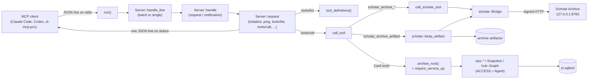

# MCP server

## Purpose

`zt mcp` is the Model Context Protocol server that lets AI agents (Claude Code, Codex, and DeepSeek Harness through a helper script) work in the slip-box. It speaks JSON-RPC 2.0 over stdio, one message per line, and offers every Card operation as an MCP tool. It acts with agent Access: it reads every Card in both Workspaces, but it changes only the agent Workspace, and it refuses any change that would rewrite the body of a human Card. It also offers six `scholar_archive_*` tools that read the local Scholar Archive through the Scholar Archive bridge. The block exists so that agents get the same Card rules as the human's own tools (it calls the same operations as the GUI) without any way to change the human's Cards. The server is a thin adapter: it parses arguments, calls `src/ops.rs` and `src/scholar.rs`, and wraps the results as MCP tool results.

**Owns:** the stdio JSON-RPC loop and its error codes, protocol version negotiation, the server instructions text (`INSTRUCTIONS`), the tool list with its input schemas and annotations, per-request indexed read selection in `src/read.rs`, the mapping from tool arguments to operation calls, the fixed `ACCESS = Access::Agent`, the plan/confirm result shape (`plan_or_done`), and the project-level client config `.mcp.json`.

**Does not own:** the Card operations and their plans ([Card operations](card-operations.md)); the Access rules themselves, Workspaces, Card types, and Links ([Cards, Workspaces and Links](cards-and-links.md)); the model, build, and math reports ([Models and math](models-and-math.md)); hub reports and limits ([Hub Cards](hub-cards.md)); the bridge protocol, pairing, artifacts, and caches ([Scholar bridge](scholar-bridge.md)); the service lifecycle, `zt` command dispatch, and schema migrations ([Service, CLI and storage](service-and-cli.md)); registering the server in agent clients and the `zt-mcp.ps1` helper ([Agent skills](agent-skills.md)).

## At a glance

| | |
|---|---|
| Entry points | `zt mcp` (dispatched in `src/main.rs` to `mcp::run()`); per line `Server::handle_line`; per tool `call_tool` and `call_scholar_tool` in `src/mcp.rs` |
| Key files | `src/mcp.rs` — the whole server: transport loop, JSON-RPC dispatch, `INSTRUCTIONS`, `tool_definitions()`, argument parsers, tool handlers, unit tests. `tests/workspaces_mcp.rs` — integration tests that run a real service and a real `zt mcp` child process. `.mcp.json` — project-scope Claude Code config that launches `zt mcp` as the stdio server `zt` |
| Depends on | [Card operations](card-operations.md) (`ops::create_topic`, `create_literature`, `create_successor`, `edit`, `edit_metadata`, `delete`, `move_card`, `insert_card`, `Snapshot`), [Cards, Workspaces and Links](cards-and-links.md) (`Access`, `Workspace`, `CardType`, `workspace::counts`, and the computed Term structure `term::structure`, `term::facts`, `term::Placement`), [Models and math](models-and-math.md) (`model::Part`, `Facet`, `Emphasis`, `Level`, `math::MathForm`), [Hub Cards](hub-cards.md) (`hub::Graph`, `hub::Limits`, `hub::hubs_of`, `entry::EntryArgs`, `entry::View`), [Scholar bridge](scholar-bridge.md) (`scholar::Bridge`, `keep_artifact`, `READ_TOOLS`, `document_markdown`, `export_path`; `artifact::require_present`), [Service, CLI and storage](service-and-cli.md) (`require_service_up`, `compose_card_text`, `parse_card_text`, `open_db`, `load_card`, `VERSION`); crates `serde_json`, `anyhow` |
| Used by | [Agent skills](agent-skills.md) (`skills/zt/SKILL.md`, `skills/zt/scripts/zt-mcp.ps1`, `scripts/install-agent-integrations.ps1`), [Digest scripts](digest-scripts.md) (`scripts/book-digest/zt-calls.ps1` and the compilers call tools through `zt-mcp.ps1`, including `get_register`), [Digest workflows](digest-workflows.md) (`scripts/book-digest/workflow/modules/zt-digest-lib.js`) |
| Tests | `src/mcp.rs` (`mod tests`), `tests/workspaces_mcp.rs`, `tests/term_structure.rs`; tool-specific MCP coverage also in `tests/card_types.rs`, `tests/hub_cards.rs`, `tests/register_entries.rs`, `tests/math_units.rs`, `tests/model_levels.rs`, `tests/model_structure.rs`, `tests/self_sufficient_models.rs`, `tests/scholar_bridge.rs` |

## Concepts

- `MCP server` — the glossary term (`CONTEXT.md`): the server started with `zt mcp`, JSON-RPC over stdio, every Card operation as a tool, agent Access. Held by `Server` and `run()` in `src/mcp.rs`.
- `Access` — which Workspaces a client may change (`src/workspace.rs`). The server fixes `const ACCESS: Access = Access::Agent`; `Access::can_write` is true only for `Workspace::Agent`, `ensure_writable` fails with "the human workspace is read-only for AI agents; only the agent workspace can be changed", and `ensure_link_rewrites_allowed` refuses a rename mapping that would rewrite a `[[target]]` macro in a human Card's body ("this change would rewrite Links in human workspace Card `…`, which is read-only for AI agents").
- `Workspace` and `Zone` — `human` and `agent`; each with a Topic zone and a Literature zone. Tools take `workspace` as `human`, `agent`, or `all`, and `zone` as `topic`, `literature`, or `all` (`optional_workspace`, `optional_zone` in `src/mcp.rs`).
- `Card address` — a Location (`3/1|a`) or a Citation key (`Smith2024`); the `at` argument of most tools.
- `Card type` — `idea`, `event`, `finding`, `model`, `hub`, `term` (`CardType`); the `type` argument. A Term Card also takes the `term` argument (S07, #149): omitted creates a candidate list or preserves the name on an edit, null or a trimmed-empty string clears it, and a string sets the exact name (at most 40 scalar values, no `[`, `]`, `@`, `|`, backtick).
- `Term role`, `Term list`, `Term head`, `Term part` — the computed Term structure (S08, #150; [Cards, Workspaces and Links](cards-and-links.md)). A Term Card with no name is a `list`; a named Term Card that is an immediate Side successor of a list is a head (the wire role `card`); a named same-name Direct successor of a head or part is a `part`; any other named Term Card is `unfiled`. No read stores the role: `term::facts` recomputes it for every Card read, and `get_terms` reads one list whole.
- `Term use` — one stored `[[label@address]]` macro (S10, #151): the write validates it against a currently computed head and indexes it with `kind = 'term'` at the address, and `get_terms`, `get_card` and the Card reads publish the uses, labels and the two label/target faults. A label mismatch is advice and never rewrites the authored word.
- `Model facet`, `Emphasis`, `Elaboration level`, `Math form`, `Hub level` — the `facet`, `emphasis`, `level`, and `form` arguments. `level` is one argument for both the model level (`concept`, `formal`) and the hub level (`line`, `topic`, `field`, `register`); `ops::parse_level_arg` splits it.
- `Plan` and `confirm` — destructive operations return `ops::Outcome::Confirm { confirm, lines }` until the caller repeats the call with the named confirmation text; `plan_or_done` in `src/mcp.rs` turns it into `{ applied: false, confirm, plan, next }`.
- `Snapshot` — a set of Cards with parsed text and its Link graph (`ops::Snapshot` in `src/ops.rs`). Search, the GUI and Session retain full archive Snapshots; indexed MCP views supply a selected context to the same calculations.
- `Register` and `Register entry` — the one Hub Card of level `register` in a Workspace, whose `## 词条` rows are terms with one to three Links to the Cards that carry their substance. `get_register` returns the disposable entry view `entry::View` builds: every target of every term (not only the first), each target's bounded authored body, origins, faults, the declared `词条分册` parts with their accepted initial-range labels, rows an earlier equivalent row already serves (`duplicates`), and the archive revision/identity. One label written with different destinations is one `ambiguous` fault that keeps every destination as its own entry, never a chosen sense. There is no concept database: the rows are the only association, and two accepted spellings are two rows with the same targets. `at` asks for one Card's `terms`: the rows that name it plus the accepted labels its own substantive title and prose state (a Card carries a term it writes, not only one a row links).
- `Scholar Archive bridge` — the signed, read-only connection to the Scholar Archive (`scholar::Bridge` in `src/scholar.rs`); the `scholar_archive_*` tools use it.
- `Artifact` and `Document link` — `` and `[label](scholar:<file_id>)`; `scholar_archive_artifact` and `scholar_archive_file` return their Markdown, and `artifact::require_present` refuses Card text that shows an artifact ZET does not hold.

## Architecture

Transport, catalogue and argument adapters are in `src/mcp.rs`; `src/read.rs` supplies indexed request projections. Transaction writers and identified receipts belong to [Card operations](card-operations.md). The server adapter has five parts:

| Component | Items in `src/mcp.rs` | Job |
|---|---|---|
| Transport loop | `run()` | Reads stdin line by line, skips blank lines, writes each reply as one line to stdout and flushes. Ends at EOF. |
| JSON-RPC dispatcher | `Server`, `handle_line`, `handle`, `request`, `RpcError`, `error_response` | Parses one message or a batch, separates requests, notifications, and client responses, and routes methods. |
| Tool catalogue | `INSTRUCTIONS`, `tool()`, `scholar_tool()`, `tool_definitions()` | The server instructions text and every tool's name, title, description, JSON Schema, and annotations. |
| Card tool handlers | `call_tool`, `archive_root`, `plan_or_done`, the argument parsers (`string_arg`, `optional_string`, `title_arg`, `optional_workspace`, `target_workspace`, `optional_card_type`, `optional_form`, `optional_facet`, `optional_emphasis`, `optional_zone`) | Check the service, parse arguments, call `ops::*`, `Snapshot`, and `hub::*`, and shape results. |
| Bridge tool handlers | `call_scholar_tool`, plus the `scholar_archive_artifact` branch at the top of `call_tool` | Open a `scholar::Bridge` and forward the call. |



Control is synchronous and single-threaded: one line is answered completely before the next line is read, so replies come back in request order (the test client in `tests/workspaces_mcp.rs` asserts "replies arrive in request order"). The server holds no state except the `initialized` flag; every tool call opens the database again, so the server sees writes from the GUI, Sessions, and other `zt mcp` processes at once.

## Interfaces

Identified `edit_card` also supports `owned_paragraph` with exact `text`, optional `replaces_receipt` and explicit `adopt_legacy` (default false). The source and paragraph are retained in the archive receipt; changed/ambiguous spans conflict. Mixed full-body/metadata edits are refused. Nested paragraph text counts toward the 1 MiB input cap. Single `edit_card` refuses this batch-only mode instead of ignoring it.

`apply_batch {preview: true, items: [...]}` validates the evolving transaction and returns ordered results, final `cards` and proposed `paragraphs` with derived `links`/`kinds`, then rolls back before returning. Explicit `preview`, `applied: false`, `complete` and base `archive_revision` fields distinguish a draft from a commit. The existing lean `src/read.rs::text_facts` projection reads uncommitted Cards and the synchronized transactional Link index. Preview Cards therefore carry the same Links, kind facts, parent and edge metadata as persisted scoped text reads; a new parser or connection would give a different view. The normal 8 MiB encoded reply bound also covers previews. An oversized preview is already rolled back when the server returns `read_limit`; normal apply results keep their existing shape. See [Card operations](card-operations.md) for ownership and preview validation.

A preview simulates each item in its own savepoint, so a Tree Lock or blocking Card-check refusal rolls back that item and the independent items after it keep running. The reply then carries `complete: false`, ordered `refusals` (`{index, op_key, client_ref, refusal}`, the same typed `card_locked` or `card_check` object the single-Card writers answer, so a Card-check entry keeps its `faults`, `diagnostics`, `zt_check_version` and `policy_hash`), `blocked` (`{index, op_key, client_ref, reason: "blocked_by_refusal", blocked_by: [item identity]}` for an item whose `@@` reference a refused or blocked item would have bound) and `scan: {items, checked, refused, blocked}`, so a client never treats the report as a fully checked plan. `results`, `cards` and `paragraphs` then describe only the items that really simulated or replayed. Every other failure (a validation error, a `write_conflict`, an unbound reference, an incomplete check) keeps its existing isError answer and rolls the whole request back, and a real batch stays fail-fast and atomic: it names its first blocking item and rolls everything back instead of aggregating.

The same tool supports an exclusive `preview_items` sequence when `preview` is exactly true. It accepts 1–1024 numeric, zero-based references and at most 8 MiB authored input, simulates the thin client's normal 64-item/1-MiB chunk bindings and replays existing receipts, then rolls back every simulated change. It aggregates Tree Lock and Card-check refusals and blocked dependents exactly as `items` does, across those chunk boundaries. `items` and `preview_items` cannot be combined. The JSON Schema exposes these two input alternatives; actual writes still require the original bounded `items` input. Complete sequence previews remain subject to the encoded reply limit.

`apply_batch` accepts `items` with `op_key`, `client_ref`, `tool` and `arguments`. Supported tools are `create_topic`, `create_literature`, `create_successor` and `edit_card`. A batch has 1–64 items and at most 1,048,576 UTF-8 bytes across authored title/body/text/BibTeX/base inputs. `@@name` resolves an earlier result in placement or authored input; forward/unknown references fail. Agent Access, artifacts, Link validation, base guards and model/type constraints use the ordinary write validators inside the evolving transaction.

The response has ordered `results`, each retaining its operation key, client reference, exact write result and `replayed` flag. The write result also carries before/after authored fingerprints (a create has no before fingerprint). Replays supply their original addresses to later items. A changed payload or changed resolved binding under an existing key fails. Any failed unseen item rolls back all unseen writes and receipts; previously committed receipts survive. The batch publishes one Link-index/Reverse-link update over the affected union and one Card revision. Each ordinary MCP create/edit uses the same `write_card_tx` parser and transaction writers. A rolled-back batch leaves no receipt, so a corrected request starts over instead of replaying a broken prefix. See [zt-digest](zt-digest.md) for the helper and compiler that drive this boundary in deterministic chunks and verify their outputs against the receipts.

An identified edit requires one `arguments.base_fingerprint` (authored SHA-256) or `arguments.base_receipt` (earlier operation key for the same Card). Its base excludes generated Reverse links and includes editable metadata. Stale/misaddressed bases return a structured tool error with `code: "write_conflict"`, address, observed body/fingerprint and `complete: false`. The server checks it within the write transaction. The existing single `edit_card` raw `base` contract is unchanged; batch-only guard fields are explicitly rejected on that single-operation path. Raw `base` is refused in a batch.

### The structured Lock refusal (S09, #132)

Every MCP writer reports one typed objection when an active Tree Lock forbids the effect: `{error: "card_locked", message, tree, cards, reason, hint}`, plus `sources` (the locked source Cards whose Links pin the target) and `locks` (`[{lock_id, tree}]`) when a Lock blocks. `tree` is the canonical blocking Locked tree's **root address**, `cards` the sorted, deduplicated affected Card addresses, and `reason` one of `edit`, `delete`, `move`, `create-inside`, `move-inside`, `pinned-move`, `pinned-delete`. `hint` names the owner action. The object travels in the existing tool result: `isError: true`, `structuredContent` carrying the fields and the text content holding the same JSON. It is mapped by downcasting `tree_lock::Refusal`, beside `read::Limit` and `batch::Conflict`; no client parses English to recover it. A Lock plan whose derived Link index disagrees refuses with the separate `index_integrity` object instead. The Workspace gate still answers first for an agent write to a human Card, and `plan_changed`, `already_locked`, `not_locked`, invalid arguments and integrity faults remain distinct outcomes. There is no MCP Lock tool: owner authority stays on the GUI routes.

A pure receipt replay is not a write. `apply_batch` checks the stored receipt before it runs any writer, so replaying a committed operation after the owner locks its result answers the stored `result` verbatim (with `replayed: true`), performs no Card mutation and adds no current Lock annotation to the historical receipt. A **new** `op_key` that asks for the same edit is refused with `card_locked`, even when the proposed text equals the stored text. A batch whose earlier items are valid and whose later item is refused rolls back every unseen Card, receipt, Topic allocation, Link row and revision inside its one transaction, while receipts committed before it survive; item count, authored-byte, local-reference and transaction bounds are unchanged.

### The structured write check (S04, #146)

Every MCP writer reaches `gate::check_proposed` inside its transaction. A successful write keeps its existing fields and adds `warnings` (`[{rule, fault, message, legacy}]`, the message/key bounded to 2000 characters for transport) and `check` (`{complete: true, rule_version, policy_hash, stage}`); the shell routes print the same lines, and the GUI returns them beside the save result.

A blocking write answers the typed `card_check` object instead of a generic message: `{error: "card_check", address, blocking, faults: [clipped lines], diagnostics: [structured faults], zt_check_version, policy_hash, message}`. `faults` are the checker's ordered human lines; `diagnostics` are the structured faults (`address`, `rule`, `fault`, `key`, `message`, `severity`, `legacy`, `scope`, plus `truncated: true` when a long `message` or `key` was clipped); the human `message` starts `card_check: N blocking fault(s)` and repeats the fault lines. It travels in the existing tool result (`isError: true`, `structuredContent` carrying the fields), mapped by downcasting `gate::Refusal` beside `tree_lock::Refusal`. A real `apply_batch` refusal adds `item {index, tool, op_key}`, prefixes the message with `batch item N (tool): `, and rolls back the whole batch, receipts included. A `preview` instead collects that `card_check` object as one `refusals` entry, keeps checking the independent items and answers `complete: false` (S05, #147); a dependent item's `@@` reference to the refused candidate is named in `blocked`, never resolved against an invented address. An unreadable policy/stage or an over-budget context answers `check_incomplete` (`reason` `policy`, `stage` or `context_budget`) instead of a pass. The archive's `gate.stage` decides whether a policy `block` refuses (`enforce`) or is reported as advice (`advisory`, the rollout default); mandatory envelope/Link/Access/Lock invariants refuse in both stages.

### Indexed and bulk read views

`get_cards` also returns `archive_identity: {id, path}` from the same read transaction. `id` is the existing random 128-bit `metadata.archive_id`, retained as its original 32 hexadecimal characters; `path` is the resolved archive directory. An empty address list provides identity/revision without Card bodies. Reads validate the stored identity and refuse a missing/malformed value rather than generating one. Replacing the database at the same path produces a different identity; a consistent SQLite restore preserves it, and deleting every Card still keeps it (	ests/workspaces_mcp.rs proves it through zt del --all, the command that replaced zt clear). Ledger binding must compare identity as well as path and verify actual outputs after restoration. No second identifier or new metadata table is introduced.

`get_cards` also returns `check_contract` (S06 / #148): the stable rule version, the diagnostic schema and applicability version, the checker build, both Workspaces' effective policy and its SHA-256 hash, the checker's limits, the write-gate stage, the archive identity plus the read's revision, and the syntax capabilities (`term_links`, `term_cards`). The empty-address read therefore publishes every fact a self-check needs to decide whether its own rules and policy are the gate's (see [Service, CLI and storage](service-and-cli.md#the-published-check-contract-srcreadrs-s06--148)). The MCP `initialize` result additionally declares `zt_check_version` and the three contract versions of the proxy build; a client compares that declaration with the read reply's contract, because a stdio proxy and the daemon can be different builds.

`src/read.rs` owns per-request SQLite read transactions for `get_card`, `get_cards`, `get_tree`, `get_terms`, `get_model`, `list_trees`, `list_links`, `list_broken_links`, `list_workspaces`, `get_hub`, `list_hubs`, and `get_register`. The module has no persistent cache. It supplies a selected context to `Snapshot::from_cards`, reusing the existing model/build/math calculations; the GUI and Session keep their full Snapshot lifecycle and remain the independent oracle.

Ordinary Card reads load the requested Card, indexed inbound/outbound neighbours, immediate navigation and relevant hub bodies. The request-local `Scope` collector expands the requested model's members and, for a requested Theory report, its units. Boundary models supply ownership, citation and title context without recursively expanding unrelated neighbours' models. Shared owners/members, external premises, incoming users/theories and plain citers' users remain present for the existing build/math reports. A tree summary loads the exact tree and its one-hop references, without computing every model. Contexts of at least 200 Cards produce a `zt.log` entry with Card count, revision and elapsed milliseconds; required context is not truncated to meet a latency target.

| Read | Contract |
|---|---|
| `get_cards({addresses,view?})` | At most 200 addresses. Default `full` has the same Card fields as `get_card`; `text` returns title/body/text, BibTeX, type/facet/emphasis/level/form, Workspace, the derived `restatement` navigation role and the exact `statement_fingerprint`, and basic identity without model/hub calculations. It also supplies cheap summary facts (`excerpt`, `edge`, valid `links`, first non-reference `kinds`, and `parent_address`) from the existing parser/index so scoped digest clients need no tree scan for them. `cards` preserves request order and duplicates for found addresses; `missing` preserves missing request occurrences. `complete` is false if any address is missing. Includes one `archive_revision` and the persisted `archive_identity`. |
| `get_tree({tree,bodies?})` | Existing summary fields plus `archive_revision` and `complete`. With `bodies: true`, each summary adds `body`, `text` and `bibtex`. A Term Card summary adds `term_role`, `term_list` and `term_uses` (one small chain walk and one count per Term Card). Exact root plus indexed `<tree>/` range, followed by existing membership filtering and ZET address ordering; case and `_` in Citation keys do not broaden selection. |
| `get_terms({at})` | One Term list read whole in one transaction: the list Card, its subtree's Term Cards and every stored Term use. No page bound and no silent truncation; an oversized encoded reply hits the same 8 MiB limit as the other bulk reads. See [Behaviour → get_terms](#get_terms). |
| `export_titles({workspace?,zone?})` | `titles` contains address, tree, Workspace, type, facet, title and the derived `restatement` role (a `## 同述入口` entry is navigation, so a title-only reader never treats it as a claim); `count`, `complete` and `archive_revision` describe the complete selected result. One pass over selected stored text parses the title. This is O(selected text), with no stored-title cache. |
| Indexed lists | Workspace SQL counts and occurrence-based Broken link counts; roots with range counts for trees; distinct source-target pairs for `list_links`; each Broken occurrence, with its actual source line and, for a Term use, the authored label from the parsed source body and a `missing`/`not_head` reason, for `list_broken_links` (a Term row whose target exists is checked with `term::is_head`). Only Broken sources need their body parsed for that list. |
| Hub policy | Global policy enumerates Card metadata/title lines, Topic Card bodies (a Topic body carries its `## 入口` entry section), Hub Card bodies and indexed relationships once. It does not load ordinary bodies. The existing `hub::Graph` computes levels, faults, coverage, candidates, the entry sections and policy results using that input. |
| `get_register` / `get_hub` on a register | The same one-pass hub read (every Card's heading line, every Hub Card's and Topic Card's body, the Link index) inside one transaction, plus the authored bodies of the register's term targets and declared parts and of every immediate Side successor of the register, which is how an undeclared part is told from an ordinary Card (D049, D182: a deliberate projection extension, because ordinary bodies are not otherwise loaded). `src/entry.rs` projects each target within the fixed bounds (1,200 characters and 24 lines), pages the entries, and adds `archive_revision`/`archive_identity`. It also scans the Workspace for `## 同述入口` sections and resolves each confirmed entry to its terminal substantive Card, reporting a malformed, self-, missing, cross-Workspace, non-substantive, chain or cycle section as a `restatement` fault that records no confirmed row (#107 S08). With `at`, it reads that one Card's authored body to derive the terms the Card itself states (§9.1 D196); no other ordinary body enters the read. On a register, `get_hub` keeps the hub policy's own `faults` (H5's row checks and H8's line reasons) beside the entry view's row, part, restatement and ambiguous-label faults, with a row fault both check listed once (D276: the existing report fields remain). No cache. |
| `get_hub` (any level) · `one-book` evidence | The same one-pass hub read plus the authored bodies `one-book` advice needs (D166): the members of the hub the request names and the accepted register's term targets in its Workspace, at most 800 addresses. A Card beyond that bound keeps unknown source evidence, so the advice stays absent rather than guessed. `list_hubs` loads no such bodies, so its hub summaries carry no `one_book` advice. |

The text view also returns `outbound_count`, the number of distinct authored Link targets including Broken links. Repeated occurrences count once and fenced text does not count, matching `get_card.outbound.length`. The existing indexed query uses a left existence join to retain this count while still returning only valid targets in `links`/`kinds`. This preserves the digest's structure/index ownership guard without calculating the full Card view.

### The active Lock facts a read carries (S03, #126)

Every Card object and Card summary names the active Locks that govern it, additively and from the same read:

- `lock` is `null`, or `{lock_id, tree, since}` where `tree` is the Locked tree's **root address** and `since` its UTC start. An unlocked Card always answers `null`.
- `pinned_by` is the sorted, deduplicated list of active Locked tree roots whose Cards link this one; an unpinned Card answers `[]`. Several members of one Locked tree name that root once. A Card can be a member and a pinned target at the same time.
- `writable` is the truthful form of the old field: **this client's** Workspace permission and no active Lock. The MCP server reads with Agent Access, so a human-Workspace Card is never writable and a Locked agent Card is not either; a pinned target stays writable, because only movement and deletion are constrained.

The fields appear on `get_card`, both `get_cards` views (the lean `text` view answers exactly what `full` does, at the same revision), `get_tree` with and without `bodies`, `search_cards` rows in both modes, `export_titles` rows (which destination planning reads) and, as `locked: true|false`, on `list_trees` rows. The existing Card `tree` field keeps the tree id and `root` keeps its meaning. Model and hub reports name their Cards with bare `{address, title, …}` references and are unchanged; `ask_box`'s and entry search's selection and ranking rules are untouched, so the annotations they return are descriptive only. `get_cards`' `text` view reads one `LockView` for the whole request, so a lean read issues no query per Card.

The encoded tool result for `get_cards`, `get_tree`, `export_titles` and `get_terms` has an 8 MiB limit, counting both pretty text and structured content. A limit error has `isError: true`, `error`, `code: "read_limit"`, `limit_kind` (`addresses` or `reply_bytes`), `limit`, `actual`, and `complete: false`; it returns no partial Cards. The caller reduces its chunk. If several reads have different revisions, callers retry once or record a changing view. Unknown bulk view values/types, malformed addresses arrays and nonboolean `bodies` fail explicitly.

### Command and client config

```text
zt mcp
```

Takes no arguments (`[cmd] if cmd == "mcp" => mcp::run()` in `src/main.rs`). It does not need the service to be up to start or to answer `initialize` and `tools/list`.

`.mcp.json` registers the server for Claude Code in this repository:

```json
{
  "mcpServers": {
    "zt": { "type": "stdio", "command": "zt", "args": ["mcp"] }
  }
}
```

It expects `zt` on `PATH`. `scripts/install-agent-integrations.ps1` approves this entry (`enabledMcpjsonServers`) and also registers the same server at user scope with the absolute `zt.exe` path, so tools appear as `mcp__zt__<tool>`.

### JSON-RPC methods

| Method | Params | Result |
|---|---|---|
| `initialize` | `protocolVersion` (optional) | `{ protocolVersion, capabilities: { tools: { listChanged: false } }, serverInfo: { name: "zt", title: "ZT slip-box", version: crate::VERSION }, zt_check_version, check_contract: { rule_version, diagnostic_schema, applicability_version }, instructions: INSTRUCTIONS }`. The version is the requested one when it is in `PROTOCOL_VERSIONS` (`2025-11-25`, `2025-06-18`, `2025-03-26`, `2024-11-05`), else `2025-11-25`. `zt_check_version` and the three contract versions are this stdio build's declaration (R0198); the authoritative contract for a check comes from the running service's `get_cards` reply. |
| `ping` | none | `{}` |
| `tools/list` | ignored | `{ tools: tool_definitions() }` (no pagination) |
| `tools/call` | `name` (string), `arguments` (object, default `{}`) | an MCP tool result (see below) |
| `resources/list` | ignored | `{ resources: [] }` |
| `resources/templates/list` | ignored | `{ resourceTemplates: [] }` |
| `prompts/list` | ignored | `{ prompts: [] }` |
| `notifications/initialized` | notification | no reply; sets `Server.initialized` |
| any other notification | notification | no reply |

### Error codes

| Code | When | Message |
|---|---|---|
| `-32700` | the line is not JSON | `parse error: <serde error>` (id `null`) |
| `-32600` | a message is not a JSON object | `invalid request: expected a JSON object` (id `null`) |
| `-32600` | a message has an `id` but no string `method` | `invalid request: missing method` |
| `-32601` | unknown method | `method not found: <method>` |
| `-32602` | `tools/call` without a string `name` | `missing tool `name`` |
| `-32602` | `tools/call` whose `arguments` is not an object | `tool `arguments` must be an object` |
| `-32602` | `tools/call` with a name not in `tool_definitions()` | `unknown tool `<name>`` |

A tool that runs and fails is **not** a JSON-RPC error. `tool_result` returns `{ content: [{ type: "text", text: <pretty JSON> }], isError: true, structuredContent: { error: "<anyhow chain>" } }`. A tool that succeeds returns the same shape with `isError: false` and its value as `structuredContent` (only when the value is an object) and as pretty-printed text.

### Server instructions text

`INSTRUCTIONS` in `src/mcp.rs` is sent in the `initialize` result; clients show it to the model. In order, it states:

1. The two Workspaces (`human` read-only, `agent` read-write), their two Zones, address forms, and that Links cross Workspaces but Cards and trees never move between them.
2. The owner's Lock policy (S17, #140): a Card whose `lock` is set belongs to a locked tree; the agent reads and links it normally and continues the thought in another, unlocked tree; only the owner changes Locks, and a Card lock never widens Access; a `card_locked` tool error is a destination decision and a planning error, not a transient failure, so it is never retried, answered with a different Access, worked on through the database or replaced by another client's write path.
3. Where to start (`list_workspaces`, `list_trees`, `get_card`, `search_cards`, `create_topic`, `create_literature`, `create_successor`), and that `search_cards mode: entry` ranks ways in first exactly as the GUI does while an omitted mode keeps the plain order.
4. Card types: Idea, Event, Finding, Model, Hub, and Term Cards, set with `type`; a Term Card names its term with `term`, and a Term list's rows, heads, parts, uses and faults are read with `get_terms` (a role is computed, never stored). A named Term Card follows the authored template the checker's T rules read: the `术语：`/`原文：`/`不用：`/`类别：`/`首次定义：` head lines, the fixed section order ending with `来源：[[book]] locator`, and `自动链接：否` plus a required `自动链接理由：` to keep the term unlinked; a continuation part starts with `类别：`/`续：[[head]]` and is titled `推导（续 k/n）：…`. A direct Term use is written `[[label@address]]`: the label is the word in the sentence (1–40 characters), exactly one `@` separates it from a Regular Location, the address must name a Term head, a new use on any other Card is refused, and a label that differs from the head's name is reported as advice and never rewritten (S10, #151).
5. Models: the Model Card, Model parts with `facet` and `emphasis`, Math forms (the unit forms with their fixed facet set, and `theory`), cited premises versus reach-ins, `特例`, the `math` report, and the elaboration `level` (`concept`, `formal`).
6. That a part belongs to the Model Card it is filed under and to every Model Card that links it.
7. Relation kinds by the words before a Link (`依赖`, `基于`, `例示`, `案例`, `印证`, `对照`, `区别`, `放宽`, `推广`, `对应`, `类比`, `参照`, `反驳`, `批评`; `引出` and no word give a plain reference).
8. What `get_model` reports: parts, relations, loose parts, neighbours, `build` order, `chains`, and the faults `closure`, `forward`, `unanchored`, `beyond_level`; that a model rests on parts, not on a whole Model Card; `insert_card` with `before` for a missing step.
9. Hub Cards: the `- [[address]]：…` line format, hub levels and where each is filed, the `邻近` group, `get_hub` and `list_hubs`; `move_card` `before` and `alone`.
10. The Card language (one statement per sentence, no semicolons, active voice, one term per meaning), TeX and ```` ```chart ```` fences.
11. That `delete_card`, `move_card`, `insert_card`, and Citation key renames return a plan first and need the `confirm` text.
12. The `scholar_archive_*` tools: file a used paper as a Literature Card with its DOI; take figures with `list_work_artifacts` then `scholar_archive_artifact` and paste the returned ``; write Document links `[label](scholar:<file_id>)`, which `scholar_archive_file` returns as `link`.

The text partly repeats `skills/zt/SKILL.md` and `CONTEXT.md`. When a Card rule or a tool changes, update the three together. The Lock paragraph names no GUI route and no token: the owner's own unlock action stays outside the agent's instructions.

### Tools

Every tool's `inputSchema` is an object with `additionalProperties: false`. `tool()` sets the annotations `readOnlyHint` and `idempotentHint` to the `read_only` flag, `destructiveHint` to the `destructive` flag, and `openWorldHint: false`; `scholar_tool()` makes a read-only tool with `openWorldHint: true`. "RO" below means `readOnlyHint: true`; "D" means `destructiveHint: true`. Unless a row says otherwise, every Card tool first calls `archive_root()` and fails with "the ZT service is not available; run `zt up`: …" when the service is down.

#### Read tools (both Workspaces)

| Tool | Hints | Arguments (required in bold) | Result | Errors |
|---|---|---|---|---|
| `list_workspaces` | RO | none | `{ workspaces: [{ id, label, access: "read-only" \| "read-write", zones: { topic: { trees }, literature: { trees } }, cards }], cards, broken_links }` | service down |
| `list_trees` | RO | `workspace`, `zone` (`topic`, `topics`, `literature`, `all`) | `{ trees: [{ tree, root, workspace, kind, title, excerpt, count, events, findings, models, locked, … }] }` from `Snapshot::trees`; `locked` is whether an active Tree Lock governs that tree | `unknown zone`, unknown workspace |
| `get_tree` | RO | **`tree`** (a tree id or any address in it) | `{ tree, root, workspace, zone, title, cards: [Snapshot::summary] }`, each summary carrying `lock`, `pinned_by` and, on a Term Card, `term_role`, `term_list` and `term_uses` | "tree `x` does not exist" |
| `get_card` | RO | **`at`** | `{ address, tree, workspace, writable, kind, type, term, term_role, term_list, term_uses, facet, emphasis, level, form, model, hubs, title, body, text, bibtex, citation_key, lock, pinned_by, parent, direct, sides, outbound, inbound }`; the three `term_*` facts are present only on a Term Card | "card `x` does not exist" |
| `get_terms` | RO | **`at`** (a Term list, any Card under one, or a tree that holds exactly one) | `read::terms` → `term::structure`: `list`, `title`, `workspace`, `tree`, `rows` (source order with `term`, `avoid`, `meaning`, `defined`, `heads`, `published`), `row_duplicates`, `heads` (`address`, `term`, `title`, `role` `card`, `parts`, `uses`), `parts` (`head`), `unfiled`, `uses` (`source`, `source_title`, `target`, `label`, `count`), `faults`, `coverage` (`rows`, `raw_rows`, `published`, `missing`, `heads`, `parts`, `unfiled`, `uses`), `complete`, `archive_revision`, `archive_identity` | "card `x` does not exist"; "`x` is not a Term list and is not under one"; "tree `t` has no Term list"; "tree `t` has N Term lists (…); name the one to read"; "get_terms reads the whole list and takes no page bound; remove `<arg>`"; the typed `term_placement` (`reason` `depth` or `cycle`) |
| `get_model` | RO | **`at`** (Model Card or Model part) | `Snapshot::model(at)` with `head.body` and each `parts[].body` added | "card `x` does not exist"; "`x` is not a Model Card or Model part; set type `model` first" |
| `get_hub` | RO | **`at`**, `max_groups`, `max_lines`, `min_reason`, `topic_min`, `line_min`, `neighbour_links`, `entry_offset`, `entry_limit` | `hub::Graph::report(at, limits)` with its advice (`mirror`, `candidates`, `unreached`, and `one_book`: a cross-book treatment an accepted register term links to a member, with its address and source, `unknown` for evidence the read cannot see); on a register, plus the flattened entry projection of `get_register` (the two page arguments apply to that projection only), and its `faults` keep the hub policy's own line checks beside the entry faults (a row fault once) | from `hub::Limits::from_args`, `entry::EntryArgs::from_args`, and `report` |
| `list_hubs` | RO | `workspace` and the same six limits | `hub::Graph::list(workspace, limits)`: the hub graph, `entries` (each Topic body's `## 入口` section with its `valid` flag and fault), and `missing` (which skips a topic hub a valid entry section replaces) | as above |
| `get_register` | RO | **`workspace`** (`human` or `agent`), `entry_offset`, `entry_limit` (default 200, clamped to 1–1000), `at` (one Card address) | `read::register`: the register's entry view — `register`, `title`, `entries` (every target of every term with its bounded authored body), `parts` (label, address, title, place, row count), `duplicates`, `faults` (row; part: `part-place`, `part-missing`, `part-hub`, `part-duplicate`, `part-nested`, `part-unlisted`, `part-label`; restatement; and one `ambiguous` fault per label with different destinations), `complete`, `terms_by_card`, `restatements`, `bounds`, `archive_revision`, `archive_identity`, and, with `at`, `terms_at` and `terms` (the accepted terms that Card carries: its register rows and the labels its own substantive title and prose state, §9.1 D196); a register-less Workspace answers `register_missing: true` with no entries | unknown workspace; from `entry::EntryArgs::from_args` |
| `search_cards` | RO | `query` (required unless `type` or `form` is given), `mode` (`plain` default, `entry`), `type`, `form`, `workspace`, `limit` (default 30, clamped to 1–200) | omitted or `mode: plain`: `{ results: Snapshot::search_in(...) }`, the existing order and shape. `mode: entry`: `entry::search` (`results` with `role`/`rank_tier`/evidence and the fold fields `folded`/`member_total`/`representative`/`members`/`members_truncated`, `total`, `row_total`, `folded_total`, `workspaces`, `types`, `registers`, `register_missing`, `register_faults`, `bounds`, `scanned`, `archive_fingerprint`) — the same value the GUI's `/api/search mode=entry` returns. An empty query keeps the existing type/form listing in either mode. | "missing string argument `query`"; ``unknown search mode `x`; expected plain or entry`` |
| `ask_box` | RO | **`question`** (nonblank, at most 512 Unicode characters), `workspace` (`human`/`agent`/`all`, default `all`), `limit` (5 to 9, default 7, clamped) | `read::ask` → `entry::gather`: one unsaved Spread proposal — `question`, `workspace`, `limit`, `matched_terms` and `terms` (each with its first occurrence `at`, register `origins`, and `targets`), `ambiguous_terms`, `fallback` (`kind: bigram`, `confidence: low`, `explanation`, `matched`), `registers`, `faults`, `held`, `spread` (`name`, `question`, `cards` with `x`/`y`), `cards` (each with `term`, `origin`, `via_hub`, `depth`, `seed`, `path`, `statement`, `reason`, `authored_fingerprint`, `position`), `reasons`, `threads`, `excluded`, `sparse`, `truncated`, `counts`, `bounds`, `archive_revision`, `archive_identity` — the same value the GUI's `POST /api/ask` returns. Read-only: it starts no model, writes no Card, and saves no Spread. | "argument `question` must be a nonblank question"; "argument `question` is longer than 512 characters"; unknown workspace; "argument `limit` must be a whole number of 5 to 9" |
| `list_links` | RO | `workspace` (a Link is kept when either end is in it), `cross_workspace_only` | `{ links: [{ source, source_workspace, target, target_workspace, broken }] }` | service down |
| `list_broken_links` | RO | `workspace` | `{ broken: Snapshot::broken(workspace) }`: one row per Broken occurrence with `source`, `title`, `workspace`, `target`, `label` (the authored word of a Term use, `null` for an ordinary Link), `reason` (`missing` or `not_head`) and `line` (S11, #153) | service down |

#### Write tools (agent Workspace only)

Every successful write adds `warnings` (each `{rule, fault, message, legacy}`, bounded for transport) and `check {complete, rule_version, policy_hash, stage}` to the result fields below; a blocking Card-check fault answers the typed `card_check` object described in "The structured write check (S04, #146)", and a refused call rolls its transaction back.

| Tool | Hints | Arguments (required in bold) | Result | Errors and rules |
|---|---|---|---|---|
| `create_topic` | none | **`title`**, `body`, `workspace` (schema enum `agent`) | `{ address, workspace }` | `workspace: "human"` is refused by `target_workspace`; title must be one non-empty line; artifacts must be held |
| `create_literature` | none | **`bibtex`**, `body`, `workspace` | `{ address, workspace }` (address = Citation key) | as `create_topic`; BibTeX errors from `ops::create_literature` |
| `create_successor` | none | **`at`**, **`title`**, `kind` (`direct` default, `side`), `body`, `type`, `facet`, `emphasis`, `level`, `form`, `term` | `{ address, type, facet, emphasis, level, form }` | "unknown successor kind"; "only Model Cards can have a Model facet"; `level`/`form` only on a Model Card without a facet (`LEVEL_NEEDS_MODEL_CARD`, `FORM_NEEDS_MODEL_CARD`); a hub level only on `type: hub` (`LEVEL_NEEDS_HUB_CARD`); `at` in the human Workspace is refused |
| `edit_card` | none | **`at`**, `title`, `body`, `text`, `type`, `facet`, `emphasis`, `level`, `form`, `term`, `base` | `{ address }` | human Card refused; `title` on a Literature Card refused ("change it with edit_literature_metadata"); `text` without a `# Title` heading refused; `base` that differs from the stored text: "card `x` changed since it was opened" |
| `edit_literature_metadata` | D | **`at`**, **`bibtex`**, `confirm` | a plan with `confirm: "move"` when the Citation key changes, else `{ address, applied: true }` | Citation key conflict; a rename that would rewrite a human Card's Link |
| `delete_card` | D | **`at`**, `into`, `confirm` | a plan (`confirm` is `delete`, or the Tree root's address for a root), then `{ deleted, moved, address, applied: true }` | human Card refused; Side successor compaction or `into` re-pointing that would rewrite a human Card's Link is refused |
| `move_card` | D | **`at`**, `to` or `before` (exactly one), `alone`, `confirm` | a plan with `confirm: "move"`, then `{ address, moved, applied: true }` | "give either `to` or `before`, not both"; "missing string argument `to` or `before`"; "argument `alone` must be true or false"; "Cards cannot move between workspaces"; human Link rewrites refused |
| `insert_card` | D | **`before`**, **`title`**, `body`, `type`, `facet`, `emphasis`, `term`, `confirm` | a plan with `confirm: "insert"`, then `{ address, moved, applied: true }` | as `create_successor` for type and facet; human Link rewrites refused |

A plan result is `{ applied: false, confirm, plan: [lines], next: "nothing changed yet; call again with confirm = \"<text>\" to apply" }`. A wrong `confirm` returns the plan again; it is not an error.

#### Scholar Archive tools

| Tool | Hints | Arguments (required in bold) | Result | Errors |
|---|---|---|---|---|
| `scholar_archive_status` | RO, open world | none | `{ connected: true, url, read_only, archive_uuid, database, tools, status }` from `Bridge::hello` and the read tool `archive_status` | bridge errors |
| `scholar_archive_read` | RO, open world | **`tool`** (enum `scholar::READ_TOOLS`), `arguments` (object) | `{ tool, result }` from `Bridge::call` | "`arguments` must be an object"; "`x` is not a Scholar Archive read tool; the bridge offers: …" |
| `scholar_archive_sql` | RO, open world | **`sql`**, `params` (array, default `[]`), `limit` (default 500), `database` (`archive` default, `vectors`) | `{ columns, rows, truncated }` from `Bridge::sql` | the archive refuses writes, `ATTACH`, and non-schema pragmas |
| `scholar_archive_file` | RO, open world | **`file_id`**, `max_text_bytes` (default 1000000) | `FileCopy::summary()` (`file_id, name, relative_path, path, bytes, sha256`) plus `link` (the Document link) and, for `.md`/`.markdown`/`.txt` within the limit, `text` | "missing integer argument `file_id`"; SHA-256 mismatch |
| `scholar_archive_artifact` | not RO, not destructive, open world | **`file_id`**, **`path`**, `caption` | `{ sha256, address, markdown, caption, work_id, file_id, path, media_type, bytes }` from `scholar::keep_artifact` | needs the service (it writes into the archive's `artifacts/`); bridge errors; SHA-256 mismatch |
| `scholar_archive_export` | RO, open world | `scholar_id`, `format` (`json` default, `csv`, `bibtex`), `view` (`profile` default, `combined`) | `{ path, bytes, format }` plus `text` when the export is at most 1000000 bytes | write failure of the cache file |

## Behaviour

Ordinary and identified writes share the storage guard against an extra leading Card title in a newly supplied body. The one legitimate envelope heading is parsed first. A new bad write returns `duplicate leading title` and rolls back allocation/prior unseen batch writes. An unrelated metadata/type edit may preserve a legacy authored title/body fault for review; quality rules R18/R19 still report existing corruption. Public cases are in `tests/workspaces_mcp.rs`.

### Start-up and handshake

1. `run()` locks stdout, makes a `Server::default()`, and reads stdin lines until EOF. Blank lines are skipped. A read failure ends the process with "failed to read an MCP message".
2. The client sends `initialize`; `request` picks the protocol version and returns the capabilities, `serverInfo`, and `INSTRUCTIONS`.
3. The client sends `notifications/initialized`; `handle` sets `initialized` and returns no reply.
4. The client sends `tools/list`; `request` returns `tool_definitions()`.

The server never checks `initialized`: requests before `initialize` are served (`tests/scholar_bridge.rs` calls `tools/list` without a handshake).

### One line

1. `handle_line` parses the line as JSON. A parse failure is answered with `-32700` and id `null`.
2. An array is a batch: each element goes through `handle`; the replies that are not `None` are returned as one JSON array on one line. A batch of only notifications, or an empty batch, gets no reply.
3. `handle` reads `id` and `method`. A message without a string `method` is a client response: no reply when it has no `id`, `-32600` when it has one. A message without `id` is a notification: no reply. Otherwise `request` runs and its `Ok` or `RpcError` becomes the reply.

### A tool call

1. `request` checks `name` and `arguments`, and that `name` is in `tool_definitions()`; failures are `-32602`.
2. `call_tool(name, arguments)` runs. Its `Ok(value)` becomes `tool_result(value, false)`; its `Err` becomes `tool_result({ error: "{error:#}" }, true)`.
3. In `call_tool`, `scholar_archive_artifact` is handled first: `archive_root()`, then `scholar::Bridge::connect()`, then `scholar::keep_artifact(bridge, root, file_id, path, caption)`.
4. Any other `scholar_archive_*` name goes to `call_scholar_tool`, which does **not** call `archive_root()`: these tools work when the service is down and even when no `archive_root` is configured.
5. Every Card tool calls `archive_root()` = `crate::require_service_up()` with the context "the ZT service is not available; run `zt up`".
6. Indexed reads open one SQLite read transaction through `src/read.rs`, select their required context and shape JSON with the existing domain calculations. Search retains a full `Snapshot::read(&root)`.
7. A write tool parses its arguments, checks artifacts with `artifact::require_present(&root, text)`, and waits up to `ZT_EDIT_PATIENCE` seconds (whole seconds 1–300, default 20; `zt-digest` sets 180 for its write steps) for the edit lock before calling the `ops` function with `ACCESS`. The `ops` function takes the edit lock (`acquire_edit_lock_within`, 20 s patience, `EDIT_PATIENCE` in `src/ops.rs`), checks `access.ensure_writable` and, for renames, `access.ensure_link_rewrites_allowed`, and either applies the change or returns a plan. `apply_batch` takes the same lock with the same declared patience, so a batch client's 180 seconds applies to its batch writes too. The tool's own name (`create_topic`, `create_successor`, `edit_card`, …) is the `op=` of the lock's wait lines. An invalid `ZT_EDIT_PATIENCE` writes one `edit patience: …` line to `zt.log` at the server's start and keeps 20 ([Service, CLI and storage](service-and-cli.md) has the lock's contention/fault classification and its wait diagnostics).

### The service: connect, never start

`zt mcp` does not run `zt up`. It talks to the database directly; it needs the service only as a gate. `require_service_up` in `src/main.rs`:

1. `require_archive_root` reads `archive_root` from the config; with none, the call fails ("archive_root is not configured; run `zt config set archive_root <path>`").
2. `is_service_up` checks `zt.pid`. With no record, it is up only when another process is restarting it (`zt.restart` younger than 30 s) and that restart succeeds. With a record whose daemon is alive, it is up. With a record whose daemon is dead (it ended without `zt down`), the first process to claim `zt.restart` clears the stale record and starts the service again (`restart_service`, logged as "service restarted: daemon <pid> ended without `zt down`"); other processes wait.
3. `ensure_markdown_cards` runs the schema migrations.

So a crashed service comes back on the next MCP call, but a service stopped with `zt down` stays down and every Card tool fails until `zt up`. The check runs on every call, so one long-lived `zt mcp` process survives `zt down` and `zt up` (`mcp_protocol_errors_and_service_state_are_reported`). `zt mcp` is not a Session and holds no lock between calls, so it never blocks `zt down` (`docs/workspaces-and-mcp-design.md`).

### Read everything, write the agent Workspace only

- Reads ignore Access: every read tool sees both Workspaces. `list_workspaces` reports `access` per Workspace and `get_card` reports `writable`, both from `ACCESS.can_write`.
- `create_topic` and `create_literature` pick the Workspace with `target_workspace`: omitted means `agent`; `human` fails with the read-only error before anything is written.
- `create_successor`, `insert_card`, `edit_card`, `edit_literature_metadata`, `delete_card`, and `move_card` pass `ACCESS` to `ops`, which refuses a human Card. `edit_card` also checks `ACCESS.ensure_writable(card.workspace)` itself before it composes the text.
- Agent changes whose rename mapping would rewrite a Link in a human Card's body are refused: moving or renumbering an agent Card a human Card links to, renaming a linked Citation key, a delete whose Side successor compaction renumbers a linked Card, and `into` re-pointing. Deleting a linked agent Card is allowed: it leaves a Broken link in the human Card, whose body is unchanged (`mcp_refuses_agent_changes_that_would_rewrite_links_in_human_cards`).
- Regenerated Reverse links on a human Card are not a change to it, so an agent Link into a human Card is allowed.

### get_terms

`get_terms {at}` reads one Term list whole (S08, #150) through `read::terms` → `term::structure`, in one transaction:

1. **Which list.** `at` may name the list itself, any Card under it, or a tree root (Topic or Literature). The nearest list on the placement chain wins. A tree root selects its only Term list; a tree with several lists is refused with every address listed, never the first by address. A Card that is neither a list nor under one, a tree with no list, and a missing Card are separate visible errors.
2. **Rows.** `zt_check::text::term_table` reads the list body's four-column table in source order (R6's own row parse: `不用` splits on `、,，/`, `—`/`无` means none, a later same-name row replaces the earlier one). Each row carries `row`, `term`, `avoid`, `meaning`, `defined`, the `heads` that publish it by exact spelling, and `published`. `row_duplicates` separately reports the raw rows whose names are the same exactly or only in case, because the compatibility reader folds them while a publication must resolve them first (`term_rows_raw`, `term_row_duplicates` in zt-check's shared text module).
3. **Roles.** `term::place` walks each named Term Card's placement chain (Side successor of a list = head, wire role `card`; same-name Direct successor of a head or part = part; anything else = unfiled). A chain is followed at most `MAX_CHAIN` (128) steps and stops on a revisited address; either case answers the typed `term_placement` error instead of a cut structure.
4. **Uses.** A stored `kind = 'term'` row of the `links` index is one Term use: the reply groups them per source and target with the source's title, the authored label read from the macro (`[[label@target]]`, code spans and fences excluded by the ordinary scanner), and the occurrence count. A use of one of this list's heads counts from any tree, and a label that differs from that head's exact name is reported whoever writes it.
5. **Faults.** The seven faults of design 9.2 in a fixed order: `term_unfiled`, `term_duplicate`, `term_row_without_card`, `term_card_without_row`, `term_part_name`, `term_label_mismatch` (a stored use's label differs from the target head's exact name), `term_link_target` (a Term use of this list's own tree whose target is missing or is not a head). Since S09 (#152) the three coverage faults carry `rule: "T8"`, and two table-shape faults are added: `extra_column` for a row wider than the four template columns (with `row` and `columns`) and `hidden_comment` for an HTML comment in the list body other than the generated Reverse marker (with `line` and `comment`); both also carry `rule: "T8"`. Coverage and placement faults are reported, never refused; a valid head needs no other row to exist.
6. **Coverage and binding.** `coverage` counts rows, raw rows, published and missing rows, heads, parts, unfiled Cards and uses; `complete: true`; `archive_revision` and `archive_identity` come from the same transaction. The read takes no page bound: `limit`, `offset`, `entry_limit`, `entry_offset` or `rows_limit` is refused by name rather than ignored, and an encoded reply over 8 MiB is the ordinary `read_limit` error.

The same computed facts appear on every Card read: `term_role` (`list`, `card`, `part`, `unfiled`, or absent for another Card type), `term_list` (the owning list, itself for a list) and `term_uses` (how many stored Term uses name the Card) on `get_card`, `get_cards`'s `full` view and `get_tree`. The lean `get_cards` `text` view keeps only the authored `term` name and issues no per-Card query.

### Search modes (`search_cards`)

`search_cards` has two contracts (D198, D275, D278):

- **Omitted or `mode: plain`** — the existing behaviour: `Snapshot::search_in` over address, title, and body, an empty query listing every Card of `type`/`form`, and the reply `{ results: [...] }` with no new keys. An existing caller keeps its order and shape (US024). Clamp: `limit` 1–200, default 30.
- **`mode: entry` with a non-empty query** — `entry::search(snapshot, &SearchArgs { query, workspace, card_type, form, limit })`, the same function the GUI calls. It returns the ranked rows (exact address, register term and its entry Cards, hub member line and the Card it opens, model head, title, body), their roles and evidence, the fold fields of a confirmed restatement row (`folded`, `member_total`, `representative`, `members`, `members_truncated`; an equal statement folds only between Idea Cards, or through an accepted entry), the counts of matching Cards against rows (`total`, `row_total`, `folded_total`), the per-Workspace register summary and faults, the named bounds, the actual scan counts, and `archive_fingerprint`. See [Hub Cards](hub-cards.md#entry-first-search) for the row and reply shapes and [Restatement folding](hub-cards.md#restatement-folding) for what may fold.
- **`mode: entry` with an empty query** — the existing type/form listing, unchanged. A form/type listing is not a query to rank (D209), and folding applies to no listing.
- An unknown mode is a tool error: ``unknown search mode `fuzzy`; expected plain or entry``.

The handler reads the Snapshot itself (one `SELECT`, so one coherent read), and only the entry path calls the ranking. It starts no model, writes nothing, and adds no cache: the ranking is a projection over that read.

### edit_card text rules

1. The type change is built from `type`, `facet`, `emphasis`, `level`, `form`; each is `None` when absent, and `facet`, `emphasis`, `level`, `form` are `Some(None)` (clear) for `null`, `""`, or `none` (and `regular` for emphasis).
2. If a type change is given and none of `text`, `title`, `body` is present, only the type changes.
3. Else `text` replaces the whole document; or `title` and `body` replace their parts and the missing part is kept from the stored text (`compose_card_text`).
4. `base`, when given, must equal the stored text (`ops::edit` → `unchanged_card`).

### create_successor with level or form

`ops::create_successor` takes no level or form. When `level`, a hub level, or `form` is given, the handler creates the Card and then calls `ops::edit` with a `TypeChange` that sets them. These are two locked operations, not one.

### Scholar Archive delegation

1. `Bridge::connect()` (`src/scholar.rs`) loads `scholar-bridge.json` beside the config file; with none it pairs automatically (`scholar-archive bridge pair --client zet`).
2. Each request is signed. `Bridge::request` recovers once from an offline archive by running `scholar-archive start` and waiting up to 30 s (unless `ZT_SCHOLAR_NO_START` is set), and once from a lost pairing by pairing again.
3. `scholar_archive_status` → `hello` + `call("archive_status")`; `scholar_archive_read` → `call(tool, arguments)`, which refuses names outside `READ_TOOLS` before sending; `scholar_archive_sql` → `sql`; `scholar_archive_file` → `file(file_id, None)` (verified, cached under the config folder's `scholar-archive/files/<file_id>/<name>`); `scholar_archive_export` → `export`, written to `scholar::export_path` (`scholar-archive/exports/scholar-archive-<all|scholar-N>.<json|csv|bib>`); `scholar_archive_artifact` → `keep_artifact`, which lists the Work's artifacts to find the caption, fetches and verifies the bytes, and stores them with `artifact::store` in the archive's `artifacts/` folder.
4. Nothing on the bridge changes the Scholar Archive; see [Scholar bridge](scholar-bridge.md).

### Rules

- Replies keep request order; there is no concurrency inside one server. Several `zt mcp` processes may run at once; the edit lock in `ops` serializes their writes.
- Read tools are not cached: each call re-reads and re-parses every Card (unlike the GUI, which keeps its Snapshot in `src/gui.rs`).
- The server does not validate arguments against the input schemas. It reads only the names it knows and ignores the rest; `additionalProperties: false` is a hint for clients.
- `limit` in `search_cards` is clamped to 1–200; `limit` in `scholar_archive_sql` is passed through (the archive enforces 1–10000).

## Data and storage

The server persists nothing of its own. It reads and writes the archive's `zt.sqlite3` through `ops` and `Snapshot`, writes artifacts into `<archive_root>/artifacts/` (`scholar_archive_artifact`), and writes Scholar Archive copies into the config folder's `scholar-archive/` cache (`scholar_archive_file`, `scholar_archive_export`). Those stores belong to [Service, CLI and storage](service-and-cli.md) and [Scholar bridge](scholar-bridge.md).

### Wire format

One JSON-RPC 2.0 message (or batch) per line, UTF-8, in both directions. Example exchange, from `scripts/install-agent-integrations.ps1` and `tests/workspaces_mcp.rs`:

```json
{"jsonrpc":"2.0","id":1,"method":"initialize","params":{"protocolVersion":"2025-06-18","capabilities":{},"clientInfo":{"name":"zt-tests","version":"1"}}}
{"jsonrpc":"2.0","method":"notifications/initialized"}
{"jsonrpc":"2.0","id":2,"method":"tools/call","params":{"name":"create_topic","arguments":{"title":"Agent Research","body":"What the agent is exploring."}}}
```

The reply to id 2 (pretty JSON in `text`, the same value in `structuredContent`):

```json
{"jsonrpc":"2.0","id":2,"result":{"content":[{"type":"text","text":"{\n  \"address\": \"1/0\",\n  \"workspace\": \"agent\"\n}"}],"isError":false,"structuredContent":{"address":"1/0","workspace":"agent"}}}
```

A plan reply's `structuredContent`:

```json
{"applied":false,"confirm":"move","plan":["..."],"next":"nothing changed yet; call again with confirm = \"move\" to apply"}
```

A tool failure's `structuredContent`:

```json
{"error":"the human workspace is read-only for AI agents; only the agent workspace can be changed"}
```

## Configuration

| Setting | Where | Default | Effect |
|---|---|---|---|
| `archive_root` | `config.toml` (`zt config set archive_root <path>`) | none | The archive the Card tools use. Without it every Card tool fails. |
| `ZT_CONFIG_DIR` | env var | `%APPDATA%\zt` (Windows), `~/.config/...` elsewhere (`config_file` in `src/main.rs`) | Folder of `config.toml`, the bridge credential `scholar-bridge.json`, and the `scholar-archive/` cache. The tests set it to a temp folder. |
| `ZT_GUI_PORT` | env var | 4717 | Not read by `src/mcp.rs`, but a service restarted from an MCP call starts its GUI on it; the tests set `0`. |
| `ZT_SCHOLAR_ARCHIVE` | env var | `%LOCALAPPDATA%\ScholarArchive\bin\scholar-archive.cmd` | The `scholar-archive` command used to pair and start the archive (`src/scholar.rs`). |
| `ZT_SCHOLAR_NO_START` | env var | unset | When set, an offline Scholar Archive is not started; the bridge call fails. |
| `PROTOCOL_VERSIONS` | const in `src/mcp.rs` | `2025-11-25`, `2025-06-18`, `2025-03-26`, `2024-11-05` | Versions `initialize` accepts; the first is the fallback. |
| `.mcp.json` `mcpServers.zt` | repository root | `zt mcp` over stdio | How Claude Code launches the server in this repository. |

## Usage

### Talk to the server by hand

```powershell
@'
{"jsonrpc":"2.0","id":1,"method":"initialize","params":{"protocolVersion":"2025-06-18"}}
{"jsonrpc":"2.0","method":"notifications/initialized"}
{"jsonrpc":"2.0","id":2,"method":"tools/list"}
{"jsonrpc":"2.0","id":3,"method":"tools/call","params":{"name":"list_workspaces","arguments":{}}}
'@ | zt mcp
```

### Two-step destructive calls

From `tests/workspaces_mcp.rs`:

```json
{"name":"move_card","arguments":{"at":"1/1|a","to":"1/2"}}
{"name":"move_card","arguments":{"at":"1/1|a","to":"1/2","confirm":"move"}}
{"name":"delete_card","arguments":{"at":"1/0"}}
{"name":"delete_card","arguments":{"at":"1/0","confirm":"1/0"}}
```

The first call of each pair returns `applied: false` and the `confirm` text; the second applies it. For a Tree root, `confirm: "delete"` only returns the plan again.

### A Model part with a level on its Model Card

```json
{"name":"create_successor","arguments":{"at":"3/1","kind":"side","title":"Solow model","type":"model","level":"formal"}}
{"name":"create_successor","arguments":{"at":"3/1|a","kind":"side","title":"Setting","facet":"设定","emphasis":"core"}}
```

A `facet` implies `type: model`; `level` and `form` are refused on a part.

### Show a Scholar Archive figure in a Card

```json
{"name":"scholar_archive_read","arguments":{"tool":"list_work_artifacts","arguments":{"file_id":3}}}
{"name":"scholar_archive_artifact","arguments":{"file_id":3,"path":"<path as listed>"}}
{"name":"edit_card","arguments":{"at":"Agent2026/1","body":"...  ..."}}
```

Card text that shows an `artifact:` address the archive does not hold is refused ("take it from the Scholar Archive with scholar_archive_artifact first").

### Add a new tool

1. Add its definition to the `vec![...]` in `tool_definitions()` with `tool(name, title, description, properties, required, read_only, destructive)` (or `scholar_tool(...)` for a bridge read). Every `required` name must be a key of `properties` (the unit test `every_tool_has_a_unique_name_and_object_schema` checks this and unique names).
2. Add a match arm in `call_tool` (Card tools, after `archive_root()`) or in `call_scholar_tool`. Parse arguments with the `string_arg` / `optional_*` helpers so errors read alike. Pass `ACCESS` to every `ops` call; never build an `Access::Owner`.
3. For a destructive tool, return `ops::Outcome` and wrap it with `plan_or_done`; take a `confirm` argument.
4. If Card text comes from the arguments, call `crate::artifact::require_present(&root, &text)` before writing.
5. Mention the tool in `INSTRUCTIONS` if agents must learn when to use it, and in `skills/zt/SKILL.md` and the README's MCP table.
6. Add an integration test that drives it through `TestHome::mcp()` (`tests/workspaces_mcp.rs`), including a refusal on a human Card for a write tool.

## Testing

Unit tests in `src/mcp.rs` (no service needed):

- `initialize_negotiates_a_known_protocol_version` — a known version is echoed; an unknown one falls back to `PROTOCOL_VERSIONS[0]`.
- `initialize_states_the_lock_policy_without_a_route_or_a_token` — the `initialize` answer's `instructions` carry the Lock policy (a Card's `lock`, a locked tree, read and link, another unlocked tree, only the owner changes Locks, `card_locked` as a planning error that is never retried) and name no Lock route, no token field and no unlock tool.
- `notifications_get_no_reply_and_unknown_methods_are_errors` — `notifications/initialized` gets no reply and sets `initialized`; `-32601` and `-32700`.
- `every_tool_has_a_unique_name_and_object_schema` — unique names, object schemas, required names present; `get_register` requires `workspace`.
- `new_trees_cannot_target_the_human_workspace` — `target_workspace`.

Integration tests in `tests/workspaces_mcp.rs` build the `zt` binary, make a temp config and archive (`TestHome`, `ZT_CONFIG_DIR`, `ZT_GUI_PORT=0`), run `zt up`, and drive a real `zt mcp` child over pipes (`Mcp::request`, `call`, `ok`, `err`):

- `mcp_reads_both_workspaces_but_changes_only_the_agent_workspace` — the tool list, `list_workspaces` access, reads of human Cards, refusal of every write to the human Workspace, agent Topic and Literature trees, `list_trees` / `get_tree` / `search_cards` / `list_links` filters, `edit_card` (`base`, missing heading), move plan and confirm, Citation key rename, delete plan and Tree root confirmation, Reverse links on a human Card.
- `mcp_refuses_agent_changes_that_would_rewrite_links_in_human_cards` — move, compaction on delete, and rename refused; deleting a linked agent Card leaves a Broken link.
- `mcp_protocol_errors_and_service_state_are_reported` — `ping`, `-32601`, `-32602`, tool errors, and the "service is not available" error after `zt down`, then recovery after `zt up` in the same server.
- `migrating_an_existing_markdown_archive_keeps_authored_cards_and_is_idempotent`, `creating_a_previously_missing_target_keeps_the_broken_links_that_named_it`, `legacy_link_migration_names_a_bad_card_and_can_be_retried_after_repair`, `an_unknown_link_index_version_is_refused_without_changing_the_archive`, `a_live_lock_holder_is_reported_busy_promptly_and_its_lock_file_is_kept` — the derived Link index through the public boundary: migration with repeated, Broken and cross-Workspace occurrences preserves authored bytes and is idempotent; a new Card at a Broken Link's address takes its existing inbound sources at once; an aborted migration leaves no marker, index row or changed Card and one consistent backup; an unknown index version refuses the start without touching a Card; a live lock holder is reported busy without its file being removed, then its stale file is recovered.
- The other tests in the file cover Workspaces through the shell, Session, GUI, migration, and `zt dp`; they are not MCP tests.

`tests/term_structure.rs` drives the computed Term structure through the real MCP reads (S08, #150): `get_terms_reads_the_rows_and_heads_of_one_list` (rows, the wire role `card`, one coverage fault, coverage counts, `complete`, revision); `the_term_role_comes_from_the_exact_name_and_the_placement` (list, head, part of a part, a Side successor of a head, a renamed continuation, a Card under no list, a non-Term Card, and the same facts on `get_tree` and `get_cards`); `get_terms_names_a_list_by_itself_a_descendant_or_an_unambiguous_tree` (descendant selection, a tree with one list, an unrelated Card, a missing Card, a tree with two lists refused by name, a refused page bound); `get_terms_reports_the_seven_structure_faults` (two duplicate heads, row and card coverage both ways, a part-name fault, a seeded Term use with a wrong label, a part target and a missing target, uses counted from another tree, and a valid head with a missing row); `raw_duplicate_rows_are_reported_before_compatibility_dedup_and_names_stay_exact` (exact and case-equivalent raw rows, exact-spelling heads, no case folding in linking); `a_nested_list_reads_separately_and_a_named_term_card_with_no_list_is_refused`; and `a_placement_chain_past_the_depth_limit_fails_visibly` (the typed `term_placement` error from a seeded 130-step chain).

Commands:

```powershell
cargo test --bin zt mcp::tests
cargo test --test workspaces_mcp
cargo test --test term_structure
```

Related MCP coverage lives in `tests/card_types.rs`, `tests/hub_cards.rs`, `tests/register_entries.rs`, `tests/search_rank.rs`, `tests/ask_spread.rs`, `tests/math_units.rs`, `tests/model_levels.rs`, `tests/model_structure.rs`, `tests/self_sufficient_models.rs` (Card tools), `tests/term_structure.rs` (`get_terms` and the computed Term facts, S08), `tests/term_links.rs` (direct Term links through create/edit/apply_batch and the raw reads, S10), `tests/gate_writes.rs` (the write-check object and the preview/real-batch refusal contract, S04–S05) and `tests/scholar_bridge.rs` (`zt_mcp_offers_the_bridge_as_read_only_tools`, `a_card_shows_a_figure_only_after_zet_keeps_it_from_the_archive`, with a fake archive and `ZT_SCHOLAR_NO_START=1`). `tests/search_rank.rs` drives `search_cards mode: entry` against the GUI route and checks the same rows, order, counts, and evidence; its `plain_search_and_empty_query_listings_keep_their_contract` test pins the omitted-mode shape. `tests/ask_spread.rs` drives `ask_box` against `POST /api/ask`: the advertised schema, the byte-identical value from both transports, the unchanged archive after the read, the input refusals, and the token guard. Run them all with `cargo test`. The `tests/workspaces_mcp.rs` editor helper uses `powershell`, so those tests expect Windows PowerShell on `PATH`.

Gaps: no test for JSON-RPC batches, for `-32600`, for `resources/*` and `prompts/list`, for `tools/call` with non-object `arguments`, for `scholar_archive_sql`, `scholar_archive_export`, or `scholar_archive_status` through MCP, for `create_successor` with `level`/`form` failing after the Card exists, or for the automatic restart of a dead service from an MCP call (that is covered for the CLI in `tests/cli_service.rs`).

The Lock paragraph itself is checked end to end by `scripts/book-digest/tests/agent-lock-guidance.tests.ps1` (S17, #140): it starts a real `zt mcp` child, reads the `initialize` answer's `instructions`, and requires the policy phrases and the absence of every Lock route, token and unlock tool, together with the same rule in the two skills.

## Decisions and pitfalls

### Decisions

- **One server, fixed agent Access.** The MCP client may read both Workspaces and change only the agent Workspace; the human's tools may change both. Reasons and the full refusal list: `docs/workspaces-and-mcp-design.md` (sections "Access" and "MCP Server").
- **Shared operations.** The tools call the same `src/ops.rs` functions as the GUI, so every Card rule holds and destructive changes need the same typed confirmation (`docs/workspaces-and-mcp-design.md`, "Shared Operations").
- **Tool failures are results, protocol faults are errors.** A failing tool returns `isError: true` with an `error` message so the model can read it and retry; only unknown methods, unknown tools, and malformed calls are JSON-RPC errors (`docs/workspaces-and-mcp-design.md`).
- **Each call checks the service and holds nothing.** An idle agent never blocks `zt down`, and one server process survives service restarts.
- **Bridge tools are read-only and separate from the service.** They reach only the Scholar Archive's read actions and work without the ZT service; only `scholar_archive_artifact` writes, into ZET's own `artifacts/` (`docs/scholar-archive-bridge-design.md`).
- **Artifacts must be held before a Card shows them.** `require_present` runs on every text the server writes, so a Card never shows an image ZET lacks (`docs/scholar-archive-bridge-design.md`, "Artifacts").
- **Search has one ranking, shared with the GUI.** The MCP `mode: entry` path is a thin adapter over `entry::search`; the handler does not sort, filter, or count rows, so the two transports cannot drift (D194, D198). The plain path is the deliberate exception: it stays `Snapshot::search_in` in Card order, and the GUI's `All matches` stays `Snapshot::find`, the way each already worked.
- **The question path has one retrieval function, shared with the GUI, and it never writes.** `ask_box` is a thin adapter over `read::ask` → `entry::gather`; the handler parses `AskArgs` and returns the value unchanged, so the MCP tool and `POST /api/ask` cannot answer one question differently. The tool is annotated read-only (`readOnlyHint: true`), as the design's permission row requires (D277): it starts no model, saves no Spread, and changes no Card, so an agent may ask without holding a write path. Keeping the proposal is a separate GUI action (S16, #116) and is not an MCP tool.

### Pitfalls

- **A running `zt mcp` keeps the old binary.** Agent clients start the server once per conversation; after a rebuild, open conversations keep the old tools and old logic, and on Windows they lock `zt.exe`, so `cargo install` fails until it is renamed aside or the processes end.
- **`tools/list` is static per process** (`listChanged: false`); a new tool appears only in a new client conversation.
- **The service is a gate, not a dependency to start.** A service stopped with `zt down` makes every Card tool fail; only a crashed daemon is restarted by the call. Scholar tools other than `scholar_archive_artifact` work anyway.
- **Search remains global.** `search_cards` uses a full Snapshot, because it searches all authored bodies; entry mode also reads the archive's registers from that Snapshot. Targeted Card/tree/model reads use `src/read.rs`; hub policy still enumerates global metadata and index relationships because its policy is global.
- **The entry reply is not the plain reply.** A plain row has `address`, `title`, `kind`, `type`, `facet`, `emphasis`, `level`, `form`, `workspace`, and `snippet`; an entry row keeps those fields (with `tree`, `tree_title`, `field`, `score`) and adds `role`, `rank_tier`, `matched_term`, `matched_line`, `reason`, `origin`, and `entry_targets`. A client that parses the plain reply must ask for `mode: entry` explicitly.
- **`edit_card` composes title and body from text read outside the edit lock.** Without `base`, a concurrent edit between that read and `ops::edit` can be overwritten. Pass `base` when edits may race.
- **`create_successor` with `level`, a hub level, or `form` is two operations.** If the second (`ops::edit`) fails, the Card exists without them. The handler checks most combinations before creating, which makes this rare.
- **`insert_card` takes no `level` or `form`.** Its schema and handler take `title`, `body`, `type`, `facet`, and `emphasis`; the description says so and sends a Model Card's level or Math form to `edit_card` after the insert. The unit test `insert_card_names_the_create_successor_fields_it_does_not_take` fails when `create_successor` gains a field that `insert_card` neither takes nor names.
- **The server ignores unknown arguments.** Schemas say `additionalProperties: false`, but the handlers read only the names they know, so a misspelt optional argument is silently dropped.
- **`initialized` is never enforced**, and an empty batch gets no reply (JSON-RPC 2.0 expects an Invalid Request error).
- **Insert and move renumber Cards.** Addresses read before an `insert_card` or `move_card` may name another Card after it; use the returned `moved` map.
- **Keep three texts in step.** `INSTRUCTIONS`, the tool descriptions, and `skills/zt/SKILL.md` all teach the same rules; a change to one Card rule usually needs all three, plus `CONTEXT.md`.
- **`INSTRUCTIONS` breaks its own Card-language rule** in one place ("use insert_card with `before`; A Hub Card"): a semicolon joins two sentences and the next one starts with a capital.

## Change history
- `2026-10-25` — S11 (#153): `list_broken_links` reports a Term use whose target row exists but is no Term head (`reason: "not_head"`) beside a missing one, and every Term row carries the authored `label` read from its source's shared parse. The generated tail's `## Term uses` section is written by the derived index, so `get_card` text carries it and `get_terms`/`list_broken_links` agree on the use. No tool argument changed. zt 0.32.0.
- `2026-10-25` — S09 (#152): the `get_terms` reply's coverage faults now carry `rule: "T8"`, and the list audit adds `extra_column` and `hidden_comment`; the `initialize` instructions state the named Term Card's authored template (head lines, section order, the `来源：` trailer, the `自动链接：否`/`自动链接理由：` opt-out) and the continuation part's `类别：`/`续：[[head]]`/`推导（续 k/n）：…` shape. No tool argument or other reply field changed; the checker's T1–T10 rules run on the stored Card through the write gate and `--cards`.
- `2026-10-25` — S10 (#151): the `initialize` instructions teach the direct Term use `[[label@address]]` (1–40-character label, one `@`, a Regular Location that names a Term head); a new use on another Card is refused and a label mismatch is advice. No tool shape changed: `create_successor`, `edit_card`, `apply_batch` and the raw reads carry the same fields, and a written Term use appears in `get_terms` and the Card's own `term_uses` facts. zt 0.30.0 (zt-check 0.7.0 shares the lexical scan).
- `2026-10-25` — S08 (#150): the new read tool `get_terms {at}` returns one Term list's computed structure (rows, raw row duplicates, heads, parts, unfiled Cards, stored Term uses, the seven faults, coverage) with its archive revision and identity in one transaction; it accepts a list, any Card under one, or a tree with exactly one list, refuses an ambiguous tree by address, refuses any page bound, and answers the typed `term_placement` error for a cycle or a chain past 128 steps. `get_card`, the `get_cards` `full` view and `get_tree` now carry `term_role`, `term_list` and `term_uses` on a Term Card. zt 0.29.0 (zt-check 0.6.0 adds the raw row reader).
- `2026-10-24` — S07 (#149): `create_successor`, `edit_card` and `insert_card` accept the `term` field and `type: "term"`; `search_cards` accepts the sixth type. A create with a name on another type fails as an invalid field, and the canonical batch request includes the normalized name so two creates that differ only in it are different requests.
- `2026-10-24` — #148 S06: `initialize` now also declares `zt_check_version` and the three stable check-contract versions of the stdio build, and every `get_cards` reply carries `check_contract` (rule/diagnostic/applicability versions, effective policy and hash, limits, stage, archive identity/revision, term capabilities) from the same read transaction. A client compares the proxy declaration with the read reply's contract; no new tool or endpoint was added. zt 0.27.0.`r

- `2026-10-22` — #140 S17: the `initialize` answer's `INSTRUCTIONS` state the owner's Lock policy in the agent's own terms — a Card whose `lock` is set belongs to a locked tree, it stays readable and linkable, the thought continues in another unlocked tree, only the owner changes Locks, a Card lock never widens Access, and a `card_locked` error is a destination decision and a planning error (no retry, no different Access, no direct database change, no other client's write path). The paragraph names no GUI route, no token and no unlock tool, so the owner's authority stays policy-based (`skills/zt/SKILL.md` and `skills/zettelkasten/SKILL.md` carry the same rule). New unit test `initialize_states_the_lock_policy_without_a_route_or_a_token`; `scripts/book-digest/tests/agent-lock-guidance.tests.ps1` reads the same text from a real `zt mcp` handshake.
- `2026-10-21` — #132 S09: one structured Lock refusal for every MCP writer, and safe identified receipt replay. A refused write answers the design's `card_locked` object (`error`, `message`, `tree`, sorted/deduplicated `cards`, the exact `reason` out of `edit`/`delete`/`move`/`create-inside`/`move-inside`/`pinned-move`/`pinned-delete`, `hint`, optional pin `sources` and the `locks` blockers) in the existing `isError` tool result, mapped by downcasting `tree_lock::Refusal` beside `read::Limit` and `batch::Conflict`; the plan-time index mismatch stays a separate `index_integrity` object. The Workspace denial still answers first, and `plan_changed`/`already_locked`/`not_locked`/invalid arguments/integrity faults stay distinct. A committed receipt replays its stored result verbatim after its Card is locked (no Card write, no re-annotation), while a new `op_key` asking for the same edit is refused; a batch refused at a locked item rolls back every unseen Card, receipt, Topic allocation, Link row and revision and keeps earlier receipts. R052 pins the seal to `card::authored_fingerprint`, never the batch receipt fingerprint.
- `2026-10-21` — #126 S03: every Card object and summary names the active Lock that governs it. `get_card`, both `get_cards` views, `get_tree` (with and without `bodies`), `search_cards` in both modes and `export_titles` add `lock` (`null` or `{lock_id, tree, since}`, `tree` the Locked tree's root address) and `pinned_by` (sorted, deduplicated Locked roots); `list_trees` adds `locked`; `get_card`/`get_cards` `writable` is now this client's Workspace permission **and** no active Lock, so a Locked agent Card answers false while a pinned target stays true. The lean `get_cards` `text` view reads one `LockView` for the whole request and answers the same facts as `full` at the same `archive_revision`. Additive only: the tool arguments, the selection and the ranking of every read are unchanged, and the tool descriptions state the new fields.
- `2026-10-21` — #124 S01: a Tree Lock refusal reaches MCP as the existing `isError` result whose structured content carries the typed refusal object, using the same downcast chain as `Limit` and `Conflict`. No Lock control tool exists; owner authority stays on the GUI routes. S09 (#132) later replaced the shipped `code`/`card`/`lock_id`/`locked_tree`/`pinned_by` fields with the design's `card_locked` vocabulary above.
- `2026-10-19` — #106 S13 re-verification: `get_register` takes an optional `at` and answers `terms_at`/`terms`, the accepted register terms that one Card carries — the rows that name it plus the accepted labels its own substantive title and prose state (§9.1 D196). The derivation reads that one Card's authored body inside the register's read transaction, so the indexed read keeps its economy and `terms_by_card` (the explicit destinations) keeps its size; the tool description states both, and `tests/register_entries.rs` covers a non-target Card, a `来源` line, a navigation list, a Hub Card, a tree root, and a scoped label.
- `2026-10-19` — #105 S12: the hub reads carry the entry-section exception and the cross-book advice. `read::hubs` now keeps Topic Card bodies in its one-pass read (a Topic body holds the `## 入口` section), `list_hubs` reports those sections under `entries` and stops reporting a topic hub a valid section replaces, and `get_hub` adds `one_book` (with the bounded member and register-target bodies it needs) as advice, never a fault. The `get_hub` and `list_hubs` descriptions state both. The projection shapes are otherwise unchanged.
- `2026-10-19` — #104 S11: `get_register`'s view adds the declared `词条分册` parts' accepted labels, the `duplicates` list (an equivalent row left behind by an interrupted publication, counted once), and the `part-label`/`part-unlisted` faults. `read::register` loads every immediate Side successor of the register in its read transaction, so a part the root no longer declares is reported instead of becoming invisible; `read::card` loads the register of a Card whose term row lives in a declared part, so `hubs_of` reports that part's term and target index as membership. The tool descriptions of `get_register` and `get_hub` name the new fields and faults. The projection shape is otherwise unchanged: `entries`, `entry_total`, `entry_next_offset`, `parts`, `faults`, `complete`, `terms_by_card`, `restatements`, `bounds`, `archive_revision`, `archive_identity`.
- `2026-10-19` — #101 S10 re-verification: `get_register` now reports one `ambiguous` fault per term label written with different destinations (every target stays; no sense is chosen), and `get_hub` on a register keeps the hub report's own policy faults (H5 rows, H8 line reasons) in `faults` beside the entry projection's faults instead of replacing the list, with a row fault both check reported once (D276). The tool descriptions state both. Covered by `tests/register_entries.rs`.
- `2026-10-19` — #93 S03 re-verification: the `get_hub` description lists the hub fault names by hand and was missing `anchor-title`; it now names it, in the order `check` computes faults. The fault itself is [Hub Cards](hub-cards.md)' contract.
- `2026-10-19` - The two lock-contention fixtures no longer race a fixed sleep against process startup: the patience fixture holds the stale lock until its refusal is observed (60 s cap), and the acquired-wait fixture holds for 20 s so the write must still wait more than five; a loaded host cannot flip either outcome. `tests/workspaces_mcp.rs`.
- `2026-10-19` — #111 S14: `search_cards mode: entry` folds confirmed restatements. A row of a confirmed group adds `folded`, `member_total`, `representative`, `members` (each member with `role`, `statement` `entry`/`substantive`, `matched`, `kept`, `canonical`), and `members_truncated`; the reply adds `folded_total` beside `total` (matching Cards) and `row_total` (rows after folding, before the page limit), and `bounds.members_max` and `scanned.restatements`/`scanned.statements` state the work. The tool description states what may fold (an accepted `## 同述入口` entry, or two equal exact statement fingerprints of Idea Cards: an equal body on a Model part, Event Card or Finding Card is no demonstrated restatement) and that plain mode is unchanged. Covered by `tests/search_rank.rs`.
- `2026-10-19` — #93 S13 (#106): `search_cards` gains `mode: plain|entry` (`plain` default, so the existing order and the single-`results` shape are untouched). The entry path calls `entry::search`, the same ranking the GUI's `/api/search mode=entry` serves: exact address, register term and its entry Cards, hub member line and the Card it opens, model head, title, body; rows carry `role`, `rank_tier`, `matched_term`/`matched_line`, `reason`, `origin`, and surviving `entry_targets`, and the reply carries `registers`, `register_missing`, `register_faults`, `bounds`, `scanned`, and `archive_fingerprint`. An empty query keeps the existing type/form listing in every mode; an unknown mode is an error. `INSTRUCTIONS` states the mode. Covered by `tests/search_rank.rs`.
- `2026-10-19` — #93 S10 (#101): `get_register` reads the concept register's accepted entries for one Workspace (term, every one of its one to three targets with the bounded authored body, origin, faults, declared parts, `terms_by_card`, confirmed restatements, archive identity/revision, and `entry_offset`/`entry_limit` paging). A register-less Workspace answers `register_missing` with no entries instead of an error. `get_hub` on a register adds the same projection; `get_hub`'s two page arguments never truncate its hub report. `get_card` `hubs` now names a register term's second and third targets with `term` and `target_index`.
- `2026-10-18` — Reverify [issue #68](https://github.com/liudesheng9/zet/issues/68) at the MCP/helper/compiler boundary: assert the durable receipt (operation key, canonical request hash, exact result, UTC commit time) and that a rolled-back batch leaves no receipt, so its corrected retry applies once. Remove the stale "compiler/crash qualification pending" note; the helper and the `terms` compiler now drive this path.

- `2026-10-18` — Reverify [issue #65](https://github.com/liudesheng9/zet/issues/65) at the MCP/CLI boundary: add the T01 legacy-migration oracle and idempotency test, the T02 aborted-migration state assertions, the T10 live-lock-holder refusal, the unknown-index-version refusal (an unsafe downgrade or mixed old/new writer cannot start), and the R067 test that a new target takes over the Broken links that already named it. The migration revision fix is recorded in [Service, CLI and storage](service-and-cli.md).

- `2026-10-17` — Add the lean distinct `outbound_count`, preserving the full view's valid/Broken/repeated/fenced target semantics. Public MCP tests compare the count after a confirmed target deletion; ownership inference needs no full projection.

- `2026-10-17` — Extend the lean text batch with existing summary facts needed by scoped checks and link-candidate exclusion; compare them with the tree/full-Card projections through public MCP tests.

- `2026-10-17` — Add indexed per-request reads, complete model-context loading, `get_cards`, tree bodies and title export, structured read limits and large-context diagnostics. Compare projections with the full GUI Snapshot, including shared/math/plain-citer context, exact tree selection, repeated Broken occurrences and concurrent revisions.

- `2026-10-17` — Extend public integration coverage for Link-index integrity/reindex, scoped title/Link updates, atomic metadata revisions, failed legacy migration recovery and Windows sharing-lock retries. MCP tool schemas are unchanged in this step.

- `2026-10-16` — The `insert_card` description no longer claims every `create_successor` field; it names `level` and `form` as `edit_card` work, checked by a unit test.
- `2026-10-16` `753bd7b` — Finding Cards: `type: finding` in every type enum, Finding counts in `list_trees`, Finding Cards in `INSTRUCTIONS` (zt 0.20.0).
- `2026-10-15` `9918ba6` — Math form: `form` on `create_successor`, `edit_card`, and `search_cards`; `get_card` reports `form`; `get_model` reports `math`; unit and theory rules in `INSTRUCTIONS`.
- `2026-10-15` `9cf4097` — `INSTRUCTIONS` names `印证` and `参照` as kind words and `引出` as a plain reference (zt 0.18.1).
- `2026-10-15` `6b36918` — Document links: `scholar_archive_file` returns `link`; `INSTRUCTIONS` explains figures and Document links (zt 0.18.0).
- `2026-10-15` `33ecec2` — `get_card` finds a Card's hubs with `hub::hubs_of`.
- `2026-10-14` `82eac86` — Hub Cards: `get_hub` and `list_hubs` with their limits, `type: hub`, hub levels through `level`, `get_card` reports `hubs` (zt 0.16.0).
- `2026-10-13` `1bec685` — Derivation chains: `get_model` `build.chains` and `INSTRUCTIONS` (zt 0.15.0).
- `2026-10-13` `4f0414d` — The GUI runs inside the service; the tests set `ZT_GUI_PORT=0` (zt 0.14.0).
- `2026-10-13` `b61f2c4`, `7d636e4` — `delete_card` takes `into` to re-point Links (zt 0.13.1); Model Cards take an elaboration `level`, reported by `get_card` and `get_model` (zt 0.13.0).
- `2026-10-12` `7a878da` — `insert_card`, `move_card` `before` and `alone`, and the `build` report in `get_model` (zt 0.12.0).
- `2026-10-12` `d92f367`, `2026-10-11` `2b05ba6`, `eec0940` — Open models: parts join by Link and Links have kinds (zt 0.10.0); author-chosen facets and emphasis (zt 0.7.0); `get_model`, Model parts with `facet` (zt 0.6.0).
- `2026-10-11` `ea9a8f0` — `scholar_archive_artifact`, and `require_present` on every written text (zt 0.9.0).
- `2026-10-10` `09f7e46`, `4e990a0` — Event and Model Cards with `type` (zt 0.5.0); the five read-only `scholar_archive_*` tools through the Scholar Archive bridge.
- `2026-10-10` `1f0db11`, `db67049`, `d52b4ae` — The first server: Workspaces, agent Access, the Card tools, `.mcp.json`, and `tests/workspaces_mcp.rs`; dump tests for Workspaces.
- `2026-10-16` — Wiki doc created.

