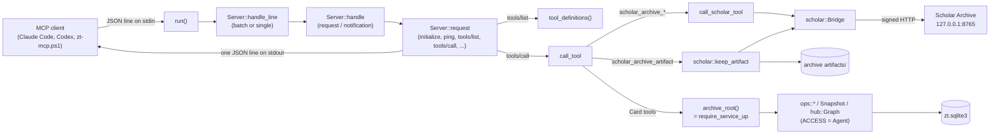

# MCP server

## Purpose

`zt mcp` is the Model Context Protocol server that lets AI agents (Claude Code, Codex, and DeepSeek Harness through a helper script) work in the slip-box. It speaks JSON-RPC 2.0 over stdio, one message per line, and offers every Card operation as an MCP tool. It acts with agent Access: it reads every Card in both Workspaces, but it changes only the agent Workspace, and it refuses any change that would rewrite the body of a human Card. It also offers six `scholar_archive_*` tools that read the local Scholar Archive through the Scholar Archive bridge. The block exists so that agents get the same Card rules as the human's own tools (it calls the same operations as the GUI) without any way to change the human's Cards. The server is a thin adapter: it parses arguments, calls `src/ops.rs` and `src/scholar.rs`, and wraps the results as MCP tool results.

**Owns:** the stdio JSON-RPC loop and its error codes, protocol version negotiation, the server instructions text (`INSTRUCTIONS`), the tool list with its input schemas and annotations, per-request indexed read selection in `src/read.rs`, the mapping from tool arguments to operation calls, the fixed `ACCESS = Access::Agent`, the plan/confirm result shape (`plan_or_done`), and the project-level client config `.mcp.json`.

**Does not own:** the Card operations and their plans ([Card operations](card-operations.md)); the Access rules themselves, Workspaces, Card types, and Links ([Cards, Workspaces and Links](cards-and-links.md)); the model, build, and math reports ([Models and math](models-and-math.md)); hub reports and limits ([Hub Cards](hub-cards.md)); the bridge protocol, pairing, artifacts, and caches ([Scholar bridge](scholar-bridge.md)); the service lifecycle, `zt` command dispatch, and schema migrations ([Service, CLI and storage](service-and-cli.md)); registering the server in agent clients and the `zt-mcp.ps1` helper ([Agent skills](agent-skills.md)).

## At a glance

| | |
|---|---|
| Entry points | `zt mcp` (dispatched in `src/main.rs` to `mcp::run()`); per line `Server::handle_line`; per tool `call_tool` and `call_scholar_tool` in `src/mcp.rs` |
| Key files | `src/mcp.rs` — the whole server: transport loop, JSON-RPC dispatch, `INSTRUCTIONS`, `tool_definitions()`, argument parsers, tool handlers, unit tests. `tests/workspaces_mcp.rs` — integration tests that run a real service and a real `zt mcp` child process. `.mcp.json` — project-scope Claude Code config that launches `zt mcp` as the stdio server `zt` |
| Depends on | [Card operations](card-operations.md) (`ops::create_topic`, `create_literature`, `create_successor`, `edit`, `edit_metadata`, `delete`, `move_card`, `insert_card`, `Snapshot`), [Cards, Workspaces and Links](cards-and-links.md) (`Access`, `Workspace`, `CardType`, `workspace::counts`), [Models and math](models-and-math.md) (`model::Part`, `Facet`, `Emphasis`, `Level`, `math::MathForm`), [Hub Cards](hub-cards.md) (`hub::Graph`, `hub::Limits`, `hub::hubs_of`), [Scholar bridge](scholar-bridge.md) (`scholar::Bridge`, `keep_artifact`, `READ_TOOLS`, `document_markdown`, `export_path`; `artifact::require_present`), [Service, CLI and storage](service-and-cli.md) (`require_service_up`, `compose_card_text`, `parse_card_text`, `open_db`, `load_card`, `VERSION`); crates `serde_json`, `anyhow` |
| Used by | [Agent skills](agent-skills.md) (`skills/zt/SKILL.md`, `skills/zt/scripts/zt-mcp.ps1`, `scripts/install-agent-integrations.ps1`), [Digest scripts](digest-scripts.md) (`scripts/book-digest/zt-calls.ps1` and the compilers call tools through `zt-mcp.ps1`), [Digest workflows](digest-workflows.md) (`scripts/book-digest/workflow/modules/zt-digest-lib.js`) |
| Tests | `src/mcp.rs` (`mod tests`), `tests/workspaces_mcp.rs`; tool-specific MCP coverage also in `tests/card_types.rs`, `tests/hub_cards.rs`, `tests/math_units.rs`, `tests/model_levels.rs`, `tests/model_structure.rs`, `tests/self_sufficient_models.rs`, `tests/scholar_bridge.rs` |

## Concepts

- `MCP server` — the glossary term (`CONTEXT.md`): the server started with `zt mcp`, JSON-RPC over stdio, every Card operation as a tool, agent Access. Held by `Server` and `run()` in `src/mcp.rs`.
- `Access` — which Workspaces a client may change (`src/workspace.rs`). The server fixes `const ACCESS: Access = Access::Agent`; `Access::can_write` is true only for `Workspace::Agent`, `ensure_writable` fails with "the human workspace is read-only for AI agents; only the agent workspace can be changed", and `ensure_link_rewrites_allowed` refuses a rename mapping that would rewrite a `[[target]]` macro in a human Card's body ("this change would rewrite Links in human workspace Card `…`, which is read-only for AI agents").
- `Workspace` and `Zone` — `human` and `agent`; each with a Topic zone and a Literature zone. Tools take `workspace` as `human`, `agent`, or `all`, and `zone` as `topic`, `literature`, or `all` (`optional_workspace`, `optional_zone` in `src/mcp.rs`).
- `Card address` — a Location (`3/1|a`) or a Citation key (`Smith2024`); the `at` argument of most tools.
- `Card type` — `idea`, `event`, `finding`, `model`, `hub` (`CardType`); the `type` argument.
- `Model facet`, `Emphasis`, `Elaboration level`, `Math form`, `Hub level` — the `facet`, `emphasis`, `level`, and `form` arguments. `level` is one argument for both the model level (`concept`, `formal`) and the hub level (`line`, `topic`, `field`, `register`); `ops::parse_level_arg` splits it.
- `Plan` and `confirm` — destructive operations return `ops::Outcome::Confirm { confirm, lines }` until the caller repeats the call with the named confirmation text; `plan_or_done` in `src/mcp.rs` turns it into `{ applied: false, confirm, plan, next }`.
- `Snapshot` — a set of Cards with parsed text and its Link graph (`ops::Snapshot` in `src/ops.rs`). Search, the GUI and Session retain full archive Snapshots; indexed MCP views supply a selected context to the same calculations.
- `Scholar Archive bridge` — the signed, read-only connection to the Scholar Archive (`scholar::Bridge` in `src/scholar.rs`); the `scholar_archive_*` tools use it.
- `Artifact` and `Document link` — `` and `[label](scholar:<file_id>)`; `scholar_archive_artifact` and `scholar_archive_file` return their Markdown, and `artifact::require_present` refuses Card text that shows an artifact ZET does not hold.

## Architecture

Transport, catalogue and argument adapters are in `src/mcp.rs`; `src/read.rs` supplies indexed request projections. Transaction writers and identified receipts belong to [Card operations](card-operations.md). The server adapter has five parts:

| Component | Items in `src/mcp.rs` | Job |
|---|---|---|
| Transport loop | `run()` | Reads stdin line by line, skips blank lines, writes each reply as one line to stdout and flushes. Ends at EOF. |
| JSON-RPC dispatcher | `Server`, `handle_line`, `handle`, `request`, `RpcError`, `error_response` | Parses one message or a batch, separates requests, notifications, and client responses, and routes methods. |
| Tool catalogue | `INSTRUCTIONS`, `tool()`, `scholar_tool()`, `tool_definitions()` | The server instructions text and every tool's name, title, description, JSON Schema, and annotations. |
| Card tool handlers | `call_tool`, `archive_root`, `plan_or_done`, the argument parsers (`string_arg`, `optional_string`, `title_arg`, `optional_workspace`, `target_workspace`, `optional_card_type`, `optional_form`, `optional_facet`, `optional_emphasis`, `optional_zone`) | Check the service, parse arguments, call `ops::*`, `Snapshot`, and `hub::*`, and shape results. |
| Bridge tool handlers | `call_scholar_tool`, plus the `scholar_archive_artifact` branch at the top of `call_tool` | Open a `scholar::Bridge` and forward the call. |



Control is synchronous and single-threaded: one line is answered completely before the next line is read, so replies come back in request order (the test client in `tests/workspaces_mcp.rs` asserts "replies arrive in request order"). The server holds no state except the `initialized` flag; every tool call opens the database again, so the server sees writes from the GUI, Sessions, and other `zt mcp` processes at once.

## Interfaces

Identified `edit_card` also supports `owned_paragraph` with exact `text`, optional `replaces_receipt` and explicit `adopt_legacy` (default false). The source and paragraph are retained in the archive receipt; changed/ambiguous spans conflict. Mixed full-body/metadata edits are refused. Nested paragraph text counts toward the 1 MiB input cap. Single `edit_card` refuses this batch-only mode instead of ignoring it.

`apply_batch {preview: true, items: [...]}` validates the evolving transaction and returns ordered results, final `cards` and proposed `paragraphs` with derived `links`/`kinds`, then rolls back before returning. Explicit `preview`, `applied: false`, `complete` and base `archive_revision` fields distinguish a draft from a commit. The pure lean projection in `src/read.rs::text_value` reads uncommitted Cards directly; opening another connection would see the wrong state. The normal 8 MiB encoded reply bound also covers previews. An oversized preview is already rolled back when the server returns `read_limit`; normal apply results keep their existing shape. See [Card operations](card-operations.md) for ownership and preview validation.


`apply_batch` accepts `items` with `op_key`, `client_ref`, `tool` and `arguments`. Supported tools are `create_topic`, `create_literature`, `create_successor` and `edit_card`. A batch has 1–64 items and at most 1,048,576 UTF-8 bytes across authored title/body/text/BibTeX/base inputs. `@@name` resolves an earlier result in placement or authored input; forward/unknown references fail. Agent Access, artifacts, Link validation, base guards and model/type constraints use the ordinary write validators inside the evolving transaction.

The response has ordered `results`, each retaining its operation key, client reference, exact write result and `replayed` flag. The write result also carries before/after authored fingerprints (a create has no before fingerprint). Replays supply their original addresses to later items. A changed payload or changed resolved binding under an existing key fails. Any failed unseen item rolls back all unseen writes and receipts; previously committed receipts survive. The batch publishes one Link-index/Reverse-link update over the affected union and one Card revision. Each ordinary MCP create/edit uses the same `write_card_tx` parser and transaction writers. This implements the archive portion of #68; compiler/crash qualification is still pending.

An identified edit requires one `arguments.base_fingerprint` (authored SHA-256) or `arguments.base_receipt` (earlier operation key for the same Card). Its base excludes generated Reverse links and includes editable metadata. Stale/misaddressed bases return a structured tool error with `code: "write_conflict"`, address, observed body/fingerprint and `complete: false`. The server checks it within the write transaction. The existing single `edit_card` raw `base` contract is unchanged; batch-only guard fields are explicitly rejected on that single-operation path. Raw `base` is refused in a batch.

### Indexed and bulk read views

`get_cards` also returns `archive_identity: {id, path}` from the same read transaction. `id` is the existing random 128-bit `metadata.archive_id`, retained as its original 32 hexadecimal characters; `path` is the resolved archive directory. An empty address list provides identity/revision without Card bodies. Reads validate the stored identity and refuse a missing/malformed value rather than generating one. Replacing the database at the same path produces a different identity; a consistent SQLite restore preserves it. Ledger binding must compare identity as well as path and verify actual outputs after restoration. No second identifier or new metadata table is introduced.

`src/read.rs` owns per-request SQLite read transactions for `get_card`, `get_cards`, `get_tree`, `get_model`, `list_trees`, `list_links`, `list_broken_links`, `list_workspaces`, `get_hub` and `list_hubs`. The module has no persistent cache. It supplies a selected context to `Snapshot::from_cards`, reusing the existing model/build/math calculations; the GUI and Session keep their full Snapshot lifecycle and remain the independent oracle.

Ordinary Card reads load the requested Card, indexed inbound/outbound neighbours, immediate navigation and relevant hub bodies. The request-local `Scope` collector expands the requested model's members and, for a requested Theory report, its units. Boundary models supply ownership, citation and title context without recursively expanding unrelated neighbours' models. Shared owners/members, external premises, incoming users/theories and plain citers' users remain present for the existing build/math reports. A tree summary loads the exact tree and its one-hop references, without computing every model. Contexts of at least 200 Cards produce a `zt.log` entry with Card count, revision and elapsed milliseconds; required context is not truncated to meet a latency target.

| Read | Contract |
|---|---|
| `get_cards({addresses,view?})` | At most 200 addresses. Default `full` has the same Card fields as `get_card`; `text` returns title/body/text, BibTeX, type/facet/emphasis/level/form, Workspace and basic identity without model/hub calculations. It also supplies cheap summary facts (`excerpt`, `edge`, valid `links`, first non-reference `kinds`, and `parent_address`) from the existing parser/index so scoped digest clients need no tree scan for them. `cards` preserves request order and duplicates for found addresses; `missing` preserves missing request occurrences. `complete` is false if any address is missing. Includes one `archive_revision` and the persisted `archive_identity`. |
| `get_tree({tree,bodies?})` | Existing summary fields plus `archive_revision` and `complete`. With `bodies: true`, each summary adds `body`, `text` and `bibtex`. Exact root plus indexed `<tree>/` range, followed by existing membership filtering and ZET address ordering; case and `_` in Citation keys do not broaden selection. |
| `export_titles({workspace?,zone?})` | `titles` contains address, tree, Workspace, type, facet and title; `count`, `complete` and `archive_revision` describe the complete selected result. One pass over selected stored text parses the title. This is O(selected text), with no stored-title cache. |
| Indexed lists | Workspace SQL counts and occurrence-based Broken link counts; roots with range counts for trees; distinct source-target pairs for `list_links`; each Broken occurrence, with its actual source line, for `list_broken_links`. Only Broken sources need their body parsed for that list. |
| Hub policy | Global policy enumerates Card metadata/title lines, Hub Card bodies and indexed relationships once. It does not load ordinary bodies. The existing `hub::Graph` computes levels, faults, coverage, candidates and policy results using that input. |

The text view also returns `outbound_count`, the number of distinct authored Link targets including Broken links. Repeated occurrences count once and fenced text does not count, matching `get_card.outbound.length`. The existing indexed query uses a left existence join to retain this count while still returning only valid targets in `links`/`kinds`. This preserves the digest's structure/index ownership guard without calculating the full Card view.

The encoded tool result for `get_cards`, `get_tree` and `export_titles` has an 8 MiB limit, counting both pretty text and structured content. A limit error has `isError: true`, `error`, `code: "read_limit"`, `limit_kind` (`addresses` or `reply_bytes`), `limit`, `actual`, and `complete: false`; it returns no partial Cards. The caller reduces its chunk. If several reads have different revisions, callers retry once or record a changing view. Unknown bulk view values/types, malformed addresses arrays and nonboolean `bodies` fail explicitly.

### Command and client config

```text
zt mcp
```

Takes no arguments (`[cmd] if cmd == "mcp" => mcp::run()` in `src/main.rs`). It does not need the service to be up to start or to answer `initialize` and `tools/list`.

`.mcp.json` registers the server for Claude Code in this repository:

```json
{
  "mcpServers": {
    "zt": { "type": "stdio", "command": "zt", "args": ["mcp"] }
  }
}
```

It expects `zt` on `PATH`. `scripts/install-agent-integrations.ps1` approves this entry (`enabledMcpjsonServers`) and also registers the same server at user scope with the absolute `zt.exe` path, so tools appear as `mcp__zt__<tool>`.

### JSON-RPC methods

| Method | Params | Result |
|---|---|---|
| `initialize` | `protocolVersion` (optional) | `{ protocolVersion, capabilities: { tools: { listChanged: false } }, serverInfo: { name: "zt", title: "ZT slip-box", version: crate::VERSION }, instructions: INSTRUCTIONS }`. The version is the requested one when it is in `PROTOCOL_VERSIONS` (`2025-11-25`, `2025-06-18`, `2025-03-26`, `2024-11-05`), else `2025-11-25`. |
| `ping` | none | `{}` |
| `tools/list` | ignored | `{ tools: tool_definitions() }` (no pagination) |
| `tools/call` | `name` (string), `arguments` (object, default `{}`) | an MCP tool result (see below) |
| `resources/list` | ignored | `{ resources: [] }` |
| `resources/templates/list` | ignored | `{ resourceTemplates: [] }` |
| `prompts/list` | ignored | `{ prompts: [] }` |
| `notifications/initialized` | notification | no reply; sets `Server.initialized` |
| any other notification | notification | no reply |

### Error codes

| Code | When | Message |
|---|---|---|
| `-32700` | the line is not JSON | `parse error: <serde error>` (id `null`) |
| `-32600` | a message is not a JSON object | `invalid request: expected a JSON object` (id `null`) |
| `-32600` | a message has an `id` but no string `method` | `invalid request: missing method` |
| `-32601` | unknown method | `method not found: <method>` |
| `-32602` | `tools/call` without a string `name` | `missing tool `name`` |
| `-32602` | `tools/call` whose `arguments` is not an object | `tool `arguments` must be an object` |
| `-32602` | `tools/call` with a name not in `tool_definitions()` | `unknown tool `<name>`` |

A tool that runs and fails is **not** a JSON-RPC error. `tool_result` returns `{ content: [{ type: "text", text: <pretty JSON> }], isError: true, structuredContent: { error: "<anyhow chain>" } }`. A tool that succeeds returns the same shape with `isError: false` and its value as `structuredContent` (only when the value is an object) and as pretty-printed text.

### Server instructions text

`INSTRUCTIONS` in `src/mcp.rs` is sent in the `initialize` result; clients show it to the model. In order, it states:

1. The two Workspaces (`human` read-only, `agent` read-write), their two Zones, address forms, and that Links cross Workspaces but Cards and trees never move between them.
2. Where to start (`list_workspaces`, `list_trees`, `get_card`, `search_cards`, `create_topic`, `create_literature`, `create_successor`).
3. Card types: Idea, Event, Finding, Model Cards, set with `type`.
4. Models: the Model Card, Model parts with `facet` and `emphasis`, Math forms (the unit forms with their fixed facet set, and `theory`), cited premises versus reach-ins, `特例`, the `math` report, and the elaboration `level` (`concept`, `formal`).
5. That a part belongs to the Model Card it is filed under and to every Model Card that links it.
6. Relation kinds by the words before a Link (`依赖`, `基于`, `例示`, `案例`, `印证`, `对照`, `区别`, `放宽`, `推广`, `对应`, `类比`, `参照`, `反驳`, `批评`; `引出` and no word give a plain reference).
7. What `get_model` reports: parts, relations, loose parts, neighbours, `build` order, `chains`, and the faults `closure`, `forward`, `unanchored`, `beyond_level`; that a model rests on parts, not on a whole Model Card; `insert_card` with `before` for a missing step.
8. Hub Cards: the `- [[address]]：…` line format, hub levels and where each is filed, the `邻近` group, `get_hub` and `list_hubs`; `move_card` `before` and `alone`.
9. The Card language (one statement per sentence, no semicolons, active voice, one term per meaning), TeX and ```` ```chart ```` fences.
10. That `delete_card`, `move_card`, `insert_card`, and Citation key renames return a plan first and need the `confirm` text.
11. The `scholar_archive_*` tools: file a used paper as a Literature Card with its DOI; take figures with `list_work_artifacts` then `scholar_archive_artifact` and paste the returned ``; write Document links `[label](scholar:<file_id>)`, which `scholar_archive_file` returns as `link`.

The text partly repeats `skills/zt/SKILL.md` and `CONTEXT.md`. When a Card rule or a tool changes, update the three together.

### Tools

Every tool's `inputSchema` is an object with `additionalProperties: false`. `tool()` sets the annotations `readOnlyHint` and `idempotentHint` to the `read_only` flag, `destructiveHint` to the `destructive` flag, and `openWorldHint: false`; `scholar_tool()` makes a read-only tool with `openWorldHint: true`. "RO" below means `readOnlyHint: true`; "D" means `destructiveHint: true`. Unless a row says otherwise, every Card tool first calls `archive_root()` and fails with "the ZT service is not available; run `zt up`: …" when the service is down.

#### Read tools (both Workspaces)

| Tool | Hints | Arguments (required in bold) | Result | Errors |
|---|---|---|---|---|
| `list_workspaces` | RO | none | `{ workspaces: [{ id, label, access: "read-only" \| "read-write", zones: { topic: { trees }, literature: { trees } }, cards }], cards, broken_links }` | service down |
| `list_trees` | RO | `workspace`, `zone` (`topic`, `topics`, `literature`, `all`) | `{ trees: [{ tree, root, workspace, kind, title, excerpt, count, events, findings, models, … }] }` from `Snapshot::trees` | `unknown zone`, unknown workspace |
| `get_tree` | RO | **`tree`** (a tree id or any address in it) | `{ tree, root, workspace, zone, title, cards: [Snapshot::summary] }` | "tree `x` does not exist" |
| `get_card` | RO | **`at`** | `{ address, tree, workspace, writable, kind, type, facet, emphasis, level, form, model, hubs, title, body, text, bibtex, citation_key, parent, direct, sides, outbound, inbound }` | "card `x` does not exist" |
| `get_model` | RO | **`at`** (Model Card or Model part) | `Snapshot::model(at)` with `head.body` and each `parts[].body` added | "card `x` does not exist"; "`x` is not a Model Card or Model part; set type `model` first" |
| `get_hub` | RO | **`at`**, `max_groups`, `max_lines`, `min_reason`, `topic_min`, `line_min`, `neighbour_links` | `hub::Graph::report(at, limits)` | from `hub::Limits::from_args` and `report` |
| `list_hubs` | RO | `workspace` and the same six limits | `hub::Graph::list(workspace, limits)` | as above |
| `search_cards` | RO | `query` (required unless `type` or `form` is given), `type`, `form`, `workspace`, `limit` (default 30, clamped to 1–200) | `{ results: Snapshot::search_in(...) }` | "missing string argument `query`" |
| `list_links` | RO | `workspace` (a Link is kept when either end is in it), `cross_workspace_only` | `{ links: [{ source, source_workspace, target, target_workspace, broken }] }` | service down |
| `list_broken_links` | RO | `workspace` | `{ broken: Snapshot::broken(workspace) }` (each with `target`, `workspace`, …) | service down |

#### Write tools (agent Workspace only)

| Tool | Hints | Arguments (required in bold) | Result | Errors and rules |
|---|---|---|---|---|
| `create_topic` | none | **`title`**, `body`, `workspace` (schema enum `agent`) | `{ address, workspace }` | `workspace: "human"` is refused by `target_workspace`; title must be one non-empty line; artifacts must be held |
| `create_literature` | none | **`bibtex`**, `body`, `workspace` | `{ address, workspace }` (address = Citation key) | as `create_topic`; BibTeX errors from `ops::create_literature` |
| `create_successor` | none | **`at`**, **`title`**, `kind` (`direct` default, `side`), `body`, `type`, `facet`, `emphasis`, `level`, `form` | `{ address, type, facet, emphasis, level, form }` | "unknown successor kind"; "only Model Cards can have a Model facet"; `level`/`form` only on a Model Card without a facet (`LEVEL_NEEDS_MODEL_CARD`, `FORM_NEEDS_MODEL_CARD`); a hub level only on `type: hub` (`LEVEL_NEEDS_HUB_CARD`); `at` in the human Workspace is refused |
| `edit_card` | none | **`at`**, `title`, `body`, `text`, `type`, `facet`, `emphasis`, `level`, `form`, `base` | `{ address }` | human Card refused; `title` on a Literature Card refused ("change it with edit_literature_metadata"); `text` without a `# Title` heading refused; `base` that differs from the stored text: "card `x` changed since it was opened" |
| `edit_literature_metadata` | D | **`at`**, **`bibtex`**, `confirm` | a plan with `confirm: "move"` when the Citation key changes, else `{ address, applied: true }` | Citation key conflict; a rename that would rewrite a human Card's Link |
| `delete_card` | D | **`at`**, `into`, `confirm` | a plan (`confirm` is `delete`, or the Tree root's address for a root), then `{ deleted, moved, address, applied: true }` | human Card refused; Side successor compaction or `into` re-pointing that would rewrite a human Card's Link is refused |
| `move_card` | D | **`at`**, `to` or `before` (exactly one), `alone`, `confirm` | a plan with `confirm: "move"`, then `{ address, moved, applied: true }` | "give either `to` or `before`, not both"; "missing string argument `to` or `before`"; "argument `alone` must be true or false"; "Cards cannot move between workspaces"; human Link rewrites refused |
| `insert_card` | D | **`before`**, **`title`**, `body`, `type`, `facet`, `emphasis`, `confirm` | a plan with `confirm: "insert"`, then `{ address, moved, applied: true }` | as `create_successor` for type and facet; human Link rewrites refused |

A plan result is `{ applied: false, confirm, plan: [lines], next: "nothing changed yet; call again with confirm = \"<text>\" to apply" }`. A wrong `confirm` returns the plan again; it is not an error.

#### Scholar Archive tools

| Tool | Hints | Arguments (required in bold) | Result | Errors |
|---|---|---|---|---|
| `scholar_archive_status` | RO, open world | none | `{ connected: true, url, read_only, archive_uuid, database, tools, status }` from `Bridge::hello` and the read tool `archive_status` | bridge errors |
| `scholar_archive_read` | RO, open world | **`tool`** (enum `scholar::READ_TOOLS`), `arguments` (object) | `{ tool, result }` from `Bridge::call` | "`arguments` must be an object"; "`x` is not a Scholar Archive read tool; the bridge offers: …" |
| `scholar_archive_sql` | RO, open world | **`sql`**, `params` (array, default `[]`), `limit` (default 500), `database` (`archive` default, `vectors`) | `{ columns, rows, truncated }` from `Bridge::sql` | the archive refuses writes, `ATTACH`, and non-schema pragmas |
| `scholar_archive_file` | RO, open world | **`file_id`**, `max_text_bytes` (default 1000000) | `FileCopy::summary()` (`file_id, name, relative_path, path, bytes, sha256`) plus `link` (the Document link) and, for `.md`/`.markdown`/`.txt` within the limit, `text` | "missing integer argument `file_id`"; SHA-256 mismatch |
| `scholar_archive_artifact` | not RO, not destructive, open world | **`file_id`**, **`path`**, `caption` | `{ sha256, address, markdown, caption, work_id, file_id, path, media_type, bytes }` from `scholar::keep_artifact` | needs the service (it writes into the archive's `artifacts/`); bridge errors; SHA-256 mismatch |
| `scholar_archive_export` | RO, open world | `scholar_id`, `format` (`json` default, `csv`, `bibtex`), `view` (`profile` default, `combined`) | `{ path, bytes, format }` plus `text` when the export is at most 1000000 bytes | write failure of the cache file |

## Behaviour

### Start-up and handshake

1. `run()` locks stdout, makes a `Server::default()`, and reads stdin lines until EOF. Blank lines are skipped. A read failure ends the process with "failed to read an MCP message".
2. The client sends `initialize`; `request` picks the protocol version and returns the capabilities, `serverInfo`, and `INSTRUCTIONS`.
3. The client sends `notifications/initialized`; `handle` sets `initialized` and returns no reply.
4. The client sends `tools/list`; `request` returns `tool_definitions()`.

The server never checks `initialized`: requests before `initialize` are served (`tests/scholar_bridge.rs` calls `tools/list` without a handshake).

### One line

1. `handle_line` parses the line as JSON. A parse failure is answered with `-32700` and id `null`.
2. An array is a batch: each element goes through `handle`; the replies that are not `None` are returned as one JSON array on one line. A batch of only notifications, or an empty batch, gets no reply.
3. `handle` reads `id` and `method`. A message without a string `method` is a client response: no reply when it has no `id`, `-32600` when it has one. A message without `id` is a notification: no reply. Otherwise `request` runs and its `Ok` or `RpcError` becomes the reply.

### A tool call

1. `request` checks `name` and `arguments`, and that `name` is in `tool_definitions()`; failures are `-32602`.
2. `call_tool(name, arguments)` runs. Its `Ok(value)` becomes `tool_result(value, false)`; its `Err` becomes `tool_result({ error: "{error:#}" }, true)`.
3. In `call_tool`, `scholar_archive_artifact` is handled first: `archive_root()`, then `scholar::Bridge::connect()`, then `scholar::keep_artifact(bridge, root, file_id, path, caption)`.
4. Any other `scholar_archive_*` name goes to `call_scholar_tool`, which does **not** call `archive_root()`: these tools work when the service is down and even when no `archive_root` is configured.
5. Every Card tool calls `archive_root()` = `crate::require_service_up()` with the context "the ZT service is not available; run `zt up`".
6. Indexed reads open one SQLite read transaction through `src/read.rs`, select their required context and shape JSON with the existing domain calculations. Search retains a full `Snapshot::read(&root)`.
7. A write tool parses its arguments, checks artifacts with `artifact::require_present(&root, text)`, and calls the `ops` function with `ACCESS`. The `ops` function takes the edit lock (`acquire_edit_lock_within`, 20 s patience, `EDIT_PATIENCE` in `src/ops.rs`), checks `access.ensure_writable` and, for renames, `access.ensure_link_rewrites_allowed`, and either applies the change or returns a plan.

### The service: connect, never start

`zt mcp` does not run `zt up`. It talks to the database directly; it needs the service only as a gate. `require_service_up` in `src/main.rs`:

1. `require_archive_root` reads `archive_root` from the config; with none, the call fails ("archive_root is not configured; run `zt config set archive_root <path>`").
2. `is_service_up` checks `zt.pid`. With no record, it is up only when another process is restarting it (`zt.restart` younger than 30 s) and that restart succeeds. With a record whose daemon is alive, it is up. With a record whose daemon is dead (it ended without `zt down`), the first process to claim `zt.restart` clears the stale record and starts the service again (`restart_service`, logged as "service restarted: daemon <pid> ended without `zt down`"); other processes wait.
3. `ensure_markdown_cards` runs the schema migrations.

So a crashed service comes back on the next MCP call, but a service stopped with `zt down` stays down and every Card tool fails until `zt up`. The check runs on every call, so one long-lived `zt mcp` process survives `zt down` and `zt up` (`mcp_protocol_errors_and_service_state_are_reported`). `zt mcp` is not a Session and holds no lock between calls, so it never blocks `zt down` (`docs/workspaces-and-mcp-design.md`).

### Read everything, write the agent Workspace only

- Reads ignore Access: every read tool sees both Workspaces. `list_workspaces` reports `access` per Workspace and `get_card` reports `writable`, both from `ACCESS.can_write`.
- `create_topic` and `create_literature` pick the Workspace with `target_workspace`: omitted means `agent`; `human` fails with the read-only error before anything is written.
- `create_successor`, `insert_card`, `edit_card`, `edit_literature_metadata`, `delete_card`, and `move_card` pass `ACCESS` to `ops`, which refuses a human Card. `edit_card` also checks `ACCESS.ensure_writable(card.workspace)` itself before it composes the text.
- Agent changes whose rename mapping would rewrite a Link in a human Card's body are refused: moving or renumbering an agent Card a human Card links to, renaming a linked Citation key, a delete whose Side successor compaction renumbers a linked Card, and `into` re-pointing. Deleting a linked agent Card is allowed: it leaves a Broken link in the human Card, whose body is unchanged (`mcp_refuses_agent_changes_that_would_rewrite_links_in_human_cards`).
- Regenerated Reverse links on a human Card are not a change to it, so an agent Link into a human Card is allowed.

### edit_card text rules

1. The type change is built from `type`, `facet`, `emphasis`, `level`, `form`; each is `None` when absent, and `facet`, `emphasis`, `level`, `form` are `Some(None)` (clear) for `null`, `""`, or `none` (and `regular` for emphasis).
2. If a type change is given and none of `text`, `title`, `body` is present, only the type changes.
3. Else `text` replaces the whole document; or `title` and `body` replace their parts and the missing part is kept from the stored text (`compose_card_text`).
4. `base`, when given, must equal the stored text (`ops::edit` → `unchanged_card`).

### create_successor with level or form

`ops::create_successor` takes no level or form. When `level`, a hub level, or `form` is given, the handler creates the Card and then calls `ops::edit` with a `TypeChange` that sets them. These are two locked operations, not one.

### Scholar Archive delegation

1. `Bridge::connect()` (`src/scholar.rs`) loads `scholar-bridge.json` beside the config file; with none it pairs automatically (`scholar-archive bridge pair --client zet`).
2. Each request is signed. `Bridge::request` recovers once from an offline archive by running `scholar-archive start` and waiting up to 30 s (unless `ZT_SCHOLAR_NO_START` is set), and once from a lost pairing by pairing again.
3. `scholar_archive_status` → `hello` + `call("archive_status")`; `scholar_archive_read` → `call(tool, arguments)`, which refuses names outside `READ_TOOLS` before sending; `scholar_archive_sql` → `sql`; `scholar_archive_file` → `file(file_id, None)` (verified, cached under the config folder's `scholar-archive/files/<file_id>/<name>`); `scholar_archive_export` → `export`, written to `scholar::export_path` (`scholar-archive/exports/scholar-archive-<all|scholar-N>.<json|csv|bib>`); `scholar_archive_artifact` → `keep_artifact`, which lists the Work's artifacts to find the caption, fetches and verifies the bytes, and stores them with `artifact::store` in the archive's `artifacts/` folder.
4. Nothing on the bridge changes the Scholar Archive; see [Scholar bridge](scholar-bridge.md).

### Rules

- Replies keep request order; there is no concurrency inside one server. Several `zt mcp` processes may run at once; the edit lock in `ops` serializes their writes.
- Read tools are not cached: each call re-reads and re-parses every Card (unlike the GUI, which keeps its Snapshot in `src/gui.rs`).
- The server does not validate arguments against the input schemas. It reads only the names it knows and ignores the rest; `additionalProperties: false` is a hint for clients.
- `limit` in `search_cards` is clamped to 1–200; `limit` in `scholar_archive_sql` is passed through (the archive enforces 1–10000).

## Data and storage

The server persists nothing of its own. It reads and writes the archive's `zt.sqlite3` through `ops` and `Snapshot`, writes artifacts into `<archive_root>/artifacts/` (`scholar_archive_artifact`), and writes Scholar Archive copies into the config folder's `scholar-archive/` cache (`scholar_archive_file`, `scholar_archive_export`). Those stores belong to [Service, CLI and storage](service-and-cli.md) and [Scholar bridge](scholar-bridge.md).

### Wire format

One JSON-RPC 2.0 message (or batch) per line, UTF-8, in both directions. Example exchange, from `scripts/install-agent-integrations.ps1` and `tests/workspaces_mcp.rs`:

```json
{"jsonrpc":"2.0","id":1,"method":"initialize","params":{"protocolVersion":"2025-06-18","capabilities":{},"clientInfo":{"name":"zt-tests","version":"1"}}}
{"jsonrpc":"2.0","method":"notifications/initialized"}
{"jsonrpc":"2.0","id":2,"method":"tools/call","params":{"name":"create_topic","arguments":{"title":"Agent Research","body":"What the agent is exploring."}}}
```

The reply to id 2 (pretty JSON in `text`, the same value in `structuredContent`):

```json
{"jsonrpc":"2.0","id":2,"result":{"content":[{"type":"text","text":"{\n  \"address\": \"1/0\",\n  \"workspace\": \"agent\"\n}"}],"isError":false,"structuredContent":{"address":"1/0","workspace":"agent"}}}
```

A plan reply's `structuredContent`:

```json
{"applied":false,"confirm":"move","plan":["..."],"next":"nothing changed yet; call again with confirm = \"move\" to apply"}
```

A tool failure's `structuredContent`:

```json
{"error":"the human workspace is read-only for AI agents; only the agent workspace can be changed"}
```

## Configuration

| Setting | Where | Default | Effect |
|---|---|---|---|
| `archive_root` | `config.toml` (`zt config set archive_root <path>`) | none | The archive the Card tools use. Without it every Card tool fails. |
| `ZT_CONFIG_DIR` | env var | `%APPDATA%\zt` (Windows), `~/.config/...` elsewhere (`config_file` in `src/main.rs`) | Folder of `config.toml`, the bridge credential `scholar-bridge.json`, and the `scholar-archive/` cache. The tests set it to a temp folder. |
| `ZT_GUI_PORT` | env var | 4717 | Not read by `src/mcp.rs`, but a service restarted from an MCP call starts its GUI on it; the tests set `0`. |
| `ZT_SCHOLAR_ARCHIVE` | env var | `%LOCALAPPDATA%\ScholarArchive\bin\scholar-archive.cmd` | The `scholar-archive` command used to pair and start the archive (`src/scholar.rs`). |
| `ZT_SCHOLAR_NO_START` | env var | unset | When set, an offline Scholar Archive is not started; the bridge call fails. |
| `PROTOCOL_VERSIONS` | const in `src/mcp.rs` | `2025-11-25`, `2025-06-18`, `2025-03-26`, `2024-11-05` | Versions `initialize` accepts; the first is the fallback. |
| `.mcp.json` `mcpServers.zt` | repository root | `zt mcp` over stdio | How Claude Code launches the server in this repository. |

## Usage

### Talk to the server by hand

```powershell
@'
{"jsonrpc":"2.0","id":1,"method":"initialize","params":{"protocolVersion":"2025-06-18"}}
{"jsonrpc":"2.0","method":"notifications/initialized"}
{"jsonrpc":"2.0","id":2,"method":"tools/list"}
{"jsonrpc":"2.0","id":3,"method":"tools/call","params":{"name":"list_workspaces","arguments":{}}}
'@ | zt mcp
```

### Two-step destructive calls

From `tests/workspaces_mcp.rs`:

```json
{"name":"move_card","arguments":{"at":"1/1|a","to":"1/2"}}
{"name":"move_card","arguments":{"at":"1/1|a","to":"1/2","confirm":"move"}}
{"name":"delete_card","arguments":{"at":"1/0"}}
{"name":"delete_card","arguments":{"at":"1/0","confirm":"1/0"}}
```

The first call of each pair returns `applied: false` and the `confirm` text; the second applies it. For a Tree root, `confirm: "delete"` only returns the plan again.

### A Model part with a level on its Model Card

```json
{"name":"create_successor","arguments":{"at":"3/1","kind":"side","title":"Solow model","type":"model","level":"formal"}}
{"name":"create_successor","arguments":{"at":"3/1|a","kind":"side","title":"Setting","facet":"设定","emphasis":"core"}}
```

A `facet` implies `type: model`; `level` and `form` are refused on a part.

### Show a Scholar Archive figure in a Card

```json
{"name":"scholar_archive_read","arguments":{"tool":"list_work_artifacts","arguments":{"file_id":3}}}
{"name":"scholar_archive_artifact","arguments":{"file_id":3,"path":"<path as listed>"}}
{"name":"edit_card","arguments":{"at":"Agent2026/1","body":"...  ..."}}
```

Card text that shows an `artifact:` address the archive does not hold is refused ("take it from the Scholar Archive with scholar_archive_artifact first").

### Add a new tool

1. Add its definition to the `vec![...]` in `tool_definitions()` with `tool(name, title, description, properties, required, read_only, destructive)` (or `scholar_tool(...)` for a bridge read). Every `required` name must be a key of `properties` (the unit test `every_tool_has_a_unique_name_and_object_schema` checks this and unique names).
2. Add a match arm in `call_tool` (Card tools, after `archive_root()`) or in `call_scholar_tool`. Parse arguments with the `string_arg` / `optional_*` helpers so errors read alike. Pass `ACCESS` to every `ops` call; never build an `Access::Owner`.
3. For a destructive tool, return `ops::Outcome` and wrap it with `plan_or_done`; take a `confirm` argument.
4. If Card text comes from the arguments, call `crate::artifact::require_present(&root, &text)` before writing.
5. Mention the tool in `INSTRUCTIONS` if agents must learn when to use it, and in `skills/zt/SKILL.md` and the README's MCP table.
6. Add an integration test that drives it through `TestHome::mcp()` (`tests/workspaces_mcp.rs`), including a refusal on a human Card for a write tool.

## Testing

Unit tests in `src/mcp.rs` (no service needed):

- `initialize_negotiates_a_known_protocol_version` — a known version is echoed; an unknown one falls back to `PROTOCOL_VERSIONS[0]`.
- `notifications_get_no_reply_and_unknown_methods_are_errors` — `notifications/initialized` gets no reply and sets `initialized`; `-32601` and `-32700`.
- `every_tool_has_a_unique_name_and_object_schema` — unique names, object schemas, required names present.
- `new_trees_cannot_target_the_human_workspace` — `target_workspace`.

Integration tests in `tests/workspaces_mcp.rs` build the `zt` binary, make a temp config and archive (`TestHome`, `ZT_CONFIG_DIR`, `ZT_GUI_PORT=0`), run `zt up`, and drive a real `zt mcp` child over pipes (`Mcp::request`, `call`, `ok`, `err`):

- `mcp_reads_both_workspaces_but_changes_only_the_agent_workspace` — the tool list, `list_workspaces` access, reads of human Cards, refusal of every write to the human Workspace, agent Topic and Literature trees, `list_trees` / `get_tree` / `search_cards` / `list_links` filters, `edit_card` (`base`, missing heading), move plan and confirm, Citation key rename, delete plan and Tree root confirmation, Reverse links on a human Card.
- `mcp_refuses_agent_changes_that_would_rewrite_links_in_human_cards` — move, compaction on delete, and rename refused; deleting a linked agent Card leaves a Broken link.
- `mcp_protocol_errors_and_service_state_are_reported` — `ping`, `-32601`, `-32602`, tool errors, and the "service is not available" error after `zt down`, then recovery after `zt up` in the same server.
- The other tests in the file cover Workspaces through the shell, Session, GUI, migration, and `zt dp`; they are not MCP tests.

Commands:

```powershell
cargo test --bin zt mcp::tests
cargo test --test workspaces_mcp
```

Related MCP coverage lives in `tests/card_types.rs`, `tests/hub_cards.rs`, `tests/math_units.rs`, `tests/model_levels.rs`, `tests/model_structure.rs`, `tests/self_sufficient_models.rs` (Card tools) and `tests/scholar_bridge.rs` (`zt_mcp_offers_the_bridge_as_read_only_tools`, `a_card_shows_a_figure_only_after_zet_keeps_it_from_the_archive`, with a fake archive and `ZT_SCHOLAR_NO_START=1`). Run them all with `cargo test`. The `tests/workspaces_mcp.rs` editor helper uses `powershell`, so those tests expect Windows PowerShell on `PATH`.

Gaps: no test for JSON-RPC batches, for `-32600`, for `resources/*` and `prompts/list`, for `tools/call` with non-object `arguments`, for `scholar_archive_sql`, `scholar_archive_export`, or `scholar_archive_status` through MCP, for `create_successor` with `level`/`form` failing after the Card exists, or for the automatic restart of a dead service from an MCP call (that is covered for the CLI in `tests/cli_service.rs`).

## Decisions and pitfalls

### Decisions

- **One server, fixed agent Access.** The MCP client may read both Workspaces and change only the agent Workspace; the human's tools may change both. Reasons and the full refusal list: `docs/workspaces-and-mcp-design.md` (sections "Access" and "MCP Server").
- **Shared operations.** The tools call the same `src/ops.rs` functions as the GUI, so every Card rule holds and destructive changes need the same typed confirmation (`docs/workspaces-and-mcp-design.md`, "Shared Operations").
- **Tool failures are results, protocol faults are errors.** A failing tool returns `isError: true` with an `error` message so the model can read it and retry; only unknown methods, unknown tools, and malformed calls are JSON-RPC errors (`docs/workspaces-and-mcp-design.md`).
- **Each call checks the service and holds nothing.** An idle agent never blocks `zt down`, and one server process survives service restarts.
- **Bridge tools are read-only and separate from the service.** They reach only the Scholar Archive's read actions and work without the ZT service; only `scholar_archive_artifact` writes, into ZET's own `artifacts/` (`docs/scholar-archive-bridge-design.md`).
- **Artifacts must be held before a Card shows them.** `require_present` runs on every text the server writes, so a Card never shows an image ZET lacks (`docs/scholar-archive-bridge-design.md`, "Artifacts").

### Pitfalls

- **A running `zt mcp` keeps the old binary.** Agent clients start the server once per conversation; after a rebuild, open conversations keep the old tools and old logic, and on Windows they lock `zt.exe`, so `cargo install` fails until it is renamed aside or the processes end.
- **`tools/list` is static per process** (`listChanged: false`); a new tool appears only in a new client conversation.
- **The service is a gate, not a dependency to start.** A service stopped with `zt down` makes every Card tool fail; only a crashed daemon is restarted by the call. Scholar tools other than `scholar_archive_artifact` work anyway.
- **Search remains global.** `search_cards` uses a full Snapshot, because it searches all authored bodies. Targeted Card/tree/model reads use `src/read.rs`; hub policy still enumerates global metadata and index relationships because its policy is global.
- **`edit_card` composes title and body from text read outside the edit lock.** Without `base`, a concurrent edit between that read and `ops::edit` can be overwritten. Pass `base` when edits may race.
- **`create_successor` with `level`, a hub level, or `form` is two operations.** If the second (`ops::edit`) fails, the Card exists without them. The handler checks most combinations before creating, which makes this rare.
- **`insert_card` takes no `level` or `form`.** Its schema and handler take `title`, `body`, `type`, `facet`, and `emphasis`; the description says so and sends a Model Card's level or Math form to `edit_card` after the insert. The unit test `insert_card_names_the_create_successor_fields_it_does_not_take` fails when `create_successor` gains a field that `insert_card` neither takes nor names.
- **The server ignores unknown arguments.** Schemas say `additionalProperties: false`, but the handlers read only the names they know, so a misspelt optional argument is silently dropped.
- **`initialized` is never enforced**, and an empty batch gets no reply (JSON-RPC 2.0 expects an Invalid Request error).
- **Insert and move renumber Cards.** Addresses read before an `insert_card` or `move_card` may name another Card after it; use the returned `moved` map.
- **Keep three texts in step.** `INSTRUCTIONS`, the tool descriptions, and `skills/zt/SKILL.md` all teach the same rules; a change to one Card rule usually needs all three, plus `CONTEXT.md`.
- **`INSTRUCTIONS` breaks its own Card-language rule** in one place ("use insert_card with `before`; A Hub Card"): a semicolon joins two sentences and the next one starts with a capital.

## Change history

- `2026-10-17` — Add the lean distinct `outbound_count`, preserving the full view's valid/Broken/repeated/fenced target semantics. Public MCP tests compare the count after a confirmed target deletion; ownership inference needs no full projection.

- `2026-10-17` — Extend the lean text batch with existing summary facts needed by scoped checks and link-candidate exclusion; compare them with the tree/full-Card projections through public MCP tests.

- `2026-10-17` — Add indexed per-request reads, complete model-context loading, `get_cards`, tree bodies and title export, structured read limits and large-context diagnostics. Compare projections with the full GUI Snapshot, including shared/math/plain-citer context, exact tree selection, repeated Broken occurrences and concurrent revisions.

- `2026-10-17` — Extend public integration coverage for Link-index integrity/reindex, scoped title/Link updates, atomic metadata revisions, failed legacy migration recovery and Windows sharing-lock retries. MCP tool schemas are unchanged in this step.

- `2026-10-16` — The `insert_card` description no longer claims every `create_successor` field; it names `level` and `form` as `edit_card` work, checked by a unit test.
- `2026-10-16` `753bd7b` — Finding Cards: `type: finding` in every type enum, Finding counts in `list_trees`, Finding Cards in `INSTRUCTIONS` (zt 0.20.0).
- `2026-10-15` `9918ba6` — Math form: `form` on `create_successor`, `edit_card`, and `search_cards`; `get_card` reports `form`; `get_model` reports `math`; unit and theory rules in `INSTRUCTIONS`.
- `2026-10-15` `9cf4097` — `INSTRUCTIONS` names `印证` and `参照` as kind words and `引出` as a plain reference (zt 0.18.1).
- `2026-10-15` `6b36918` — Document links: `scholar_archive_file` returns `link`; `INSTRUCTIONS` explains figures and Document links (zt 0.18.0).
- `2026-10-15` `33ecec2` — `get_card` finds a Card's hubs with `hub::hubs_of`.
- `2026-10-14` `82eac86` — Hub Cards: `get_hub` and `list_hubs` with their limits, `type: hub`, hub levels through `level`, `get_card` reports `hubs` (zt 0.16.0).
- `2026-10-13` `1bec685` — Derivation chains: `get_model` `build.chains` and `INSTRUCTIONS` (zt 0.15.0).
- `2026-10-13` `4f0414d` — The GUI runs inside the service; the tests set `ZT_GUI_PORT=0` (zt 0.14.0).
- `2026-10-13` `b61f2c4`, `7d636e4` — `delete_card` takes `into` to re-point Links (zt 0.13.1); Model Cards take an elaboration `level`, reported by `get_card` and `get_model` (zt 0.13.0).
- `2026-10-12` `7a878da` — `insert_card`, `move_card` `before` and `alone`, and the `build` report in `get_model` (zt 0.12.0).
- `2026-10-12` `d92f367`, `2026-10-11` `2b05ba6`, `eec0940` — Open models: parts join by Link and Links have kinds (zt 0.10.0); author-chosen facets and emphasis (zt 0.7.0); `get_model`, Model parts with `facet` (zt 0.6.0).
- `2026-10-11` `ea9a8f0` — `scholar_archive_artifact`, and `require_present` on every written text (zt 0.9.0).
- `2026-10-10` `09f7e46`, `4e990a0` — Event and Model Cards with `type` (zt 0.5.0); the five read-only `scholar_archive_*` tools through the Scholar Archive bridge.
- `2026-10-10` `1f0db11`, `db67049`, `d52b4ae` — The first server: Workspaces, agent Access, the Card tools, `.mcp.json`, and `tests/workspaces_mcp.rs`; dump tests for Workspaces.
- `2026-10-16` — Wiki doc created.
