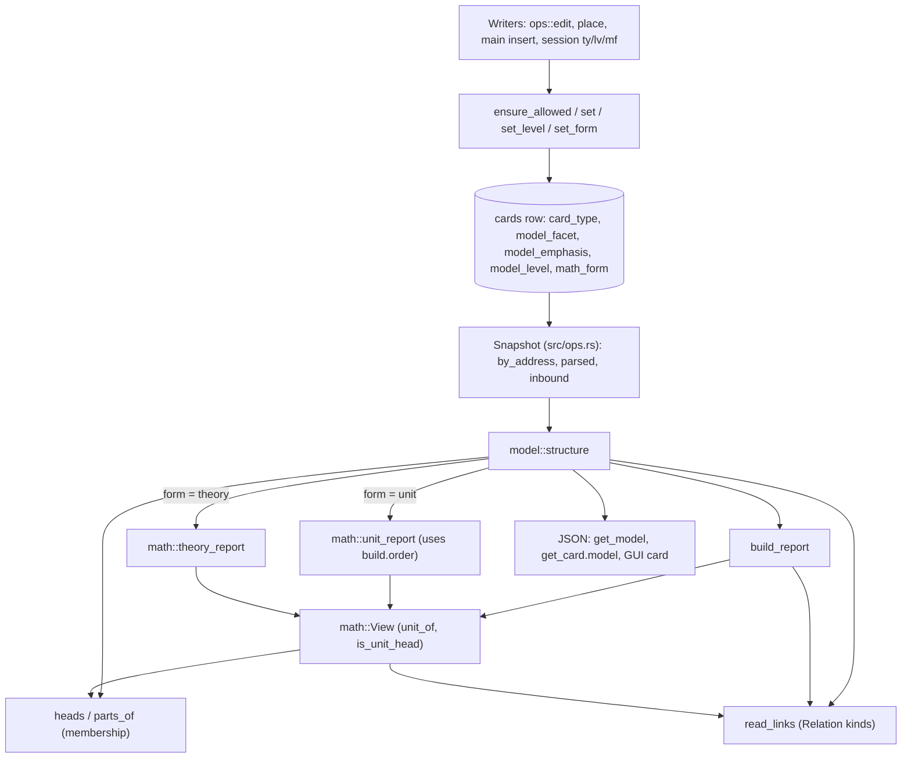

# Model structure and math units

## Purpose

This block turns Cards of type `model` into whole models and mathematical units. It validates and stores the few model properties that live on a Card row (Model facet, Emphasis, Elaboration level, Math form). From Locations, facets, and Links it computes everything else: which model a Card belongs to, the Relation kind of every Link, a model's parts, relations, Loose parts and Model neighbours, its Build order with Derivation chains and self-sufficiency faults, and, for a Model Card with a Math form, the unit report (tiers, faults, load, used_by, study order) or the theory report (Dependency order, tools, users, study passes). These reports serve the book-digest agents (through `get_model` on the [MCP server](mcp-server.md)), the GUI's Model board, theory board and study desk ([GUI](gui.md)), and `zt-check` ([zt-check](zt-check.md)). The block exists so that a model's structure is never stored: it follows its Cards when they move, and nothing is enforced except the few rules that keep the stored properties coherent.

**Owns:** facet, emphasis, level, and Math form parsing and the rules for who may carry them; model membership (filed under or linked from a Model Card); Relation kinds read from Link sentences (`RELATION_KINDS`, `read_links`); the model structure and build report of `get_model`; the unit and theory reports of `math`; Folgezettel ordering (`address_order`) used by other blocks.

**Does not own:** the Card row, the SQLite schema and its migrations ([Service, CLI and storage](service-and-cli.md)); Card text, Link parsing (`LinkBody`), and Reverse links ([Cards, Workspaces and Links](cards-and-links.md)); the `Snapshot`, `edit`, insert, move, and delete operations that call this block ([Card operations](card-operations.md)); the MCP tool schemas and argument parsing ([MCP server](mcp-server.md)); the `ty`, `lv`, and `mf` commands ([Terminal Session](session.md)); the Model board and study desk drawing ([GUI](gui.md)); Hub Cards, which reuse `read_links` ([Hub Cards](hub-cards.md)); the model compiler and math compiler scripts that build models ([Digest scripts](digest-scripts.md)).

## At a glance

| | |
|---|---|
| Entry points | `model::structure` (called by `Snapshot::model` in `src/ops.rs`, which serves MCP `get_model`, the `model` field of `get_card`, and the GUI card JSON); `model::read_links` (Link kinds for `src/ops.rs`, `src/hub.rs`, and `src/math.rs`); `model::ensure_allowed`, `model::set`, `model::set_level`, `math::set_form` (every write that changes a Card's type, facet, emphasis, level, or form); `model::heads` (`Snapshot::model_head`); `Facet::parse`, `Emphasis::parse`, `Level::parse`, `MathForm::parse` and their `parse_optional*` forms (argument parsing in MCP, GUI, Session, and row loading in `src/main.rs`) |
| Key files | `src/model.rs` — facets, emphasis, levels, membership, Relation kinds, model structure, build report; `src/math.rs` — Math forms, unit facet roles, labels, the unit report and the theory report |
| Depends on | [Cards, Workspaces and Links](cards-and-links.md) (`Card`, `CardType`, `ParsedCard`, `LinkBody`, `parse_card_text`, `Workspace`); [Service, CLI and storage](service-and-cli.md) (`load_card`, `load_cards`, `parent_location`, `direct_successor`, `immediate_side_label`, `side_label_to_number`, `tree_id`, `is_tree_member`, `is_tree_root`, and the `cards` table); `rusqlite`, `serde_json`, `anyhow` |
| Used by | [Card operations](card-operations.md) (`src/ops.rs`, `src/place.rs`), [Service, CLI and storage](service-and-cli.md) (`src/main.rs` schema and row loading, `src/dump.rs`), [MCP server](mcp-server.md) (`src/mcp.rs`), [GUI](gui.md) (`src/gui.rs`), [Terminal Session](session.md) (`src/session/command.rs`), [Hub Cards](hub-cards.md) (`src/hub.rs`); the cue list in `scripts/book-digest/card-compiler.ps1` ([Digest scripts](digest-scripts.md)) copies `RELATION_KINDS` |
| Tests | `tests/model_structure.rs`, `tests/model_levels.rs`, `tests/self_sufficient_models.rs`, `tests/math_units.rs`; unit tests in `src/model.rs` (`model::tests`) and `src/math.rs` (`math::tests`); `Snapshot::model` tests in `src/ops.rs` (`ops::tests`) |

## Concepts

The terms are those of `CONTEXT.md`.

- `Model Card` — a Regular Card of type `model` with no facet: the entry point of one whole model. In code: `card.card_type == CardType::Model && card.facet.is_none()` (`src/model.rs`).
- `Model part` — a Card of type `model` with a facet. It belongs to the Model Card it is filed under and to every Model Card that links it (`heads`, `parts_of` in `src/model.rs`).
- `Model facet` — what a part presents: a free label of 1–32 characters on one line, with no `[[`/`]]` (`Facet` in `src/model.rs`). The eight `COMMON_FACETS` (`setting`, `assumptions`, `timing`, `dynamics`, `solution`, `results`, `intuition`, `limits`) are stored in lower case whatever their case.
- `Emphasis` — `core`, `aside`, or none, only on parts (`Emphasis` in `src/model.rs`). In a unit, `core` is the focus tier, none the support tier, `aside` the detail tier (`tier` in `src/math.rs`).
- `Elaboration level` — `concept` (level 1) or `formal` (level 2), only on a Model Card (`Level` in `src/model.rs`). No level means "not classified"; the build report then applies the formal rules.
- `Model range` — the Model Card and the parts filed under it (`in_range` in `build_report`).
- `Model member` — a Card of the range, or a shared part that the Model Card takes in by a Link (`members` in `structure` and `build_report`).
- `Relation kind` — what a Link says, read from the words before it in its sentence: `rests-on`, `illustrates`, `contrasts`, `relaxes`, `corresponds`, `objects`, `specializes`, `refers` (`RelationKind`, `RELATION_KINDS` in `src/model.rs`). Computed, never stored.
- `Model relation` — a Link from one part to another part of the same model, once per pair (`relations` in `structure`).
- `Loose part` — a part in no relation (`loose`).
- `Model neighbour` — a Link between a member and a Card outside the model, either way, tree roots excluded (`neighbours`).
- `Build order` — the members in the order a reader builds the model: shared parts before the main-line step that needs them, the main line from the setting, each step's side parts after it, then unplaced shared parts, then off parts (`build.order`).
- `Derivation part` — a part whose facet starts with `推导` or (case-insensitive) `derivation` (`is_derivation` in `src/model.rs`; `Role::Derivation` in `src/math.rs`).
- `Derivation chain` — a run of Derivation parts next to each other in the build order (`build.chains`).
- `Self-sufficient model` — no `closure`, `reach_in`, `forward`, or `unanchored` fault (`build.self_sufficient`).
- `Tolerated premise` — a premise of a shared part that stays in its home model (`build.tolerated`); not a fault.
- `Math form` — `theory`, `definition`, `axiom`, `theorem`, `proposition`, `lemma`, or `corollary`, only on a Model Card (`MathForm` in `src/math.rs`).
- `Unit` — a Model Card with a Math form other than `theory`, with its parts (`is_unit_head`). A `Result` is a theorem, proposition, lemma, or corollary (`MathForm::is_result`).
- `Theory Card` — a Model Card with the form `theory`; its Links take in whole units (`theory_report`).
- `Cited premise` — a rests-on Link to the Model Card of a unit, or to the Book notation table (a Card titled `符号表…` or `notation…`, `is_notation_table`). Listed in `build.cited`; not a fault.
- `Reach-in` — a rests-on Link to a part inside another unit (`build.reach_in`); a fault.
- `Crux step` — a main-line proof step (`证明…` facet) with emphasis `core` (`crux` in `unit_report`).
- `Load` — how many citers (models, units, or lone Cards) rest on a unit's Model Card (`View::citers`, `math.load`).
- `Building block` — among units, a unit that units of two or more theories cite, counting its own theory (`building_block`).
- `Dependency order` — a theory's units, each after the units it cites, Folgezettel order for ties (`math.order` of a Theory Card).
- `Study order` — the stations of Learn mode: passes `meet`, `why`, `boundary`, `connect`, `recall`, each station with one focus and at most three companions (`math.study`).

## Architecture

`src/model.rs` and `src/math.rs` are pure computation over a read snapshot (`by_address`, `parsed`, `inbound` maps built by `Snapshot` in `src/ops.rs`), plus four small writers that update one column of the `cards` row. Nothing here holds state between calls.

| Component | File | Role |
|---|---|---|
| Stored properties | `src/model.rs` (`Facet`, `Emphasis`, `Level`, `Part`, `set`, `set_level`, `ensure_allowed`); `src/math.rs` (`MathForm`, `set_form`) | Parse, validate, and write the facet, emphasis, level, and form columns |
| Membership | `src/model.rs` (`find_head`, `heads`, `parts_of`, `parts_in_db`) | Which models a Card belongs to; a model's parts |
| Link reader | `src/model.rs` (`RELATION_KINDS`, `RelationKind::announced_in`, `read_links`, `sentence_start`, `sentence_around`) | Each Link's target, kind, and sentence |
| Structure | `src/model.rs` (`structure`) | Parts, relations, loose parts, neighbours, discussion, issues; calls the build report and the math report |
| Build report | `src/model.rs` (`build_report`, `take_in_shared`, `closure_fix`) | Build order, chains, faults |
| Math view | `src/math.rs` (`View`) | Unit lookups over the snapshot: `unit_of`, `theories_of`, `citers`, `premises_of` |
| Unit report | `src/math.rs` (`unit_report`, `unit_study`, `tools`, `building_block`, `group_by_theory`, `role`, `labels`) | Tiers, budget, faults, load, used_by, study stations |
| Theory report | `src/math.rs` (`theory_report`, `section_links`) | Dependency order, weights, cycle, forward, tools, users, faults, study passes |



Control enters at `structure(address, by_address, parsed, inbound)`. It finds the Card's models with `heads`, takes the first as the head, lists its parts with `parts_of`, reads every member's Links with `read_links`, and builds relations and neighbours. It then calls `build_report` for the head, and, if the head has a Math form, `math::theory_report` or `math::unit_report`. The unit report takes the build report's `order` array as its member list, so the build order decides the unit's main line and study order.

## Interfaces

### Stored-property types (`src/model.rs`, `src/math.rs`)

| Item | Signature | Behaviour and errors |
|---|---|---|
| `Facet` | `struct Facet(String)`; `Facet::MAX_CHARS = 32`; `parse(&str) -> Result<Facet>`; `from_stored(Option<&str>) -> Option<Facet>`; `id(&self) -> &str`; `Display` | Trims and collapses whitespace. Errors: `a Model facet cannot be empty`; ``Model facet `…` is too long; a facet is a short label of at most 32 characters``; ``Model facet `…` must be plain text on one line, without Links``. A common facet is stored in its lower-case spelling. `from_stored` drops an unreadable value. |
| `COMMON_FACETS` | `[(&str, &str); 8]` | The eight common facets with what each holds. Only the spelling is fixed; they are no required list. |
| `parse_optional` | `fn(&str) -> Result<Option<Facet>>` | Empty or `none` clears. |
| `Emphasis` | `enum { Core, Aside }`; `id`, `parse`, `from_stored`, `Display` | Error: ``unknown emphasis `…`; expected core, aside, or empty for none``. |
| `parse_optional_emphasis` | `fn(&str) -> Result<Option<Emphasis>>` | Empty, `none`, or `regular` clears. |
| `Level` | `enum { Concept, Formal }`; `id`, `number` (1 or 2), `parse`, `from_stored`, `Display` | `parse` accepts `concept`, `1`, `l1`, `概念`, `概念模型`, and `formal`, `2`, `l2`, `形式`, `形式模型`, `形式化`. Error: ``unknown elaboration level `…`; expected concept (1), formal (2), or empty for none``. |
| `parse_optional_level` | `fn(&str) -> Result<Option<Level>>` | Empty or `none` clears. |
| `Part` | `struct Part { facet: Facet, emphasis: Option<Emphasis> }`; `Part::from_args(Option<Facet>, Option<Emphasis>) -> Result<Option<Part>>` | An emphasis without a facet fails with `only Model parts can have an emphasis; give the Card a Model facet first`. |
| `LEVEL_NEEDS_MODEL_CARD` | `&str` | `only a Model Card (a whole model, without a facet) has an elaboration level` |
| `MathForm` | `enum { Theory, Definition, Axiom, Theorem, Proposition, Lemma, Corollary }`; `ALL`, `id`, `name_zh`, `parse`, `from_stored`, `is_unit`, `is_result`, `Display` | `parse` accepts the English id, the Chinese name (`理论`, `定义`, `公理`, `定理`, `命题`, `引理`, `推论`), and `def`, `thm`, `prop`, `lem`, `cor`. Error: ``unknown Math form `…`; expected theory, definition, axiom, theorem, proposition, lemma, corollary, or empty for none``. `MathForm::ALL` also builds the SQL CHECK list in `src/main.rs`. |
| `parse_optional_form` | `fn(&str) -> Result<Option<MathForm>>` | Empty or `none` clears. |
| `FORM_NEEDS_MODEL_CARD` | `&str` | `only a Model Card (a whole model, without a facet) has a Math form` |
| `CORE_BUDGET`, `MAIN_RESULTS`, `HIGH_LOAD` | `usize` = 3, 7, 3 | Core chunks per unit; main results per Theory Card; citers that raise a unit's weight. `COMPANIONS` (3, private) caps a study station's companions. |

### Writers

| Function | Signature | Effect and errors |
|---|---|---|
| `model::ensure_allowed` | `fn(conn, current: Option<&Card>, card_type, facet: Option<&Facet>, emphasis: Option<Emphasis>) -> Result<()>` | Refuses a facet on a non-model type (`only Model Cards can have a Model facet`) and an emphasis without a facet. When `current` is a Model Card with parts (filed under it or linked from its stored body) and the change would retype it or give it a facet: ``` `<address>` is the Model Card of N Model part(s) (…); change or move them first```. Called with `current = None` on create and insert (`src/main.rs`, `src/place.rs`). |
| `model::set` | `fn(conn, card, card_type, facet, emphasis) -> Result<()>` | Runs `card_type::ensure_allowed` and `ensure_allowed`, then one `UPDATE` of `card_type`, `model_facet`, `model_emphasis`. In the same statement it clears `model_level` and `math_form` unless the Card stays a Model Card without a facet, and clears `hub_level` unless the type is `hub`. |
| `model::set_level` | `fn(conn, card, Option<Level>) -> Result<()>` | Refuses a level unless the Card is a Model Card without a facet; `None` always clears. |
| `math::set_form` | `fn(conn, card, Option<MathForm>) -> Result<()>` | Same rule for `math_form`. |

### Readers

| Function | Signature | Output |
|---|---|---|
| `find_head` | `fn(start: Option<String>, lookup: impl Fn(&str) -> Option<(CardType, bool)>) -> Option<String>` | Walks `parent_location` from `start` through Model parts to the first Model Card without a facet. Stops with `None` at any non-model Card. Call it with the Card's parent, not the Card. |
| `heads` | `fn(address, by_address, inbound) -> Vec<String>` | Every model a Card belongs to. A Model Card is its own model. A part: the Model Card it is filed under (if any), then every other Model Card that links it, in Folgezettel order. Any other Card: empty. |
| `parts_of` | `fn<'a>(head, by_address, parsed) -> Vec<&'a Card>` | The parts the Model Card's body links, in the order it names them, then the parts filed under it that it does not name, in Folgezettel order (same tree only). |
| `structure` | `fn(address, by_address, parsed, inbound) -> Option<Value>` | The model report (see "Data and storage"). `None` when the Card is not of type `model`. |
| `read_links` | `fn(body: &str, name: impl Fn(&str) -> String) -> Vec<LinkRead>` | Every Link of a body, in order. `LinkRead { target, kind: RelationKind, note, form: LinkForm }`; `note` is the sentence with each Link replaced by `「name(target)」`, at most 140 characters. A Term use (`form: Term`) names its head's address and takes `Refers`: it neither announces nor inherits a reasoning kind and never changes the ordinary Link a later one shares, so Model relations and neighbours leave it to the graph filters of S16 (#158). Returns empty on a body `LinkBody` cannot parse. |
| `RelationKind` | `enum { RestsOn, Illustrates, Contrasts, Relaxes, Corresponds, Objects, Specializes, Refers }`; `id()` gives `rests-on`, `illustrates`, `contrasts`, `relaxes`, `corresponds`, `objects`, `specializes`, `refers` | |
| `RELATION_KINDS` | `[(RelationKind, &str, &[&str]); 8]` | Each kind, its meaning, and its cue words (see "Behaviour"). |
| `address_order` | `fn(&str, &str) -> Ordering` | Folgezettel order: numbers by value, side letters by length then alphabet (`3/2` < `3/2|a|1` < `3/2|b` < `3/2|aa` < `3/9` < `3/10`). Used also by `src/place.rs` and `src/hub.rs`. |
| `is_derivation` | `fn(&Facet) -> bool` | The facet starts with `推导` or, in lower case, `derivation`. |
| `math::is_unit_head` | `fn(&Card) -> bool` | A Model Card without a facet whose form is a unit form. |
| `math::is_notation_table` | `fn(title: &str) -> bool` | The title starts with `符号表` or, in lower case, `notation`. |
| `math::role` | `fn(&Facet) -> Option<Role>` | The unit role of a facet: the text before the first `：` or `:` matched against `FACETS` in Chinese or English; else the longest Chinese prefix that matches (`证明x0存在` is a step). |
| `math::labels` | `fn(body: &str) -> Vec<String>` | Labels `(H1)`, `（H2）`, `(C1)` in order of first appearance, ASCII or full-width parentheses. |
| `math::section_links` | `fn(body, names: &[&str]) -> Vec<String>` | The Link targets of a section that starts at a heading (`## 主要结果`) or a line that opens with a bold label (`**主要结果**：`), up to the next heading or bold-label line; a bold label may carry its Links on its own line. Names match case-insensitively. Each target is the shared lexical occurrence's (`LinkBody::for_rendering`), so a code span holds none and a Term use names its head's address. |
| `math::View` | `struct View<'a> { by_address, parsed, inbound }`; `unit_of(at) -> Option<String>`, `theories_of(head) -> Vec<String>`, `citers(head) -> Vec<String>` | `unit_of`: the first of `heads(at)` that is a unit head. `theories_of`: Theory Cards that link the unit, in Folgezettel order. `citers`: for each Card that links `head` with a rests-on Link, its first model (or the Card itself if in none), excluding `head`, deduplicated, in Folgezettel order. |
| `math::unit_report` | `fn(view, head, form, level, order: &[Value]) -> Value` | The unit report. |
| `math::theory_report` | `fn(view, head) -> Value` | The theory report. |

### The unit facet set (`math::FACETS`)

| Chinese | English | `Role` | Used for |
|---|---|---|---|
| `前提` | premises | `Premises` | statement premises (`statement_of` in the theory report) |
| `记号` | notation | `Notation` | connect-station details |
| `证明思路` | proof plan | `Plan` | `no_plan` fault; why-station companion |
| `证明` (any `证明…` other than 证明思路) | proof step | `Step` | crux steps, why stations face down |
| `推导` | derivation | `Derivation` | skipped as why stations; listed as `details` |
| `结论` | conclusion | `Conclusion` | why station face down |
| `直觉` | intuition | `Intuition` | `no_intuition` fault; meet companion |
| `图示` | picture | `Picture` | counts as intuition |
| `例子` | example | `Example` | `no_example`; contrast pair; meet |
| `非例` | non-example | `NonExample` | `no_nonexample`; contrast pair; boundary |
| `反例` | counterexample | `Counterexample` | boundary stations |
| `假设作用` | hypothesis role | `HypothesisRole` | boundary station with its counterexamples |
| `等价刻画` | equivalent form | `Equivalent` | connect companion of a definition |
| `另证` | alternative proof | `AltProof` | connect details |
| `习题` | exercise | `Exercise` | recall stations face down |
| `历史` | history | `History` | connect details |

### Where users meet the block

These interfaces belong to other blocks but are thin wrappers over this one:

- MCP `get_model { at }` returns `structure(at)` with a `body` added to `head` and to each part; for a non-model Card it fails with ``…is not a Model Card or Model part; set type `model` first`` (`src/mcp.rs`, [MCP server](mcp-server.md)). `get_card` returns the same structure, without bodies, as `model`. `create_successor`, `insert_card`, and `edit_card` take `facet`, `emphasis`, `level`, and `form`; `search_cards` filters by `type` and `form`.
- Session commands `ty <type> [<facet…>]`, `lv <level|none>`, `mf <form|none>` (`src/session/command.rs`, [Terminal Session](session.md)).
- GUI `/api/create`, `/api/edit`, `/api/insert` take `facet`, `emphasis`, `level`, `form`; `/api/card` returns `model` (`src/gui.rs`, [GUI](gui.md)).
- `Snapshot::summary` in `src/ops.rs` reports `kinds` (each non-`refers` Link's kind) and `head` per Card in `get_tree`.

## Behaviour

### Validate and store a model property

1. A writer parses the argument with `Facet::parse` / `parse_optional`, `parse_optional_emphasis`, `parse_optional_level` (or `ops::parse_level_arg`, which also accepts hub levels), or `parse_optional_form`.
2. `ops::edit` (`src/ops.rs`) resolves the new type, facet, and emphasis with `TypeChange::resolve`: a facet makes the Card a Model Card; any other type clears the facet; naming `model` alone keeps a part's facet; a Card that stops being a part loses its emphasis. `resolve_level` and `resolve_form` refuse a level or form on anything but a Model Card without a facet.
3. If the type, facet, or emphasis changes, `card_type::ensure_allowed` and `model::ensure_allowed` run before the text is written, then `model::set` writes the columns and clears the level and form of a Card that is no longer a Model Card.
4. `model::set_level` and `math::set_form` run on a freshly loaded Card when the level or form changes.
5. Creation (`src/main.rs` insert path, `place::apply_insert_plan`) calls `ensure_allowed(conn, None, …)` and inserts `model_facet` and `model_emphasis` with the row.

### Read a Link's Relation kind (`read_links`)

1. `LinkBody::parse` finds each `[[target]]` occurrence and its byte range.
2. `sentence_start` walks back to the last sentence end: `。！？!?；;`, a line break, or a `.` followed by whitespace.
3. If an earlier Link of the same sentence ends after that start, only the words since that Link count; otherwise the words since the sentence start.
4. `RelationKind::announced_in` lowercases those words and finds every cue of `RELATION_KINDS`. An English cue (one that starts with an ASCII letter) must start a word: the character before it may not be ASCII alphanumeric. The cue that ends last wins, the longer on a tie.
5. With no cue, a Link right after an earlier Link of the same sentence shares that Link's kind; else it is `refers`. The cue `引出` announces `refers` explicitly, which also stops the sharing.
6. `sentence_around` builds the note: the whole sentence, each Link replaced by `「name」`, list and heading markers and `**` stripped, whitespace collapsed, clipped to 140 characters with `…`.

The cue words (`RELATION_KINDS`):

| Kind | Chinese cues | English cues |
|---|---|---|
| `rests-on` | 依赖 依据 基于 建立在 取自 沿用 承接 用到 借用 代入 推导自 由此推出 按定义 | substitut, rests on, builds on, depends on, relies on, derived from, follows from, uses, cites, by definition, by theorem, by lemma, by proposition, by corollary, by axiom |
| `illustrates` | 例示 举例 例子 示例 演示 例证 实例 案例 印证 | illustrat, example of, instance of, for example, e.g. |
| `contrasts` | 对照 对比 相比 不同于 区别 相反 逆命题 | contrast, unlike, compared with, compare, versus, differs from |
| `relaxes` | 放宽 放松 推广 扩展 拓展 一般化 | relax, extend, generaliz |
| `corresponds` | 对应 类比 同构 相当于 等价 参照 | correspond, maps onto, analog, equivalent, mirrors |
| `objects` | 反驳 批评 质疑 反例 否定 挑战 | objection, objects to, critici, refut, counterexample, challeng |
| `specializes` | 特例 特殊情形 | special case, specializ |
| `refers` | 引出 | (none) |

### Membership: filed under or linked

1. `find_head` from a part's parent: walk up through Cards of type `model` with a facet; the first Model Card without a facet is the head the part is **filed under**. A non-model Card on the way ends the walk with no head.
2. `heads` adds every Model Card in `inbound[part]` (a Model Card whose body links the part) other than the filed head, in Folgezettel order. A part's own Link to a Model Card never makes it a member: only the Model Card's Link counts.
3. `parts_of(head)` lists the parts the head's body links (in body order, each once), then the filed parts it does not name.
4. `structure` shows the first model of `heads`; `models` lists them all, and each part's `also` lists its other models.
5. A part in no model gets a reduced report with `head: null`, empty lists, and one `issues` entry: ``…is a Model part (…) but belongs to no model: file it under a Model Card, or link it from one``. That report has no `build` and no `head_links`.

### The model structure (`structure`)

1. Name each part by its facet and the head by `模型` for notes.
2. Out-neighbours of the head: each Link from the head to an outside Card (not a member, not a tree root), once per pair.
3. For each part: a Link to another part is a relation (once per pair, the first Link's kind and note); a Link to an outside Card is an out-neighbour. A part's Link to itself is skipped; a part's Link to the head is neither (it shows in the part's `links`).
4. In-neighbours: for each member, each outside Card in `inbound[member]` gives one `in` neighbour with the kind and note of its first Link to that member. The `met` set keeps each (from, to) pair once, across both directions.
5. `loose` lists the parts in no relation; `discussion` counts the distinct outside Cards that link any member (tree roots included, unlike neighbours).
6. `build_report` and the math report complete the value.

### The build report (`build_report`)

1. **Range.** The parts whose filed head is this Model Card.
2. **Setting.** The range part that is an immediate Side successor of the Model Card (`<head>|<label>`) with the lowest side number. A Side successor that is not a part is not in the range, so the setting is the first Side successor that is a part.
3. **Main line.** The setting, then its Direct successors while they stay in the range.
4. **Side and off.** Each other range part walks up its parents: the first main-line ancestor makes it a `side` part of that step (`from`); reaching the head first makes it `off`. Side lists and off are sorted in Folgezettel order.
5. **Shared parts.** Members filed outside the range. `premises` maps each member to its rests-on targets. For each main step (then its side parts), `take_in_shared` places, depth-first in address order, each shared part it rests on after the shared parts that one rests on itself. Shared parts no step needs come after the main line, premises first.
6. **Order.** For each main step: its shared parts (`shared`, with `home`), the step (`main`), its side parts (`side`, with `from`). Then the unplaced shared parts, then the `off` parts. A Derivation part carries `derivation: true`.
7. **Closure, cited, reach-in.** For each Card of the range (the head included), each rests-on Link to an outside Card (not a member, not a tree root), once per target:
   - a unit's Model Card or a Book notation table: `cited`;
   - a part inside a unit (`View::unit_of`): `reach_in`, with the fix to rest on the statement or make the step a lemma;
   - anything else: `closure`, with `closure_fix` (below).
8. **Forward.** Each main-line step that rests on a member placed later in `order` (a later main step, a side part, a later shared part, or an off part).
9. **Tolerated.** Each rests-on Link from a shared part to an outside Card. If that premise is a Derivation part, a `fix` says to take it in too.
10. **Unanchored.** Seed the anchored set with the setting and every shared part; repeatedly add each member that rests on an anchored member. Each main step left out is unanchored.
11. **Beyond level.** For a concept model only, each Derivation part in the range.
12. **Chains.** Walk `order`: `side` entries are skipped (they neither break a run nor become `after`); a Derivation part on the `main` or `shared` line extends the run; anything else closes it with `before` = that member (or `null` if it is an `off` part). A run open at the end closes with `before: null`. `after` is the last non-side member before the run.
13. `self_sufficient` is true when `closure`, `reach_in`, `forward`, and `unanchored` are empty. `beyond_level` and `tolerated` do not affect it.

The closure fixes (`closure_fix`):

| The outside Card is | The fix says |
|---|---|
| a Model Card (not a unit) | a model rests on parts, not on a whole model: name the parts, take them in, rest on them |
| a part of another model | take it in with a Link from this Model Card's 结构 list |
| an agent Card in the same tree as the head | move it into the range at its build position (`move_card` with `before`) and give it a facet |
| anything else (another tree, a human Card) | restate it in a part of this model, keep it as a neighbour |

### The unit report (`unit_report`)

1. Members come from `build.order` (address, line, Card). Roles come from `role(facet)`.
2. `tiers`: the Model Card is `focus`; each part `focus`, `support`, or `detail` by its emphasis.
3. `core`: non-shared parts with emphasis `core`. `pair`: the first example and first non-example are both core. `chunks = core.len() - pair`.
4. `crux`: main-line `Step` parts with emphasis `core`.
5. Faults, in this order:

| Fault | Condition |
|---|---|
| `no_example` | a definition with no `例子` part |
| `no_nonexample` | a definition with no `非例` part |
| `no_intuition` | a theorem or definition with no `直觉` or `图示` part |
| `no_plan` | a theorem or proposition, not concept level, with no `证明思路` part |
| `no_crux` | a result, not concept level, with three or more main-line proof steps and none `core` |
| `too_many_crux` | more crux steps than allowed: 1, or 2 when the proof has eight or more steps |
| `over_budget` | `chunks` > `CORE_BUDGET` (3) |

6. `labels` of the Model Card body; `citers` → `load`; `used_by` groups citers by the Theory Cards that take them in (`theory: null` for citers in no theory); `theories` lists the Theory Cards that take this unit in; `building_block`.
7. `study` (`unit_study`):
   - **Definition or axiom:** `meet` the first example and first non-example beside the statement; `meet` the statement beside that pair; `meet` the first intuition; `boundary` each further non-example and example; `connect` the statement with its `specializes`/`relaxes` targets, its `等价刻画` parts, and its top user (the citer with the most citers).
   - **Result:** `meet` the first example; `meet` the statement beside intuition and the first example; one `why` station per main-line part that is not a Derivation part (premises, plan, steps, conclusion), with companions (the plan: the statement; the crux: intuition, plan, previous step; another step: previous step and plan), `tools` (the units it cites; a lemma is `just_in_time`), `details` (the Derivation and side parts right after it), `face_down` for steps, conclusions, and roleless facets, `crux: true` on the crux; `boundary` per hypothesis role with the counterexamples it links or that link it, then each remaining counterexample; `connect` with corollaries that cite it, hierarchy, top user, and `另证`/`历史`/`记号` parts as details.
   - Always: `recall` the statement face down, then each `习题` face down.
   - `station` removes the focus from the companions, deduplicates, and keeps at most three.

### The theory report (`theory_report`)

1. `units`: every unit head the Theory Card body links, any kind, any section, in first-mention order.
2. `main_results` (section `主要结果` / `main results`) and `objects` (`对象` / `objects`) keep only those units.
3. For each unit: `premises` (units cited by its Model Card and all its parts, reach-ins counted as their unit) and `statement_premises` (its Model Card and `前提` parts only).
4. **Dependency order:** repeatedly take the ready unit (all member premises placed) with the lowest address. Units left over are appended in address order; each that reaches itself through premises is listed in `cycle`.
5. `forward`: a unit cites a member that stands later in Folgezettel order (`the book states later`).
6. `tools`: cited units outside the theory, each with its own theories. `users`: citers of the theory's units outside it, grouped by their other theories (`theory: null` for citers in none).
7. Weight: `focus` for main results and objects, `detail` for lemmas, `support` otherwise; a load of `HIGH_LOAD` or more raises it one step, capped at `focus`.
8. Faults: `over_budget` (more than 7 main results), `empty` (no unit).
9. Study passes: `orient` (Theory Card, first three main results); `path` (per main result, in address order: the non-lemma units it needs, following a lemma's statement premises only, each listed once across results, in dependency order); `connect` (tools and users); `recall` (main results face down).

### Rules the code keeps

- Only the facet, emphasis, level, and form are stored; membership, kinds, order, faults, and reports are computed on each call and change with the Cards.
- ZT reports faults; it enforces none of them. The only refusals are the stored-property rules: facet only on `model`, emphasis only with a facet, level and form only on a Model Card without a facet, and a Model Card with parts cannot be retyped or given a facet.
- `parts_in_db` reads the Model Card's stored body, so the parts check sees the old Links during an edit that changes text and type together (`ops::edit` checks before it writes the text).
- All functions are deterministic: every list is sorted by `address_order` or kept in body order.
- The readers run on an immutable `Snapshot`, so they need no lock; the writers run under the edit lock that `ops::edit` takes.

## Data and storage

### Columns of `cards`

| Column | Values | Rule (new archives: CHECK in `src/main.rs`; old archives: kept by `model::set`, `set_level`, `set_form`) |
|---|---|---|
| `card_type` | `idea`, `event`, `finding`, `model`, `hub` | |
| `model_facet` | 1–32 characters or NULL | facet only on `model` (enforced in code) |
| `model_emphasis` | `core`, `aside`, NULL | `model_emphasis IS NULL OR model_facet IS NOT NULL` |
| `model_level` | `concept`, `formal`, NULL | only `card_type = 'model' AND model_facet IS NULL` |
| `math_form` | the seven `MathForm` ids, NULL | only `card_type = 'model' AND model_facet IS NULL` |

The migrations `ensure_model_facet_column`, `ensure_open_model_parts` (a one-time table rebuild with a `zt.sqlite3.pre-open-models-<time>.bak` backup), `ensure_model_level_column`, and `ensure_math_form_column` live in `src/main.rs`. The dump manifest `archive.json` (`src/dump.rs`) carries the maps `facets`, `emphasis`, `levels`, and `forms`, keyed by address:

```json
{"next_topic_id":7,"workspaces":{"0/1":"human"},"types":{"0/1":"model","0/1|a":"model"},"facets":{"0/1|a":"assumptions"},"emphasis":{"0/1|a":"core"},"levels":{"0/1":"formal"},"forms":{"0/1":"theorem"}}
```

### The model report (`structure`)

The shape `get_model` returns (MCP adds `body` to `head` and to each part). Values are abridged from `tests/model_structure.rs` and `tests/self_sufficient_models.rs`:

```json
{
  "head": { "address": "0/1", "title": "GHM model: ownership shapes investment", "body": "Question." },
  "level": "formal",
  "form": null,
  "math": null,
  "models": [{ "address": "0/1", "title": "…" }],
  "facet": "setting",
  "emphasis": null,
  "head_links": ["0/1|a"],
  "parts": [
    { "address": "0/1|a", "title": "Setting: two managers, two assets", "facet": "setting",
      "emphasis": null, "filed": true, "also": [], "links": ["0/1"], "body": "…" }
  ],
  "relations": [{ "from": "0/1|a|1", "to": "0/1|a", "kind": "rests-on", "note": "uses 「setting」." }],
  "loose": ["0/1|b"],
  "neighbours": [
    { "way": "in", "from": "1/2", "to": "0/1|a", "kind": "relaxes", "note": "This relaxes 「setting」: …",
      "card": { "address": "1/2", "title": "Contracts can fix it", "type": "idea", "facet": null } }
  ],
  "discussion": 1,
  "issues": [],
  "build": {
    "level": "formal", "level_number": 2, "setting": "0/1|a",
    "order": [
      { "address": "0/1|a", "title": "…", "facet": "setting", "emphasis": null, "line": "main" },
      { "address": "1/1", "title": "…", "facet": "results", "emphasis": null, "line": "shared", "home": "2/1" },
      { "address": "0/1|a|2", "title": "…", "facet": "推导：参与约束", "emphasis": "aside", "line": "main", "derivation": true },
      { "address": "0/1|a|1|a", "title": "…", "facet": "例子", "emphasis": null, "line": "side", "from": "0/1|a|1" },
      { "address": "0/1|b", "title": "…", "facet": "局限", "emphasis": null, "line": "off" }
    ],
    "chains": [{ "parts": ["0/1|a|2"], "length": 1, "after": "0/1|a|1", "before": "0/1|a|3" }],
    "closure": [{ "from": "…", "to": "…", "note": "…", "card": { "address": "…", "title": "…", "type": "idea", "facet": null, "models": [] }, "fix": "…" }],
    "cited": [{ "from": "…", "to": "…", "note": "…", "form": "lemma", "title": "…" }],
    "reach_in": [{ "from": "…", "to": "…", "unit": "…", "note": "…", "fix": "…" }],
    "forward": [{ "from": "…", "to": "…", "note": "…", "fix": "…" }],
    "tolerated": [{ "part": "…", "home": "…", "premise": { "address": "…", "title": "…", "type": "model", "facet": "…", "models": ["…"] }, "note": "…", "fix": "…" }],
    "unanchored": [{ "address": "…", "title": "…", "fix": "…" }],
    "self_sufficient": false,
    "beyond_level": [{ "address": "…", "title": "…", "fix": "…" }]
  }
}
```

### The unit report (`math` of a unit)

```json
{
  "form": "theorem",
  "labels": ["H1", "H2"],
  "tiers": { "Abbott2015/1|d": "focus", "Abbott2015/1|d|a": "support", "Abbott2015/1|d|b": "detail" },
  "core": ["…"], "crux": ["…"],
  "budget": { "chunks": 3, "limit": 3, "pair": false },
  "faults": [{ "fault": "no_crux", "fix": "…" }],
  "theories": [{ "address": "…", "title": "…", "form": "theory" }],
  "load": 1,
  "building_block": false,
  "used_by": [{ "theory": { "address": "…", "title": "…", "form": "theory" }, "units": [{ "address": "…", "title": "…", "form": "corollary" }] }],
  "study": [
    { "pass": "meet", "focus": ["…"], "companions": ["…"], "tools": [], "details": [] },
    { "pass": "why", "focus": ["…"], "companions": ["…"], "tools": [{ "address": "…", "title": "…", "form": "lemma", "just_in_time": true }], "details": ["…"], "face_down": true, "crux": true },
    { "pass": "recall", "focus": ["…"], "companions": [], "tools": [], "details": [], "face_down": true }
  ]
}
```

### The theory report (`math` of a Theory Card)

```json
{
  "form": "theory",
  "units": 4,
  "order": [{ "address": "…", "title": "…", "form": "definition", "weight": "focus", "load": 1, "level": "concept", "cites": [], "statement_cites": [], "object": true }],
  "main_results": ["…"], "objects": ["…"],
  "cycle": [{ "unit": { "address": "…", "title": "…", "form": "…" }, "fix": "…" }],
  "forward": [{ "from": "…", "to": "…", "note": "…" }],
  "tools": [{ "address": "…", "title": "…", "form": "axiom", "theories": ["…"] }],
  "users": [{ "theory": null, "units": [{ "address": "…", "title": "…", "form": null }] }],
  "faults": [],
  "study": [
    { "pass": "orient", "focus": ["…"], "companions": ["…"] },
    { "pass": "path", "results": [{ "result": "…", "path": ["…"] }] },
    { "pass": "connect", "focus": ["…"], "tools": ["…"], "users": [null] },
    { "pass": "recall", "focus": ["…"], "face_down": true }
  ]
}
```

## Configuration

None: the block reads no flag, environment variable, or config key; its limits (`Facet::MAX_CHARS`, `CORE_BUDGET`, `MAIN_RESULTS`, `HIGH_LOAD`, `COMPANIONS`, the 140-character note clip) are compile-time constants in `src/model.rs` and `src/math.rs`.

## Usage

### Build a model over MCP

From `tests/self_sufficient_models.rs`: a Model Card, a setting as its first Side successor, and a main line of Direct successors whose Links say `依赖`.

```json
{"name": "create_successor", "arguments": {"at": "K2024/1", "kind": "side", "type": "model", "level": "formal", "title": "资金挪用模型", "body": "问题：E 能借到多少？"}}
{"name": "create_successor", "arguments": {"at": "K2024/1|a", "kind": "side", "facet": "设定", "title": "设定：E 与 C", "body": "E 有项目，C 出资。"}}
{"name": "create_successor", "arguments": {"at": "K2024/1|a|a", "facet": "可承诺的还款", "emphasis": "core", "title": "可承诺的还款", "body": "依赖设定 [[K2024/1|a|a]]。"}}
{"name": "insert_card", "arguments": {"before": "K2024/1|a|a|2", "facet": "推导一", "emphasis": "aside", "title": "推导：还款化为现金流", "body": "起点：依赖可承诺的还款 [[K2024/1|a|a|1]]。", "confirm": "insert"}}
{"name": "get_model", "arguments": {"at": "K2024/1|a"}}
```

A second Model Card takes a shared chain in by linking every part of it (`结构：[[K2024/1|a|a|2]] [[K2024/1|a|a|3]]。`); its build order then holds them as `shared`, before the first step that rests on them.

### State a unit

From `tests/math_units.rs`: a theorem whose proof cites an axiom and a lemma by their statements, and a Theory Card that lists it.

```json
{"name": "create_successor", "arguments": {"at": "Abbott2015/1", "kind": "side", "type": "model", "form": "theorem", "level": "formal", "title": "介值定理：连续函数取遍中间值", "body": "**陈述**：\n- (H1) $f$ 在 $[a,b]$ 上连续。\n- (H2) $f(a)<c<f(b)$。"}}
{"name": "create_successor", "arguments": {"at": "<plan>", "facet": "证明：x0 存在", "title": "证明：x0 存在", "body": "依赖 [[<plan>]]。依赖 [[<axiom>]]：S 有上确界。"}}
{"name": "create_successor", "arguments": {"at": "Abbott2015/1", "kind": "side", "type": "model", "form": "theory", "title": "连续函数理论", "body": "**主要结果**：\n- [[<theorem>]]：介值定理。\n\n**对象**：[[<definition>]]\n\n**结构**：\n- [[<corollary>]]\n- [[<lemma>]]"}}
```

### Call the block from Rust

```rust
// Read every Link of a body with its kind (as src/hub.rs and src/ops.rs do).
for read in crate::model::read_links(body, str::to_string) {
    if read.kind == crate::model::RelationKind::RestsOn { /* read.target, read.note */ }
}
// The model structure of any Card, from a Snapshot (src/ops.rs).
let report: Option<serde_json::Value> =
    crate::model::structure(address, &snapshot.by_address, &snapshot.parsed, &snapshot.inbound);
```

### Extend the block

- **A new cue word for a kind:** add it to the kind's row in `RELATION_KINDS` (`src/model.rs`); an English cue matches only at a word start and in lower case. Add a case to `a_link_takes_its_kind_from_the_words_before_it_in_its_sentence`, and copy the word into `$Cues`/`$CuesEn` in `scripts/book-digest/card-compiler.ps1`. Before adding a common word, check the live archive read-only for Links it would retype (see "Decisions and pitfalls").
- **A new Relation kind:** add the variant to `RelationKind`, its `id`, and a row to `RELATION_KINDS` (change the array length), then decide whether the build report or the study order should read it (only `RestsOn` places parts; `Specializes`/`Relaxes` feed the connect station).
- **A new unit facet:** add a `Role` variant and a row to `FACETS` (change the length), then use the role in `unit_report` or `unit_study`, and add a case to `facets_name_their_role_by_the_text_before_the_colon`.
- **A new build fault:** compute it in `build_report`, add it to the returned JSON, decide whether it counts in `self_sufficient`, and describe it in the `get_model` tool text in `src/mcp.rs`.
- **A new Math form:** add it to `MathForm`, `ALL`, `id`, `name_zh`; the SQL CHECK of a new archive picks it up from `ALL`, but an existing archive's `math_form` column CHECK does not change, so it needs a migration in `src/main.rs`.

## Testing

The integration tests start the `zt` binary with a temporary `ZT_CONFIG_DIR` and `ZT_GUI_PORT=0`, run `zt up`, and talk to `zt mcp` over stdio (and to the GUI over HTTP). Run them from the repository root:

```bash
cargo test --test model_structure
cargo test --test model_levels
cargo test --test self_sufficient_models
cargo test --test math_units
cargo test --bin zt model::tests
cargo test --bin zt math::tests
cargo test --bin zt ops::tests
```

| Test file | Covers |
|---|---|
| `tests/model_structure.rs` | Facet and emphasis schemas and refusals; parts filed and parts taken in by Link (`filed`, `also`); relation kinds and notes; loose parts; neighbours both ways; the Model Card retype refusal; the GUI's create/edit of parts; the Session `ty model <facet…>` view; the one-time upgrade of a zt 0.6 archive with its backup |
| `tests/model_levels.rs` | Setting and clearing a level (`2`, empty), the refusals on Idea Cards and parts, loss of the level on retype, `beyond_level` in a concept model, `level` in `search_cards` and `get_tree` |
| `tests/self_sufficient_models.rs` | Build order with main, side, shared, and off lines; `closure` fixes; `forward`; `unanchored`; `tolerated`; Derivation chains and shared chains; `insert_card` and `move_card` with `before` and `alone` (MCP and GUI); `delete_card` with `into` |
| `tests/math_units.rs` | Math form storage and refusals; cited premises and `reach_in`; tiers, budget, the contrast pair, crux and other unit faults; load and `used_by`; study stations; the theory's dependency order, weights, tools, building block; statement-only premises of a lemma on the study path; `specializes`, including the same kind in the derived Link index's `kinds` map |
| `src/model.rs` `tests` | Facet parsing, emphasis parsing, `find_head`, `address_order`, sentence notes, kind reading, `印证`/`参照`/`引出`/`来自` |
| `src/math.rs` `tests` | Form parsing, facet roles, labels, `section_links`, notation tables |

Gaps: no test covers `cycle` or `forward` in a theory report, `too_many_crux`, `over_budget` (unit or theory), the theory `empty` fault, `no_plan`, a reach-in counted as a theory premise, `users` of a theory, or the `e.g.` cue. The header of `tests/model_levels.rs` names the Session view and the dump manifest, but its tests use MCP only (the dump manifest keys are tested in `src/dump.rs`).

## Decisions and pitfalls

### Decisions

- **Structure is computed, never stored.** Only the facet, emphasis, level, and form sit on the Card row; everything else follows the Cards through moves and renames ([model-structure-design](../model-structure-design.md)).
- **Membership by Link, declared by the Model Card.** A part belongs to the Model Card it is filed under and to every Model Card that links it; a part's own Link to a Model Card does not make it a member, because parts link other models all the time. Filing says nothing about rank, following Luhmann ([open-models-design](../open-models-design.md)).
- **Relation kinds come from words, not syntax.** An author writes `依赖`, `例示`, `对照` before the Link; there is no `[[a|kind]]` form. `比较` is deliberately not a cue, so `比较静态` is no contrast ([open-models-design](../open-models-design.md)).
- **Faults are reported, not enforced.** The build report gives each fault a fix and lets the author or the digest decide ([self-sufficient-models-proposal](../self-sufficient-models-proposal.md)).
- **A model rests on parts, never on a whole Model Card.** A closure fault on a Model Card asks for the parts the step uses ([self-sufficient-models-proposal](../self-sufficient-models-proposal.md)).
- **One shared part, not copies.** A building block stays in its first model; other Model Cards take it in, and its own premises are tolerated ([self-sufficient-models-proposal](../self-sufficient-models-proposal.md)).
- **The level lives on the Model Card only, and adds a check without loosening one.** A model without a level takes the formal rules ([model-elaboration-levels-design](../model-elaboration-levels-design.md)).
- **Units chunk by citation.** A proof rests on another unit's statement (a cited premise), never on a step inside its proof (a reach-in); a step two proofs need becomes a lemma ([math-cards-design](../math-cards-design.md), [math-cards-proposal](../math-cards-proposal.md)).
- **A lemma comes just in time.** The theory's study path follows only a lemma's statement premises; its proof premises come with its proof ([math-cards-design](../math-cards-design.md), [math-cards-luhmann-comparison](../math-cards-luhmann-comparison.md) L4).
- **Few rests-on words for proofs.** `应用` and `由命题` were not added, because a scan of the live archive showed they would retype existing Links and create new closure faults; only `按定义` and English `by …` words were added ([math-cards-design](../math-cards-design.md)).

### Pitfalls

- **Semicolons and line breaks end a sentence.** `依赖 [[a]]；[[b]]` gives `b` the kind `refers`. A Link after another in the same sentence shares its kind, so `依赖 [[a]] 与 [[b]]` makes both rests-on.
- **The `e.g.` cue is dead in normal writing.** `ends_sentence` treats a `.` followed by whitespace as a sentence end, so in `e.g. [[x]]` the sentence starts after `e.g.` and the Link reads as `refers`. Only `e.g.[[x]]` or `e.g., [[x]]` work.
- **The last cue wins.** In `依赖设定 [[s]]：区别在触发条件——[[x]]`, `x` is `contrasts`, not rests-on, and any later Link in that sentence shares `contrasts`. A careless word inside a rests-on sentence changes the kind and can remove a premise from the build report.
- **Changing `RELATION_KINDS` changes every existing Link's kind**, and with it closure faults, the Model board, hub kinds (`src/hub.rs`), and `get_tree` `kinds`. Scan the live archive read-only first. `scripts/book-digest/card-compiler.ps1` keeps a copy of the cue table that must stay in sync.
- **The setting is the first Side successor that is a Model part.** A model with no part at `<head>|a`, `<head>|b`, … has no setting and an empty main line, so it shows no `forward` or `unanchored` fault at all.
- **Side parts do not break a Derivation chain**, and an `off` part closes it with `before: null`. A Derivation part filed as a Side successor is a `side` entry and never joins a chain.
- **A main step that rests on a side or off part is a forward fault**, because side parts come after their step and off parts come last.
- **Closure checks the range only.** Premises of shared parts go to `tolerated`, never to `closure`.
- **The reduced report of a part in no model has no `build` and no `head_links` keys.** Callers must not index into `build` without checking `head`.
- **The parts check reads the stored body.** To retype a Model Card that links parts, first remove the Links (one edit), then retype (a second edit); `tests/model_structure.rs` does this.
- **`set_level(None)` and `set_form(None)` never fail**, and `model::set` silently clears the level and form when a Card stops being a Model Card. An `edit_card` that gives a Model Card a facet loses its level and form.
- **`load` counts any citer.** `View::citers` takes the first model of each citing Card, or the Card itself when it is in no model, so an Idea Card or a Theory Card that writes `依赖 [[unit]]` adds to a unit's load and may make it a building block.
- **A Theory Card takes in every unit it links**, in any section and with any kind, not only those in its `结构` list. The `empty` fault's fix names the 结构 section, but any Link counts.
- **`section_links` ends a section at any line that starts with `**`** (a bold label), so a paragraph that opens with bold text inside `主要结果` ends the list.
- **`no_plan` and `no_crux` apply to unclassified units** (no level), because only `concept` turns them off.
- **The `get_model` tool description in `src/mcp.rs` lists the relation kinds without `specializes`**, and does not mention `head_links`; keep it in step when the report changes.
- **A new Math form needs a migration** for archives whose `math_form` column was added by `ALTER TABLE`, because the column CHECK lists the forms of the time.

## Change history
- `2026-10-25` — S10 (#151): `LinkRead` gains `form: LinkForm`, set by the shared lexical scan. A Term use names its head's address, takes `Refers`, and never changes the ordinary Link state a following Link may share, so the reasoning reports see no new kind (the graph filters are S16, #158). `math::section_links` now reads the targets from the shared `LinkBody::for_rendering` occurrences instead of its own `[[` loop, so a code span holds none and a Term use names its head. zt 0.30.0.
- `2026-10-24` — S07 (#149): `model::set` also clears `term_name` whenever the new Card type is not `term`, so the table check `term_name IS NULL OR card_type = 'term'` holds when a type change is made without the shared edit path; `ops::edit_tx` clears a removed name before the type change and sets a new one after it.

- `2026-10-21` — #124 S01: `model::set`, `model::set_level` and `math::set_form` call the Tree Lock gate before their UPDATE, so a type, facet, emphasis, level or Math form change on a locked member is refused with the shared typed `Refusal`.

- `2026-10-18` — Reverify [issue #65](https://github.com/liudesheng9/zet/issues/65): the `specializes` kind is asserted once from the full parser (`get_tree`) and once from the derived Link index (`get_cards` text `kinds`), so both readers keep every current relation kind.
- `2026-10-16` — `a_delete_names_the_links_it_breaks_and_into_re_points_them` expects the plan line that keeps later Side successors in place when Links to the deleted part break.
- `2026-10-15` `639a5a4` — A theory's study path follows only a lemma's statement premises; the theory report adds `statement_cites`.
- `2026-10-15` `9918ba6` — Math forms on Model Cards (`src/math.rs`): units and Theory Cards, cited premises, `reach_in`, the `specializes` kind, new rests-on cues (`按定义`, `cites`, `by …`), the unit and theory reports in `math`.
- `2026-10-15` `9cf4097` — `印证` reads as illustrates and `参照` as corresponds; `引出` stays a plain reference and stops a shared kind (zt 0.18.1).
- `2026-10-14` `82eac86` — `model::set` clears `hub_level` on a Card that is no longer a Hub Card (zt 0.16.0).
- `2026-10-13` `1bec685` — A step may take a chain of Derivation parts: `build.chains`, shared chains keep their order, tolerated Derivation premises get a fix (zt 0.15.0).
- `2026-10-13` `4f0414d`, `b61f2c4` — Tests follow the GUI moving into the service and `delete_card` with `into` (zt 0.14.0, 0.13.1).
- `2026-10-13` `7d636e4` — Elaboration levels `concept`/`formal` on Model Cards, `build.level`, `level_number`, `beyond_level` (zt 0.13.0).
- `2026-10-12` `7a878da` — The build report (`build`: order, closure, forward, tolerated, unanchored, self_sufficient), new rests-on cues (`代入`, `推导自`, `由此推出`, `substitut`), insert and move-between tests (zt 0.12.0).
- `2026-10-12` `d92f367` — Open models: parts join by Link (`models`, `filed`, `also`), Relation kinds read from sentences, Model neighbours; `common_facets` and the link-each-other issues removed (zt 0.10.0).
- `2026-10-11` `2b05ba6` — Free facet labels, emphasis, relations and loose parts; the open-model-parts table rebuild (zt 0.7.0).
- `2026-10-11` `eec0940` — Model Cards structured into Model parts with facets; math and HTML chart rendering tests (zt 0.6.0).
- `2026-10-16` — Wiki doc created.
