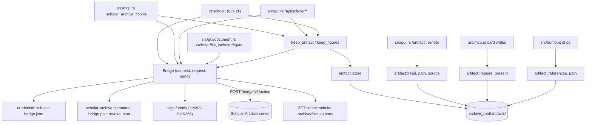
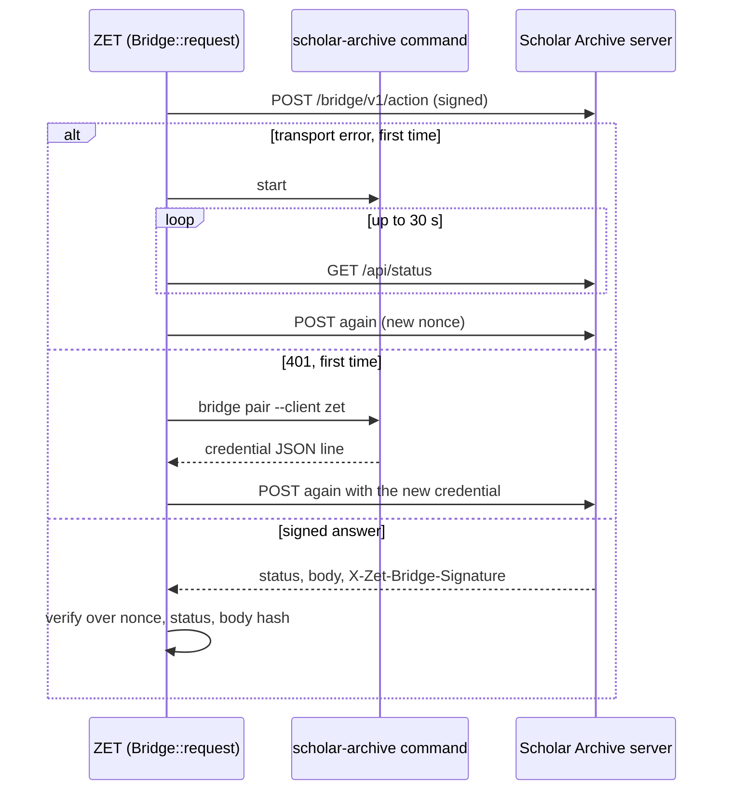

# Scholar Archive bridge and artifacts

## Purpose

This block is ZET's half of the **Scholar Archive bridge**: the authenticated, read-only connection to the user's separate local Scholar Archive (`http://127.0.0.1:8765`). It pairs ZET with the archive and keeps the issued credential, signs every request and verifies every answer with HMAC-SHA256, and gives the rest of ZET typed calls for the archive's read tools, read-only SQL, documents, figures, and exports (`src/scholar.rs`). It also holds the **Artifact** store (`src/artifact.rs`): the content-addressed images that a Card shows with ``, kept once in `<archive_root>/artifacts/` so a Card never breaks when the Scholar Archive moves or drops its copy. It exists so that the human (through `zt scholar` and the GUI) and agents (through `zt mcp`) can read a paper's metadata, text, and figures from the Scholar Archive and put figures and Document links into Cards, without any path through which ZET could change the archive.

**Owns:** pairing and the credential file `scholar-bridge.json`; the `ZET-SCHOLAR-BRIDGE-1` request and answer signatures; the six bridge actions (`hello`, `call`, `sql`, `file`, `artifact`, `export`) and the read-tool allow-list `READ_TOOLS`; automatic pairing, re-pairing, and starting of the archive server; ZET's document and export cache (`<config dir>/scholar-archive/`); the `zt scholar` command; the artifact store (`artifacts/<sha256>.<ext>` plus `<sha256>.json`), format sniffing, and finding the `artifact:` addresses in a Card body; Document link parsing and Markdown (`scholar:<file_id>`); `keep_artifact` and `keep_figures`.

**Does not own:** the `scholar_archive_*` MCP tool definitions, their argument handling, and the MCP refusal of Cards that show an absent artifact (call sites in `src/mcp.rs`, see [MCP server](mcp-server.md)); rendering of figures and Document links in Cards, the `/artifact/`, `/api/scholar/*` and `/scholar/*` routes, the figure picker, and the Markdown reading page (`src/gui.rs`, `src/gui/document.rs`, `src/gui/app.js`, see [GUI](gui.md)); `zt dp`, which copies the artifacts its Cards show, the config file, `archive_root`, and the service (`src/dump.rs`, `src/main.rs`, see [Service, CLI and storage](service-and-cli.md)); the book-digest scripts that call `zt scholar keep-figures`, `file`, and `sql` (`scripts/book-digest/figures.ps1`, `scripts/book-digest/attach-figures.ps1`, see [Digest scripts](digest-scripts.md)); the Scholar Archive's own connector (`archive/bridge.py` in the Scholar Archive repository).

## At a glance

| | |
|---|---|
| Entry points | `scholar::run_cli` (the `zt scholar ...` command, dispatched from `src/main.rs`); `scholar::Bridge::connect` and its methods `hello`, `call`, `sql`, `file`, `artifact`, `export`, `document`; `scholar::keep_artifact`, `scholar::keep_figures`; `scholar::document_target`, `scholar::document_markdown`, `scholar::export_path`, `scholar::READ_TOOLS`, `scholar::DOCUMENT_SCHEME`; `scholar::pair`, `scholar::unpair`; `artifact::store`, `read`, `path`, `source`, `sniff`, `references`, `missing`, `require_present`, `is_digest`, `sha256_hex`, `SCHEME` |
| Key files | `src/scholar.rs` — credential, signing, the `Bridge` client, figure and document helpers, the `zt scholar` command, unit tests with the known-answer vectors; `src/artifact.rs` — the content-addressed artifact store and the `artifact:` address scanner, with unit tests; `tests/scholar_bridge.rs` — end-to-end tests against a fake signing archive and a fake `scholar-archive` command; `docs/scholar-archive-bridge-design.md` — the protocol specification shared with Scholar Archive |
| Depends on | [Service, CLI and storage](service-and-cli.md) (`crate::config_file`, `crate::require_archive_root`); the external Scholar Archive server (`POST /bridge/v1/{action}`, `GET /api/status`) and its `scholar-archive` command (`bridge pair`, `bridge revoke`, `start`); crates `hmac` 0.12, `sha2` 0.10, `ureq` 2.12 (no default features: plain HTTP only), `getrandom` 0.4, `serde_json`, `anyhow` (`Cargo.toml`) |
| Used by | [MCP server](mcp-server.md) (`src/mcp.rs`: the six `scholar_archive_*` tools and `artifact::require_present` on every Card write); [GUI](gui.md) (`src/gui.rs`, `src/gui/document.rs`: artifact serving, figure picker, Document links, reading page); [Service, CLI and storage](service-and-cli.md) (`src/main.rs` routes `zt scholar`; `src/dump.rs` copies artifacts into `zt dp` archives); [Digest scripts](digest-scripts.md) (through the `zt scholar` command) |
| Tests | `src/scholar.rs` (`mod tests`), `src/artifact.rs` (`mod tests`), `tests/scholar_bridge.rs` |

## Concepts

- `Scholar Archive` — the user's separate local archive of Works and their PDF/Markdown documents; ZET reads it and it is never part of the card archive (`CONTEXT.md`). Its URL comes from the credential, default `http://127.0.0.1:8765` (`DEFAULT_URL` in `src/scholar.rs`).
- `Scholar Archive bridge` — the authenticated, read-only connection; every request and answer is signed with the pairing secret (`CONTEXT.md`, `src/scholar.rs` module comment).
- `Credential` — the private struct `{ key_id, secret, url }` read from and written to `scholar-bridge.json`; `secret` is 64 hex characters (256 bits), `url` must be `http://127.0.0.1:` or `http://localhost:` (`Credential::from_json` in `src/scholar.rs`).
- `Pairing` — asking the archive to authorize the client `zet` by running `scholar-archive bridge pair --client zet [--rotate]` and storing the JSON it prints (`pair` in `src/scholar.rs`).
- `Action` — one bridge endpoint, `POST /bridge/v1/<action>` with a JSON body: `hello`, `call`, `sql`, `file`, `artifact`, `export` (`docs/scholar-archive-bridge-design.md`).
- `Read tool` — one of the 18 Scholar Archive MCP tools the bridge forwards through `call`, listed in `READ_TOOLS`; any other tool name is refused in ZET before a request is sent (`Bridge::call`).
- `Answer` — one verified archive answer: body bytes plus headers, with `json()` and `header(name)` (`src/scholar.rs`).
- `Failure` — the private classification of a failed send: `Offline` (transport error), `NotPaired` (HTTP 401), `Other` (`src/scholar.rs`).
- `Artifact` — an image a Card shows: a figure, table, or cover from a Work's Markdown, addressed by the SHA-256 of its bytes, kept once in `artifacts/`; it belongs to no Card and never changes (`CONTEXT.md`, `src/artifact.rs`).
- `Artifact address` — `artifact:<64 lowercase hex>` inside Markdown image syntax: `` (`artifact::SCHEME`, `scholar::figure_markdown`).
- `Source record` — `artifacts/<sha256>.json`, which says where an artifact came from (`artifact::store`, `artifact::source`).
- `Document link` — `[label](scholar:<file_id>)` with an optional fragment such as `#page=12`: a reference to a whole Scholar Archive document; not a Link, no Reverse link, no copy in the archive (`CONTEXT.md`, `scholar::document_target`).
- `Document` — a Scholar Archive document as ZET holds it: `file_id`, `kind`, `name`, `relative_path` (below the archive's `files/`), and `path` (the verified copy in ZET's cache) (`src/scholar.rs`).
- `FileCopy` — the result of the `file` action: the same fields plus `sha256` and the bytes, with `text(limit)` and `summary()` (`src/scholar.rs`).

## Architecture

`src/scholar.rs` is built in layers. At the bottom, the credential functions (`credential_path`, `load_credential`, `save_credential`) and the archive-command runner (`archive_command`, `run_archive_command`) talk to the file system and to the `scholar-archive` program. Above them, the signing primitives (`canonical_request`, `canonical_response`, `sign`, `verify`, `nonce`) build and check signatures. `Bridge` holds one `Credential` and one `ureq::Agent`; its private `send` signs and sends one request and verifies the answer, and `request` wraps `send` in the recovery loop (start the server once, re-pair once). The typed methods (`hello`, `call`, `sql`, `file`, `artifact`, `export`, `document`) and the free functions `keep_artifact` and `keep_figures` sit on top of `request`. `run_cli` is the `zt scholar` command and only calls the layers below.

`src/artifact.rs` is independent of the bridge: it only knows the archive root and bytes. `scholar::keep_artifact` and `scholar::keep_figures` join the two: they fetch through `Bridge::artifact` and store through `artifact::store`.



Control always enters through `Bridge::connect`; there is no long-lived bridge object. Each CLI command, each MCP tool call, and each GUI request makes a new `Bridge` (and a new HTTP agent) and drops it after the call.

On Windows, `run_archive_command(["start"])` has a narrow independent-service path when `ZT_MCP_OWNED_JOB=1`. The shared service must outlive that short-lived client's process job. `src/main.rs::start_independent_service_command` launches only the configured program's fixed `start` verb, leaves the owned MCP job and disables all handle inheritance. Batch launchers use the quoted `cmd /d /s /c` form; executable launchers run directly. The helper waits at most 20 seconds, terminates its exact start-command handle on timeout and closes returned handles. Its stdout/stderr are not captured, so a detached service cannot keep an MCP client's pipe open. The bridge still checks the service's actual availability and signed response after startup. Ordinary CLI starts and credential pair/revoke commands keep their existing command/output path; pairing credentials are not passed through the native command line.

## Interfaces

### The `zt scholar` command

`scholar::run_cli(args: &[String]) -> Result<()>`, routed from `src/main.rs` (`[cmd, rest @ ..] if cmd == "scholar"`). All JSON output is pretty-printed to stdout; errors go to stderr through `anyhow` with a non-zero exit.

| Syntax | What it does | Output |
|---|---|---|
| `zt scholar` or `zt scholar status` | `Bridge::connect`, `hello`, `call("archive_status")` | text lines: URL, archive UUID, database, number of read tools, counts of scholars, works, files |
| `zt scholar pair [--rotate]` | `pair(rotate)` | `{ paired, client, key_id, url, credential }` (the secret is not printed) |
| `zt scholar unpair` | `unpair()` | `{ removed_credential, revoked_by_archive }` |
| `zt scholar tools` | `hello`, then one line per tool: name padded to 22 and the first sentence of its description | text |
| `zt scholar call <tool> [<json-arguments>]` | `Bridge::call`; arguments default to `{}` and must parse as JSON | the tool's `result` |
| `zt scholar sql [--db archive\|vectors] [--limit <n>] <sql>` | `Bridge::sql` with no params; options must come before the SQL; defaults `archive`, 500 | `{ columns, rows, truncated }` |
| `zt scholar file <file-id> [--out <path>]` | `Bridge::file`; default destination is the cache | `FileCopy::summary()`: `{ file_id, name, relative_path, path, bytes, sha256 }` |
| `zt scholar figures <work-id>` | `call("list_work_artifacts", { work_id })` | one line per artifact: number, `•` when shown, availability, caption, file id, path |
| `zt scholar figure <file-id> <path> [--caption <text>]` | `keep_artifact` into `require_archive_root()` | the `keep_artifact` JSON (below) |
| `zt scholar keep-figures <markdown-file-id> [--min-bytes <n>] [--out <path>]` | `keep_figures` into `require_archive_root()`; options in any order, in pairs | the `keep_figures` JSON, or with `--out` a file plus the line `<n> figures kept (<m> skipped) -> <path>` |
| `zt scholar export [--scholar <id>] [--format json\|csv\|bibtex] [--view profile\|combined] [--out <path>]` | `Bridge::export`; defaults `json`, `profile` | the export bytes to stdout (lossy UTF-8), or with `--out` a file plus `<path> (<n> bytes)` |

Any other shape fails with the usage line `expected \`zt scholar [status|pair [--rotate]|unpair|tools|call <tool> [<json>]|sql <sql>|file <id> [--out <path>]|figures <work-id>|figure <file-id> <path>|keep-figures <file-id>|export ...]\``. `figure` and `keep-figures` need `archive_root` configured but not the service up.

### Bridge client (`src/scholar.rs`)

All are `pub(crate)`.

| Item | Signature | Returns / effect | Errors |
|---|---|---|---|
| `Bridge::connect` | `fn connect() -> Result<Bridge>` | loads the credential; pairs first if there is none; builds a `ureq::Agent` with 5 s connect and 600 s overall timeout | `ZET is not paired with Scholar Archive and pairing failed`; credential parse errors |
| `Bridge::request` | `fn request(&mut self, action: &str, payload: &Value) -> Result<Answer>` | one verified answer, with one server start and one re-pair at most | see Behaviour |
| `Bridge::url` | `fn url(&self) -> &str` | the archive URL from the credential | — |
| `Bridge::hello` | `fn hello(&mut self) -> Result<Value>` | `{ bridge, read_only, archive_uuid, database, generation, tools: [{ name, description, inputSchema }] }` | request errors, invalid JSON |
| `Bridge::call` | `fn call(&mut self, tool: &str, arguments: &Value) -> Result<Value>` | the `result` field of `{ tool, result }` | `` `<tool>` is not a Scholar Archive read tool; the bridge offers: ... `` before sending, when `tool` is not in `READ_TOOLS` |
| `Bridge::sql` | `fn sql(&mut self, sql: &str, params: &Value, limit: u64, database: &str) -> Result<Value>` | `{ columns, rows, truncated }`; BLOBs as `{ "base64": ... }` | the archive refuses writes, `ATTACH`, other pragmas (`Scholar Archive: <error>: <detail>`) |
| `Bridge::file` | `fn file(&mut self, file_id: u64, out: Option<&Path>) -> Result<FileCopy>` | writes the bytes to `out` or to `<cache>/files/<file_id>/<name>` | `document <id> arrived damaged: its SHA-256 does not match` |
| `Bridge::artifact` | `fn artifact(&mut self, file_id: u64, path: &str) -> Result<(Vec<u8>, String)>` | the image bytes and their SHA-256 hex; stores nothing | `artifact <path> arrived damaged: ...` |
| `Bridge::export` | `fn export(&mut self, scholar_id: Option<u64>, format: &str, view: &str) -> Result<Answer>` | the raw answer; the caller writes the bytes | request errors |
| `Bridge::document` | `fn document(&mut self, file_id: u64) -> Result<Document>` | a cached copy when its size matches `work_files.size_bytes`, else a fresh `file` fetch | `Scholar Archive has no document <id>`; `... is not present` |
| `Answer` | `struct Answer { pub body: Vec<u8>, headers }`; `json()`, `header(name)` (case-insensitive) | — | `the archive answered with invalid JSON` |
| `FileCopy` | `struct { file_id, name, relative_path, path, sha256, bytes }`; `text(limit) -> Option<&str>`, `summary() -> Value` | `text` decodes `.md`, `.markdown`, `.txt` up to `limit` bytes when valid UTF-8 | — |
| `Document` | `struct { file_id, kind, name, relative_path, path }` | — | — |
| `pair` | `fn pair(rotate: bool) -> Result<Value>` | runs `scholar-archive bridge pair --client zet [--rotate]`, saves the credential | `Scholar Archive printed no bridge credential`; command failure with its stderr |
| `unpair` | `fn unpair() -> Result<Value>` | deletes `scholar-bridge.json`, runs `scholar-archive bridge revoke --client zet` | only a failed file removal; a failed revoke gives `revoked_by_archive: false` |
| `READ_TOOLS` | `const READ_TOOLS: &[&str]` | `archive_status`, `list_scholars`, `scholar_report`, `list_works`, `get_work`, `list_journals`, `list_workspaces`, `get_workspace`, `list_work_files`, `get_work_file`, `list_work_artifacts`, `list_source_labels`, `list_source_updates`, `find_duplicate_works`, `job_status`, `vector_index_status`, `semantic_search`, `similar_works` | — |
| `export_path` | `fn export_path(scholar_id: Option<u64>, format: &str) -> Result<PathBuf>` | creates `<cache>/exports/` and returns `scholar-archive-<all\|scholar-N>.<json\|csv\|bib>` | — |

### Figures and Document links (`src/scholar.rs`)

| Item | Signature | Returns / effect |
|---|---|---|
| `keep_artifact` | `fn keep_artifact(bridge: &mut Bridge, root: &Path, file_id: u64, path: &str, caption: Option<&str>) -> Result<Value>` | calls `list_work_artifacts { file_id }` for the caption and `work_id`, fetches with `Bridge::artifact`, stores with `artifact::store`; returns `{ sha256, address, markdown, caption, work_id, file_id, path, media_type, bytes }`, where `path` is the local stored file |
| `keep_figures` | `fn keep_figures(bridge: &mut Bridge, root: &Path, file_id: u64, min_bytes: u64) -> Result<Value>` | stores every listed artifact of one Markdown in reading order, skipping those with an empty path, `availability != "present"`, or `size_bytes < min_bytes`; returns `{ work_id, file_id, figures: [{ number, name, path, caption, captions, sha256, markdown, bytes }], skipped }` |
| `DOCUMENT_SCHEME` | `const DOCUMENT_SCHEME: &str = "scholar:"` | — |
| `document_target` | `fn document_target(dest: &str) -> Option<(u64, Option<&str>)>` | the file id (1 to 18 digits, greater than 0) and a fragment kept only when it is 1 to 64 characters of `[A-Za-z0-9=._-&]`; any other fragment is dropped, not refused |
| `document_markdown` | `fn document_markdown(label: &str, file_id: u64) -> String` | `[label](scholar:<id>)` with newlines turned to spaces and `[`/`]` to `(`/`)` |
| `figure_markdown` (private) | `fn figure_markdown(caption: &str, digest: &str) -> String` | ``, with the same caption cleaning |

### Artifact store (`src/artifact.rs`)

All are `pub(crate)`; `root` is the archive root.

| Item | Signature | Returns / effect |
|---|---|---|
| `SCHEME` | `const SCHEME: &str = "artifact:"` | — |
| `folder` | `fn folder(root: &Path) -> PathBuf` | `<root>/artifacts` |
| `is_digest` | `fn is_digest(text: &str) -> bool` | exactly 64 characters of `0-9a-f` (lowercase only) |
| `sha256_hex` | `fn sha256_hex(bytes: &[u8]) -> String` | lowercase hex SHA-256 |
| `sniff` | `fn sniff(bytes: &[u8]) -> Option<(&'static str, &'static str)>` | `(extension, media type)` by magic bytes: PNG, JPEG, GIF87a/89a, WebP (`RIFF....WEBP`), BMP (`BM`), else SVG when the first 1024 bytes contain `<svg` (case-insensitive) |
| `path` | `fn path(root: &Path, digest: &str) -> Option<PathBuf>` | the first existing `<digest>.<ext>` in the order png, jpg, gif, webp, svg, bmp; `None` for a non-digest (so `../x` cannot escape) |
| `read` | `fn read(root: &Path, digest: &str) -> Option<(Vec<u8>, &'static str)>` | the bytes and media type, only when the bytes sniff as an image and hash back to `digest` |
| `store` | `fn store(root: &Path, bytes: &[u8], source: &Value) -> Result<String>` | writes `<digest>.<ext>` once (temp file then rename) and always rewrites `<digest>.json`; returns the digest. Error: `an artifact must be a PNG, JPEG, GIF, WebP, SVG, or BMP image` |
| `source` | `fn source(root: &Path, digest: &str) -> Option<Value>` | the `source` field of `<digest>.json` |
| `references` | `fn references(body: &str) -> Vec<String>` | every distinct digest that follows `artifact:` anywhere in the text, in order of first appearance |
| `missing` | `fn missing(root: &Path, body: &str) -> Vec<String>` | the referenced digests with no stored file |
| `require_present` | `fn require_present(root: &Path, text: &str) -> Result<()>` | error naming the first missing digest: `the Card shows artifact:<sha>, which this archive does not hold; take it from the Scholar Archive with scholar_archive_artifact first and paste the \`markdown\` it returns` |

### MCP tools that use this block (defined in `src/mcp.rs`)

| Tool | Calls | Needs the service up |
|---|---|---|
| `scholar_archive_status` | `hello`, `call("archive_status")`; returns `{ connected, url, read_only, archive_uuid, database, tools, status }` | no |
| `scholar_archive_read` | `Bridge::call(tool, arguments)`; `tool` is an enum of `READ_TOOLS`; `arguments` must be an object | no |
| `scholar_archive_sql` | `Bridge::sql(sql, params or [], limit or 500, database or "archive")` | no |
| `scholar_archive_file` | `Bridge::file(file_id, None)`; adds `link` (`document_markdown`) and `text` when `FileCopy::text(max_text_bytes or 1000000)` decodes | no |
| `scholar_archive_artifact` | `keep_artifact` into the service's archive root; `readOnlyHint` false (it writes ZET's store) | yes |
| `scholar_archive_export` | `Bridge::export`, writes to `export_path`, adds `text` when the export is at most 1000000 bytes | no |

Every MCP Card write (`create_topic`, `create_literature`, `create_successor`, `edit_card`, `insert_card`) calls `artifact::require_present` on the new text first (`src/mcp.rs`).

### GUI routes that use this block (defined in `src/gui.rs` and `src/gui/document.rs`)

| Route | Calls |
|---|---|
| `GET /artifact/<sha256>` | `artifact::read`; answers with `Cache-Control: max-age=31536000, immutable` and a sandbox CSP (`respond_artifact`), or 404 `artifact not in this archive` |
| `GET /api/artifact?sha=` | `artifact::path`, `artifact::source`; returns `{ sha256, held, source, in_document }`, where `in_document` is `/scholar/file/<file_id>#fig-<stem>` |
| `GET /api/scholar/works?q=` | `Bridge::sql` over `works` with a Markdown `work_files` row, 40 at most |
| `GET /api/scholar/artifacts?work_id=` | `Bridge::call("list_work_artifacts", { work_id })` |
| `GET /api/scholar/files?work_id=` | `Bridge::sql` over present `pdf`/`markdown` `work_files`, each with `document_markdown`; only shown files when the Work shows any |
| `POST /api/scholar/preview` `{ file_id, path }` | `Bridge::artifact`, returned as a `data:` URL; nothing is kept |
| `POST /api/scholar/artifact` `{ file_id, path, caption? }` | `keep_artifact` into the GUI's archive root |
| `GET /scholar/file/<id>` | `Bridge::document` on a thread of its own; a PDF inline, a Markdown document as a reading page |
| `GET /scholar/figure/<file_id>?path=` | `Bridge::artifact` on a thread of its own; image bytes, `private, max-age=86400` |
| Card rendering | `artifact::SCHEME` images become `figure_html` (`">`); `DOCUMENT_SCHEME` links become `document_link_open` via `document_target` |

### Wire protocol

Request headers set by `Bridge::send`: `Content-Type: application/json`, `X-Zet-Bridge-Client: zet`, `X-Zet-Bridge-Key: <key_id>`, `X-Zet-Bridge-Timestamp: <unix seconds>`, `X-Zet-Bridge-Nonce: <32 lowercase hex>`, `X-Zet-Bridge-Signature: <64 lowercase hex>`. Answer headers read: `X-Zet-Bridge-Signature` (always), `X-Zet-Bridge-File-Sha256`, `X-Zet-Bridge-File-Name`, `X-Zet-Bridge-File-Path` (URL-safe base64) for `file` and `artifact`. The action bodies and answers are in `docs/scholar-archive-bridge-design.md` ("Actions").

## Behaviour

### Connecting and pairing

1. `Bridge::connect` calls `load_credential`, which reads `<config dir>/scholar-bridge.json`. A missing file is `None`; a malformed file is an error (ZET does not re-pair over it).
2. With no credential, `connect` calls `pair(false)`: `run_archive_command(["bridge", "pair", "--client", "zet"])`. `archive_command` uses `ZT_SCHOLAR_ARCHIVE`, else on Windows `%LOCALAPPDATA%\ScholarArchive\bin\scholar-archive.cmd` (error when missing: `Scholar Archive is not installed for this user (...); run its install.cmd`), else `scholar-archive` on `PATH`. On Windows the child runs with `CREATE_NO_WINDOW`.
3. `pair` takes the **last** stdout line that starts with `{`, parses it, validates it with `Credential::from_json` (client must be `zet` when present, `secret` 64 hex, `url` local, `key_id` present), and writes it with `save_credential` (pretty JSON to `.scholar-bridge.json.tmp`, then rename).
4. `connect` reads the credential again and builds the `ureq` agent.

### One request (`Bridge::request` and `Bridge::send`)

1. `request` serializes the payload once. It then loops over `send`.
2. `send` builds the target `/bridge/v1/<action>`, the current Unix time, and a fresh 16-byte `nonce` from `getrandom`.
3. `canonical_request("POST", target, timestamp, nonce, body)` gives `ZET-SCHOLAR-BRIDGE-1\nPOST\n<target>\n<timestamp>\n<nonce>\n<sha256 hex of body>`; `sign` decodes the hex secret to 32 key bytes and computes HMAC-SHA256.
4. `send` posts with the six headers. A transport error is `Failure::Offline`; an HTTP error status is not an error at this point (`ureq::Error::Status` gives back the response).
5. It copies all headers, reads at most `MAX_ANSWER_BYTES` (600 MiB) of the body.
6. HTTP 401 becomes `Failure::NotPaired(detail)` **before** any signature check, using the JSON `detail` or `unauthorized`.
7. For every other status it checks `X-Zet-Bridge-Signature` against `canonical_response(nonce, status, body)` = `ZET-SCHOLAR-BRIDGE-1 RESPONSE\n<nonce>\n<status>\n<sha256 hex of body>`, with `verify` (constant-time compare over the hex). A mismatch or a missing header is `the answer from <url> is not signed by the paired Scholar Archive; refusing it`.
8. A verified non-2xx status becomes `Scholar Archive: <error>: <detail>` from the JSON body, or `HTTP <status>`.
9. Back in `request`: the first `Offline` runs `scholar-archive start` (unless `ZT_SCHOLAR_NO_START` is set) and `wait_until_up` polls `GET <url>/api/status` every 500 ms for up to 30 s, then retries. The first `NotPaired` runs `pair(false)`, reloads the credential, and retries. A second `Offline` is `Scholar Archive is not reachable: <reason>`; a second `NotPaired` is `Scholar Archive refused ZET's bridge credential: <reason>`; `Other` returns at once.



### Fetching a document (`Bridge::file`, `Bridge::document`)

1. `file` sends `{ file_id }`, hashes the body, and compares it with `X-Zet-Bridge-File-Sha256`.
2. It decodes `X-Zet-Bridge-File-Path` and `X-Zet-Bridge-File-Name` with `base64_url_decode` (accepts URL-safe and standard alphabets, stops at `=`). A name that is empty, `.`, `..`, or contains `/` or `\` is replaced by `file-<id>`.
3. It writes the bytes to `out`, or to `<config dir>/scholar-archive/files/<file_id>/<name>`, creating folders.
4. `document` (used by the GUI) first runs `SELECT relative_path, kind, size_bytes, availability FROM work_files WHERE id = ?1` through `sql`. It refuses a missing row or `availability != 'present'`. It derives `name` from the last segment of `relative_path` and uses the cached file when it exists with exactly `size_bytes`; otherwise it calls `file(file_id, None)`.

### Taking a figure (`keep_artifact`)

1. `call("list_work_artifacts", { file_id })` finds the listed item whose `path` equals the requested path (for its caption) and the Work's `work_id`.
2. `Bridge::artifact(file_id, path)` fetches and verifies the bytes.
3. `artifact::store(root, bytes, source)` with `source = { scholar_archive: <url>, work_id, file_id, path, caption }`.
4. The caption is the given one, else the listed one, else empty; the answer carries `markdown` from `figure_markdown`.

`keep_figures` repeats steps 2–3 for every listed item that passes its filters; the first fetch or store error stops the whole run (earlier figures stay stored).

### Storing and reading an artifact (`artifact::store`, `artifact::read`)

1. `store` sniffs the format (refusing non-images), computes the digest, creates `artifacts/`.
2. When `<digest>.<ext>` is absent it writes `.<digest>.tmp` and renames it; an existing file is never rewritten.
3. It always writes `<digest>.json` = `{ sha256, bytes, file, source }`, so a second store of the same bytes replaces the source record.
4. `read` finds the file with `path`, sniffs it, and returns it only when its SHA-256 equals the requested digest. The GUI serves only through `read`.

### Rules the code keeps

- The bridge only sends `POST` to the six actions, and `call` refuses any tool not in `READ_TOOLS` before anything leaves ZET (`tests/scholar_bridge.rs` checks that the fake archive saw nothing).
- The credential URL must be local (`127.0.0.1` or `localhost`, plain HTTP); a credential that names another host is refused when loaded or paired.
- Every non-401 answer, errors included, must be signed over this request's nonce; ZET never trusts an unsigned body.
- `file` and `artifact` bodies are additionally checked against `X-Zet-Bridge-File-Sha256`.
- An artifact address is a lowercase 64-hex digest; `path`, `read`, and `source` return `None` for anything else, which also stops path traversal.
- Only the MCP server enforces `require_present`; the GUI and the Session can save a Card showing an artifact ZET lacks, and the GUI renders it as a figure whose image fails to load (`figure_html` in `src/gui.rs`).
- Recovery happens at most once per kind per `request` call: one server start, one re-pair.
- There is no concurrency control in the bridge: each caller makes its own `Bridge`. Two parallel first uses may both run `bridge pair`; pairing again returns the same credential (`docs/scholar-archive-bridge-design.md`), and `save_credential` replaces the file by rename.

## Data and storage

### Credential: `<config dir>/scholar-bridge.json`

`<config dir>` is the folder of `config.toml`: `ZT_CONFIG_DIR`, else `%APPDATA%\zt` on Windows (`config_file` in `src/main.rs`). Written by `pair`, deleted by `unpair`.

```json
{
  "client": "zet",
  "key_id": "k1",
  "secret": "1111111111111111111111111111111111111111111111111111111111111111",
  "url": "http://127.0.0.1:8765"
}
```

### Document and export cache: `<config dir>/scholar-archive/`

```text
scholar-archive/
  files/<file_id>/<name>                 # verified copies from Bridge::file (and Bridge::document)
  exports/scholar-archive-all.json       # export_path(None, "json")
  exports/scholar-archive-scholar-7.bib  # export_path(Some(7), "bibtex")
```

Nothing prunes this cache. A cached document is reused by `Bridge::document` only while its size equals the archive's `work_files.size_bytes`.

### Artifact store: `<archive_root>/artifacts/`

```text
artifacts/
  86460e5d...c1.png    # the image bytes; name = SHA-256 of the bytes + sniffed extension
  86460e5d...c1.json   # source record
  .86460e5d...c1.tmp   # only while a store is in progress
```

Source record written by `artifact::store`, with the `source` that `keep_artifact` passes:

```json
{
  "sha256": "86460e5d...c1",
  "bytes": 48213,
  "file": "86460e5d...c1.png",
  "source": {
    "scholar_archive": "http://127.0.0.1:8765",
    "work_id": 42,
    "file_id": 3,
    "path": "nber/paper_mineru/images/one.png",
    "caption": "FIGURE 1: GROWTH [REWEIGHTED]"
  }
}
```

In a Card body:

```markdown


See the [paper's Markdown](scholar:3) and the [PDF, page 12](scholar:85#page=12).
```

### Garbage handling

None exists. An artifact belongs to no Card (`CONTEXT.md`): deleting or editing every Card that shows it leaves the image and its record in `artifacts/`. No code counts references or removes unreferenced artifacts, and no command lists them. The one consumer that follows references is `zt dp` (`src/dump.rs`): it collects `artifact::references` over the dumped Cards, copies each held `<digest>.<ext>` (not the `.json` record) into `artifacts/` inside the dump, and silently skips digests ZET does not hold. Stray `.<digest>.tmp` files from an interrupted store are not cleaned either; the next `store` of the same bytes overwrites the temp file.

### Wire format

Signed canonical strings (from `canonical_request` and `canonical_response`; the separators are `\n`):

```text
ZET-SCHOLAR-BRIDGE-1
POST
/bridge/v1/hello
1700000000
00000000000000000000000000000000
44136fa355b3678a1146ad16f7e8649e94fb4fc21fe77e8310c060f61caaff8a
```

```text
ZET-SCHOLAR-BRIDGE-1 RESPONSE
00000000000000000000000000000000
200
44136fa355b3678a1146ad16f7e8649e94fb4fc21fe77e8310c060f61caaff8a
```

With the secret `"11" * 32` these sign to `4147ee46...445127` and `f05b90ff...e92dc` (the known-answer test in `src/scholar.rs`). The last line is the SHA-256 of the body `{}`.

## Configuration

| Name | Where | Default | Effect |
|---|---|---|---|
| `ZT_CONFIG_DIR` | env var (read by `config_file` in `src/main.rs`) | `%APPDATA%\zt` on Windows | folder of `scholar-bridge.json` and of the `scholar-archive/` cache |
| `ZT_SCHOLAR_ARCHIVE` | env var (`archive_command`) | `%LOCALAPPDATA%\ScholarArchive\bin\scholar-archive.cmd` on Windows, `scholar-archive` elsewhere | the program run for `bridge pair`, `bridge revoke`, and `start`; tests point it at a fake script |
| `ZT_SCHOLAR_NO_START` | env var (`Bridge::request`), any value | unset | when set, ZET never runs `scholar-archive start` on a transport error; it fails at once with `Scholar Archive is not reachable` |
| `url` | `scholar-bridge.json` (issued by the archive) | `http://127.0.0.1:8765` when absent | the archive server; must start with `http://127.0.0.1:` or `http://localhost:`; a trailing `/` is removed |
| `archive_root` | `config.toml` (`zt config set archive_root <path>`) | none | where `artifacts/` lives; `zt scholar figure` and `keep-figures` fail without it |
| Constants | `src/scholar.rs` | `PROTOCOL = "ZET-SCHOLAR-BRIDGE-1"`, `CLIENT = "zet"`, `MAX_ANSWER_BYTES = 600 MiB`, connect timeout 5 s, request timeout 600 s, start wait 30 s at 500 ms | compiled in |

## Usage

### From the command line

```bash
zt scholar                                    # connect (pair and start as needed), show identity and counts
zt scholar tools
zt scholar call list_works '{"query":"democracy","limit":5}'
zt scholar sql --limit 10 "SELECT id, title, year FROM works WHERE doi IS NOT NULL"
zt scholar file 22                            # into <config dir>/scholar-archive/files/22/
zt scholar figures 42                         # a Work's figures: number, caption, file id, path
zt scholar figure 22 nber/w1_mineru/images/a1.jpg --caption "Figure 1"
zt scholar keep-figures 83 --min-bytes 3000 --out figs.json
zt scholar export --scholar 7 --format bibtex --out works.bib
zt scholar pair --rotate                      # new secret; zt scholar unpair disconnects
```

The book digest calls the same commands from PowerShell, for example `& $Zt scholar keep-figures $FileId --min-bytes $MinBytes --out $out` (`scripts/book-digest/figures.ps1`) and `zt scholar file $FileId` (`scripts/book-digest/attach-figures.ps1`).

### From Rust code inside the crate

```rust
// Read: any read tool, SQL, or a document.
let mut bridge = crate::scholar::Bridge::connect()?;
let works = bridge.call("list_works", &json!({ "query": "growth", "limit": 5 }))?;
let rows = bridge.sql("SELECT id FROM works WHERE year > ?1", &json!([2000]), 100, "archive")?;
let copy = bridge.file(22, None)?;                     // FileCopy in the cache

// Take a figure and get the Markdown that shows it.
let kept = crate::scholar::keep_artifact(&mut bridge, &root, 22, "nber/w1/images/a1.jpg", None)?;
let markdown = kept["markdown"].as_str().unwrap();     // 

// Before saving agent text: refuse figures ZET does not hold.
crate::artifact::require_present(&root, &text)?;
```

### Adding a bridge capability

- **A new archive read tool.** Add its name to `READ_TOOLS` in `src/scholar.rs`. The MCP `scholar_archive_read` enum and description pick it up from the constant (`src/mcp.rs`). The Scholar Archive must also offer it through `call`; update the tool list in `docs/scholar-archive-bridge-design.md` and keep that file identical to Scholar Archive's `docs/zet-bridge.md`.
- **A new action.** Add a typed method on `Bridge` that calls `self.request("<action>", &json!({...}))`; check any content hash header the action returns as `file` and `artifact` do. Add the action to the table in the design doc, a case to `FakeArchive` in `tests/scholar_bridge.rs`, and a `run_cli` arm with its usage text (and the catch-all usage line).
- **A new image format.** Add `(extension, media type)` to `KINDS` and a magic-byte check to `sniff` in `src/artifact.rs`; `path` searches `KINDS` in order, so existing files keep resolving.

## Testing

Tests run with cargo; the crate is a single binary (`src/main.rs`, no `lib.rs`), so unit tests live in the `zt` binary target. On this machine builds use `CARGO_TARGET_DIR=D:/zt-target` because E: runs short of space.

```bash
# End-to-end bridge tests (fake archive and fake scholar-archive command)
cargo test --test scholar_bridge

# Unit tests of both modules
cargo test --bin zt scholar::
cargo test --bin zt artifact::
```

What they cover:

| Test | File | Covers |
|---|---|---|
| `signatures_match_the_archive_known_answers` | `src/scholar.rs` | request and response canonical strings and HMAC against the vectors Scholar Archive's `tests/test_bridge.py` also checks; `verify` rejects a wrong signature |
| `credentials_only_reach_this_computer` | `src/scholar.rs` | trailing `/` trimmed; remote URL refused; other client refused |
| `a_document_link_names_a_file_and_maybe_a_page` | `src/scholar.rs` | `document_target` ids and fragments, an unsafe fragment dropped, bad addresses refused; `document_markdown` cleaning |
| `decodes_url_safe_base64_names` | `src/scholar.rs` | `base64_url_decode` with ASCII and Unicode names |
| `refuses_answers_not_signed_by_the_paired_archive` | `src/scholar.rs` | `Bridge::with` against a `tiny_http` server with a bad signature |
| `an_image_is_kept_once_by_its_content_and_read_back_verified` | `src/artifact.rs` | `store` idempotence, source record replaced, `read` verifies, `path` refuses `../secret`, non-image refused |
| `a_body_names_its_artifacts_and_only_held_ones_pass` | `src/artifact.rs` | `references` order and dedupe, short digests ignored, `missing`, `require_present` |
| `formats_are_recognized_by_their_bytes` | `src/artifact.rs` | `sniff` for JPEG, GIF, WebP, SVG; PDF refused |
| `zet_pairs_itself_then_reads_works_sql_and_documents` | `tests/scholar_bridge.rs` | first `zt scholar call` pairs through the fake command; `sql`, `file` (name from base64 header, bytes on disk), `zt scholar` status |
| `write_tools_are_refused_before_anything_is_sent` | `tests/scholar_bridge.rs` | `update_work`, `apply_archive_operations`, `backup_database`, `start_archive` refused; the fake archive saw no request |
| `answers_not_signed_by_the_paired_archive_are_refused` | `tests/scholar_bridge.rs` | a tampering fake archive is refused through the CLI |
| `zt_mcp_offers_the_bridge_as_read_only_tools` | `tests/scholar_bridge.rs` | six `scholar_archive_*` tools, `readOnlyHint` true for all but `scholar_archive_artifact`; `read`, `file` text, a refused write tool |
| `a_card_shows_a_figure_only_after_zet_keeps_it_from_the_archive` | `tests/scholar_bridge.rs` | `zt up` with `ZT_GUI_PORT=0`; `create_topic` refused with an unknown artifact, `scholar_archive_artifact` stores `artifacts/<sha>.png` and its record, caption brackets cleaned, then `create_topic` succeeds |

The integration tests set `ZT_CONFIG_DIR` to a temp folder, `ZT_SCHOLAR_ARCHIVE` to a generated `.cmd` (Windows) or `sh` script that prints the credential only for `bridge pair`, and `ZT_SCHOLAR_NO_START=1`. The `FakeArchive` checks request signatures like the real one and answers `hello`, `call`, `sql`, `file`, and `artifact`.

Gaps: no test of the re-pair path after a 401, of the server-start path and `wait_until_up`, of `unpair`, of `export` and `export_path`, of `keep_figures` and its filters, of `Bridge::document` and its size-based cache, of a damaged `X-Zet-Bridge-File-Sha256`, of the 600 MiB answer limit, or of timestamp or nonce handling (those checks live in the archive). The GUI routes are tested in [GUI](gui.md) only for rendering (`src/gui.rs`, `src/gui/document.rs`).

## Decisions and pitfalls

### Decisions

- **One shared specification.** The protocol lives in `docs/scholar-archive-bridge-design.md`, which must stay identical to Scholar Archive's `docs/zet-bridge.md`; both sides test the same known-answer vectors. Change the spec, both connectors, and both tests together.
- **Information only.** The bridge offers only reads; the allow-list is enforced twice (ZET's `READ_TOOLS` and the archive's `403`), and SQL is read-only on the archive side (`mode=ro`, `PRAGMA query_only`, an authorizer). Nothing read through it changes a Card (`CONTEXT.md`, "Scholar Archive bridge").
- **Signed answers, not only signed requests.** Every answer is signed over the request's nonce, so ZET knows it reads the paired archive and not another program on the same port (design doc, "Signed answers").
- **Local only.** The credential URL must be `127.0.0.1` or `localhost`, and `ureq` is built without TLS; the trust boundary is the Windows user profile (design doc, "Trust boundary").
- **Automatic connection.** First use pairs; a 401 re-pairs once; a transport error starts the server once. The user never runs a setup step (design doc, "Running automatically").
- **Artifacts by content, kept by ZET.** A Card depends only on ZET's own copy, named by SHA-256, so the archive may move, rename, or drop its file (design doc, "Artifacts"; `CONTEXT.md`, "Artifact"). Documents are the opposite: a Document link keeps no copy in the archive and is fetched on demand into the cache (`CONTEXT.md`, "Document link").
- **Agents may show only held artifacts.** The MCP server refuses Card text that names an absent artifact, and the error tells the agent which tool to call (`artifact::require_present`).

### Pitfalls

- **The 401 path is not authenticated.** `send` turns any HTTP 401 into `NotPaired` before checking the signature, so any program answering on the archive's port with 401 makes ZET run `scholar-archive bridge pair` once. No data is trusted from it, but it does cost a pairing run.
- **A truncated answer looks like a forgery.** `MAX_ANSWER_BYTES` (600 MiB) truncates silently with `take`; the body hash then fails and the error says `not signed by the paired Scholar Archive`, not "too large".
- **The GUI's `/api/scholar/*` calls block the GUI.** They run on the single `zt-gui` request thread (`src/gui.rs`), so a stopped archive (start plus up to 30 s wait) or a slow answer (600 s timeout) holds up every other GUI request. Only `/scholar/file/` and `/scholar/figure/` run on a thread of their own (`src/gui/document.rs`).
- **The document cache can serve a stale copy.** `Bridge::document` trusts a cached file whose size equals `work_files.size_bytes`; a changed document of the same size is not refetched.
- **Two names for one cached document.** `Bridge::file` names the cache file from the `X-Zet-Bridge-File-Name` header, while `Bridge::document` looks it up by the last segment of `relative_path`. If they differ, `document` misses its cache and refetches every time.
- **`artifact::references` scans text, not Markdown.** Any `artifact:` followed by 64 lowercase hex characters counts, also inside a code block, in prose, or as the first 64 characters of a longer hex string. Such text makes `require_present` refuse an MCP write.
- **`artifact::path` does not verify.** It only checks that a file exists; `require_present`, `missing`, `/api/artifact` (`held`), and `zt dp` accept a damaged file. Only `artifact::read` (and so the `/artifact/` route) checks the hash.
- **The source record keeps only the last source.** `store` rewrites `<digest>.json` on every store, so the record names the most recent Work and path that gave these bytes, not the first. The `.json` write is not atomic, unlike the image write.
- **Nothing collects garbage.** Artifacts and cached documents and exports stay forever (see "Garbage handling").
- **`unpair` reads revocation by string match.** It reports `revoked_by_archive: true` only when stdout contains exactly `"revoked": true` (with one space); a change in the archive's JSON formatting turns it false while the revoke still happened.
- **`pair` needs one-line JSON.** It parses only the last stdout line starting with `{`; a pretty-printed credential would fail with `failed to parse the bridge credential`.
- **`zt scholar sql` takes no params.** It always sends `[]`; use `scholar_archive_sql` or the Rust API for placeholders.
- **`Bridge::connect` per call.** Every call builds a new agent and re-reads the credential file; do not hold a `Bridge` across a `zt scholar pair --rotate` in another process, or its first request will 401 and re-pair.
- **Run the tests with `ZT_GUI_PORT=0`.** The figure test runs `zt up`; without it a test daemon could take the live GUI port 4717 (`tests/scholar_bridge.rs` sets it).

## Change history

- `2026-10-17` — Preserve a shared archive service started from a contained MCP client without inherited capture handles. The isolated lifecycle test uses a spaced/apostrophe batch path, confirms service survival and verifies that an unsigned fixture response still fails.

- `2026-10-16` `63d77d1` — The bridge specification moved from `doc/` to `docs/scholar-archive-bridge-design.md`.
- `2026-10-15` `6b36918` — `zt scholar keep-figures` and `keep_figures`; Document links (`DOCUMENT_SCHEME`, `document_target`, `document_markdown`); `Bridge::document` with the size-checked cache for the GUI reading page; `scholar_archive_file` returns `link` (zt 0.18.0).
- `2026-10-13` `4f0414d` — Integration tests set `ZT_GUI_PORT=0` now that the GUI runs inside the service (zt 0.14.0).
- `2026-10-11` `ea9a8f0` — Artifacts: `src/artifact.rs` (content-addressed store, sniffing, `references`, `require_present`); the `artifact` action and `list_work_artifacts` read tool; `keep_artifact`, `zt scholar figures` and `figure`; the `scholar_archive_artifact` MCP tool and the refusal of Cards that show an absent artifact (zt 0.9.0).
- `2026-10-10` `4e990a0` — The signed, read-only Scholar Archive bridge: automatic pairing, re-pairing and server start, signed requests and answers, read tools, SQL, documents, exports, the `zt scholar` command, and the `scholar_archive_*` MCP tools.
- `2026-10-16` — Wiki doc created.
