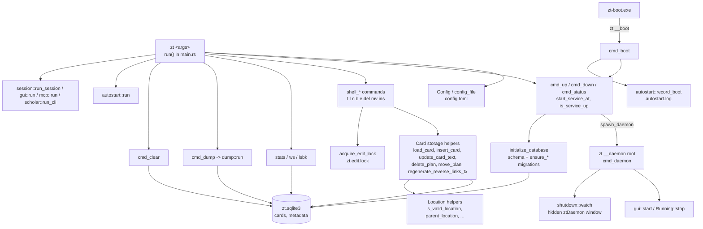
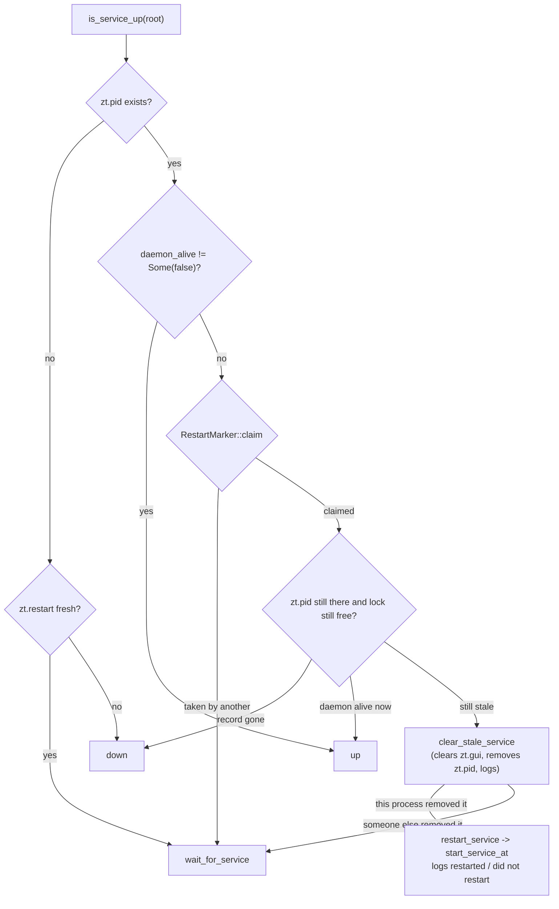

# Service, CLI and storage

## Purpose

This block is the `zt` binary's front door and its storage base. It parses every `zt` command line and dispatches it, reads and writes the config file, owns the archive root (the SQLite database, the log, and the service, session, lock, and GUI record files), starts and stops the service daemon, finds a daemon that ended without `zt down` and starts the service again, creates the SQLite schema and runs every one-time migration, and holds the shared Location and Card-storage helpers that the other blocks call (`load_card`, `insert_card`, `direct_successor`, `parent_location`, the edit lock, Reverse link regeneration). It also starts the service at sign-in (`zt autostart`, `zt-boot`), stops it when Windows ends the user's session, writes full dumps (`zt dp`), and empties the archive (`zt clear`). It exists so that every client (the shell commands, the Session, the GUI, the MCP server) works on one archive, through one set of rules, while exactly one daemon is up.

**Owns:** command dispatch in `src/main.rs`, the config file, the archive-root file layout, the daemon lifecycle and stale-service recovery, the `cards` and `metadata` tables and their migrations, the Location grammar helpers, the edit lock, the shell write commands (`t`, `l`, `n`, `b`, `e`, `del`, `mv`, `ins`), `stats`, `ws`, `lsbk`, `dp`, `clear`, autostart, shutdown handling, and the shared integration-test harness.

**Does not own:** Card text parsing, Link parsing, Reverse link text, Citation key and BibTeX rules, and Workspace rules ([Cards, Workspaces and Links](cards-and-links.md)); move, insert, and delete planning beyond the plain cases ([Card operations](card-operations.md)); the interactive Session ([Terminal Session](session.md)); Model facets, levels, and Math forms ([Models and math](models-and-math.md)); hub levels ([Hub Cards](hub-cards.md)); the GUI server and Spreads ([GUI](gui.md)); `zt mcp` ([MCP server](mcp-server.md)); `zt scholar` and artifacts ([Scholar bridge](scholar-bridge.md)).

## At a glance

| | |
|---|---|
| Entry points | `main()` / `run()` in `src/main.rs` (every `zt` command line); `zt __daemon <root>` (`cmd_daemon`, the service process); `zt __boot` (`cmd_boot`, run by `zt-boot`); `main()` in `src/bin/zt-boot.rs` (the sign-in command); `autostart::run` in `src/autostart.rs`; `dump::run` in `src/dump.rs`; `shutdown::watch` in `src/shutdown.rs` |
| Key files | `src/main.rs` — dispatch, config, archive-root paths, daemon lifecycle, schema and migrations, Location helpers, Card storage helpers, shell commands, edit lock |
| | `src/shutdown.rs` — keeps the daemon alive until `zt down` or until Windows ends the session (hidden `ztDaemon` window) |
| | `src/autostart.rs` — `zt autostart [on\|off]`, the HKCU Run key value, `autostart.log` |
| | `src/bin/zt-boot.rs` — window-less login program that runs `zt __boot` |
| | `src/dump.rs` — `zt dp` payload, `archive.json` manifest, compressor detection, archive cleanup |
| | `tests/cli_service.rs` — end-to-end CLI, schema, dump, clear, Session-over-pipe, GUI lifecycle, and the GUI Reply route tests |
| | `tests/autostart.rs` — Windows-only sign-in, shutdown, sign-out, and dead-daemon tests |
| | `tests/support/pty.rs`, `tests/support/mod.rs` — PTY harness (`PtySession`, `Key`) shared with `tests/pty_session.rs` |
| | `tests/support/host_tools.rs` — `host_tar()`: the tar that reads every dump format |
| | `tests/fixtures/fake_tar.rs`, `tests/fixtures/fake_7z.rs` — fake compressors compiled by tests |
| Depends on | [Cards, Workspaces and Links](cards-and-links.md) (`card::parse_card_text`, `compose_card_text`, templates, `from_legacy_text`; `link::LinkLifecycle`, `LinkBody`; `literature::validate_citation_key`, `parse_metadata`; `workspace::tree_workspace`, `ensure_same_workspace`, `counts`), [Card operations](card-operations.md) (`place::move_plan`, `insert_plan`, `apply_insert_plan`), [Models and math](models-and-math.md) (`model::Facet::MAX_CHARS`, `model::ensure_allowed`, `math::MathForm::ALL`), [Hub Cards](hub-cards.md) (`hub::HubLevel`), [Terminal Session](session.md) (`run_session`, `session_count`, `process_exists`), [GUI](gui.md) (`gui::start`, `Running::stop`, `recorded_url`, `clear_record`, `gui::run`; `spread::follow`), [MCP server](mcp-server.md) (`mcp::run`), [Scholar bridge](scholar-bridge.md) (`scholar::run_cli`, `artifact::references`, `artifact::path`). Libraries: `rusqlite` (bundled SQLite), `anyhow`, `tempfile`, `sha2`, `getrandom`, `serde_json`, `windows-sys` (process creation, registry, window messages). Host programs: the `EDITOR` command, and `tar.exe` / `zip` / `gzip` / `zstd` / `7z` / `7zz` for dumps |
| Used by | Every other Rust block calls the crate-root helpers: [Terminal Session](session.md) (`use crate::*`), [Card operations](card-operations.md) (`move_plan`, `apply_move_plan`, `delete_plan`, `apply_delete_plan`, `insert_card`), [GUI](gui.md) (`require_service_up`, `log_event`, `load_cards`, `ensure_markdown_cards`), [MCP server](mcp-server.md) (`require_service_up`, `acquire_edit_lock_within`), [Models and math](models-and-math.md) and [Hub Cards](hub-cards.md) (`load_card`, `tree_id`, `parent_location`), [Scholar bridge](scholar-bridge.md) (`config_file`) |
| Tests | `tests/cli_service.rs`, `tests/autostart.rs`, `tests/workspaces_mcp.rs` (lock contention, fault classification, wait diagnostics), unit tests in `src/main.rs`, `src/dump.rs`, `src/autostart.rs`; harness in `tests/support/`, `tests/fixtures/` |

## Concepts

- `Archive root` — the folder that holds one archive: the database and all service files. Set with `zt config set archive_root <path>`; read by `require_archive_root` in `src/main.rs`.
- `Config file` — `config.toml` in the config directory; holds only `archive_root=<path>`. Type `Config` in `src/main.rs`.
- `Service` — the one daemon process (`zt __daemon <root>`) that keeps an archive "up" and runs the GUI. Commands that read or write Cards refuse with `service is not up` while it is down (`require_service_up`).
- `Service record` — `zt.pid`, the daemon's pid. Its presence means "up"; removing it is how `zt down` stops the daemon (`service_path`, `owns_service`).
- `Daemon lock` — an exclusive OS file lock on `zt.daemon.lock`, held for the daemon's whole life and released by the OS however the daemon ends (`daemon_alive`).
- `Stale record` — a `zt.pid` whose daemon lock is free: the daemon ended without `zt down` (power cut, killed process). `clear_stale_service` removes it.
- `Restart marker` — `zt.restart`, made with create-new by the one process that restarts a dead service (`RestartMarker`); ignored after 30 seconds (`RESTART_TIMEOUT`).
- `Session` — an interactive terminal view ([Terminal Session](session.md)); open Sessions are listed by pid in `zt.sessions` and counted by `session::session_count`. `zt down` and `zt clear` refuse while any is open.
- `Edit lock` — `zt.edit.lock`, made with create-new for every write (`acquire_edit_lock`, `EditLock` removes it on drop). Its holder writes `zt edit lock` and its pid into it and keeps the file's OS lock, which the system releases however the holder ends; the next writer removes a marked file whose OS lock is free (`remove_stale_edit_lock`) and takes the lock. A second writer gets `edit in progress`. The short-held `zt.edit.guard` OS lock orders creating, taking over, and removing the lock file.
- `Edit conflict` — the only retryable edit-lock outcome: another holder's marked file (`EditConflict::Held`, with the pid or marker that could be observed of it), or the operating system's contention errors while opening, reading or removing the lock file (`EditConflict::Sharing`: Windows `ERROR_SHARING_VIOLATION`, os error 32, and the byte-range `ERROR_LOCK_VIOLATION`, os error 33, which is what a live holder's `LockFileEx` makes a reader or a remover hit). Every other failure is an `EditLockError::Fault`: access denied, a full disk, a lock file that is not UTF-8 text, and anything else. A fault fails at once instead of being waited out as a busy lock (R314).
- `Edit wait diagnostics` — one `edit wait:` line in `zt.log` after a wait passes five seconds (`EDIT_WAIT_LOG_AFTER`), one `edit wait done:` line for its completion (`outcome=acquired` with `queue_wait_ms` and `held_ms`, or `outcome=timeout` with `waited_ms` and `patience_s`), and one `edit lock held:` line for a hold longer than five seconds with no wait. Never one line per poll. The crossing is checked both after a refusal and when the lock arrives, so a wait whose last poll crosses five seconds still reports itself and names the last observed holder. Both durations are recorded so a slow apply is attributable to waiting or to writing (R316/R317).
- `Daemon run record` — `zt.daemon.run`, JSON written by the daemon at start (`pid`, `version`, `archive_id`, `revision`, `started`, `last_heartbeat`, `panicked`), refreshed by each heartbeat, and removed by a normal exit. What is left behind at the next start is the evidence of a disappearance (R318/R319).
- `Abnormal exit record` — `zt.daemon.last`, the run record of a daemon that ended without a normal exit record, written by the next start's `begin_daemon_run`. `zt status` reports it as `last_exit: abnormal`; a normal exit removes it. The log line is `daemon abnormal exit: pid=… version=… archive=… revision=… started=… last_heartbeat=… panicked=… exit_info=none cause=unknown`, because a force kill or a power cut leaves no OS exit information.
- `Active-run marker` — `zt.digest.run`, JSON `{schema_version, run_id, out, unit, pid, renewed, ttl_s}` written by ledger-aware `zt-digest` commands (`zt::renew_active_run`) and their claim heartbeats. The daemon's heartbeat reads it and appends one `daemon heartbeat:` line a minute while it is fresh; a killed run stops renewing it and it expires after `ttl_s` (300 s), so it never stays active indefinitely (R318).
- `SystemEnd` — why Windows ended the daemon: `LogOff` or `Shutdown` (`src/shutdown.rs`).
- `Login command` — the Run-key value `zt` that starts `zt-boot` at sign-in (`src/autostart.rs`).
- `Card` (the storage row) — the private struct `Card` in `src/main.rs`: `row_id`, `address` (a Location or a Citation key), `citation_key`, `is_topic`, `is_lit`, `bibtex`, `text`, `workspace`, `card_type`, and the optional `facet`, `emphasis`, `level` (elaboration level), `hub_level`, `form` (Math form). `Card::level_id` gives a Model Card's or Hub Card's level as clients see it.
- `Location` — the address of a Topic or Regular Card, such as `1/0`, `1/2|c|4|b`, or `Smith2024/1|a`. The text before `/` is the tree id: a Topic number or a Citation key. Grammar in `is_valid_location` and friends.
- `Citation key` — the address of a Literature Card, which is its own tree id; validated by `literature::validate_citation_key` (`^[A-Za-z][A-Za-z0-9_-]{0,127}$`, not a Windows reserved name such as `CON`).
- `Tree root` — a Topic Card (`<n>/0`) or a Literature Card; `is_tree_root`.
- `Direct successor`, `Side successor` — the numbered and lettered continuations of a Card; `direct_successor`, `next_side_successor`.
- `Next Topic id` — the `metadata` value `next_topic_id`; deleted Topic numbers are never reused (`next_topic_id`, `bump_next_topic_id`).
- `Dump` — a compressed archive `zt-archive-<seconds>.<ext>` under `<root>/dump/` with every Card, its manifest, and the artifacts the Cards show (`src/dump.rs`).
- `DumpCard` — one Card as `zt dp` writes it (`src/dump.rs`).
- `Compression candidate` — one way to write one format with one executable (`Candidate`, `Backend`, `CompressionFormat` in `src/dump.rs`).

## Architecture

The binary is one crate. `src/main.rs` declares every module, so the crate root is also the shared library of storage helpers. Most other modules reach its private items with `crate::name` (or `use crate::*` in `src/session.rs`).



### Components

| Component | File | Role |
|---|---|---|
| Dispatcher | `src/main.rs` (`run`, `parse_*`) | Matches the whole argument list exactly; anything else is `unknown command`. |
| Config | `src/main.rs` (`Config`, `config_file`) | Reads and writes `config.toml`. |
| Lifecycle | `src/main.rs` (`start_service`, `start_service_at`, `spawn_daemon`, `cmd_daemon`, `cmd_down`, `is_service_up`, `is_service_recorded_up`, `restart_service`, `wait_for_service`, `daemon_alive`, `clear_stale_service`, `clear_stale_legacy_service`, `RestartMarker`) | Brings the daemon up and down and repairs a dead one. |
| Shutdown watcher | `src/shutdown.rs` | Blocks the daemon thread until the record is gone or Windows ends the session. |
| Schema | `src/main.rs` (`initialize_database`, `cards_table`, `ensure_*`) | Creates and migrates the database. |
| Storage helpers | `src/main.rs` (`open_db`, `load_card`, `load_cards`, `insert_card`, `insert_literature_card`, `create_topic`, `update_card_text`, `update_literature_text`, `update_literature_metadata`, `delete_plan`, `apply_delete_plan`, `move_plan`, `apply_move_plan`, `apply_location_mapping_tx`, `regenerate_reverse_links_tx`) | Every write path runs through these. |
| Location helpers | `src/main.rs` | Location grammar, tree membership, successor arithmetic. |
| Editor bridge | `src/main.rs` (`run_editor`, `run_editor_with_suffix`) | Opens `EDITOR` on a temp file. |
| Dump | `src/dump.rs` | Builds and compresses the dump. |
| Autostart | `src/autostart.rs`, `src/bin/zt-boot.rs` | Sign-in start. |
| Reply write | `src/reply.rs` (registered by `mod reply` in `src/main.rs`) | The GUI-only Owner write that answers an agent Card with one human Card; see [GUI](gui.md#reply-srcreplyrs). It owns no new table and no new command. |

Control and data flow: a CLI process resolves the archive root from the config, checks the service (`require_service_up` also runs `ensure_markdown_cards`), takes the edit lock for a write, opens its own SQLite connection, and commits the authored change, derived Links and generated sections together. Ordinary writes finalize one source with `link_index::source_changed`; structural changes use `regenerate_reverse_links_tx`. The daemon itself does not serve Card writes from the CLI; it holds the daemon lock, keeps the record, and runs the GUI thread. Every CLI process and the GUI open the database directly.

## Interfaces

The transaction-level create helpers and `update_card_text` explicitly compose ordinary authored writes before storage. `src/link_index.rs` replaces generated Reverse sections with `card::with_reverse_section`, and its integrity oracle uses the same byte-preserving rule. This preserves existing normal terminal-save formatting while allowing a receipt-owned edit to retain a legacy authored prefix exactly. The owned paragraph writer alone splices its authorized body span inside the caller's transaction; it does not call the ordinary whole-Card formatter.


Identified Card writes create the additive `applied_ops(op_key PRIMARY KEY, request_hash, result_json, committed_at)` table inside their archive write transaction. Required values are non-null; commit time is UTC. Receipts are never expired by time or stored in a separate run database. They remain historical evidence even if a later Card edit/delete/clear changes their outputs; consumers must reread and verify the retained authored fingerprints before declaring current completion. The transaction-level `insert_card_tx` and `insert_literature_card_tx` share ordinary storage validation without committing or refreshing derived data themselves.

`link_index::sync_sources` replaces occurrence rows for all changed sources, then refreshes the union of those sources and their old/new targets once. The single-source wrapper uses the same implementation. A bounded batch owns the one revision increment and receipt commit; a replay makes no new Card or Link-index write. Diagnostic `last_write.indexed_cards`/`refreshed_cards` cover the complete union, rather than only the last item.

`card_from_row` decodes the shared 14-column Card projection for exact/full storage reads and the MCP hub-policy metadata projection. Metadata rules have one decoder; read query selection is owned by `src/read.rs`.

### Link integrity and recovery

`zt status --check-links` prints a JSON integrity report from one read transaction and exits nonzero on drift. It compares every indexed occurrence and stored Reverse link section with a fresh full parse. The report includes `ok`, `cards`, `links`, `archive_revision`, `faults` and `last_write` counters (`indexed_cards`, `refreshed_cards`, `changed_reverse_sections`). `zt reindex` takes the edit lock, rebuilds the derived index and repairs generated sections transactionally, without rewriting authored content.

`src/link_index.rs` owns the index migration, `ensure`, `sync_source`, `source_changed`, `rebuild`, `check`, and archive revision. Migration makes a consistent `VACUUM INTO` backup, verifies its integrity and atomically installs the index. A migration that repairs a stale stored Reverse section advances the revision once, because it changed stored Cards; a migration that changes no stored text leaves the revision alone. The Markdown-format early return still runs this ensure step. A malformed Card names its address and rolls back the migration, so no marker, index row or changed Card survives the aborted transaction; an unknown index version is refused. Reindex repairs drift explicitly instead of concealing it in ordinary reads.

### CLI commands (dispatch in `run`, `src/main.rs`)

Commands marked "up" call `require_service_up` and fail with `service is not up` (or `archive_root is not configured; run \`zt config set archive_root <path>\``) first. Write commands also take the edit lock and fail with `edit in progress`.

| Command | Needs | Function | Output / effect |
|---|---|---|---|
| `zt` | up | `session::run_session(root)` | Opens a Session ([Terminal Session](session.md)). |
| `zt version` | — | inline | `zt <CARGO_PKG_VERSION>` |
| `zt help` | — | `cmd_help` | Lifecycle and `scholar` lines always; Card commands only when the service is up (it calls `is_service_up`, which may restart a dead daemon). |
| `zt up` | config | `cmd_up` → `start_service` | `service started pid: <pid>` or `service already running pid: <pid>`, then `gui: <url>` or `gui: not running (see <zt.log>)`. |
| `zt down` | — | `cmd_down` | `service stopped` / `service already stopped`; fails `cannot stop service while N session(s) are open`. |
| `zt status` | — | `cmd_status` | `state: up\|down`, `pid:`, `gui:` (when up), `archive_root:`, `sqlite:`, `revision:` (the archive's current revision), `daemon:` (the run record's version, start time and last heartbeat), `last_exit: abnormal …` while the latest run ended without a normal exit record, `cards:`, `sessions:`, and on Windows `autostart: on\|off\|unknown (…)`. Calls `is_service_up`, so it restarts a dead daemon; `zt-digest`'s service resolution polls this output before archive work (R320). |
| `zt stats` | up | `cmd_stats` | `total:`, `topics:`, `regular:`, `literature:` |
| `zt ws` | up | `cmd_workspaces` | One line per Workspace: `<id> (<label>): N topic trees, N literature trees, N cards; MCP access: read-only\|read-write`. |
| `zt lsbk` | up | `cmd_lsbk` | One line per Broken link: `<source> <source title> -> <target>: <source line>`. |
| `zt dp` | up, lock | `cmd_dump` → `dump::run` | Interactive compression prompt, then `dumped N cards to <path>`. |
| `zt clear` | up, lock, no Session | `cmd_clear` | Prompt `type clear to confirm: `; `cleared N cards; next topic id reset to 0` or `clear canceled`. |
| `zt mcp` | up (checked in `mcp.rs`) | `mcp::run` | [MCP server](mcp-server.md). |
| `zt scholar …` | — | `scholar::run_cli(rest)` | [Scholar bridge](scholar-bridge.md). |
| `zt gui [--open]` | up | `gui::run(rest)` | [GUI](gui.md): `zt gui: <url>`, `port: <n>`. |
| `zt autostart [on\|off]` | Windows | `autostart::run(rest)` | See below. |
| `zt config show` | — | `cmd_config_show` | `archive_root=<path>` or `archive_root=<unset>`, then `gui_search=on\|off`, `gui_ask=on\|off`, `gui_reply=on\|off` |
| `zt config set archive_root <path>` | service down | `cmd_config_set_archive_root` | Writes the config, prints `archive_root=<path>`; fails `cannot change archive_root while service is up`. |
| `zt config set gui_search\|gui_ask\|gui_reply on\|off` | — | `cmd_config_set_feature` | Turns one reader feature off or on (S28, #121); prints `<key>=<on\|off>` and may run while the service is up, because the GUI reads the switch on every request. A value other than `on`/`off` is refused before the file is written. |
| `zt t [--ws <workspace>] <title…>` | up, lock | `shell_create_topic` | Title words joined by spaces, must be one non-empty line; opens `EDITOR` on `topic_template(title)`; prints the new `<n>/0`. Default Workspace human. |
| `zt l [--ws <workspace>]` | up, lock | `shell_create_literature` | `EDITOR` on a `.bib` buffer until it parses and its key is free (case-insensitively), then `EDITOR` on the Card text; prints the Citation key. |
| `zt n --at <target>` | up, lock | `shell_create_direct` | Direct successor of a Topic, Literature, or Regular Card; fails `direct successor already exists: <loc>`; prints the Location. |
| `zt b --at <location>` | up, lock | `shell_create_side` | Next Side successor; refuses Topic and Literature Cards. |
| `zt e --at <target> [--part metadata\|text]` | up, lock | `shell_edit` | Edits Card text; a Literature Card needs `--part`; `--part` on another Card fails. A key change in metadata prints the rename plan and asks for `move`. |
| `zt del --at <target>` | up, lock | `shell_delete` | Prints `delete verification:` lines, asks for `delete` (or the root's own address for a Tree root), prints `deleted: N` and any `compacted:` renames. |
| `zt mv --at <location> [--alone] <new-location>` / `… --before <location>` | up, lock | `shell_move` → `place::move_plan` | Prints `move verification:`, asks for `move`, prints `moved: N` and each `old -> new`. |
| `zt ins --at <location>` | up, lock | `shell_insert` → `place::insert_plan` | Prints the renumbering, asks for `insert`, then opens `EDITOR`; prints the new Location. |
| `zt __daemon <root>` | internal | `cmd_daemon` | The service process. |
| `zt __boot` | internal | `cmd_boot` | `zt up` for sign-in, recorded in `autostart.log`. |

Argument parsing (`src/main.rs`): `parse_workspace_option` takes one optional leading `--ws <human|agent>` (`Workspace::parse`); `parse_at` / `parse_target_at` accept exactly `--at <value>`; `parse_mv_args` accepts `--at <loc> [--alone] (<new-location> | --before <loc>)`; `parse_edit_args` accepts `--at` and `--part` once each, in any order. All of them fail before the editor opens. Shell-created Cards (`n`, `b`, `ins`) are Idea Cards in the parent's Workspace.

### `zt autostart` (`src/autostart.rs`)

| Form | Effect |
|---|---|
| `zt autostart` | `autostart: on` + `command: <cmd>` (+ `warning: <program> is missing; run \`zt autostart on\` again`), or `autostart: off`; then `last login start: <outcome> (at <seconds>)` from the last line of `autostart.log`. |
| `zt autostart on` | Fails `<zt-boot> is missing; install zt with \`cargo install --path . --locked\`` if `zt-boot` is not beside `zt`; writes the Run value; prints `autostart: on`, a one-line summary, and `command: <cmd>`. Idempotent. |
| `zt autostart off` | `autostart: off` or `autostart: already off`. |
| other | `usage: zt autostart [on\|off]` |
| non-Windows | every form fails `zt autostart is only available on Windows`. |

The command line is `"<dir>\zt-boot.exe"`, plus ` --config-dir "<dir>"` (trailing slashes trimmed) when `ZT_CONFIG_DIR` is set (`login_command`).

`pub(crate)` items: `run(&[String]) -> Result<()>`, `status_line() -> Option<String>` (the `autostart:` line of `zt status`, `None` off Windows), `record_boot(&str) -> Result<()>` (appends `<seconds> <outcome>` to `autostart.log`, newlines replaced by spaces).

### `zt-boot` (`src/bin/zt-boot.rs`)

A Windows-subsystem program (`windows_subsystem = "windows"`, so no console). It runs `zt __boot` from its own folder (`zt` + `EXE_SUFFIX`) with null stdio and `CREATE_NO_WINDOW`; with exactly `--config-dir <dir>` it sets `ZT_CONFIG_DIR=<dir>` for the child. It exits with the child's exit code (1 when the child cannot run).

### `src/shutdown.rs`

- `pub(crate) enum SystemEnd { LogOff, Shutdown }`; `describe()` gives `the user is signing out` / `the machine is shutting down`.
- `pub(crate) const WINDOW_CLASS: &str = "ztDaemon"` (Windows); the window title is `zt daemon <pid>`.
- `pub(crate) fn watch(keep_running: impl Fn() -> bool + 'static, on_end: impl Fn(SystemEnd) + 'static) -> Option<SystemEnd>`: returns `None` when `keep_running` turns false, or `Some(end)` after `on_end(end)` ran because Windows ended the session. Off Windows it polls `keep_running` every 250 ms and never calls `on_end`.

### `src/dump.rs`

- `pub(crate) struct DumpCard` with `new(address, workspace, card_type, text)`, `literature(address, workspace, bibtex, text)`, and builders `with_part(facet, emphasis)`, `with_level(level)`, `with_form(form)`.
- `pub(crate) fn run(root: &Path, cards: &[DumpCard], next_topic_id: u64) -> Result<()>`: prompts on stdin and writes the dump. Errors: `no supported compression option detected; supported options: zip, tar.gz, tar.zst, 7z`, `invalid compression option`, `archive already exists: <path>`, `compression command for <fmt> failed with <status>`, `compression command for <fmt> did not write a <fmt> archive`.

### Crate-root helpers other blocks call (`src/main.rs`)

Archive and service:

| Function | Contract |
|---|---|
| `require_archive_root() -> Result<PathBuf>` | The configured root, or the "not configured" error. |
| `require_service_up() -> Result<PathBuf>` | Root when `is_service_up`; then runs `ensure_markdown_cards`. |
| `config_file() -> Result<PathBuf>` | Path of `config.toml` (see Configuration). |
| `db_path`, `log_path`, `service_path`, `sessions_path`, `sessions_lock_path`, `edit_lock_path`, `edit_guard_path`, `daemon_lock_path`, `restart_marker_path` | Archive-root file paths (see Data and storage). |
| `log_event(root, event) -> Result<()>` | Appends `<unix-seconds> <event>` to `zt.log`. |
| `is_service_up(root) -> bool` | Up check that restarts a dead daemon. |
| `acquire_edit_lock(root, operation) -> Result<EditLock>` | Under the `zt.edit.guard` lock: create-new `zt.edit.lock`, write the marker and pid, keep its OS lock. If the file exists, `remove_stale_edit_lock` removes it when it has the marker and its OS lock is free, and the create is tried once more; a marked file with a live holder, a file without the marker (from an older zt), and the two Windows contention errors are `edit in progress` with the observable holder named. Every other failure is a fault. `operation` names the caller in the diagnostic lines. |
| `acquire_edit_lock_within(root, patience, operation) -> Result<EditLock>` | Retries with backoff 20 ms → 400 ms while the conflict is contention and `patience` has not run out (MCP server, batch writes, reindex); a fault returns at once. Logs the one wait event, and its one completion or timeout (see Edit wait diagnostics). |
| `try_acquire_edit_lock(root, operation) -> Result<EditLock, EditLockError>` | One acquisition attempt with the typed outcome: `EditLockError::Busy(EditConflict, waited)` or `EditLockError::Fault(anyhow::Error)`. |
| `remove_stale_edit_lock(path) -> Result<StaleLock, EditLockError>` | `StaleLock::Removed` or `StaleLock::Held(EditConflict)`; reads the holder's marker before taking the file lock, so a live byte-range holder is reported as contention, and a file that is not UTF-8 text is a fault that keeps the file for its owner. |
| `classify_lock_step(err, step, path, holder) -> EditLockError` | Maps one lock-file IO error to contention (os error 32/33, Windows only) or to a fault naming the file and the step. |
| `initialize_database(root) -> Result<()>` | Schema + all migrations (also used by unit tests in other modules on a temp dir). |
| `ensure_markdown_cards(root) -> Result<()>` | Runs on every `require_service_up` and GUI snapshot read. |
| `open_db(root) -> Result<Connection>` | Plain connection to `zt.sqlite3`. |

Card storage:

| Function | Contract |
|---|---|
| `load_card(conn, target) -> Result<Card>` | By Location or Citation key (exact case); error `card \`<target>\` does not exist`. |
| `load_cards(conn) -> Result<Vec<Card>>` | Every row, ordered by address. |
| `insert_card(conn, location, is_topic, workspace, card_type, part: Option<&model::Part>, text)` | Validates the Location, the Topic-is-Idea rule (`only Regular Cards can be Event, Finding, Model, or Hub Cards`), uniqueness, the tree's Workspace, `model::ensure_allowed`, and the text and its Links; inserts and regenerates Reverse links in one transaction. |
| `create_topic(conn, workspace, text) -> Result<String>` | Inserts at `next_topic_location` and bumps `next_topic_id`. |
| `insert_literature_card(conn, key, workspace, bibtex, text)` | Validates the key, case-insensitive uniqueness, and the text. |
| `update_card_text`, `update_literature_text`, `update_literature_metadata` | Text updates; metadata may rename the whole Literature tree (`citation_rename_mapping`). |
| `validate_card_text(conn, location, text, old_text)` | `parse_card_text` + `LinkLifecycle::validate_edit` (new Links must target existing Cards; old Broken links may stay). |
| `delete_plan(conn, at) -> Result<DeletePlan>`, `DeletePlan::into(conn, into)`, `DeletePlan::compaction()`, `delete_verification_lines`, `apply_delete_plan(conn, plan)` | Delete a subtree, or a whole tree from its root; optional re-pointing of inbound Links to `into`; Side successor compaction, left out when it would make a breaking Link resolve to a renamed Card. |
| `move_plan(conn, at, new_location) -> Result<MovePlan>`, `move_verification_lines`, `apply_move_plan` | Plain subtree move to a free Location (the base case of `place::move_plan`). |
| `apply_location_mapping_tx(conn, mapping)` | Renames rows through a `__moving__` prefix, rewrites Links, and calls `spread::follow`. |
| `regenerate_reverse_links_tx(conn)` | Rebuilds the occurrence index after a structural change, refreshes generated sections only where text differs, and advances the revision in the caller's transaction. Before index migration, retains the legacy full-parser path. |
| `count_rewritten_links`, `replace_link_locations`, `citation_rename_lines`, `citation_key_exists_case_insensitive`, `citation_key_conflicts`, `card_counts`, `read_confirmation(input, expected)`, `run_editor`, `link_lifecycle`, `link_lifecycle_from_cards` | Supporting helpers. |

Location helpers (all pure except where a `conn` is taken):

| Function | Rule |
|---|---|
| `is_valid_location(s)` | Topic or Regular Location. |
| `is_valid_topic_location(s)` | `<topic-id>/0`. |
| `is_valid_regular_location(s)` | `<tree-id>/<positive>` followed by `\|`-separated segments, each a positive number or a lowercase-letter label. |
| `valid_topic_id(s)` | `0` or a positive number. |
| `valid_positive_number(s)` | ASCII digits, no leading zero, not `0`. |
| `valid_side_label(s)` | one or more `a`–`z`. |
| `valid_tree_id(s)`, `is_literature_tree_id(s)` | Topic id, or a valid Citation key. |
| `tree_id(addr)`, `tree_root_address(tree)`, `is_tree_member(addr, tree)`, `is_tree_root(card)`, `topic_id(loc)` | Tree membership: `3` → root `3/0`; `Smith2024` → root `Smith2024`; `30/1` is not in tree `3`. |
| `direct_successor(loc)` | `n/0` → `n/1`; `Key` → `Key/1`; last segment numeric → +1; last segment a label → append `\|1`. |
| `parent_location(loc)` | Inverse: label → strip it; number > 1 → number − 1; `1` → the prefix, or the tree root. `None` for roots. |
| `last_segment`, `replace_last_segment`, `immediate_side_label` | Segment arithmetic. |
| `side_label_to_number`, `number_to_side_label` | Bijective base 26: `z` = 26, `aa` = 27. |
| `next_side_successor(conn, parent, excluding)` | `parent\|<max label + 1>`. |
| `descendant_locations(conn, root)` | The root and every Card reachable by `parent_location`. |
| `ensure_side_parent(card)`, `ensure_same_tree_kind_boundary(from, to)` | No Side successor on a Tree root; Literature tree Cards never leave their tree; Topic tree Cards never enter a Literature tree. |
| `location_exists`, `citation_key_exists`, `target_exists` | Existence checks. |
| `next_topic_location`, `next_topic_id`, `bump_next_topic_id` | Topic numbering. |

## Behaviour

`validate_card_text` refuses a newly authored body/title combination whose first nonblank body line repeats its Card title. The check runs after the legitimate envelope is parsed and is shared by ordinary, GUI/terminal and identified writes. An unchanged legacy authored title/body may survive an unrelated type/metadata update; a new bad content write is refused. The ordinary transaction and identified batch roll back their prior writes/allocation on this error. The guard does not remove old text or rewrite repeated Chinese characters. The GUI boundary is public too: `tests/cli_service.rs` `gui_serves_a_token_guarded_api_backed_by_the_same_card_rules` sends `/api/create` and `/api/edit` a body that repeats its own title, gets HTTP 400 with `duplicate leading title`, and sees no allocated address or changed Card.


### Start the service (`zt up`)

1. `cmd_up` → `start_service`: read the root; if `zt.restart` is fresh, `wait_for_service` first (a second daemon would only wait for the daemon lock).
2. `start_service_at`: create the root; `clear_stale_legacy_service` (a zt 0.7 record with no lock file is cleared when its pid is gone, via `session::process_exists`); `is_service_recorded_up` (clears a stale record without restarting). If up, return `service already running pid: <pid>` without touching the database.
3. `initialize_database` (see "Open and migrate the database"), then create `zt.log` if missing.
4. `spawn_daemon`: starts the current `zt` executable directly with separate `__daemon` and archive-path arguments. Windows uses `CreateProcessW` with `CREATE_NO_WINDOW` and handle inheritance disabled; other platforms use null stdio. `independent_service_flags` adds `CREATE_BREAKAWAY_FROM_JOB` only when an owned MCP's `ZT_MCP_OWNED_JOB=1` marker is present. Thus a stale-service restart from inside a contained MCP outlives that client's cleanup. Ordinary starts keep their existing flags. No shell or execution-policy override is required; the child pid is available immediately. The normal service-record readiness check still waits for daemon initialization.
5. Poll for `zt.pid` every 20 ms for up to 15 s; fail `daemon did not start`. Print `service started pid: <pid>`, then `print_gui_line`.

### The daemon (`cmd_daemon`)

1. Open `zt.daemon.lock` and block on `lock()` (a daemon still stopping holds it a moment longer).
2. `begin_daemon_run`: if `zt.daemon.run` is still there, the previous daemon ended without a normal exit record, so log `daemon abnormal exit: … exit_info=none cause=unknown` with every fact that record kept and retain it as `zt.daemon.last`; then write this run's record and log `daemon started pid=… version=… archive=… revision=…`. `install_daemon_panic_hook` logs `daemon panic: … message=… location=…` and marks the record as panicked before the default hook runs.
3. `gui::start(root)`; on failure clear `zt.gui` and log `gui did not start: …`. The GUI comes up before the record, so an "up" service already names its GUI.
4. Write `zt.pid` = own pid; create `zt.sessions` if missing (append mode, so a file a Session wrote meanwhile is not truncated). An isolated test host (`ZT_CONFIG_DIR` under the temp folder) may provoke the panic hook here with `ZT_DAEMON_TEST_FAULT=panic`.
5. `start_daemon_heartbeat`: once a minute (`ZT_DAEMON_TEST_HEARTBEAT_MS` shortens it only for an isolated test), read `zt.digest.run`; while a digest command keeps it fresh, append one `daemon heartbeat: pid=… version=… archive=… revision=… run=… unit=… marker_age_s=…` line and refresh the run record's `last_heartbeat`. An absent or expired marker writes nothing.
6. `shutdown::watch(|| owns_service(root, pid), |end| stop_for_system(root, pid, end))`. `owns_service` is true while `zt.pid` holds this pid.
7. After `watch` returns: stop the GUI (`Running::stop` clears `zt.gui`, logs `gui stopped`); stop and join the heartbeat; `end_daemon_run` logs `daemon stopped pid=… version=… archive=… revision=… exit=normal reason=requested|system-logoff|system-shutdown uptime_s=…` and removes `zt.daemon.run` and `zt.daemon.last`; drop the lock.

### Edit-lock waits and failures

1. `try_acquire_edit_lock` takes `zt.edit.guard`, then creates `zt.edit.lock` with create-new and writes `zt edit lock` and `pid <n>` into it and keeps its OS lock.
2. `AlreadyExists` → `remove_stale_edit_lock` opens the file, reads it (before locking it), tries the OS lock, and if the marker is there removes it and the caller tries once more. A live holder's byte-range lock makes the read itself fail (os error 33) and a holder that opened the file without delete sharing makes removal fail (os error 32): both are contention, and both keep the live holder's file.
3. Contention with no patience (`acquire_edit_lock`) refuses at once with `edit in progress: <operation> is held by <holder>`. With patience (`acquire_edit_lock_within`) the caller retries with backoff 20 ms → 400 ms, logs one `edit wait:` line once the wait passes five seconds, and either acquires (a completion line at release with `queue_wait_ms` and `held_ms`) or refuses at the patience (one `outcome=timeout` line with `waited_ms` and `patience_s`).
4. A fault (access denied, disk full, non-UTF-8 lock text, any other IO error) returns at once as an error naming the file and the step; it is never waited out and never removes the file.
5. `zt mcp` validates `ZT_EDIT_PATIENCE` as whole seconds from 1 through 300 (default 20) at its start; an unreadable or out-of-range value keeps 20 and writes one `edit patience: …` line, so a batch client's misconfiguration cannot silently fall back. A digest write step sets 180 for its child `zt mcp` ([zt-digest](zt-digest.md)).

### Stop the service (`zt down`)

1. No root configured, or `is_service_recorded_up` false → `service already stopped`.
2. `session::session_count > 0` → fail `cannot stop service while N session(s) are open`.
3. Remove `zt.pid`, log `service stop requested`, print `service stopped`. The daemon notices within 250 ms and exits; `zt down` does not wait for it.

### Windows ends the session (`src/shutdown.rs`)

1. The daemon registers class `ztDaemon` and creates a hidden window `zt daemon <pid>` with a 250 ms timer; the timer destroys the window when `keep_running()` is false (the `zt down` path).
2. `WM_QUERYENDSESSION` → answer 1 (never block a shutdown).
3. `WM_ENDSESSION` with `wParam != 0` (once): `ENDSESSION_LOGOFF` in `lParam` → `LogOff`, else `Shutdown`; call `on_end` = `stop_for_system`, which removes `zt.pid` (if still owned), clears `zt.gui`, and logs `service stopped: <describe>`, without waiting for Sessions; then destroy the window. `wParam == 0` (a cancelled shutdown) changes nothing.
4. `WM_DESTROY` posts quit; the message loop ends and `watch` returns `ENDED`.
5. If the window cannot be created, `watch` falls back to polling; the daemon lock still covers the machine going down.

### Detect and restart a dead daemon (`is_service_up`)



- `daemon_alive` tries `try_lock` on `zt.daemon.lock`: `WouldBlock` → `Some(true)`; lock taken → `Some(false)` (released at once); no file or other error → `None`, which counts as alive.
- `wait_for_service` polls every 50 ms up to `RESTART_TIMEOUT` (30 s) until a live record appears or the marker is gone.
- `RestartMarker::claim` removes a marker older than 30 s, then create-new; its `Drop` removes it however the restart ends.
- `is_service_up` is used by `require_service_up`, `zt status`, `zt help`, and the Session on every input line, so any of them restarts a dead service. `zt up`, `zt down`, and `zt config set` use `is_service_recorded_up` instead: they clear a stale record but never restart.
- Logged lines: `service record of daemon <pid> cleared: the daemon ended without \`zt down\``, then `service restarted: daemon <pid> ended without \`zt down\`` or `service did not restart: <error>`. The restarted daemon adds its own `daemon abnormal exit: …` line and its start line, so one disappearance leaves exactly one restart and one abnormal record (R319).

### Sign-in start (`zt-boot` → `zt __boot`)

1. Windows runs the Run value; `zt-boot` starts `zt __boot` without a console.
2. `cmd_boot` runs `start_service`; the outcome line is the success message or `error: <err>`.
3. On success it logs `login start: <line>` to `zt.log`; in every case `autostart::record_boot(line)` appends to `<config dir>/autostart.log`. The exit code reflects the outcome.

### Open and migrate the database (`initialize_database`)

1. Open `zt.sqlite3`; `PRAGMA quick_check` must return `ok`, else `SQLite database is corrupted: …` (a non-SQLite file fails here with `failed to run SQLite integrity check`; the file is not rewritten).
2. If `cards` exists, read its columns. `[location, is_topic, text]` → fail `legacy cards schema detected; back up and manually migrate the database before starting this ZT version`. Any column list other than the eight known generations (7 base columns, then + `workspace`, `card_type`, `model_facet`, `model_emphasis`, `model_level`, `hub_level`, `math_form`) → fail `unsupported cards schema; database was not modified`.
3. `CREATE TABLE IF NOT EXISTS cards` (`cards_table`), the `cards_citation_key_nocase` index, and `metadata`; set `journal_mode=WAL`.
4. Run, in order: `ensure_workspace_column`, `ensure_card_type_column`, `ensure_model_facet_column`, `ensure_open_model_parts`, `ensure_model_level_column`, `ensure_hub_cards`, `ensure_math_form_column`, `ensure_finding_cards`; then `ensure_markdown_cards`. Each step checks for its own mark and returns at once when present, so each runs once per archive.

| Step | Mark it checks | Change | Backup | Log line |
|---|---|---|---|---|
| `ensure_workspace_column` | column `workspace` | `ALTER TABLE ADD COLUMN workspace … DEFAULT 'human'` | — | `added workspaces; existing cards are in the human workspace` |
| `ensure_card_type_column` | column `card_type` | `ADD COLUMN card_type … DEFAULT 'idea'` | — | `added card types; existing cards are idea cards` |
| `ensure_model_facet_column` | column `model_facet` | `ADD COLUMN model_facet TEXT` | — | `added model facets; existing model cards are model heads` |
| `ensure_open_model_parts` | column `model_emphasis` | Rebuild `cards` with today's `cards_table` (free facets, emphasis) | `zt.sqlite3.pre-open-models-<s>.bak` if any Card | `model facets are free labels and model parts may carry an emphasis` |
| `ensure_model_level_column` | column `model_level` | `ADD COLUMN model_level … IN ('concept','formal')` | — | `added model elaboration levels; no model has a level yet` |
| `ensure_hub_cards` | column `hub_level` | Calls `ensure_model_level_column`, then rebuilds with today's table (adds `hub`, `hub_level`) | `zt.sqlite3.pre-hub-cards-<s>.bak` | `added hub cards; no card is a hub card yet` |
| `ensure_math_form_column` | column `math_form` | `ADD COLUMN math_form … IN (<MathForm::ALL>)` | — | `added math forms; no model card states a unit yet` |
| `ensure_finding_cards` | stored table SQL contains `'finding'` | Calls `ensure_math_form_column`, then rebuilds with today's table | `zt.sqlite3.pre-finding-cards-<s>.bak` | `added finding cards; no card is a finding card yet` |
| `ensure_markdown_cards` | `metadata.card_format = 'markdown'` | Converts pre-Markdown text with `card::from_legacy_text`, regenerates Reverse links, sets `card_format` | `zt.sqlite3.pre-markdown-<s>.bak` if any Card converts | `converting N cards to Markdown; backup <path>` |

Each rebuild runs `BEGIN IMMEDIATE; CREATE TABLE cards_<x> …; INSERT … SELECT <known columns>; DROP TABLE cards; ALTER TABLE … RENAME TO cards; CREATE UNIQUE INDEX …; COMMIT;` and issues `ROLLBACK` on error. Because a rebuild creates today's full table, later steps find their marks and do nothing: an old archive gets one rebuild backup, not one per step. Backups use `VACUUM INTO`.

`ensure_markdown_cards` itself first runs `ensure_workspace_column`, `ensure_card_type_column`, `ensure_model_facet_column`, `ensure_open_model_parts`, and `ensure_hub_cards` (not `ensure_math_form_column` or `ensure_finding_cards`).

### Shell writes (`shell_*`)

1. `require_service_up`, then `acquire_edit_lock` (held until the command returns, including while `EDITOR` is open).
2. Load the anchor Card (`load_card`), compute the target Location (`direct_successor`, `next_side_successor`, `next_topic_location`, or the `place` plan).
3. `run_editor` writes the template (`topic_template`, `regular_template`, `card::card_template`, or current text) to a temp file with suffix `.zt.md` (`.bib` for metadata), runs `EDITOR <path>`; a non-zero exit is "cancelled" and stores nothing; the temp file is removed.
4. Validate the referenced targets and write in one transaction, ending with `link_index::source_changed`; print the address.

`zt l` loops on the `.bib` buffer, keeping the user's text on errors (`literature::parse_metadata` errors or `Literature Card \`<key>\` already exists`); the Card title always comes from the BibTeX title (`compose_card_text(&metadata.title, …)`), and client Reverse link text is dropped.

### Delete (`delete_plan` → `apply_delete_plan`)

1. A Tree root's delete set is its whole tree (confirmation: its own address); any other Card's set is `descendant_locations` (confirmation: `delete`).
2. `links_into` lists Links from staying Cards into the set. Without `into`, `delete_verification_lines` lists them as `links that will break`; with `into`, they are rewritten first.
3. For a deleted Side successor, `delete_plan` stores `side_compaction_mapping`: later sibling labels shift down one (`0/1|c → 0/1|b`, with their subtrees). Tree-root deletes never compact. `DeletePlan::compaction` returns no mapping when, without `into`, a Link that breaks targets an address a renamed Card would take; the plan then ends with `later side successors keep their locations, so no card takes over a broken link`, and the gap stays (new Side successors take the label after the highest).
4. One transaction: re-point, delete rows, `spread::follow` (drop deleted Cards from Spreads), apply the compaction mapping (renames and Link rewrites), regenerate Reverse links.

The shell `zt del` never re-points; the `into` path is used by [Card operations](card-operations.md).

### Plain move (`move_plan`)

Refuses Literature Cards (`Literature Card cannot be moved; edit metadata to change its Citation key`) and Topic Cards; requires a valid Regular Location, the tree-kind boundary, the same Workspace, a target outside the moved subtree, a parent that exists outside it, and a target that is exactly the next Side label (`side successor move target must be the next available label: …`) or the parent's Direct successor (`move target does not preserve direct successor rules`). `move_mapping` replays each moved Card's path of Direct/Side edges (`path_edges`) from the new root; any destination that exists outside the subtree fails `destination locations already exist`.

### Literature rename (`update_literature_metadata`)

`citation_rename_mapping` maps `Old → New` and every `Old/<suffix> → New/<suffix>` (fails if any Location already starts with `New/`); one transaction updates the row, applies the mapping, and regenerates Reverse links. A case-only rename is refused, as is a key another Card holds case-insensitively.

### Dump (`zt dp`)

1. `cmd_dump`: `require_service_up`, edit lock (Sessions may be open), load every Card into `DumpCard`s with its facet, emphasis, elaboration level, Math form, and Hub level (Literature Cards must have BibTeX), `next_topic_id`.
2. `detect_compression_options`: `compression_candidates(platform)` → `expand_with(…, locate_on_path)` (one candidate per executable of that name on PATH, in PATH order) → `detect_with(…, probe_candidate)` (first candidate per format whose probe archive carries the format signature, checked by `written_as`). None → fail before creating anything.
3. Print `compression options:` / `  1. zip` …; read one line; only an exact listed number is accepted.
4. Name everything from one timestamp: staging `dump/.tmp/zt-archive-<s>/`, archive `dump/zt-archive-<s><ext>`; fail if the archive exists.
5. Write `mapping.json`, `archive.json`, the Card files, the `.bib` files, and copy every artifact referenced by a Card body (`artifact::references`, `artifact::path`) into `artifacts/`.
6. `compress` into `.zt-archive-<s>.partial<ext>` inside the staging folder; check `written_as` again; `DumpArtifacts::publish` copies it to the final path with create-new; `commit` removes staging and keeps the archive. On any failure `Drop` removes staging, an empty `.tmp`, and the archive only if this run created it.

Command plans (`command_plan`):

| Backend | Command |
|---|---|
| `WindowsTar` (zip, tar.gz, tar.zst) | `tar.exe -a -cf <archive file name> -C <source> <entries…>`, run from the archive's folder |
| `UnixZip` | `zip -q <archive> <entries…>` in `<source>` |
| `UnixTarGzip` / `UnixTarZstd` | `tar -cf - -C <source> <entries…> \| gzip -c` / `\| zstd -q -c` > archive |
| `SevenZip("7z"/"7zz"[.exe])` | `<7z> a -t7z -bd -y <archive> <entries…>` in `<source>` |

### Clear (`zt clear`)

1. `require_service_up`; refuse `cannot clear while N session(s) are open`; take the edit lock.
2. Prompt `type clear to confirm: `; anything but exactly `clear` (after stripping the line ending) prints `clear canceled` and changes nothing.
3. One transaction: count, `DELETE FROM cards`, set `metadata.next_topic_id = '0'`. A failure rolls both back.

### Rules the code keeps

- Exactly one daemon per archive: the daemon lock serializes daemons; `RestartMarker` serializes restarts.
- The service is down only after `zt down` or a system end; both remove `zt.pid`.
- Every Card write holds the edit lock. Ordinary creates and text/title edits update the changed source's Link occurrences and refresh only that Card and its old/new targets in the same transaction. Structural operations retain a full index/Reverse link rebuild, updating stored sections only when they differ. Card edit text and type/level/form changes commit together with one archive revision.
- Argument errors are found before the editor opens or any lock-free side effect happens (tests check that the editor never runs).
- Literature tree Cards never leave their tree; Topic tree Cards never enter one; Tree roots have no Side successors and cannot be moved.
- Citation keys are unique case-insensitively (`cards_citation_key_nocase`) but looked up case-sensitively (`load_card`, `go casekey` fails).
- Topic numbers are never reused, except after `zt clear`.

## Data and storage

The Link-index migration already records `metadata.archive_id` as 16 OS-random bytes encoded by 32 hexadecimal characters. This persistent archive identity is reused by the prepared-run ledger contract and exposed through `get_cards`, alongside the canonical directory path. It survives Card clearing and consistent SQLite backups/restores. A fresh database at the same directory gets another identity. Readers never substitute a new value for missing/corrupt identity metadata; doing that would silently rebind pending work.

### Config directory

| File | Written by | Content |
|---|---|---|
| `config.toml` | `Config::save` | `archive_root=<path>`, `gui_search=on\|off`, `gui_ask=on\|off`, `gui_reply=on\|off` (`key=value` lines, not real TOML; `save` rewrites the lines it owns and keeps the rest) |
| `autostart.log` | `autostart::record_boot` | `<unix-seconds> <outcome>` per sign-in |
| `scholar-bridge.json`, `scholar-archive/` | [Scholar bridge](scholar-bridge.md) | pairing credential, cache |

```text
archive_root=D:\zt-archive
```

### Archive root

| Path | Owner | Meaning |
|---|---|---|
| `zt.sqlite3` (+ `-wal`, `-shm`) | `initialize_database` | The database (WAL mode). |
| `zt.sqlite3.pre-<step>-<seconds>.bak` | migrations | `VACUUM INTO` copies before a rebuild or conversion. |
| `zt.log` | `log_event` | `<unix-seconds> <event>` lines. |
| `zt.pid` | `cmd_daemon` | Service record: the daemon pid. |
| `zt.daemon.lock` | `cmd_daemon` | Locked for the daemon's life. |
| `zt.daemon.run` | `cmd_daemon` | This run's JSON record (`pid`, `version`, `archive_id`, `revision`, `started`, `last_heartbeat`, `panicked`); removed by a normal exit, so what is left is the evidence of a disappearance. |
| `zt.daemon.last` | `begin_daemon_run` | The previous run's record while the latest exit was abnormal; `zt status` reports it, and the next normal exit removes it. |
| `zt.digest.run` | `zt-digest` (`zt::renew_active_run`, claim heartbeats) | Active-run marker `{schema_version, run_id, out, unit, pid, renewed, ttl_s}` that the daemon's heartbeat reads; it expires after `ttl_s`. |
| `zt.restart` | `RestartMarker` | Present only while one process restarts the service. |
| `zt.sessions` | [Terminal Session](session.md) | Open Session pids, one per line, pruned by `session_count`. |
| `zt.sessions.lock` | [Terminal Session](session.md) | Empty; its OS lock serializes every change to `zt.sessions`. |
| `zt.edit.lock` | `acquire_edit_lock` | Present while a write is in progress: `zt edit lock`, then `pid <n>`; the holder keeps its OS lock. A marked file whose OS lock is free is stale. |
| `zt.edit.guard` | `lock_edit_guard` | Empty and kept; its OS lock is held only while a process creates, takes over, or removes `zt.edit.lock`. |
| `zt.gui` | [GUI](gui.md) | The GUI URL, `http://127.0.0.1:<port>/`. |
| `artifacts/` | [Scholar bridge](scholar-bridge.md) | `<sha256>.<ext>` images and `<sha256>.json` records. |
| `dump/zt-archive-<s>.<ext>`, `dump/.tmp/` | `dump::run` | Dumps and their temporary staging. |

```text
1760600000 daemon started pid=78732 version=0.20.0 archive=0f4c… revision=57
1760600001 gui started on http://127.0.0.1:4717/
1760600060 daemon heartbeat pid=78732 version=0.20.0 archive=0f4c… revision=57 run=abc… unit=digest/g001@1 marker_age_s=12
1760600512 service stop requested
1760600512 gui stopped
1760600512 daemon stopped pid=78732 version=0.20.0 archive=0f4c… revision=58 exit=normal reason=requested uptime_s=512
1760600900 daemon abnormal exit: pid=78732 version=0.20.0 archive=0f4c… revision=58 started=1760600000 last_heartbeat=1760600060 panicked=unknown exit_info=none cause=unknown
1760600990 edit wait: op=create_successor waiter_pid=86488 elapsed_ms=5032 patience_s=180 holder=pid:26112(remove refused with os error 32)
1760600995 edit wait done: op=create_successor waiter_pid=86488 outcome=acquired queue_wait_ms=7438 held_ms=11
```

### `cards` table (`cards_table`)

| Column | Type / constraint | Meaning |
|---|---|---|
| `row_id` | `INTEGER PRIMARY KEY` | Stable row id; kept through rebuilds. |
| `location` | `TEXT UNIQUE` | Topic or Regular Location; NULL for Literature Cards. |
| `citation_key` | `TEXT UNIQUE` + `cards_citation_key_nocase` unique index (`COLLATE NOCASE`) | Literature Cards only. |
| `is_topic` | `0/1` | Topic Card. |
| `is_lit` | `0/1` | Literature Card. |
| `bibtex` | `TEXT` | Exact BibTeX; Literature Cards only. |
| `text` | `TEXT NOT NULL` | Full Markdown Card text including the Reverse link section. |
| `workspace` | `'human'` (default) or `'agent'` | Workspace. |
| `card_type` | `'idea'` (default), `'event'`, `'finding'`, `'model'`, `'hub'` | Card type. |
| `model_facet` | NULL or 1..`Facet::MAX_CHARS` chars | Model facet of a Model part. |
| `model_emphasis` | NULL, `'core'`, `'aside'` | Only with a facet. |
| `model_level` | NULL, `'concept'`, `'formal'` | Only on a Model Card without a facet. |
| `hub_level` | NULL, `'line'`, `'topic'`, `'field'`, `'register'` | Only on a Hub Card. |
| `math_form` | NULL or a `MathForm::ALL` id | Only on a Model Card without a facet. |

Table CHECKs: a non-Literature row has a `location` and no key or BibTeX; a Literature row has `is_topic = 0`, no `location`, a key, and BibTeX; plus the facet/level/hub/form rules above. Columns added by `ALTER TABLE` (`model_level`, `math_form`) carry only their column CHECK in migrated archives, so the "Model Card only" rules for them are kept in code (`model::set_level`, `model::set`, `math::set_form`). The Topic-is-Idea rule is kept in `insert_card`.

### `metadata` table

The derived `links` table has `(source, ord)` as its primary key, with `target` and optional computed `kind`, and an index on `(target, source)`. It retains every occurrence, including repeated targets and Broken links; target existence is not a foreign key. Kinds come from the existing body/Relation parser. Generated Reverse links, titles, BibTeX and code are excluded. Clear empties the index; move/rename/delete/insert rebuild it within their existing transaction.

Additional metadata keys are `links_index_version`, `archive_id`, `archive_revision`, and diagnostic `link_write_stats`. The identity binds a future digest ledger to its archive. Revisions increase once per changing content/metadata transaction, including Session retyping; unchanged reindex, MCP edits, shell text saves and identical BibTeX saves leave the revision alone. Ordinary target validation queries only referenced addresses, preserving already Broken links while refusing newly introduced missing targets.

`key TEXT PRIMARY KEY, value TEXT NOT NULL`. Keys: `next_topic_id` (decimal; when missing, `next_topic_id` falls back to the largest Topic number + 1), `card_format` (`markdown`), and `gui_spreads` ([GUI](gui.md), `src/spread.rs`).

### Dump layout (`src/dump.rs`)

```text
zt-archive-1760600000.zip
└── zt-archive-1760600000/
    ├── mapping.json          {"0/0":"141284107b.md","Smith2024":"a1b2c3d4e5.md"}
    ├── archive.json
    ├── 141284107b.md         exact cards.text
    ├── a1b2c3d4e5.md         YAML front matter + exact cards.text
    ├── Smith2024.bib         exact BibTeX bytes
    └── artifacts/<sha256>.png
```

- File names: first 10 hex characters of SHA-256 over `address NUL text`, or for Literature Cards `key NUL bibtex NUL text`. On a name clash two fresh 10-hex-char salts (OS randomness) are appended and the hash is recomputed until unique; salts are recorded nowhere.
- Entry order: `mapping.json`, `archive.json`, Markdown files by address, `.bib` files by Citation key, artifacts.
- Literature Markdown front matter (`literature_markdown`); the block indicator `|-`, `|`, or `|+` keeps the BibTeX's trailing newlines exactly:

```yaml
---
zt_kind: literature
citation_key: DumpKey
bibtex: |+
  @article{DumpKey,
    title={Dump Literature}
  }
  
---
```

- `archive.json` (`manifest`), keys in this order:

```json
{"next_topic_id":7,"workspaces":{"0/0":"human","Smith2024":"agent"},"types":{"0/1":"model","1/1|a":"event","1/1|b":"finding","1/1|c":"hub"},"facets":{"0/1|a":"assumptions"},"emphasis":{"0/1|a":"core"},"levels":{"0/1":"formal"},"forms":{"0/1":"theorem"},"hub_levels":{"1/1|c":"topic"}}
```

`types` leaves out Idea Cards. `levels` holds elaboration levels of Model Cards; `hub_levels` holds the Hub level of every Hub Card that has one.

## Configuration

| Setting | Where | Default | Effect |
|---|---|---|---|
| `archive_root` | `config.toml` via `zt config set archive_root <path>` | unset | The archive every command uses; refused while the service is up. |
| `gui_search`, `gui_ask`, `gui_reply` | `config.toml` via `zt config set <key> on\|off` | on (no line) | One reader feature each, read by the GUI on every request ([GUI](gui.md#feature-switches-s28-121-design-15-release-d380)); they may change while the service is up, and they gate only the GUI's own route. |
| `ZT_CONFIG_DIR` | env var | Windows `%APPDATA%\zt`, else `$HOME/.config/zt` | Config directory (`config_file`); also carried into the login command as `--config-dir`. |
| `APPDATA` / `HOME` | env var | — | Base of the default config directory; missing → `APPDATA is not set` / `HOME is not set`. |
| `EDITOR` | env var | none (`EDITOR is not set`) | Editor command for shell writes; split on whitespace, the temp path is appended. |
| `ZT_AUTOSTART_KEY` | env var | `Software\Microsoft\Windows\CurrentVersion\Run` | HKCU key for the login command (tests point it at a scratch key). |
| `ZT_GUI_PORT` | env var, read by the daemon ([GUI](gui.md)) | 4717 | GUI port; `0` lets the system choose. The daemon inherits the environment of the `zt up` (or restarting) process. |
| `PATH` | env var | — | Where `zt dp` finds compressors; every executable of a name is tried. |
| `RESTART_TIMEOUT` | constant in `src/main.rs` | 30 s | Age after which a `zt.restart` is ignored; also the longest wait for a restart. |
| Daemon start wait | constant in `start_service_at` | 15 s | How long `zt up` waits for `zt.pid`. |
| Shutdown poll | constant in `src/shutdown.rs` | 250 ms | How fast the daemon notices `zt down`. |
| `ZT_FAKE_TAR_ALWAYS_FAIL`, `ZT_FAKE_7Z_ALL_FAIL` | env vars, test fixtures only | unset | Make the fake compressors fail every call. |

## Usage

Set up an archive and work in it:

```powershell
zt config set archive_root D:\zt-archive
zt up
$env:EDITOR = "notepad"
zt t Economics            # prints 0/0
zt n --at 0/0             # prints 0/1
zt b --at 0/1             # prints 0/1|a
zt l --ws agent           # BibTeX first, then the Card text; prints the Citation key
zt e --at Smith2024 --part metadata
"move" | zt mv --at 0/1|a 0/2|a
"delete" | zt del --at 0/2|a
zt lsbk
zt status
zt down
```

Dump non-interactively (the prompt reads one line from stdin):

```powershell
"1" | zt dp      # 1 = the first detected format, usually zip
```

Enable sign-in start (Windows):

```powershell
cargo install --path . --locked   # installs zt and zt-boot side by side
zt autostart on
zt autostart                      # shows the command and the last login start
```

Drive the CLI from a test, as `tests/cli_service.rs` does:

```rust
let home = TestHome::new();          // temp config dir + archive root
home.configure_and_up();             // config set archive_root, then zt up
home.cmd_with_editor("# Topic\n\nbody\n\n<!-- zt:reverse-links -->\n")
    .args(["t", "Topic"])
    .assert()
    .success()
    .stdout(predicate::str::contains("0/0"));
```

Drive a Session in a real terminal with the shared PTY harness (`tests/support/pty.rs`, used by `tests/pty_session.rs`):

```rust
mod support;
use support::pty::{Key, PtySession};

let mut pty = PtySession::spawn(&zt_binary, &config_dir); // sets ZT_CONFIG_DIR, ZT_GUI_PORT=0
pty.wait_for_text("ROOT");
pty.send_text("go 0/0");
pty.send_enter();
pty.send_key(Key::Down);
pty.wait_for_exit();
```

### Add a shell command

1. Add a match arm in `run` (`src/main.rs`) that matches the exact argument shape; parse options with a `parse_*` helper that fails before any side effect.
2. Implement `cmd_<name>` or `shell_<name>`: call `require_service_up` for anything that reads Cards, `acquire_edit_lock` for anything that writes, and do the write in one transaction that ends with `link_index::source_changed` for an ordinary source, or `regenerate_reverse_links_tx` for a structural change.
3. Add its line to `cmd_help` (in the "up" group if it needs the service). Shell-only commands must not appear in Session help (tests check `dp` and `clear`).
4. Add an end-to-end test in `tests/cli_service.rs` with `TestHome`.

### Add a column or a value to `cards`

1. Change `cards_table` (the table new archives get).
2. Add the new column list to the generations accepted in `initialize_database`, or `zt up` refuses the archive as `unsupported cards schema`.
3. Add an `ensure_<x>` step at the end of the list in `initialize_database`: `ALTER TABLE ADD COLUMN` for a new nullable column, or a backup plus rebuild (copy of `ensure_finding_cards`) when a CHECK must change; log one line. Make it call the earlier step whose column it copies, as `ensure_hub_cards` and `ensure_finding_cards` do.
4. Read the column in both `load_card` and `load_cards` and add it to `Card`; extend `DumpCard` and `manifest` so a dump keeps it.
5. Update the expected column list in `service_bootstraps_configured_archive_root_and_reports_status` and the manifest strings in `tests/cli_service.rs` and `src/dump.rs`.

## Testing

| Suite | Command | Covers |
|---|---|---|
| Unit tests in `src/main.rs`, `src/dump.rs`, `src/autostart.rs` | `cargo test --bin zt` | Location grammar for both tree kinds, tree ids and membership, Literature roots' successors and parents, the move boundary; dump hash input, collision salts, manifest key order and content, the compressor matrix, detection fallback and pinning (GNU tar vs bsdtar), Windows tar naming, format signatures, command plans, artifact cleanup guard, Literature YAML round-trip; `program_of`. |
| `tests/cli_service.rs` | `cargo test --test cli_service` | Service bootstrap, schema columns and WAL, Literature CHECKs and case-insensitive keys, legacy and corrupted databases left untouched, every shell write (`t l n b e del mv`) including editor cancel and temp-file cleanup, Link and Broken link rules, Citation-key rename, Side compaction, subtree moves, the Literature tree boundary, Session over a pipe (navigation, help, writes), the service-down/help/edit-lock rules, `zt dp` (empty, mapping and order, Literature files, tar.gz, tar.zst, 7z via fake compressors, prompt validation, edit lock, failed compression cleanup, existing archive protection), `zt clear` (gating, confirmation, rollback), Session exit on disconnect, killed-Session pruning, pre-Markdown conversion with backups and a matching Link index, and the GUI's lifecycle with the service (record, token, stop with `zt down`, a killed daemon restarted by `zt gui`, the token-guarded API, GUI writes keeping the derived Link index exact through `status --check-links`, a Spread following a Side-successor compaction, and the GUI Reply route: the served `draft.js`, the fingerprint and four relation words, the refusal reasons, a failed Save rolling back the default Topic it created, a reply to a Side-successor agent Card whose address carries a pipe, the destination fallback, and the human Card's Reverse link — [GUI](gui.md#reply-srcreplyrs)). |
| `tests/autostart.rs` (Windows only) | `cargo test --test autostart` | Run-key registration under a scratch key, `zt-boot` is a GUI-subsystem PE, sign-in start and repeat, failed sign-in recorded, shutdown with an open Session, sign-out, cancelled shutdown, machine restart, a killed daemon restarted by the next command (and `zt down` still keeps it down), four parallel commands causing one restart, and a zt 0.7 record. |
| All | `cargo test --all-targets` (earlier release gates ran `cargo test --all-targets -- --test-threads=1`) | Every suite. |

Harness notes:

- `TestHome` (`tests/cli_service.rs`) and `Machine` (`tests/autostart.rs`) give each test its own `ZT_CONFIG_DIR` and archive root and set `ZT_GUI_PORT=0`, so a test service never takes the user's GUI port or archive. Their `Drop` removes `zt.pid` so the test daemon exits.
- The fake editors are PowerShell scripts (`fake-editor.ps1`, `fake-sequence-editor.ps1`) run as `EDITOR="powershell -NoProfile -ExecutionPolicy Bypass -File …"`; `ZT_EDITOR_TEXT`, `ZT_EDITOR_EXIT`, `ZT_EDITOR_PATH_OUT`, and the sequence/capture directories control and record them. `tests/autostart.rs` uses `EDITOR="cmd /C rem"` to keep the template.
- `build_failing_tar` / `build_probe_matrix` compile `tests/fixtures/fake_tar.rs` and `fake_7z.rs` with `rustc` into a temp folder; `path_with_only_fakes` drops every PATH entry holding a real `tar.exe`, `7z.exe`, or `7zz.exe`. `fake_tar` writes a correct signature only for `probe*` archives and fails real dumps (exit 23); `fake_7z` fails when named `7z` and otherwise delegates to System32 `tar.exe`.
- `host_tools::host_tar()` returns `%SystemRoot%\System32\tar.exe` on Windows (bsdtar, which reads zip and 7z), else `tar`.
- `PtySession` (`tests/support/pty.rs`) answers cursor-position queries (`ESC[6n`) while waiting, strips ANSI with a newline at each full-screen clear, waits 5 s, and kills its child on drop. It sets `ZT_TEST_CLIPBOARD_TEXT`, `ZT_TEST_CLIPBOARD_OUTPUT`, and `ZT_TEST_SHORTCUTS` for the clipboard variants.

Gaps:

- `tests/cli_service.rs` needs `powershell` for its editor, so it runs only where PowerShell is installed (in practice Windows); the dump format tests skip silently when the host lacks a backend.
- No test covers `ensure_open_model_parts`, `ensure_hub_cards`, `ensure_math_form_column`, or `ensure_finding_cards` on an archive of exactly the previous generation, nor the `unsupported cards schema` refusal.
- No test covers `zt ins` from the shell, `zt mv --alone` / `--before` from the shell (covered in [Card operations](card-operations.md) tests), `zt ws`, or Unix daemon behaviour.

## Decisions and pitfalls

### Decisions

- **The service record is a file, liveness is a lock.** `zt.pid` says what should run; the OS-released `zt.daemon.lock` says whether it still runs. A dead daemon is detected without pid reuse problems, and any command repairs it. Reason: the daemon twice died silently with the Claude desktop app ([Service autostart design](../service-autostart-design.md)).
- **`zt down` stops the daemon by removing `zt.pid`.** No signal or IPC is needed; the daemon polls every 250 ms. Only `zt down` and a system end keep the service down.
- **Sign-in start through the HKCU Run key and a Windows-subsystem `zt-boot`.** No admin rights, visible in Task Manager, no console flash ([Service autostart design](../service-autostart-design.md)).
- **Shutdown through a hidden window.** The daemon links user32 (through the clipboard crate), so Windows sends window messages, not console events; the daemon answers `WM_QUERYENDSESSION` with yes and does not wait for Sessions ([Service autostart design](../service-autostart-design.md)).
- **The GUI lives in the daemon** and is up before the record is written, so an up service always names its GUI ([GUI](gui.md)).
- **Migrations are one-time, self-detecting steps with a backup before every table rebuild**, because SQLite cannot change a CHECK. Earlier designs had no migrations at all ([ZT note system design](../zt-note-system-design.md), [Literature Card design](../literature-card-design.md)); each later type got its own step ([Workspaces and MCP design](../workspaces-and-mcp-design.md), [Event and Model Cards design](../event-and-model-cards-design.md), [Open models design](../open-models-design.md), [Markdown Cards and GUI design](../markdown-cards-and-gui-design.md), [Hub Cards design](../hub-cards-design.md), [Finding Cards design](../finding-cards-design.md)).
- **`zt dp` and `zt clear` are shell-only**, prompt on stdin, and never accept a format flag; a compressor counts only if it writes the format's signature ([Dump and Clear design](../dump-and-clear-design.md)).
- **Citation keys refuse Windows reserved stems** because a dump writes `<key>.bib` ([Cards, Workspaces and Links](cards-and-links.md)).

### Pitfalls

- **Upgrading the binary while the service is up does not migrate.** `zt up` returns `service already running` before `initialize_database`. Other commands run `ensure_markdown_cards`, which runs only some steps (not `ensure_math_form_column` or `ensure_finding_cards`). Run `zt down` and `zt up` after installing a new zt, or a missing column fails `load_cards` and a missing `'finding'` CHECK refuses Finding Cards. On Windows the running daemon also locks `zt.exe` (see the user's deploy notes).
- **A closed stdout pipe is not a failure.** A consumer that stops reading early (`zt status --check-links | Select-Object -Last 1`, `head`) closes the pipe while zt still prints; Rust's `println!` then panics on the broken write. `main` keeps the default panic hook for every other case and exits 0 for exactly that write (`failed printing to stdout` with OS error 32 or 232), so a pipeline sees the command's real result instead of `panicked` on stderr and exit 101. `tests/closed_stdout.rs` drives the real process boundary with no reader.
- **A lock file without the marker is never taken over.** zt binaries from before the OS-locked edit lock write an empty `zt.edit.lock` and keep no OS lock, so such a file counts as held until it is removed by its holder or by hand. While an old `zt mcp` process still runs after an upgrade, both versions still exclude each other.
- **Remove the lock file only under the guard.** `EditLock::drop` removes `zt.edit.lock` before it releases the file's OS lock, under `zt.edit.guard`; releasing first would let another process take the free file for stale and then lose its new lock file to the late removal.
- **`zt dp` and `zt clear` hold the edit lock while waiting for stdin.** A dump prompt left open blocks the MCP server and the GUI (they wait only their `patience`).
- **`zt status` and `zt help` may start the service.** They call `is_service_up`, which restarts a daemon that ended without `zt down`. Only `zt up`, `zt down`, and `zt config set` never restart.
- **`zt down` does not wait for the daemon to exit.** A `zt up` right after it starts a new daemon that blocks on the daemon lock until the old one releases it; `zt up` waits up to 15 s for the record.
- **A daemon of zt 0.7 or earlier has no lock file**: `daemon_alive` returns `None`, which counts as alive everywhere except `clear_stale_legacy_service` in `zt up`.
- **`config.toml` is not TOML.** It is `key=value` lines; values are not quoted. `Config::save` rewrites the four lines it owns (`archive_root` and the three GUI switches, in place or appended) and keeps every other line, comments included (test `config_set_rewrites_only_the_archive_root_line`). A key the `Config` holds no value for is dropped, so `archive_root` can still be unset.
- **`EDITOR` is split on whitespace**, so an editor path with spaces needs a wrapper or a path without spaces.
- **Structural changes still scan the archive.** `regenerate_reverse_links_tx` rebuilds the occurrence index for moves, renames, insertions and deletions; `apply_location_mapping_tx` rewrites only changed authored text. Ordinary writes use `link_index::source_changed` instead and index one body. Full integrity checks and reindex are intentionally global operations.
- **Two `move_plan`s.** `crate::move_plan` (plain move to a free Location) is the base case; the shell calls `place::move_plan`, which delegates to it only for `To` without `--alone`.
- **`zt clear` deletes `cards` and derived `links`, and resets `next_topic_id`.** `metadata.gui_spreads`, `card_format`, `artifacts/`, and `dump/` stay; Spreads keep addresses of deleted Cards.
- **On Unix the daemon is a plain child process** (no `setsid`), and `shutdown::watch` handles no signals; a daemon that dies with its terminal is repaired by the next command through the stale-record path.
- **`card_counts` opens the database without migrations** and turns query errors into 0, so `zt status` can report `cards: 0` on an unreadable database.
- **Case:** a Citation key is unique case-insensitively but found case-sensitively; `[[deletelit]]` does not reach `DeleteLit`.

## Change history

- `2026-10-20` — #121 S28: `zt config` owns three more lines. `zt config set gui_search|gui_ask|gui_reply on|off` writes one switch while the service may run (the GUI reads it per request, [GUI](gui.md#feature-switches-s28-121-design-15-release-d380)); `zt config show` prints all three after `archive_root`; `Config::save` now rewrites the four lines it owns and keeps every other line. The zt package version moves to 0.21.0 so the installed release is distinguishable from the 0.20.0 build. No schema column or migration changes.
- `2026-10-19` — Re-verify #99 S18 (Reply) again with the tool binaries rebuilt from `HEAD`: `tests/cli_service.rs` now also replies to a Side-successor agent Card whose address carries a pipe (the desk's usual target), so the whole `[[0/1|a]]` address is proven to be the Link's target and its Reverse link is proven to reach that Card. The `src/reply.rs` comments now spell the default Topic `回应`, as the code does. No service, CLI or schema code changed.
- `2026-10-19` — Re-verify #99 S18 (Reply): `tests/cli_service.rs` now also proves the served `/draft.js`, all four relation words, that a request's `workspace` is ignored (the route writes only the human Workspace), that refusals write no human Card, and that a failed Save rolls back the default Topic it created. No service or CLI code changed.
- `2026-10-19` — #93 S10 (#101): the crate declares one more module, `src/entry.rs` (the concept register's shared entry projection); no command, flag, schema column, or migration changes.
- `2026-10-19` — Register `src/reply.rs` (S18, #99) as the GUI-only Reply write: one human Card per reply, no MCP tool, no new table or command. The component table names it; the behaviour, access boundary and tests live in the [GUI](gui.md) block.
- `2026-10-19` — A consumer that closes zt's stdout early (`head`, `Select-Object -Last 1`) no longer makes the command panic with a broken-pipe write: `main`'s panic hook exits 0 for that one case and keeps the default hook for every other panic (`tests/closed_stdout.rs`).
- `2026-10-18` — Reverify [issue #65](https://github.com/liudesheng9/zet/issues/65): a migration that repairs a stored Reverse section now advances `archive_revision` once, so a reader's held revision never covers changed text. Public tests add the T01 migration oracle (repeated, Broken and cross-Workspace Links, human Cards, BibTeX, authored bytes preserved, second migration a no-op), the T02 aborted-migration state (no marker, no index, no changed Card, one consistent backup, retry after repair) and the T10 live-holder refusal. GUI and Session writes now verify `status --check-links` at their own boundaries, a Spread follows a Side-successor compaction, and the pre-Markdown conversion checks that its converted archive has a matching Link index.

- `2026-10-17` — Keep a daemon restarted inside an owned MCP outside the client's kill-on-close job. Add the narrow no-inherited-handle service-start helper used by Scholar Archive; the public lifecycle fixture verifies actual service survival before status repair and absence of capture-pipe leaks.

- `2026-10-17` — Windows service launch calls `CreateProcessW` directly, preserving archive-path arguments and isolating caller handles. The public no-shell/path regression replaces the hidden PowerShell execution-policy override. Defender scans and the classifier limitations are recorded in [the build investigation](../windows-defender-build-investigation.md).

- `2026-10-17` — Share the Card row decoder across full, targeted and hub-policy projections; MCP read selection is in `src/read.rs`.

- `2026-10-17` — Add the derived transactional Link index, consistent migration/backup, scoped ordinary updates, archive revisions and public integrity/reindex commands. Stale-lock Windows sharing violations are retried through their typed I/O cause; cleanup closes its own handle before deletion. Public MCP/CLI tests cover rebuild preservation, locality, metadata revisions, failed migration/retry, and a held Windows sharing handle.

- `2026-10-16` — `Config::save` keeps the other lines of `config.toml` and changes only `archive_root`.
- `2026-10-16` — `sessions_lock_path` (`zt.sessions.lock`); the daemon creates `zt.sessions` in append mode instead of an exists-then-write.
- `2026-10-16` — The edit lock keeps an OS lock on `zt.edit.lock` with a marker, so a writer killed while holding it (for example a Session with its editor open) no longer blocks every later write; `zt.edit.guard` orders take-over and removal (test `a_killed_session_does_not_leave_its_edit_lock_holding_every_write`).
- `2026-10-16` — `DeletePlan` holds the side compaction; `DeletePlan::compaction` keeps later Side successors in place when a breaking Link would land on a renamed one.
- `2026-10-16` — Dumps keep Hub levels: `DumpCard::with_hub_level`, `archive.json` key `hub_levels` after `forms`.
- `2026-10-16` `753bd7b` — Finding Cards (zt 0.20.0): `finding` in the `card_type` CHECK, `ensure_finding_cards` rebuild with a `pre-finding-cards` backup, dumps list `finding` in `types`.
- `2026-10-15` `9918ba6` — Math forms: `math_form` column and `ensure_math_form_column`; dumps add `forms`.
- `2026-10-15` `d3d07e0` — Any service check restarts a daemon that ended without `zt down`: `zt.restart` marker, `restart_service`, `wait_for_service`, restart log lines (zt 0.18.2).
- `2026-10-14` `82eac86` — Hub Cards: `hub` type and `hub_level` column via `ensure_hub_cards` with a `pre-hub-cards` backup (zt 0.16.0).
- `2026-10-13` `4f0414d` — The GUI runs inside the daemon; `zt up` and `zt status` print `gui:`; `zt gui` only reports where (zt 0.14.0). `1220aec` (zt 0.17.0) extended the GUI tests.
- `2026-10-13` `b61f2c4` — Delete can re-point inbound Links to a Card that stays (`DeletePlan::into`); delete verification lists Links that break (zt 0.13.1).
- `2026-10-13` `7d636e4` — Elaboration levels: `model_level` column; dumps add `levels` (zt 0.13.0).
- `2026-10-12` `7a878da` — `zt ins` and `zt mv --alone` / `--before` through `place` (zt 0.12.0).
- `2026-10-12` `d92f367` — Open models: free Model facets and `model_emphasis` via the `ensure_open_model_parts` rebuild; dumps add `facets` and `emphasis` (zt 0.10.0). `45552c6` (zt 0.11.0) made deletes and moves update Spreads.
- `2026-10-11` `daea37b` — `zt autostart`, `zt-boot`, `zt __boot`, the daemon lock, and shutdown handling (zt 0.8.0). `ea9a8f0` (zt 0.9.0) made dumps carry the artifacts Cards show.
- `2026-10-10`/`2026-10-11` `09f7e46`, `eec0940`, `2b05ba6` — Event and Model Cards, Model parts (`card_type`, `model_facet` columns).
- `2026-10-10` `db67049`, `1f0db11`, `d52b4ae`, `4e990a0` — `zt dp` proves each compressor by its output signature; `archive.json` records Workspaces and `next_topic_id`; human and agent Workspaces, `zt ws`, `zt mcp`; `zt scholar`.
- `2026-09-30` `316b454`, `4e4141a` — Markdown Cards with the `ensure_markdown_cards` conversion and backup, the GUI, Literature trees.
- `2026-07-08`–`2026-07-22` `b7bf74d`, `8454199`, `2e2f420`, `28e1319`, and others — Literature Cards, `zt dp` and atomic `zt clear`, the PTY test harness, Session fixes.
- `2026-10-16` — Wiki doc created.

